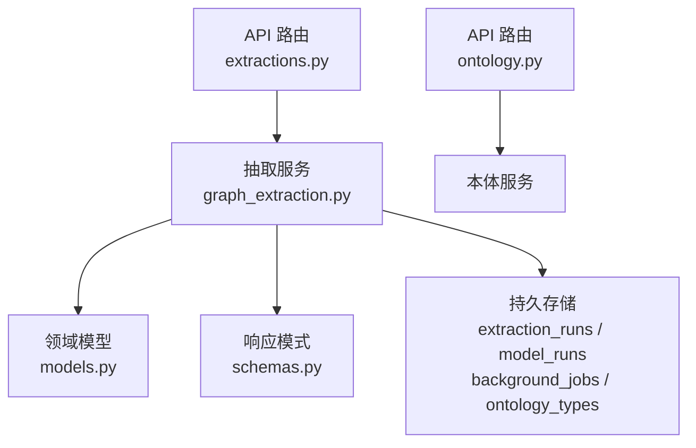
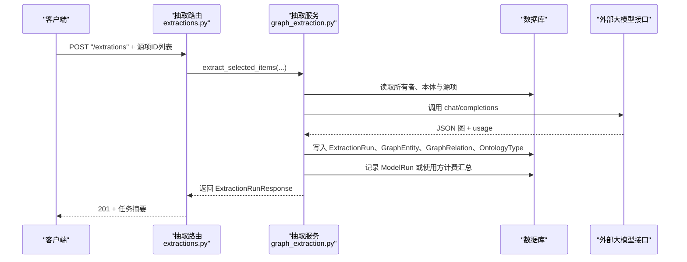
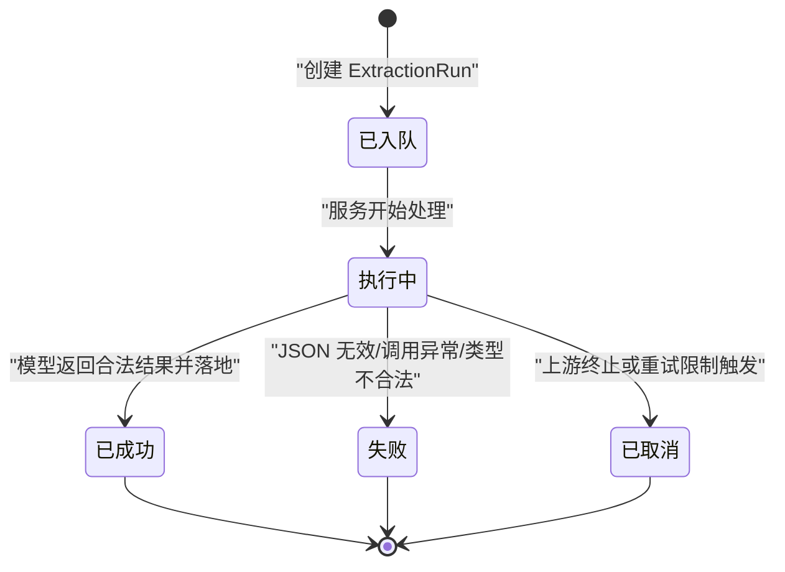
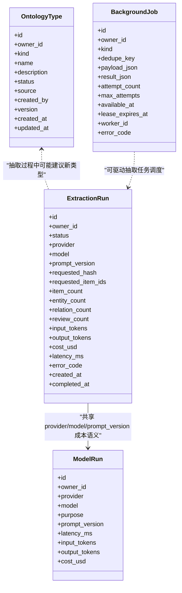
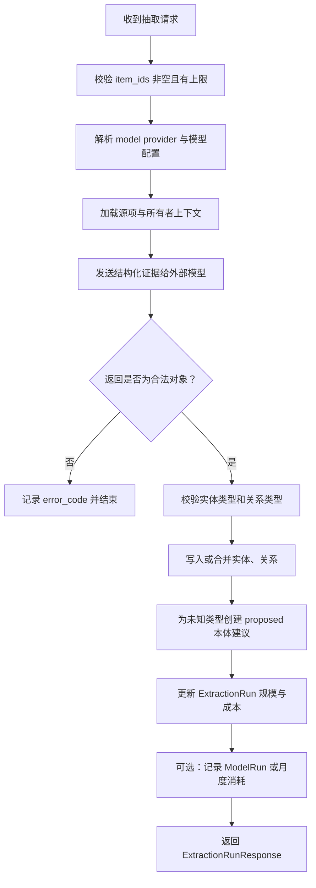
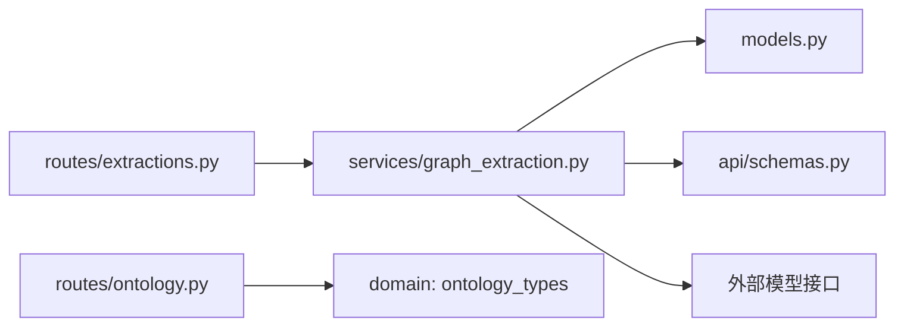

# 本体类型与抽取任务

<cite>
**本文引用的文件**   
- [models.py](file://src/personal_ai_life_os/models.py)
- [schemas.py](file://src/personal_ai_life_os/api/schemas.py)
- [graph_extraction.py](file://src/personal_ai_life_os/services/graph_extraction.py)
- [extractions.py](file://src/personal_ai_life_os/api/routes/extractions.py)
- [ontology.py](file://src/personal_ai_life_os/api/routes/ontology.py)
- [data-model.md](file://docs/architecture/data-model.md)
- [c101bc66b1a3_add_durable_background_jobs.py](file://migrations/versions/c101bc66b1a3_add_durable_background_jobs.py)
- [eb3ff930ec06_track_estimated_model_costs.py](file://migrations/versions/eb3ff930ec06_track_estimated_model_costs.py)
- [958b551e0397_record_model_usage.py](file://migrations/versions/958b551e0397_record_model_usage.py)
- [b8e2c4d6f901_add_graph_qa_threads_and_ontology_versions.py](file://migrations/versions/b8e2c4d6f901_add_graph_qa_threads_and_ontology_versions.py)
- [d2f5a8c14e73_add_evidence_graph_tables.py](file://migrations/versions/d2f5a8c14e73_add_evidence_graph_tables.py)
</cite>

## 目录
1. [引言](#引言)
2. [项目结构定位](#项目结构定位)
3. [核心数据模型](#核心数据模型)
4. [体系架构总览](#体系架构总览)
5. [详细组件分析](#详细组件分析)
6. [依赖关系分析](#依赖关系分析)
7. [性能与成本特性](#性能与成本特性)
8. [监控仪表盘常用查询](#监控仪表盘常用查询)
9. [数据迁移注意事项](#数据迁移注意事项)
10. [API 负载与字段的约定](#api-负载与字段的约定)
11. [故障排查指南](#故障排查指南)
12. [结论](#结论)

## 引言
本文聚焦 Personal-AI-Life-OS 中两个关键数据域：

- **本体类型定义 OntologyType**：用于描述实体类型和关系类型，由“模型自动建议”或“用户人工维护”，并以 `kind`、`name`、`status`、`version` 等字段区分来源、版本和控制状态。
- **抽取任务 ExtractionRun**：记录一次对源数据的 AI 抽取作业，包括所选源项、调用的模型提供方、提示词版本、产出规模、令牌用量、美元成本和延迟。

此外说明它与 BackgroundJob、ModelRun 的协作方式，以及面向监控与迁移的常见实践。文档从数据模型出发，逐步扩展到流水线语义、调度计费及可观测性。

## 项目结构定位
OntologyType 与 ExtractionRun 的核心定义位于领域模型层；抽取流程服务化到 services 层，暴露 REST 接口在 api/route 层；相关数据库变更记录在 migrations 中。



**图表来源**
- [extractions.py](file://src/personal_ai_life_os/api/routes/extractions.py)
- [ontology.py](file://src/personal_ai_life_os/api/routes/ontology.py)
- [graph_extraction.py](file://src/personal_ai_life_os/services/graph_extraction.py)
- [models.py](file://src/personal_ai_life_os/models.py)
- [schemas.py](file://src/personal_ai_life_os/api/schemas.py)

**章节来源**
- [models.py:542-612](file://src/personal_ai_life_os/models.py#L542-L612)
- [graph_extraction.py:1-120](file://src/personal_ai_life_os/services/graph_extraction.py#L1-L120)
- [extractions.py:1-91](file://src/personal_ai_life_os/api/routes/extractions.py#L1-L91)

## 核心数据模型
### 本体类型 OntologyType
OntologyType 表示一个受所有者隔离的本体概念名，核心语义如下：

| 字段 | 类型 | 约束与默认值 | 业务含义 |
|---|---|---|---|
| id | UUID 字符串 | 主键 | 本体类型的内部标识 |
| owner_id | UUID 字符串 | 非空、索引 | 所属用户或租户 |
| kind | 固定长度字符串 | 通常为实体本体或关系本体 | 区分实体类型名称与关系类型名称 |
| name | 最大长度 64 的字符串 | 与 kind、owner_id 唯一约束 | 本体的具体概念名 |
| description | 可选文本 | 可为空 | 自然语言说明，帮助理解该类型 |
| status | 固定长度字符串 | 默认 proposed | 生命周期状态，如 proposed、approved、rejected |
| source | 固定长度字符串 | 默认 model | 来源标记，例如来自模型建议或人工创建 |
| created_by | 固定长度字符串 | 默认 model | 创建主体，区分模型还是用户 |
| version | 整数 | 默认 1 | 增量修订号，支持后续增强命名规范 |
| created_at / updated_at | 时间戳 | UTC 时间 | 审计时间线 |

唯一的业务联合键是 `(owner_id, kind, name)`，防止同一用户在实体维度或关系维度重复定义同一名词。

**章节来源**
- [models.py:542-563](file://src/personal_ai_life_os/models.py#L542-L563)
- [schemas.py:572-601](file://src/personal_ai_life_os/api/schemas.py#L572-L601)
- [ontology.py:34-102](file://src/personal_ai_life_os/api/routes/ontology.py#L34-L102)

### 抽取任务 ExtractionRun
ExtractionRun 是幂等、可追踪的一次图抽取执行记录。关键字段如下：

| 字段 | 类型 | 约束或默认 | 含义与用途 |
|---|---|---|---|
| id | UUID 字符串 | 主键 | 抽取运行唯一标识 |
| owner_id | UUID 字符串 | 非空、索引 | 所属用户级作用域 |
| status | 固定长度字符串 | 默认 queued | 状态：入队、执行中、成功、失败等 |
| provider | 最大长度 120 字符串 | 非空 | 模型提供方名称 |
| model | 最大长度 160 字符串 | 非空 | 调用模型名 |
| prompt_version | 最大长度 40 字符串 | 非空 | 可复现的提示词实验配置标识 |
| requested_hash | 最大长度 64 字符串 | 索引 | 与 requested_item_ids 组合形成的幂等请求键 |
| requested_item_ids | JSON 列表 | 默认空列表 | 本次抽取选中的源项 ID 集合 |
| item_count | 整数 | 默认 0 | 处理源项数量 |
| entity_count | 整数 | 默认 0 | 产出的实体数量 |
| relation_count | 整数 | 默认 0 | 产出的关系数量 |
| review_count | 整数 | 默认 0 | 需要复核的项目数量 |
| input_tokens | 整数 | 默认 0 | 输入令牌数 |
| output_tokens | 整数 | 默认 0 | 输出令牌数 |
| cost_usd | 十进制数值 | 可空 | 估算费用（美元） |
| latency_ms | 整数 | 默认 0 | 模型调用耗时毫秒 |
| error_code | 最大长度 80 字符串 | 可空 | 失败原因编码 |
| created_at / completed_at | UTC 时间戳 | completed_at 可空 | 作业创建时间与完成时间 |

抽取任务本身不包含模型原始请求内容，仅保留控制标识和统计结果，符合可伸缩日志型模型的使用范式。

**章节来源**
- [models.py:564-612](file://src/personal_ai_life_os/models.py#L564-L612)
- [schemas.py:430-451](file://src/personal_ai_life_os/api/schemas.py#L430-L451)

## 体系架构总览
下图展示一次“指定源项抽取”的端到端上下文：请求进入 `/extrations`，服务解析模型提供方，调用外部大模型，写入 ExtractionRun，并在成功时更新图实体、关系和本体建议，同时关联计费表 ModelRun。BackgroundJob 承担更通用的后台任务能力；ExtractionRun 可以看作抽取领域的专用执行记录。



**图表来源**
- [extractions.py:56-91](file://src/personal_ai_life_os/api/routes/extractions.py#L56-L91)
- [graph_extraction.py:1-220](file://src/personal_ai_life_os/services/graph_extraction.py#L1-L220)
- [models.py:542-612](file://src/personal_ai_life_os/models.py#L542-L612)

**章节来源**
- [extractions.py:1-91](file://src/personal_ai_life_os/api/routes/extractions.py#L1-L91)
- [graph_extraction.py:120-220](file://src/personal_ai_life_os/services/graph_extraction.py#L120-L220)

## 详细组件分析

### 本体类型 OntologyType 的生命周期
本体类型支持三类关键路径：

1. **模型建议**：当抽取发现非核心、未被批准的实体类型或关系类型时，服务会创建一个 status 为 proposed、source 为 model 的本体条目，等待人工审批。
2. **人工创建**：用户通过本体 API 直接提交新的实体或关系类型，source 和 created_by 明确标记为 user。
3. **审批决策**：管理员或所有者可把 proposed 改为 approved 或 rejected，只有 approved 类型才会被抽取流程接受为非核心类型。

```mermaid
flowchart TD
    Start["新增类型请求"] --> SourceCheck{"来源是否为用户创建？"}
    SourceCheck -- 是 | UserCreate["创建 user 来源<br/>created_by=user"] --> Proposal["进入待处理"]
    SourceCheck -- 否 | ModelPropose["模型推断新类型"] --> Proposal
    Proposal --> StateDecision{"状态决定？"}
    StateDecision -- 批准 --> Approved["approved<br/>被后续抽取采纳"]
    StateDecision -- 拒绝 --> Rejected["rejected"]
    StateDecision -- 未处理 --> Proposed["proposed<br/>保留历史"]
    Approved --> End["参与图实体和关系类型校验"]
    Rejected --> End
    Proposed --> End
```

**图表来源**
- [graph_extraction.py:260-360](file://src/personal_ai_life_os/services/graph_extraction.py#L260-L360)
- [ontology.py:34-102](file://src/personal_ai_life_os/api/routes/ontology.py#L34-L102)
- [models.py:542-563](file://src/personal_ai_life_os/models.py#L542-L563)

**章节来源**
- [graph_extraction.py:260-450](file://src/personal_ai_life_os/services/graph_extraction.py#L260-L450)
- [ontology.py:34-102](file://src/personal_ai_life_os/api/routes/ontology.py#L34-L102)
- [models.py:542-563](file://src/personal_ai_life_os/models.py#L542-L563)

### 抽取任务 ExtractionRun 的执行语义
ExtractionRun 并不等同于通用 BackgroundJob：它记录的是“一次抽取任务”的业务执行结果，包括模型提供方、提示词版本、产出规模、成本、延迟等指标。其典型状态流转如下：



该状态设计便于：

- 监控失败率与重试行为；
- 根据 prompt_version 对比不同提示词版本的召回效果；
- 结合 ModelRun 做按 provider、model 的成本分摊。

需要注意的是，当前 ExtractionRun 没有显式枚举状态值的数据库枚举约束，因此状态一致性需要由应用代码和业务逻辑保障。

**图表来源**
- [models.py:564-612](file://src/personal_ai_life_os/models.py#L564-L612)
- [graph_extraction.py:1-220](file://src/personal_ai_life_os/services/graph_extraction.py#L1-L220)
- [extractions.py:1-91](file://src/personal_ai_life_os/api/routes/extractions.py#L1-L91)

**章节来源**
- [models.py:564-612](file://src/personal_ai_life_os/models.py#L564-L612)
- [graph_extraction.py:200-450](file://src/personal_ai_life_os/services/graph_extraction.py#L200-L450)
- [extractions.py:1-91](file://src/personal_ai_life_os/api/routes/extractions.py#L1-L91)

### 与 BackgroundJob 和 ModelRun 的协作
#### BackgroundJob
BackgroundJob 是通用的耐久工作项表，强调：

- `dedupe_key` 去重；
- `attempt_count` 与 `max_attempts` 控制重试；
- `available_at` 与 `lease_expires_at` 控制取锁与超时；
- `payload_json` 只包含标识与控制信息，不应含原始正文；
- `worker_id`、`error_code` 辅助分布式 Worker 定位问题。

这与 ExtractionRun 的定位互补：BackgroundJob 负责“要不要重试、能不能执行”，ExtractionRun 负责“一次业务级抽取执行的结果与成本”。

#### ModelRun
ModelRun 是更通用的模型使用轨迹表，记录 provider、model、purpose、prompt_version、latency_ms、input/output tokens、cost_usd 等。抽取服务可基于此聚合月度花费；ExtractionRun 则提供“抽取作业视图”下的成本与规模统计。二者可配合：

- ModelRun 作为系统级模型成本记账表；
- ExtractionRun 作为产品功能级任务报表；
- 监控系统可从两条线分别查看“本月总成本”和“某次抽取是否超预算”。



**图表来源**
- [models.py:542-612](file://src/personal_ai_life_os/models.py#L542-L612)
- [models.py:764-840](file://src/personal_ai_life_os/models.py#L764-L840)

**章节来源**
- [models.py:764-840](file://src/personal_ai_life_os/models.py#L764-L840)
- [graph_extraction.py:220-360](file://src/personal_ai_life_os/services/graph_extraction.py#L220-L360)

### 抽取流水线的关键校验与落库流程


**图表来源**
- [graph_extraction.py:120-450](file://src/personal_ai_life_os/services/graph_extraction.py#L120-L450)
- [extractions.py:1-91](file://src/personal_ai_life_os/api/routes/extractions.py#L1-L91)

**章节来源**
- [graph_extraction.py:200-450](file://src/personal_ai_life_os/services/graph_extraction.py#L200-L450)

## 依赖关系分析
- **routes → services**：对外暴露 REST 接口，但实际逻辑集中在 graph_extraction.py。
- **services → models**：读写 ExtractionRun、OntologyType、ModelRun 及其他图模型。
- **services → schemas**：构建标准化 Response；Request Schema 中对 item_ids 的长度做了约束。
- **entities / relations ↔ ontologies**：抽取器在遇到非核心且未批准的类型时自动创建本体建议；只有 approved 本体才能被当作已知类型使用。
- **external API → services**：通过 httpx 向 OpenAI 兼容接口发送聊天请求，获取 JSON 结果和 usage。



**图表来源**
- [extractions.py:1-91](file://src/personal_ai_life_os/api/routes/extractions.py#L1-L91)
- [ontology.py:1-102](file://src/personal_ai_life_os/api/routes/ontology.py#L1-L102)
- [graph_extraction.py:1-220](file://src/personal_ai_life_os/services/graph_extraction.py#L1-L220)
- [models.py:542-612](file://src/personal_ai_life_os/models.py#L542-L612)
- [schemas.py:430-601](file://src/personal_ai_life_os/api/schemas.py#L430-L601)

**章节来源**
- [graph_extraction.py:120-220](file://src/personal_ai_life_os/services/graph_extraction.py#L120-L220)
- [schemas.py:430-601](file://src/personal_ai_life_os/api/schemas.py#L430-L601)

## 性能与成本特性
- **令牌估算**：服务会根据源项标题和内容的前若干字符估算输入大小，用于前端提示或内部限额策略。
- **延迟测量**：使用单调时间计算外部模型调用耗时，单位毫秒，存入 ExtractionRun.latency_ms。
- **费用估算**：根据 Provider 配置中的每百万令牌输入输出价格计算 cost_usd；若配置缺失则为 None。
- **月度预算**：ExtractionRunResponse 额外附加了当月 ModelRun 累计花费、预算上限和警告标志，适合用于客户端预算提醒。

优化建议：

1. 将高频使用的 PromptVersion 与 Provider 配置缓存，避免频繁解析配置。
2. 对 requested_item_ids 进行归一化排序后再求哈希，保证幂等键与顺序无关。
3. 对大图抽取结果设置输出令牌上限，并结合错误码记录截断场景。
4. 将高频监控指标拆成物化视图：按 provider、model、prompt_version、status 聚合 cost_usd、token、latency。

[本节为一般性性能讨论，不直接分析具体代码片段]

## 监控仪表盘常用查询
以下查询以提取视角列出，实现时应匹配当前 ORM 或 SQL 方言。

| 监控目标 | 推荐查询方向 | 解释 |
|---|---|---|
| 按提供者汇总费用 | GROUP BY provider 对 ExtractionRun.cost_usd 求和 | 观察各模型提供方成本占比 |
| 按模型名跟踪成本 | GROUP BY provider, model | 比较相同提供方下不同模型的开销 |
| 评估提示词版本召回变化 | 按 prompt_version 分组，统计 entity_count 与 review_count | 新版本提升实体量同时降低待审量通常意味着召回改善 |
| 追踪失败重试情况 | 按 error_code 和 status 分组，计数并排序 | 快速识别高频错误 |
| 单次任务耗时分布 | 按 latency_ms 分桶统计 | 发现模型接口抖动或慢查询 |
| 预算风险 | WHERE completed_at 落在当月 且 cost_usd 非空后聚合 | 接近或超过 Monthly Budget 时触发预警 |
| 本体建议积压 | SELECT * FROM ontology_types WHERE status='proposed' | 管理需审核的新类型 |

监控最佳实践：

- 对 ExtractionRun.status 建立索引，支持“按状态分页”和“按失败重试过滤”。
- 对 prompt_version 建立独立筛选条件，避免用模糊查询造成全表扫描。
- 对 requested_hash 做幂等命中分析，识别重复提交导致的超额调用。
- 对 ontology_types.kind 和 status 建立索引，加速本体建议看板。

[本节为通用查询建议，不直接分析具体代码文件]

## 数据迁移注意事项
相关变更已分布在多个 Alembic 版本中，迁移时需要关注以下要点：

| 迁移文件 | 主题 | 迁移注意点 |
|---|---|---|
| c101bc66b1a3_add_durable_background_jobs.py | BackgroundJob 耐久任务表 | 确保 Worker 能处理 dedupe_key、attempt_count、available_at、lease_expires_at 等语义 |
| eb3ff930ec06_track_estimated_model_costs.py | 预估模型成本追踪 | cost_usd 使用高精度数值列，禁止使用浮点存储；Decimal 运算需一致 |
| 958b551e0397_record_model_usage.py | 模型使用记录 | ModelRun.purpose、status 等字段扩展时注意兼容旧记录 |
| b8e2c4d6f901_add_graph_qa_threads_and_ontology_versions.py | 图问答线程与本体版本 | 本体状态与版本演进必须保持向后兼容，避免破坏已有 proposed/approved 数据 |
| d2f5a8c14e73_add_evidence_graph_tables.py | 证据图表 | 实体、关系、审查条目与 ExtractionRun、OntologyType 之间的外键与级联删除语义 |

迁移原则：

1. 新建表时统一使用 UUID 字符串主键，并预留 owner_id 多租户作用域。
2. 新增状态或枚举类型时，先允许现有空值或默认值，再在上游代码中收紧校验。
3. cost_usd、budget_usd 类字段一律使用高精度十进制或对应数据库金额列，不得用浮点数做财务计算。
4. 对新增查询热点字段添加索引，但不要把高频变化的 JSON 主列加为全值索引。
5. 如果变更 ExtractionRun.requested_hash 或 BaseModelRun.prompt_version 的宽度，应同步检查幂等逻辑和索引占用。

**章节来源**
- [c101bc66b1a3_add_durable_background_jobs.py](file://migrations/versions/c101bc66b1a3_add_durable_background_jobs.py)
- [eb3ff930ec06_track_estimated_model_costs.py](file://migrations/versions/eb3ff930ec06_track_estimated_model_costs.py)
- [958b551e0397_record_model_usage.py](file://migrations/versions/958b551e0397_record_model_usage.py)
- [b8e2c4d6f901_add_graph_qa_threads_and_ontology_versions.py](file://migrations/versions/b8e2c4d6f901_add_graph_qa_threads_and_ontology_versions.py)
- [d2f5a8c14e73_add_evidence_graph_tables.py](file://migrations/versions/d2f5a8c14e73_add_evidence_graph_tables.py)

## API 负载与字段的约定
### 创建抽取任务
**请求体 ExtractionRequest**

| 字段 | 类型 | 必填 | 约束 |
|---|---|---:|---|
| item_ids | 字符串数组 | 是 | 至少 1 项、最多 50 项 |
| provider | 字符串 | 否 | 为空时回退到默认模型配置；不为空时必须已配置 |

**响应体 ExtractionRunResponse 主要字段**

| 字段 | 类型 | 含义 |
|---|---|---|
| id | 字符串 | 任务 ID |
| status | 字符串 | 执行状态 |
| provider | 字符串 | 提供方名 |
| model | 字符串 | 模型名 |
| prompt_version | 字符串 | 提示词版本 |
| item_count | 整数 | 处理项数 |
| entity_count | 整数 | 实体数量 |
| relation_count | 整数 | 关系数量 |
| review_count | 整数 | 待审查项数 |
| input_tokens | 整数 | 输入令牌 |
| output_tokens | 整数 | 输出令牌 |
| cost_usd | 十进制或空 | 成本，可能为空 |
| latency_ms | 整数 | 调用延迟毫秒 |
| error_code | 字符串或空 | 失败码 |
| budget_used_usd | 十进制 | 当月累计成本 |
| budget_limit_usd | 十进制 | 月度预算上限 |
| budget_warning | 布尔 | 是否达到预算警戒阈值 |
| created_at | 时间 | 创建时间 |
| completed_at | 时间或空 | 完成时间 |

### 查询本体类型
**查询参数**

| 参数 | 类型 | 可选 | 说明 |
|---|---|---:|---|
| kind | 字符串 | 是 | 可按 entity 或 relation 过滤 |
| status | 字符串 | 是 | 可按 proposed、approved、rejected 等过滤 |

**创建本体类型 OntologyTypeCreateRequest**

| 字段 | 类型 | 必填 | 约束 |
|---|---|---:|---|
| kind | 字符串 | 是 | 只允许实体或关系 |
| name | 字符串 | 是 | 长度 2～64 |
| description | 字符串 | 否 | 最大长度可受服务校验约束 |

**更改状态 OntologyTypeStatusRequest**

| 字段 | 类型 | 必填 | 约束 |
|---|---|---:|---|
| status | 字符串 | 是 | 只允许 approved 或 rejected |

**章节来源**
- [schemas.py:430-451](file://src/personal_ai_life_os/api/schemas.py#L430-L451)
- [schemas.py:572-601](file://src/personal_ai_life_os/api/schemas.py#L572-L601)
- [extractions.py:35-91](file://src/personal_ai_life_os/api/routes/extractions.py#L35-L91)
- [ontology.py:34-102](file://src/personal_ai_life_os/api/routes/ontology.py#L34-L102)

## 故障排查指南

### 常见问题与处理思路
- **模型提供方不可用或配置不完整**  
  当请求的 provider 未配置，或缺少 base_url、api_key、model 等字段时，服务会抛出明确的错误码。检查环境变量中的模型提供方配置是否正确。
- **外部模型返回非 JSON 对象**  
  抽取服务要求外部模型返回 JSON 对象。如果返回类型非法，应将 error_code 记录为无效响应类型，避免脏数据进入图。
- **本地预算告警**  
  ExtractionRunResponse 内置 budget_warning；即使单次任务成功，也应在前端显示当月累计花费接近预算上限。
- **状态不一致或死任务**  
  检查 ExtractionRun.completed_at 是否为空、error_code 是否长期存在；结合 BackgroundJob.attempt_count 判断是否存在重试风暴。
- **重复提交**  
  如果 requested_hash 生成不稳定（例如 list 顺序未归一化），会造成重复计费或重复抽取；应保证幂等 key 与集合内容等价。
- **本体建议堆积**  
  大量 proposed 本体说明新模型输出引入了很多新型名词；需要在 UI 上集中批处理 approve/reject，否则会影响后续抽取稳定性。

**章节来源**
- [graph_extraction.py:120-220](file://src/personal_ai_life_os/services/graph_extraction.py#L120-L220)
- [extractions.py:56-91](file://src/personal_ai_life_os/api/routes/extractions.py#L56-L91)
- [schemas.py:430-451](file://src/personal_ai_life_os/api/schemas.py#L430-L451)

## 结论
OntologyType 提供本体名称的来源、版本与审批通道，使 AI 抽取既能探索新概念，又能回到人类控制的命名治理。ExtractionRun 以清晰的业务语义记录每次抽取作业的范围、模型、规模和成本，并与 BackgroundJob 的调度能力、ModelRun 的记账能力形成互补。

在实际使用中，应重点把握三点：

1. 用 prompt_version 和 requested_hash 支撑可复现实验与幂等执行。
2. 用 Entity/Rapion 校验 + OntologyType 审批闭环保护图结构的稳定性。
3. 用 provider、model、status、error_code、prompt_version 构建稳定的监控与审计面板，同时以 Monthly Budget 控制整体模型支出。