# 证据图数据模型

<cite>
**本文引用的文件 **
- [models.py](file://src/personal_ai_life_os/models.py)
- [graph_extraction.py](file://src/personal_ai_life_os/services/graph_extraction.py)
- [graph_review.py](file://src/personal_ai_life_os/api/routes/graph_review.py)
- [schemas.py](file://src/personal_ai_life_os/api/schemas.py)
- [d2f5a8c14e73_add_evidence_graph_tables.py](file://migrations/versions/d2f5a8c14e73_add_evidence_graph_tables.py)
- [b8e2c4d6f901_add_graph_qa_threads_and_ontology_versions.py](file://migrations/versions/b8e2c4d6f901_add_graph_qa_threads_and_ontology_versions.py)
</cite>

## 目录
1. [引言](#引言)
2. [项目结构定位](#项目结构定位)
3. [核心图谱实体与关系](#核心图谱实体与关系)
4. [架构总览](#架构总览)
5. [详细组件分析](#详细组件分析)
6. [抽取流程与持久化策略](#抽取流程与持久化策略)
7. [依赖分析与索引结构](#依赖分析与索引结构)
8. [性能与查询优化建议](#性能与查询优化建议)
9. [故障排查指南](#故障排查指南)
10. [结论](#结论)
11. [附录：字段与状态说明](#附录字段与状态说明)

## 引言
本数据模型围绕“证据图”概念构建，用于从用户已选定的来源内容中抽取可信的实体、关系及其引用证据，并通过本体定义、抽取任务追踪和人工审查机制控制图谱质量。文档聚焦以下主题：
- `GraphEntity`、`GraphRelation`、`GraphEvidence` 的核心结构与关联。
- 实体抽取流程中的置信度评分、状态管理和合并策略。
- `EntityAlias` 别名机制如何支持重名实体聚合。
- `EntityMergeLog` 如何记录可撤销的合并操作。
- `OntologyType` 的本体元数据结构。
- `ExtractionRun` 抽取任务的可观测性与成本统计。
- `GraphReviewItem` 低置信度结果的审查工作流。
- 图谱查询优化建议及索引策略，包括自引用外键的处理方式。

## 项目结构定位
证据图相关的数据建模集中在应用主模型文件中，并由 Alembic 迁移脚本创建底层表结构；业务逻辑分布在图谱抽取服务和图谱审查路由中。API 层通过 Pydantic 模型对响应进行标准化。

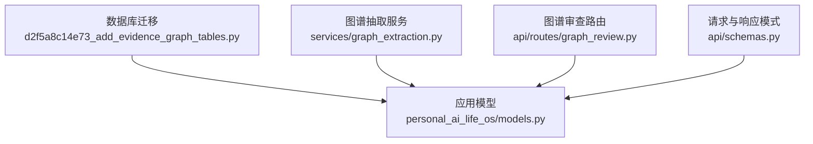

**图表来源**
- [d2f5a8c14e73_add_evidence_graph_tables.py:1-200](file://migrations/versions/d2f5a8c14e73_add_evidence_graph_tables.py#L1-L200)
- [models.py:201-522](file://src/personal_ai_life_os/models.py#L201-L522)
- [graph_extraction.py:201-600](file://src/personal_ai_life_os/services/graph_extraction.py#L201-L600)
- [graph_review.py:1-129](file://src/personal_ai_life_os/api/routes/graph_review.py#L1-L129)
- [schemas.py:430-500](file://src/personal_ai_life_os/api/schemas.py#L430-L500)

**章节来源**
- [d2f5a8c14e73_add_evidence_graph_tables.py:1-200](file://migrations/versions/d2f5a8c14e73_add_evidence_graph_tables.py#L1-L200)
- [models.py:201-522](file://src/personal_ai_life_os/models.py#L201-L522)

## 核心图谱实体与关系
三大核心图谱实体构成证据图的基本骨架：
- `GraphEntity`：表示一个被识别出的概念对象，如项目、人、事件、决策等。它包含类型、名称、归一化名称、摘要、置信度、状态、来源标识和时间戳。
- `GraphRelation`：连接两个实体的有向关系，包含关系类型、双向实体外键、置信度、有效性时间窗口、状态和时间戳。
- `GraphEvidence`：绑定到具体实体或关系的证据，保存来源连接、来源项、引用文本、定位信息、可用性和置信度。

此外，系统还维护以下重要辅助实体：
- `EntityAlias`：允许同一个实体存在多个别名，并通过归一化别名实现重名匹配。
- `EntityMergeLog`：记录实体合并的来源目标、快照和撤销标记。
- `OntologyType`：定义实体类型和关系类型的元数据，支持版本和控制台批准状态。
- `ExtractionRun`：记录一次抽取任务的输入哈希、成本、耗时和产出统计。
- `GraphReviewItem`：承载需要人工审查的低置信度实体、关系、合并或本体提议。

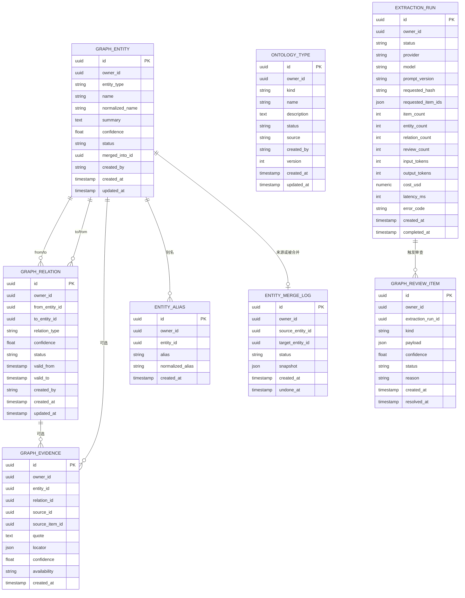

**图表来源**
- [models.py:428-647](file://src/personal_ai_life_os/models.py#L428-L647)
- [models.py:523-830](file://src/personal_ai_life_os/models.py#L523-L830)
- [d2f5a8c14e73_add_evidence_graph_tables.py:1-200](file://migrations/versions/d2f5a8c14e73_add_evidence_graph_tables.py#L1-L200)

**章节来源**
- [models.py:428-647](file://src/personal_ai_life_os/models.py#L428-L647)
- [models.py:523-830](file://src/personal_ai_life_os/models.py#L523-L830)
- [d2f5a8c14e73_add_evidence_graph_tables.py:1-200](file://migrations/versions/d2f5a8c14e73_add_evidence_graph_tables.py#L1-L200)

## 架构总览
证据图架构由四层组成：
1. **模型层**：使用 SQLAlchemy ORM 描述图谱实体、关系、证据、别名、合并日志、本体和抽取任务。
2. **服务层**：解析外部模型返回的结构化 JSON，校验类型与置信度，合并同名实体，写入实体、关系、证据和审查任务。
3. **接口层**：提供审查队列、批量处理和单项决策 API，限制查询范围并封装领域错误。
4. **持久化层**：由 Alembic 迁移维护表结构、约束、索引和外键行为。

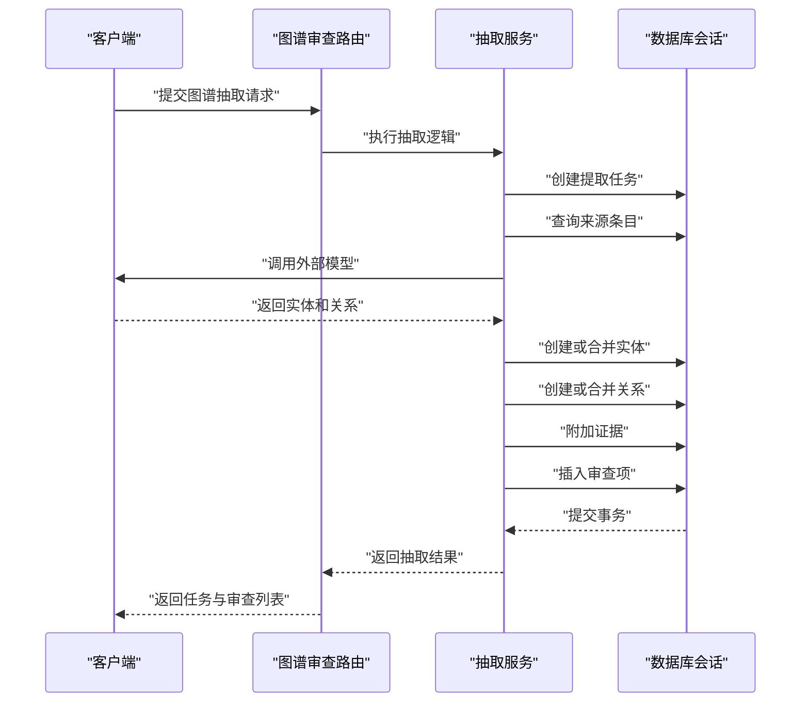

**图表来源**
- [graph_extraction.py:201-600](file://src/personal_ai_life_os/services/graph_extraction.py#L201-L600)
- [graph_review.py:1-129](file://src/personal_ai_life_os/api/routes/graph_review.py#L1-L129)

**章节来源**
- [graph_extraction.py:201-600](file://src/personal_ai_life_os/services/graph_extraction.py#L201-L600)
- [graph_review.py:1-129](file://src/personal_ai_life_os/api/routes/graph_review.py#L1-L129)

## 详细组件分析

### `GraphEntity`：图谱实体
`GraphEntity` 是图谱的核心顶点。关键字段包括：
- `owner_id`：租户隔离边界。
- `entity_type`：受核心集合和本体表共同约束的类型标签。
- `name` 与 `normalized_name`：原始名称与用于去重的归一化名称。
- `summary`：可选的语义摘要。
- `confidence`：默认 `1.0`，在抽取时可被外部模型值修正。
- `status`：默认 `active`，低置信度时可为 `pending_review`。
- `merged_into_id`：自引用外键，指向合并后的实体，删除源实体时设为空。
- `created_by`：默认 `model`，表明模型生成来源。

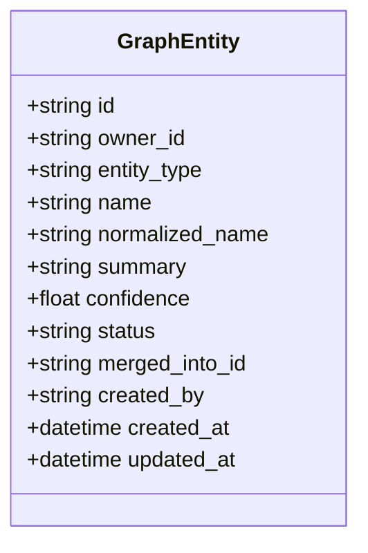

**图表来源**
- [models.py:428-480](file://src/personal_ai_life_os/models.py#L428-L480)
- [d2f5a8c14e73_add_evidence_graph_tables.py:12-46](file://migrations/versions/d2f5a8c14e73_add_evidence_graph_tables.py#L12-L46)

**章节来源**
- [models.py:428-480](file://src/personal_ai_life_os/models.py#L428-L480)
- [d2f5a8c14e73_add_evidence_graph_tables.py:12-46](file://migrations/versions/d2f5a8c14e73_add_evidence_graph_tables.py#L12-L46)

### `GraphRelation`：有向关系
`GraphRelation` 表示 `from_entity_id` 到 `to_entity_id` 的有向关系，支持有效时间区间和置信度衰减。它与 `GraphEntity` 建立两条强外键关系；当两端任一实体被删除时，关系级联删除。

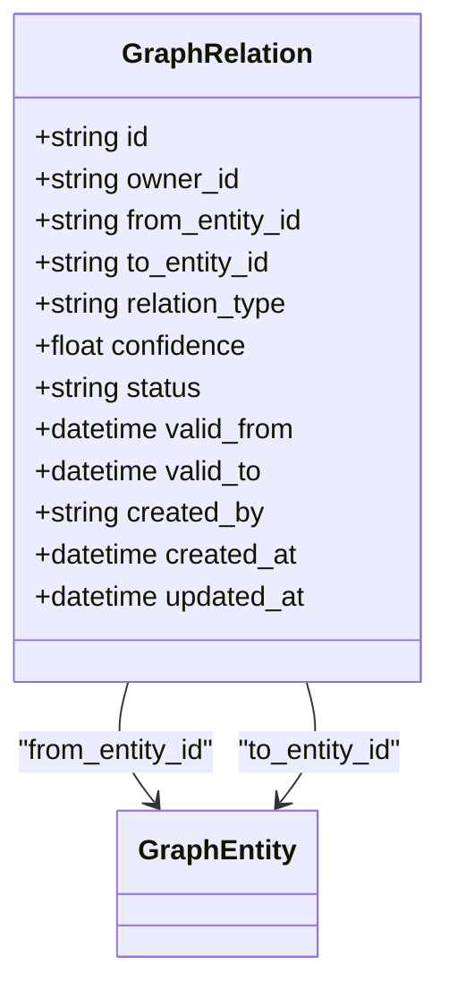

**图表来源**
- [models.py:482-522](file://src/personal_ai_life_os/models.py#L482-L522)
- [d2f5a8c14e73_add_evidence_graph_tables.py:48-88](file://migrations/versions/d2f5a8c14e73_add_evidence_graph_tables.py#L48-L88)

**章节来源**
- [models.py:482-522](file://src/personal_ai_life_os/models.py#L482-L522)
- [d2f5a8c14e73_add_evidence_graph_tables.py:48-88](file://migrations/versions/d2f5a8c14e73_add_evidence_graph_tables.py#L48-L88)

### `GraphEvidence`：证据引用
`GraphEvidence` 是实体或关系的证据锚点，强制至少关联其中一类目标：
- `ck_graph_evidence_target` 检查约束保证 `entity_id` 或 `relation_id` 非空。
- 同时绑定来源连接和来源项，便于追溯原文位置。
- `locator` 以结构化方式存储来源定位信息。
- `availability` 默认 `active`，支持按可用性过滤待验证或不可用证据。

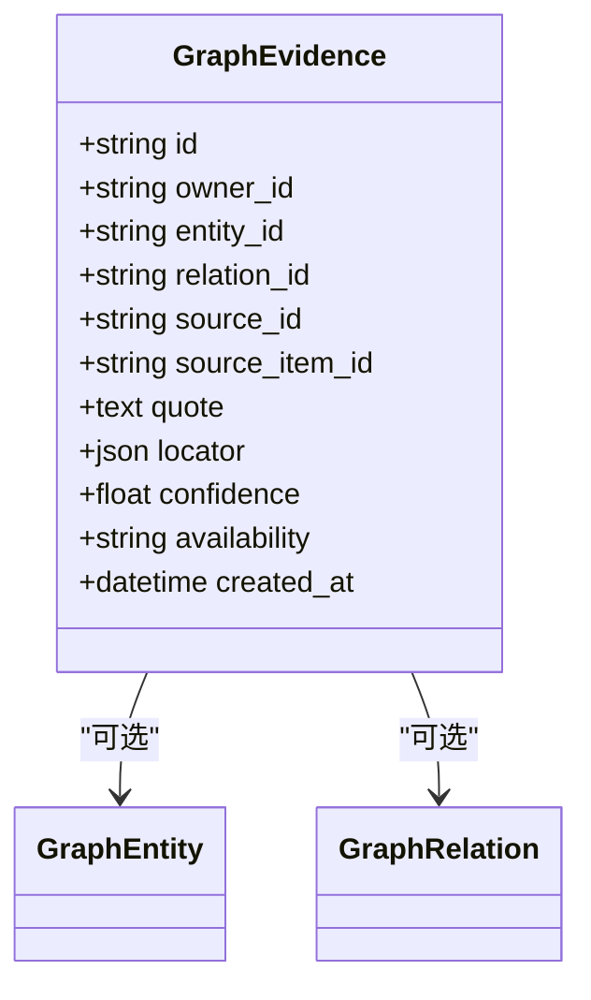

**图表来源**
- [models.py:524-562](file://src/personal_ai_life_os/models.py#L524-L562)
- [d2f5a8c14e73_add_evidence_graph_tables.py:90-141](file://migrations/versions/d2f5a8c14e73_add_evidence_graph_tables.py#L90-L141)

**章节来源**
- [models.py:524-562](file://src/personal_ai_life_os/models.py#L524-L562)
- [d2f5a8c14e73_add_evidence_graph_tables.py:90-141](file://migrations/versions/d2f5a8c14e73_add_evidence_graph_tables.py#L90-L141)

### `EntityAlias`：别名与重名处理
`EntityAlias` 将多个显示名称映射到同一实体。其设计要点如下：
- 每个别名包含 `alias` 和 `normalized_alias`，便于不区分大小写和空白差异的搜索。
- 抽取过程中发现同实体不同拼写时，自动追加归一化别名。
- 如果通过别名首次匹配到高置信度活跃实体，则复用该实体而非新建实体。

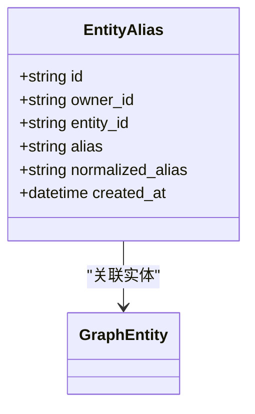

**图表来源**
- [models.py:564-591](file://src/personal_ai_life_os/models.py#L564-L591)
- [d2f5a8c14e73_add_evidence_graph_tables.py:143-164](file://migrations/versions/d2f5a8c14e73_add_evidence_graph_tables.py#L143-L164)
- [graph_extraction.py:280-380](file://src/personal_ai_life_os/services/graph_extraction.py#L280-L380)

**章节来源**
- [models.py:564-591](file://src/personal_ai_life_os/models.py#L564-L591)
- [d2f5a8c14e73_add_evidence_graph_tables.py:143-164](file://migrations/versions/d2f5a8c14e73_add_evidence_graph_tables.py#L143-L164)
- [graph_extraction.py:280-380](file://src/personal_ai_life_os/services/graph_extraction.py#L280-L380)

### `EntityMergeLog`：可撤销合并日志
`EntityMergeLog` 主要用于审计和潜在回滚：
- `source_entity_id` 和 `target_entity_id` 均为自引用外键，且可空。
- `snapshot` 保存原始数据快照，可用于恢复。
- `undone_at` 标记撤销时间。
- 该结构本身不直接触发反向更新；撤销实现应由业务逻辑结合快照重建。

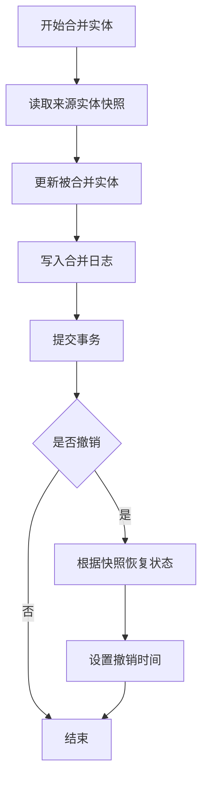

**图表来源**
- [models.py:523-563](file://src/personal_ai_life_os/models.py#L523-L563)
- [d2f5a8c14e73_add_evidence_graph_tables.py:166-200](file://migrations/versions/d2f5a8c14e73_add_evidence_graph_tables.py#L166-L200)

**章节来源**
- [models.py:523-563](file://src/personal_ai_life_os/models.py#L523-L563)
- [d2f5a8c14e73_add_evidence_graph_tables.py:166-200](file://migrations/versions/d2f5a8c14e73_add_evidence_graph_tables.py#L166-L200)

### `OntologyType`：本体定义
`OntologyType` 管理用户或模型定义的实体类型和关系类型：
- `kind` 限定为 `entity` 或 `relation`。
- `(owner_id, kind, name)` 具有唯一性约束，防止重复定义。
- `status` 支持 `proposed`、`approved` 等状态。
- `source` 记录来源（如模型或用户），`created_by` 记录创建主体。
- `version` 在后续迁移中添加，用于类型演进。

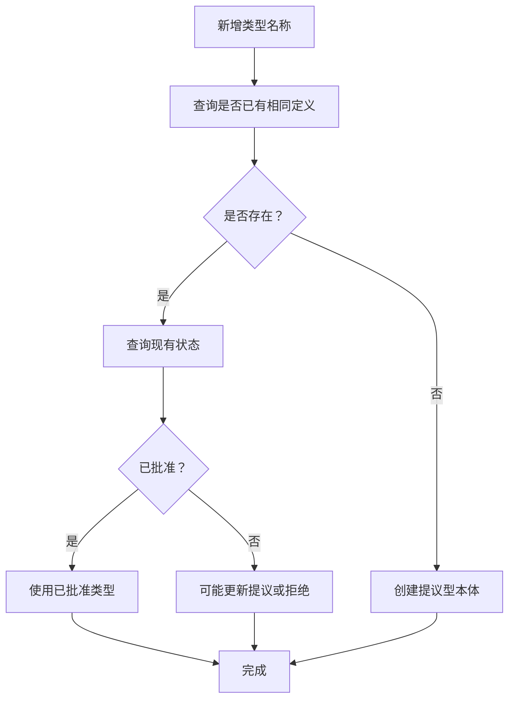

**图表来源**
- [models.py:542-563](file://src/personal_ai_life_os/models.py#L542-L563)
- [d2f5a8c14e73_add_evidence_graph_tables.py:188-200](file://migrations/versions/d2f5a8c14e73_add_evidence_graph_tables.py#L188-L200)
- [b8e2c4d6f901_add_graph_qa_threads_and_ontology_versions.py:1-76](file://migrations/versions/b8e2c4d6f901_add_graph_qa_threads_and_ontology_versions.py#L1-L76)
- [graph_extraction.py:230-279](file://src/personal_ai_life_os/services/graph_extraction.py#L230-L279)

**章节来源**
- [models.py:542-563](file://src/personal_ai_life_os/models.py#L542-L563)
- [d2f5a8c14e73_add_evidence_graph_tables.py:188-200](file://migrations/versions/d2f5a8c14e73_add_evidence_graph_tables.py#L188-L200)
- [b8e2c4d6f901_add_graph_qa_threads_and_ontology_versions.py:1-76](file://migrations/versions/b8e2c4d6f901_add_graph_qa_threads_and_ontology_versions.py#L1-L76)
- [graph_extraction.py:230-279](file://src/personal_ai_life_os/services/graph_extraction.py#L230-L279)

### `ExtractionRun`：抽取任务追踪
`ExtractionRun` 是一次抽取操作的完整审计记录：
- `requested_hash` 用于幂等和增量判断。
- `requested_item_ids` 记录参与抽取的源条目。
- `item_count`、`entity_count`、`relation_count`、`review_count` 输出基本统计。
- `input_tokens`、`output_tokens`、`cost_usd` 记录模型用量与费用。
- `latency_ms` 与 `error_code` 记录延迟与失败原因。
- `completed_at` 标志任务生命周期结束。

**章节来源**
- [models.py:564-592](file://src/personal_ai_life_os/models.py#L564-L592)
- [d2f5a8c14e73_add_evidence_graph_tables.py:200-275](file://migrations/versions/d2f5a8c14e73_add_evidence_graph_tables.py#L200-L275)
- [schemas.py:430-500](file://src/personal_ai_life_os/api/schemas.py#L430-L500)

### `GraphReviewItem`：低置信度审查工作流
`GraphReviewItem` 用于接收需要人工决策的结果：
- `kind` 支持实体、关系、合并或本体四类审查。
- `payload` 以 JSON 存储上下文，例如实体 ID、名称和类型。
- `confidence` 与 `reason` 帮助审核者快速定位问题。
- 路由层暴露查看队列、批量处理、编辑和决策接口。

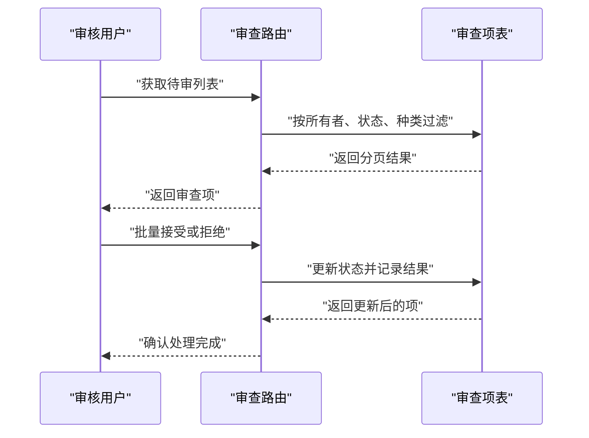

**图表来源**
- [graph_review.py:1-129](file://src/personal_ai_life_os/api/routes/graph_review.py#L1-L129)
- [models.py:593-613](file://src/personal_ai_life_os/models.py#L593-L613)
- [d2f5a8c14e73_add_evidence_graph_tables.py:201-244](file://migrations/versions/d2f5a8c14e73_add_evidence_graph_tables.py#L201-L244)

**章节来源**
- [graph_review.py:1-129](file://src/personal_ai_life_os/api/routes/graph_review.py#L1-L129)
- [models.py:593-613](file://src/personal_ai_life_os/models.py#L593-L613)
- [d2f5a8c14e73_add_evidence_graph_tables.py:201-244](file://migrations/versions/d2f5a8c14e73_add_evidence_graph_tables.py#L201-L244)

## 抽取流程与持久化策略
抽取服务对外部模型的返回值进行严格校验，并根据置信度和证据情况决定实体和关系的状态：

1. 调用外部模型后得到 JSON 文档。
2. 校验 `entities` 与 `relations` 是否为数组。
3. 对每条实体记录：
   - 校验类型是否在核心集合或已批准本体中；否则降权并添加本体提议。
   - 规范化名称并查找现有实体。
   - 若找到同命名实体，合并摘要并将置信度取最大值；如名称差异明显，写入 `EntityAlias`。
   - 若未命中别名，尝试通过 `normalized_alias` 合并。
   - 若无实体则新建 `GraphEntity`。
   - 依据阈值设置 `active` 或 `pending_review`。
   - 将引用证据写入 `GraphEvidence`。
   - 低于阈值或缺少证据时插入低置信度审查项。
4. 对每条关系记录执行类似合并逻辑。
5. 统计实体、关系和审查数量，并在异常时抛出领域错误。

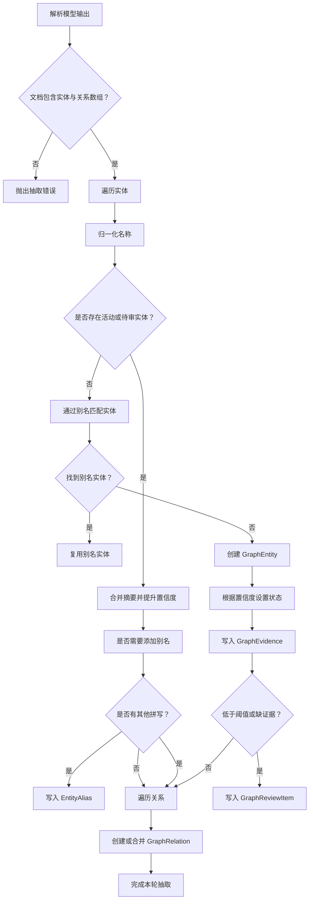

**图表来源**
- [graph_extraction.py:230-600](file://src/personal_ai_life_os/services/graph_extraction.py#L230-L600)

**章节来源**
- [graph_extraction.py:230-600](file://src/personal_ai_life_os/services/graph_extraction.py#L230-L600)

## 依赖分析与索引结构

### 外键与级联关系
证据图的外键遵循以下原则：
- 所有核心图谱表均包含 `owner_id`，并与用户表建立级联删除，保证租户隔离和级联清理。
- `GraphRelation.from_entity_id` 与 `to_entity_id` 对 `GraphEntity` 使用级联删除，避免悬挂边。
- `GraphEvidence.entity_id` 与 `relation_id` 对目标对象使用级联删除。
- `GraphEvidence.source_id` 与 `source_item_id` 分别关联来源连接和来源项。
- `EntityAlias.entity_id` 对实体使用级联删除。
- `EntityMergeLog` 的两个实体外键可空，并使用 `SET NULL` 保持日志可查。

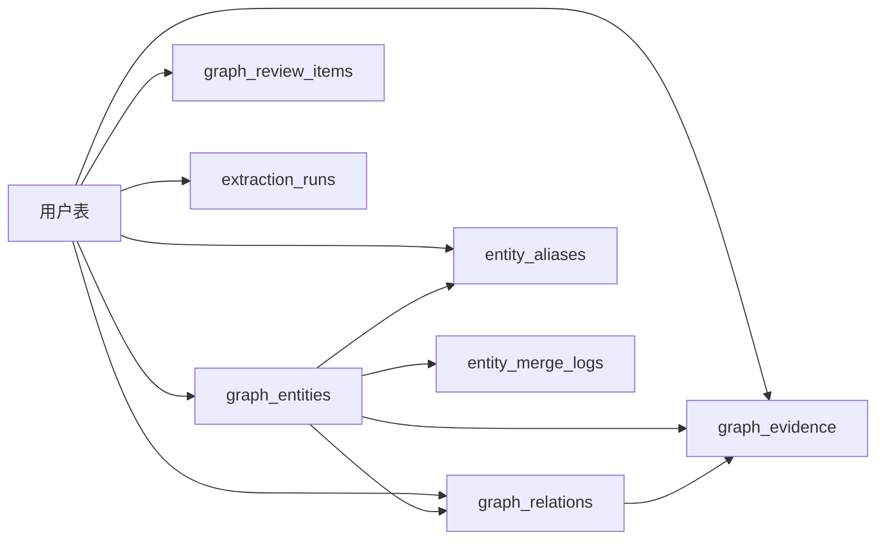

**图表来源**
- [models.py:428-613](file://src/personal_ai_life_os/models.py#L428-L613)
- [d2f5a8c14e73_add_evidence_graph_tables.py:12-200](file://migrations/versions/d2f5a8c14e73_add_evidence_graph_tables.py#L12-L200)

**章节来源**
- [models.py:428-613](file://src/personal_ai_life_os/models.py#L428-L613)
- [d2f5a8c14e73_add_evidence_graph_tables.py:12-200](file://migrations/versions/d2f5a8c14e73_add_evidence_graph_tables.py#L12-L200)

### 索引与查询热点
当前模型提供了大量单列和复合索引，覆盖常见的过滤场景：
- 实体层：`owner_id`、`entity_type`、`normalized_name`、`status` 以及 `(owner_id, entity_type)`、`(owner_id, normalized_name)`。
- 关系层：`owner_id`、`relation_type`、`status`、`from_entity_id`、`to_entity_id` 以及 `(owner_id, relation_type)`。
- 证据层：`owner_id`、`availability`、`(owner_id, source_id)`、`(owner_id, availability)`。
- 别名层：`owner_id`、`entity_id`、`normalized_alias`、`(owner_id, normalized_alias)`。
- 合并日志：`owner_id`、`(owner_id, created_at)`。
- 本体层：`owner_id`、`status`、`(owner_id, status)`，以及 `(owner_id, kind, name)` 唯一约束。
- 抽取任务：`owner_id`、`status`、`requested_hash`、`(owner_id, created_at)`。
- 审查项：`owner_id`、`status`、`(owner_id, status)`、`(owner_id, created_at)`。

这些索引适合以下典型查询：
- 按所有者筛选实体类型或名称。
- 按关系类型枚举关系。
- 按来源连接筛选可验证证据。
- 按别名归一化形式检索实体。
- 按抽取任务状态和创建时间查询运行历史。

## 性能与查询优化建议

### 当前索引合理性评估
现有索引已经覆盖了所有权隔离、状态过滤、类型过滤、名称检索和时间排序等常见场景。对于图谱图查询而言，最大的开销通常来自基于 `from_entity_id` 或 `to_entity_id` 的邻接图遍历；当前已在关系表和证据表建立相应索引，可显著降低邻居扫描成本。

### 推荐增强索引
- 为 `graph_entities.status` 与 `graph_entities.confidence` 的组合条件创建复合索引，加速低置信度实体查询。
- 为 `graph_evidence.quote` 启用全文搜索索引，如果需要对证据文本精确或模糊匹配。
- 为 `ontology_types.status` 与 `ontology_types.kind` 创建组合索引，提高本体审批查询性能。
- 如果经常按 `extraction_runs.completed_at` 或 `extraction_runs.error_code` 做报表分析，可考虑补充时序或分类索引。

### 自引用外键处理策略
`graph_entities.merged_into_id` 是自引用外键，且采用 `SET NULL` 语义。这意味着：
- 当目标实体被删除时，源实体的合并指针不会级联删除，而是置空。
- 合并方向应单向可读：下游查询应避免沿多个合并路径递归，除非明确实现有界深度回溯。
- 建议在应用层维护“最终实体”视图，避免深层图遍历造成锁竞争。

### 并发与安全建议
- 实体和关系合并时应持有行级锁定或会话一致性保障，防止竞态条件下多次合并。
- 审查状态的批量更新应在单个事务内完成，并结合业务逻辑校验状态机合法性。
- 成本字段使用 `Numeric` 类型，有利于财务精度；统计查询应聚合前先过滤所属所有者和月份。

[本节为通用优化建议，不直接分析具体代码行]

## 故障排查指南
- 抽取输出为空或缺少数组：
  - 检查外部模型返回是否满足期望结构。
  - 确认 `entities` 与 `relations` 是否为数组类型。
- 低置信度或无证据：
  - 检查模型返回的 `confidence` 是否在 `[0, 1]` 范围内。
  - 检查证据中是否包含合法的 `item_id` 和有效 `quote`。
  - 低于阈值的实体将进入 `pending_review` 状态并生成审查项。
- 审查项无法处理：
  - 核对所有者是否匹配当前登录用户。
  - 检查审查项状态是否允许目标操作。
  - 观察路由层抛出的领域错误码与消息。
- 类型未被采纳：
  - 如果实体或关系类型不在核心集合中，会创建 `proposed` 状态的本体项。
  - 需要管理员或上层流程将其变更为 `approved`。

**章节来源**
- [graph_extraction.py:201-600](file://src/personal_ai_life_os/services/graph_extraction.py#L201-L600)
- [graph_review.py:1-129](file://src/personal_ai_life_os/api/routes/graph_review.py#L1-L129)

## 结论
证据图数据模型通过 `GraphEntity`、`GraphRelation`、`GraphEvidence` 构建可追溯的知识结构，并以 `EntityAlias`、`EntityMergeLog`、`OntologyType`、`ExtractionRun` 和 `GraphReviewItem` 提供名称消歧、合并审计、本体治理、任务追踪和质量门控能力。迁移脚本定义了完整的表结构和索引，抽取服务实现了从外部模型到数据库的可靠持久化链路。未来可按图查询高频路径、证据文本搜索和本体审批流程进一步增强索引设计与界面体验。

[本节总结整体发现，不直接分析具体代码行]

## 附录：字段与状态说明

### 主要字段分类
- **公共归属与时序**：`owner_id`、`created_at`、`updated_at`。
- **图谱顶点属性**：`entity_type`、`name`、`normalized_name`、`summary`、`confidence`、`status`、`merged_into_id`、`created_by`。
- **关系属性**：`relation_type`、`valid_from`、`valid_to`、`from_entity_id`、`to_entity_id`。
- **证据属性**：`source_id`、`source_item_id`、`quote`、`locator`、`availability`。
- **任务属性**：`provider`、`model`、`prompt_version`、`requested_hash`、`requested_item_ids`、`item_count`、`entity_count`、`relation_count`、`review_count`、`input_tokens`、`output_tokens`、`cost_usd`、`latency_ms`、`error_code`、`completed_at`。
- **审查属性**：`kind`、`payload`、`confidence`、`status`、`reason`、`resolved_at`。

### 关键状态空间
- 实体与关系：`active`、`pending_review`。
- 证据可用性：`active`。
- 本体类型：`proposed`、`approved` 等扩展状态。
- 抽取任务：`queued` 等任务状态。
- 审查项：`pending`、`accepted`、`rejected` 等人工决策状态。

### 风险与注意事项
- 证据表使用 `JSON` 存储定位信息，查询灵活但难以统一 schema 校验；建议应用层对 locator 结构保持一致。
- 置信度字段默认值为 `1.0`，但抽取逻辑会将无效置信度截断为固定值；上游模型输入应尽可能准确。
- 合并日志只记录数据快照，不包含反向操作实现；撤销逻辑需在应用层补充。
- 本体类型为字符串长度上限较小，长实体或关系名称会被截断并放入释义或别名中，需保证 UI 展示一致。

**章节来源**
- [models.py:428-613](file://src/personal_ai_life_os/models.py#L428-L613)
- [d2f5a8c14e73_add_evidence_graph_tables.py:12-244](file://migrations/versions/d2f5a8c14e73_add_evidence_graph_tables.py#L12-L244)
- [graph_extraction.py:230-600](file://src/personal_ai_life_os/services/graph_extraction.py#L230-L600)
- [graph_review.py:1-129](file://src/personal_ai_life_os/api/routes/graph_review.py#L1-L129)