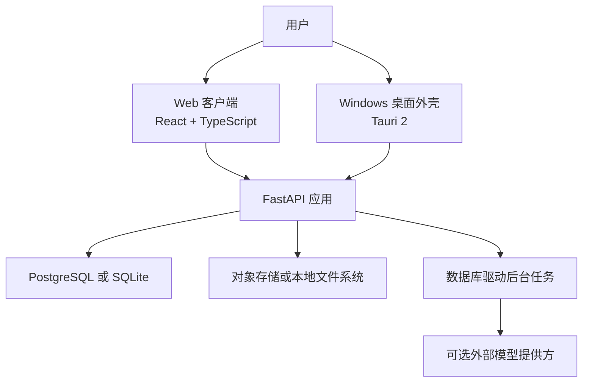
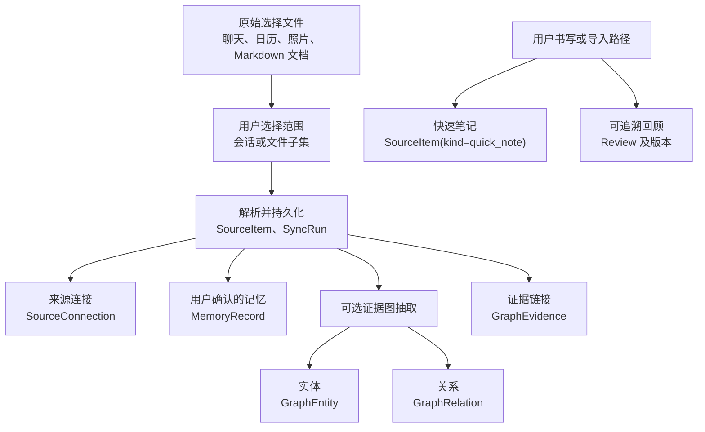
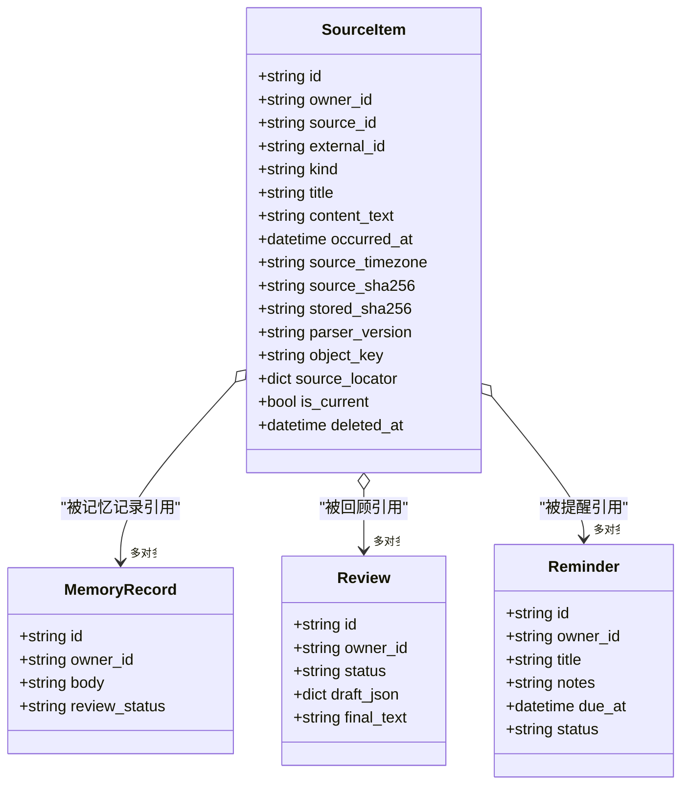
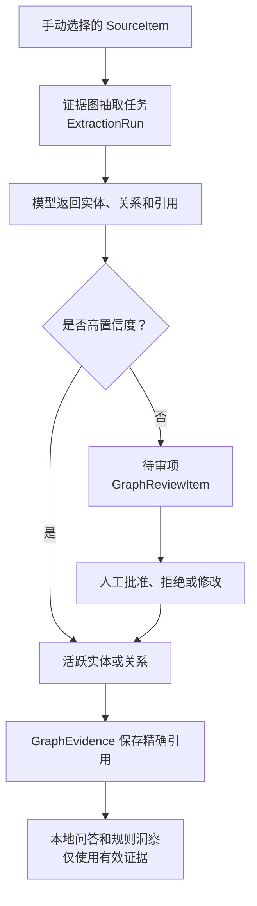
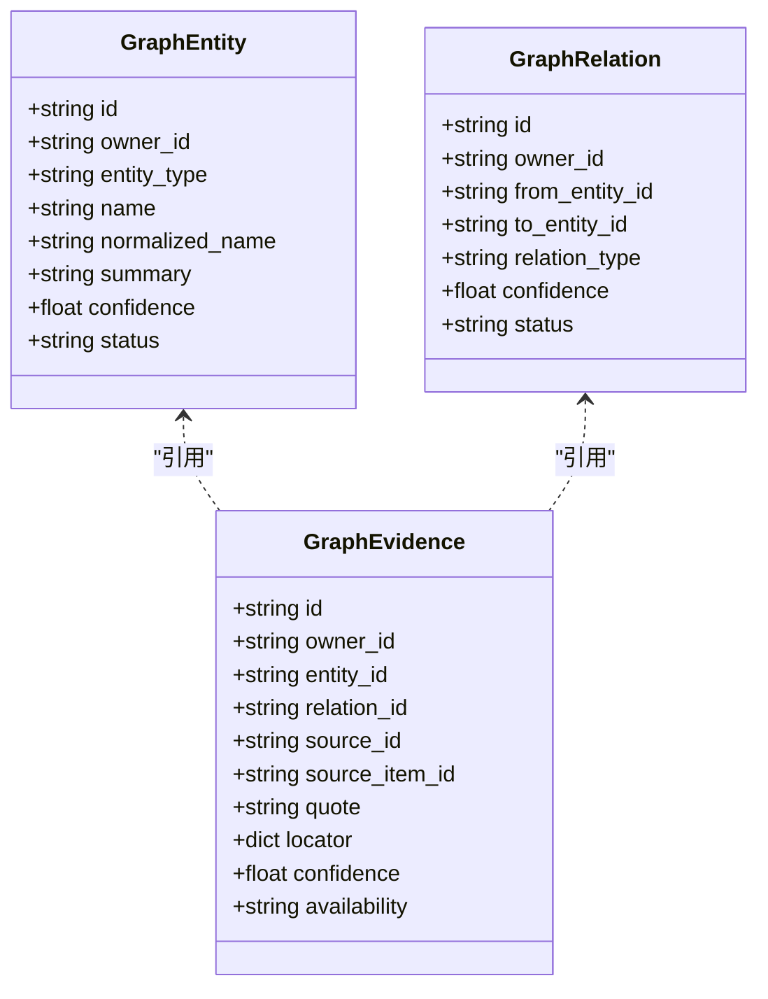
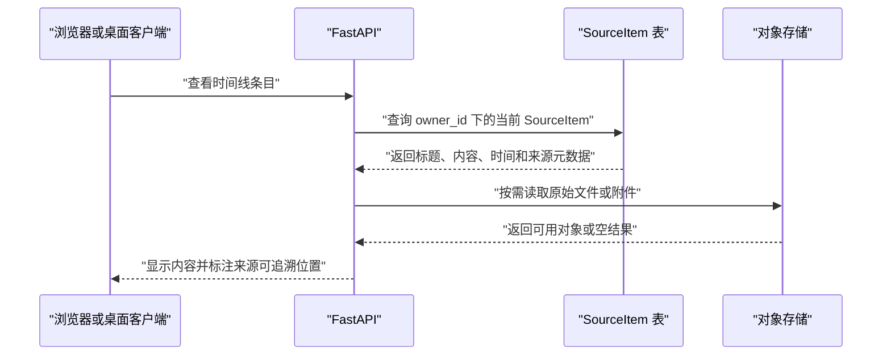
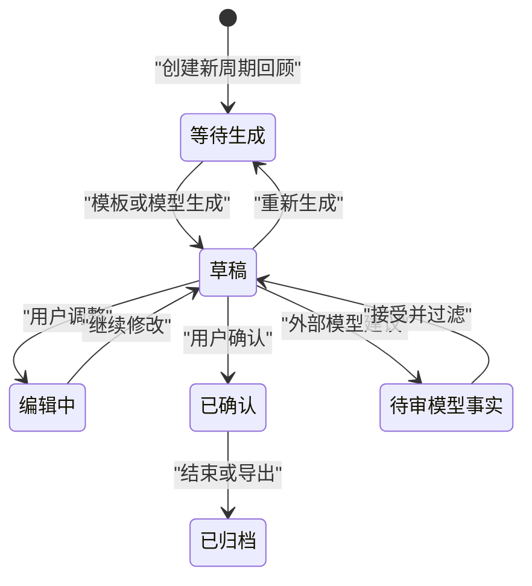
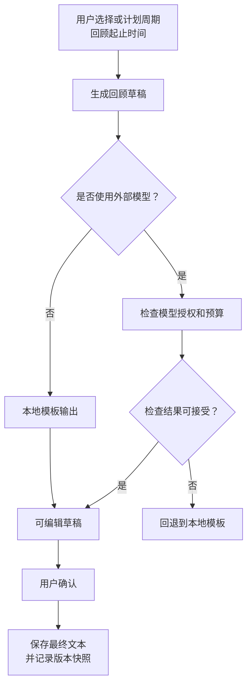
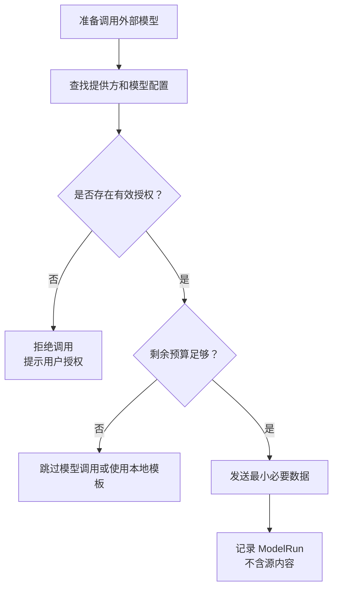
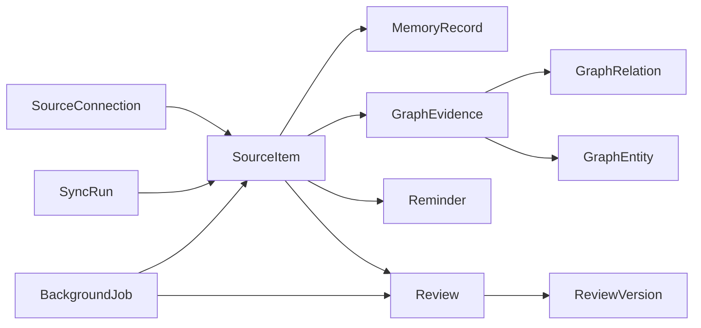

# 核心概念

<cite>
**本文引用的文件**   
- [models.py](file://src/personal_ai_life_os/models.py)
- [data-model.md](file://docs/architecture/data-model.md)
- [overview.md](file://docs/architecture/overview.md)
- [privacy.md](file://docs/architecture/privacy.md)
- [d2f5a8c14e73_add_evidence_graph_tables.py](file://migrations/versions/d2f5a8c14e73_add_evidence_graph_tables.py)
</cite>

## 目录
1. [引言](#引言)
2. [项目结构与核心边界](#项目结构与核心边界)
3. [数据所有权与租户隔离](#数据所有权与租户隔离)
4. [从原始信息到结构化知识](#从原始信息到结构化知识)
5. [关键概念一：SourceItem（统一数据项）](#关键概念一sourceitem统一数据项)
6. [关键概念二：Evidence Graph（证据图）](#关键概念二evidence-graph证据图)
7. [关键概念三：Timeline（时间线）与可追溯来源](#关键概念三timeline时间线与可追溯来源)
8. [关键概念四：Review（回顾）的版本控制与工作流](#关键概念四review回顾的版本控制与工作流)
9. [关键概念五：ModelConsent（模型授权）与隐私保护](#关键概念五modelconsent模型授权与隐私保护)
10. [选择性导入与全量同步的隐私差异](#选择性导入与全量同步的隐私差异)
11. [使用场景示例](#使用场景示例)
12. [依赖关系分析](#依赖关系分析)
13. [结论](#结论)

## 引言
Personal-AI-Life-OS 是一个以“用户自主选择”为中心的个人记忆系统。它的目标不是自动抓取一切信息，而是帮助用户把明确选定的聊天记录、日历快照、照片和笔记，变成带来源、可审查、可导出的结构化知识。系统同时支持本地运行和可选的外部模型能力；任何涉及外部模型的行为都需要显式授权，并且默认情况下不上传源内容。

该系统的核心设计哲学可以概括为六句话：
- 选择优先：用户必须主动选择要进入系统的内容。
- 原像不可变：导入的原始内容是固定副本，不会被后续编辑改变。
- 生成内容可撤回：由系统或模型生成的事实、实体、关系和分析都保持草稿状态，直到用户确认。
- 所有知识可追溯：时间线、问答、证据图和提醒都必须能回到具体来源项。
- 数据归用户：所有主表都通过 `owner_id` 实现租户级隔离，删除操作带有持久化墓碑记录。
- 外部调用有门槛：模型调用需要提供方披露文本、用户同意、预算检查和审计记录。

这些原则在数据模型、架构说明和隐私说明中相互呼应：原始资料、解析结果、回忆记录、周度回顾、提醒事项、证据图、模型使用情况以及后台任务都被区分成不同的实体类型，而不是合并成一个“万能消息表”。

**章节来源**
- [README.md:1-15](file://README.md#L1-L15)
- [README.md:16-45](file://README.md#L16-L45)
- [README.md:82-118](file://README.md#L82-L118)
- [overview.md:1-12](file://docs/architecture/overview.md#L1-L12)

## 项目结构与核心边界
从代码仓库角度，个人知识管理的核心逻辑集中在 Python 后端模块中，而前端和桌面端负责用户界面和本地资源访问：

图中的组件职责如下：
- Web 客户端和 Windows 桌面外壳负责用户选择文件、预览、时间线浏览、回顾编辑和设置。
- FastAPI 应用负责权限校验、数据模型、导入流程、图谱抽取、回顾工作流、搜索和导出。
- 数据库保存经过迁移版本管理的主表和关联表。
- 对象存储保存原始文件或清洗后的图片等附件。
- 后台任务承担 OCR、部分模型工作或可重试的处理步骤。
- 外部模型提供方是可选的，仅在满足授权、配置、预算等约束后才会被调用。

这个拓扑强调了两点：一是 UI 并不直接写数据库；二是本地桌面侧的文件选择、图片和聊天预览发生在设备侧，再由受控接口进入系统。

**图表来源**
- [overview.md:1-12](file://docs/architecture/overview.md#L1-L12)
- [overview.md:14-39](file://docs/architecture/overview.md#L14-L39)

**章节来源**
- [README.md:16-45](file://README.md#L16-L45)
- [README.md:46-81](file://README.md#L46-L81)
- [overview.md:14-53](file://docs/architecture/overview.md#L14-L53)

## 数据所有权与租户隔离
本系统的单租户单位不是“组织”，而是“用户”。数据库中几乎所有需要长期保留的用户资产表都包含 `owner_id`，并通过对 `users.id` 的外键关联进行级联清理。这意味着：

| 类别 | 代表表 | 隔离方式 | 设计意义 |
|---|---|---|---|
| 账户与模型授权 | `User`、`ModelConsent` | `owner_id` 为主键来源或外键字段 | 用户的身份、时区、当前模型授权状态彼此绑定 |
| 来源连接 | `SourceConnection`、`SyncRun`、`DesktopFolder` | 多张表持有 `owner_id`，并可指向用户和来源 | 来源生命周期和用户边界一致 |
| 基础数据项 | `SourceItem` | `owner_id` + `source_id` + `external_id` + `source_sha256` 唯一性 | 同一来源的稳定外部标识不能重复覆盖旧版本 |
| 用户加工产物 | `MemoryRecord`、`Review`、`Reminder`、`SavedSearch` | `owner_id` 作为主外键之一 | 回忆、回顾、待办和保存的搜索都属于特定用户 |
| 证据图相关 | `GraphEntity`、`GraphRelation`、`GraphEvidence`、`ExtractionRun` | 多数表含 `owner_id` | 图谱、引用、抽取记录和批处理按用户隔离 |
| 本地问题与规则洞察 | `QaThread`、`QaMessage`、`InsightDismissal` | `owner_id` | 本地问答上下文和误报忽略记录不被共享 |
| Agent 行为与插件 | `AgentAction`、`PluginManifest`、`PluginPermission`、`PluginAuditLog` | 均含 `owner_id` | Agent 内部写入和插件清单都在租户内审计 |
| 任务与草稿 | `BackgroundJob`、`DesktopDraft` | 多处通过 `source_id`、`source_item_id`、`review_id` 等上下文链接 | 任务的执行上下文不会跨用户泄漏 |

在架构文档中也明确了所有用户拥有表都会携带 `owner_id`，且 API 在跟随资源关系前会验证已认证的归属人。这种设计让“谁拥有一行数据”成为数据库层面的第一约束，而不只是业务层的一个过滤条件。

**章节来源**
- [models.py:39-96](file://src/personal_ai_life_os/models.py#L39-L96)
- [models.py:98-197](file://src/personal_ai_life_os/models.py#L98-L197)
- [models.py:201-322](file://src/personal_ai_life_os/models.py#L201-L322)
- [models.py:323-561](file://src/personal_ai_life_os/models.py#L323-L561)
- [models.py:562-875](file://src/personal_ai_life_os/models.py#L562-L875)
- [data-model.md:1-13](file://docs/architecture/data-model.md#L1-L13)

## 从原始信息到结构化知识
系统把“信息生命阶段”划分为几个清晰层次，每层都有独立表结构，而不是简单追加一个 `is_structured` 字段：

数据流转的关键约束包括：
- 原始导入内容是不可变的：哈希值、解析器版本、存储摘要和外部标识一起记录，便于复现和重放。
- 时间线上的条目可能对应多个来源，也可能被新的更高序列的日历事件替换版本。
- 只有用户确认后，记忆记录才进入相对稳定的状态。
- 低置信度的模型输出不直接进入活跃知识，而是留在待审队列或由用户审核后生效。
- 所有高级结构体——回忆、回顾、提醒、证据图、Agent 动作、背景任务——都可以反向定位到一个或多个 `SourceItem`。

**图表来源**
- [models.py:201-284](file://src/personal_ai_life_os/models.py#L201-L284)
- [overview.md:55-95](file://docs/architecture/overview.md#L55-L95)
- [privacy.md:1-29](file://docs/architecture/privacy.md#L1-L29)

**章节来源**
- [overview.md:55-95](file://docs/architecture/overview.md#L55-L95)
- [privacy.md:1-29](file://docs/architecture/privacy.md#L1-L29)

## 关键概念一：SourceItem（统一数据项）
`SourceItem` 是整个系统中的原子数据单元。它用来表示一次明确的、可追踪的解析或输入结果。无论是用户手写的快速笔记，还是 ChatGPT 导入的消息、ICS 日历事件、文档解析结果，最终都要落库为统一的项类型。

### SourceItem 的核心字段含义
| 字段类别 | 字面表达 | 设计意图 |
|---|---|---|
| 所有者与来源 | `owner_id`、`source_id`、`sync_run_id` | 回答“这条数据属于谁、来自哪个来源、是哪次同步产生” |
| 稳定身份 | `external_id` | 尽量复用上游 ID，例如 ICS UID 或外部消息标识 |
| 类型 | `kind` | 区分聊天、文档、日历、快速笔记等不同语义来源 |
| 可读内容 | `title`、`content_text` | 用于时间线展示和检索 |
| 时间与地域 | `occurred_at`、`source_timezone` | 支持按用户日历日查询和回溯 |
| 完整性校验 | `source_sha256`、`stored_sha256` | 原始字节哈希与持久化内容哈希互相校验 |
| 解析版本 | `parser_version` | 不同解析器版本产生的结果具备可对比性 |
| 附件位置 | `object_key` | 指向对象存储中的原文或清洗后图片 |
| 位置元数据 | `source_locator`、`metadata_json` | 保存行号、文件名、URI、额外结构化信息 |
| 版本与软删除 | `is_current`、`deleted_at` | 同一外部的更新用新版本取代旧版本，删除先标记再清理 |

`SourceItem` 上有一个复合唯一约束：`(owner_id, source_id, external_id, source_sha256)`。这意味着即使外部 ID 相同，只要原始字节发生变化，也会形成新版本；而对于相同来源的同一外部条目，重复导入不会破坏已有历史。

此外，`SourceItem` 不是孤立的数据行：它通过多对多表与 `MemoryRecord`、`Review`、`Reminder` 建立引用，并与标签、集合等整理元数据相连。这使它能同时充当原始信息的锚点和上层结构的引用目标。

**图表来源**
- [models.py:201-284](file://src/personal_ai_life_os/models.py#L201-L284)

**章节来源**
- [models.py:201-284](file://src/personal_ai_life_os/models.py#L201-L284)
- [data-model.md:1-13](file://docs/architecture/data-model.md#L1-L13)

## 关键概念二：Evidence Graph（证据图）
证据图是系统从“原始信息”走向“结构化理解”的关键桥梁。它把松散的聊天记录、笔记和日历条目转换为实体、关系、精确引用和置信度评分。

### 证据图的三个核心层级
| 层级 | 表 | 角色 |
|---|---|---|
| 节点 | `GraphEntity` | 表示主题、人物、项目、技能、目标等实体，包括名称、标准化名称、摘要、置信度和合并状态 |
| 边 | `GraphRelation` | 表示实体之间的关系，如参与、完成、学习、拥有等，附带时间和置信度 |
| 证据链 | `GraphEvidence` | 将实体或关系与具体 `source_item_id` 和原始文本片段连接起来 |

证据图并不假设模型一定正确：它有 `confidence`、`status`、`availability` 等字段，允许高置信度内容进入活跃状态，低置信度内容进入待审队列，也可对用户审核结果撤销、合并或拒绝。

### 证据链如何维持可信度

`GraphEvidence` 同时保留来源连接、来源项、引用原文、定位器和可用性状态。因此，即使某条源链接被撤回或删除，也不会静默隐藏已经生成的历史结构，而是通过证据可用性状态让下游查询知道证据不再可靠。

**图表来源**
- [models.py:323-561](file://src/personal_ai_life_os/models.py#L323-L561)
- [d2f5a8c14e73_add_evidence_graph_tables.py:24-103](file://migrations/versions/d2f5a8c14e73_add_evidence_graph_tables.py#L24-L103)

**章节来源**
- [models.py:323-561](file://src/personal_ai_life_os/models.py#L323-L561)
- [overview.md:87-95](file://docs/architecture/overview.md#L87-L95)
- [d2f5a8c14e73_add_evidence_graph_tables.py:24-103](file://migrations/versions/d2f5a8c14e73_add_evidence_graph_tables.py#L24-L103)

## 关键概念三：Timeline（时间线）与可追溯来源
时间线不是简单的时间轴列表，而是以用户视角组织的可溯源历史。每条时间线上的条目都基于一个 `SourceItem`，并通过 `kind`、`occurred_at`、`source_timezone`、`source_locator` 等字段解释它从什么时候、从哪里来、属于什么类型。

时间线的可追溯性体现在三个层面：
- 用户能在时间线上看到标题、内容和发生时间。
- 系统能把回顾、记忆、提醒等内容链接回一个或多个 `SourceItem`。
- 当用户点击来源链接时，能够根据 `object_key`、`source_locator`、`external_id` 等元信息找到原始对象或具体位置。

需要注意的边界是：时间线提供的是“用户选择过的内容”。文档明确指出，聊天记录在本地预处理后只上传用户选择的会话；日历导入是完整快照，但单条事件仍通过 `external_id`、`SEQUENCE` 和 `deleted_at` / `is_current` 控制版本。这样既保证了时间线连续性，又避免无边界地拉取大量无关内容。

**图表来源**
- [models.py:201-284](file://src/personal_ai_life_os/models.py#L201-L284)
- [overview.md:55-65](file://docs/architecture/overview.md#L55-L65)

**章节来源**
- [models.py:201-284](file://src/personal_ai_life_os/models.py#L201-L284)
- [overview.md:55-73](file://docs/architecture/overview.md#L55-L73)
- [README.md:22-45](file://README.md#L22-L45)

## 关键概念四：Review（回顾）的版本控制与工作流
Review 代表一段有时窗的用户反思产出。它不仅保存当前草稿或终稿文本，还通过 `ReviewVersion` 记录每次生成、编辑、确认、再生成的快照。

### 回顾的状态演化

核心字段关系如下：
- `Review.period_start`、`period_end` 定义半开区间时间段。
- `Review.status` 表示当前整体状态，`draft_json`、`final_text` 分别承载草稿结构和用户终审文本。
- `ReviewVersion` 通过递增版本号保存历史快照，包含状态、草稿、最终文本和变更原因。
- `ReviewSchedule` 可配置每周自动生成回顾的计划，包括工作日、本地时间、是否使用外部模型、提供方和模型选择。
- 回顾与 `SourceItem` 是多对多关联，确保回顾内容始终可以回溯到具体时间线上的证据。

**图表来源**
- [models.py:406-478](file://src/personal_ai_life_os/models.py#L406-L478)
- [overview.md:105-118](file://docs/architecture/overview.md#L105-L118)

**章节来源**
- [models.py:406-478](file://src/personal_ai_life_os/models.py#L406-L478)
- [overview.md:96-118](file://docs/architecture/overview.md#L96-L118)

## 关键概念五：ModelConsent（模型授权）与隐私保护
`ModelConsent` 不是简单的“开启 AI”开关，而是一个针对每个用户提供方、每次披露版本的授权记录。它包含：
- `owner_id`：归属于哪个用户；
- `provider_id`：是哪个提供方；
- `disclosure_version`：使用的是哪一版披露说明；
- `granted_at`、` revoked_at`：授权和撤销时间。

这一设计与提供方注册表、预算检查、令牌价格、本地环回提供方、审批限制和调度回顾共同构成完整的模型调用治理链路：
- 模型密钥不持久化到数据库、响应、归档或日志中。
- 不同提供方的同意互不影响；切换提供方必须重新同意。
- 撤销提供方只会取消携带该提供方 ID 的任务，不会影响其他来源。
- 请求外部模型前会检查披露文本、隐私链接、单价、余额和配额。
- 预算超限时采用保守预留策略，并回退到本地模板。
- 本地环回提供方仅限本地地址，且不需要在数据库里嵌入密钥。

**图表来源**
- [models.py:39-68](file://src/personal_ai_life_os/models.py#L39-L68)
- [models.py:729-745](file://src/personal_ai_life_os/models.py#L729-L745)
- [privacy.md:30-53](file://docs/architecture/privacy.md#L30-L53)
- [overview.md:105-118](file://docs/architecture/overview.md#L105-L118)

**章节来源**
- [models.py:39-68](file://src/personal_ai_life_os/models.py#L39-L68)
- [models.py:729-745](file://src/personal_ai_life_os/models.py#L729-L745)
- [privacy.md:1-53](file://docs/architecture/privacy.md#L1-L53)

## 选择性导入与全量同步的隐私差异
这里需要明确两个容易混淆的概念：

| 概念 | 在 Personal-AI-Life-OS 中的含义 | 隐私影响 |
|---|---|---|
| 选择性导入 | 用户在 Web 或 CLI 中选择特定聊天对话、照片、文档或文件夹子集后再上传 | 减少进入系统的数据量，降低后续解析和模型调用的隐私风险 |
| 全量同步 | 通过 CLI 定时扫描选定目录，并使用 SHA-256 去重重复运行 | 提高便利性，但不意味着把所有文件内容无条件永久发送出去；仍需来源授权、状态控制和删除机制 |

两者并非对立：用户可以先做选择性导入，获得更细粒度的隐私控制；也可以启用定期文件夹同步以获得持续补充。但无论哪种方式，系统都要求用户至少明确授权来源连接、声明选择的范围和来源状态。

安全性方面还有若干配套措施：
- CLI 预览只显示文件和会话元数据，不打印聊天正文。
- ChatGPT JSON 在本机读取后只上传用户选的对话。
- 文本上传上限、图片解码像素数、单次回顾最大来源项数量等硬约束防止滥用。
- 后台任务载荷中存储的是标识符和控制信息，不是源内容。
- OCR、照片描述和可选外部评论走数据库驱动的任务队列，失败可恢复，且结果同样受用户隔离。

**章节来源**
- [README.md:16-45](file://README.md#L16-L45)
- [README.md:46-81](file://README.md#L46-L81)
- [privacy.md:1-29](file://docs/architecture/privacy.md#L1-L29)

## 使用场景示例

### 场景一：把聊天记录变成可追溯时间线
**用户操作：**
1. 打开本地导出文件或在 Windows 桌面应用中选择一个聊天导出。
2. 浏览器或桌面端在本地预览，但预览只显示元数据，不渲染聊天正文。
3. 只勾选需要的对话或消息批次进行导入。
4. 在后端生成 `SourceConnection`、`SyncRun` 和若干 `SourceItem`。
5. 在时间线上按时间浏览这些条目，并根据来源链接找到具体文件位置。

**系统保障：**
- 每条消息都是独立的 `SourceItem`，可保留来源哈希和解析版本。
- 用户可以导出 Markdown，包含 `source_locator`，方便回到原文件。
- 如果用户撤销来源连接或删掉来源，系统会写出墓碑记录并清理相关数据。

**章节来源**
- [models.py:98-284](file://src/personal_ai_life_os/models.py#L98-L284)
- [overview.md:55-65](file://docs/architecture/overview.md#L55-L65)
- [privacy.md:3-18](file://docs/architecture/privacy.md#L3-L18)

### 场景二：从聊天记录中抽取可审查的证据图
**用户操作：**
1. 手动选择一些 `SourceItem`。
2. 提交证据图抽取请求。
3. 系统检查对应的来源是否具有云提取授权，并检查月度/单次预算。
4. 抽取完成后，高置信度结果进入活跃实体或关系，低置信度进入待审队列。
5. 用户可以在待审页面批准、拒绝、合并重复实体或自定义本体类型。
6. 本地问答只从“有效证据”中提取事实和引用，不绕过用户的选择。

**系统保障：**
- 每个实体、关系和证据都有 `owner_id`。
- 证据图抽取是可幂等的：相同批次的重复请求会避免重复计算。
- `GraphEvidence.quote`、`locator`、`source_item_id` 让答案可追溯到原始语料。

**章节来源**
- [models.py:323-561](file://src/personal_ai_life_os/models.py#L323-L561)
- [overview.md:87-95](file://docs/architecture/overview.md#L87-L95)

### 场景三：生成一份带版本历史的周回顾
**用户操作：**
1. 选择一个或固定的周维度周期。
2. 系统列出该周期的来源项，可结合本地模板和外部模型生成草稿。
3. 用户调整草稿、添加提醒、确认后保存到 `Review`。
4. 每次重大变化都生成一条 `ReviewVersion`，可比较前后差异。
5. 用户可以导出 Markdown，或继续维护下一期回顾。

**系统保障：**
- 回顾的周期性由 `period_start`、`period_end` 定义。
- 模型建议和最终文本分别保存在 JSON 结构和纯文本字段。
- 如果使用外部模型，必须先检查授权和预算；若不可用则使用本地模板。

**章节来源**
- [models.py:406-478](file://src/personal_ai_life_os/models.py#L406-L478)
- [overview.md:105-118](file://docs/architecture/overview.md#L105-L118)

### 场景四：撤回某个外部模型的授权后，之前已生成的图谱如何处理
**用户操作：**
1. 撤销某个提供方的 `ModelConsent`。
2. 系统取消仍排队或运行中的该提供方任务。
3. 已完成的实体和关系通常仍保留历史结构，但与其关联的敏感证据可通过来源状态变为不可用或删除。
4. 本地问答继续使用当前“有效”证据；如果找不到可靠证据，则明确回复未找到可靠证据。

**系统保障：**
- 提供者级同意与来源云提取同意分开管理。
- 撤销操作不影响其他提供方的历史记录。
- 证据图答案必须过滤撤回到来源和已删除内容。

**章节来源**
- [privacy.md:30-53](file://docs/architecture/privacy.md#L30-L53)
- [overview.md:87-95](file://docs/architecture/overview.md#L87-L95)

## 依赖关系分析
下图展示主要数据对象之间的静态依赖关系，重点体现哪些东西依赖 `SourceItem`，哪些东西是 `SourceItem` 的产物。

这个依赖图反映了一个重要现实：`SourceItem` 是“事实锚点”，而大多数人类可见的结构体——记忆、回顾、提醒、证据引用、任务结果——都以某种方式指向它。反之，`SourceConnection` 和 `SyncRun` 则是“数据来源审计链”的一部分，回答“数据是在哪个来源、哪次同步、用什么解析器进入系统的”。

**图表来源**
- [models.py:98-284](file://src/personal_ai_life_os/models.py#L98-L284)
- [models.py:323-875](file://src/personal_ai_life_os/models.py#L323-L875)

**章节来源**
- [models.py:98-284](file://src/personal_ai_life_os/models.py#L98-L284)
- [models.py:323-875](file://src/personal_ai_life_os/models.py#L323-L875)

## 结论
Personal-AI-Life-OS 的设计不是为了替代用户的判断，而是为用户的判断提供更强的证据底座。它把个人信息管道拆成六个层次：

1. **选择层**：用户决定哪些文件、对话、照片、笔记进入系统。
2. **导入层**：系统生成不可变的原始副本和 `SourceItem`，并记录来源、同步和解析版本。
3. **时间线层**：以发生时间组织和展示可追溯条目。
4. **结构化层**：通过记忆、回顾、提醒、证据图构建高阶理解。
5. **审查层**：低置信度输出必须经用户批准；模型调用需披露、同意、预算和审计。
6. **清理层**：通过来源、项目和账户级删除加上持久化墓碑保证数据可擦除。

开发者在设计新功能时应优先考虑五个问题：
- 新增内容能否追溯到 `SourceItem`？
- 是否需要 `owner_id` 隔离，是否有越权访问风险？
- 如果是模型输出，是否在草稿或待审状态？
- 是否可以被用户撤销、合并、忽略或导出？
- 是否避免了不必要地上传源文本或图片？

普通用户则可以记住一个基本原则：系统信任你的选择，但不代替你相信模型。任何自动生成的知识点都应该有时间线、来源链接和可撤回的操作空间。