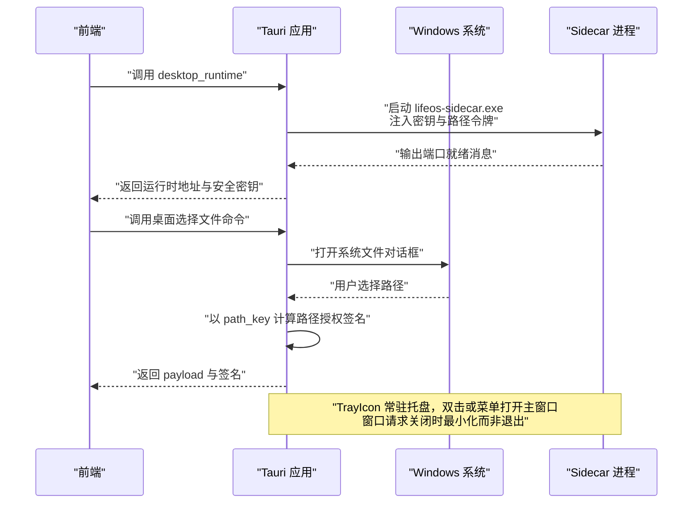
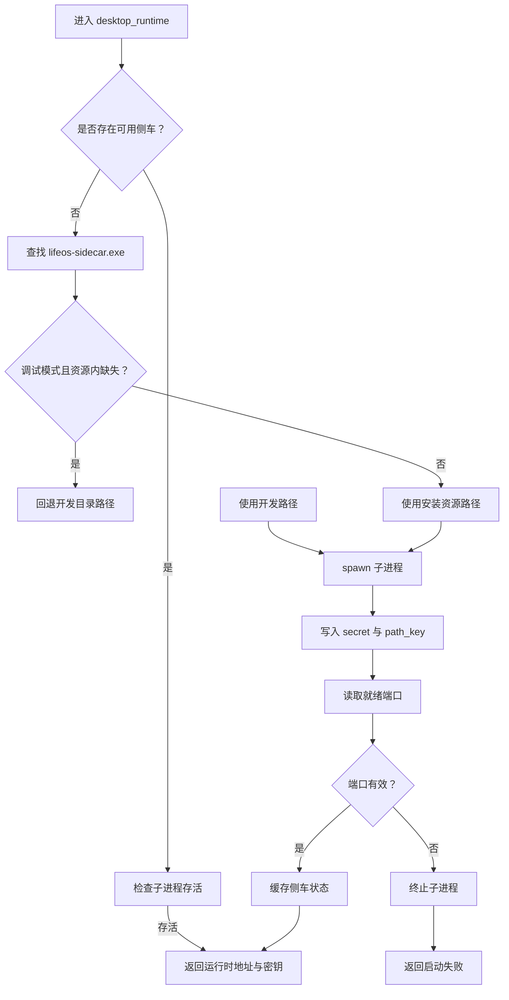
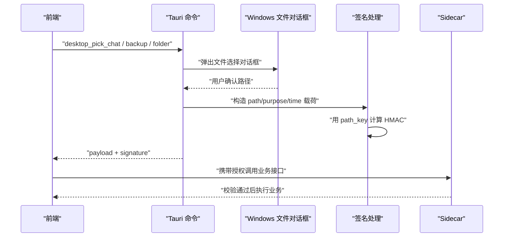
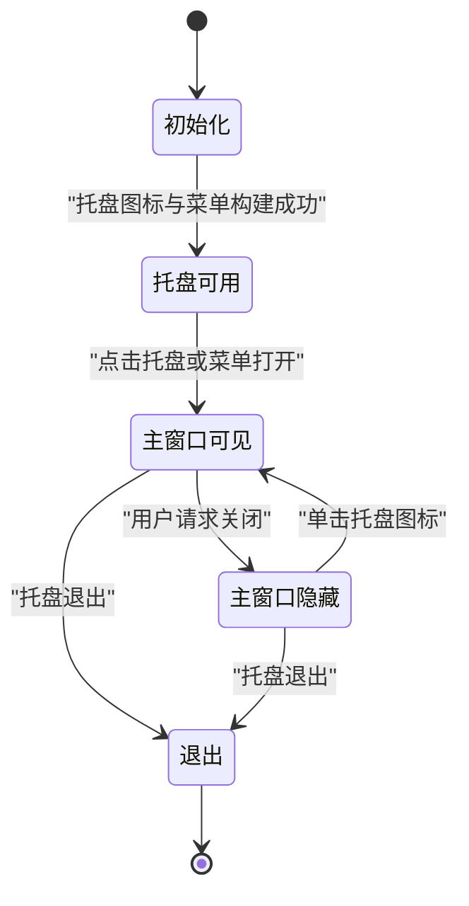
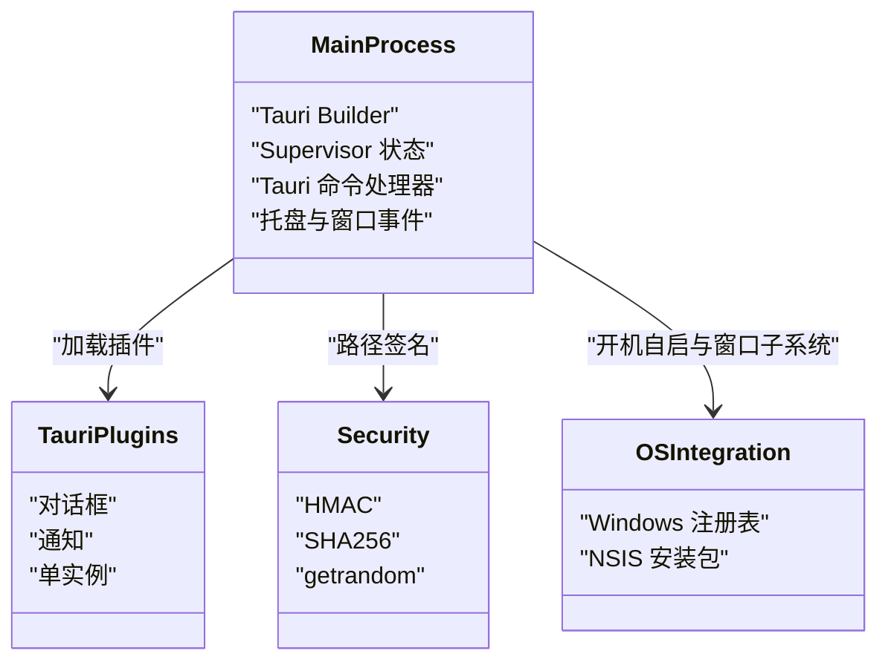
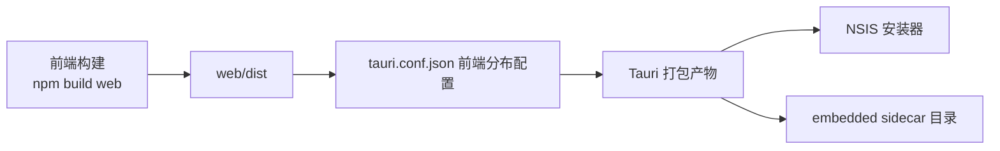
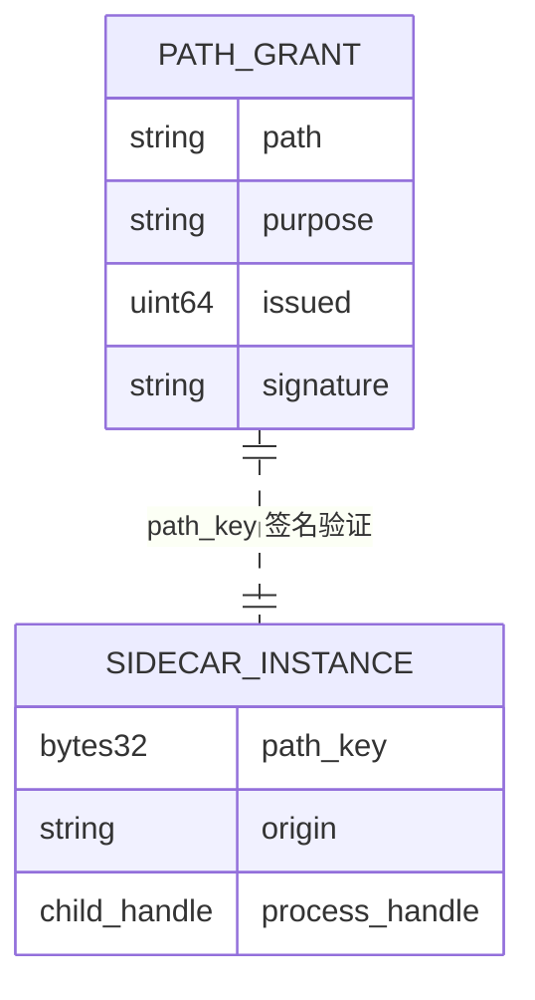

# Tauri 主进程架构

<cite>
**本文引用的文件**
- [main.rs](file://desktop/src-tauri/src/main.rs)
- [tauri.conf.json](file://desktop/src-tauri/tauri.conf.json)
- [Cargo.toml](file://desktop/src-tauri/Cargo.toml)
- [build.rs](file://desktop/src-tauri/build.rs)
</cite>

## 目录
1. [引言](#引言)
2. [项目结构](#项目结构)
3. [核心组件](#核心组件)
4. [架构总览](#架构总览)
5. [关键流程与时序](#关键流程与时序)
6. [依赖与构建配置](#依赖与构建配置)
7. [权限、安全与信任边界](#权限安全与信任边界)
8. [性能与行为特性](#性能与行为特性)
9. [故障排查指南](#故障排查指南)
10. [扩展点与最佳实践](#扩展点与最佳实践)
11. [结论](#结论)

## 引言
本文件从 Rust 和 Tauri 2 的角度，系统性梳理该 Windows 桌面应用的主进程设计与实现。主进程承担四类职责：
- 应用生命周期管理：启动、单实例、窗口显示隐藏、退出清理。
- 系统托盘集成：提供“打开”和“退出”菜单，更新图标提示。
- IPC 命令调度：对外暴露获取运行时信息、选择文件和路径并签名、设置开机自启等能力。
- Sidecar 子进程管理：以独立 Windows 程序运行 Python 后端，负责数据与服务逻辑；主进程只作为安全边界与操作系统接口桥梁。

主进程本身不包含业务逻辑，而是通过受控的通信通道驱动 sidecar，并由前端 UI 页面经 Tauri IPC 调用主进程能力。

## 项目结构
Tauri 桌面端相关代码集中在 `desktop/src-tauri` 下：
- `src/main.rs`：Tauri 主进程入口、命令注册、托盘初始化、sidecar 管理。
- `tauri.conf.json`：产品标识、窗口配置、内容安全策略、打包资源、NSIS 安装器配置。
- `Cargo.toml`：Rust 包元数据、编译目标、运行时依赖。
- `build.rs`：调用 Tauri 构建钩子。
- `installer-hooks.nsh`：用于 NSIS 安装脚本扩展（由配置文件引入）。
- `icons/icon.ico`：应用图标与托盘图标来源。

```mermaid
graph TB
    A["前端界面<br/>web/dist"] --> B["Tauri 应用上下文<br/>tauri.conf.json"]
    C["Tauri 主进程<br/>main.rs"] --> D["Sidecar 子进程<br/>lifeos-sidecar.exe"]
    E["系统托盘<br/>tauri tray icon"] --> C
    F["Windows 注册表<br/>开机自启键值"] <-- C
    G["本地数据目录<br/>Local App Data"] --> D
```

**图表来源**
- [main.rs:1-385](file://desktop/src-tauri/src/main.rs#L1-L385)
- [tauri.conf.json:1-29](file://desktop/src-tauri/tauri.conf.json#L1-L29)

**章节来源**
- [main.rs:1-20](file://desktop/src-tauri/src/main.rs#L1-L20)
- [tauri.conf.json:1-29](file://desktop/src-tauri/tauri.conf.json#L1-L29)

## 核心组件
- **Sidecar 管理器**：封装 sidecar 可执行文件路径、启动参数、I/O 流、守护逻辑与终止策略。
- **Supervisor 应用状态**：全局保存当前 sidecar 实例句柄与运行时信息，供所有命令访问。
- **Tauri 命令集合**：
  - `desktop_runtime`：获取或启动 sidecar，返回运行时地址与密钥。
  - `desktop_stop_sidecar`：移除 Supervisor 中的侧车实例，触发销毁。
  - `desktop_pick_chat`、`desktop_pick_backup`、`desktop_pick_folder`：调用系统对话框选择文件/目录，并以 path_key 对路径声明进行 HMAC 签名，产生临时授权凭证。
  - `desktop_autostart`：在 Windows HKCU Run 键中写入或移除开机启动项。
  - `desktop_notify_due`：向系统发送到期提醒通知。
  - `desktop_tray_status`：更新托盘提示文本，反映授权目录同步状态。
- **窗口与托盘生命周期回调**：阻止关闭窗口为“关闭”，改为最小化到托盘；托盘点击左键恢复主窗口。

**章节来源**
- [main.rs:201-385](file://desktop/src-tauri/src/main.rs#L201-L385)
- [main.rs:1-200](file://desktop/src-tauri/src/main.rs#L1-L200)

## 架构总览
下图展示主进程如何在 Tauri、Sidecar、Windows 系统资源和前端之间协作。



**图表来源**
- [main.rs:1-385](file://desktop/src-tauri/src/main.rs#L1-L385)

### 关键设计模式
- **状态集中化**：通过 Tauri `state::<Supervisor>` 共享进程句柄，避免重复启动与竞态。
- **异步 I/O 保护**：阻塞型对话、子进程等待放在 spawn_blocking 中运行，避免阻塞事件循环。
- **最小信任面**：UI 无法直接读取用户磁盘；只能拿到已签名的路径声明，sidecar 必须验证签名才能放行。
- **平台专用能力分离**：Windows 注册表、NSIS、子系统开关由主进程承载，跨平台业务保留在 sidecar。

**章节来源**
- [main.rs:300-385](file://desktop/src-tauri/src/main.rs#L300-L385)
- [main.rs:1-120](file://desktop/src-tauri/src/main.rs#L1-L120)

## 关键流程与时序

### Sidecar 启动与就绪等待
主进程在第一次需要运行时信息时创建 sidecar 进程：
1. 生成会话密钥和 path_key。
2. 用标准输入把密钥与 path_key 传给 sidecar。
3. 读取 sidecar 第一行 JSON，解析 port 字段判断是否就绪。
4. 若未收到正确响应，超时后终止子进程并返回错误。



**图表来源**
- [main.rs:313-385](file://desktop/src-tauri/src/main.rs#L313-L385)

**章节来源**
- [main.rs:1-120](file://desktop/src-tauri/src/main.rs#L1-L120)

### 文件与目录授权签名流程
前端选择目标文件或目录后，主进程调用原生对话框取得真实路径，然后用 path_key 生成 HMAC-SHA256 签名。这样前端只持有“被授权的路径声明 + 签名”，不能自行伪造其他路径。



**图表来源**
- [main.rs:121-200](file://desktop/src-tauri/src/main.rs#L121-L200)
- [main.rs:201-268](file://desktop/src-tauri/src/main.rs#L201-L268)

### 托盘与会话生命周期
- 应用启动后初始化托盘，默认不弹窗菜单，左键点击打开主窗口。
- 窗口 CloseRequested 拦截，改为 hide；防止用户误关导致后台退出。
- 单实例插件保证同一时间只有一个实例；重复启动仅唤起已有窗口。
- 进程 Exit 事件中清除 Supervisor 状态，让 Drop 能够释放子进程句柄。



**图表来源**
- [main.rs:333-385](file://desktop/src-tauri/src/main.rs#L333-L385)

**章节来源**
- [main.rs:333-385](file://desktop/src-tauri/src/main.rs#L333-L385)

## 依赖与构建配置

### Cargo.toml 的作用
- 定义 Rust crate 名称、版本、语言版本。
- `tauri = "2"` 引入 Tauri 2 主库，并启用 `tray-icon` 功能。
- `tauri-plugin-dialog`、`tauri-plugin-notification`、`tauri-plugin-single-instance` 分别开启系统对话框、通知与单实例插件。
- `hmac`、`sha2`、`getrandom`、`serde_json` 实现路径授权签名与随机数。
- `winreg` 操作 Windows 注册表完成开机自启管理。



**图表来源**
- [Cargo.toml:1-19](file://desktop/src-tauri/Cargo.toml#L1-L19)
- [main.rs:1-30](file://desktop/src-tauri/src/main.rs#L1-L30)
- [tauri.conf.json:18-29](file://desktop/src-tauri/tauri.conf.json#L18-L29)

**章节来源**
- [Cargo.toml:1-19](file://desktop/src-tauri/Cargo.toml#L1-L19)
- [build.rs:1-3](file://desktop/src-tauri/build.rs#L1-L3)

### tauri.conf.json 的影响
- `productName`、`version`、`identifier`：决定产品名、版本号与 Windows/UAC/NSIS 等系统识别 ID。
- `build.beforeBuildCommand`：构建前先运行 Web 前端构建命令，把产物放到 `web/dist`。
- `app.windows`：定义主窗口标签、尺寸与最小尺寸。
- `app.security.csp`：严格限制资源来源与连接源，允许 `ipc:`、`http://ipc.localhost` 和 `http://127.0.0.1:*`；这意味着 sidecar 绑定本机 IP 是必要条件。
- `bundle.resources`：将 `../dist/lifeos-sidecar/` 打包进应用，路径映射为 `sidecar/`；运行时由 `resource_dir()` 找到 `lifeos-sidecar.exe`。
- `bundle.windows.nsis`：使用当前用户模式安装，并通过 `installer-hooks.nsh` 扩展安装行为。



**图表来源**
- [tauri.conf.json:1-29](file://desktop/src-tauri/tauri.conf.json#L1-L29)

**章节来源**
- [tauri.conf.json:1-29](file://desktop/src-tauri/tauri.conf.json#L1-L29)

## 权限、安全与信任边界

### 最小权限模型
- 主进程拥有更多 Windows 能力：注册表、窗口子系统、托盘、对话框、通知、子进程控制。
- 前端只能通过 Tauri IPC 调用有限命令，不能直接访问系统 API。
- 真正文件读写和业务逻辑位于 sidecar；sidecar 必须验证前端传递的路径签名。

### 路径签名机制
- `path_key` 在每个 sidecar 实例启动时随机生成，并与主进程共享。
- 每次用户选择路径后，主进程构造 `{path, purpose, issued}` 载荷，并用 `path_key` 做 HMAC-SHA256。
- 只有知道 `path_key` 的 sidecar 才能验证签名，从而防止恶意前端篡改路径。



**图表来源**
- [main.rs:1-120](file://desktop/src-tauri/src/main.rs#L1-L120)
- [main.rs:121-268](file://desktop/src-tauri/src/main.rs#L121-L268)

### 安全策略注意事项
- CSP 允许 `http://127.0.0.1:*`，这意味着应确保 sidecar 不监听 `0.0.0.0`，而应只绑定 loopback。
- `CREATE_NO_WINDOW` 标志隐藏 sidecar 控制台窗口，但仍存在命令行参数泄露风险，建议在 sidecar 中记录日志到文件而非 stdout/stderr。
- 重启与热重载时 path_key 会变化，旧前端持有的签名会失效；这是期望的安全行为。

**章节来源**
- [main.rs:121-268](file://desktop/src-tauri/src/main.rs#L121-L268)
- [tauri.conf.json:13-17](file://desktop/src-tauri/tauri.conf.json#L13-L17)

## 性能与行为特性
- 窗口关闭拦截避免了意外退出，提升用户体验，但也要求后台任务必须正确处理托盘退出。
- 子进程 IO 使用 BufReader 与 channel，但当前 stdout 在准备好后被复制到 `std::io::sink`，后续日志丢弃。生产环境建议持久化侧车日志。
- 停止子进程时采用轮询尝试终止，最多等待约 8 秒，最终 kill 并 wait，属于强杀兜底。
- 单实例插件通过回调复用现有窗口，减少资源竞争和状态不一致。
- 通知与托盘提示仅在 Windows 上生效，跨平台兼容需配合条件编译或平台抽象层。

**章节来源**
- [main.rs:1-120](file://desktop/src-tauri/src/main.rs#L1-L120)
- [main.rs:300-385](file://desktop/src-tauri/src/main.rs#L300-L385)

## 故障排查指南

| 现象 | 可能原因 | 排查方向 |
|---|---|---|
| 主进程无法启动或启动后立即退出 | Tauri 构建失败、Web 前端未构建、打包缺少 sidecar | 先执行前端构建；确认 `web/dist` 存在；查看打包产物是否包含 `sidecar` 资源 |
| sidecar 启动失败或报未就绪 | sidecar 可执行文件不存在、启动参数异常、端口未返回 | 检查 `lifeos-sidecar.exe` 位置；查看 `logs/sidecar.log`；确认侧车输出首行 JSON |
| 路径授权无效或业务拒绝读取 | path_key 变更、前端签名过期、CSP 不允许连接 | 重新触发选择文件流程；不要复用旧签名；确认 sidecar 只监听本地地址 |
| 开机自启未生效 | Windows 注册表写入失败或权限不足 | 检查 HKCU `\Software\Microsoft\Windows\CurrentVersion\Run` |
| 托盘无图标或不响应点击 | 系统主题或图标路径问题、托盘 ID 冲突 | 确认 `default_window_icon` 可用，托盘 ID 未被占用 |
| 主窗口无法显示 | 窗口标签不一致、焦点设置失败 | 检查窗口 label `main`、`show`/`unminimize`/`set_focus` 返回值 |

**章节来源**
- [main.rs:121-200](file://desktop/src-tauri/src/main.rs#L121-L200)
- [main.rs:300-385](file://desktop/src-tauri/src/main.rs#L300-L385)

## 扩展点与最佳实践

### 推荐新增 IPC 命令的方式
1. 在 Rust 中新增 `#[tauri::command]` 函数。
2. 将该函数加入 `invoke_handler` 的命令列表。
3. 如需访问状态，从 `AppHandle` 中取 `state::<Supervisor>()`。
4. 避免在主进程做重 CPU 任务，必要时用 `spawn_blocking`。
5. 如果命令涉及敏感文件访问，优先返回“已签名授权”，而不是直接把路径交给前端任意使用。

### 侧车进程监控增强建议
- 为侧车添加健康检查端点，由主进程周期性调用。
- 当检测到侧车崩溃时，由主进程自动重启，同时重置 path_key。
- 为 stdout/stderr 增加结构化日志轮转。

### 托盘与通知的可观测性
- 将托盘状态变化、通知发送结果计入指标。
- 对托盘点击、菜单事件增加可调试日志，便于定位用户交互问题。

### 开发与调试模式差异
- 主进程会在 debug 模式下优先使用 `CARGO_MANIFEST_DIR` 下的开发路径，方便在不打包的情况下测试侧车。
- 可通过环境变量 `LIFEOS_SMOKE_DATA` 覆盖本地数据目录，便于冒烟测试。
- 生产构建启用 `windows_subsystem = windows`，隐藏控制台；调试构建则保留控制台以便观察原始 IO。

**章节来源**
- [main.rs:1-30](file://desktop/src-tauri/src/main.rs#L1-L30)
- [main.rs:313-360](file://desktop/src-tauri/src/main.rs#L313-L360)

## 结论
该主进程是一个轻量、专注的 Tauri 应用壳：它负责操作系统能力、安全隔离和进程编排，而把复杂业务留给 sidecar。其核心优势在于路径授权签名、严格的 CSP、托盘常驻体验和清晰的启动流程。若要长期演进，重点应放在侧车健状监控、结构化日志、统一平台抽象以及更细粒度的 IPC 权限模型上。