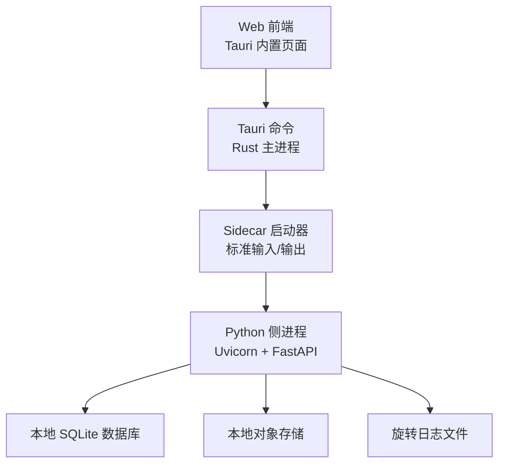
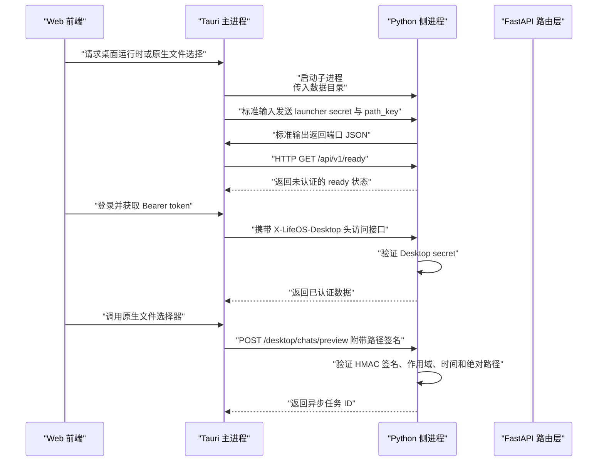
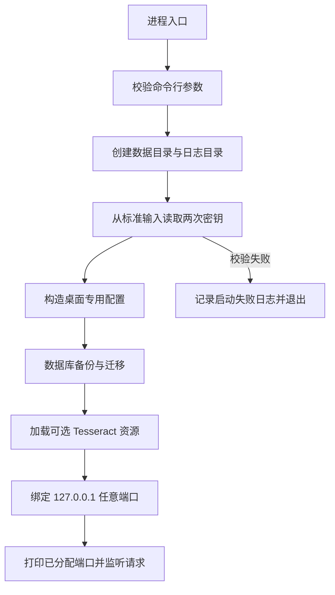
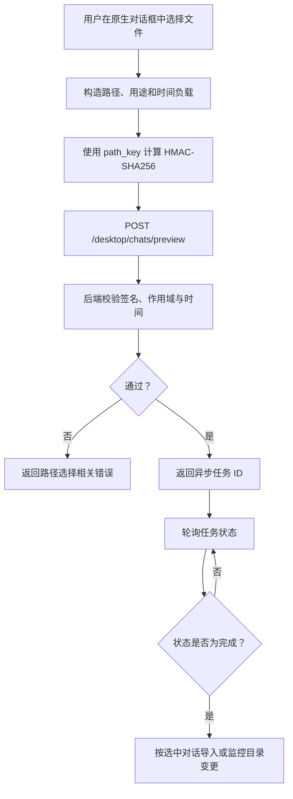
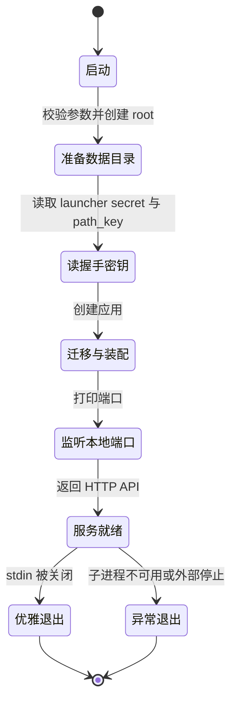
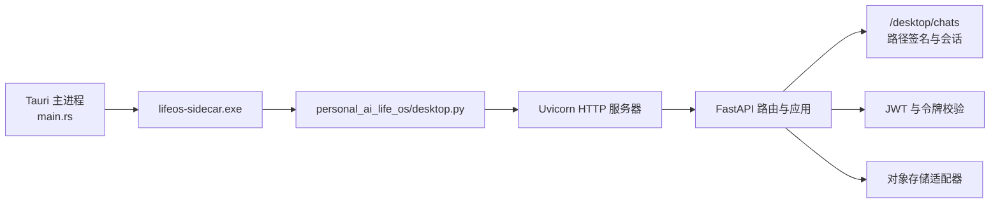

# 侧进程通信机制

<cite>
**本文引用的文件 **
- [desktop.py](file://src/personal_ai_life_os/desktop.py)
- [build-sidecar.ps1](file://desktop/build-sidecar.ps1)
- [main.rs](file://desktop/src-tauri/src/main.rs)
- [tauri.conf.json](file://desktop/src-tauri/tauri.conf.json)
- [smoke-sidecar.py](file://desktop/smoke-sidecar.py)
- [security.py](file://src/personal_ai_life_os/security.py)
- [desktop_chats.py](file://src/personal_ai_life_os/api/routes/desktop_chats.py)
- [privacy.md](file://docs/architecture/privacy.md)
</cite>

## 目录
1. [介绍](#介绍)
2. [项目结构](#项目结构)
3. [核心组件](#核心组件)
4. [架构总览](#架构总览)
5. [详细组件分析](#详细组件分析)
6. [依赖关系分析](#依赖关系分析)
7. [性能与稳定性考虑](#性能与稳定性考虑)
8. [故障排查指南](#故障排查指南)
9. [结论](#结论)
10. [附录：构建产物与部署约束](#附录构建产物与部署约束)

## 介绍
本文档面向桌面端运行中的主应用与 Python 侧进程之间的关系，重点说明以下事项：
- 主进程通过标准输入输出管道启动、认证并连接本地 Python API。
- 侧进程的启动参数、数据目录隔离、随机端口绑定和日志写入方式。
- 路径授权签名协议、令牌验证及跨进程权限边界。
- Python 侧进程的启动、迁移、OCR 资源装配、优雅退出。
- 打包脚本如何构建独立可执行文件并适配 OCR 资源。
- 连接超时、异常恢复、大文件导入以及调试方法。

## 项目结构
本项目的桌面侧涉及两个可执行程序：
- Tauri 主应用：管理窗口、托盘、用户选择文件和侧进程生命周期。
- Python 侧进程：一个仅监听本地回环地址的 FastAPI/Uvicorn 服务，负责数据库迁移、模型处理和本地文件系统操作。



**图表来源**
- [main.rs:10-40](file://desktop/src-tauri/src/main.rs#L10-L40)
- [desktop.py:54-178](file://src/personal_ai_life_os/desktop.py#L54-L178)

**章节来源**
- [desktop.py:54-178](file://src/personal_ai_life_os/desktop.py#L54-L178)
- [main.rs:10-40](file://desktop/src-tauri/src/main.rs#L10-L40)

## 核心组件
- **Sidecar 进程**：Python 入口 `desktop.py`，读取父进程传来的加密密钥和数据目录，创建应用实例、执行数据库迁移，并以循环回环地址运行 Uvicorn 服务器。
- **Tauri 主应用**：Rust 代码负责启动子进程、发送首次握手消息、等待子进程就绪、持有运行时地址和签名密钥，并提供原生文件选择封装。
- **通信通道**：基于子进程的 `stdin` 和 `stdout`，先交换一次握手信息，再通过 HTTP 访问 `/api/v1` 下的路由。
- **路径授权协议**：由主应用用共享随机路径密钥对目标路径负载进行 HMAC-SHA256 签名；后端校验签名、有效期和作用域。
- **会话控制**：大聊天导入使用进程内会话表、取消事件、线程池和状态机，限制并发会话数和最大对话数。

**章节来源**
- [desktop.py:54-178](file://src/personal_ai_life_os/desktop.py#L54-L178)
- [desktop_chats.py:1-200](file://src/personal_ai_life_os/api/routes/desktop_chats.py#L1-L200)
- [main.rs:10-40](file://desktop/src-tauri/src/main.rs#L10-L40)

## 架构总览



**图表来源**
- [main.rs:24-114](file://desktop/src-tauri/src/main.rs#L24-L114)
- [desktop.py:106-178](file://src/personal_ai_life_os/desktop.py#L106-L178)
- [desktop_chats.py:106-200](file://src/personal_ai_life_os/api/routes/desktop_chats.py#L106-L200)

## 详细组件分析

### Python 侧进程：启动参数、数据目录与日志
- 启动参数要求只有一个绝对路径参数，作为用户级数据根目录。如果传参不是绝对路径或缺少参数，会直接记录启动失败日志并退出。
- 数据目录会创建 `logs` 与 `data/lifeos.db`，并使用旋转日志写入 `sidecar.log`，最多保留三个历史文件，单文件上限为一百万字节。
- 应用配置强制覆盖来源，避免继承 Web 环境或云端配置；注册模式为关闭，Access Token Secret 每次生成随机值。
- 数据库迁移前先备份当前库到 `migration-backups`，迁移失败时尝试回滚。
- OCR 可选资源从 PyInstaller `_MEIPASS` 或仓库 `assets/tesseract` 中装配，并将 `tesseract.exe` 与 `tessdata` 环境变量注入到 OCR 运行环境。



**图表来源**
- [desktop.py:21-39](file://src/personal_ai_life_os/desktop.py#L21-L39)
- [desktop.py:41-52](file://src/personal_ai_life_os/desktop.py#L41-L52)
- [desktop.py:87-178](file://src/personal_ai_life_os/desktop.py#L87-L178)

**章节来源**
- [desktop.py:21-39](file://src/personal_ai_life_os/desktop.py#L21-L39)
- [desktop.py:41-52](file://src/personal_ai_life_os/desktop.py#L41-L52)
- [desktop.py:87-178](file://src/personal_ai_life_os/desktop.py#L87-L178)

### Rust 主进程：侧进程启动与连接状态
- `Sidecar::start` 生成新的 launcher secret 和路径签名密钥，创建用户数据目录，以无窗口模式启动 Python 可执行文件。
- 启动后立即向子进程标准输入写入两行文本：launcher secret 和十六进制编码的 path_key。
- 启动后等待子进程的标准输出返回一条 JSON，字段含端口号；超时为四十五秒，端口为零也视为未就绪。
- 成功后将原始二进制密钥转为十六进制字符串保存，同时形成初始运行时地址。
- 优雅停止时先丢弃 stdin，再八秒内轮询进程是否结束；结束后强制终止并清理。
- `Drop` 在 Rust 对象销毁时触发停止；Tauri 应用在退出事件中也清理子进程引用。

```mermaid
flowchart TD
    Enter["桌面运行时或原生文件选择"] --> Running{"子进程是否在运行"}
    Running -->|是| ReturnRuntime["返回缓存的运行时地址与密钥"]
    Running -->|否| Spawn["启动 lifeos-sidecar.exe"]
    Spawn -> Handshake["发送 launcher secret 与 path_key"]
    Handshake -> WaitReady{"收到含端口的就绪消息"}
    WaitReady -->|成功| CacheRuntime["缓存 origin 与 path_key"]
    WaitReady -->|失败| StopChild["停止子进程并报错"]
    CacheRuntime --> ReturnRuntime
```

**图表来源**
- [main.rs:24-114](file://desktop/src-tauri/src/main.rs#L24-L114)
- [main.rs:228-274](file://desktop/src-tauri/src/main.rs#L228-L274)

**章节来源**
- [main.rs:24-114](file://desktop/src-tauri/src/main.rs#L24-L114)
- [main.rs:150-162](file://desktop/src-tauri/src/main.rs#L150-L162)
- [main.rs:275-385](file://desktop/src-tauri/src/main.rs#L275-L385)

### 进程间消息格式与认证协议
- **握手消息（标准输入）**：首行为 launcher secret，次行为长度为六十四的十六进制 path_key。Python 侧严格校验每行长度与十六进制字符集，失败会拒绝启动。
- **就绪消息（标准输出）**：JSON 对象包含端口字段，Tauri 主进程只接受端口非零的结果，并把其解析为十六进制字符串保存到 `path_key`。
- **HTTP 认证头**：侧进程接受带 `X-LifeOS-Desktop` 的请求；该值应与 launcher secret 匹配。
- **CORS 来源**：允许 `http://tauri.localhost` 等来源，测试 smoke 脚本期望响应头包含正确的 `access-control-allow-origin`。
- **JWT 访问令牌**：登录后服务端签发 HS256 JWT，必须包含用户标识、签发时间、过期时间、固定发行者与受众等信息；校验失败则返回未认证。

| 阶段 | 方向 | 载体 | 关键字段 | 错误行为 |
|---|---|---|---|---|
| 初始化握手 | 主进程到侧进程 | 标准输入 | launcher secret、十六进制 path_key | 主进程等待四条五秒后认为未就绪 |
| 就绪通知 | 侧进程到主进程 | 标准输出 | JSON `port` 字段 | 端口为零时报未就绪 |
| 健康检查 | 客户端到侧进程 | HTTP | `X-LifeOS-Desktop` | 缺少或不匹配返回四零一 |
| 文件选择授权 | 主进程到侧进程 | HTTP | 路径签名负载、HMAC-SHA256 签名 | 签名或作用域无效报四零零三 |
| API 访问 | 客户端到侧进程 | HTTP | Bearer JWT | 令牌无效返回未认证 |

**章节来源**
- [desktop.py:94-110](file://src/personal_ai_life_os/desktop.py#L94-L110)
- [main.rs:56-95](file://desktop/src-tauri/src/main.rs#L56-L95)
- [main.rs:248-274](file://desktop/src-tauri/src/main.rs#L248-L274)
- [security.py:24-54](file://src/personal_ai_life_os/security.py#L24-L54)
- [smoke-sidecar.py:65-95](file://desktop/smoke-sidecar.py#L65-L95)

### 本地 API 调用封装与文件权限隔离
- 所有真实磁盘路径不会通过 Tauri 直接传给 Python。主应用调用原生对话框让用户选择文件或文件夹。
- 选择结果被组合成载荷，包括实际路径、用途和发布时间，并用主进程持有的 `path_key` 计算 HMAC-SHA256。
- 后端校验规则包括：签名相等、用途一致、签发时间在正负一百二十秒内、路径必须是绝对路径。
- 大聊天导出预览和导入走 `/desktop/chats` 路由；会话限最高八个并发，超过时阻塞等待；单次预览最多扫描五万条对话。
- 导入过程支持“选中对话”增量导入、本地对象存储持久化、去重作用域和会话取消。
- 安全策略强调用户驱动的数据边界：外部调用需要明确同意；敏感信息不入日志；对象键不暴露给客户端。



**图表来源**
- [main.rs:170-226](file://desktop/src-tauri/src/main.rs#L170-L226)
- [desktop_chats.py:35-104](file://src/personal_ai_life_os/api/routes/desktop_chats.py#L35-L104)
- [desktop_chats.py:106-200](file://src/personal_ai_life_os/api/routes/desktop_chats.py#L106-L200)

**章节来源**
- [main.rs:170-226](file://desktop/src-tauri/src/main.rs#L170-L226)
- [desktop_chats.py:1-200](file://src/personal_ai_life_os/api/routes/desktop_chats.py#L1-L200)
- [privacy.md:1-53](file://docs/architecture/privacy.md#L1-L53)

### Python sidecar 生命周期与优雅退出
- **正常退出**：Python 侧使用 socket 监听主进程 stdin；当主进程关闭 stdin 时，服务线程检测到并设置退出标志，随后 Uvicorn 执行四秒优雅关闭。
- **异常退出保护**：Rust 侧停止函数最多等待八秒让子进程自行结束，否则强制 kill 并重试等待。
- **资源目录**：PyInstaller 把 sidecar 打包进 `lifeos-sidecar.exe`，并通过 tauri.conf 将构建产物复制到安装包的 `sidecar/` 目录。
- **调试包**：Rust debug 模式优先查找环境变量指定目录，否则使用离工程目录更近的 `dist/lifeos-sidecar`。



**图表来源**
- [desktop.py:54-178](file://src/personal_ai_life_os/desktop.py#L54-L178)
- [main.rs:100-114](file://desktop/src-tauri/src/main.rs#L100-L114)
- [tauri.conf.json:15-29](file://desktop/src-tauri/tauri.conf.json#L15-L29)

**章节来源**
- [desktop.py:130-178](file://src/personal_ai_life_os/desktop.py#L130-L178)
- [main.rs:100-114](file://desktop/src-tauri/src/main.rs#L100-L114)
- [main.rs:228-274](file://desktop/src-tauri/src/main.rs#L228-L274)
- [tauri.conf.json:15-29](file://desktop/src-tauri/tauri.conf.json#L15-L29)

### 构建脚本 build-sidecar.ps1
- 若提供 `TesseractDirectory`，会验证 Tesseract 可执行文件和中英文语言包是否存在。
- 通过 `uv run --frozen --python 3.12 --group desktop pyinstaller` 构建 PyInstaller 单目录版本。
- 关键打包项包括：
  - 可执行名称 `lifeos-sidecar`。
  - 输出路径 `desktop/dist`，工作目录 `desktop/build`。
  - 添加 `src` 路径以便找到模块。
  - 复制 `migrations` 为附加数据。
  - 收集 `tzdata`。
  - 隐藏导入 `sqlalchemy.dialects.sqlite.pysqlite` 与桌面模块 `personal_ai_life_os.desktop`。
- 构建成功后，若启用 Tesseract，则将整个 OCR 目录复制到 `_internal/tesseract`，从而跳过 PyInstaller 的普通依赖解析。
- PowerShell 设置 `ErrorActionPreference = Stop`，任何步骤失败都会抛出异常并终止脚本。

**章节来源**
- [build-sidecar.ps1:1-27](file://desktop/build-sidecar.ps1#L1-L27)

### 传输安全与数据边界
- 侧进程绑定 `127.0.0.1`，不开启 Windows 端口对外暴露；Windows Socket 还设置了独占地址使用选项，减少端口竞争风险。
- 启动 secret 由 `getrandom` 生成，path_key 也是独立随机值；launcher secret 用于本地服务鉴权，path_key 用于本机文件选择签名。
- JWT Access Token 使用 HS256，并要求发行者、受众、类型、签名主题、签发时间与过期时间齐全。
- 日志和对象存储都遵循最小数据原则：日志不记录源文本或图像字节；对象键从不返回给客户端；删除时写入删改标记以保障可恢复性。

**章节来源**
- [desktop.py:143-178](file://src/personal_ai_life_os/desktop.py#L143-L178)
- [main.rs:24-40](file://desktop/src-tauri/src/main.rs#L24-L40)
- [security.py:24-54](file://src/personal_ai_life_os/security.py#L24-L54)
- [privacy.md:1-53](file://docs/architecture/privacy.md#L1-L53)

## 依赖关系分析



**图表来源**
- [main.rs:228-274](file://desktop/src-tauri/src/main.rs#L228-L274)
- [desktop.py:106-178](file://src/personal_ai_life_os/desktop.py#L106-L178)
- [desktop_chats.py:1-200](file://src/personal_ai_life_os/api/routes/desktop_chats.py#L1-L200)
- [security.py:24-54](file://src/personal_ai_life_os/security.py#L24-L54)

**章节来源**
- [main.rs:10-40](file://desktop/src-tauri/src/main.rs#L10-L40)
- [desktop.py:106-178](file://src/personal_ai_life_os/desktop.py#L106-L178)
- [desktop_chats.py:1-200](file://src/personal_ai_life_os/api/routes/desktop_chats.py#L1-L200)
- [security.py:24-54](file://src/personal_ai_life_os/security.py#L24-L54)

## 性能与稳定性考虑

### 通信性能优化建议
- 本地管道启动和标准 I/O 握手开销很小；瓶颈通常在于 Python 应用冷启动、数据库迁移和 OCR 加载。
- Uvicorn 默认禁用 WebSocket，仅运行 HTTP h11，减少多余能力。
- 标准错误流对主进程关闭，Python 侧改用旋转日志文件记录运行日志，避免主进程控制台阻塞。
- 大聊天导入应复用已有会话，避免重复扫描完整文件；预览阶段只读取标题元数据，真正导入再读取消息体。

### 连接超时处理
- Tauri 启动后最多等待四十五秒获取子进程端口；超过后报告未就绪并提示查看 `logs/sidecar.log`。
- 停止子进程最多等待八秒；之后强制终止，避免主进程长时间挂起。
- 聊天任务轮询有业务级超时设计：Smoke 脚本中对 OCR 任务等待三十秒并对大文件预览设定较短成功时限。

### 网络异常恢复策略
- 本地 API 仅暴露在回环地址；网络层异常通常反映为进程未启动、端口未就绪或服务崩溃。
- 建议在应用重试前读取 `logs/sidecar.log`，而不是无差别重试。
- 重启时应重建有效会话；会话具有所有权和指纹校验，防止旧会话访问已被修改或删除的文件。

**章节来源**
- [main.rs:70-114](file://desktop/src-tauri/src/main.rs#L70-L114)
- [desktop.py:87-140](file://src/personal_ai_life_os/desktop.py#L87-L140)
- [smoke-sidecar.py:10-45](file://desktop/smoke-sidecar.py#L10-L45)

## 故障排查指南

### 常见启动问题
- 子进程四十五秒未就绪：检查是否有数据库迁移失败、依赖缺失或 Tesseract 资源不完整。
- Python 日志路径：查看用户数据目录下的 `logs/sidecar.log`；Rust 启动失败信息通常会提示查看该日志。
- 参数错误：Python 侧程序需要一个绝对路径参数；相对路径或缺失参数会导致启动失败。

**章节来源**
- [desktop.py:87-110](file://src/personal_ai_life_os/desktop.py#L87-L110)
- [main.rs:68-95](file://desktop/src-tauri/src/main.rs#L68-L95)

### 鉴权与路径选择失败
- 返回四零一：请求缺少正确 `X-LifeOS-Desktop` 头，或其值不对应 launcher secret。
- 返回四零零三：本地原生选择没有参与签名，或签名失效。
- 返回四二二：路径选择过期、不可用、非绝对路径或用途不匹配。
- JWT 无效：刷新登录流程，重新取得访问令牌后再发起受保护请求。

**章节来源**
- [desktop_chats.py:106-200](file://src/personal_ai_life_os/api/routes/desktop_chats.py#L106-L200)
- [security.py:24-54](file://src/personal_ai_life_os/security.py#L24-L54)
- [smoke-sidecar.py:65-95](file://desktop/smoke-sidecar.py#L65-L95)

### 大聊天导入失败
- 对话数超过五万：预览会被拒绝，需缩小范围。
- 会话已满：最多八个活跃会话，应等待旧操作完成或被清理。
- 文件内容变化：文件指纹改变会拒绝预览或导入，应重新打开导出文件。
- 导入部分成功：检查任务状态中的错误信息和最终生成的条目数。

**章节来源**
- [desktop_chats.py:35-104](file://src/personal_ai_life_os/api/routes/desktop_chats.py#L35-L104)
- [desktop_chats.py:142-200](file://src/personal_ai_life_os/api/routes/desktop_chats.py#L142-L200)

### OCR 与构建问题
- Smoke 脚本找不到 Tesseract：确保 `build-sidecar.ps1` 正确复制或设置了 Tesseract 目录。
- PyInstaller 构建失败：检查 Python 3.12、冻结环境、`src/personal_ai_life_os/desktop.py` 是否能被导入。
- OCR 资源缺失：确认 `_internal/tesseract` 中存在 `tesseract.exe` 和对应语言包。

**章节来源**
- [smoke-sidecar.py:47-105](file://desktop/smoke-sidecar.py#L47-L105)
- [build-sidecar.ps1:1-27](file://desktop/build-sidecar.ps1#L1-L27)
- [desktop.py:120-145](file://src/personal_ai_life_os/desktop.py#L120-L145)

## 结论
该侧进程通信机制采用简短可靠的进程管道完成初次握手，随后全部业务通过本地 HTTP API 完成。核心安全点在于：
- 仅在本地回环地址提供服务。
- 使用随机 launcher secret 控制进程身份。
- 使用独立 path_key 对文件路径进行短时效 HMAC 签名。
- 使用受限 JWT 区分匿名与健康检查和用户授权 API。
- 将复杂文件系统操作交给 Python 侧进程，而 Tauri 主进程只负责用户交互和资源编排。

这一分层既保持了系统简单可靠，又明确了主进程、Python 侧进程和本地数据之间的权限边界。

## 附录：构建产物与部署约束

| 配置项 | 含义 | 注意 |
|---|---|---|
| data_dir | 用户使用数据根目录 | 必须是绝对路径，日志、数据库和对象存储均在其下 |
| database_url | 本地 SQLite 数据库 URL | 部署后需将其与对象存储一起备份 |
| access_token_secret | JWT 对称密钥 | 每次运行生成随机值，适合桌面单机场景 |
| cors_origins | 允许的浏览器来源 | 包括 Tauri 开发和本地部署来源 |
| processing_mode | worker 模式 | 表示本地处理 OCR 等任务 |
| TesseractDirectory | 可选 OCR 安装目录 | 构建脚本会复制 `tesseract.exe` 和语言包 |

**章节来源**
- [desktop.py:87-145](file://src/personal_ai_life_os/desktop.py#L87-L145)
- [build-sidecar.ps1:1-27](file://desktop/build-sidecar.ps1#L1-L27)