# 备份管理

<cite>
**本文引用的文件**
- [desktop_backup.py](file://src/personal_ai_life_os/services/desktop_backup.py)
- [backup-production.sh](file://scripts/backup-production.sh)
- [restore-production.sh](file://scripts/restore-production.sh)
- [verify_database_restore.py](file://scripts/verify_database_restore.py)
- [verify_joint_restore.py](file://scripts/verify_joint_restore.py)
- [backup-restore.md](file://docs/operations/backup-restore.md)
- [docker-compose.production.yml](file://docker-compose.production.yml)
- [pyproject.toml](file://pyproject.toml)
</cite>

## 目录
1. [简介](#简介)
2. [项目结构](#项目结构)
3. [核心组件](#核心组件)
4. [架构总览](#架构总览)
5. [组件详细分析](#组件详细分析)
6. [依赖关系分析](#依赖关系分析)
7. [性能与存储特性](#性能与存储特性)
8. [生产环境使用指南](#生产环境使用指南)
9. [恢复流程与一致性校验](#恢复流程与一致性校验)
10. [空间管理与清理策略](#空间管理与清理策略)
11. [监控与告警配置](#监控与告警配置)
12. [故障转移与灾难恢复演练](#故障转移与灾难恢复演练)
13. [故障排查指南](#故障排查指南)
14. [结论](#结论)

## 简介
本文件面向运维、开发与平台安全人员，系统性说明 Personal AI Life OS 的备份与恢复方案。方案覆盖三类能力：
- 桌面端工作区快照：基于 SQLite 的工作区数据库、对象引用和删除暂存区的离线归档与受控恢复。
- 生产环境备份脚本：对 PostgreSQL 与主对象存储桶进行一致性的时间戳快照，并生成可审计的清单。
- 恢复演练与一致性验证：数据库恢复、对象回补、删除日志回放和多存储域一致性检查。

系统同时强调以下关键原则：
- 备份目标必须是独立的存储空间，不得与主数据或应用根目录互相包含。
- 删除操作需要独立的“删除日志桶”以保证幂等和可回放。
- 恢复是侵入性操作，必须暂停在线服务、确认目标备份、执行完整健康检查。

[无具体文件分析内容，故不添加小节来源]

## 项目结构
从备份相关视角看，项目由以下层次组成：
- 运行时服务层：提供桌面端备份服务和 API 健康检查端口。
- 生产备份工具层：使用 Docker Compose、pg_dump/pg_restore 和 AWS CLI 完成库级与对象级的备份。
- 恢复与验证层：提供恢复脚本和 Python 验证脚本，用于单点恢复、联合恢复及删除回放测试。
- 部署定义层：以 Compose 暴露环境变量、启动命令和健康探测。

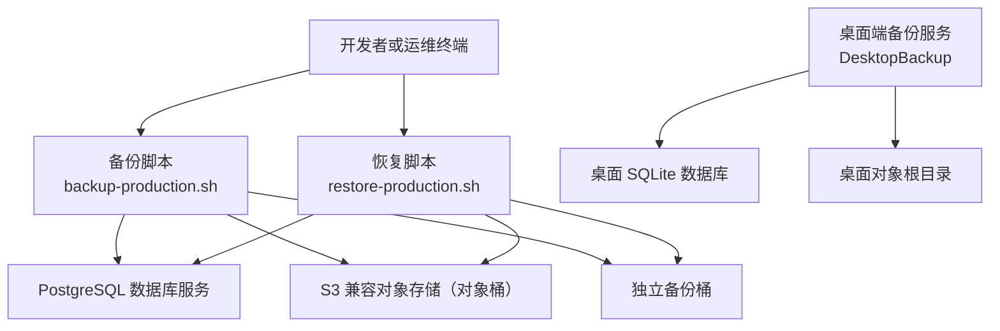

图表来源
- [backup-production.sh:1-55](file://scripts/backup-production.sh#L1-L55)
- [restore-production.sh:1-63](file://scripts/restore-production.sh#L1-L63)
- [desktop_backup.py:1-246](file://src/personal_ai_life_os/services/desktop_backup.py#L1-L246)
- [docker-compose.production.yml:1-101](file://docker-compose.production.yml#L1-L101)

章节来源
- [backup-production.sh:1-55](file://scripts/backup-production.sh#L1-L55)
- [restore-production.sh:1-63](file://scripts/restore-production.sh#L1-L63)
- [desktop_backup.py:1-246](file://src/personal_ai_life_os/services/desktop_backup.py#L1-L246)
- [docker-compose.production.yml:1-101](file://docker-compose.production.yml#L1-L101)

## 核心组件
本项目有两个相互独立但互补的备份子系统：

| 组件 | 主要职责 | 输入 | 输出 | 关键约束 |
|---|---|---|---|---|
| 桌面端备份服务 | 定期捕获桌面工作区状态，创建可恢复归档，并保护对象路径 | 应用根目录、SQLite 数据文件、已注册对象键集合 | zip 格式归档、配置元信息和最近备份列表 | 备份目录必须在应用根目录之外；禁止相对路径逃逸和符号链接访问 |
| 生产备份脚本 | 导出 PostgreSQL dump，同步对象桶内容，写入带加密标识的清单 | Docker Compose、PostgreSQL、AWS CLI、对象桶名称 | 带 ID 的时间戳备份前缀 | 备份桶、主桶、删除日志桶必须分离；要求 AES-256 服务端加密 |

章节来源
- [desktop_backup.py:1-246](file://src/personal_ai_life_os/services/desktop_backup.py#L1-L246)
- [backup-restore.md:1-33](file://docs/operations/backup-restore.md#L1-L33)

## 架构总览
备份体系采用“分层快照 + 时间戳命名 + 删除日志回放”的设计：

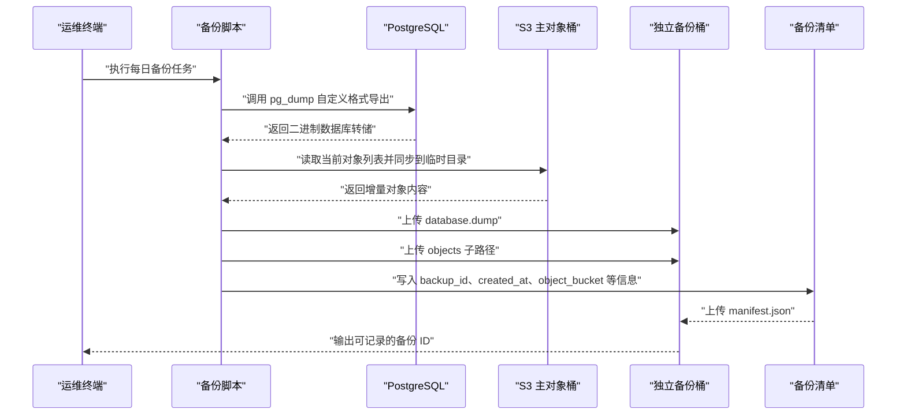

图表来源
- [backup-production.sh:1-55](file://scripts/backup-production.sh#L1-L55)
- [backup-restore.md:1-33](file://docs/operations/backup-restore.md#L1-L33)

该架构图对应的实际行为包括：
- 通过 `docker compose -f docker-compose.production.yml exec` 进入运行中的数据库容器执行 pg_dump。
- 通过 `aws s3 sync` 将主对象的现有内容拷贝到备份桶的同名对象路径下。
- 写入含 bucket 引用和格式的清单，便于恢复时校验删除日志桶的一致性。

章节来源
- [backup-production.sh:1-55](file://scripts/backup-production.sh#L1-L55)

## 组件详细分析

### 桌面端备份服务
桌面备份服务封装了完整的快照生命周期，包括配置校验、定时循环、SQLite 备份、对象键枚举、压缩归档和旧备份清理。

#### 类与方法概览
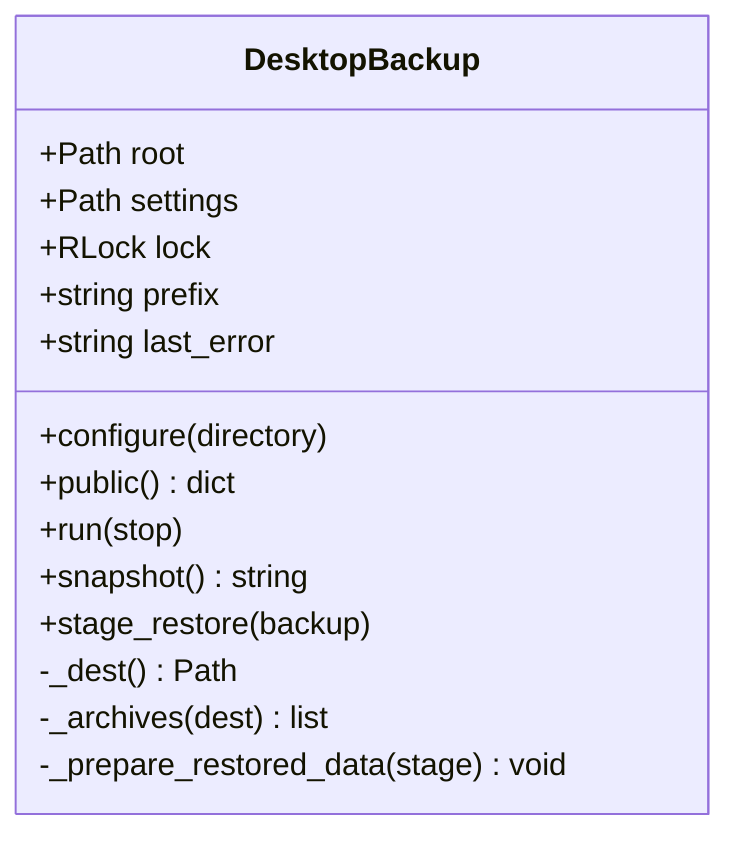

图表来源
- [desktop_backup.py:1-246](file://src/personal_ai_life_os/services/desktop_backup.py#L1-L246)

#### 核心流程一：快照归档
桌面快照不是简单复制工作区目录，而是：
1. 校验配置的备份目录存在、可解析且位于应用根目录之外。
2. 使用 SQLite 的备份接口复制到临时目录，避免直接拷贝可能存在的连接句柄。
3. 遍历 `source_items` 中未删除的对象键，并按固定前缀还原为归档中的相对路径。
4. 可选归档删除暂存区下的记录，使恢复侧能重建删除意图。
5. 使用 ZIP DEFLATE 算法写压缩归档，并在成功完成后重命名以避免部分可读。
6. 保留最新 N 个归档，早期归档由 `_archives()` 排序后裁剪删除。

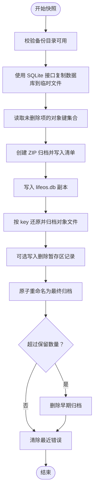

图表来源
- [desktop_backup.py:1-246](file://src/personal_ai_life_os/services/desktop_backup.py#L1-L246)

#### 核心流程二：恢复阶段准备
恢复并不是直接覆盖运行中的数据，而是先 staged 进临时区域，并通过以下步骤增强安全性：
- 检测是否存在等待重启的恢复标记，防止重复入队。
- 限制归档条目数量和总展开大小。
- 校验清单格式是否为内部已知格式，并且清单体积有上限。
- 仅允许白名单成员：数据库、特定 owners 对象、删除暂存区对象。
- 解压时使用不可覆盖的写入语义，防止同名文件静默替换。
- 恢复前执行数据库快速完整性检查，再调整连接状态、清空敏感同意字段，并将未完成的任务标记为取消。

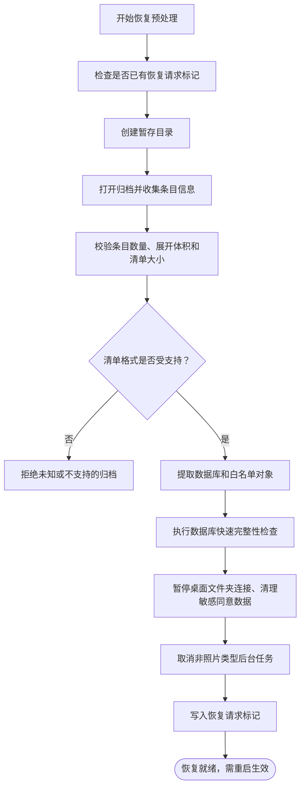

图表来源
- [desktop_backup.py:1-246](file://src/personal_ai_life_os/services/desktop_backup.py#L1-L246)

#### 定时策略与错误处理
- 服务会周期性查询备份目录，如果目录不存在则记录错误；否则判断当天是否已有归档。
- 若没有近期归档，则触发一次快照。
- 失败时不会终止整个进程，而是设置 last_error 并等待下一轮。
- 注意：这不是传统意义上按小时或 cron 精度的“定时备份”，而是一个后台轮询模型。

章节来源
- [desktop_backup.py:1-246](file://src/personal_ai_life_os/services/desktop_backup.py#L1-L246)

### 生产备份脚本
生产备份脚本承担数据库导出、对象同步、清单生成和安全校验职责。

- 参数和环境变量：
  - `.env` 被自动加载。
  - 必须设置 `S3_BUCKET`、`S3_DELETION_JOURNAL_BUCKET`、`BACKUP_S3_URI`、`POSTGRES_DB`、`POSTGRES_USER`。
  - 额外需要 `docker`、`aws` 命令。
- 安全策略：
  - 校验 S3 URI 符合 `s3://bucket[/prefix]`。
  - 禁止备份桶与主桶相同。
  - 禁止删除日志桶与主桶或备份桶相同。
- 备份步骤：
  - 使用时间戳生成本次 `BACKUP_ID`。
  - 在容器内执行 pg_dump，格式为 `custom`。
  - 上传数据库转储、同步主对象桶内容和清单到备份桶。
  - 打印备份 ID 和操作提醒。

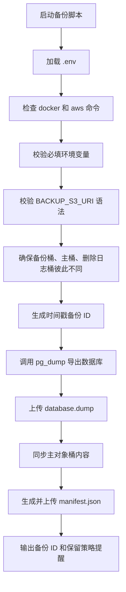

图表来源
- [backup-production.sh:1-55](file://scripts/backup-production.sh#L1-L55)

章节来源
- [backup-production.sh:1-55](file://scripts/backup-production.sh#L1-L55)

### 恢复脚本与验证脚本
恢复脚本与验证脚本分别面向两个场景：
- 生产恢复：交互式确认、停止在线服务、恢复对象、恢复数据库、重启并提示健康检查。
- 本地验证：构造源数据、模拟删后状态、执行数据库导入并验证删除逻辑是否正确回放。

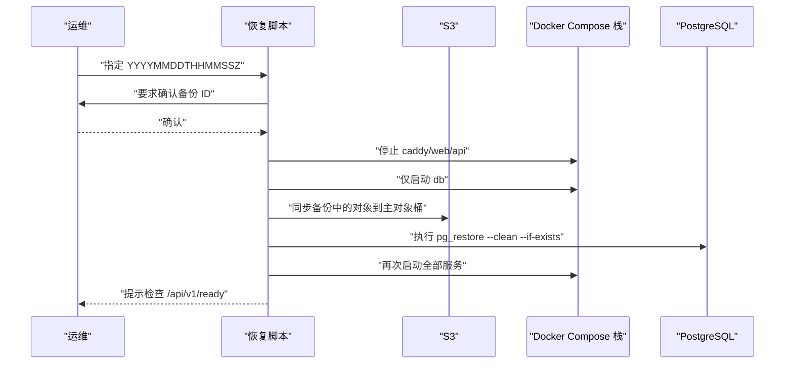

图表来源
- [restore-production.sh:1-63](file://scripts/restore-production.sh#L1-L63)

章节来源
- [restore-production.sh:1-63](file://scripts/restore-production.sh#L1-L63)
- [verify_database_restore.py:1-100](file://scripts/verify_database_restore.py#L1-L100)

## 依赖关系分析

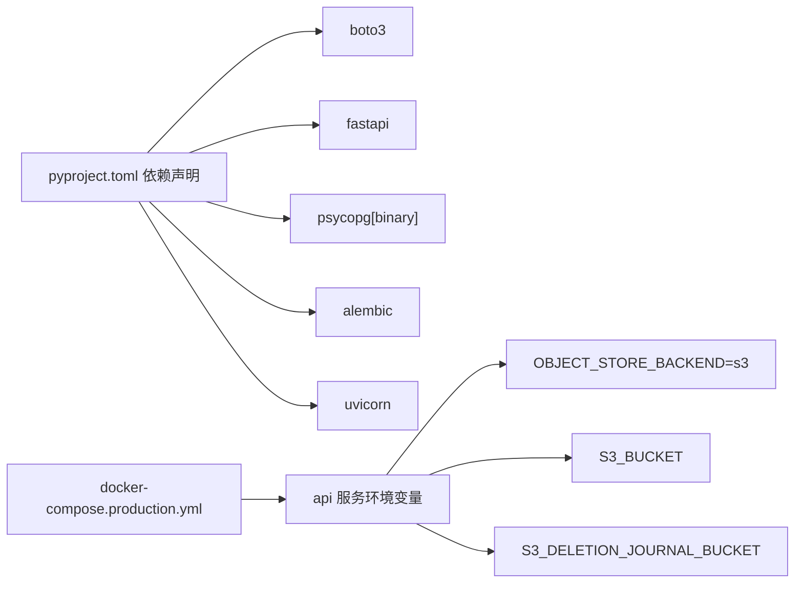

图表来源
- [pyproject.toml:1-58](file://pyproject.toml#L1-L58)
- [docker-compose.production.yml:14-69](file://docker-compose.production.yml#L14-L69)

关键依赖含义：
- `boto3` 使 API 能够读写 S3 兼容对象存储。
- `psycopg[binary]` 提供 Python 对 PostgreSQL 的连接能力。
- `alembic` 负责迁移，生产服务启动时会执行 `alembic upgrade head`。
- `uvicorn` 作为 ASGI 服务器启动 FastAPI 应用。
- Compose 定义 api 和 db 的健康检查，以便外部编排系统识别恢复进度。

章节来源
- [pyproject.toml:1-58](file://pyproject.toml#L1-L58)
- [docker-compose.production.yml:1-101](file://docker-compose.production.yml#L1-L101)

## 性能与存储特性
本节总结备份相关实现的性能与安全行为，不提供主观基准值，因为仓库中没有统一的自动化基准集。

| 特性 | 实现细节 | 影响 |
|---|---|---|
| 桌面归档压缩 | 使用 ZIP DEFLATE，压缩级别为默认中等偏保守等级 | 平衡压缩率与 CPU 占用，适合桌面级磁盘备份 |
| 数据库备份 | pg_dump 自定义格式 | 支持高效增量/差异恢复选项，但脚本整体按完整备份管理 |
| 对象同步 | `aws s3 sync` | 依赖 AWS CLI 的并发同步，通常适合多对象吞吐 |
| 对象数量限制 | 桌面恢复阶段限制归档条目数量、展开总体积和清单大小 | 防御超大或恶意归档造成内存或磁盘压力 |
| 加密选项 | 生产脚本使用 `--sse AES256` | 对象落盘由云服务侧默认加密；密钥管理由 S3 服务端保障 |
| 完整性校验 | 桌面恢复对数据库执行快速检查；生产恢复依赖 pg_restore 和对象清单 | 不能替代业务层面的端到端数据核对 |

章节来源
- [desktop_backup.py:1-246](file://src/personal_ai_life_os/services/desktop_backup.py#L1-L246)
- [backup-production.sh:1-55](file://scripts/backup-production.sh#L1-L55)

[本节为通用技术解释，不直接逐行分析代码，因此不附加额外“小节来源”。]

## 生产环境使用指南

### 前置条件
- 操作系统具备 Bash、Docker Compose、AWS CLI。
- 部署主机具有生产主对象桶、独立备份桶和独立删除日志桶的读写权限。
- 项目根目录的 `.env` 已配置所有必填变量。

### 环境变量清单
| 变量 | 用途 | 必填 | 重要规则 |
|---|---|---:|---|
| `S3_BUCKET` | 主对象存储桶 | 是 | 不能用作备份桶 |
| `S3_DELETION_JOURNAL_BUCKET` | 删除日志桶 | 是 | 不能与主桶或备份桶相同 |
| `BACKUP_S3_URI` | 备份目标 S3 URI | 是 | 必须符合 `s3://bucket[/prefix]` |
| `POSTGRES_DB` | 数据库名 | 是 | 与生产数据库配置一致 |
| `POSTGRES_USER` | 数据库用户名 | 是 | 与生产数据库配置一致 |

章节来源
- [backup-production.sh:1-55](file://scripts/backup-production.sh#L1-L55)
- [restore-production.sh:1-63](file://scripts/restore-production.sh#L1-L63)

### 执行备份
运行：
- `bash scripts/backup-production.sh`

它应产生一个 UTC 时间戳形式的 `BACKUP_ID`，并打印相应提醒。建议将该 ID 与已部署镜像版本一起记录，不要写入凭证或用户原始数据。

章节来源
- [backup-restore.md:7-21](file://docs/operations/backup-restore.md#L7-L21)

### 执行恢复
运行：
- `bash scripts/restore-production.sh <YYYYMMDDTHHMMSSZ>`

脚本要求：
- 备份 ID 符合严格的时间模式。
- 手动输入相同备份 ID 才能继续。
- 停止 caddy、web、api，仅启动 db。
- 将备份中的对象同步回主对象桶，随后执行 pg_restore。
- 重新启动服务并提示验证健康端点和典型数据。

章节来源
- [restore-production.sh:1-63](file://scripts/restore-production.sh#L1-L63)
- [backup-restore.md:23-33](file://docs/operations/backup-restore.md#L23-L33)

## 恢复流程与一致性校验

### 单点数据库恢复演练
本地验证脚本会在隔离开发栈中进行：
1. 通过测试账户创建资源。
2. 获取当前数据库快照。
3. 模拟删除一条源码后导入的项目。
4. 在新数据库中执行恢复。
5. 运行一段验证脚本，检查删除是否在恢复后再被正确回放，而未被删除的控制对象仍可读取。

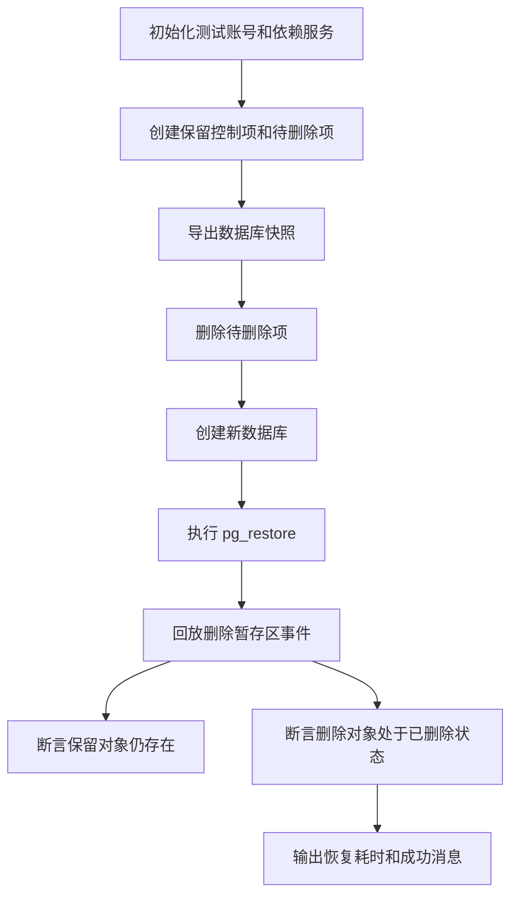

图表来源
- [verify_database_restore.py:1-100](file://scripts/verify_database_restore.py#L1-L100)

章节来源
- [verify_database_restore.py:1-100](file://scripts/verify_database_restore.py#L1-L100)

### 联合恢复与删除日志回放
联合恢复脚本更贴近“数据库和主对象桶同时丢失”的场景，包括：
- 使用本地 S3 模拟器或兼容后端创建主桶、恢复桶、删除日志桶。
- 创建多个账号和资源，模拟跨租户的数据可见性。
- 对单个对象制造损坏和不可用情况，验证删除流程和幂等性。
- 删除主桶和数据库，再恢复到新实例与新桶。
- 恢复后确认删除对象不可读、保留对象可读且内容不变。

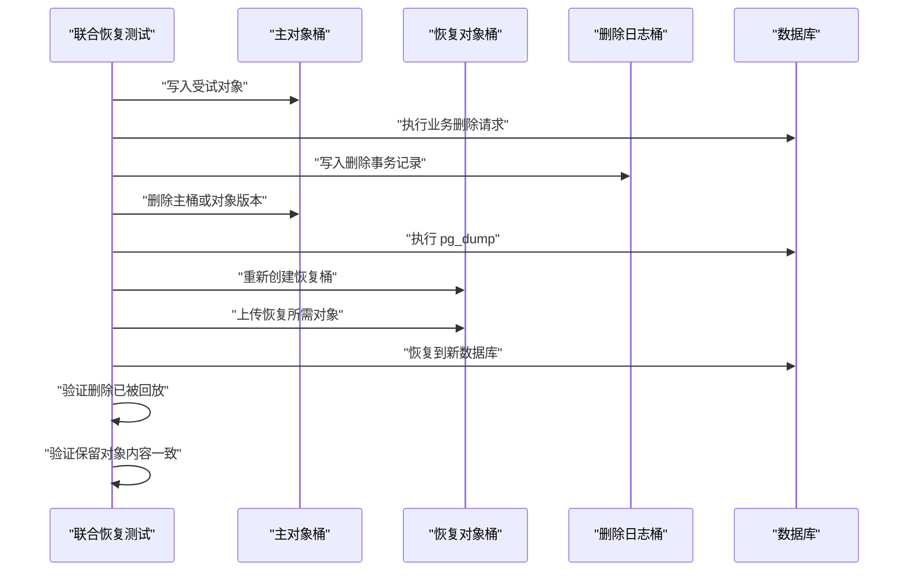

图表来源
- [verify_joint_restore.py:1-173](file://scripts/verify_joint_restore.py#L1-L173)

章节来源
- [verify_joint_restore.py:1-173](file://scripts/verify_joint_restore.py#L1-L173)

## 空间管理与清理策略

| 范围 | 行为 | 注意事项 |
|---|---|---|
| 桌面端归档 | 保留最新若干份 ZIP 归档，其余被删除 | 保留数量硬编码在当前实现中；不适合长期合规归档 |
| 生产对象同步 | 同步的是主桶当前对象集合，而非增量流式差异 | 多次同步会增加备份桶存储空间和传输成本 |
| 清理策略来源 | 文档指出备份前缀的生命周期通常为 35 天 | 生命周期是运维策略，不是 API 或脚本强制行为 |
| 删除数据可见性 | 不应在公开保留窗口结束前声称某删除已完成 | 需要核查所有备份前缀的生命周期状态 |

章节来源
- [desktop_backup.py:1-246](file://src/personal_ai_life_os/services/desktop_backup.py#L1-L246)
- [backup-restore.md:1-33](file://docs/operations/backup-restore.md#L1-L33)

## 监控与告警配置

### 健康端点
- 生产 Compose 对 api 服务执行 `/api/v1/ready` 健康检查，并在服务启动后反复探测。
- 恢复脚本完成后，应人工或通过自动化系统检查该端点。

### 关键观察指标
| 指标 | 推荐采集方式 | 告警建议 |
|---|---|---|
| 备份任务成功与否 | 监控备份脚本退出码和标准输出 | 连续失败应触发工单 |
| 数据库导出文件大小 | 监控 `database.dump` 大小异常变化 | 突增可能表示数据膨胀或异常对象 |
| 备份桶前缀数量和生命周期 | 使用云厂商桶对象列表或生命周期规则 API | 接近 35 天过期时应通知保留策略变更风险 |
| API 可用性 | 健康探针和外部探测服务 | 恢复后仍不可用应阻断流量恢复 |
| 删除日志桶写入失败 | 应用错误或 S3 上传错误日志 | 删除日志不可用会导致未来恢复边界模糊 |

章节来源
- [docker-compose.production.yml:34-64](file://docker-compose.production.yml#L34-L64)
- [backup-restore.md:1-33](file://docs/operations/backup-restore.md#L1-L33)

## 故障转移与灾难恢复演练

### 故障转移模型
- 常规恢复：主数据库或主对象桶发生故障时，优先使用最近一次成功备份恢复。
- 复合恢复：数据库和主对象桶同时丢失时，恢复数据库并切换到新的主对象桶，但仍需依赖独立的删除日志桶回放恢复时间点之后的删除动作。
- 对象不可用时：删除事务必须先写入日志，即使后续对象删除失败，也要保证恢复后可统一回放。

### 演练步骤
参考仓库提供的两种演练方式：
1. 仅数据库恢复演练：在本地迭代环境中执行数据库创建、恢复、删除回放和数据验证。
2. 联合恢复演练：借助 Moto 或其他 S3 模拟服务构建主桶、恢复桶和日志桶，主动破坏数据后再恢复。

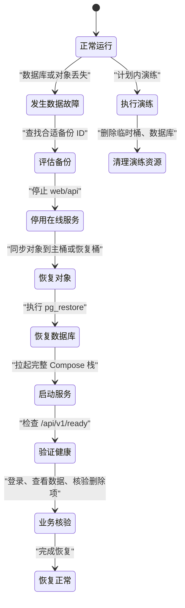

图表来源
- [restore-production.sh:1-63](file://scripts/restore-production.sh#L1-L63)
- [verify_joint_restore.py:1-173](file://scripts/verify_joint_restore.py#L1-L173)
- [backup-restore.md:1-33](file://docs/operations/backup-restore.md#L1-L33)

章节来源
- [verify_joint_restore.py:1-173](file://scripts/verify_joint_restore.py#L1-L173)
- [backup-restore.md:1-33](file://docs/operations/backup-restore.md#L1-L33)

## 故障排查指南

| 现象 | 可能原因 | 处理方法 |
|---|---|---|
| 备份脚本报错找不到命令 | 未安装 docker 或 aws | 在安装环境或使用包含依赖的宿主机 |
| BACKUP_S3_URI 格式不合法 | URI 不符合预期规范 | 修正为 `s3://bucket[/prefix]` 形式 |
| 备份桶等于主桶 | 安全策略拒绝 | 将备份数据写入独立桶 |
| 删除日志桶与主桶或备份桶重合 | 故障域不独立 | 申请并配置独立的删除日志桶 |
| 数据库导出为空或为空串 | 网络错误、权限不足或数据库不可用 | 检查容器、凭据、数据库连接和用户权限 |
| 恢复时对象与删除日志桶不一致 | 所选备份来自不同日志桶 | 先对删除日志做一致性对齐，不盲目恢复 |
| 桌面归档恢复被拒绝 | 清单格式不支持、对象缺失、路径不安全 | 重新生成受支持的归档，检查对象完整性 |
| 恢复后 API 仍不健康 | 迁移失败、连接配置错误或服务未正常启动 | 查看容器日志、数据库迁移记录和 ready 探测响应 |

章节来源
- [backup-production.sh:1-55](file://scripts/backup-production.sh#L1-L55)
- [restore-production.sh:1-63](file://scripts/restore-production.sh#L1-L63)
- [desktop_backup.py:1-246](file://src/personal_ai_life_os/services/desktop_backup.py#L1-L246)

## 结论
本项目的备份设计强调三点：
- 明确的分层：桌面工作区归档、生产数据库与对象快照、独立删除日志。
- 明确的边界：备份桶、主桶、删除日志桶相互隔离；恢复目标需经命令行和环境变量双重约束。
- 明确的验证：不仅恢复数据库和对象，还要回放删除事件并验证健康与健康后的关键数据。

对于企业化生产环境，建议在此基础上增加：
- 自动化备份调度和失败重试，而不是依赖手工或简单循环轮询。
- 基于云托管方案的增量备份、版本控制和生命周期自动化检查。
- 备份任务的可观测性指标、延迟分布、对象计数和失败率。
- 定期灾难恢复演练报告，包括恢复时长、数据损失窗口和业务验收结果。

[本节为总结性内容，不直接分析具体代码文件，故不添加“小节来源”。]