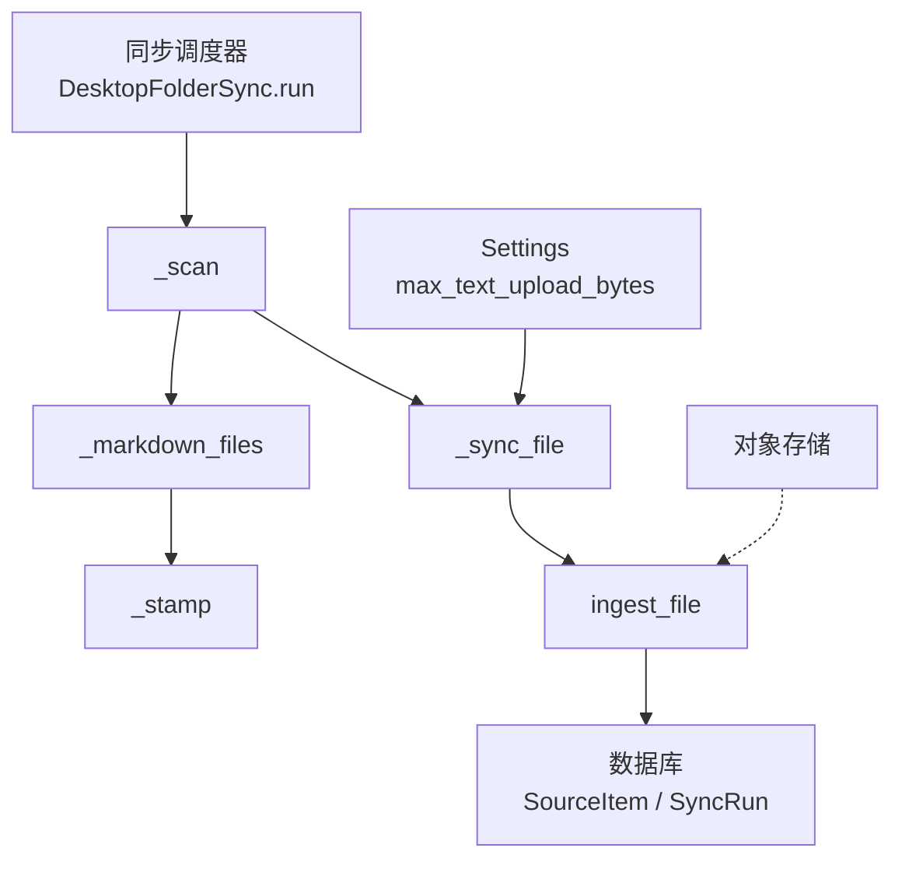
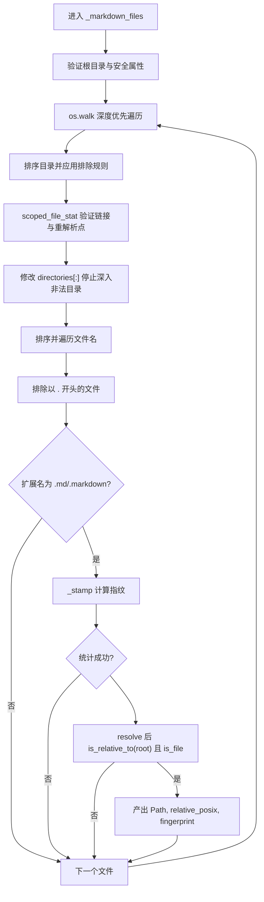
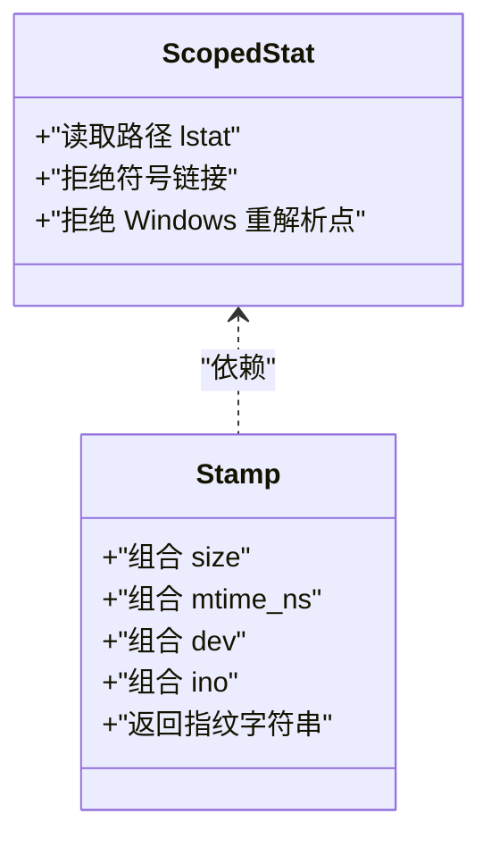
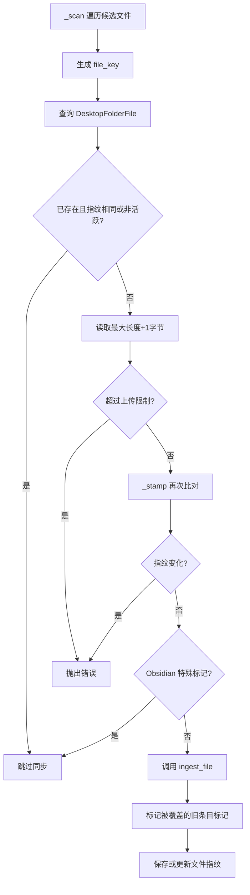
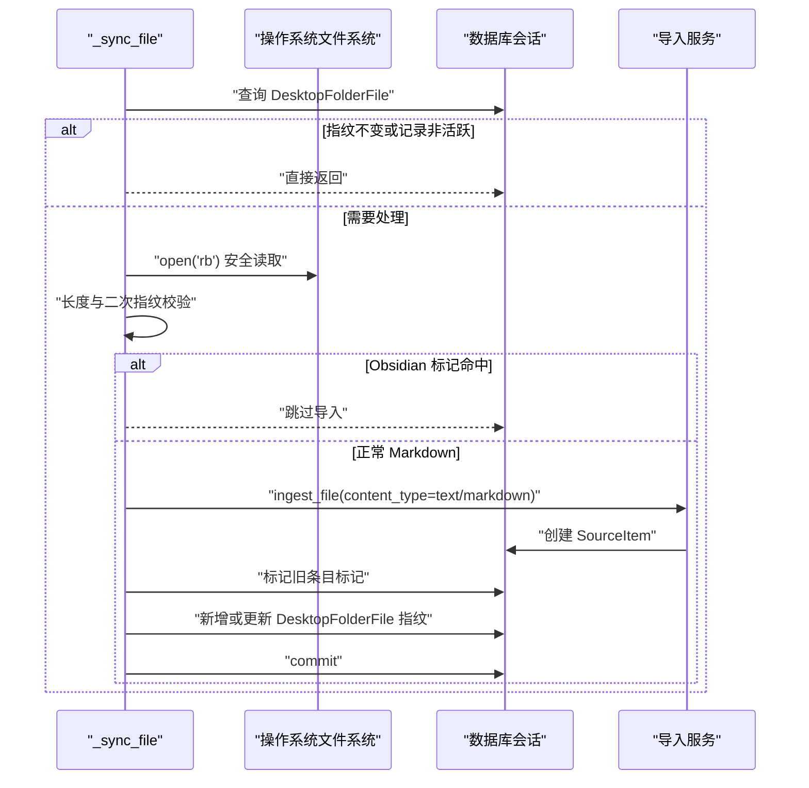
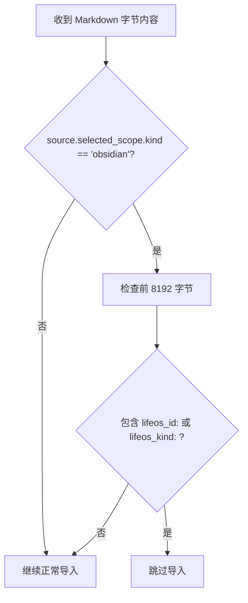
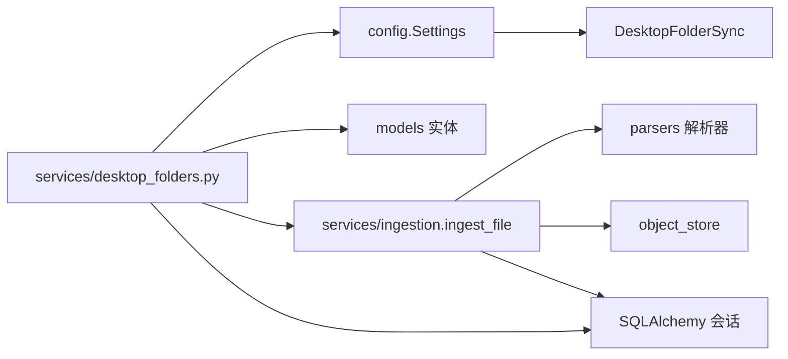

# Markdown 文件同步

<cite>
**本文引用的文件**   
- [desktop_folders.py](file://src/personal_ai_life_os/services/desktop_folders.py)
- [ingestion.py](file://src/personal_ai_life_os/services/ingestion.py)
- [config.py](file://src/personal_ai_life_os/config.py)
</cite>

## 目录
1. [简介](#简介)
2. [项目结构定位](#项目结构定位)
3. [核心组件总览](#核心组件总览)
4. [架构视图](#架构视图)
5. [详细组件分析](#详细组件分析)
6. [依赖关系分析](#依赖关系分析)
7. [性能优化建议](#性能优化建议)
8. [故障排查指南](#故障排查指南)
9. [结论](#结论)

## 简介
本文针对桌面端 Markdown 文件同步能力进行技术文档化。重点覆盖以下方面：
- `_markdown_files` 文件的扫描策略，包括 `os.walk` 的使用方式、排除目录规则、`.md` 与 `.markdown` 识别逻辑。
- 指纹计算函数 `_stamp` 的设计原理与安全性考虑。
- 增量同步流程：已有文件的指纹比较、新文件的入库处理。
- `_sync_file` 的完整处理链路：权限验证、大小校验、变更检测、Obsidian Vault 特殊过滤、调用导入服务、关联数据更新。
- Obsidian Vault 中 `lifeos_id` 与 `lifeos_kind` 标记的识别规则。
- 大文件保护机制（`max_text_upload_bytes`）、并发安全（`RLock`）和错误分类。
- 同步性能优化方向，包括批量处理、索引与缓存策略。

## 项目结构定位
Markdown 文件同步能力由 Python 后端中的桌面文件夹服务提供，核心位于 services 层，并与导入服务和配置模块协作：
- 同步入口：DesktopFolderSync 定时轮询激活状态的桌面文件夹连接。
- 文件发现：_markdown_files 负责递归遍历并筛选可同步的 Markdown 文件。
- 文件处理：DesktopFolderSync._sync_file 完成安全读取、内容消费与记录更新。
- 导入管道：ingest_file 将文本转换为系统内的 SourceItem，并完成元数据及关联项管理。
- 配置边界：max_text_upload_bytes 限制单次文本上传大小，防止内存与存储压力。



**图表来源**   
- [desktop_folders.py:100-150](file://src/personal_ai_life_os/services/desktop_folders.py#L100-L150)
- [desktop_folders.py:281-335](file://src/personal_ai_life_os/services/desktop_folders.py#L281-L335)
- [desktop_folders.py:43-89](file://src/personal_ai_life_os/services/desktop_folders.py#L43-L89)
- [ingestion.py:1-180](file://src/personal_ai_life_os/services/ingestion.py#L1-L180)
- [config.py:39-41](file://src/personal_ai_life_os/config.py#L39-L41)

## 核心组件总览
- 桌面文件夹同步类 DesktopFolderSync：负责周期扫描、增量比较、失败状态写入。
- 文件扫描生成器 _markdown_files：以受限方式遍历文件系统，返回候选文件及其相对路径和本地指纹。
- 文件操作原子锁 mutation_lock：保证同一源的写操作串行，避免并发竞态。
- 导入函数 ingest_file：根据源类型解析 Markdown、文档、对话、照片、日历等，产出系统内 Item 集合。
- 设置 Settings：包含 max_text_upload_bytes 等导入上限和对象存储、模型等配置。

**章节来源**   
- [desktop_folders.py:100-150](file://src/personal_ai_life_os/services/desktop_folders.py#L100-L150)
- [desktop_folders.py:281-335](file://src/personal_ai_life_os/services/desktop_folders.py#L281-L335)
- [ingestion.py:1-180](file://src/personal_ai_life_os/services/ingestion.py#L1-L180)
- [config.py:39-41](file://src/personal_ai_life_os/config.py#L39-L41)

## 架构视图
同步主循环按固定间隔检查活跃源，逐个触发扫描；每个源的文件扫描和同步通过会话上下文隔离，但写路径使用全局互斥锁保护，确保桌面文件夹文件记录和源状态一致。

```mermaid
sequenceDiagram
    participant Loop as "DesktopFolderSync.run"
    participant Session as "SQLAlchemy 会话"
    participant Folder as "桌面文件夹记录"
    participant Scanner as "_markdown_files"
    participant Worker as "_sync_file"
    participant Parser as "ingest_file"

    Loop->>Session: "查询活跃源"
    Loop->>Loop: "_scan(source_id)"
    Loop->>Folder: "加载桌面文件夹记录"
    Loop->>Scanner: "递归枚举 Markdown 文件"
    loop 对每个候选文件
        Loop->>Worker: "传入文件路径、相对路径、键、指纹"
        Worker->>Session: "查找 DesktopFolderFile 记录"
        alt 指纹相同或记录非活跃
            Worker-->>Loop: "跳过"
        else 新文件或更新
            Worker->>Worker: "安全读取与尺寸/变更校验"
            Worker->>Parser: "调用导入"
            Parser->>Session: "持久化条目"
            Worker->>Session: "更新已删除或废弃条目状态"
            Worker->>Session: "保存或更新文件指纹"
        end
    end
    Loop->>Folder: "写入最后扫描时间与扫描状态"
```

**图表来源**   
- [desktop_folders.py:100-150](file://src/personal_ai_life_os/services/desktop_folders.py#L100-L150)
- [desktop_folders.py:281-335](file://src/personal_ai_life_os/services/desktop_folders.py#L281-L335)
- [desktop_folders.py:43-89](file://src/personal_ai_life_os/services/desktop_folders.py#L43-L89)
- [ingestion.py:1-180](file://src/personal_ai_life_os/services/ingestion.py#L1-L180)

## 详细组件分析

### 文件扫描算法 `_markdown_files`
该函数是同步的第一环，目的是在受控目录中发现所有应被同步的 Markdown 文件。关键行为如下：
- 根路径验证：使用 scoped_file_stat 校验根路径非链接、非重解析点；同时要求 root.resolve() == root 且类型为目录，否则抛出 OSError。
- 遍历策略：使用 os.walk 递归遍历，followlinks=False，避免跟随软链接导致的安全逃逸。
- onerror 行为：自定义 on_error 直接抛出异常，使无法访问的子目录直接中断当前 walk。
- 子目录过滤：
  - 先对 directories 排序，再按名称判断。
  - 若名称忽略大小写后属于 EXCLUDED_DIRECTORIES，或名称以 "." 开头，则丢弃。
  - 剩余目录同样经过 scoped_file_stat 验证，链接或 Windows 重解析点会被跳过。
  - 将允许的子目录写回 directories[:]，从而阻止 os.walk 继续进入这些目录。
- 文件过滤：
  - 文件名以 "." 开头的文件直接丢弃。
  - 扩展名必须为 ".md" 或 ".markdown"，忽略大小写。
  - 使用 _stamp 计算本地指纹，失败时跳过该文件。
  - 使用 candidate.resolve(strict=True).is_relative_to(root) 再次确认最终解析路径仍在授权根下，且必须是普通文件，然后产出三元组：实际 Path、POSIX 风格相对路径、指纹字符串。

复杂度分析：
- 时间复杂度近似 O(N + D)，N 为遍历到的文件和子目录数量，D 为被显式扫描过的子目录数。每次扫描都产生 stat 开销，整体与磁盘 I/O 相关。
- 空间复杂度较低，主要为当前层级目录列表与结果生成器。



**图表来源**   
- [desktop_folders.py:43-89](file://src/personal_ai_life_os/services/desktop_folders.py#L43-L89)

**章节来源**   
- [desktop_folders.py:43-89](file://src/personal_ai_life_os/services/desktop_folders.py#L43-L89)

### 排除目录规则 `EXCLUDED_DIRECTORIES`
默认排除以下目录：
- `.obsidian`：Obsidian 私有数据目录。
- `.git`：版本控制目录。
- `.trash`：回收站目录。
- `$recycle.bin`：Windows 回收站。
- `system volume information`：系统卷信息目录。
- `lifeos-exports`：LifeOS 导出目录，避免无限互相导入。

该集合用于 _markdown_files 中对子目录名的 casefold 匹配，同时还会额外排除任意以 "." 开头的目录，实现“隐藏目录即跳过”的安全默认值。

**章节来源**   
- [desktop_folders.py:29](file://src/personal_ai_life_os/services/desktop_folders.py#L29)
- [desktop_folders.py:68-79](file://src/personal_ai_life_os/services/desktop_folders.py#L68-L79)

### 文件指纹计算 `_stamp`
_stamp 通过对单个路径执行 scoped_file_stat，获取以下四项信息并拼接为字符串：
- st_size：文件大小（字节）。
- st_mtime_ns：纳秒级修改时间。
- st_dev：设备 ID。
- st_ino：inode 号。

返回值形如 `"size:mtime_ns:dev:ino"`。其设计优点是可跨平台区分不同设备上的同名文件；缺点是 inode 在非 UNIX 文件系统上语义可能较弱，且 mtime 依赖时钟精度。

安全补充：
- scoped_file_stat 拒绝符号链接与 Windows 重解析点，防止通过快捷方式绕过授权根。
- _markdown_files 和 _sync_file 再次检查最终路径是否在授权根下，形成双层校验。



**图表来源**   
- [desktop_folders.py:36-45](file://src/personal_ai_life_os/services/desktop_folders.py#L36-L45)

**章节来源**   
- [desktop_folders.py:36-45](file://src/personal_ai_life_os/services/desktop_folders.py#L36-L45)

### 增量同步与新旧文件处理
同步调度器会遍历活跃的桌面文件夹源。对每个文件，主要判断：
1. 是否已经存在 DesktopFolderFile 记录。
2. 如果存在记录，且指纹与本次扫描指纹相同，或者记录状态不是 active，则跳过。
3. 只有当记录不存在，或记录指纹不一致时，才会进入 _sync_file。

新文件流程：
- 使用 path_key(relative) 生成稳定的文件键。
- 打开二进制流，读取 max_text_upload_bytes + 1 字节。
- 读取后再用 _stamp 对比，防止读写期间文件变化导致的时间窗竞态。
- 调用 ingest_file 解析 Markdown 并写入系统条目。
- 比较旧条目与最新解析条目，将未出现的新条目标记为 superseded。
- 新增或更新 DesktopFolderFile 记录的指纹，并提交事务。

旧文件流程：
- 若指纹不变，跳过全部解析，节省 CPU 与 IO。
- 仅当指纹改变时才重新读取和导入。



**图表来源**   
- [desktop_folders.py:210-313](file://src/personal_ai_life_os/services/desktop_folders.py#L210-L313)
- [desktop_folders.py:281-313](file://src/personal_ai_life_os/services/desktop_folders.py#L281-L313)

**章节来源**   
- [desktop_folders.py:210-313](file://src/personal_ai_life_os/services/desktop_folders.py#L210-L313)
- [desktop_folders.py:281-313](file://src/personal_ai_life_os/services/desktop_folders.py#L281-L313)

### 文件处理方法 `_sync_file` 完整链路
_sync_file 从参数 source、file、relative、key、fingerprint 开始，依次执行：
1. 权限验证：不在此函数内部再次检查 root；权限在前置步骤由 _markdown_files、scoped_file_stat 和外部作用域保障。source 的状态在 _scan 内确认，若失效则提前返回。
2. 已有指纹快速返回：存在记录且指纹一致或记录非 active，直接 return。
3. 安全读取：以二进制模式 open，只读，读取 bytes 数量 = config.max_text_upload_bytes + 1。
4. 大小保护：如果读入长度大于限制，报错；这有效防止超大量文件耗尽内存。
5. 变更检测：再次调用 _stamp(file) 对比扫描阶段的原始指纹，防御扫描到读取期间的文件替换、截断或扩容。
6. Obsidian Vault 特殊规则：
   - 当 source.selected_scope 中 desktop_folder_kind == "obsidian"。
   - 且 content[:8192] 中包含 b"lifeos_id:" 或 b"lifeos_kind:"。
   - 直接跳过该文件，避免把 LifeOS 专用标注文件重新导入为普通 Markdown。
7. 导入：调用 ingest_file，指定 content_type="text/markdown"，传递用户名时区、桌面文件 key 与相对路径。
8. 清理旧引用：取出本次导入产生的 current_ids，将与本文件对应的 SourceItem 中不在新集合中的现有活动项标记为非当前项，并使用 mark_item_evidence_unavailable 将其证据标记为 superseded。
9. 记录更新：若无历史文件记录则新建 DesktopFolderFile，否则更新 fingerprint，最后提交会话事务。



**图表来源**   
- [desktop_folders.py:281-313](file://src/personal_ai_life_os/services/desktop_folders.py#L281-L313)
- [ingestion.py:1-180](file://src/personal_ai_life_os/services/ingestion.py#L1-L180)

**章节来源**   
- [desktop_folders.py:281-313](file://src/personal_ai_life_os/services/desktop_folders.py#L281-L313)
- [ingestion.py:1-180](file://src/personal_ai_life_os/services/ingestion.py#L1-L180)

### Obsidian Vault 特殊处理规则
代码中没有对 vault 根做语法解析，而是基于二进制前缀检测：
- 条件前提：source.selected_scope["desktop_folder_kind"] == "obsidian"。
- 检测范围：content 的前 8192 字节。
- 检测关键词：b"lifeos_id:" 或 b"lifeos_kind:"。
- 行为：命中任一标记时直接跳过 ingest_file，避免 Obsidian 插件生成的带 LifeOS 标记的文件被重复建模为常规条目。

注意：这不是对 Frontmatter YAML 字段 name=lifeos_id 等字面意义上的键解析，而是简单字节串匹配，因此只要任意位置出现这些前缀都会触发跳过。



**图表来源**   
- [desktop_folders.py:292-295](file://src/personal_ai_life_os/services/desktop_folders.py#L292-L295)

**章节来源**   
- [desktop_folders.py:292-295](file://src/personal_ai_life_os/services/desktop_folders.py#L292-L295)

### 大文件保护、并发安全与错误分类
#### 大文件保护
- max_text_upload_bytes：默认 5MB，定义于 Settings。
- _sync_file 读取长度为 limit + 1，一旦读到更多字节即判定超出限制，抛出 ValueError。
- ingest_file 会根据源类型进行更细粒度的格式校验、编码校验和业务校验，并将结构化错误包装为 IngestionFailure。

#### 并发安全
- DesktopFolderSync 使用 threading.RLock 作为 mutation_lock。
- _scan 在遍历每个文件时，以该锁保护内部会话创建、导入与记录更新，避免多个线程同时修改 DesktopFolderFile 和 SourceItem 引发冲突。
- 整个 run 主循环捕获顶层 Exception 并记录警告，不退出轮询进程，确保一个源失败不会停止其他源。

#### 错误分类
- OSError、ValueError：主要用于文件系统和安全校验失败，例如目录不可用、链接被拒绝、文件过大或扫描期间变更。
- IngestionFailure：来自 ingest_file，表示解析或导入业务失败，例如不支持的文件类型、编码错误、对话选择越界等。
- 扫描状态：
  - unavailable：根目录不可访问或不符合安全约束。
  - partial：部分文件处理发生异常。
  - up_to_date：本轮扫描未发现错误或已无变更。
- _finish_scan 会把未在当前 seen 中出现且仍处于 active 的 DesktopFolderFile 标记为 pending_delete，并将其对应 SourceItem 标记为 source_missing。

**章节来源**   
- [config.py:39-41](file://src/personal_ai_life_os/config.py#L39-L41)
- [desktop_folders.py:100-150](file://src/personal_ai_life_os/services/desktop_folders.py#L100-L150)
- [desktop_folders.py:210-335](file://src/personal_ai_life_os/services/desktop_folders.py#L210-L335)
- [ingestion.py:1-180](file://src/personal_ai_life_os/services/ingestion.py#L1-L180)

## 依赖关系分析



**图表来源**   
- [desktop_folders.py:1-18](file://src/personal_ai_life_os/services/desktop_folders.py#L1-L18)
- [ingestion.py:1-180](file://src/personal_ai_life_os/services/ingestion.py#L1-L180)
- [config.py:39-41](file://src/personal_ai_life_os/config.py#L39-L41)

**章节来源**   
- [desktop_folders.py:1-18](file://src/personal_ai_life_os/services/desktop_folders.py#L1-L18)
- [ingestion.py:1-180](file://src/personal_ai_life_os/services/ingestion.py#L1-L180)
- [config.py:39-41](file://src/personal_ai_life_os/config.py#L39-L41)

## 性能优化建议

### 当前实现特点
- 增量优化：基于 fingerprint 跳过未变文件。
- 最小解析：仅当指纹变化才读取并解析。
- 并发安全：串行写入保证一致性。

### 可扩展优化方案
- 索引预过滤：
  - 维护 file_key → fingerprint 的轻量内存索引，减少数据库查询次数。
  - 对大规模目录，先将 _markdown_files 扫描结果输出为阶段性批次，避免长时间持有会话。
- 缓存策略：
  - 短期缓存 st_mtime_ns 与 st_size，在同一扫描周期内避免重复 lstat。
  - 对频繁访问的 DesktopFolderFile 记录，可在事务内按需刷新而不是每文件多次查询。
- 批量处理：
  - 对一批同属某源的文件，统一开启事务并在完成后一次性 commit。
  - 对 superseded 和 pending_delete 的标记批量更新，减少 N+1 查询。
- 文件扫描优化：
  - 在极端目录树情况下，可使用 scandir 或 pyinotify 事件订阅替代全量 walk，只在变更目录触发重新扫描。
- I/O 安全：
  - 对于超大 Markdown，可按块解码并在达到 limit 时提前中止读取，减少内存占用。
- 观测性与恢复：
  - 记录每个文件的扫描耗时与失败原因，结合 scan_status 输出端到端吞吐与错误分布。
  - 对临时网络或存储失败采用有限重试，避免一次失败阻塞整批扫描。

这些建议并不改变现有 API 契约，而是围绕现有 _markdown_files、_stamp、_sync_file、DesktopFolderSync.run/_scan/_finish_scan 扩展缓存、批处理和事件驱动扫描层。

[本节为通用性能指导，不涉及具体代码行引用]

## 故障排查指南

### 常见错误与定位
- 目录不可用：
  - 现象：scan_status 变为 unavailable。
  - 原因：root.resolve() != root、非目录、walk onerror 抛出、或 _scoped_chat_file 检测到目录不存在。
  - 排查：确认桌面文件夹路径是否存在并可访问。
- 链接与重解析点：
  - 现象：文件被跳过或抛出 ValueError。
  - 原因：scoped_file_stat 拒绝符号链接或 Windows reparse point。
  - 排查：改用真实文件，或使用快捷方式的物理副本放入授权目录。
- 文件过大：
  - 现象：抛出“太大或扫描过程中发生变化”的错误。
  - 原因：文件大小超过 max_text_upload_bytes 或扫描后读取阶段指纹变化。
  - 排查：拆分大文件或将上限调大，但要评估内存风险。
- Obsidian 标记导致不导入：
  - 现象：文件未被摄入但仍保留文件记录。
  - 原因：content[:8192] 中出现 b"lifeos_id:" 或 b"lifeos_kind:"。
  - 排查：确认该文件是否为 LifeOS 专用标注，如确需导入可移除该标记，或切换 source kind。
- 扫描状态 partial 与 pending_delete：
  - 现象：部分文件标记为 pending_delete。
  - 原因：文件在本次扫描未出现在 seen 中，而记录仍为 active。
  - 排查：检查相对路径和 filename 是否变化；确认 _markdown_files 是否仍能发现该文件。

### 状态字段含义
- scan_status：
  - up_to_date：本轮扫描无异常且无变更。
  - partial：本轮扫描遇到部分异常。
  - unavailable：根目录无法访问或不满足安全约束。
- DesktopFolderFile.status：
  - active：文件仍存在且正在同步。
  - pending_delete：扫描未再发现该文件，等待后续清理。
- SourceItem.is_current 与证据状态：
  - 被覆盖的旧项会被取消当前状态，并通过 mark_item_evidence_unavailable 调整证据可用性。

**章节来源**   
- [desktop_folders.py:100-150](file://src/personal_ai_life_os/services/desktop_folders.py#L100-L150)
- [desktop_folders.py:210-335](file://src/personal_ai_life_os/services/desktop_folders.py#L210-L335)
- [desktop_folders.py:281-313](file://src/personal_ai_life_os/services/desktop_folders.py#L281-L313)
- [ingestion.py:1-180](file://src/personal_ai_life_os/services/ingestion.py#L1-L180)

## 结论
Markdown 文件同步功能通过受限的目录扫描、严格的文件系统安全校验、稳定的本地指纹和可复现的导入流水线，实现了桌面端 Markdown 到系统条目的增量同步。其主要优势在于：
- 安全性强：通过符号链接、重解析点、根目录相对性、隐藏目录和排除目录等多层防护。
- 增量高效：利用 fingerprint 避免重复读取与大对象解析。
- 可扩展：在现有 DesktopFolderSync 框架内可叠加缓存、批处理和事件驱动增强。
- 安全边界明确：max_text_upload_bytes 和 ingest_file 的结构化错误帮助隔离资源风险与业务错误。

对于 Obsidian Vault，当前策略以轻量字节串匹配快速跳过 LifeOS 专用标注文件；未来如需更强的语义规则，可在观察不影响性能的前提下引入 YAML Frontmatter 解析分支，同时保留现有快速跳过策略。