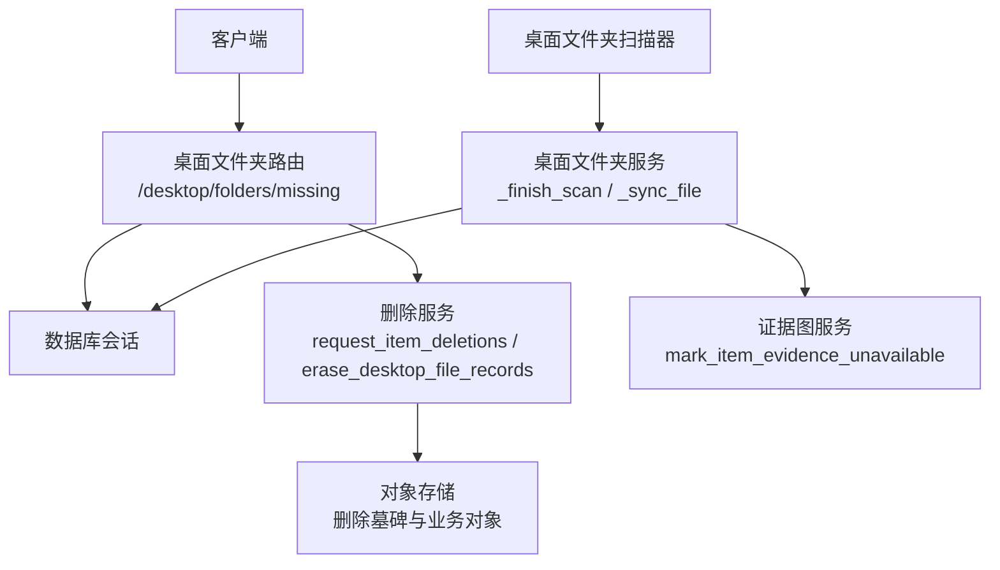
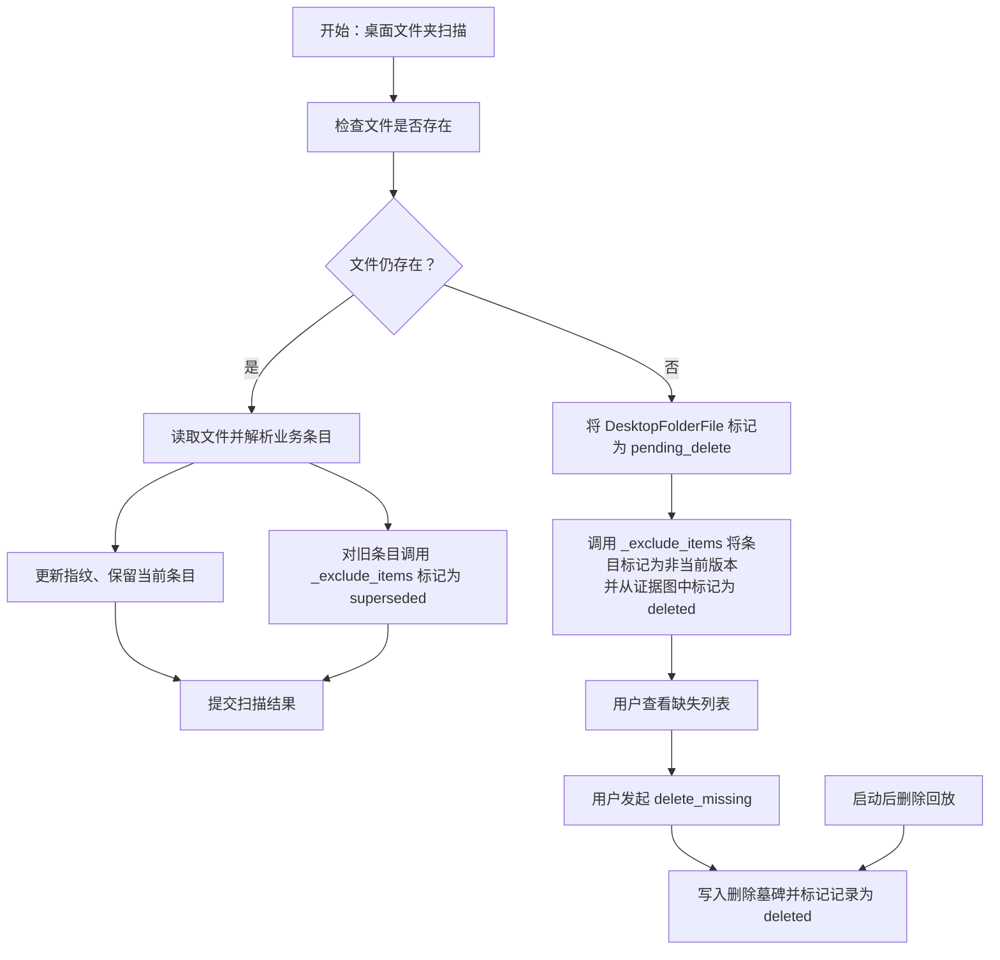
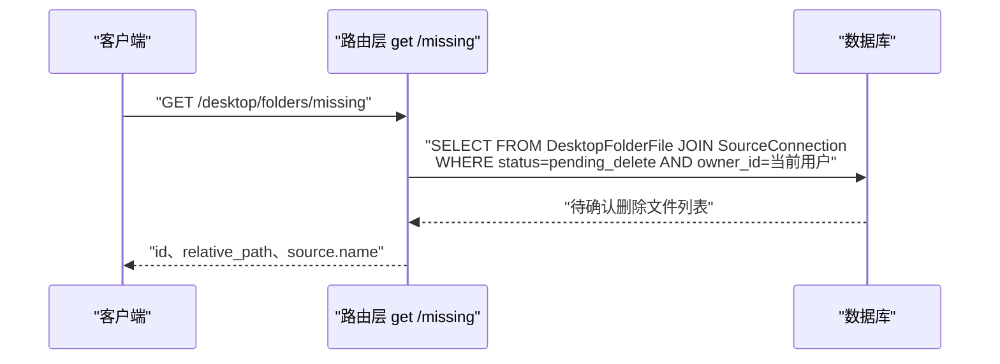
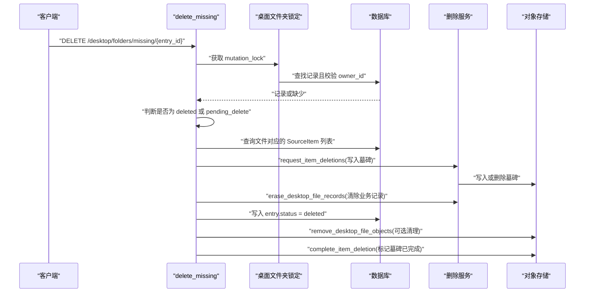
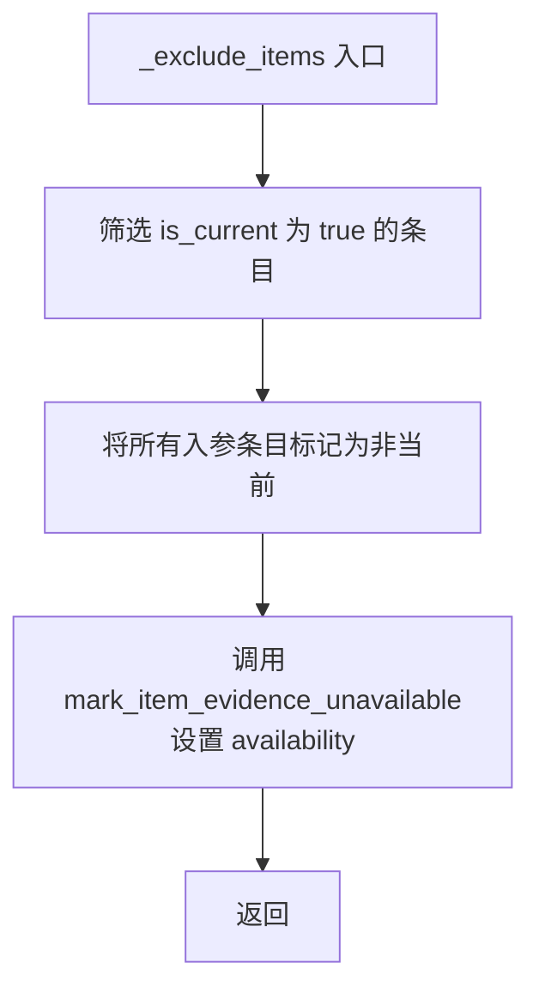
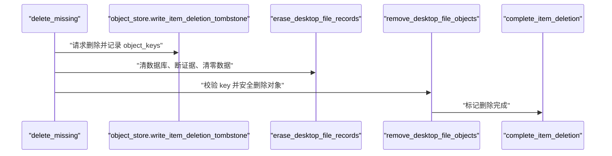
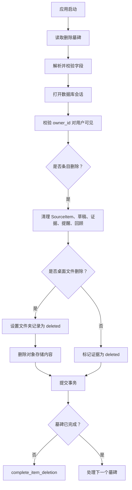

# 删除管理流程

<cite>
**本文引用的文件**
- [desktop_folders.py（路由层）](file://src/personal_ai_life_os/api/routes/desktop_folders.py)
- [desktop_folders.py（桌面文件夹服务）](file://src/personal_ai_life_os/services/desktop_folders.py)
- [deletion.py（删除服务）](file://src/personal_ai_life_os/services/deletion.py)
</cite>

## 目录
1. [简介](#简介)
2. [项目结构与职责边界](#项目结构与职责边界)
3. [核心状态模型与数据实体](#核心状态模型与数据实体)
4. [架构总览：从缺失检测到彻底删除](#架构总览从缺失检测到彻底删除)
5. [待确认删除清单查询 list_missing](#待确认删除清单查询-list_missing)
6. [删除待确认记录 delete_missing 完整流程](#删除待确认记录-delete_missing-完整流程)
7. [_exclude_items 的标记与证据断开语义](#_exclude_items-的标记与证据断开语义)
8. [对象存储清理与不可逆数据清洗](#对象存储清理与不可逆数据清洗)
9. [事务、回滚、幂等与并发控制](#事务回滚幂等与并发控制)
10. [审计日志与可回放机制](#审计日志与可回放机制)
11. [性能与一致性考量](#性能与一致性考量)
12. [故障排查指南](#故障排查指南)
13. [结论](#结论)

## 简介
本文件系统梳理桌面端源文件的“删除管理”能力，重点说明两类相关流程：

- **扫描侧自动清理**：当桌面文件夹扫描发现某个文件消失时，将 `DesktopFolderFile` 标记为 `pending_delete`，并调用 `_exclude_items` 把对应的业务实体降级和断链。
- **用户侧主动删除**：通过 `list_missing` 查询待确认删除项，由用户在合适时机调用 `delete_missing` 完成彻底的数据清理，包括数据库记录清洗、元数据擦除、对象存储清理，以及持久化删除墓碑。

这个设计把“发现缺失”和“执行删除”解耦，避免扫描器在每次检测到一个临时缺少的文件时就立即永久删除，也为用户提供了最终决定权。

**本节未直接分析具体代码行。**

## 项目结构与职责边界
删除管理涉及三层：

| 层次 | 主要文件 | 职责 |
|---|---|---|
| HTTP 路由层 | `api/routes/desktop_folders.py` | 暴露 `/desktop/folders/missing` 查询和删除端点；处理身份鉴权和输入约束 |
| 桌面文件夹服务 | `services/desktop_folders.py` | 扫描、增量同步、缺失文件标记、排除已有记录的逻辑 |
| 删除服务 | `services/deletion.py` | 删除墓碑写入、事务内记录擦除、对象存储清理、跨表衍生数据维护 |

**图示来源**
- [desktop_folders.py（路由层）:1-132](file://src/personal_ai_life_os/api/routes/desktop_folders.py#L1-L132)
- [desktop_folders.py（桌面文件夹服务）:270-335](file://src/personal_ai_life_os/services/desktop_folders.py#L270-L335)
- [deletion.py:70-119](file://src/personal_ai_life_os/services/deletion.py#L70-L119)

**节来源**
- [desktop_folders.py（路由层）:1-132](file://src/personal_ai_life_os/api/routes/desktop_folders.py#L1-L132)
- [desktop_folders.py（桌面文件夹服务）:270-335](file://src/personal_ai_life_os/services/desktop_folders.py#L270-L335)
- [deletion.py:70-119](file://src/personal_ai_life_os/services/deletion.py#L70-L119)

## 核心状态模型与数据实体
虽然本项目的删除逻辑并不依赖一个独立的 `SourceItem.status` 字段，但其行为主要由几个关键属性协同表达：

| 实体或字段 | 作用 | 删除相关语义 |
|---|---|---|
| `DesktopFolderFile.status` | 表示文件夹中某个待扫描文件的生命周期 | `active` → 正常参与扫描；`pending_delete` → 被扫描器判定为暂缺；`deleted` → 已被用户确认并彻底清理 |
| `SourceItem.is_current` | 标识是否是该文件最新的有效版本 | 被排除时被置为 `False`，从而不再是当前可用版本 |
| `SourceItem.deleted_at` | 标记实例级删除时间 | 删除操作会设置该字段 |
| `SourceItem.object_key` | 指向对象存储中的内容键 | 删除时会清空；对象可能被物理删除 |
| `GraphEvidence.availability` | 指示证据的可发现性 | 删除时将设置为 `deleted` |
| 删除墓碑文档 | 持久化到对象存储的删除请求记录 | 支持重启后重放，实现异步清理和审计 |

这种设计的好处是：`pending_delete` 仅用于“尚未被最终删除的待确认文件”，而真正的删除不仅修改数据库记录，还会改写 `deleted_at`、清空敏感正文和对象引用，确保“最终不可恢复”。

**节来源**
- [desktop_folders.py（桌面文件夹服务）:303-335](file://src/personal_ai_life_os/services/desktop_folders.py#L303-L335)
- [deletion.py:70-119](file://src/personal_ai_life_os/services/deletion.py#L70-L119)

## 架构总览：从缺失检测到彻底删除

**图示来源**
- [desktop_folders.py（桌面文件夹服务）:303-335](file://src/personal_ai_life_os/services/desktop_folders.py#L303-L335)
- [desktop_folders.py（路由层）:91-132](file://src/personal_ai_life_os/api/routes/desktop_folders.py#L91-L132)
- [deletion.py:275-288](file://src/personal_ai_life_os/services/deletion.py#L275-L288)

## 待确认删除清单查询 list_missing

### API 定义
端点是 GET `/desktop/folders/missing`，返回待确认删除的文件清单。返回值包含文件 ID、相对路径和所属源的名称，用于前端展示供用户决策。

### 查询逻辑
服务端执行以下查询：

1. 选择 `DesktopFolderFile` 与关联的 `SourceConnection`。
2. 只返回 `status == "pending_delete"` 的记录。
3. 强制按 `owner_id == user.id` 过滤，确保只能列出当前用户拥有的源。
4. 按照源名称和相对路径排序，提升界面稳定性。

这保证了：

- 不能通过遍历 ID 获取其他用户的数据。
- 只显示已经处于“待确认删除”的文件，不会泄漏活跃文件或已删除文件。
- 结果排序依赖数据库外键和列值，适合分页扩展。

**图示来源**
- [desktop_folders.py（路由层）:91-103](file://src/personal_ai_life_os/api/routes/desktop_folders.py#L91-L103)

**节来源**
- [desktop_folders.py（路由层）:91-103](file://src/personal_ai_life_os/api/routes/desktop_folders.py#L91-L103)

## 删除待确认记录 delete_missing 完整流程

端点是 DELETE `/desktop/folders/missing/{entry_id}`，响应码 204 表示成功删除。

### 身份权限与输入验证
- 路由使用 FastAPI 注入的当前用户依赖，确保 `user.id` 可信。
- SQL 查询同时限定 `DesktopFolderFile.id == entry_id` 和 `SourceConnection.owner_id == user.id`。
- 找不到记录时返回 404。

### 删除前置检查
删除方法要求记录必须是 `pending_delete`：

- 如果已经是 `deleted`，视为幂等的“已成功删除”，直接返回。
- 如果不是 `pending_delete`，则拒绝删除并返回 409，避免误删正在使用中或其他生命周期的文件。

**图示来源**
- [desktop_folders.py（路由层）:104-132](file://src/personal_ai_life_os/api/routes/desktop_folders.py#L104-L132)
- [deletion.py:33-53](file://src/personal_ai_life_os/services/deletion.py#L33-L53)
- [deletion.py:111-131](file://src/personal_ai_life_os/services/deletion.py#L111-L131)
- [deletion.py:275-288](file://src/personal_ai_life_os/services/deletion.py#L275-L288)

### 主执行步骤
1. **加锁**：使用 `request.app.state.desktop_folders.mutation_lock` 保证同一时刻只有一个桌面目录变更任务在运行。
2. **定位记录**：根据 `entry_id` 查找到 `DesktopFolderFile` 及其关联源，并校验属于当前用户。
3. **状态合法性检查**：`deleted` 视为成功；非 `pending_delete` 时报错。
4. **解析业务条目**：通过 `file_items(session, source.id, entry.file_key)` 查到该文件生成的所有当前 `SourceItem`。
5. **写删除墓碑**：如果有需要删除的业务条目，则调用 `request_item_deletions`，将条目 ID、所有者 ID、时间戳，以及与删除相关的对象存储键持久化。
6. **清洗数据库记录**：调用 `erase_desktop_file_records` 清理 `SourceItem`、草稿、证据和关联记录。
7. **落库删除标志**：将 `DesktopFolderFile.status` 设为 `deleted`。
8. **清理对象存储**：若有墓碑文档，则调用 `remove_desktop_file_objects` 删除共享的对象。
9. **完成墓碑**：调用 `complete_item_deletion`，将墓碑标记为已完成。

**节来源**
- [desktop_folders.py（路由层）:104-132](file://src/personal_ai_life_os/api/routes/desktop_folders.py#L104-L132)

## _exclude_items 的标记与证据断开语义

`_exclude_items` 负责把不再有效或需要让位的 `SourceItem` 标记为“不在当前生效集合”，并在证据图中将其状态改为指定的不可用原因。

| 参数 | 含义 |
|---|---|
| `session` | 数据库会话 |
| `source` | 数据来源，用于绑定所有权和证据上下文 |
| `items` | 要被排除的业务条目 |
| `availability` | 标记证据不可用的原因，例如 `superseded` 或 `source_missing` |

实现关键点：

1. **只对当前有效条目真正降低证据可用性**：只有 `item.is_current` 为真的条目才会进入“证据不可用”的处理路径，这样能避免重复影响已被替换的记录。
2. **全部被排除条目都变为非当前版本**：无论是否曾是当前版本，都会被设置为 `is_current = False`。
3. **调用证据服务**：通过 `mark_item_evidence_unavailable` 将该组条目的证据标注为给定 availability 值，防止下游检索继续依赖这些证据。

典型用途包括：

- 扫描到新版本的 Markdown 或聊天记录时，旧条目被标记为 `superseded`。
- 文件丢失时，对应条目被标记为 `source_missing`，提示系统证据暂时无法访问。
- 正式删除阶段再进一步清理正文、外链、时间戳和对象键。

**图示来源**
- [desktop_folders.py（桌面文件夹服务）:100-112](file://src/personal_ai_life_os/services/desktop_folders.py#L100-L112)

**节来源**
- [desktop_folders.py（桌面文件夹服务）:100-112](file://src/personal_ai_life_os/services/desktop_folders.py#L100-L112)

## 对象存储清理与不可逆数据清洗

删除流程中的不可逆数据清理不是单一函数完成的，而是由多个组件协作：

### request_item_deletions
该函数用于创建或删除事务前的“删除请求”，它会把：

- 所有者 ID
- 删除请求 ID
- 归一化的条目 ID 列表
- 请求时间
- 桌面文件 ID（可选）
- 对象存储键集合（可选）

写入对象存储中的“删除墓碑”。这是可重放的关键：即使后端进程或数据库暂时不可用，删除意图仍可保留在对象存储中。

**节来源**
- [deletion.py:33-53](file://src/personal_ai_life_os/services/deletion.py#L33-L53)

### erase_desktop_file_records
该方法处理桌面文件的核心数据清洗：

| 清理项 | 行为 |
|---|---|
| 派生数据 | 先调用 `scrub_item_derivatives`，清理评论、记忆记录、提醒等衍生引用 |
| `SourceItem` | 将目标记录置为 `is_current = False`，设置 `deleted_at`，清空标题、正文、对象键、来源定位器和元数据 |
| `DesktopDraft` | 清空内容和引用，标记为 `invalidated` |
| `GraphEvidence` | 清空摘要，并将可用性设为 `deleted` |

因此，一旦删除完成，原始内容、位置信息和可重新导入的证据都会被丢弃。

**节来源**
- [deletion.py:70-96](file://src/personal_ai_life_os/services/deletion.py#L70-L96)

### remove_desktop_file_objects
该方法针对对象存储中的实际内容执行物理删除：

1. 遍历墓碑中的对象键列表。
2. 校验键必须以 `owners/{owner_id}/` 开头，否则报错，防止删除他人数据。
3. 检查是否还有其他有效的 `SourceItem` 引用同一个对象键。如果没有，则：
   - 调用对象存储的 `delete(key)`。
   - 将 `SyncRun` 中对应对象的引用设为空，避免残留无效指针。

这保证了对象存储删除是“有引用保护”的：只有在没有其他有效业务条目使用该对象时才删除。

**节来源**
- [deletion.py:111-131](file://src/personal_ai_life_os/services/deletion.py#L111-L131)

### complete_item_deletion
完成后可视化为墓碑状态的二次写：

1. 复制现有墓碑文档。
2. 增加 `completed_at` 时间戳。
3. 覆盖原墓碑。

它的作用是表明该次删除已经成功执行完毕，回放流程可以跳过已完成的删除，减少重复工作。

**节来源**
- [deletion.py:55-66](file://src/personal_ai_life_os/services/deletion.py#L55-L66)

### 对象存储清理调用时机
在 `delete_missing` 中：

- `erase_desktop_file_records` 始终执行。
- 若存在要删除的业务条目，才生成墓碑并调用 `remove_desktop_file_objects`。
- 在完成数据库事务后，调用 `complete_item_deletion` 完成墓碑。

**图示来源**
- [desktop_folders.py（路由层）:104-132](file://src/personal_ai_life_os/api/routes/desktop_folders.py#L104-L132)
- [deletion.py:33-53](file://src/personal_ai_life_os/services/deletion.py#L33-L53)
- [deletion.py:70-131](file://src/personal_ai_life_os/services/deletion.py#L70-L131)

## 事务、回滚、幂等与并发控制

### 事务边界
在 `delete_missing` 中：

1. 查找并校验记录、加载 `SourceItem`。
2. 写入删除墓碑。
3. 执行记录清洗。
4. 将文件夹条目状态设为 `deleted`。
5. 如需删除对象存储内容，则调用 `remove_desktop_file_objects`。
6. 最后 `session.commit()`。
7. 成功后再调用 `complete_item_deletion`。

这里有一个值得注意的顺序：**墓碑的写入发生在事务提交之前**，而对象存储清理和墓碑完成写也在提交前/后交错。这意味着如果后续 `complete_item_deletion` 失败，数据库中可能已经记录了“已删除”的文件夹条目和业务清理状态，但墓碑可能没有完成标记。

因此，这个流程应结合部署环境的事务策略和重试机制来理解：

- 数据库操作本身在一个显式会话内提交一次。
- 对象存储和墓碑属于外部状态，需要幂等操作和回放机制辅助恢复。
- 建议在应用层对 `complete_item_deletion` 的异常进行重试；如果失败，可在下次启动时依靠墓碑回放再次完成状态一致。

### 并发控制
`delete_missing` 使用桌面文件夹管理器上的 `mutation_lock`，阻止并行执行目录突变操作。结合 SQL 层面的用户权限过滤，可以避免多个请求同时对同一个记录进行错误操作。

由于 `pending_delete → deleted` 转换只在路由内部判断，且加锁范围覆盖主要分支，正常情况下不会出现竞争写入。

### 幂等设计
- 对已经是 `deleted` 的请求，直接返回 204，不重复清理。
- 对象存储删除前会再次检查对象是否仍被其他 `SourceItem` 引用。
- 墓碑使用固定的 `tombstone_id`，完成后的墓碑只是追加完成时间，不会因重复完成造成破坏。

### 失败恢复
推荐的恢复策略：

| 失败点 | 恢复建议 |
|---|---|
| `erase_desktop_file_records` 中途失败 | 回滚事务；`delete_missing` 重试前应先删除已写的墓碑以避免重复删除 |
| 对象存储删除失败 | 保留数据库已清理状态；下次调用应能再次尝试删除对象键 |
| `complete_item_deletion` 失败 | 允许重试；回放脚本也应忽略已完成墓碑 |
| 删除过程中进程崩溃 | 下次启动可使用 `replay_deletion_tombstones` 重建一致状态 |

**节来源**
- [desktop_folders.py（路由层）:104-132](file://src/personal_ai_life_os/api/routes/desktop_folders.py#L104-L132)
- [deletion.py:55-66](file://src/personal_ai_life_os/services/deletion.py#L55-L66)
- [deletion.py:111-131](file://src/personal_ai_life_os/services/deletion.py#L111-L131)

## 审计日志与可回放机制

删除系统使用了两种“墓碑”概念：

1. **删除请求墓碑**：用于单个条目或桌面文件删除请求，保存所有者 ID、条目 ID 集合和时间信息。
2. **源代码删除和账户删除墓碑**：用于更粗粒度的源或整个账户删除场景，支持从启动时的回放流程执行。

对于桌面文件删除，`replay_deletion_tombstones` 会在启动时读取对象存储中的删除墓碑，并以所有者维度逐条处理：

- 读取并解析墓碑 JSON。
- 验证 UUID 和必要字段。
- 打开新数据库会话。
- 查找所有者和用户记录，确保安全边界。
- 如果是条目级别删除：
  - 设置 `is_current = False` 和 `deleted_at`。
  - 若关联桌面文件，则执行 `erase_desktop_file_records`。
  - 如果存在 `desktop_file_id`，还将 `DesktopFolderFile.status` 设为 `deleted`。
  - 调用 `remove_desktop_file_objects` 清理对象存储。
  - 提交会话。
  - 若墓碑未完成，则调用 `complete_item_deletion`。

**图示来源**
- [deletion.py:185-260](file://src/personal_ai_life_os/services/deletion.py#L185-L260)

需要注意的是，当前 `replay_deletion_tombstones` 中没有显式日志语句直接打印每条记录的处理结果，仅在回放完成后输出累计数量。如果需要更强的可观测性，应在每个墓碑处理分支中记录：

- 所有者 ID
- 墓碑 ID
- 涉及的条目数
- 是否已执行对象存储删除
- 事务是否提交成功
- 完成墓碑是否成功

**节来源**
- [deletion.py:185-260](file://src/personal_ai_life_os/services/deletion.py#L185-L260)
- [deletion.py:275-288](file://src/personal_ai_life_os/services/deletion.py#L275-L288)

## 性能与一致性考量

### 扫描侧性能
- `_finish_scan` 会对每个活跃目录文件逐个检查，若指纹不同或不存在就触发导入或标记缺失。
- 文件过大或格式不符合配置限制时，会在导入环节提前失败，避免写入大量无用数据。
- `_exclude_items` 批量标记非当前条目并调用证据服务，应避免对超大列表反复刷新。

### 删除侧性能
- `delete_missing` 中查询文件对应的 `SourceItem` 时使用 `external_id.startswith(...)`，这通常匹配以固定前缀组织的文件条目，但若同一文件产生很多历史变体，仍需注意查询规模。
- `erase_desktop_file_records` 会清理评论、记忆、提醒等多个关联表，删除大量业务记录时可能对数据库造成短期压力。
- 对象存储删除是 I/O 密集操作，应监控存储层的速率限制和重试。

### 一致性建议
1. 对 `complete_item_deletion` 添加幂等重试。
2. 对对象存储删除失败的条目增加本地重试队列或可观察指标。
3. 在回放日志中添加逐条处理信息，便于生产排障。
4. 对大条目删除操作考虑异步化：在当前设计中，事务中已直接等待墓碑写入、对象删除和完成写入，长时间 I/O 会影响接口延迟。

**节来源**
- [desktop_folders.py（桌面文件夹服务）:270-335](file://src/personal_ai_life_os/services/desktop_folders.py#L270-L335)
- [deletion.py:70-131](file://src/personal_ai_life_os/services/deletion.py#L70-L131)
- [deletion.py:185-260](file://src/personal_ai_life_os/services/deletion.py#L185-L260)

## 故障排查指南

| 现象 | 可能原因 | 诊断动作 | 修复建议 |
|---|---|---|---|
| `list_missing` 返回空 | 没有文件被扫描器判定为缺失；或用户无权限 | 检查源是否为 active/paused；核对 `DesktopFolderFile.status` | 重新触发扫描；确认所有者关系 |
| `delete_missing` 返回 404 | 条目 ID 不存在；或不属于当前用户 | 查看路由中按 `owner_id` 的 JOIN 过滤 | 使用正确记录 ID；检查用户身份 |
| `delete_missing` 返回 409 | 条目状态不是 `pending_delete` | 检查 `DesktopFolderFile.status` | 等待扫描器标记缺失，或由管理员修正 |
| 已显示删除但仍可看到条目 | 客户端缓存或未刷新；证据图尚未完全清理 | 检查证据可用性和草稿状态 | 清理缓存；重新扫描或重试回放 |
| 对象存储仍有文件残留 | 删除前还有其它 `SourceItem` 引用同一键；或 `complete_item_deletion` 失败 | 检查对象键引用和墓碑完成时间戳 | 删除其他引用后重试删除；重启服务触发回放 |
| 重启后部分删除未生效 | 应用未在启动后运行回放逻辑 | 检查启动钩子和 `replay_deletion_tombstones` | 启动回放；必要时手动重试 |
| 删除后正文仍存在 | `erase_desktop_file_records` 未被调用或被回滚 | 检查事务提交顺序和日志 | 确认数据库连接和事务提交；必要时回滚并重试 |

### 推荐调试顺序
1. 先用 `GET /desktop/folders/missing` 确认是否存在待确认删除项。
2. 若已删除，检查数据库中的 `DesktopFolderFile.status` 和 `SourceItem.deleted_at`。
3. 检查对象存储中的删除墓碑是否含有 `completed_at`。
4. 若是启动后才出现问题，检查回放日志和墓碑可读性。
5. 若对象仍存在于存储，检查是否有其它 `SourceItem.object_key` 仍指向该键。

**节来源**
- [desktop_folders.py（路由层）:91-132](file://src/personal_ai_life_os/api/routes/desktop_folders.py#L91-L132)
- [desktop_folders.py（桌面文件夹服务）:303-335](file://src/personal_ai_life_os/services/desktop_folders.py#L303-L335)
- [deletion.py:33-131](file://src/personal_ai_life_os/services/deletion.py#L33-L131)

## 结论
桌面删除管理通过“扫描标记缺失 + 用户确认后彻底删除”的两阶段设计，在保证用户体验的同时实现了较严格的数据安全：

- 扫描器仅做“暂缺标记”和证据降权，不立即销毁用户数据。
- `list_missing` 提供受权的待确认视图，用户掌握最终删除权。
- `delete_missing` 组合了身份验证、状态校验、删除墓碑、数据库记录和对象存储清理。
- 证据完整性通过 `is_current`、`deleted_at`、`GraphEvidence.availability` 等多处字段共同保证。
- 删除墓碑和回放机制提升了系统在进程重启和外部 I/O 失败下的健壮性。
- 当前实现需要重点关注：对象存储删除的幂等重试、删除完成状态的一致性、回放过程的审计增强，以及大规模删除时的性能开销。