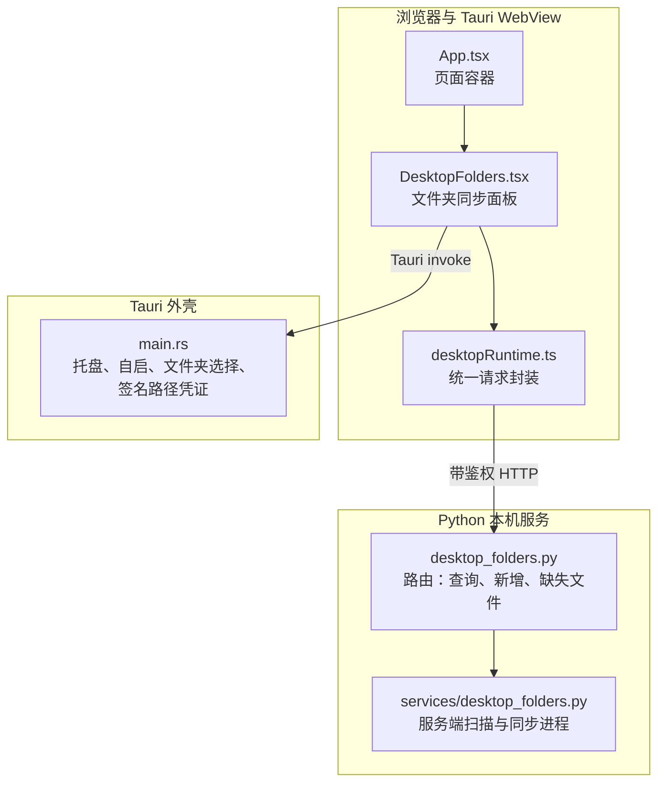
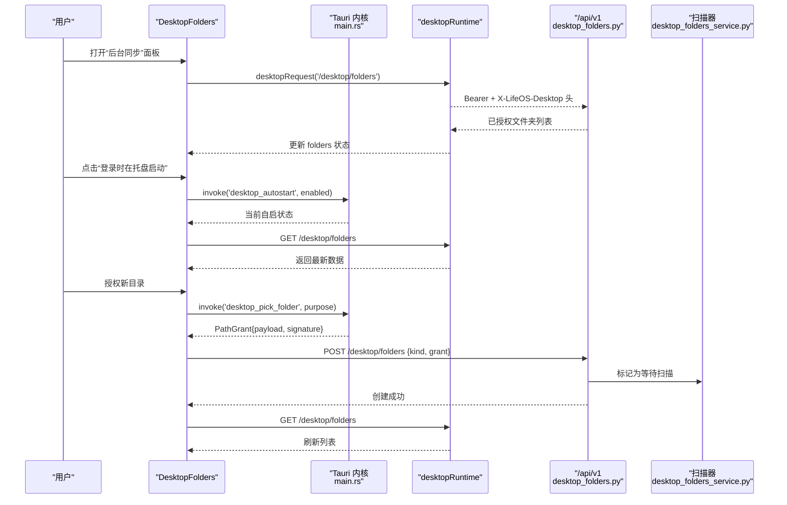
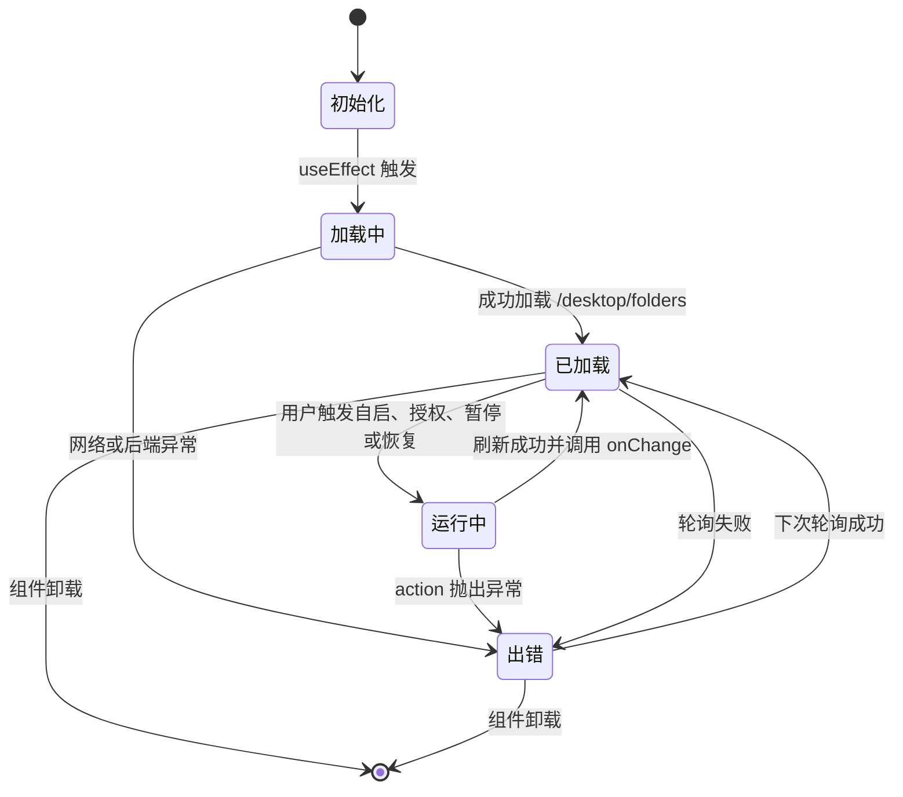
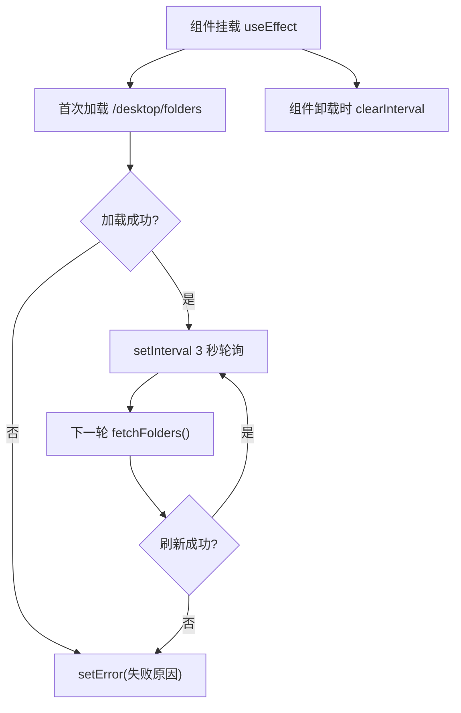
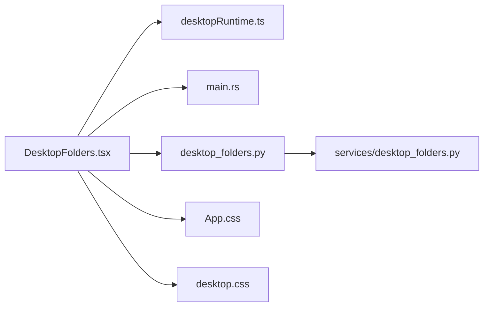

# 前端界面组件

<cite>
**本文引用的文件**   
- [DesktopFolders.tsx](file://web/src/DesktopFolders.tsx)
- [desktopRuntime.ts](file://web/src/desktopRuntime.ts)
- [App.tsx](file://web/src/App.tsx)
- [desktop.css](file://web/src/desktop.css)
- [App.css](file://web/src/App.css)
- [desktop_folders.py](file://src/personal_ai_life_os/api/routes/desktop_folders.py)
- [desktop_folders_service.py](file://src/personal_ai_life_os/services/desktop_folders.py)
- [main.rs](file://desktop/src-tauri/src/main.rs)
- [data-model.md](file://docs/architecture/data-model.md)
- [overview.md](file://docs/architecture/overview.md)
</cite>

## 目录
1. [简介](#简介)
2. [项目结构](#项目结构)
3. [核心组件](#核心组件)
4. [架构总览](#架构总览)
5. [详细组件分析](#详细组件分析)
6. [依赖关系分析](#依赖关系分析)
7. [性能考虑](#性能考虑)
8. [故障排查指南](#故障排查指南)
9. [结论](#结论)
10. [附录：扩展指南](#附录扩展指南)

## 简介
本文面向桌面文件夹同步的前端实现，重点说明 `DesktopFolders` React 组件的功能架构、状态管理、Tauri IPC 调用方式、与后端 API 的协作、实时轮询机制、用户交互流程，以及样式、可访问性与国际化相关设计。读者无需具备 Tauri 或 FastAPI 经验即可理解该组件如何协调“选择本地文件夹—授权并显示—启动或暂停后台同步”的完整工作流。

## 项目结构
从前端到原生层的数据和控制流程如下：



图示来源
- [DesktopFolders.tsx:1-121](file://web/src/DesktopFolders.tsx#L1-L121)
- [desktopRuntime.ts:1-45](file://web/src/desktopRuntime.ts#L1-L45)
- [main.rs:1-200](file://desktop/src-tauri/src/main.rs#L1-L200)
- [desktop_folders.py:1-132](file://src/personal_ai_life_os/api/routes/desktop_folders.py#L1-L132)
- [desktop_folders_service.py:1-200](file://src/personal_ai_life_os/services/desktop_folders.py#L1-L200)

章节来源
- [Overview.md](file://docs/architecture/overview.md)
- [Data-model.md](file://docs/architecture/data-model.md)

## 核心组件
`DesktopFolders` 组件承担以下职责：

| 职责 | 行为 |
|---|---|
| 文件夹列表展示 | 展示已授权的 Markdown、Obsidian Vault、聊天导出目录名称、路径、状态和最近扫描时间 |
| 操作按钮组 | 提供“登录时自动启动”“按类型授权新文件夹”“恢复/暂停”“撤回授权”“确认删除待删记录”等交互入口 |
| 功能状态管理 | 维护 `folders`、`kind`、`autostart`、`error`、`busy` 五个核心状态，负责初始加载、错误归并、防抖式全局忙碌状态和业务回调通知 |
| 实时更新 | 通过 3 秒轮询定时器刷新文件夹列表；失败时写入 `error` 状态并在 UI 中提示 |
| 跨环境通信 | 在 Tauri 环境调用 `invoke('desktop_autostart')`、`invoke('desktop_pick_folder')`，并通过封装方法发起经过鉴权的后端 API 请求 |

章节来源
- [DesktopFolders.tsx:1-121](file://web/src/DesktopFolders.tsx#L1-L121)

## 架构总览
桌面模式下，组件不会直接构造后端 URL，而是使用 `desktopRuntime.ts` 中的运行时信息和本机秘钥转发请求；原生侧则负责用户权限、路径选择和系统级能力（如 Windows 开机自启）。



图示来源
- [DesktopFolders.tsx:13-99](file://web/src/DesktopFolders.tsx#L13-L99)
- [desktopRuntime.ts:13-45](file://web/src/desktopRuntime.ts#L13-L45)
- [main.rs:70-190](file://desktop/src-tauri/src/main.rs#L70-L190)
- [desktop_folders.py:36-85](file://src/personal_ai_life_os/api/routes/desktop_folders.py#L36-L85)
- [desktop_folders_service.py:162-200](file://src/personal_ai_life_os/services/desktop_folders.py#L162-L200)

## 详细组件分析

### 数据模型与状态结构
前端定义了三个主要数据结构：

| 结构 | 字段 | 含义 |
|---|---|---|
| `Folder` | `id`、`name`、`path`、`kind`、`status`、`scan_status`、`last_scan_at` | 每个已授权桌面文件夹的可见摘要，其中 `kind` 是 `'markdown' \| 'obsidian' \| 'chat_folder'`，`status` 表示连接活跃性或暂停状态 |
| `MissingFile` | `id`、“待确认删除的文件项 ID”、`path`、`source` | 从同步目录删除但仍需在系统中标记清除的记录 |
| `FolderKind` | `markdown`、`obsidian`、`chat_folder` | 新增授权时的目录用途类型 |

这些结构与后端的 `DesktopFolder`、`SourceConnection`、`DesktopFolderFile` 存在一一对应关系：后端路由负责把数据库中的源连接、文件夹、文件清单映射成更小的接口返回体，避免泄露内部键和无关字段。

章节来源
- [DesktopFolders.tsx:6-15](file://web/src/DesktopFolders.tsx#L6-L15)
- [desktop_folders.py:16-41](file://src/personal_ai_life_os/api/routes/desktop_folders.py#L16-L41)
- [DesktopFolders.tsx:103-121](file://web/src/DesktopFolders.tsx#L103-L121)
- [data-model.md:1-26](file://docs/architecture/data-model.md#L1-L26)

### 状态生命周期
`DesktopFolders` 使用局部 `useState` 和 `useEffect` 管理渲染和副作用：



图示来源
- [DesktopFolders.tsx:16-35](file://web/src/DesktopFolders.tsx#L16-L35)

#### 状态变量说明
| 变量 | 类型 | 作用 | 关键生命周期 |
|---|---|---|---|
| `folders` | Folder 数组 | 驱动列表中每一条已授权目录行 | 初始加载时赋值；每次业务动作成功后重新获取 |
| `kind` | `FolderKind` | 下拉框当前选择的目录用途 | 仅用于下一次“授权文件夹”请求，不影响已有目录 |
| `autostart` | boolean 或未定义 | 表示 Windows 开机自启是否启用 | 组件挂载时读取，切换时写回并刷新本地状态 |
| `error` | string | 集中展示网络错误、后端校验错误或不可恢复问题 | 清空于 `run` 开始，捕获异常时设置，支持屏幕阅读器 `role="alert"` |
| `busy` | boolean | 表示任意异步事务进行中，禁用大部分交互 | `run` 开始时设为 `true`，完成或在 finally 中重置 |

章节来源
- [DesktopFolders.tsx:16-55](file://web/src/DesktopFolders.tsx#L16-L55)

### Tauri IPC 与桌面能力
组件通过两条路径与系统能力交互：

1. **只读查询自启状态**  
   - 调用：`invoke('desktop_autostart')`  
   - 目的：获取当前 Windows 注册表 Run 项是否存在 Life OS 条目  
   - UI 反馈：布尔值填充 `autostart`；若 Tauri 不存在或未就绪，进入错误状态

2. **修改自启开关**  
   - 调用：`invoke('desktop_autostart', { enabled })`  
   - 目的：写入或删除当前用户的 Run 启动项；Windows 下命令附加 `--background` 参数以进入静默模式  
   - UI 反馈：刷新 `autostart` 本地值后继续执行后续状态刷新

3. **选择本地目录**  
   - 调用：`invoke('desktop_pick_folder', { purpose: kind })`  
   - 目的：由 Tauri 对话框引导用户选择目标文件夹  
   - 返回值：`PathGrant { payload, signature }`，这是后端用于验证所选路径的短期安全凭据；取消选择时返回空

章节来源
- [DesktopFolders.tsx:19-38](file://web/src/DesktopFolders.tsx#L19-L38)
- [DesktopFolders.tsx:49-62](file://web/src/DesktopFolders.tsx#L49-L62)
- [main.rs:72-120](file://desktop/src-tauri/src/main.rs#L72-L120)
- [main.rs:175-190](file://desktop/src-tauri/src/main.rs#L175-L190)

### Desktop API 通信机制
组件不直接使用 `fetch`，而是调用 `desktopRequest(token, path, init)`。该方法保证：

| 场景 | 行为 |
|---|---|
| 非 Tauri 环境 | 拼接环境变量中的 API base URL 走浏览器直连 |
| Tauri 环境且尚未就绪 | 抛出本机服务就绪错误 |
| Tauri 环境且已就绪 | 追加 `Authorization: Bearer <token>`，同时携带运行时秘钥头向本机关联地址发起请求 |
| HTTP 响应码 204 | 直接解析为空结果，适配删除类接口 |
| 其他错误响应 | 读取 `error.message` 或降级为通用失败消息并抛出 `Error` |

这种封装使得上层 React 组件只需关注资源路径和业务逻辑。

章节来源
- [desktopRuntime.ts:13-45](file://web/src/desktopRuntime.ts#L13-L45)
- [DesktopFolders.tsx:17-20](file://web/src/DesktopFolders.tsx#L17-L20)

### 实时更新机制与错误处理
#### 3 秒轮询定时任务
组件在 `useEffect` 中立即拉取一次 `/desktop/folders`，然后创建 `window.setInterval(fetchFolders, 3000)` 实现周期性刷新，并在清理函数中执行 `clearInterval`。这意味着：

- 组件挂载后立即获得快照；
- 每 3 秒再次检查后端文件夹状态变化；
- 轮询失败时错误被转换为字符串并显示；
- 组件卸载后定时器自动销毁，避免泄漏。



图示来源
- [DesktopFolders.tsx:19-35](file://web/src/DesktopFolders.tsx#L19-L35)

#### 后端轮询与扫描周期
服务端存在 `DesktopFolderSync.run`，其外层循环会在扫描完所有活跃源后调用 `stop.wait(3)`，形成约 3 秒一次的批量扫描节奏；该延迟属于服务器端扫描间隔，与前端 UI 的 3 秒轮询不同。前端轮询用于刷新视图，后端扫描用于检测文件系统变化和导入进度。

章节来源
- [DesktopFolders.tsx:19-35](file://web/src/DesktopFolders.tsx#L19-L35)
- [desktop_folders_service.py:162-200](file://src/personal_ai_life_os/services/desktop_folders.py#L162-L200)

### 用户交互流程

#### 授权桌面文件夹
```mermaid
sequenceDiagram
  participant User as "用户"
  participant Folders as "DesktopFolders"
  participant Tauri as "desktop_pick_folder"
  participant Backend as "POST /desktop/folders"

  User->>Folders: 选择来源类型，点击“授权文件夹”
  Folders->>Folders: setBusy(true); setError('')
  Folders->>Tauri: invoke('desktop_pick_folder', purpose)
  alt 用户取消选择
    Tauri-->>Folders: null
  else 用户选择目录
    Tauri-->>Folders: PathGrant
    Folders->>Backend: {kind, grant}
    Backend-->>Folders: 新文件或复用文件记录
    Folders->>Folders: load(); onChange()
  end
  Folders->>Folders: setBusy(false)
```

图示来源
- [DesktopFolders.tsx:52-62](file://web/src/DesktopFolders.tsx#L52-L62)
- [desktop_folders.py:43-85](file://src/personal_ai_life_os/api/routes/desktop_folders.py#L43-L85)
- [main.rs:175-190](file://desktop/src-tauri/src/main.rs#L175-L190)

后端新增目录时会对路径进行安全检查，包括拒绝应用数据目录内部路径、根目录、符号链接和 Windows 重解析点；对重复授权也会给出明确的冲突响应，防止并发添加产生不一致。

#### 自启状态切换
- 初始：调用 `invoke('desktop_autostart')` 获取当前开关状态；
- 勾选：将 enabled 设置为选中值，写入注册表 Run 项；
- 取消：删除该启动项；
- 失败或读取不到值：统一落入错误状态，UI 仍允许重试。

#### 暂停与恢复
- 点击按钮时调用 PATCH 接口，将连接状态改为 `paused` 或 `active`；
- 受 `busy` 控制，防止多次快速点击；
- 成功后重新加载列表并触发父组件刷新回调。

#### 撤回目录授权
- 使用 `window.confirm` 做二次确认；
- 调用删除/撤销相关后端接口；
- 完成后进入忙碌状态收尾，刷新列表。

#### 确认删除缺失记录
- “待确认删除”列表单独维护自己的状态与 3 秒轮询；
- 用户确认后发送 DELETE 请求，删除源项索引并更新记录状态；
- 如果请求失败，同样写入本地 error。

章节来源
- [DesktopFolders.tsx:49-121](file://web/src/DesktopFolders.tsx#L49-L121)
- [desktop_folders.py:87-132](file://src/personal_ai_life_os/api/routes/desktop_folders.py#L87-L132)

### 样式组件结构与可访问性

#### 视觉层级
| CSS 类 | 用途 |
|---|---|
| `.panel .stack .desktop-tool-panel` | 包裹整个工具的卡片容器，具有内边距、间距和浅边框 |
| `.panel-heading h2` | “后台同步”标题 |
| `.muted` | 次级说明文字，例如描述窗口关闭后仍可同步 |
| `.check-row` | 复选框行样式，包含“登录 Windows 时在托盘启动” |
| `.button-row` | 按钮和下拉菜单的横向布局 |
| `.manage-source` | 一条已授权目录的行，包含名称、路径、状态和操作区 |
| `.source-scope` | 目录路径等辅助说明文本 |
| `.notice.error` | 统一错误提示信息 |

章节来源
- [desktop.css:537-591](file://web/src/desktop.css#L537-L591)
- [desktop.css:791-797](file://web/src/desktop.css#L791-L797)
- [desktop.css:710-713](file://web/src/desktop.css#L710-L713)
- [App.css:178-223](file://web/src/App.css#L178-L223)

#### 可访问性要点
- “来源类型”下拉框带有 `aria-label`，便于屏幕阅读器识别；
- 错误段落使用 `role="alert"`，让辅助技术明确这是动态警告区域；
- 所有操作按钮在忙碌期间被 `disabled`，避免重复提交和无意义交互；
- 危险操作“撤回授权”和“确认删除记录”都先通过确认对话框；
- 文案均为中文，便于单语言用户理解，但缺少可扩展的多语言 key 机制。

章节来源
- [DesktopFolders.tsx:41-46](file://web/src/DesktopFolders.tsx#L41-L46)
- [DesktopFolders.tsx:93-101](file://web/src/DesktopFolders.tsx#L93-L101)
- [DesktopFolders.tsx:113-117](file://web/src/DesktopFolders.tsx#L113-L117)

### 国际化支持现状
目前组件使用硬编码的中文字符串：

| 位置 | 现有中文文案 | 建议的可扩展键 |
|---|---|---|
| 标题 | 后台同步 | `desktopTool.title` |
| 说明 | 关闭窗口后，托盘中的 Life OS 仍会同步授权目录 | `desktopTool.description` |
| 自启选项 | 登录 Windows 时在托盘启动 | `desktopTool.autostart` |
| 下拉标签 | Markdown 记录、Obsidian Vault、聊天导出目录 | `folderKind.markdown`、`folderKind.obsidian`、`folderKind.chatFolder` |
| 按钮 | 授权文件夹 | `folderAction.authorize` |
| 状态 | 已暂停、已同步、等待同步、部分文件未同步、目录暂不可用 | `folderStatus.*` |
| 操作 | 恢复、暂停、撤回 | `folderAction.resume`、`folderAction.pause`、`folderAction.revoke` |
| 空状态 | 暂无授权目录 | `folderEmpty.state` |
| 删除页标题 | 待确认删除 | `missingList.title` |
| 删除页说明 | 这些文件已从同步目录移除…… | `missingList.description` |
| 删除按钮 | 确认删除记录 | `missingList.confirmDelete` |

当前实现没有外部 i18n 库，也没有 `Intl` 动态格式化策略。需要新增一种来源类型或按钮文案时，应优先引入可翻译配置对象，而非继续在 JSX 中添加硬编码字符串。

章节来源
- [DesktopFolders.tsx:28-47](file://web/src/DesktopFolders.tsx#L28-L47)
- [DesktopFolders.tsx:66-75](file://web/src/DesktopFolders.tsx#L66-L75)
- [DesktopFolders.tsx:90-119](file://web/src/DesktopFolders.tsx#L90-L119)

## 依赖关系分析



图示来源
- [DesktopFolders.tsx:1-121](file://web/src/DesktopFolders.tsx#L1-L121)
- [desktopRuntime.ts:1-45](file://web/src/desktopRuntime.ts#L1-L45)
- [main.rs:70-190](file://desktop/src-tauri/src/main.rs#L70-L190)
- [desktop_folders.py:1-132](file://src/personal_ai_life_os/api/routes/desktop_folders.py#L1-L132)
- [desktop_folders_service.py:1-200](file://src/personal_ai_life_os/services/desktop_folders.py#L1-L200)
- [App.css:200-223](file://web/src/App.css#L200-L223)
- [desktop.css:537-591](file://web/src/desktop.css#L537-L591)

耦合关系说明：

| 模块 | 耦合方向 | 风险与建议 |
|---|---|---|
| `DesktopFolders` → `desktopRuntime` | 强依赖统一请求封装 | 合理；前端不应感知 Tauri 与浏览器差异 |
| `DesktopFolders` → `@tauri-apps/core` | 直接调用 `invoke` | 建议把平台相关 `invoke` 抽取为更高层钩子，减少测试复杂度 |
| `desktop_folders.py` → `desktop_folders_service.py` | 路由调用服务类进行扫描和业务判断 | 符合前后端清晰分层，但需保证扫描异常可恢复 |
| `main.rs` → Windows 注册表 | 直接读写 Run 启动项 | 属于平台能力，应记录错误并返回可读信息 |
| 前端 → 3 秒轮询 | 固定频率网络开销 | 可在连接不稳定时退避，或对无变更响应做轻量 diff |
| 样式 → 多个 CSS 文件 | 共享 `panel`、`muted`、`button-row` 等类名 | 注意避免组件内部覆盖全局类导致的歧义 |

章节来源
- [overview.md:42-74](file://docs/architecture/overview.md#L42-L74)
- [data-model.md:3-26](file://docs/architecture/data-model.md#L3-L26)

## 性能考虑
- **前端轮询频率**：3 秒轮询适用于单用户桌面场景，但不适合移动端或多标签高并发浏览器；未来可加入退避策略，例如连续失败后延长间隔，恢复后再回退。
- **后端扫描锁**：服务端使用递归锁保护目录变更相关写入，确保同一段时间内只有一个目录变更记录被合并；这对避免大量并发写入是必要的，但会限制并行扫描吞吐量。
- **文件指纹与排除规则**：服务端对符号链接、重解析点和敏感目录（如 `.obsidian`、`.git`、回收站）进行跳过，能降低无用 I/O 和安全性风险。
- **内存占用**：前端只在本地保存扁平文件列表，复杂度接近 O(n)，对常见少量目录场景足够友好；但如果授权数量增长，应考虑分页或虚拟列表。
- **UI 阻塞**：`busy` 阻止重复操作，避免重复刷新和重复请求；但当前组件没有针对长耗时操作的进度反馈，只体现“忙碌”。

章节来源
- [desktop_folders_service.py:12-41](file://src/personal_ai_life_os/services/desktop_folders.py#L12-L41)
- [desktop_folders_service.py:156-200](file://src/personal_ai_life_os/services/desktop_folders.py#L156-L200)
- [DesktopFolders.tsx:36-51](file://web/src/DesktopFolders.tsx#L36-L51)

## 故障排查指南
| 现象 | 可能原因 | 处理方式 |
|---|---|---|
| 面板一直显示某个错误信息 | 后端不可用、鉴权失败或网络中断 | 检查 Tauri 服务是否就绪、网络响应码及 `error.message` |
| 授权文件夹无效 | 选择了根目录、应用数据目录内部路径或不允许的路径 | 改用具体子目录，并确保不在应用数据目录内部 |
| 新增目录报 409 冲突 | 目录已授权或类型不匹配 | 查看列表中是否有同名目录或被禁用的目录 |
| 无法设置自启 | 用户注册表写入失败或 Tauri 命令不可用 | 检查系统权限、当前账户 Run 键可用性，或回滚更改 |
| 目录显示“目录暂不可用” | 文件夹被移动、U 盘断开或文件不再存在 | 恢复路径或重新授权目录 |
| 3 秒刷新反复报错但没有用户操作 | 后台扫描或服务端异常导致状态异常 | 查看后端日志，必要时暂停再恢复对应目录 |
| 删除记录后未消失 | 删除 API 未被调用、状态未刷新或存在并发修改 | 检查网络响应码、后端是否为 `pending_delete` 状态并重试 |
| 组件卸载后仍有网络请求 | 定时器清理失败或异步 `run` 仍在执行 | 确认 `clearInterval` 生效，并注意 `finally` 中对 `busy` 的重置 |

章节来源
- [DesktopFolders.tsx:17-51](file://web/src/DesktopFolders.tsx#L17-L51)
- [DesktopFolders.tsx:76-119](file://web/src/DesktopFolders.tsx#L76-L119)
- [desktop_folders.py:43-85](file://src/personal_ai_life_os/api/routes/desktop_folders.py#L43-L85)
- [desktop_folders.py:105-132](file://src/personal_ai_life_os/api/routes/desktop_folders.py#L105-L132)

## 结论
`DesktopFolders` 是一个边界清晰的桌面工具型 React 组件：它通过 `@tauri-apps/api/core.invoke` 调用 Windows 自启能力和文件夹选择器，同时使用 `desktopRuntime` 统一发起经过认证的后端请求。3 秒轮询提供了直观的“近实时”体验，而 `busy`、`error` 和 `onChange` 构成了简单可靠的业务事务控制面。后端则在路由层完成安全校验与资源建模，在服务层实现安全的文件系统扫描与同步调度。整体结构简洁，但还有可访问性、国际化、退避轮询和更长耗时的用户反馈空间。

[无需小节来源，因为本节为总结性内容]

## 附录：扩展指南

### 新增一种来源类型
1. 在前端 `FolderKind` 中增加新的联合类型成员。
2. 在“来源类型”下拉选项中添加对应的 `<option>` 文案。
3. 在后端路由 `FolderSelection.kind` 中放行新值。
4. 根据 `kind` 调整后端路径验证逻辑和源连接映射。
5. 在状态显示、图标和导出数据说明中补充新类型的解释。
6. 为该文案建立本地化键，避免硬编码。

章节来源
- [DesktopFolders.tsx:6-15](file://web/src/DesktopFolders.tsx#L6-L15)
- [DesktopFolders.tsx:41-47](file://web/src/DesktopFolders.tsx#L41-L47)
- [desktop_folders.py:17-27](file://src/personal_ai_life_os/api/routes/desktop_folders.py#L17-L27)

### 新增一个操作按钮
推荐遵循既有模式：

| 步骤 | 做法 |
|---|---|
| 1 | 定义一个异步动作，调用 `invoke` 或 `desktopRequest` |
| 2 | 在必要时使用确认对话框 |
| 3 | 放入 `run` 包装器以保证 `busy`、`error` 和行为一致 |
| 4 | 成功后调用 `load()` 和 `onChange()` |
| 5 | 在 `busy` 为真时禁用按钮 |
| 6 | 添加可翻译文案和 `aria-label` |

章节来源
- [DesktopFolders.tsx:36-51](file://web/src/DesktopFolders.tsx#L36-L51)
- [DesktopFolders.tsx:76-119](file://web/src/DesktopFolders.tsx#L76-L119)

### 优化轮询策略
当前 3 秒轮询简单易实现，适合单机桌面应用；如需改进可加入：

- 连续失败后的指数退避；
- 收到空响应或无变更响应时缩短网络负载；
- 焦点丢失时降低轮询频率；
- 使用 WebSocket 或后端事件替代轮询；
- 对长时间挂起的任务提供进度提示而非仅 `busy`。

章节来源
- [DesktopFolders.tsx:19-35](file://web/src/DesktopFolders.tsx#L19-L35)

### 可访问性与用户体验增强建议
- 为所有按钮添加明确的 `aria-label`，避免仅靠颜色或上下文传达含义。
- 在错误段落中增加更多分类，例如“网络错误”“权限错误”“后端校验错误”，方便自动化诊断。
- 使用 Toast 或内置 notice 区分临时错误和用户操作失败。
- 为“待确认删除”列表提供撤销能力，如果后端能够恢复待删除状态。
- 对大目录列表增加分页、搜索和分组，避免一次性渲染过多 DOM。

章节来源
- [DesktopFolders.tsx:90-119](file://web/src/DesktopFolders.tsx#L90-L119)