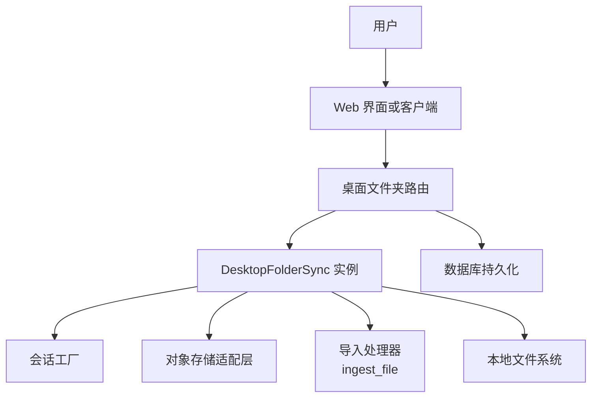
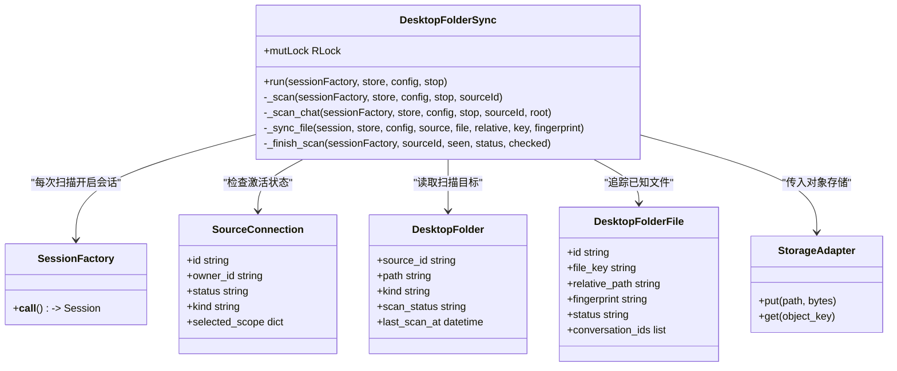
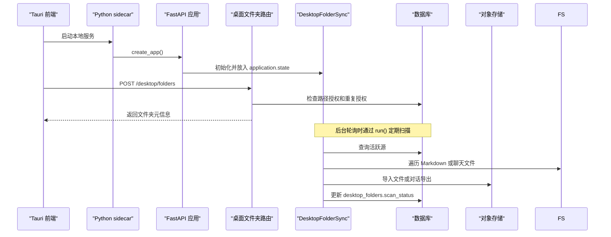
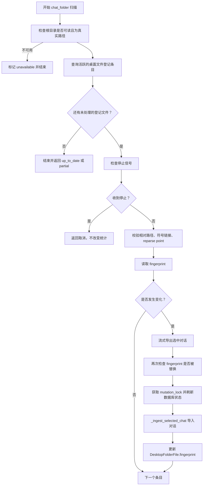
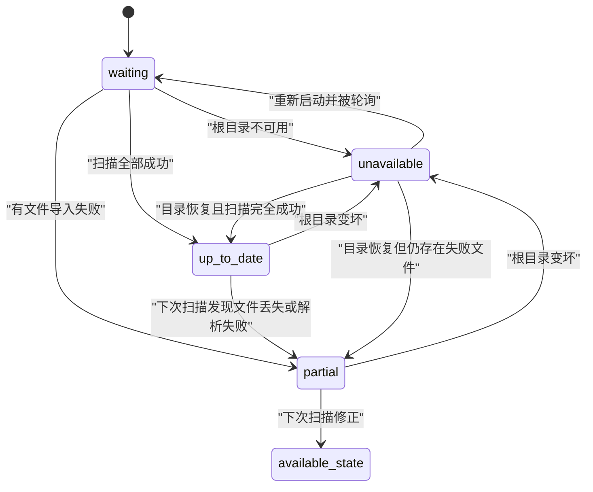
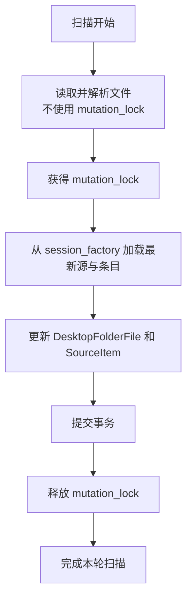
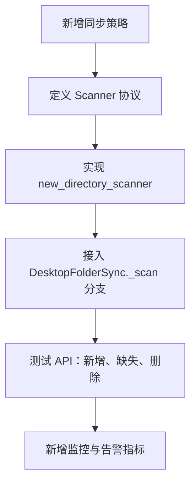

# 同步服务架构

<cite>
**本文引用的文件**
- [desktop_folders.py](file://src/personal_ai_life_os/services/desktop_folders.py)
- [desktop_folders（路由）.py](file://src/personal_ai_life_os/api/routes/desktop_folders.py)
- [models.py](file://src/personal_ai_life_os/models.py)
- [桌面进程配置.desktop.py](file://src/personal_ai_life_os/desktop.py)
- [文件夹源迁移.b68cce9036fd_desktop_folder_sources.py](file://migrations/versions/b68cce9036fd_desktop_folder_sources.py)
- [系统架构总览.md](file://docs/architecture/overview.md)
</cite>

## 目录
1. [引言](#引言)
2. [项目结构与职责边界](#项目结构与职责边界)
3. [核心组件 DesktopFolderSync](#核心组件-desktopfoldersync)
4. [整体架构与调用关系](#整体架构与调用关系)
5. [扫描循环与状态机](#扫描循环与状态机)
6. [权限隔离与安全验证](#权限隔离与安全验证)
7. [会话工厂与线程安全设计](#会话工厂与线程安全设计)
8. [异常恢复与停止信号](#异常恢复与停止信号)
9. [性能特征与内存优化](#性能特征与内存优化)
10. [扩展点与演进建议](#扩展点与演进建议)
11. [故障排查](#故障排查)
12. [结论](#结论)

## 引言
本架构文档聚焦于本地桌面 Markdown 目录与只读 Obsidian vault 的“桌面文件夹同步服务”。该服务不负责实时监听文件系统变更，而是通过一个可停止事件驱动的多轮扫描器，周期性地检查活跃源、校验文件指纹、解析内容并写入统一的 SourceItem 模型，从而避免本地文件系统的跨平台不可靠事件。

核心目标是：
- 明确 DesktopFolderSync 类的生命周期、扫描策略、线程安全和互斥保护。
- 解释 scan_status 状态机的语义及转换逻辑。
- 说明 path_key、fingerprint、mutation_lock 如何保证多源并发访问的数据一致性。
- 总结路径合法性、符号链接防护、Windows reparse point 检测等权限隔离机制。
- 给出性能、内存、监控和扩展建议，帮助后续接入新的目录类型或同步策略。

## 项目结构与职责边界
当前同步服务由三层组成：
- API 层：提供授权添加文件夹、列出缺失文件、完成删除等 REST 接口。
- 服务层：DesktopFolderSync 负责轮询扫描、增量同步、缺失文件和 Obsidian 聊天目录处理。
- 模型与持久化层：DesktopFolder、DesktopFolderFile、SourceConnection、SourceItem 等模型配合迁移脚本定义文件夹与文件的长期状态。

**图示来源**
- [桌面文件夹路由.py:18-132](file://src/personal_ai_life_os/api/routes/desktop_folders.py#L18-L132)
- [services/desktop_folders.py:98-335](file://src/personal_ai_life_os/services/desktop_folders.py#L98-L335)
- [models.py:234-315](file://src/personal_ai_life_os/models.py#L234-L315)

本节未直接分析具体代码行中的实现细节，仅做高层职责划分，因此不包含章节来源。

**部分来源**
- [desktop_folders（路由）.py:1-132](file://src/personal_ai_life_os/api/routes/desktop_folders.py#L1-L132)
- [desktop_folders.py:1-335](file://src/personal_ai_life_os/services/desktop_folders.py#L1-L335)
- [models.py:234-315](file://src/personal_ai_life_os/models.py#L234-L315)
- [系统架构总览.md:8-11](file://docs/architecture/overview.md#L8-L11)

## 核心组件 DesktopFolderSync
DesktopFolderSync 是一个无状态的 Python 类，其唯一内部可变字段是 `mutation_lock`，用于串行化所有涉及增删改的操作；它不持有 session、连接池或文件系统缓存。

关键属性与方法：
| 成员 | 类型 | 职责 | 并发含义 |
|---|---|---|---|
| `mutation_lock` | `RLock` | 保护对数据库写操作、文件删除标记和指纹更新的原子性 | 重入锁允许同一线程多次获得，但不同同步任务不会交错执行修改 |
| `run` | 方法 | 启动轮询循环 | 对外暴露单入口，由应用侧在进程内调度 |
| `_scan` | 方法 | 根据文件夹类型分派 Markdown、Obsidian chat_folder 扫描 | 内部线程安全依赖外部调用方和会话工厂 |
| `_sync_file` | 方法 | 单个 Markdown 文件的读取、去重、导入、旧 item 废弃 | 必须在 mutation_lock 下执行 |
| `_scan_chat` | 方法 | 遍历已登记的 ChatGPT 对话导出文件 | 使用 stop 事件中断长耗时流式导入 |
| `_finish_scan` | 方法 | 更新 last_scan_at、scan_status、标记丢失文件为待删除 | 同样处于 mutation_lock 中，确保结果快照一致 |

从源码角度，DesktopFolderSync 不是传统面向对象中的“数据容器”，而是“流程编排器”：它以 source_id 为单位串行工作，以 `stop` 为退出条件，以 `session_factory` 获取短生命周期 SQLAlchemy session。

**图示来源**
- [desktop_folders.py:114-335](file://src/personal_ai_life_os/services/desktop_folders.py#L114-L335)
- [models.py:234-315](file://src/personal_ai_life_os/models.py#L234-L315)

**部分来源**
- [desktop_folders.py:114-335](file://src/personal_ai_life_os/services/desktop_folders.py#L114-L335)

## 整体架构与调用关系
桌面端由 Tauri 管理的前端启动打包后的 Python sidecar，sidecar 再创建 FastAPI 应用并绑定到 loopback 端口。桌面文件夹同步通常由应用上下文持有 DesktopFolderSync 实例，并将其注册到 `application.state.desktop_folders`，供 API 和后台扫描共享。

**图示来源**
- [桌面进程配置.desktop.py:110-178](file://src/personal_ai_life_os/desktop.py#L110-L178)
- [desktop_folders（路由）.py:28-98](file://src/personal_ai_life_os/api/routes/desktop_folders.py#L28-L98)
- [desktop_folders.py:114-335](file://src/personal_ai_life_os/services/desktop_folders.py#L114-L335)

本节中桌面进程装配依赖了上层框架，因此仅将相关实现映射到对应文件。

**部分来源**
- [桌面进程配置.desktop.py:110-178](file://src/personal_ai_life_os/desktop.py#L110-L178)
- [系统架构总览.md:20-35](file://docs/architecture/overview.md#L20-L35)

## 扫描循环与状态机

### 轮询驱动策略
DesktopFolderSync.run 的实现本质是一个 while 循环：
1. 从 SessionFactory 中取出当前活跃的 SourceConnection。
2. 按 source_id 逐一调用 _scan。
3. 任何异常都被捕获并记录，不影响下一次轮询。
4. 每个轮询周期结束时调用 `stop.wait(3)`，从而实现“最大约 3 秒一轮”的可中断等待。

这种设计选择避免了：
- 不同平台 on_create/on_delete/event 行为差异。
- inotify、ReadDirectoryChangesW、FSEvents 等事件库维护成本。
- 因事件顺序错乱导致的增量判断复杂化。
- 需要实现完整的事件缓冲、去重、重放能力。

轮询代价是可接受的延迟：普通 Markdown 目录可在一次扫描中处理数百个轻量文本文件；如果某次扫描失败，下一轮仍会重试。

**部分来源**
- [desktop_folders.py:114-158](file://src/personal_ai_life_os/services/desktop_folders.py#L114-L158)

### 扫描入口 _scan 的行为
_scan 的职责是将文件夹分为两类处理：
- 如果是 chat_folder，委托给 _scan_chat。
- 否则，对根目录执行 `_markdown_files` 递归枚举，并在每个文件上执行 `_sync_file`。
- 最后进入 `_finish_scan`，设置扫描结束时间和最终状态。

若根目录不可用，或在遍历过程中抛出 OSError/ValueError，则会把 scan_status 设为 unavailable；只有正常结束且无错误才可能得到 up_to_date 或 partial。

### Markdown 文件扫描
Markdown 扫描通过内部函数 `_markdown_files` 实现：
- 先对根目录进行 scoped_file_stat，排除符号链接和 Windows reparse point。
- 拒绝非严格解析路径，确保目录不存在被虚拟路径绕过。
- 过滤忽略目录：.obsidian、.git、.trash、$recycle.bin、system volume information、lifeos-exports。
- 对所有候选子目录再次检查 symlinks/reparse point，动态缩小 os.walk 的 descend 范围。
- 只保留 .md 和 .markdown 后缀，跳过隐藏名称。
- 对每个文件生成 fingerprint，包含 size、mtime_ns、st_dev、st_ino。
- 只接受 resolve(strict=True) 后仍在授权 root 之下的真实文件。

这保证了：
- 即使目录名包含快捷方式，实际子文件也被进一步检查。
- os.path.is_relative_to 与 resolve(strict=True) 共同防御路径穿越。
- fingerprint 可以区分“内容变化 vs 时间戳轻微变化 vs 真正结构变化”。

**部分来源**
- [desktop_folders.py:29-112](file://src/personal_ai_life_os/services/desktop_folders.py#L29-L112)
- [desktop_folders.py:159-200](file://src/personal_ai_life_os/services/desktop_folders.py#L159-L200)

### Chat 目录扫描
_chat_folder 同步的是已经登记过的 conversations.json 文件，其特点是：
- 不再自动发现新文件，只遍历 DesktopFolderFile.status == active 的记录。
- 先用 stage_selected_conversations + stream_conversations 流式提取选中对话。
- 在 mutate 前再次核对 fingerprint，防止“扫描过程中原文件被重写”。
- 仅在目标条目的 conversation_ids、fingerprint 均未改变时才重新 ingeste_selected_chat。
- 更新 DesktopFolderFile.fingerprint 后提交事务。
- 如果出现 FileNotFoundError 但目录不存在，则将扫描标记为 unavailable。
- ChatExportCancelled 会优雅退出，不污染 error 计数。

**图示来源**
- [desktop_folders.py:201-270](file://src/personal_ai_life_os/services/desktop_folders.py#L201-L270)

**部分来源**
- [desktop_folders.py:201-270](file://src/personal_ai_life_os/services/desktop_folders.py#L201-L270)

### 单个文件同步
_sync_file 处理一个 Markdown 文件：
1. 根据 source_id 和 file_key 查找 DesktopFolderFile 记录。
2. 如果已有相同 fingerprint 且仍为 active，则跳过，避免重复读取和解析。
3. 打开文件并以配置上限加 1 的方式读取，确保超出大小限制的文件提前失败。
4. 再次比对 fingerprint，解决扫描期间文件被替换的情况。
5. 对 Obsidian 模式，若头 8192 字节中包含 lifeos_id 或 lifeos_kind，则视为 LifeOS 内部导出文件，直接跳过。
6. 调用 ingest_file 写入 SourceItem，并通过 file_items + _exclude_items 废弃本次扫描未覆盖到的旧 item。
7. 新增或更新 DesktopFolderFile 的 fingerprint 并提交。

这里最关键的设计是：所有数据库修改都在 `self.mutation_lock` 内完成，从而保证：
- 多个源或同一源的多次扫描不会并行写入。
- web UI 触发的手动删除也不会与后台扫描交错。
- DesktopFolderFile.status 从 active 转为 pending_delete 时，关联 evidence 和 SourceItem 的状态能保持一致。

**部分来源**
- [desktop_folders.py:272-312](file://src/personal_ai_life_os/services/desktop_folders.py#L272-L312)

### 扫描结束与缺失文件清理
_finish_scan 负责：
- 如果没有 seen 集合（根目录不可用），直接把整个源标记为 unavailable。
- 如果有 seen，则找出仍在数据库中但不在 seen 中的 active 文件记录。
- 把这些文件标记为 pending_delete，并把它们关联的 SourceItem 证据标记为 source_missing。
- 可选 checked 参数用于 chat_folder 场景，只考虑已经显式检查过的项目。
- 最后更新时间戳和 scan_status。

这意味着“扫描成功”不等于“没有错误”：只要任意一个文件导入失败，就会返回 partial，提示 UI 存在部分错误。

**部分来源**
- [desktop_folders.py:314-335](file://src/personal_ai_life_os/services/desktop_folders.py#L314-L335)

### 扫描状态机
scan_status 的业务含义如下表所示：

| 状态 | 含义 | 触发条件 |
|---|---|---|
| waiting | 文件夹已授权，尚未完成一次有效扫描 | 新增文件夹时初始值 |
| up_to_date | 根目录可用且本次扫描全部成功，没有遗漏已登记文件 | 所有 Markdown/chat 文件都达到预期 |
| partial | 根目录可用但某个文件导入失败，或部分聊天文件出现可容忍错误 | 任一个文件读取、导入或流式导出抛出异常 |
| unavailable | 根目录不可用、路径无效、被绕过或目录消失 | 根目录检查失败、OSError/ValueError、目录不存在 |

需要注意：unavailable 表示扫描阶段无法判定是否存在“文件消失”，因此不会把现有 active 条目误判为 pending_delete；partial 则表示扫描至少完成了部分决策，可以进行遗留清理。

图示中“up_to_date/partial/unavailable”都是 scan_status；waiting 是新建授权后的初始状态。

**图示来源**
- [desktop_folders.py:131-158](file://src/personal_ai_life_os/services/desktop_folders.py#L131-L158)
- [desktop_folders.py:159-200](file://src/personal_ai_life_os/services/desktop_folders.py#L159-L200)
- [desktop_folders.py:201-335](file://src/personal_ai_life_os/services/desktop_folders.py#L201-L335)

**部分来源**
- [desktop_folders.py:128-335](file://src/personal_ai_life_os/services/desktop_folders.py#L128-L335)
- [models.py:279-296](file://src/personal_ai_life_os/models.py#L279-L296)
- [文件夹源迁移.b68cce9036fd_desktop_folder_sources.py:13-29](file://migrations/versions/b68cce9036fd_desktop_folder_sources.py#L13-L29)

## 权限隔离与安全验证
桌面文件夹同步的安全防线贯穿“URL 授权 → 前端路径许可 → API 层校验 → 文件系统访问 → 数据库写入”。

### URL 授权与路径授权
API 层的 add_folder 使用 verify_path_grant，结合请求中的 app.state.desktop_chats.path_key，确保选出的目录确实来自浏览器的 File System Access API 授权，而不是浏览器伪造的字符串。

随后路由还做了业务级约束：
- 必须是目录。
- 不能是驱动器根。
- 不能位于应用 data_dir 之下，也不能让 data_dir 成为它的子目录。
- 必须与当前 owner 关联。

这是为了防止用户意外或恶意地把应用数据目录本身授权为观察源，避免同步器持续监视应用自身产生的数据库、日志、导出目录。

**部分来源**
- [desktop_folders（路由）.py:47-98](file://src/personal_ai_life_os/api/routes/desktop_folders.py#L47-L98)
- [桌面进程配置.desktop.py:132-154](file://src/personal_ai_life_os/desktop.py#L132-L154)

### 路径规范化与路径键
path_key 对路径进行 os.path.normcase 编码后做 sha256。这样做是为了：
- 在 Windows 等大小写不敏感系统上统一路径标识。
- 避免保存原始绝对路径作为唯一索引冲突键。
- 为去重和匹配提供一个固定长度哈希。

同时，DesktopFolder 表中 path_key 是 unique，迁移也强制这一约束。

**部分来源**
- [desktop_folders.py:20-26](file://src/personal_ai_life_os/services/desktop_folders.py#L20-L26)
- [models.py:282-291](file://src/personal_ai_life_os/models.py#L282-L291)
- [文件夹源迁移.b68cce9036fd_desktop_folder_sources.py:13-21](file://migrations/versions/b68cce9036fd_desktop_folder_sources.py#L13-L21)

### 符号链接与 Windows reparse point 防护
scoped_file_stat 对每个要访问的路径执行 lstat：
- 如果发现 is_symlink，抛出 ValueError。
- 如果使用 Python stat 中的 FILE_ATTRIBUTE_REPARSE_POINT 标志，也抛出 ValueError。
- 只有在两者都不是链接或 reparse point 时才返回目录记录。

这个策略适用于：
- Markdown 根目录。
- 每个允许的子系统目录。
- 每个文件名候选。
- Chat 目录中的根目录和候选文件。

它并不能替代“resolve(strict=True) 是否在授权根内”的检查；后者主要处理“真实路径绕出根”的情况，而前者针对“当前路径节点本身就是链接或 reparse point”。

**部分来源**
- [desktop_folders.py:21-30](file://src/personal_ai_life_os/services/desktop_folders.py#L21-L30)
- [desktop_folders.py:44-91](file://src/personal_ai_life_os/services/desktop_folders.py#L44-L91)
- [desktop_folders.py:212-234](file://src/personal_ai_life_os/services/desktop_folders.py#L212-L234)

### 根目录有效性检查
Markdown 扫描使用：
- scoped_file_stat(root)。
- Path.resolve(strict=True) 要求路径必须真实存在且不可被其他命名空间伪装。
- Path.is_dir() 确认它是目录。
- os.walk(followlinks=False) 阻止自动跟随链接继续遍历。
- 自定义 directories 列表只放行未被排除且未标记为 link/reparse point 的子目录。

Chat 目录则额外要求 root.resolve() == root，确保不是别名路径；当 enumerate 中发现 FileNotFoundError 时，还要检查目录是否还存在，否则会回到 unavailable。

**部分来源**
- [desktop_folders.py:44-91](file://src/personal_ai_life_os/services/desktop_folders.py#L44-L91)
- [desktop_folders.py:203-214](file://src/personal_ai_life_os/services/desktop_folders.py#L203-L214)
- [desktop_folders.py:214-234](file://src/personal_ai_life_os/services/desktop_folders.py#L214-L234)

## 会话工厂与线程安全设计

### 为什么使用会话工厂而不是共享 session
DesktopFolderSync.run 在每个轮询、每个源、每个文件、每个状态更新中都使用 `with session_factory() as session`。这样做的优点是：
- 每次 I/O 操作拥有最小化的 session 生命周期。
- 不需要显式关闭 session，异常时也可避免泄漏。
- 避免在多线程或多协程环境中复用 session。
- 降低 long-running transaction 造成锁竞争的风险。

缺点是 SQL 语句数量较多：每个源会查询源记录，每个文件可能查 DesktopFolderFile，失败路径还要查 SourceItem。对于极大量小文件场景，可考虑批量查询和批量更新。

**部分来源**
- [desktop_folders.py:114-139](file://src/personal_ai_life_os/services/desktop_folders.py#L114-L139)
- [desktop_folders.py:159-200](file://src/personal_ai_life_os/services/desktop_folders.py#L159-L200)
- [desktop_folders.py:314-335](file://src/personal_ai_life_os/services/desktop_folders.py#L314-L335)

### mutation_lock 的互斥范围
mutaion_lock 是 threading.RLock，主要包裹以下临界区：
- Markdown 单个文件同步。
- _finish_scan 中的 lost file 标记和 scan_status 更新。
- chat_folder 扫描中实际消费 staging 的结果。
- register_chat_watch 中手动导入选中对话。
- 路由 delete missing 操作中完成真正的删除。

其保护目标是“写入操作的原子性”，而非 CPU 计算。例如：
- 读取文件或 streaming_conversation 不持有 lock，减少阻塞时间。
- 只有 commit 前才真正占用互斥。
- API 删除路径也用同一个 lock，使页面点击删除不会与后台扫描交错。

**图示来源**
- [desktop_folders.py:159-200](file://src/personal_ai_life_os/services/desktop_folders.py#L159-L200)
- [desktop_folders.py:272-335](file://src/personal_ai_life_os/services/desktop_folders.py#L272-L335)
- [desktop_folders（路由）.py:102-132](file://src/personal_ai_life_os/api/routes/desktop_folders.py#L102-L132)

**部分来源**
- [desktop_folders.py:116-139](file://src/personal_ai_life_os/services/desktop_folders.py#L116-L139)
- [desktop_folders（路由）.py:20-26](file://src/personal_ai_life_os/api/routes/desktop_folders.py#L20-L26)
- [desktop_folders（路由）.py:102-132](file://src/personal_ai_life_os/api/routes/desktop_folders.py#L102-L132)

## 异常恢复与停止信号

### 异常恢复
run 方法中的主循环使用 broad try-except 包裹每轮扫描：
- 捕获 Exception 后 log.warning，但不会中断循环。
- stop.wait(3) 会在异常路径之后仍然执行，从而实现周期性重试。
- 具体异常包括数据库异常、权限异常、IOError、导入失败等。
- _scan_chat 单独区分 ChatExportCancelled，避免把主动取消当成普通错误。

这表明服务被设计成“鲁棒的守护进程”：即使单次扫描失败，仍可等待下一轮。

**部分来源**
- [desktop_folders.py:114-158](file://src/personal_ai_life_os/services/desktop_folders.py#L114-L158)
- [desktop_folders.py:236-251](file://src/personal_ai_life_os/services/desktop_folders.py#L236-L251)

### 停止信号
stop 是 threading.Event，用于优雅终止：
- run 的 while 开头检查 stop。
- 每个源扫描前后检查 stop。
- chat 目录流式导出时使用 stop.is_set 回调传递给底层生成器。
- _scan_chat 在每份对话导出前检查 stop，发生 ChatExportCancelled 直接返回。
- stop.wait(3) 是“最多等待 3 秒直到被 set”。

副作用：如果在等待中被立即 stop.set，wait 可能立刻返回，导致本轮扫描跳过。这在正常退出中是可接受的。

**部分来源**
- [desktop_folders.py:114-158](file://src/personal_ai_life_os/services/desktop_folders.py#L114-L158)
- [desktop_folders.py:162-168](file://src/personal_ai_life_os/services/desktop_folders.py#L162-L168)
- [desktop_folders.py:214-251](file://src/personal_ai_life_os/services/desktop_folders.py#L214-L251)

## 性能特征与内存优化

### 复杂度与瓶颈
| 操作 | 时间复杂度 | 空间开销 | 说明 |
|---|---|---|---|
| Markdown 根扫描 | O(N) | O(V+E) 临时 visited set | N 是 Markdown 文件数；seen 保存本次扫描 key |
| 单个文件同步 | O(S+F) | O(S) | S 是文件大小，F 是导入后创建的 SourceItem 数量 |
| chat_folder 同步 | O(M×C) | 暂存 staging 输出 | M 是登记文件数，C 是被选中对话数 |
| 缺失清理 | O(K+R) | O(R) | K 是登记文件数，R 是失效记录的 item 数 |

主要瓶颈通常是：
- 大体积 conversations.json 导出的流式读取与解析。
- 大量 Markdown 文件逐个建立 session。
- ingest_file 中创建大量 SourceItem 及证据图记录。
- filesystem IO 和网络存储写入。

### 已实现的内存优化
- 使用 session_factory 短会话避免长时间持有数据库连接。
- 对话导出走 staged conversation 流，而不是一次性构建超大对象。
- DesktopFolder 与 DesktopFolderFile 使用 JSON 字段存储 conversation_ids，避免冗余中间表。
- scan 过程只维护 path_key 组成的 seen set，不缓存完整文件树。
- markdown 文件读取时按配置上限 +1 截断，防止超大型文件吃满堆栈。
- Obsidian 模式下跳过内部 lifeos_id/lifeos_kind 内容，避免重复 import。

### 可扩展的性能监控指标
建议在应用层扩展以下指标（不改变现有核心逻辑即可）：
| 指标 | 维度 | 用途 |
|---|---|---|
| sync_round_total | 全局 | 统计成功完成的轮询次数 |
| sync_source_errors_total | source_id、error_type | 定位高频失败源 |
| files_scanned_total | kind、source_id | 估算 Markdown 目录规模增长 |
| files_ingested_total | source_id | 衡量导入吞吐量 |
| ingestion_size_bytes | source_id | 监测大文件或损坏文件 |
| files_pending_delete_count | source_id | 监控缺失文件积压 |
| scan_duration_seconds | source_id | 对比 slow folder |
| mutation_lock_hold_seconds | 全局 | 检测高并发写竞争 |
| chat_export_items_streamed | source_id | 评估大对话导出压力 |

这些指标可在 run、_scan、_sync_file、_finish_scan 等处打点，并暴露到 metrics API；当前代码未包含该集成，仅作为演进建议。

[本节属于通用性能建议，不直接分析具体实现片段，因此不含章节来源]

## 扩展点与演进建议

### 支持新的目录类型
DesktopFolder.kind 目前支持 markdown、chat_folder 等语义。新增目录类型可采用以下步骤：
1. 在路由层 allowlist 新 kind，并调整 verify_path_grant 允许路径授权。
2. 在 DesktopFolderSync._scan 中增加分支，调用新扫描器。
3. 为新类型定义独立的 scanner 类或函数，继承一致的 input/output 契约：
   - 输入：root Path、session_factory、stop Event。
   - 输出：seen key 集合、errors bool、finished_with_unavailable bool。
4. 如果需要独立文件登记表，参考 DesktopFolderFile；如果复用 Markdown 模式，保持 file_key + fingerprint 语义。
5. 为 API 列出缺失、撤销、暂停等操作补充新类型处理。

注意：不应直接复制 Markdown 扫描逻辑到新类型中，而应抽象出 CommonScanResult 契约，使 _scan 只需要关心分发和聚合结果。

### 支持新的同步策略
当前同步策略是“全量扫描 + 指纹比较 + SourceItem 外部版本去重”。可演进为：
- 增量策略：基于 mtime/size/inode 快速跳过未变文件，但遇到可疑元数据变化仍做全文校验。
- 分段策略：对超大 conversations.json 分块校验和并行解析。
- 预检策略：先列目录并排序，避免频繁 readdir 影响 UI 状态切换。
- 批量化策略：将多个文件的 flush 合并到一个大事务中，但要平衡 deadlocks 风险。

[此图为概念演进图，不直接映射具体代码文件，因此不含图示来源]

### 当前实现的可改进点
- 可为 run 增加每轮统计，便于前端展示 “上一轮扫描了多少文件、失败多少个”。
- 可将 mutation_lock 拆分为两个锁：文件登记写入锁 + 源级别状态锁，以减少 chat_folder 扫描对 Markdown 文件写入的影响。
- 可把 _markdown_files 改为生成器 + 分页，避免一次性看到全部文件后再写数据库。
- 可对 large directory 启用 backoff：首次扫描慢但第二次快，降低瞬时 IO 冲击。

**部分来源**
- [desktop_folders.py:114-335](file://src/personal_ai_life_os/services/desktop_folders.py#L114-L335)
- [models.py:279-315](file://src/personal_ai_life_os/models.py#L279-L315)

## 故障排查

### 常见问题定位矩阵

| 现象 | 可能原因 | 检查位置 | 处理建议 |
|---|---|---|---|
| 文件夹一直显示 waiting | 未被后台轮询触发，或 stop 事件被立即设置 | run、_scan 入口 | 确认服务运行且未处于关闭阶段 |
| 文件夹持续显示 unavailable | 目录被移动、删除、权限不足或符号链接被拦截 | scoped_file_stat、根目录检查 | 重新授权真实目录 |
| 部分文件无法导入但目录仍可见 | 文件太大、被替换、parser 失败、对象存储失败 | _sync_file、错误标记 partial | 检查日志和 _finish_scan 的 errors 路径 |
| 之前存在的对话导出突然变成 pending_delete | 文件中不再包含原 conversation_ids，或被外部删除 | _scan_chat、_finish_scan | 在 Web 上重新打开导出并重新选择 |
| 手动删除后仍短暂出现旧数据 | SourceItem 尚未完全移除或缓存未刷新 | delete missing 流程 | 等待一次完整扫描和清洗 |
| 重复授权失败 | path_key 已存在或 SourceConnection 已被禁用 | add_folder | 撤销旧授权或选择其他目录 |
| 扫描很慢 | 目录过大、磁盘慢、网络存储慢 | 监控 scan_duration_seconds | 拆分目录、减少 chat 导出规模 |

### 关键代码路径参考
- 添加文件夹时路径校验和重复检查：[桌面文件夹路由](file://src/personal_ai_life_os/api/routes/desktop_folders.py#L47-L98)
- 扫描主循环与 3 秒间隔：[run](file://src/personal_ai_life_os/services/desktop_folders.py#L114-L158)
- Markdown 枚举与权限检查：[_markdown_files](file://src/personal_ai_life_os/services/desktop_folders.py#L44-L91)
- 文件同步和指纹比较：[_sync_file](file://src/personal_ai_life_os/services/desktop_folders.py#L272-L312)
- 扫描结束和 pending_delete 清理：[_finish_scan](file://src/personal_ai_life_os/services/desktop_folders.py#L314-L335)
- Chat 对话流式导入与中止：[_scan_chat](file://src/personal_ai_life_os/services/desktop_folders.py#L201-L270)
- 缺失文件删除事务：[delete_missing](file://src/personal_ai_life_os/api/routes/desktop_folders.py#L102-L132)

**部分来源**
- [desktop_folders（路由）.py:47-132](file://src/personal_ai_life_os/api/routes/desktop_folders.py#L47-L132)
- [desktop_folders.py:44-335](file://src/personal_ai_life_os/services/desktop_folders.py#L44-L335)

## 结论
DesktopFolderSync 的核心价值在于“稳定、可恢复、可审计的桌面文件同步”。它放弃实时事件驱动的复杂性，换取更稳健的跨平台行为和更明确的回滚与恢复语义。通过 path_key、fingerprint、mutation_lock、会话工厂以及 API 路径授权，它在可用性、安全性和可观测性之间取得了合理平衡。

面向未来扩展时，建议优先完善指标采集、扫描契约抽象和低层互斥粒度调优，而不是简单地引入更复杂的事件监听框架。若确需提高响应速度，也应先在 Markdown 目录上做增量预检和批量化写入，并明确保留“每轮扫描都会重建 seen 集合”的最终一致性语义。

[本节为总结性内容，未直接分析具体代码文件，因此不含章节来源]