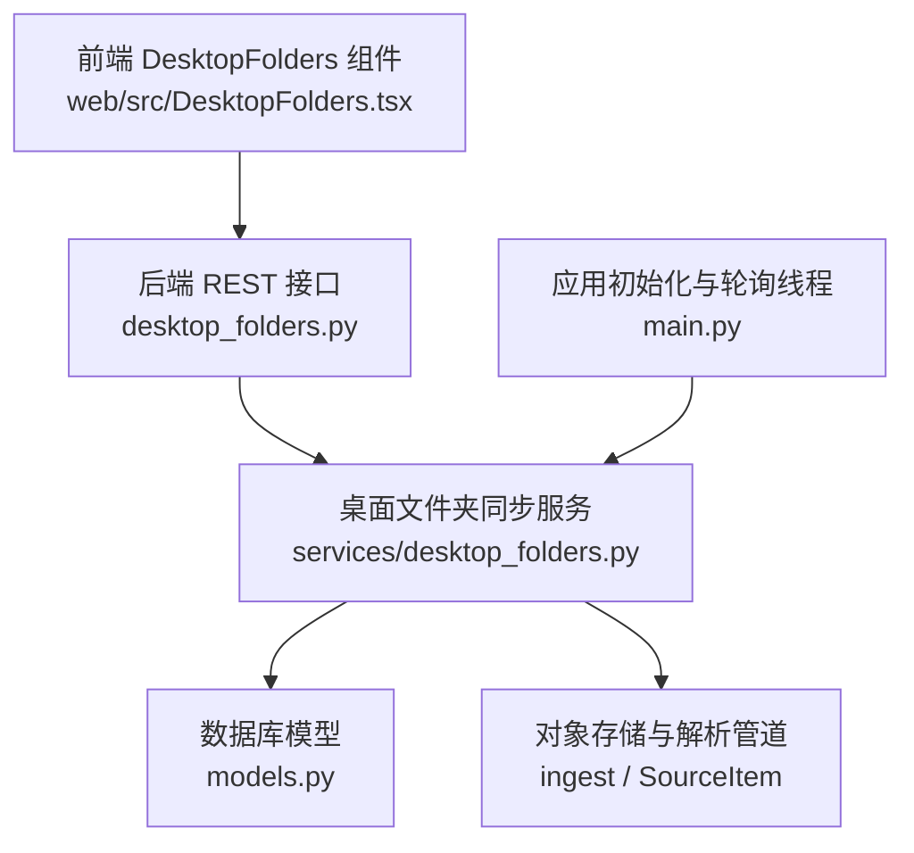
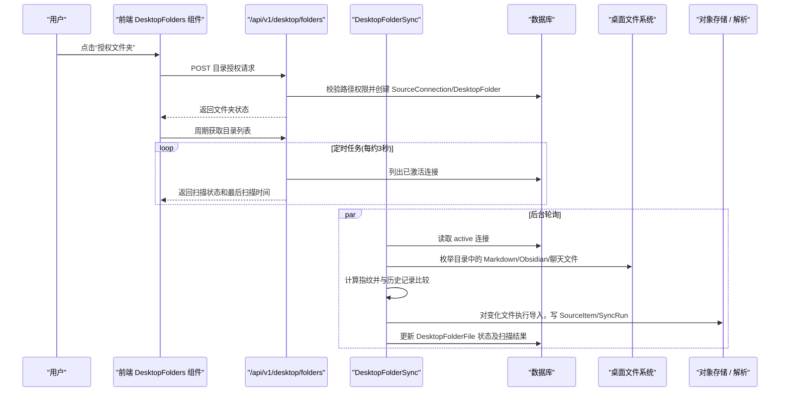
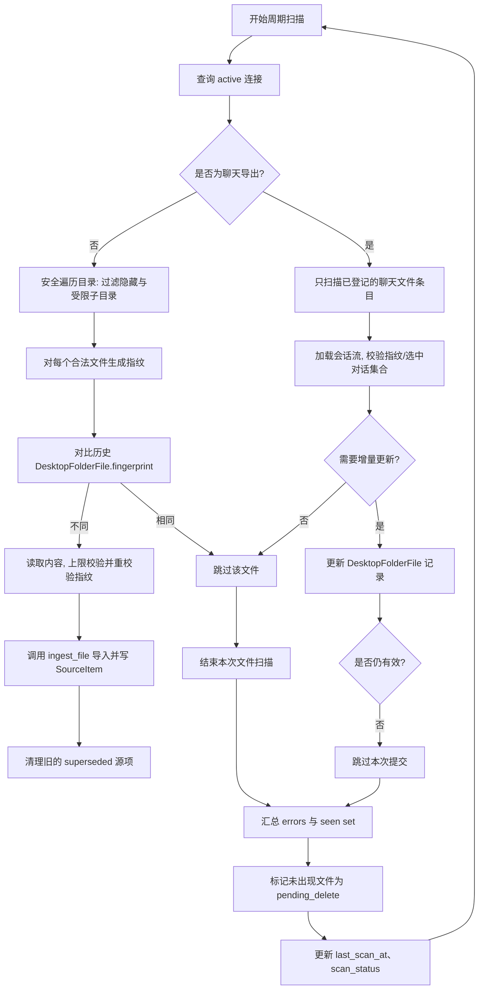
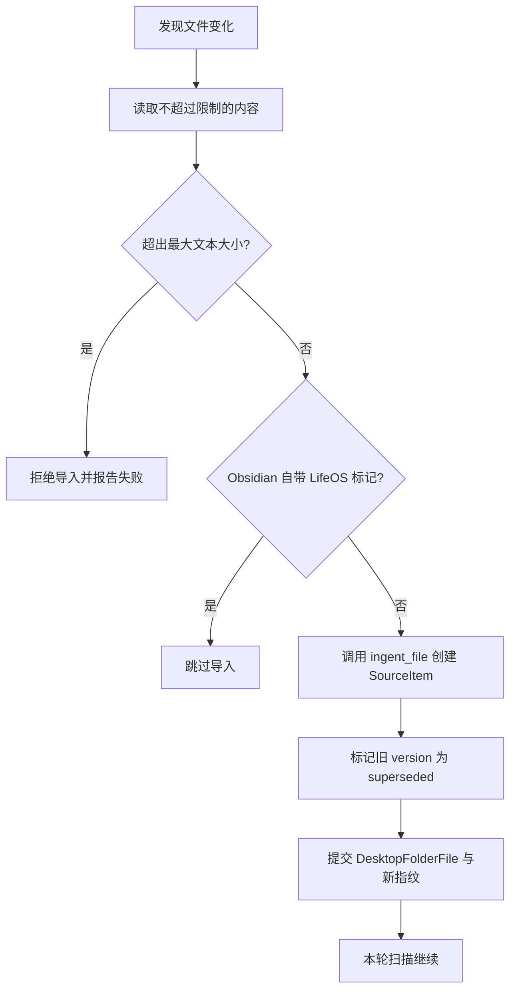
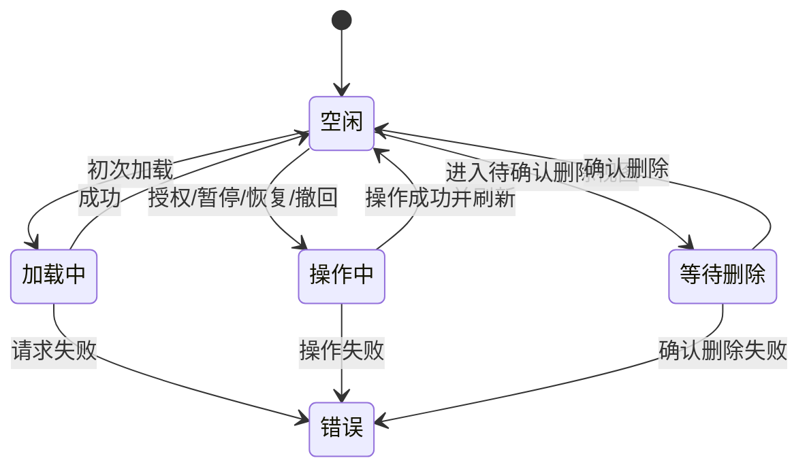
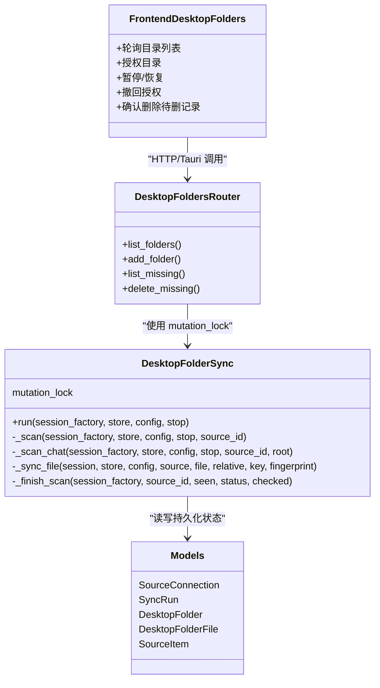

# 文件夹同步功能

<cite>
**本文引用的文件**
- [src/personal_ai_life_os/services/desktop_folders.py](file://src/personal_ai_life_os/services/desktop_folders.py)
- [src/personal_ai_life_os/api/routes/desktop_folders.py](file://src/personal_ai_life_os/api/routes/desktop_folders.py)
- [web/src/DesktopFolders.tsx](file://web/src/DesktopFolders.tsx)
- [src/personal_ai_life_os/models.py](file://src/personal_ai_life_os/models.py)
- [migrations/versions/b68cce9036fd_desktop_folder_sources.py](file://migrations/versions/b68cce9036fd_desktop_folder_sources.py)
- [src/personal_ai_life_os/main.py](file://src/personal_ai_life_os/main.py)
- [src/personal_ai_life_os/config.py](file://src/personal_ai_life_os/config.py)
</cite>

## 目录
1. [简介](#简介)
2. [项目结构](#项目结构)
3. [核心组件](#核心组件)
4. [架构总览](#架构总览)
5. [详细组件分析](#详细组件分析)
6. [依赖关系分析](#依赖关系分析)
7. [性能与调优](#性能与调优)
8. [故障排查指南](#故障排查指南)
9. [结论](#结论)
10. [附录：同步状态语义](#附录同步状态语义)

## 简介
本文件为“桌面端文件夹同步”功能的完整技术文档。该功能通过后端轮询机制监控桌面授权目录中的 Markdown、Obsidian 或聊天导出内容，完成差异识别、增量更新和删除标记；前端提供目录授权、状态查看、暂停/恢复以及待删除记录处理的交互界面。核心目标包括：
- 稳定、可恢复的周期性扫描与增量同步。
- 精确的文件变更检测与缺失文件回收。
- 双向流程控制：前端发起授权/操作，后端服务驱动扫描与数据入库。
- 面向用户的状态反馈与错误提示，保障数据一致性与完整性。

## 项目结构
文件夹同步功能由三条主要路径构成：
- 后端服务层：负责周期性扫描、文件枚举、差异比对、对象存储写入、源项生命周期管理。
- 后端接口层：暴露添加、查询、撤回和删除等 REST 接口。
- 前端桌面组件：提供用户选择目录、启动/停止后台同步、查看状态、处理待删除文件等操作入口。

图表来源
- [web/src/DesktopFolders.tsx:1-121](file://web/src/DesktopFolders.tsx#L1-L121)
- [src/personal_ai_life_os/api/routes/desktop_folders.py:1-132](file://src/personal_ai_life_os/api/routes/desktop_folders.py#L1-L132)
- [src/personal_ai_life_os/services/desktop_folders.py:176-335](file://src/personal_ai_life_os/services/desktop_folders.py#L176-L335)
- [src/personal_ai_life_os/models.py:180-276](file://src/personal_ai_life_os/models.py#L180-L276)
- [src/personal_ai_life_os/main.py:69-112](file://src/personal_ai_life_os/main.py#L69-L112)

章节来源
- [src/personal_ai_life_os/api/routes/desktop_folders.py:1-132](file://src/personal_ai_life_os/api/routes/desktop_folders.py#L1-L132)
- [web/src/DesktopFolders.tsx:1-121](file://web/src/DesktopFolders.tsx#L1-L121)
- [src/personal_ai_life_os/services/desktop_folders.py:176-335](file://src/personal_ai_life_os/services/desktop_folders.py#L176-L335)
- [src/personal_ai_life_os/main.py:69-112](file://src/personal_ai_life_os/main.py#L69-L112)

## 核心组件
- `DesktopFolderSync`：主循环类，按周期扫描已激活的连接，分发到具体类型（聊天导出或 Markdown/Obsidian）。
- `_markdown_files`：安全地遍历目录，跳过符号链接、重解析点及敏感目录，产出相对路径与指纹。
- `_sync_file`：对比本地文件指纹与数据库记录，必要时读取、校验大小并调用统一导入管线。
- `register_chat_watch`：为聊天导出场景提供“选定对话集”的稳定提交能力，支持撤销、取消、重校验。
- `file_items`：根据外部键检索关联源项，以便标记旧版本或删除影响范围。
- 桌面连接与文件元信息：使用 `SourceConnection`、`DesktopFolder`、`DesktopFolderFile`、`SourceItem`、`SyncRun` 等模型持久化状态。

章节来源
- [src/personal_ai_life_os/services/desktop_folders.py:13-174](file://src/personal_ai_life_os/services/desktop_folders.py#L13-L174)
- [src/personal_ai_life_os/services/desktop_folders.py:176-335](file://src/personal_ai_life_os/services/desktop_folders.py#L176-L335)
- [src/personal_ai_life_os/models.py:180-276](file://src/personal_ai_life_os/models.py#L180-L276)

## 架构总览
以下时序图描述一次典型的用户授权与首次扫描流程：

图表来源
- [web/src/DesktopFolders.tsx:27-96](file://web/src/DesktopFolders.tsx#L27-L96)
- [src/personal_ai_life_os/api/routes/desktop_folders.py:34-82](file://src/personal_ai_life_os/api/routes/desktop_folders.py#L34-L82)
- [src/personal_ai_life_os/services/desktop_folders.py:176-225](file://src/personal_ai_life_os/services/desktop_folders.py#L176-L225)

## 详细组件分析

### 文件系统监听与增量检测
实现模式并非传统意义上的“实时系统级事件监听”，而是在后端服务中启动一个可停止的轮询线程，固定间隔检查所有已激活连接的目录。

关键要点：
- **调度方式**：`run` 方法维护 `while not stop.is_set()` 循环，每次扫描结束后等待固定时间再唤醒。
- **安全性枚举**：
  - 拒绝符号链接和 Windows 重解析点。
  - 排除隐藏文件和若干高危/无关目录。
  - 仅处理 `.md`、`.markdown` 文本文件。
- **指纹计算**：基于文件大小、修改时间纳秒、设备号和 inode 组合生成短指纹，以判断是否需要重新导入。
- **隔离保护**：对每个候选路径均进行 `lstat`、相对根目录检查和是否文件等多重安全验证。

图表来源
- [src/personal_ai_life_os/services/desktop_folders.py:176-225](file://src/personal_ai_life_os/services/desktop_folders.py#L176-L225)
- [src/personal_ai_life_os/services/desktop_folders.py:226-335](file://src/personal_ai_life_os/services/desktop_folders.py#L226-L335)

章节来源
- [src/personal_ai_life_os/services/desktop_folders.py:13-75](file://src/personal_ai_life_os/services/desktop_folders.py#L13-L75)
- [src/personal_ai_life_os/services/desktop_folders.py:176-335](file://src/personal_ai_life_os/services/desktop_folders.py#L176-L335)

### 同步算法：差异计算、冲突解决与双向工作流
该实现采用“桌面文件为权威源”的单向同步模式，而非真正的双向合并：

- **差异计算**：
  - Markdown/Obsidian：以 `DesktopFolderFile.file_key` 为维度，匹配当前扫描到的相对路径，比较指纹。
  - 聊天导出：以 `DesktopFolderFile.conversation_ids` 与指纹共同判断是否需要重建导入对象。
- **冲突解决**：
  - 同一路径多次变化：新版本覆盖旧版本，旧 `SourceItem` 被标记为 `superseded`。
  - 文件在桌面上移除：对应 `DesktopFolderFile.status` 标记为 `pending_delete`，其 `SourceItem` 被标记为不可用并延迟删除。
- **并发与一致性**：
  - 使用 `mutation_lock` 将磁盘 IO、数据库事务与对象写入顺序化，避免两个线程同时修改同一文件的索引。
  - 聊天导出场景下，`stage_selected_conversations` 作为临时提交载体，确保最终导入时快照不变。

图表来源
- [src/personal_ai_life_os/services/desktop_folders.py:280-316](file://src/personal_ai_life_os/services/desktop_folders.py#L280-L316)

章节来源
- [src/personal_ai_life_os/services/desktop_folders.py:280-335](file://src/personal_ai_life_os/services/desktop_folders.py#L280-L335)
- [src/personal_ai_life_os/models.py:220-276](file://src/personal_ai_life_os/models.py#L220-L276)

### 前端 DesktopFolders 组件逻辑
前端组件提供三个主要职责：

1. 目录管理与自动启动开关
   - 调用桌面能力 `desktop_pick_folder` 取得用户所选目录权限凭证。
   - 通过 `/desktop/folders` POST 增加授权，GET 轮询刷新状态。
   - 使用 `desktop_autostart` 控制登录后托盘启动。
2. 状态展示与用户交互
   - 每约 3 秒拉取目录列表，显示名称、路径、状态映射、最近扫描时间。
   - 支持暂停/恢复单条连接、撤回目录授权。
   - 渲染统一错误提示区域。
3. “待确认删除”面板
   - 轮询 `/desktop/folders/missing`。
   - 用户在界面确认后，触发删除 API 以清理源记录和关联数据。

图表来源
- [web/src/DesktopFolders.tsx:1-121](file://web/src/DesktopFolders.tsx#L1-L121)

章节来源
- [web/src/DesktopFolders.tsx:1-121](file://web/src/DesktopFolders.tsx#L1-L121)
- [src/personal_ai_life_os/api/routes/desktop_folders.py:34-82](file://src/personal_ai_life_os/api/routes/desktop_folders.py#L34-L82)
- [src/personal_ai_life_os/api/routes/desktop_folders.py:84-132](file://src/personal_ai_life_os/api/routes/desktop_folders.py#L84-L132)

### 大文件处理与断点续传策略
当前实现并未采用分块上传式的断点续传协议，而是采用如下边界策略：
- 大小限额：读取最多 `config.max_text_upload_bytes + 1` 字节；若超过上限则拒绝导入。
- 扫描期间变更保护：在正式写入前再次比较指纹，防止“边读边改”导致不一致。
- 对象存储与元数据：导入过程产生 `SourceItem` 与 `SyncRun` 记录，但当前同步器本身不维护未完成任务的分片进度表。
- 失败重试：外层轮询会捕获异常并记录日志，下次扫描周期自动重试；若文件仍异常，则会累积错误，使扫描结果变为 `partial`。

因此，“断点续传”更准确地说是“基于大小限制与安全快照的重试式增量处理”。若未来需要真正断点续传，需要新增分片对象键、元数据表以及幂等的分段上传统一协调逻辑。

章节来源
- [src/personal_ai_life_os/services/desktop_folders.py:280-301](file://src/personal_ai_life_os/services/desktop_folders.py#L280-L301)
- [src/personal_ai_life_os/config.py:39-39](file://src/personal_ai_life_os/config.py#L39-L39)

### 网络中断与恢复
- 轮询模型天然具备恢复特性：如果对象存储或解析阶段短暂失败，下一次定时扫描会重新尝试。
- 对于无法恢复的错误（例如根目录不存在），扫描结果设置为 `unavailable`，并在恢复后重新建立可用状态。
- `DesktopFolderSync.run` 对外层异常做容错处理，不会因单次扫描失败而停止全局监听。

需要注意：当前代码并没有针对 HTTP 传输层的显式“重试次数上限、退避策略、超时参数”进行封装；这些细节一般由 `ingest_file`、对象存储客户端和 FastAPI 上游配置共同决定。

章节来源
- [src/personal_ai_life_os/services/desktop_folders.py:176-194](file://src/personal_ai_life_os/services/desktop_folders.py#L176-L194)
- [src/personal_ai_life_os/services/desktop_folders.py:200-225](file://src/personal_ai_life_os/services/desktop_folders.py#L200-L225)

### 同步质量保障
- **完整性检查**：
  - 本地文件指针校验：`st_size`、`st_mtime_ns`、`st_dev`、`st_ino` 组成 `fingerprint`。
  - 相对路径严格限定：禁止符号链接、重解析点和越权父目录。
  - 聊天导出需保持相同的 `conversation_ids` 与指纹才可复用。
- **哈希验证**：
  - `SourceItem` 模型保留 `source_sha256` 与 `stored_sha256`，用于追踪对象哈希的一致性。
  - `SyncRun` 保留 `file_sha256`、`object_key`、`items_created/updated/duplicate/removed/skipped/failed` 等指标，可作为审核依据。
- **数据备份点与可回滚性**：
  - 删除并不立即物理移除，而是经历 `pending_delete`、`deleted` 多阶段，并通过 `request_item_deletions` 等函数逐步完成软删除和墓碑归档。
  - 旧版本的 `SourceItem` 不会被直接覆盖，而是标记为 `superseded` 或保留以供审计（视后续清理策略而定）。
- **证据链一致性**：
  - 当文件或源项被不可用时，调用证据相关标记逻辑，避免搜索与 QA 误读过时数据。

章节来源
- [src/personal_ai_life_os/models.py:180-276](file://src/personal_ai_life_os/models.py#L180-L276)
- [src/personal_ai_life_os/services/desktop_folders.py:87-174](file://src/personal_ai_life_os/services/desktop_folders.py#L87-L174)
- [src/personal_ai_life_os/services/desktop_folders.py:302-335](file://src/personal_ai_life_os/services/desktop_folders.py#L302-L335)

## 依赖关系分析
模块间的主要依赖关系如下：

图表来源
- [src/personal_ai_life_os/services/desktop_folders.py:176-335](file://src/personal_ai_life_os/services/desktop_folders.py#L176-L335)
- [src/personal_ai_life_os/api/routes/desktop_folders.py:1-132](file://src/personal_ai_life_os/api/routes/desktop_folders.py#L1-L132)
- [src/personal_ai_life_os/models.py:180-276](file://src/personal_ai_life_os/models.py#L180-L276)
- [web/src/DesktopFolders.tsx:1-121](file://web/src/DesktopFolders.tsx#L1-L121)

## 性能与调优
### 可调参数
- `max_text_upload_bytes`：控制单文件单次导入上限，避免过大 Markdown 占用大量内存和传输带宽。
- 轮询频率：当前轮询间隔固定为约 3 秒，适合轻量桌面场景。
- 扫描并行度：当前设计串行处理每个 `source_id`，且在单个文件处理时持有 `mutation_lock`，以减少锁竞争和并发文件写入风险。
- 缓存策略：当前没有应用层面的文件内容缓存；频繁重复扫描可能带来重复磁盘读取成本。如业务量上升，建议引入去重的扫描摘要缓存，避免对未变化文件反复导入。
- 批量优化：现有批量主要体现在“一轮扫描中标记多个失效项并调用证据更新逻辑”，但没有针对超大目录的文件树预索引或差异快照库。

### 性能权衡建议
- 对于大型 Obsidian 仓库：优先缩小授权目录范围，尽量不直接将整个 vault 挂入，而是授权包含目标笔记的较小子目录。
- 减少隐藏文件与 `.obsidian`、`.git` 等敏感目录被遍历的影响：当前已内置忽略规则，但仍可考虑按用途拆分多份连接以限制单轮工作量。
- 若导入阶段阻塞明显：应检查下游对象存储和网络延迟，并在监控层暴露 `ScanRun` 时长分布与失败率。

### 当前实现的限制
- 无真实文件系统事件监听，存在最长约 3 秒的延迟。
- 不存在跨进程或跨机器的事件分发，不适合高吞吐生产环境。
- 无分片上传或断点续传状态机，大文件失败后会从头重读。
- 没有可见的“批量重试退避”策略；重试发生在下一轮周期。

章节来源
- [src/personal_ai_life_os/services/desktop_folders.py:176-335](file://src/personal_ai_life_os/services/desktop_folders.py#L176-L335)
- [src/personal_ai_life_os/config.py:39-39](file://src/personal_ai_life_os/config.py#L39-L39)

## 故障排查指南
### 常见现象与定位方法
| 现象 | 可能原因 | 建议处理 |
| --- | --- | --- |
| 目录状态始终显示“等待同步” | 尚未完成首次扫描，或连接刚启用 | 等待一轮轮询；检查 `last_scan_at` 是否更新 |
| 状态为“部分文件未同步” | 有文件导入失败或被跳过大文件 | 查看服务端日志中对应 `IngestionFailure`、IO 异常；检查文件大小是否与 `max_text_upload_bytes` 冲突 |
| 状态为“目录暂不可用” | 根目录被移动、权限丢失、卸载盘断开 | 恢复目录路径和挂载，或在 UI 中重新授权 |
| 某个文件被持续标记为“待确认删除” | 文件已从桌面目录移除，但未确认清理记录 | 在前端“待确认删除”面板确认删除；或通过 API 手动删除 |
| 聊天导出一直拒绝导入 | 对话集合变化、导出文件指纹变化、状态非 active | 重新打开导出文件并完成选编，或在 UI 恢复连接 |
| 撤回授权后仍存在同步行为 | 旧连接仍在 active 状态 | 在 UI 中确认撤回完成，或通过列表确认状态 |

### 日志线索
- 同步服务会在扫描失败时输出警告日志，说明未完成的轮次和异常类型。
- 文件不可用、越权访问、过大文件、指纹变更等都会抛出明确异常；结合 `DesktopFolderFile` 的 `status` 与 `DesktopFolder.scan_status` 可快速定位。
- 删除操作的完整链路经过 `request_item_deletions`、`erase_desktop_file_records`、`remove_desktop_file_objects`、`complete_item_deletion`，建议在事务提交前后分别记录关键步骤。

### 恢复流程
1. 修复文件系统问题：恢复目录挂载、修正权限、移除符号链接。
2. 在前端检查并恢复连接，使状态从 `paused` 转为 `active`。
3. 等待下一次轮询完成扫描，观察 `scan_status` 由 `unavailable/partial` 回到 `up_to_date`。
4. 对误删或暂时缺失的数据，先不要立即永久删除，可通过 `pending_delete` 阶段确认后再执行彻底清理。
5. 如需人工介入恢复，可从 `SyncRun` 和 `SourceItem` 的历史记录中核对数据来源和对象键。

章节来源
- [src/personal_ai_life_os/services/desktop_folders.py:176-335](file://src/personal_ai_life_os/services/desktop_folders.py#L176-L335)
- [src/personal_ai_life_os/api/routes/desktop_folders.py:84-132](file://src/personal_ai_life_os/api/routes/desktop_folders.py#L84-L132)

## 结论
桌面端文件夹同步目前以“周期轮询 + 指纹差分 + 软删除过渡”的方式，实现了轻量、可审计、可恢复的桌面 Markdown 与聊天导出同步。它更适合个人或小规模知识管理场景；在高并发、高吞吐或大规模 Vault 环境下，需要补充真正的文件系统事件订阅、增量快照、分片上传和批量化调度能力。通过合理划分目录范围、调整 `max_text_upload_bytes` 和关注 `scan_status`、`DesktopFolderFile.status`、`SourceItem.is_current` 等关键字段，可以很好地维持数据一致性和可用性。

## 附录：同步状态语义
- `DesktopFolder.scan_status`：
  - `waiting`：等待首次或下一次扫描。
  - `up_to_date`：本轮扫描未发现错误且状态完整。
  - `partial`：本轮扫描遇到至少一个文件导入失败或其他异常。
  - `unavailable`：根目录不可用或受保护，不应认为文件缺失。
- `DesktopFolderFile.status`：
  - `active`：文件有效且被同步。
  - `pending_delete`：文件已在桌面移除，等待用户或程序完成记录清理。
  - `deleted`：相关记录已确认为删除阶段完成。
- `SourceConnection.status`：
  - `active`：允许后台扫描与写入。
  - `paused`：跳过后台扫描，但保留已有记录。
  - `revoked`：授权已撤销。

章节来源
- [src/personal_ai_life_os/api/routes/desktop_folders.py:16-23](file://src/personal_ai_life_os/api/routes/desktop_folders.py#L16-L23)
- [src/personal_ai_life_os/services/desktop_folders.py:302-335](file://src/personal_ai_life_os/services/desktop_folders.py#L302-L335)
- [src/personal_ai_life_os/models.py:180-276](file://src/personal_ai_life_os/models.py#L180-L276)