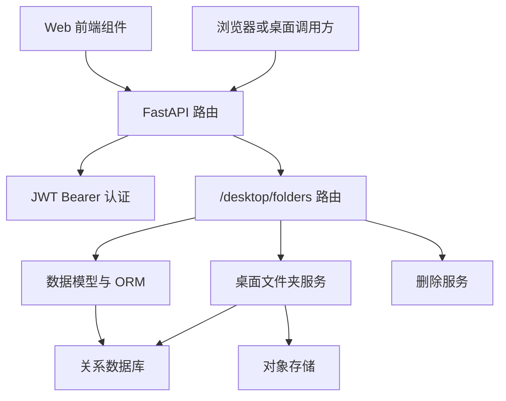
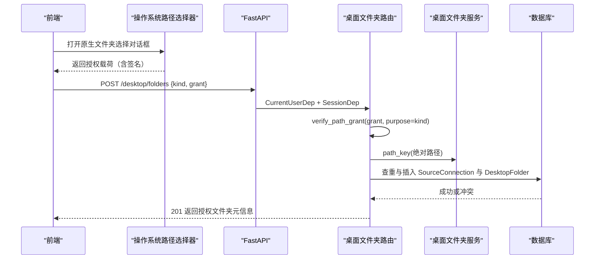
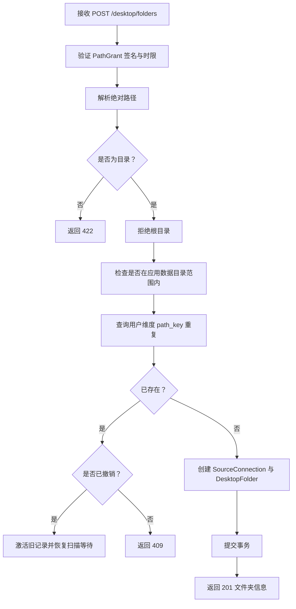
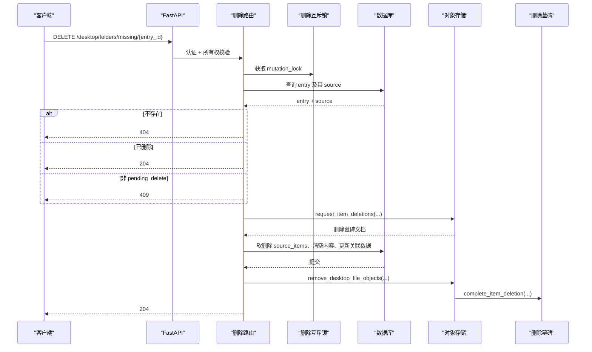
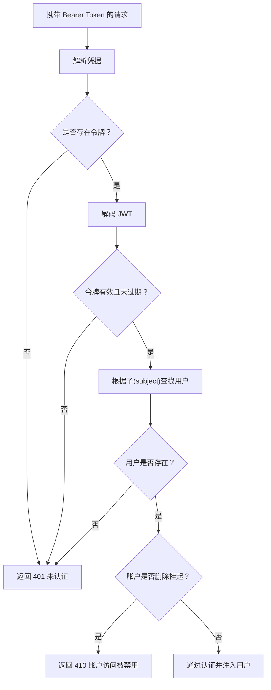
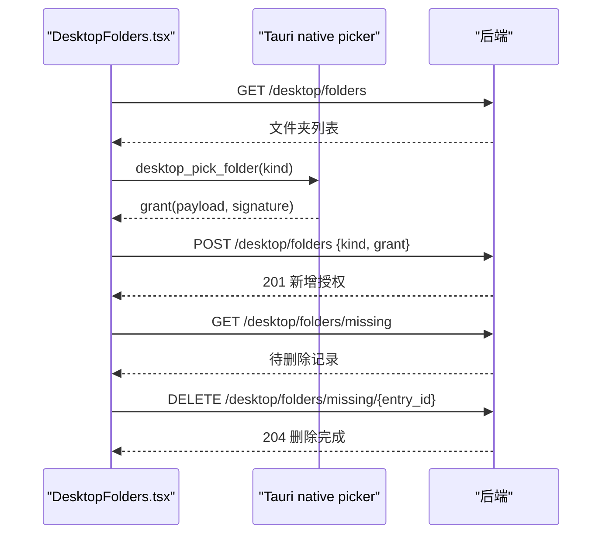

# 文件夹管理 API

<cite>
**本文引用的文件**   
- [src/personal_ai_life_os/api/routes/desktop_folders.py](file://src/personal_ai_life_os/api/routes/desktop_folders.py)
- [src/personal_ai_life_os/api/routes/desktop_chats.py](file://src/personal_ai_life_os/api/routes/desktop_chats.py)
- [src/personal_ai_life_os/services/desktop_folders.py](file://src/personal_ai_life_os/services/desktop_folders.py)
- [src/personal_ai_life_os/models.py](file://src/personal_ai_life_os/models.py)
- [src/personal_ai_life_services/deletion.py](file://src/personal_ai_life_os/services/deletion.py)
- [src/personal_ai_life_os/api/deps.py](file://src/personal_ai_life_os/api/deps.py)
- [src/personal_ai_life_os/security.py](file://src/personal_ai_life_os/security.py)
- [migrations/versions/b68cce9036fd_desktop_folder_sources.py](file://migrations/versions/b68cce9036fd_desktop_folder_sources.py)
- [web/src/DesktopFolders.tsx](file://web/src/DesktopFolders.tsx)
</cite>

## 目录
1. [简介](#简介)
2. [项目结构](#项目结构)
3. [核心组件](#核心组件)
4. [架构总览](#架构总览)
5. [接口详细文档](#接口详细文档)
6. [依赖与数据模型分析](#依赖与数据模型分析)
7. [性能与并发特性](#性能与并发特性)
8. [认证与权限](#认证与权限)
9. [错误处理规范](#错误处理规范)
10. [版本策略、兼容性及迁移指南](#版本策略兼容性及迁移指南)
11. [客户端集成示例](#客户端集成示例)
12. [常见问题排查](#常见问题排查)
13. [结论](#结论)

## 简介
本文件面向调用方和维护者，系统化描述桌面端“文件夹授权与缺失文件清理”相关的 RESTful 接口。重点覆盖以下能力：
- 获取当前用户已授权的桌面文件夹列表及其状态、最后扫描时间。
- 通过原生路径选择器授权新的 Markdown/Obsidian/聊天导出文件夹。
- 查询需要从系统中彻底删除的缺失文件记录。
- 确认并完成这些记录的删除流程，包括对象存储持久化和软删除审计。

本实现基于 FastAPI 路由、SQLAlchemy ORM、JWT Bearer 认证，并通过桌面侧前端组件发起调用。

## 项目结构
相关后端代码位于 `src/personal_ai_life_os`，前端页面位于 `web/src/DesktopFolders.tsx`，数据库变更由 Alembic 迁移脚本定义：
- 路由层负责 HTTP 校验、授权控制、事务提交和错误包装。
- 服务层负责目录扫描、指纹计算、会话导入、缺失检测与同步跟踪。
- 模型层定义用户、来源连接、桌面文件夹、桌面文件等实体。
- 删除服务提供不可逆删除、墓碑（tombstone）记录和可恢复回写逻辑。
- 前端组件展示授权目录列表、暂停/恢复/撤回操作以及待删除记录。



**图表来源**
- [src/personal_ai_life_os/api/routes/desktop_folders.py:1-132](file://src/personal_ai_life_os/api/routes/desktop_folders.py#L1-L132)
- [src/personal_ai_life_os/services/desktop_folders.py:1-200](file://src/personal_ai_life_os/services/desktop_folders.py#L1-L200)
- [src/personal_ai_life_os/models.py:1-200](file://src/personal_ai_life_os/models.py#L1-L200)
- [src/personal_ai_life_os/services/deletion.py:1-120](file://src/personal_ai_life_os/services/deletion.py#L1-L120)
- [web/src/DesktopFolders.tsx:1-121](file://web/src/DesktopFolders.tsx#L1-L121)

**章节来源**
- [src/personal_ai_life_os/api/routes/desktop_folders.py:1-132](file://src/personal_ai_life_os/api/routes/desktop_folders.py#L1-L132)
- [web/src/DesktopFolders.tsx:1-121](file://web/src/DesktopFolders.tsx#L1-L121)

## 核心组件
- 桌面文件夹路由模块：声明 `/desktop/folders` 下所有 HTTP 方法，集中处理授权查询、新增授权、缺失记录列表和确认删除。
- 路径授权模型与安全验证：使用 `PathGrant` 加 HMAC 签名，确保路径必须由应用内原生选择器生成。
- 桌面文件夹扫描服务：根据授权目录生成规范化 `path_key`，检查链接、符号链接、只读 Vault、排除系统目录，并维护 `scan_status` 与 `last_scan_at`。
- 删除事务服务：写入对象存储删除墓碑、更新源项软删除字段、清空内容并标记图证据失效，支持重试和幂等完成。

**章节来源**
- [src/personal_ai_life_os/api/routes/desktop_folders.py:1-132](file://src/personal_ai_life_os/api/routes/desktop_folders.py#L1-L132)
- [src/personal_ai_life_os/api/routes/desktop_chats.py:1-120](file://src/personal_ai_life_os/api/routes/desktop_chats.py#L1-L120)
- [src/personal_ai_life_os/services/desktop_folders.py:1-200](file://src/personal_ai_life_os/services/desktop_folders.py#L1-L200)
- [src/personal_ai_life_os/services/deletion.py:1-200](file://src/personal_ai_life_os/services/deletion.py#L1-L200)

## 架构总览
以下序列图展示客户端添加桌面文件夹的完整请求流。前端通过 Tauri 调用本地路径选择器，将带签名的路径载荷发送给后端；后端验证签名后执行安全校验并插入源连接与文件夹条目。



**图表来源**
- [web/src/DesktopFolders.tsx:28-83](file://web/src/DesktopFolders.tsx#L28-L83)
- [src/personal_ai_life_os/api/routes/desktop_chats.py:82-120](file://src/personal_ai_life_os/api/routes/desktop_chats.py#L82-L120)
- [src/personal_ai_life_os/api/routes/desktop_folders.py:29-100](file://src/personal_ai_life_os/api/routes/desktop_folders.py#L29-L100)
- [src/personal_ai_life_os/services/desktop_folders.py:20-26](file://src/personal_ai_life_os/services/desktop_folders.py#L20-L26)

## 接口详细文档

### GET /desktop/folders
获取当前登录用户已授权且处于活跃状态的桌面文件夹列表。

| 项目 | 说明 |
|---|---|
| 方法 | `GET` |
| URL | `/desktop/folders` |
| 认证 | JWT Bearer |
| 响应类型 | JSON 数组 |
| 权限 | 仅返回 `owner_id` 等于当前用户的记录 |
| 主要用途 | 展示已授权 Markdown 记录、Obsidian Vault、聊天导出目录，并显示其同步状态和最近扫描时间 |

请求无需请求体。响应中每个文件夹对象的字段如下：

| 字段 | 类型 | 含义 |
|---|---|---|
| `id` | 字符串 | 对应 `SourceConnection.id` |
| `name` | 字符串 | 名称来源于系统级源连接名称，通常截断自目录名 |
| `path` | 字符串 | 已解析的绝对路径 |
| `kind` | 枚举值 | `markdown`、`obsidian` 或 `chat_folder` |
| `status` | 字符串 | 上游源连接状态，通常为 `active` 或 `paused`；该接口同时返回已暂停记录，以便 UI 展示 |
| `scan_status` | 字符串 | 桌面文件夹扫描状态，例如 `waiting`、`up_to_date`、`partial`、`unavailable` |
| `last_scan_at` | 时间戳或空 | 上次扫描时间，可能为空 |

后端对授权查询的处理逻辑如下：
1. 通过认证依赖注入当前用户对象。
2. 将 `DesktopFolder` 与 `SourceConnection` 关联，过滤 `owner_id == 当前用户`。
3. 允许 `status` 为 `active` 或 `paused` 的源连接。
4. 按照源连接名称排序。
5. 组装 `id`、`name`、`path`、`kind`、`status`、`scan_status`、`last_scan_at` 返回。

示例响应数组元素：
- `id`: 唯一源连接标识
- `name`: 文件夹友好名称
- `path`: 桌面绝对路径
- `kind`: 类型
- `status`: `active` 或 `paused`
- `scan_status`: 扫描结果
- `last_scan_at`: ISO 时间戳或 null

HTTP 状态码：
- `200 OK`：成功返回文件夹列表。
- `401 Unauthorized`：缺少有效 JWT 令牌、令牌无效或已过期。
- `410 Gone`：账户正在数据清理期间被禁用访问。

成功示例：
```json
[
  {
    "id": "uuid-or-string-id",
    "name": "我的笔记",
    "path": "C:\\Users\\Alice\\Notes",
    "kind": "markdown",
    "status": "active",
    "scan_status": "up_to_date",
    "last_scan_at": "2026-11-27T10:30:00+00:00"
  }
]
```

错误示例：
- `401` 未认证时返回标准鉴权错误响应。
- `410` 账号删除挂起时返回标准账号限制错误。

**章节来源**
- [src/personal_ai_life_os/api/routes/desktop_folders.py:15-36](file://src/personal_ai_life_os/api/routes/desktop_folders.py#L15-L36)
- [src/personal_ai_life_os/api/routes/desktop_folders.py:38-52](file://src/personal_ai_life_os/api/routes/desktop_folders.py#L38-L52)
- [src/personal_ai_life_os/models.py:78-108](file://src/personal_ai_life_os/models.py#L78-L108)
- [src/personal_ai_life_os/models.py:155-171](file://src/personal_ai_life_os/models.py#L155-L171)
- [src/personal_ai_life_os/api/deps.py:13-50](file://src/personal_ai_life_os/api/deps.py#L13-L50)

### POST /desktop/folders
授权一个新的桌面文件夹。该方法要求客户端先调用桌面原生路径选择器，获得一个带 Hmac-SHA256 签名的 `PathGrant` 载荷，并传入 `kind` 和 `grant`。

| 项目 | 说明 |
|---|---|
| 方法 | `POST` |
| URL | `/desktop/folders` |
| 认证 | JWT Bearer |
| 请求体 | `{ kind, grant }` |
| 成功响应 | `201 Created`，返回新建或恢复的文件夹元信息 |
| 前置条件 | 必须来自本机原生选择器生成的 `PathGrant` |

请求体字段：
| 字段 | 类型 | 约束 | 含义 |
|---|---|---|---|
| `kind` | 字符串 | 必须是 `markdown`、`obsidian` 或 `chat_folder` | 表示所选文件夹用途 |
| `grant.payload` | 字符串 | 最多 36000 字符 | 包含 `purpose`、`issued`、`path` 的 JSON |
| `grant.signature` | 字符串 | 固定长度 SHA256 十六进制签名 | 服务端用共享密钥对 payload 进行 HMAC 签名校验 |

路径验证与安全约束流程：
1. 使用服务端缓存的路径密钥派生值对 `grant.signature` 进行恒定时间比较。
2. 解析 `payload`，校验 `purpose` 是否等于传入的 `kind`。
3. 校验签发时间在短时间窗口内（约 2 分钟）。
4. 校验 `path` 是绝对路径。
5. 以严格模式解析实际文件系统路径。
6. 要求目标是一个目录。
7. 不允许目录锚点根路径，防止整个盘符或根目录成为授权范围。
8. 不允许目录包含在应用数据目录内，也禁止应用数据目录位于授权目录之下，避免递归或内部资源暴露。
9. 对路径规范化后计算 `path_key`，用于去重。
10. 如果同一个用户已经拥有相同 `path_key` 的文件夹：
   - 若源连接状态为“撤销”，则复用记录并将其激活。
   - 否则返回重复授权冲突。
11. 如果没有重复记录，则创建 `SourceConnection` 和 `DesktopFolder`，并根据 `kind` 设置来源类型和同意版本。
12. 捕获数据库唯一约束冲突，转换为 `409` 响应。

示例请求体：
```json
{
  "kind": "markdown",
  "grant": {
    "payload": "{\"purpose\":\"markdown\",\"issued\":...,\"path\":\"C\\\\Users\\\\Alice\\\\Notes\"}",
    "signature": "sha256-hex-signature"
  }
}
```

成功响应（新增）：
```json
{
  "id": "source-connection-id",
  "name": "Notes",
  "path": "C:\\Users\\Alice\\Notes",
  "kind": "markdown",
  "status": "active",
  "scan_status": "waiting",
  "last_scan_at": null
}
```

HTTP 状态码：
| 状态码 | 含义 |
|---|---|
| `201 Created` | 新增授权成功 |
| `401 Unauthorized` | 缺少或无效 JWT |
| `403 Forbidden` | 路径选择器签名校验失败 |
| `422 Unprocessable Entity` | 载荷无效、非绝对路径、路径不可用或不符合路径安全策略 |
| `409 Conflict` | 文件夹已授权，或源连接类型不同，或触发数据库唯一键冲突 |

注意事项：
- `name` 字段最大取自原始目录名前 240 个字符。
- `kind` 与 `chat_folder` 会映射到 `chat_export` 来源类型，其他类型映射到 `memory_markdown`。
- 新创建的文件夹初始扫描状态通常为 `waiting`，后续由后台同步任务更新。



**图表来源**
- [src/personal_ai_life_os/api/routes/desktop_chats.py:93-120](file://src/personal_ai_life_os/api/routes/desktop_chats.py#L93-L120)
- [src/personal_ai_life_os/api/routes/desktop_folders.py:38-100](file://src/personal_ai_life_os/api/routes/desktop_folders.py#L38-L100)

**章节来源**
- [src/personal_ai_life_os/api/routes/desktop_chats.py:93-120](file://src/personal_ai_life_os/api/routes/desktop_chats.py#L93-L120)
- [src/personal_ai_life_os/api/routes/desktop_folders.py:38-100](file://src/personal_ai_life_os/api/routes/desktop_folders.py#L38-L100)

### GET /desktop/folders/missing
查询当前用户需要彻底删除的文件记录。这些记录对应已经无法从同步源读取到的文件或对话导出文件，但尚未被管理员最终确认删除。

| 项目 | 说明 |
|---|---|
| 方法 | `GET` |
| URL | `/desktop/folders/missing` |
| 认证 | JWT Bearer |
| 响应类型 | JSON 数组 |
| 数据含义 | 属于当前用户、处于待删除状态的桌面文件条目 |

响应数组元素字段：
| 字段 | 类型 | 含义 |
|---|---|---|
| `id` | 字符串 | `DesktopFolderFile.id` |
| `path` | 字符串 | 相对路径 |
| `source` | 字符串 | 所属源的名称 |

查询条件：
- 仅查询 `DesktopFolderFile.status == "pending_delete"`。
- 关联 `SourceConnection.owner_id` 过滤为当前用户。
- 按源名称和相对路径排序。

示例响应：
```json
[
  {
    "id": "desktop-folder-file-uuid-or-string",
    "path": "notes/lost-conversation.json",
    "source": "聊天导出"
  }
]
```

HTTP 状态码：
- `200 OK`：返回缺失记录列表，空数组也表示正常。
- `401 Unauthorized`：未认证。
- `410 Gone`：账号访问被禁用。

**章节来源**
- [src/personal_ai_life_os/api/routes/desktop_folders.py:102-113](file://src/personal_ai_life_os/api/routes/desktop_folders.py#L102-L113)
- [src/personal_ai_life_os/services/desktop_folders.py:313-334](file://src/personal_ai_life_os/services/desktop_folders.py#L313-L334)
- [src/personal_ai_life_os/models.py:173-186](file://src/personal_ai_life_os/models.py#L173-L186)

### DELETE /desktop/folders/missing/{entry_id}
确认彻底删除某个缺失文件记录。该接口采用“两阶段删除 + 幂等完成”设计：
1. 记录进入待删除状态。
2. 客户端调用删除确认接口完成销毁。
3. 多次调用是幂等的；已在删除中的记录会被直接接受。

| 项目 | 说明 |
|---|---|
| 方法 | `DELETE` |
| URL | `/desktop/folders/missing/{entry_id}` |
| 路径参数 | `entry_id`：待删除记录的 `id` |
| 认证 | JWT Bearer |
| 成功状态码 | `204 No Content` |
| 并发保护 | 使用服务端 `mutation_lock` 串行化同一进程内的删除操作 |

安全与验证顺序：
1. 获取全局删除互斥锁，防止高并发下的竞态。
2. 查询指定 `entry_id` 的 `DesktopFolderFile` 及其关联源连接，并校验 `owner_id` 为当前用户。
3. 未找到记录返回 `404`。
4. 如果状态已经是 `deleted`，视为幂等成功，直接返回。
5. 如果状态不是 `pending_delete`，返回 `409`，因为只能确认正式删除“待删除”记录。
6. 查找该记录对应的全部历史源项（不区分是否已被其他记录共用）。
7. 向对象存储写入删除墓碑，携带所有者标识、条目集合、可选的桌面文件 ID 和对象键集合。
8. 将这些源项软删除、内容擦除、标题和元数据清空，并清理草稿与图证据引用。
9. 将记录状态更新为 `deleted`。
10. 如果有对象键需要物理删除，则在事务提交后清理对象存储，并移除同步运行对象的关联键。
11. 最后完成删除墓碑，标志持久化回收作业可完成。

请求示例：
- `DELETE /desktop/folders/missing/<entry_id>`
- 无请求体。

成功响应：
- `204 No Content`

常见错误：
- `401 Unauthorized`
- `404 Not Found`：记录不存在或不属于当前用户。
- `409 Conflict`：记录不是待删除状态。
- 服务端并发修改异常可能导致更高层 HTTP 错误，但在常规场景下由状态机保护。



**图表来源**
- [src/personal_ai_life_os/api/routes/desktop_folders.py:115-132](file://src/personal_ai_life_os/api/routes/desktop_folders.py#L115-L132)
- [src/personal_ai_life_os/services/deletion.py:32-99](file://src/personal_ai_life_os/services/deletion.py#L32-L99)
- [src/personal_ai_life_os/services/deletion.py:101-158](file://src/personal_ai_life_os/services/deletion.py#L101-L158)

**章节来源**
- [src/personal_ai_life_os/api/routes/desktop_folders.py:115-132](file://src/personal_ai_life_os/api/routes/desktop_folders.py#L115-L132)
- [src/personal_ai_life_os/services/deletion.py:32-158](file://src/personal_ai_life_os/services/deletion.py#L32-L158)

## 依赖与数据模型分析

### 关键数据结构
- `User`：用户主体，持有 `id`、邮箱、时区等属性。
- `SourceConnection`：桌面来源连接，承载所有者 `owner_id`、来源 `kind`、名称、状态、同步时间与云授权版本等信息。
- `DesktopFolder`：将桌面目录绑定到源连接，保存路径、规范化 `path_key`、目录类型和扫描状态。
- `DesktopFolderFile`：跟踪具体文件的指纹、相对路径、状态（活跃、待删除、已删除）以及对话导出标识集合。
- `SourceItem`：通用源项，被删除服务在文件消失后软删除并清除内容。

```mermaid
erDiagram
  USER {
    string id PK
    string email UK
    string timezone
    timestamp created_at
  }

  SOURCE_CONNECTION {
    string id PK
    string owner_id FK
    string kind
    string name
    string status
    json selected_scope
    timestamp created_at
    timestamp updated_at
    timestamp last_sync_at
  }

  DESKTOP_FOLDER {
    string source_id PK FK
    text path
    string path_key UK
    string kind
    string scan_status
    timestamp last_scan_at
  }

  DESKTOP_FOLDER_FILE {
    string id PK
    string source_id FK
    string file_key
    text relative_path
    string fingerprint
    string status
    json conversation_ids
  }

  USER ||--o{ SOURCE_CONNECTION : owns
  SOURCE_CONNECTION ||--|| DESKTOP_FOLDER : has_folder
  DESKTOP_FOLDER ||--o{ DESKTOP_FOLDER_FILE : tracks_files
```

**图表来源**
- [src/personal_ai_life_os/models.py:78-108](file://src/personal_ai_life_os/models.py#L78-L108)
- [src/personal_ai_life_os/models.py:155-186](file://src/personal_ai_life_os/models.py#L155-L186)

### 数据完整性约束
- `DesktopFolder.path_key` 全局唯一，保证同一路径在同一用户、同一表级别去重。
- `DesktopFolderFile` 在 `(source_id, file_key)` 上存在唯一约束，避免同一目录源内重复文件索引。
- `DesktopFolder.source_id` 与 `SourceConnection.id` 外键关联，受级联删除约束保护。
- `DesktopFolderFile.source_id` 级联指向 `DesktopFolder.source_id`，使废弃文件与目录一同清理。
- 扫描服务会对无效链接、重解析点和不可达目录抛出异常，从而避免危险路径进入系统。

**章节来源**
- [migrations/versions/b68cce9036fd_desktop_folder_sources.py:12-37](file://migrations/versions/b68cce9036fd_desktop_folder_sources.py#L12-L37)
- [src/personal_ai_life_os/models.py:155-186](file://src/personal_ai_life_os/models.py#L155-L186)
- [src/personal_ai_life_os/services/desktop_folders.py:28-39](file://src/personal_ai_life_os/services/desktop_folders.py#L28-L39)

## 性能与并发特性
- 列表接口是简单 SQL 查询与内存投影，时间复杂度主要由数据库索引和行数决定，适合常规规模。
- `POST /desktop/folders` 包含一次路径解析、可能的现有记录查询和一次性事务写入，整体为常数级额外开销。
- 缺失记录列表使用有序关联查询，结果集受 `pending_delete` 状态过滤限制。
- 删除接口使用 `RLock` 实现进程内互斥，避免并发删除导致的状态不一致。
- 删除过程会查找所有历史源项、写出删除墓碑并可能删除对象存储对象，因此对大规模历史记录场景建议分页或批量治理缺失记录，而不要长时间阻塞单一请求。
- 同步任务以轮询方式检查活跃目录，每次扫描间隔可配置为事件驱动扩展（当前默认短轮询）。

优化建议：
- 对高频列添加复合索引，如 `(owner_id, status)`、`(status, owner_id)`、`(owner_id, status, id)`，可加速列表过滤。
- 对大用户场景，对缺失记录列表增加分页接口，减少一次性返回数量。
- 对象删除完成后尽快归档或删除 tombstone，降低存储负载。

[本节为通用性能讨论，不直接分析具体代码行]

## 认证与权限
- 所有 `/desktop/folders` 路由使用 FastAPI 依赖注入当前用户。
- 认证通过 Bearer Token 实现；令牌使用 HS256 算法签名，包含主题、签发时间、到期时间、签发方、受众和令牌类型。
- 非法或缺失的凭据返回 `401`。
- 已过期或无效的访问令牌也返回 `401`，并在响应头部包含 `WWW-Authenticate: Bearer`。
- 如果用户账户正在执行数据删除流程，普通访问会返回 `410`，除非显式启用删除权限。
- 业务层面的权限控制以 `owner_id` 为准：列表、新增、缺失查询和删除均强制校验记录所属用户与当前用户一致。

认证流程图：


**图表来源**
- [src/personal_ai_life_os/api/deps.py:13-50](file://src/personal_ai_life_os/api/deps.py#L13-L50)
- [src/personal_ai_life_os/security.py:21-54](file://src/personal_ai_life_os/security.py#L21-L54)

**章节来源**
- [src/personal_ai_life_os/api/deps.py:13-50](file://src/personal_ai_life_os/api/deps.py#L13-L50)
- [src/personal_ai_life_os/security.py:21-54](file://src/personal_ai_life_os/security.py#L21-L54)

## 错误处理规范
后端主要返回以下错误形式：
- HTTP 401：认证缺失、令牌无效、用户不存在。
- HTTP 403：路径选择器签名不符合预期。
- HTTP 404：缺失记录不存在或所有权不匹配。
- HTTP 409：重复授权、源类型冲突、非待删除状态确认删除。
- HTTP 410：账户删除挂起期间访问受限。
- HTTP 422：路径选择器过期、路径不安全、目录不可用、载荷格式不符。

统一错误消息特点：
- 使用自然语言 `detail` 描述问题原因。
- 部分错误包含语义代码，如 `auth_required`、`invalid_access_token`、`account_deletion_pending`。
- 对于路径选择和桌面原生操作错误，优先返回 401、403 或 422 等结构化状态码，而非内部 500。

最佳实践：
- 客户端应识别 401/403 并提示重新登录或使用新的路径选择器。
- 客户端应对 409 做幂等重试或引导用户刷新界面。
- 客户端不应假定所有 JSON 响应都有 `message` 字段；应优先依据 HTTP 状态码判断成败。

**章节来源**
- [src/personal_ai_life_os/api/deps.py:21-50](file://src/personal_ai_life_os/api/deps.py#L21-L50)
- [src/personal_ai_life_os/api/routes/desktop_folders.py:38-132](file://src/personal_ai_life_os/api/routes/desktop_folders.py#L38-L132)

## 版本策略、兼容性及迁移指南

### 接口版本策略
- 当前路由前缀为 `/desktop/folders`，没有独立的 API 版本号段。
- 向后兼容性通过字段稳定、状态机扩展和语义化错误来保证：新增可选字段、保留旧字段，避免破坏现有客户端。
- 未来如需重大变更，应考虑使用独立版本路径，例如 `/v1/desktop/folders`，或在 `Content-Type`、自定义头中加入版本号。

### 兼容性保证
- GET 列表仍返回 `status` 字段，即使它来自外层 `SourceConnection`；客户端可以继续使用 `active`/`paused`。
- `scan_status` 使用中文前端映射，但后端返回英文原义值；客户端应以原值为主、本地化为辅。
- 删除接口保持幂等，允许重复调用而不报错。

### 迁移指南
- 数据迁移脚本定义了 `desktop_folders` 和 `desktop_folder_files` 两张表，分别包含路径、规范化键、类型、扫描状态、文件指纹和对话选择等字段。
- 如果升级时需要调整目录扫描行为，应先更新服务层再部署，并确保已有记录的 `path_key` 不会因大小写或大小分隔符差异产生分裂。
- 若需要重置某些目录授权，应调用上层源撤销接口，而不是直接删除数据库记录，以保持事务一致性。

**章节来源**
- [migrations/versions/b68cce9036fd_desktop_folder_sources.py:12-37](file://migrations/versions/b68cce9036fd_desktop_folder_sources.py#L12-L37)
- [src/personal_ai_life_os/api/routes/desktop_folders.py:15-132](file://src/personal_ai_life_os/api/routes/desktop_folders.py#L15-L132)

## 客户端集成示例

### Web 前端调用模式
前端通过 `desktopRuntime.desktopRequest` 封装的令牌请求机制调用后端，并使用 Tauri 原生接口 `desktop_pick_folder` 获取路径授权载荷。典型交互：
- 初次加载页面时轮询 `/desktop/folders`，每三秒刷新。
- 用户选择 Markdown/Obsidian/聊天导出目录后，调用 `POST /desktop/folders`。
- 成功后刷新文件夹列表，并显示名称、路径、扫描状态和最后扫描时间。
- 进入“待确认删除”面板后轮询 `/desktop/folders/missing`。
- 点击确认后调用 `DELETE /desktop/folders/missing/{entry_id}`，然后刷新并通知上层。

前端状态映射：
- 扫描状态显示文本包含“等待同步”“已同步”“部分文件未同步”“目录暂不可用”。
- 源连接状态为 `paused` 时显示“已暂停”，`active` 时显示正常。
- 缺失记录列出文件名、所属源和删除按钮。

最佳实践：
- 首次调用前先请求原生路径选择器，避免把任意路径交给后端。
- 对网络错误和用户主动取消做友好提示，不要把内部路径或签名错误暴露给用户。
- 在按钮上增加防抖与忙状态，防止重复提交。
- 对 404、409、422 分别给出不同引导信息：记录不存在、状态不对、请重新选择目录。



**图表来源**
- [web/src/DesktopFolders.tsx:17-121](file://web/src/DesktopFolders.tsx#L17-L121)

**章节来源**
- [web/src/DesktopFolders.tsx:17-121](file://web/src/DesktopFolders.tsx#L17-L121)
- [src/personal_ai_life_os/api/routes/desktop_folders.py:15-132](file://src/personal_ai_life_os/api/routes/desktop_folders.py#L15-L132)

## 常见问题排查
- 新增文件夹时报“必须选择应用程序数据目录之外的具体文件夹”：
  - 检查所选路径是否为根目录、是否位于应用数据目录之内或之外。
  - 确认路径是由 Tauri 原生选择器生成并经 HMAC 签名验证。
- 新增文件夹报重复授权：
  - 可能已有相同 `path_key` 的记录。如果是撤销后的旧记录，后端会自动激活；若是不同 `kind`，则需要移除旧记录并重新授权。
- 缺失记录无法删除，返回冲突：
  - 记录可能已经是 `deleted` 或不再处于 `pending_delete`。刷新缺失列表后再试。
- 鉴权失败：
  - 确认携带有效的 JWT，令牌未被篡改或过期。
  - 如果账户正在执行数据清理，需等待清理完成后再访问。
- 前端反复弹窗错误或显示空白：
  - 检查 3 秒轮询是否有权限错误、网络错误或响应结构变化。
  - 关注控制台输出的 `message` 与 HTTP 状态码。

**章节来源**
- [src/personal_ai_life_os/api/routes/desktop_folders.py:38-132](file://src/personal_ai_life_os/api/routes/desktop_folders.py#L38-L132)
- [web/src/DesktopFolders.tsx:28-121](file://web/src/DesktopFolders.tsx#L28-L121)

## 结论
桌面文件夹管理 API 围绕“安全授权 + 可观测状态 + 可恢复删除”构建：
- 授权通过原生路径选择器和 HMAC 签名避免任意路径逃逸。
- 列表接口暴露统一的文件夹元数据和扫描状态。
- 缺失记录通过明确的两阶段删除流程保障数据安全和业务一致性。
- 鉴权与权限分离：JWT 负责身份认证，`owner_id` 负责资源归属隔离。
- 前端组件清晰展示了典型调用流程，可作为客户端集成参考。

在实际接入中，应重点关注路径安全性、鉴权有效期、状态机一致性、对象存储删除幂等性和用户可见的错误信息。