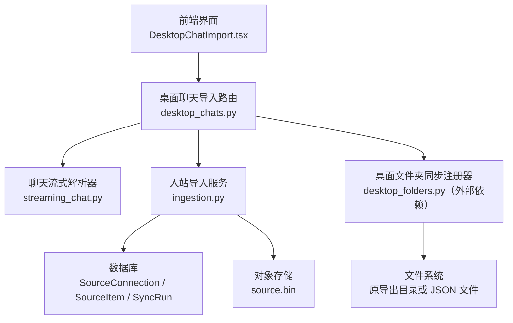
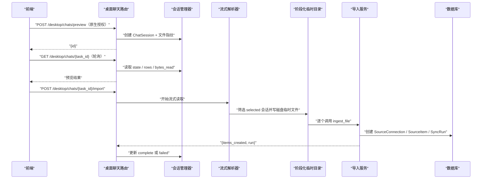
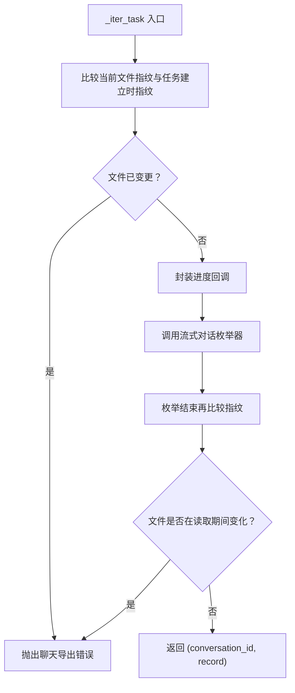
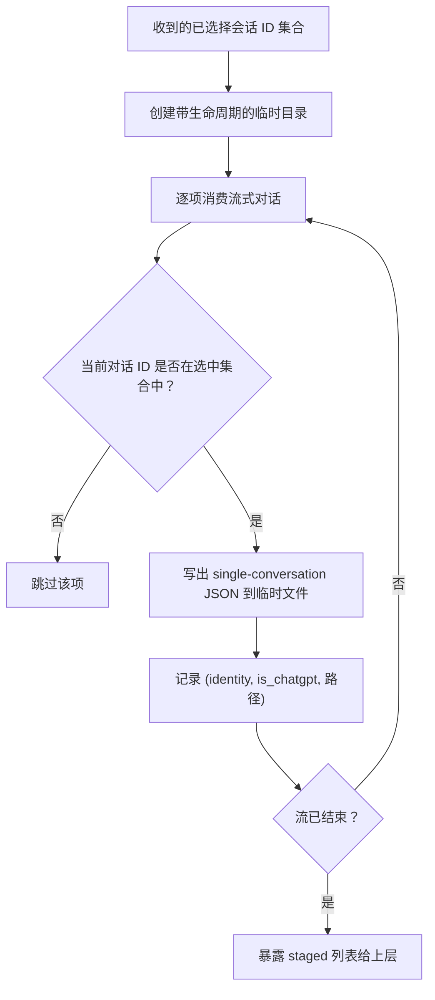
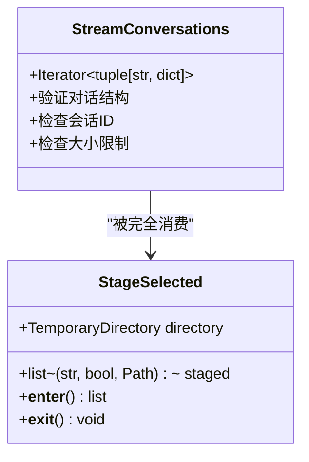
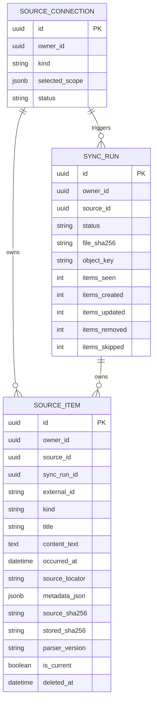
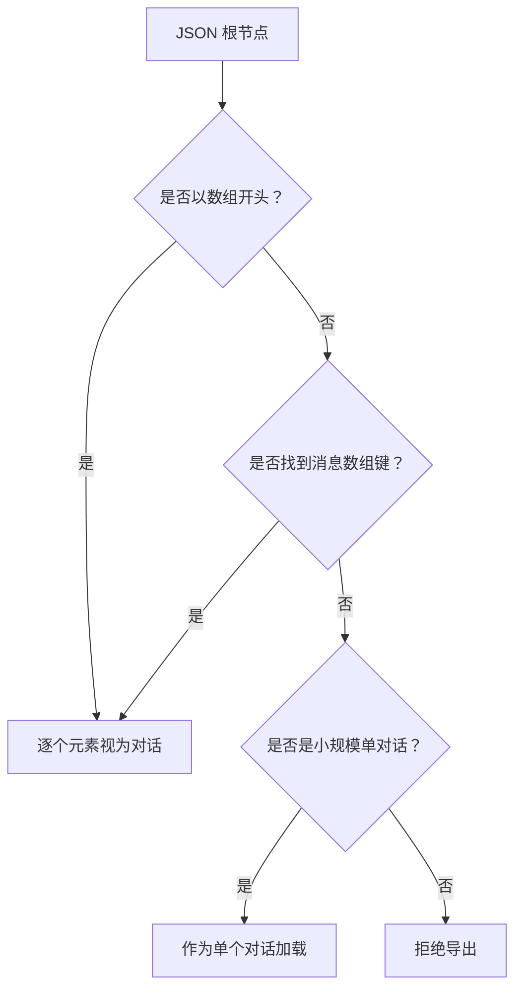

# 聊天导出目录同步

<cite>
**本文引用的文件**   
- [desktop_chats.py](file://src/personal_ai_life_os/api/routes/desktop_chats.py)
- [streaming_chat.py](file://src/personal_ai_life_os/parsers/streaming_chat.py)
- [ingestion.py](file://src/personal_ai_life_os/services/ingestion.py)
- [DesktopChatImport.tsx](file://web/src/DesktopChatImport.tsx)
- [test_desktop_mvp.py](file://tests/test_desktop_mvp.py)
- [conversations.json](file://fixtures/synthetic/conversations.json)
</cite>

## 目录

1. [引言](#引言)
2. [项目结构与职责边界](#项目结构与职责边界)
3. [核心组件总览](#核心组件总览)
4. [系统架构与数据流](#系统架构与数据流)
5. [详细组件分析](#详细组件分析)
6. [依赖关系与一致性保证](#依赖关系与一致性保证)
7. [性能、内存与中断恢复](#性能内存与中断恢复)
8. [聊天导出格式规范与兼容性](#聊天导出格式规范与兼容性)
9. [常见问题排查](#常见问题排查)
10. [结论](#结论)

## 引言

聊天导出目录同步负责将本机用户通过原生文件选择器选中的聊天导出文件导入系统，或者注册为桌面文件夹后持续同步已选会话。它强调三条核心目标：

- **本地优先与安全验证**：只解析本地授权的文件，不在浏览器或 API 中直接接收原始 JSON；所有路径都经过签名校验和时间戳过期检查。
- **低峰值内存的流式处理**：即使导出达到 GiB 级别，也只把当前一个对话放入内存，同时限制单次对话大小、总文件大小和会话数量上限。
- **强一致性与可重复导入**：通过指纹重检、SourceConnection 范围记录、SourceItem 去重以及导入运行快照，保证不同次导入和后续文件更新的结果是可预期、可恢复且可审计的。

## 项目结构与职责边界



**图示来源**   
- [DesktopChatImport.tsx:1-151](file://web/src/DesktopChatImport.tsx#L1-L151)
- [desktop_chats.py:1-262](file://src/personal_ai_life_os/api/routes/desktop_chats.py#L1-L262)
- [streaming_chat.py:1-155](file://src/personal_ai_life_os/parsers/streaming_chat.py#L1-L155)
- [ingestion.py:1-600](file://src/personal_ai_life_os/services/ingestion.py#L1-L600)

整体流程由三个角色组成：

| 角色 | 主要职责 | 关键不变式 |
|---|---|---|
| 前端页面 | 调用原生文件选择器，轮询任务状态，展示进度并允许取消 | 不直接打开文件，只传递加密授权凭据 |
| 后端路由 | 创建预览或导入任务、验证会话选择、触发阶段化导入 | 同一任务同一拥有者可见；失败状态可重试 |
| 解析与服务层 | 流式读取、过滤已选会话、持久化为 SourceItem | 一次只驻留一个对话；导入幂等 |

**章节来源**   
- [DesktopChatImport.tsx:10-120](file://web/src/DesktopChatImport.tsx#L10-L120)
- [desktop_chats.py:20-60](file://src/personal_ai_life_os/api/routes/desktop_chats.py#L20-L60)

## 核心组件总览

### ChatSession 与 ChatSessions

`ChatSession` 表示单个聊天导出的生命周期状态，包含拥有者、文件路径、文件指纹、当前状态、已读字节数、预取的对话行、已创建条目数、错误消息、取消事件等。`ChatSessions` 管理全局会话池，并限制最大并发数为 8。

| 字段 | 含义 | 作用 |
|---|---|---|
| `owner_id` | 当前用户标识 | 防止跨用户访问会话 |
| `path` | 原生选择器返回的绝对路径 | 用于本地流式读取 |
| `fingerprint` | `(文件大小, 修改时间纳秒, 设备号, inode)` | 检测原文件在预览、选择或导入过程中是否被替换 |
| `state` | `previewing` → `ready` / `importing` → `complete` / `failed` / `canceled` | 控制前端轮询和入口路由的状态机 |
| `bytes_read` | 已读取字节数 | 配合 `total_bytes` 显示进度百分比 |
| `rows` | 预取的最大 50,000 条对话行 | 供前端分页浏览，避免完整导入时重新扫描大文件 |
| `cancel` | `threading.Event` | 通知解析器和后续导入步骤停止工作 |
| `error` | 最后一条异常文本 | 由 `failed` 状态向前端暴露 |

**章节来源**   
- [desktop_chats.py:20-60](file://src/personal_ai_life_os/api/routes/desktop_chats.py#L20-L60)
- [desktop_chats.py:100-135](file://src/personal_ai_life_os/api/routes/desktop_chats.py#L100-L135)

### Streaming 解析层

`streaming_chat.StreamingReader` 使用流式事件迭代器按行或事件读取 JSON/JSONL，并支持三种结构：

| 输入形式 | 期望结构 | 适用场景 |
|---|---|---|
| JSON 数组 | `[ {...conversation...}, ... ]` | 常见 ChatGPT 导出 |
| JSON 对象 | `{ "messages": [...] }` 或含某个键名对应数组的对象 | ChatGPT 风格单一对话 |
| JSONL | 每行一个独立对话记录 | 增量或流式对话导出 |

关键限制包括：

| 约束 | 说明 |
|---|---|
| 总导出上限 | 1 GiB |
| 单对话上限 | 32 MiB（字符长度及字节偏移双判） |
| 会话 ID | 必须非空、稳定、唯一，最多 512 字符 |
| 消息结构 | 必须提供 `mapping` 或 `MESSAGE_KEYS` 列出的消息列表之一 |
| 非法 ID | 拒绝布尔值、整数转义歧义等非字符串化身份 |

**章节来源**   
- [streaming_chat.py:15-155](file://src/personal_ai_life_os/parsers/streaming_chat.py#L15-L155)

### 导入与入站处理层

导入路径最终进入通用入站服务，该服务根据 `SourceConnection.kind` 分发到具体解析器：

- `chatgpt_export`：ChatGPT 格式的 conversations JSON。
- `chat_export`：通用聊天 JSON/JSONL。
- `memory_markdown`、`document`、`calendar_ics`、`photo` 等其他桌面源类型。

对于聊天导入，入站层会在保存前计算内容摘要、写入对象存储并创建不可变 SourceItem；对日历等需要快照语义的来源，还会做删除墓碑、旧项标记和非当前状态切换。

**章节来源**   
- [ingestion.py:180-600](file://src/personal_ai_life_os/services/ingestion.py#L180-L600)

## 系统架构与数据流



**图示来源**   
- [desktop_chats.py:201-262](file://src/personal_ai_life_os/api/routes/desktop_chats.py#L201-L262)
- [streaming_chat.py:100-155](file://src/personal_ai_life_os/parsers/streaming_chat.py#L100-L155)
- [DesktopChatImport.tsx:60-140](file://web/src/DesktopChatImport.tsx#L60-L140)

## 详细组件分析

### `_iter_task`：文件名检查、进度回调与指纹重校验

`_iter_task` 是预览和导入共享的数据供给函数。其核心职责是：

1. **首次指纹检查**：从任务创建到真正开始读取前对比文件指纹。如果 `.json` 或 `.jsonl` 原文件已被替换，抛出显式错误，阻止基于旧元数据继续构建新结果。
2. **进度回调绑定**：把读取字节数写入 `task.bytes_read`，以便前端展示进度。
3. **流式遍历**：委托给 `stream_conversations`，并传入 `task.cancel.is_set()` 作为取消信号。
4. **结束态指纹复核**：流式枚举结束后再次检查指纹。如果在枚举期间文件变化，立即终止，确保“本次导入的文件自预览以来未改变”。



**图示来源**   
- [desktop_chats.py:73-90](file://src/personal_ai_life_os/api/routes/desktop_chats.py#L73-L90)
- [streaming_chat.py:96-142](file://src/personal_ai_life_os/parsers/streaming_chat.py#L96-L142)

**章节来源**   
- [desktop_chats.py:73-90](file://src/personal_ai_life_os/api/routes/desktop_chats.py#L73-L90)

### `_preview`：对话提取、标题回退与会话上限

`_preview` 仅进行有限扫描，目的是让前端能够让用户勾选要导入的对话。它会：

- 从 `_iter_task` 获取每条对话的 `(identity, record)`。
- 按 `title` → `name` → `subject` 顺序选取第一个合法字符串作为标题。
- 截取不超过 500 个字符，并将 `{id, title}` 存入 `task.rows`。
- 当行数超过 50,000 时抛出错误，强制用户选择更小的导出。

这种设计保证 UI 不会加载全部文件，但代价是：`task.rows` 最多占用几万条轻量记录；真实对话正文不会缓存到内存中。

**章节来源**   
- [desktop_chats.py:92-100](file://src/personal_ai_life_os/api/routes/desktop_chats.py#L92-L100)
- [streaming_chat.py:96-155](file://src/personal_ai_life_os/parsers/streaming_chat.py#L96-L155)

### `stage_selected_conversations`：流式选择、临时文件和取消机制

该方法解决一个关键问题：**不能在无限流上执行集合查询**。因此实现采用“先确认全部输入，再将选中对话落盘”的两阶段模型。



关键点：

| 特性 | 实现方式 |
|---|---|
| 完全消费输入 | `yield from records` 会遍历整个上游流，直到关闭 |
| 临时文件路径 | `Path(directory) / f"{len(staged)}.json"` |
| 会话类型标志 | `is_chatgpt = isinstance(record.get("mapping"), dict)` |
| 自动清理 | `TemporaryDirectory` 上下文退出后删除临时文件 |
| 取消信号 | 由于它是消费流后的整理阶段，取消主要通过外层 `_run` 和 `task.cancel` 间接体现；但实际流式来源 `_iter_task` 在枚举阶段已经可以抛取消异常 |
| 中间失败防护 | 只有当上游成功结束时才会暴露 `staged` 列表，因此未匹配完成时可阻止脏数据流入导入逻辑 |



**图示来源**   
- [streaming_chat.py:96-155](file://src/personal_ai_life_os/parsers/streaming_chat.py#L96-L155)

**章节来源**   
- [streaming_chat.py:130-155](file://src/personal_ai_life_os/parsers/streaming_chat.py#L130-L155)

### `_ingest_selected_chat`：对话选择、SourceItem 创建与记录清理策略

代码中实际存在的是 `_import`，而通用 `ingest_file` 才是真正解析并持久化记录的函数。下面按统一视角说明这一完整导入链。

#### 1. 对话选择验证

在 `_import` 内部，如果没有选择桌面文件夹，则先进入阶段化流程：

```python
with stage_selected_conversations(_iter_task(task), selected) as staged:
    if len(staged) != len(selected):
        raise ChatExportError("The export no longer contains every selected conversation.")
```

这一步确保：

- 每个被选择的对话都在当前文件中。
- 没有隐式多选的无效对话被导入。
- 阶段化阶段失败不会把部分半成品提交给数据库。

#### 2. Scope 与 SourceConnection

系统用规范化后的路径哈希作为 scope ID，并依据 `kind` 区分 ChatGPT 导出与普通聊天导出：

- 若 `folder_id` 为空，则为“一次性导入”，仍创建或复用 `chat_export` / `chatgpt_export` 类型的 `SourceConnection`。
- `selected_scope.desktop_path_id` 固定映射到该桌面文件路径。
- `selected_scope.conversation_ids` 保存排序后的可选对话 ID，形成“白名单”。

#### 3. Source 状态检查

导入前检查来源状态：

- `status` 不是 `None` 或 `active` 时，提示需要先恢复来源。
- 这避免重复导入处于暂停或撤销状态的来源。

#### 4. 调用导入服务

```python
run, _ = ingest_file(
    session=session,
    store=store,
    source=source,
    owner_id=task.owner_id,
    filename="conversations.json",
    content_type="application/json",
    payload=path.read_bytes(),
    conversation_ids={identity},
    user_timezone=timezone,
    desktop_config=application.state.settings,
)
```

- `payload` 来自阶段化生成的单对话临时 JSON。
- `conversation_ids` 限定 ChatGPT 解析器只能接受已授权 ID。
- `desktop_config` 可能影响桌面环境下的 OCR 延迟、数据目录、日志等行为。

#### 5. 记录清理与幂等性

`ingest_file` 负责：

| 阶段 | 动作 |
|---|---|
| 权限与来源检查 | 校验拥有者与来源有效性 |
| 生成导入运行 | 创建 `SyncRun(status="processing")` |
| 解析 | 根据 source kind 选择解析器 |
| 写入对象存储 | 将最小化 payload 写成 `source.bin` |
| 创建 SourceItem | 使用 `(owner_id, source_id, external_id, source_sha256)` 防冲突插入 |
| 内容去重 | 计算记录摘要，与现有 `content_digest` 相同则跳过 |
| 日历源清理 | 取消、缺失和超旧版本会标记为非当前或删除墓碑 |

其中聊天类数据的关键幂等键是：



**图示来源**   
- [ingestion.py:200-450](file://src/personal_ai_life_os/services/ingestion.py#L200-L450)

**章节来源**   
- [desktop_chats.py:102-200](file://src/personal_ai_life_os/api/routes/desktop_chats.py#L102-L200)
- [ingestion.py:180-600](file://src/personal_ai_life_os/services/ingestion.py#L180-L600)

### `_run`：异常分类与状态落盘

`_run` 将所有后台任务的异常统一收敛为任务状态：

| 异常类型 | 结果状态 | 错误信息行为 |
|---|---|---|
| `ChatExportCancelled` | `canceled` | 不记录错误消息，保持“已取消” |
| `ChatExportError` | `failed` | 透传人类可读消息 |
| `IngestionFailure` | `failed` | 使用结构化 `message` |
| 其他异常 | `failed` | 只记警告日志，对外隐藏具体解析内容 |

这样做的目的是避免用户操作因临时错误直接崩溃，同时防止敏感调试信息污染前端响应。

**章节来源**   
- [desktop_chats.py:102-115](file://src/personal_ai_life_os/api/routes/desktop_chats.py#L102-L115)

### 前端轮询与取消

前端通过 `/desktop/chats/{id}?offset&limit` 轮询，默认页面大小为 100。关键交互如下：

| 状态 | 前端行为 |
|---|---|
| `previewing` | 每 350ms 轮询，显示“正在读取会话…” |
| `ready` | 渲染对话选择框和目录下拉 |
| `importing` | 显示进度条、已读百分比、取消按钮 |
| `complete` | 显示新增条目数，并可回调完成 |
| `canceled` | 告知用户此前写入的记录保留 |
| `failed` | 显示错误信息 |

取消请求只是设置 `task.cancel`，不影响已成功持久化的 SourceItem；这也是为什么前端在取消状态下说明“此前写入的记录已保留”。

**章节来源**   
- [DesktopChatImport.tsx:14-140](file://web/src/DesktopChatImport.tsx#L14-L140)
- [desktop_chats.py:225-262](file://src/personal_ai_life_os/api/routes/desktop_chats.py#L225-L262)

## 依赖关系与一致性保证

### 目录同步路径

当用户选择一个 `chat_folder`，导入逻辑不走 `stage_selected_conversations`，而是注册目录观察器：

```python
register_chat_watch(
    application, task.owner_id, folder_id, task.path, selected,
    _iter_task(task), task.cancel,
)
```

这意味着：

- 不需要把对话 JSON 复制进对象存储。
- 系统根据目录内 `conversations.json`（或其 JSONL）的变化持续拉取。
- `selected` 始终作为白名单，阻止未选中对话被同步。
- `fingerprint` 与 `_iter_task` 共同保证原文件替换不会造成脏数据注入。

**章节来源**   
- [desktop_chats.py:128-158](file://src/personal_ai_life_os/api/routes/desktop_chats.py#L128-L158)
- [test_desktop_mvp.py:158-198](file://tests/test_desktop_mvp.py#L158-L198)

### 指纹重校验

指纹由 `(size, mtime_ns, st_dev, st_ino)` 构成，能检测以下情况：

- 文件被重新覆盖。
- 同一路径下被其他程序重建。
- 在不同挂载点或容器环境中被不同存储后端替代。

注意：指纹不是内容哈希，因此不能证明内容字节完全相同，但它能快速判断“是否建议重新预览”。这是性能和安全之间的权衡。

**章节来源**   
- [desktop_chats.py:62-71](file://src/personal_ai_life_os/api/routes/desktop_chats.py#L62-L71)
- [desktop_chats.py:73-90](file://src/personal_ai_life_os/api/routes/desktop_chats.py#L73-L90)

### 来源状态检查

导入前通过 `source.status not in {None, "active"}` 判断是否应挂起。这与日历来源中更严格的 `select(...).with_for_update()` 加锁不同；后者专门保护 `calendar_ics` 的并发写入，而聊天导入依靠应用层状态和上游任务状态机避免冲突。

**章节来源**   
- [ingestion.py:420-460](file://src/personal_ai_life_os/services/ingestion.py#L420-L460)
- [desktop_chats.py:140-190](file://src/personal_ai_life_os/api/routes/desktop_chats.py#L140-L190)

## 性能、内存与中断恢复

### 流式处理与内存优化

| 层级 | 内存控制手段 |
|---|---|
| 传输层 | 不上传 JSON 到服务器，仅在本地解析 |
| 解析层 | 使用 ijson 事件流，逐对话产出 |
| 对话缓存 | 只维护一个对话对象 |
| 临时文件 | 已选对话分别写到临时目录，不在 Python 列表中持完整 JSON |
| UI 列表 | `task.rows` 仅保存 `{id, title}` 轻量行 |
| 大小限制 | 总导出 ≤ 1 GiB，单对话 ≤ 32 MiB，对话总数预览 ≤ 50,000 |

### 并发限制

会话管理器使用 `MAX_SESSIONS = 8` 和一个单线程执行器。当任务数达到上限时，会尝试回收非 `previewing` / `importing` 的旧任务；若没有可回收任务，则返回 429 等待。

### 中断与取消

取消路径分为三层：

1. **前端取消**：发送 `/cancel`，设置 `Event`。
2. **流式取消**：`ExportReader.read` 和 `stream_conversations` 每次 IO 或循环起点检查 `canceled()`。
3. **导入取消**：`_import` 在每个已选会话开始前检查取消。

由于 `_import` 使用 `stage_selected_conversations`，取消后已完成的部分 SourceItem 不会被回滚；系统设计成“部分导入保留”，并在状态中返回 `canceled` 与已创建条目数，便于用户后续决定是否重试。

### 恢复策略

| 场景 | 建议操作 |
|---|---|
| 预览完成但尚未导入 | 可直接提交所选对话 |
| 导入中途取消 | 查看 `items_created`，如需干净状态可重新选择相同会话重新导入，或刷新并检查已有记录 |
| 文件在预览时被替换 | 系统会报错并要求重新选择 |
| 文件在导入中被替换 | 流式枚举结束后会检测到变化并失败，此时不应认为已成功导入 |
| 会话超出 50,000 | 需拆分导出文件或使用更具体的选择范围 |

**章节来源**   
- [streaming_chat.py:25-142](file://src/personal_ai_life_os/parsers/streaming_chat.py#L25-L142)
- [desktop_chats.py:102-168](file://src/personal_ai_life_os/api/routes/desktop_chats.py#L102-L168)
- [DesktopChatImport.tsx:60-140](file://web/src/DesktopChatImport.tsx#L60-L140)

## 聊天导出格式规范与兼容性

### 支持的两种主体结构

系统兼容：

1. **JSON 数组**：外层为数组，每项为一个对话对象。
2. **JSONL**：每行是一个对话对象。
3. **小对象回退**：如果首事件为对象且小于限制，则允许将单对话对象当作单个记录。



**图示来源**   
- [streaming_chat.py:50-95](file://src/personal_ai_life_os/parsers/streaming_chat.py#L50-L95)

### 必需字段规则

| 字段类型 | 规则 |
|---|---|
| 对话 ID | 可从 `conversation_id`、`id`、`uuid` 或 `chat_id` 中找到第一个非空值 |
| ID 类型 | 必须是整数或字符串；布尔值会被拒绝 |
| ID 限制 | 去除空白后非空，长度 ≤ 512，全文件唯一 |
| 消息结构 | 必须有 `mapping` 对象，或至少一个 `MESSAGE_KEYS` 指定的列表字段 |
| 编码 | UTF-8，支持 BOM |

### 合成测试数据示例

固定集 fixtures 提供了可被测试使用的对话结构，例如 `synthetic-conversation-001`，具有 `id`、`create_time`、`update_time`、`mapping`、用户和助手消息体。这类示例适合用于单元测试或离线验证，但不代表服务端生产环境的唯一格式。

**章节来源**   
- [conversations.json:1-65](file://fixtures/synthetic/conversations.json#L1-L65)
- [streaming_chat.py:15-95](file://src/personal_ai_life_os/parsers/streaming_chat.py#L15-L95)

### 兼容性说明

| 来源 | 解析类 | 特殊要求 |
|---|---|---|
| ChatGPT conversations JSON | `chatgpt_export` | 必须为 `.json`；会话选择受 `selected_scope` 白名单约束 |
| 通用聊天导出 | `chat_export` | `.json` 或 `.jsonl`；遵循通用消息结构 |
| JSONL 导出 | JSONL 模式 | 单行不得超过 32 MiB；空行跳过 |
| 单对话对象 | 小对象回退 | 必须明显小于 32 MiB |

需要注意的是：即使底层解析器能识别多种格式，聊天导入路由仍然要求初始授权路径后缀为 `.json` 或 `.jsonl`。若需导入 ChatGPT conversations，请明确选择对应的 `.json` 文件，并通过系统内置的白名单机制控制可导入对话。

**章节来源**   
- [streaming_chat.py:15-95](file://src/personal_ai_life_os/parsers/streaming_chat.py#L15-L95)
- [desktop_chats.py:201-216](file://src/personal_ai_life_os/api/routes/desktop_chats.py#L201-L216)
- [ingestion.py:70-150](file://src/personal_ai_life_os/services/ingestion.py#L70-L150)

## 常见问题排查

| 现象 | 可能原因 | 处理建议 |
|---|---|---|
| “请先选择原生文件选择器中的应用文件” | HMAC 签名不匹配或授权负载目的不符 | 不要手写 grant；重新通过 `desktop_pick_chat` 选择 |
| “本地选择已过期或不可用” | 授权超时或路径不再存在 | 重新选择文件 |
| “请选择一个 JSON 或 JSONL 聊天导出” | 文件名后缀不符合预期 | 选择 `.json` 或 `.jsonl` |
| “聊天导出超过 1 GiB” | 导出体积超限 | 分批次导出 |
| “单个对话超过 32 MiB 解析限制” | 某一条对话过大 | 清理历史过长对话 |
| “对话 ID 不稳定或重复” | 多个对话共用相同 `id`，或用位置索引代替稳定 ID | 修复上游导出脚本 |
| “此导出包含超过 50,000 个会话” | 预览阶段发现太多对话 | 拆分导出文件或缩小范围 |
| “导出不再包含每个已选会话” | 文件在阶段化之后发生变化 | 重新选择并重新提交 |
| “会话未在当前预览文件中选择” | 提交了不在当前预览结果中的 ID | 重新预览并勾选 |
| “请先恢复聊天来源后再导入” | SourceConnection 状态被暂停或撤销 | 在来源管理中恢复 |
| “正在处理来源后不可重复导入” | 后端仍在处理同一个来源 | 等待完成或检查异步队列 |
| 进度卡住 | 大文件还在解析，或取消尚未传播 | 查看 `bytes_read` 与 `total_bytes` |
| 取消后仍有部分记录 | 取消发生在持久化之后 | 确认 `items_created`，必要时手动清理 |

**章节来源**   
- [desktop_chats.py:73-168](file://src/personal_ai_life_os/api/routes/desktop_chats.py#L73-L168)
- [streaming_chat.py:25-142](file://src/personal_ai_life_os/parsers/streaming_chat.py#L25-L142)
- [DesktopChatImport.tsx:60-151](file://web/src/DesktopChatImport.tsx#L60-L151)

## 结论

聊天导出目录同步通过“安全授权 + 流式解析 + 阶段化选择 + 幂等入站”的设计，在本地导入和高频目录同步两个场景中均保持了较低内存占用、清晰状态机和较强的一致性保障。其最重要的设计取舍如下：

- **不用内容哈希做快速变更检测**：改用文件元信息指纹提升本地效率，但要求用户在文件变更后重新选择。
- **取消不是事务性回滚**：已持久化记录保留，避免长任务失败导致全部成果丢失；如需完全恢复，应由用户决定如何处理重复导入或已有 SourceItem。
- **对话选择必须在流消费完成后确定**：牺牲少量临时磁盘 I/O，换取对流无法随机查找问题的可靠解耦。
- **聊天和白名单严格隔离**：防止批量 ChatGPT 导出被误读为任意会话集合，降低安全攻击面。

在实际使用中，推荐用户：

- 总是通过原生文件选择器启动预览。
- 在 preview 完成后核对对话数量和标题。
- 重要对话导出分批处理，避免单对话过大。
- 使用目录同步功能时明确已选会话范围，并监控同步结果而非只关注文件大小。
- 遇到中断时先检查 `items_created` 与 SourceConnection 状态，再进行二次导入或刷新目录。