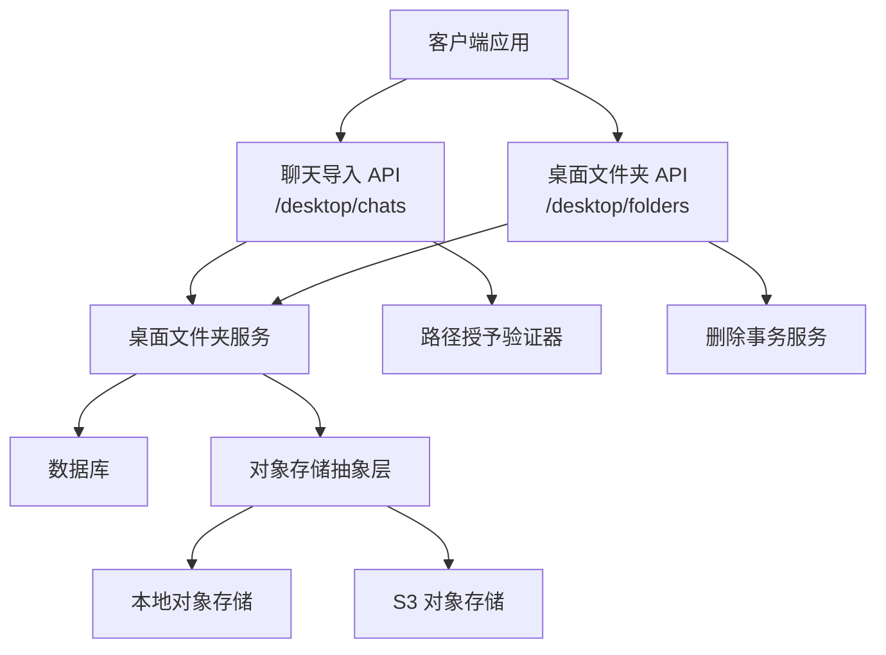
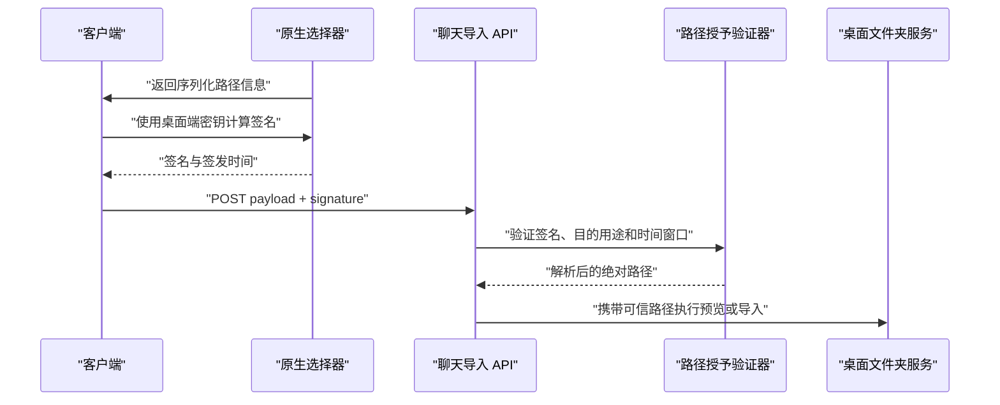
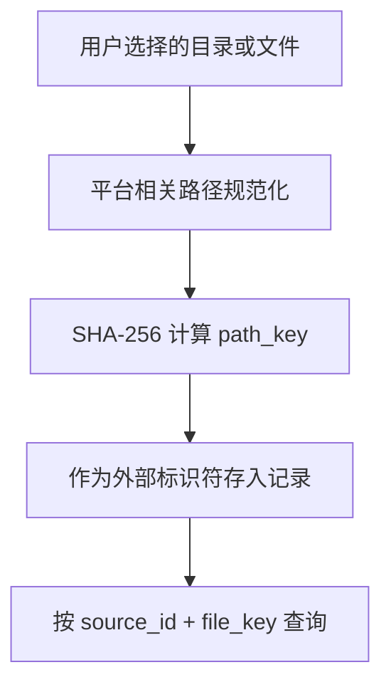
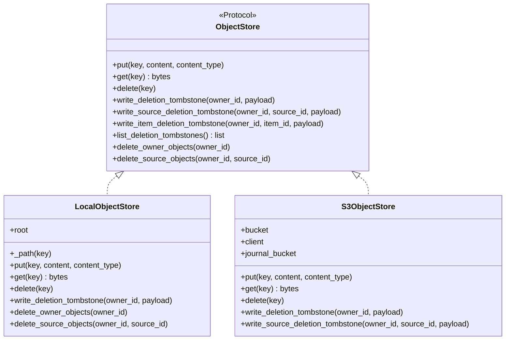
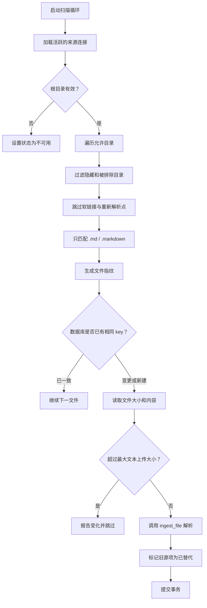
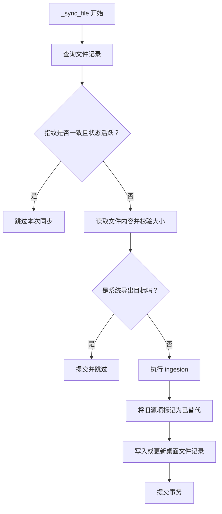
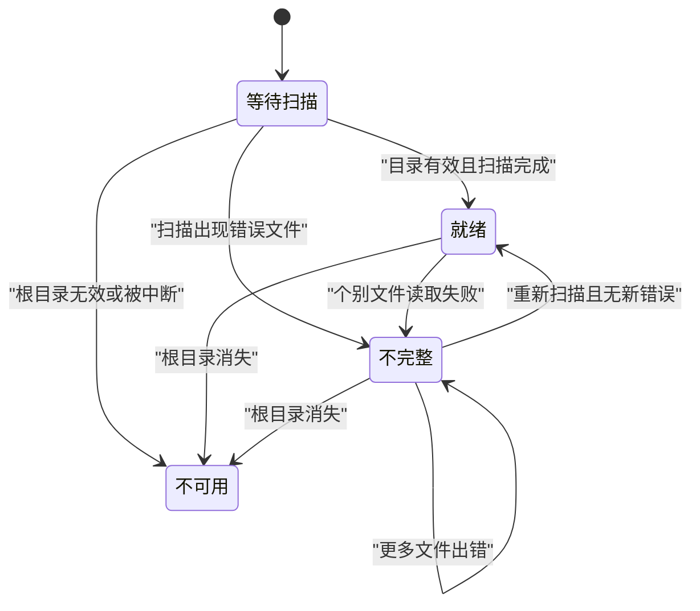
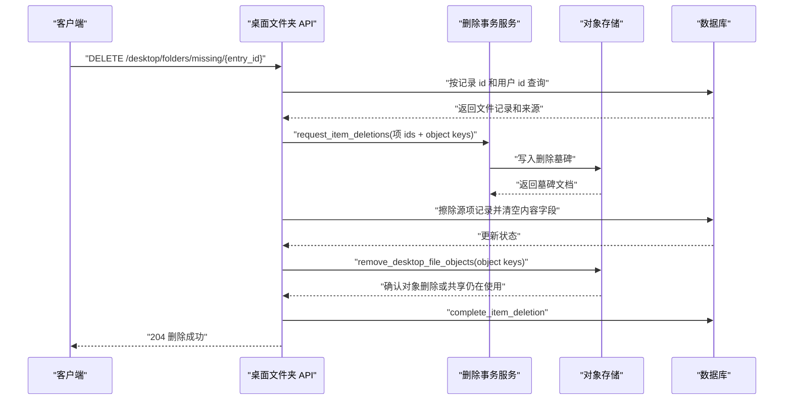
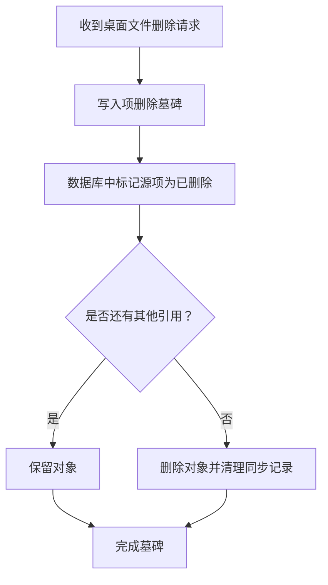
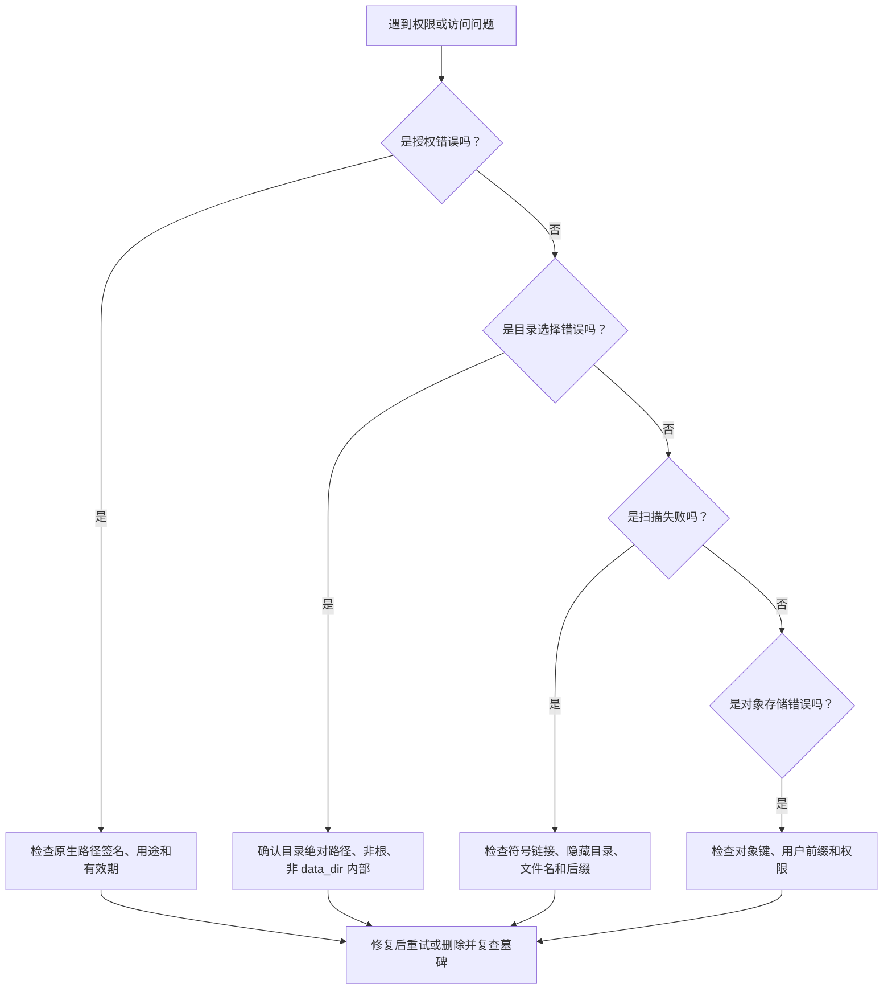

# 文件系统权限管理

<cite>
**本文引用的文件**
- [desktop_folders.py（服务层）](file://src/personal_ai_life_os/services/desktop_folders.py)
- [desktop_folders.py（API 路由）](file://src/personal_ai_life_os/api/routes/desktop_folders.py)
- [desktop_chats.py](file://src/personal_ai_life_os/api/routes/desktop_chats.py)
- [storage.py](file://src/personal_ai_life_os/storage.py)
- [deletion.py](file://src/personal_ai_life_os/services/deletion.py)
- [models.py](file://src/personal_ai_life_os/models.py)
- [config.py](file://src/personal_ai_life_os/config.py)
- [security.py](file://src/personal_ai_life_os/security.py)
- [test_desktop_mvp.py](file://tests/test_desktop_mvp.py)
- [test_storage.py](file://tests/test_storage.py)
</cite>

## 目录
1. [引言](#引言)
2. [项目结构与权限边界](#项目结构与权限边界)
3. [核心权限模型](#核心权限模型)
4. [桌面文件夹服务的权限检查逻辑](#桌面文件夹服务的权限检查逻辑)
5. [路径授权与 path_key 安全机制](#路径授权与-pathkey-安全机制)
6. [存储抽象层与用户数据隔离](#存储抽象层与用户数据隔离)
7. [同步流程与批量原子性](#同步流程与批量原子性)
8. [权限冲突检测与状态机](#权限冲突检测与状态机)
9. [软链接与符号链接安全](#软链接与符号链接安全)
10. [删除与持久化回滚](#删除与持久化回滚)
11. [常见权限错误诊断](#常见权限错误诊断)
12. [最佳实践与性能优化建议](#最佳实践与性能优化建议)
13. [结论](#结论)

## 引言

Personal-AI-Life-OS 的桌面端需要把用户操作系统上的本地文件纳入系统内部的信息来源，同时不能允许普通客户端随意浏览整个磁盘。其权限体系围绕以下目标构建：

- 只允许访问用户通过原生平台对话框明确选择的目录或文件。
- 对可同步的 Markdown 目录进行白名单式遍历，排除隐藏目录、受保护目录和危险路径点。
- 用路径哈希 key 标识来源文件，并限制同一用户的重复授权范围。
- 在扫描和导入过程中检测文件大小变化、删除、替换以及符号链接攻击面。
- 区分本地文件系统和本对象存储后端，避免对象键逃逸到受限目录之外。
- 使用幂等的删除墓志铭文件和多阶段状态机保证批量删除的一致性。

这些机制共同实现了“白名单路径、有限深度、拒绝危险引用、用户数据隔离”的桌面文件访问模型。

## 项目结构与权限边界

从模块职责看，文件系统权限涉及 API 路由、桌面文件夹服务、对象存储适配器、模型持久化和配置校验五个层次：

| 层次 | 主要责任 | 代表性文件 |
| --- | --- | --- |
| API 请求入口 | 接收用户通过前端调用的文件夹添加、缺失项删除等请求 | `api/routes/desktop_folders.py`、`api/routes/desktop_chats.py` |
| 权限验证与路径授权 | 校验路径授予签名、目的用途、时间戳和绝对路径 | `api/routes/desktop_chats.py` |
| 桌面文件夹扫描与服务 | 执行可信目录扫描、指纹比对、增量 ingestion 和状态更新 | `services/desktop_folders.py` |
| 存储访问层 | 提供本地文件系统或 S3 后端的数据写入、读取、删除和清理 | `storage.py` |
| 持久化模型 | 定义用户、来源连接、桌面文件夹、桌面文件夹文件和源项等实体 | `models.py` |
| 删除事务 | 将删除请求落盘为不可轻易丢失的墓志铭文档 | `services/deletion.py` |
| 运行配置 | 校验生产环境下的敏感配置、对象存储和策略要求 | `config.py` |
| 身份与令牌 | 处理密码哈希与访问令牌解码，不直接处理路径权限但构成调用者身份基础 | `security.py` |

**图示来源**
- [desktop_folders.py（API 路由）](file://src/personal_ai_life_os/api/routes/desktop_folders.py#L1-L132)
- [desktop_chats.py](file://src/personal_ai_life_os/api/routes/desktop_chats.py#L1-L150)
- [storage.py](file://src/personal_ai_life_os/storage.py#L1-L120)

**节来源**
- [desktop_folders.py（API 路由）](file://src/personal_ai_life_os/api/routes/desktop_folders.py#L1-L132)
- [desktop_chats.py](file://src/personal_ai_life_os/api/routes/desktop_chats.py#L1-L120)
- [storage.py](file://src/personal_ai_life_os/storage.py#L1-L80)

## 核心权限模型

### 三个权限边界

项目实现了三层相互补充的文件权限边界：

1. **调用者身份边界**：API 路由依赖当前登录用户和会话上下文来隔离不同用户的数据。
2. **路径授权边界**：只有带服务端密钥签名的原生选择结果才被接受；客户端构造的路径字符串不会被信任。
3. **运行时扫描边界**：即使已注册桌面文件夹，实际文件访问还受白名单目录、软链接保护和解析路径校验约束。

### 关键概念对照表

| 概念 | 含义 | 防止的问题 |
| --- | --- | --- |
| `path_grant.payload` | 由桌面端原生选择过程序列化的路径描述，包含路径、用途和签发时间 | 阻止普通 Web 接口直接提交任意磁盘路径 |
| `path_grant.signature` | 使用桌面端密钥计算的 HMAC-SHA256 签名 | 伪造原生选择授权 |
| `purpose` | 如 `chat_folder`、`export`、`obsidian` 等，限定授权用途 | 复用旧授权访问不同类型资源 |
| `fingerprint` | 基于大小、修改时间、设备号和 inode 生成的临时指纹 | 并发覆盖和扫描期间文件变化 |
| `path_key` | 基于规范化路径的 SHA-256 hex 摘要 | 重复授权相同路径、按相对路径索引文件 |
| `object_store_key` | 以用户 ID 为前缀的稳定对象名 | 用户之间对象共享或越权访问 |

**节来源**
- [desktop_chats.py](file://src/personal_ai_life_os/api/routes/desktop_chats.py#L120-L200)
- [desktop_folders.py（服务层）](file://src/personal_ai_life_os/services/desktop_folders.py#L1-L60)
- [models.py](file://src/personal_ai_life_os/models.py#L280-L420)

## 桌面文件夹服务的权限检查逻辑

### 初始授权检查

当新增桌面文件夹时，服务会执行以下步骤：

1. 先通过原生路径授予校验函数验证路径是否来自可信原生选择器。
2. 计算该路径在服务端使用的 `path_key`。
3. 要求所选目录不是应用数据目录的子目录，也不是应用数据目录本身。
4. 要求它是真实存在的绝对目录。
5. 根据用户 ID 查找是否已有相同 `path_key` 且未被撤销的记录，从而支持重复激活而非简单失败。
6. 记录来源类型是 Markdown 内存还是 Obsidian vault，并在数据库中创建 `DesktopFolder` 和 `SourceConnection`。

这意味着“新增一个桌面文件夹”不仅代表一个物理路径可用，还意味着服务器将该路径与该用户绑定。

### 扫描路径访问检查

桌面文件夹扫描器在遍历文件树时不会无条件跟随所有路径。它通过 `_markdown_files` 实现：

- 根目录必须满足 `resolve(strict=True)` 后等于自身，从而消除部分指向外部的路径陷阱。
- 根目录必须是存在目录。
- 枚举子目录时跳过隐藏项、`.obsidian`、`.git`、`.trash`、回收站相关名称和 `lifeos-exports`。
- 对被保留的候选子目录逐个执行符号链接与重新解析点检查。
- 只输出扩展名为 `.md` 或 `.markdown` 的普通文件。
- 最终再次用 `resolve(strict=True).is_relative_to(root)` 确认文件没有跳转到其他卷。

### 复杂度分析

假设某个桌面目录有 `D` 个子目录、`F` 个文件：

| 操作 | 时间复杂度 | 说明 |
| --- | ---: | --- |
| 目录枚举 | O(D + F) | 使用 `os.walk` 且不主动提升递归深度以外的代价 |
| 每个文件指纹 | 常数级统计+SHA 哈希 | 取决于单次 `lstat` |
| 相对路径合法性判断 | 常数级 | 使用纯路径比较和 `is_relative_to` |
| 每文件数据库查询 | O(log N) 或 O(1) 视索引而定 | 按 `source_id` 和 `file_key` 定位条目 |
| 增量导入开销 | 仅对变化文件执行一次读取和 ingestion | 未变化文件直接跳过 |

**节来源**
- [desktop_folders.py（API 路由）](file://src/personal_ai_life_os/api/routes/desktop_folders.py#L33-L110)
- [desktop_folders.py（服务层）](file://src/personal_ai_life_os/services/desktop_folders.py#L52-L115)

## 路径授权与 path_key 安全机制

### 原生路径授权流程

聊天和导出路径均通过 `verify_path_grant` 校验：

**图示来源**
- [desktop_chats.py](file://src/personal_ai_life_os/api/routes/desktop_chats.py#L140-L200)
- [test_desktop_mvp.py](file://tests/test_desktop_mvp.py#L1-L60)

这个流程的安全要点如下：

| 安全检查 | 实现方式 | 目的 |
| --- | --- | --- |
| 签名算法 | HMAC-SHA256 | 避免仅凭 JSON 载荷伪造路径 |
| 防时序攻击 | 使用常量时间比较 | 防止侧信道猜解签名 |
| 目的用途 | `purpose` 字段匹配 API 用途 | 防止 chat 授权被复用为导出授权 |
| 有效期 | 签发时间必须在近期窗口内 | 防止过期授权被重放 |
| 路径形式 | 必须存在且为绝对路径 | 防止相对路径或不存在路径进入业务逻辑 |
| 解密路径 | 在异常路径或损坏载荷下转为 HTTP 错误 | 对外暴露最小验证失败信息 |

### `path_key` 的设计

`path_key(value)` 会对路径进行平台大小写规范编码后再做 SHA-256 摘要。其用途包括：

- 作为桌面文件夹文件的稳定键。
- 用于去重已注册的桌面文件夹。
- 作为数据库查询条件，关联原始文件与解析结果。
- 与相对路径一起出现在 `DesktopFolderFile` 记录中。

需要注意：`path_key` 目前是基于完整路径计算的哈希，因此不同绝对路径会被视为不同的 key。对于“用户选择的不同挂载点映射到相同内容”的场景，这是保守策略：它们被视为独立来源，不会互相覆盖。

**图示来源**
- [desktop_folders.py（服务层）](file://src/personal_ai_life_os/services/desktop_folders.py#L24-L38)
- [models.py](file://src/personal_ai_life_os/models.py#L350-L420)

**节来源**
- [desktop_chats.py](file://src/personal_ai_life_os/api/routes/desktop_chats.py#L120-L220)
- [desktop_folders.py（服务层）](file://src/personal_ai_life_os/services/desktop_folders.py#L24-L38)
- [test_desktop_mvp.py](file://tests/test_desktop_mvp.py#L40-L120)

## 存储抽象层与用户数据隔离

### 统一存储协议

`ObjectStore` 协议定义了所有后端必须具备的能力，包括读、写、删除和删除相关操作。这使上层同步逻辑不必关心数据最终保存在本地磁盘还是 S3。

| 方法 | 输入 | 作用 |
| --- | --- | --- |
| `put` | 键、字节内容、内容类型 | 写入对象 |
| `get` | 键 | 读取对象内容 |
| `delete` | 键 | 删除对象或版本控制下的标记 |
| `write_deletion_tombstone` | 用户 ID、载荷 | 写入账户级删除墓碑 |
| `write_source_deletion_tombstone` | 用户 ID、来源 ID、载荷 | 写入来源级删除墓碑 |
| `write_item_deletion_tombstone` | 用户 ID、项 ID、载荷 | 写入项级删除墓碑 |
| `list_deletion_tombstones` | 无 | 列出全部墓碑以支持恢复和回放 |
| `delete_owner_objects` | 用户 ID | 删除某用户的全部对象 |
| `delete_source_objects` | 用户 ID、来源 ID | 删除某来源对象 |

### 本地对象存储安全

`LocalObjectStore` 的核心安全性集中在 `_validate_key` 和 `_path`：

1. 使用 POSIX 风格路径解析键，不允许绝对路径、空部件、`.` 和 `..`。
2. 禁止反斜杠和空字符。
3. 计算目标绝对路径后强制校验是否在配置的存储根目录下。
4. 写入时使用临时文件配合原子替换，防止半写对象被其他线程或进程读到。
5. 删除父目录时会自底向上尝试移除空目录，直到到达根为止。
6. 用户目录和来源目录在删除前检查符号链接，拒绝绕过安全前缀。

### S3 对象存储安全

`S3ObjectStore` 对 `put`、`get`、`delete` 也执行同样的键校验。此外它还使用服务端加密 AES256 写入对象，并通过独立删除日志桶保存删除任务，以避免主存储被备份覆盖后失去删除证据。

**图示来源**
- [storage.py](file://src/personal_ai_life_os/storage.py#L1-L120)

### 用户数据隔离策略

隔离发生在多个层面：

| 隔离层级 | 机制 |
| --- | --- |
| API 层 | 查询按当前用户 ID 过滤 |
| 来源层 | `SourceConnection.owner_id` 绑定数据来源所有权 |
| 桌面文件层 | `DesktopFolderFile.source_id` 绑定具体文件或对话选择 |
| 对象层 | 键前缀包含用户 UUID，如 `owners/{owner_id}/...` |
| 删除层 | 删除墓碑按 `owner_id` 写入，并支持源级与项级删除 |

**节来源**
- [storage.py](file://src/personal_ai_life_os/storage.py#L1-L264)
- [models.py](file://src/personal_ai_life_os/models.py#L180-L240)
- [deletion.py](file://src/personal_ai_life_os/services/deletion.py#L1-L120)

## 同步流程与批量原子性

### Markdown 文件同步流程

Markdown 与 Obsidian 同步器的总体流程如下：

**图示来源**
- [desktop_folders.py（服务层）](file://src/personal_ai_life_os/services/desktop_folders.py#L160-L335)

### 事务与一致性特性

| 属性 | 实现 | 限制 |
| --- | --- | --- |
| 扫描过程 | 定期轮询，默认约 3 秒一次循环 | 非实时事件驱动 |
| 并发扫描 | 全局写锁 `mutation_lock` | 防止不同扫描任务同时修改同一条源记录 |
| 单文件同步 | 每次扫描单个文件的读写与入库都会加锁 | 高吞吐场景可能成为瓶颈 |
| 文件一致性 | 指纹变化后拒绝沿用旧缓存 | 避免读取旧对象 |
| 大文件保护 | 读取后检查是否超出 `max_text_upload_bytes` | 可能触发完整流式重试逻辑 |
| Obsidian 识别 | 优先检测文件头中是否存在系统元数据标记 | 跳过由本系统导出的目标文件 |
| 删除标记 | 扫描结束后将缺失文件标记为待删除 | 不代表立刻永久删除物理对象 |

### 批量操作与回滚

批量行为体现在两个地方：

1. **同步期批处理**：`DesktopFolderSync.run` 依次处理多个来源；某个来源失败不会立即终止整个监控循环，而是记录警告并按周期重试。
2. **缺失项删除**：当用户删除待删除桌面文件条目时，会批量收集相关源项并写出删除墓碑，然后在数据库中将源项标记为已删除、清除敏感字段。

这里需要特别注意一个设计细节：每个 Markdown 文件的同步操作都提交一次数据库事务。如果 `ingest_file` 抛出异常，当前文件写入会被回滚，但之前已经成功提交的其他文件不会自动回滚。也就是说，“跨文件的强事务一致性”并不是由桌面同步器整体提供的。更准确地说，它提供了“单文件操作的局部一致性”和“扫描状态结果的最终一致性”。

**图示来源**
- [desktop_folders.py（服务层）](file://src/personal_ai_life_os/services/desktop_folders.py#L260-L335)

**节来源**
- [desktop_folders.py（服务层）](file://src/personal_ai_life_os/services/desktop_folders.py#L150-L335)
- [config.py](file://src/personal_ai_life_os/config.py#L25-L40)

## 权限冲突检测与状态机

桌面文件夹相关实体的状态可用于理解权限和资源生命周期。

### 桌面文件夹文件状态

`DesktopFolderFile` 的状态通常表现为：

| 状态 | 含义 | 后续处理 |
| --- | --- | --- |
| `active` | 当前有效的桌面文件记录 | 扫描发现不存在时变为待删除 |
| `pending_delete` | 已被发现丢失，正在走删除流程 | 用户可删除对应记录并触发最终清理 |
| `deleted` | 已完成桌面文件记录清理 | 不再参与扫描 |

聊天文件夹还会使用 `conversation_ids` 和 `fingerprint` 组合跟踪用户选择的对话集合及其内容指纹，避免多次重建相同选集。

### 冲突检测规则

| 场景 | 检测条件 | 响应 |
| --- | --- | --- |
| 重复授权同一目录 | 数据库中已存在相同 `path_key` 且未被撤销 | 返回冲突或提示已授权 |
| 已撤销目录重新授权 | 允许恢复到活跃状态并重置云同意字段 | 支持管理员或用户主动恢复 |
| 目录类型不一致 | 已有记录不是所需 `kind` | 拒绝并返回冲突 |
| 扫描期间文件变化 | `_stamp(file)` 与之前快照不一致 | 报告变化、跳过或重试 |
| 聊天导出变化 | 预览阶段的 fingerprint 或文件内容发生变化 | 提示用户重新打开导出 |
| 对象键非法 | 包含 `..`、绝对路径、非法字符或逃逸根目录 | 抛出对象键校验错误 |

**节来源**
- [desktop_folders.py（服务层）](file://src/personal_ai_life_os/services/desktop_folders.py#L116-L200)
- [desktop_folders.py（API 路由）](file://src/personal_ai_life_os/api/routes/desktop_folders.py#L60-L110)
- [models.py](file://src/personal_ai_life_os/models.py#L340-L420)

## 软链接与符号链接安全

系统对链接采取严格防御策略，而不是信任操作系统解析后的目标路径。

### 目录和文件扫描中的链接防护

在 `_markdown_files` 中，每个候选目录都会调用 `scoped_file_stat`。该函数会：

- 对路径执行 `lstat`。
- 如果路径是软链接或 Windows 的重新解析点，直接抛出异常并被排除。
- 正常文件也会被同样检查，从而避免把“链接到其他卷或系统目录”的文件纳入同步。

### 对象存储路径中的链接防护

`LocalObjectStore.delete_owner_objects` 和 `delete_source_objects` 在删除用户或来源目录前会检查符号链接。如果检测到符号链接，则拒绝删除，以避免攻击者通过符号链接把管理员的执行动作导向磁盘任意位置。

### 风险分类

| 类型 | 受影响位置 | 处理方式 |
| --- | --- | --- |
| 文件系统软链接 | 目录遍历、文件采样 | 跳过并记录为空结果 |
| Windows 重新解析点 | 目录枚举 | 使用标志位检测并跳过 |
| 符号链接目录逃逸 | 对象存储删除前 | 显式拒绝 |
| 路径解析跳转 | Markdown 文件最终校验 | 用 `resolve` + `is_relative_to` 双重保障 |

**节来源**
- [desktop_folders.py（服务层）](file://src/personal_ai_life_os/services/desktop_folders.py#L29-L45)
- [storage.py](file://src/personal_ai_life_os/storage.py#L140-L220)

## 删除与持久化回滚

### 桌面文件删除流程

当用户调用删除缺失桌面文件接口时，流程如下：

**图示来源**
- [desktop_folders.py（API 路由）](file://src/personal_ai_life_os/api/routes/desktop_folders.py#L112-L132)
- [deletion.py](file://src/personal_ai_life_os/services/deletion.py#L20-L120)

### 幂等性与回放能力

删除操作采用“写墓碑 → 执行业务擦除 → 完成墓碑”的多阶段模型：

- 写入墓碑后立即持久化，即使用户会话中断或服务重启，也可恢复未完成删除。
- 墓碑文件存储在对象存储层的受控前缀下，并由 `ObjectStore.list_deletion_tombstones` 公开。
- `complete_item_deletion` 会用新的已完成墓碑覆盖原有墓碑，实现幂等完成。
- 测试中模拟了 S3 删除版本器和删除标记场景，确保删除操作不会在无版本状态下产生意外副作用，也不会在回放日志时重复写入。

### 对象删除与共享保护

`remove_desktop_file_objects` 并不盲目删除对象键。它会检查是否有其他未删除的 `SourceItem` 引用该对象键。如果有共享使用者，就保留对象；否则才真正删除，并清除对应的同步运行记录。

**图示来源**
- [deletion.py](file://src/personal_ai_life_os/services/deletion.py#L80-L160)
- [test_storage.py](file://tests/test_storage.py#L1-L59)

**节来源**
- [desktop_folders.py（API 路由）](file://src/personal_ai_life_os/api/routes/desktop_folders.py#L95-L132)
- [deletion.py](file://src/personal_ai_life_os/services/deletion.py#L1-L200)
- [test_storage.py](file://tests/test_storage.py#L1-L59)

## 常见权限错误诊断

### 错误对照表

| 现象 | 可能原因 | 建议排查步骤 |
| --- | --- | --- |
| 添加桌面文件夹报 422 | 路径选择授权签名错误或已过期 | 检查桌面端是否正确使用原生选择器并计算 HMAC |
| 添加目录报 422 “必须选择具体目录” | 所选路径不是目录、是根目录或与应用数据目录相交 | 选择一个明确的用户级目录，不要选择应用 data_dir 内部 |
| 添加目录报 409 | 已授权或来源类型不匹配 | 查看现有来源状态；已撤销时可重新激活 |
| 导入聊天报 403 | 不是通过原生文件选择器传入路径 | 前端不得自行拼接或篡改路径载荷和签名 |
| 同步报错但不影响整体循环 | 单文件扫描抛异常 | 检查文件权限、权限不足、链接目标和磁盘可用性 |
| 扫描结果为不可用 | 根目录失效或被截断 | 检查目录是否存在、用户是否有读取权限 |
| 同步结果为不完整 | 个别文件太大、权限不足或解析失败 | 查看单个文件是否可读取 |
| 聊天导出报内容变化 | 文件指纹与预览时不一致 | 重新打开聊天导出并重新选择 |
| 删除缺失项报 409 | 该条记录不在待删除状态 | 确认必须先标记为待删除 |
| 对象删除或获取报键非法 | 对象键包含非法字符、绝对路径或路径穿越 | 检查上游生成对象键的逻辑 |

### 典型诊断顺序

**节来源**
- [desktop_folders.py（API 路由）](file://src/personal_ai_life_os/api/routes/desktop_folders.py#L33-L95)
- [desktop_chats.py](file://src/personal_ai_life_os/api/routes/desktop_chats.py#L140-L200)
- [storage.py](file://src/personal_ai_life_os/storage.py#L20-L80)

## 最佳实践与性能优化建议

### 权限配置最佳实践

| 场景 | 推荐做法 | 依据 |
| --- | --- | --- |
| 桌面端部署 | 使用独立、用户可控的工作区目录作为数据来源 | 与 `data_dir` 分离降低误授权风险 |
| Obsidian vault | 将整个 vault 作为 `obsidian` 类型来源 | 服务会自动跳过内部 `.obsidian` 配置目录 |
| 聊天导出 | 将对话导出所在目录注册为 `chat_folder` | 支持对话选择持久化及增量更新 |
| 生产对象存储 | 使用独立的 S3 主存储和删除日志桶 | 配置验证器强制要求两者不同 |
| 用户数据隔离 | 始终通过 API 路由访问，不要直接信任前端路径 | 路径仅在原生选择器签名后才生效 |
| 删除流程 | 先触发删除墓碑，再执行业务清理 | 支持数据库恢复后回放 |
| 测试与开发 | 可在本地对象存储模式快速验证 | 本地模式适合端到端测试 |

### 性能优化建议

1. **减少全量读取频率**  
   扫描间隔默认约 3 秒。如果目录规模较大，可适当提高轮询间隔，或者只在用户对目录做预期变更后手动刷新。

2. **控制文本上传上限**  
   `Settings.max_text_upload_bytes` 限制了 Markdown 同步时的最大读取长度。超大 Markdown 应拆分为较小文件或禁用自动同步。

3. **避免过度嵌套目录**  
   虽然代码未显式设置固定递归深度，但仍然会遍历每个允许目录。过多深层结构会增加 `os.walk` 的开销和 I/O 压力。

4. **优先使用本地对象存储进行本地调试**  
   本地后端不需要网络延迟，适合桌面端到端测试；生产环境建议使用 S3 以获得更好的可伸缩性和脱机容错。

5. **避免频繁重建聊天导入会话**  
   聊天会话有最大并行数限制。大量并发预览可能引发节流，等待当前操作结束或取消无效会话再重试。

6. **合并相似来源**  
   若用户有多个聊天导出或 Markdown 目录，应根据是否需要分别归档来选择合适策略，避免创建过多细碎来源。

### 已知限制与风险注意

| 限制 | 说明 | 应对 |
| --- | --- | --- |
| 全局写锁 | `DesktopFolderSync.mutation_lock` 会串行化文件级同步 | 大规模目录同步可能出现队列延迟 |
| 非跨文件事务 | 每文件单独提交数据库事务 | 不要期望整个扫描全部回滚 |
| 扫描中断语义 | 中断不会把所有未发现文件都当作缺失 | 下次扫描后会收敛到正确状态 |
| 路径 key 与文件系统语义解耦 | `path_key` 基于规范化字符串 | 不等同于唯一物理文件 ID |
| Obsidian 导出保护 | 包含系统标记的内容会被跳过 | 不要把系统导出目录误设为同步来源 |
| 聊天消息数量限制 | 预览最多处理一定数量的对话行 | 大型导出需合理裁剪选中范围 |

**节来源**
- [config.py](file://src/personal_ai_life_os/config.py#L25-L40)
- [desktop_folders.py（服务层）](file://src/personal_ai_life_os/services/desktop_folders.py#L140-L220)
- [desktop_chats.py](file://src/personal_ai_life_os/api/routes/desktop_chats.py#L1-L100)

## 结论

Personal-AI-Life-OS 的文件系统权限模型以“原生路径授权 + 白名单目录扫描 + 路径指纹校验 + 用户对象隔离 + 删除墓碑回放”为核心。它将桌面端特有的安全问题——特别是符号链接、重解析点和路径穿越——转化为明确的拒绝策略，并在对象存储层继续实施同样的键合法性校验。

对使用者而言，最关键的点是：**不要直接把普通 API 请求中的路径当作可信权限凭证**。真正的权限来自于本机原生选择器产生的签名载荷。对开发者而言，最需要关注的是 `DesktopFolderSync` 的全局写锁带来的批处理串行化，以及“单文件提交事务而非整轮回滚”的一致性强弱边界。在生产环境中，应结合独立对象存储、严格的 S3 删除日志桶策略和清晰的目录白名单来获得既安全又可持续的文件访问权限管理能力。