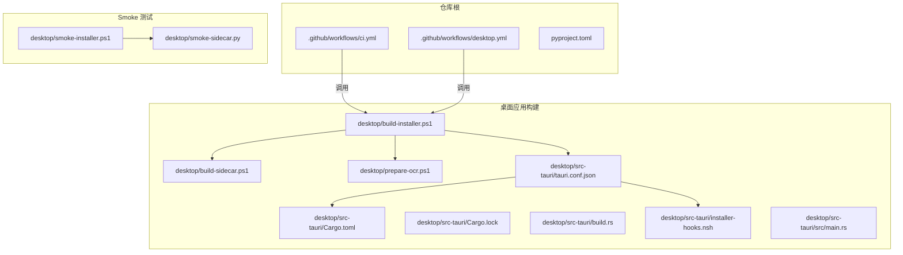
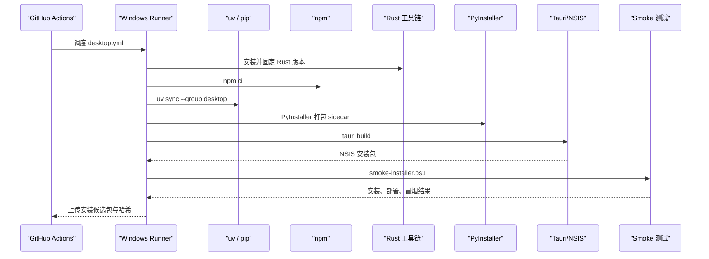
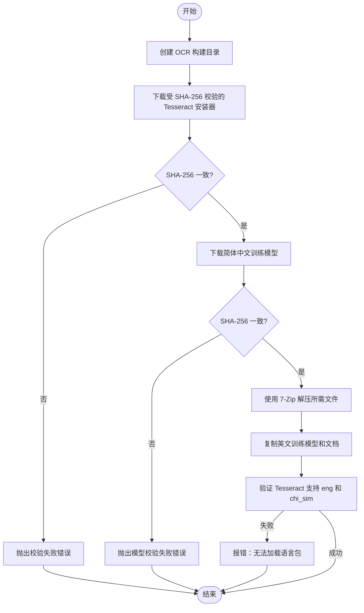
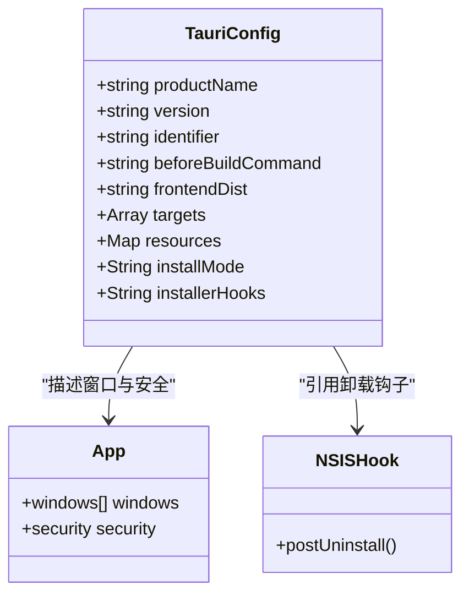
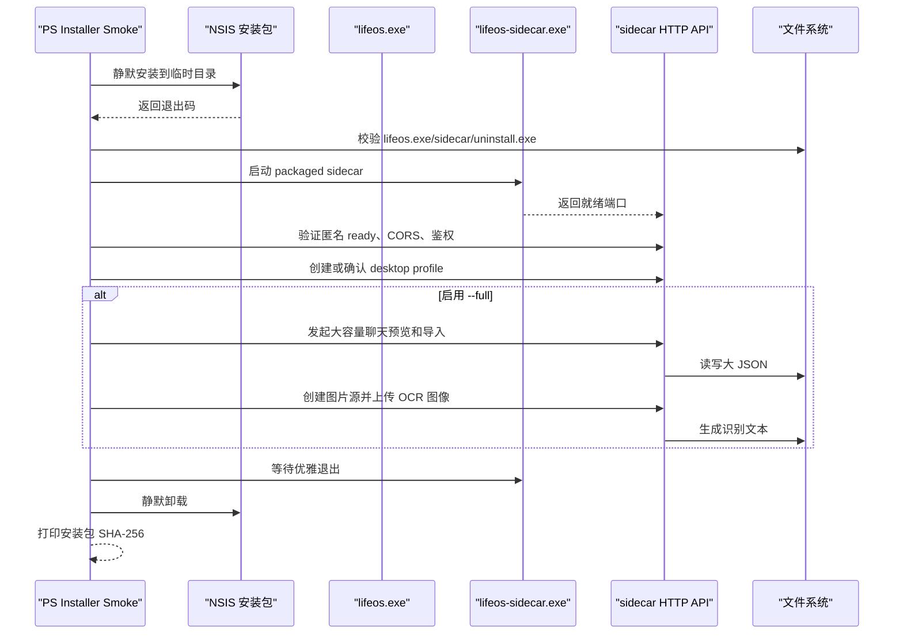
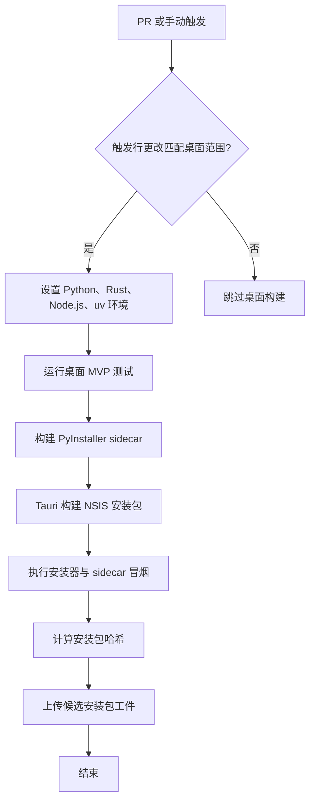

# 构建与分发

<cite>
**本文引用的文件**   
- [.github/workflows/ci.yml](file://.github/workflows/ci.yml)
- [.github/workflows/desktop.yml](file://.github/workflows/desktop.yml)
- [desktop/build-installer.ps1](file://desktop/build-installer.ps1)
- [desktop/build-sidecar.ps1](file://desktop/build-sidecar.ps1)
- [desktop/prepare-ocr.ps1](file://desktop/prepare-ocr.ps1)
- [desktop/smoke-installer.ps1](file://desktop/smoke-installer.ps1)
- [desktop/smoke-sidecar.py](file://desktop/smoke-sidecar.py)
- [desktop/src-tauri/Cargo.toml](file://desktop/src-tauri/Cargo.toml)
- [desktop/src-tauri/Cargo.lock](file://desktop/src-tauri/Cargo.lock)
- [desktop/src-tauri/build.rs](file://desktop/src-tauri/build.rs)
- [desktop/src-tauri/installer-hooks.nsh](file://desktop/src-tauri/installer-hooks.nsh)
- [desktop/src-tauri/src/main.rs](file://desktop/src-tauri/src/main.rs)
- [desktop/src-tauri/tauri.conf.json](file://desktop/src-tauri/tauri.conf.json)
- [pyproject.toml](file://pyproject.toml)
</cite>

## 目录
1. [引言](#引言)
2. [项目结构](#项目结构)
3. [核心组件](#核心组件)
4. [架构总览](#架构总览)
5. [详细组件分析](#详细组件分析)
6. [依赖与版本管理](#依赖与版本管理)
7. [CI/CD 集成、自动发布与回滚](#cicd-集成自动发布与回滚)
8. [性能优化与并行编译](#性能优化与并行编译)
9. [故障排查指南](#故障排查指南)
10. [结论](#结论)

## 引言
本项目的桌面客户端构建与分发系统围绕 Tauri、PyInstaller、PowerShell 和 GitHub Actions 构建而成。当前默认流水线在 Windows 上完成前端构建、Rust/Tauri 打包、Python sidecar 二进制封装、NSIS 安装包生成，并执行安装冒烟测试、sidecar 功能验证和资源哈希校验。系统同时包含 Python 服务端代码质量检查、容器冒烟测试等通用 CI 作业。

文档目标：
- 说明 PowerShell 自动化构建流水线的整体流程，包括资源准备、Rust 与 Python 交叉打包、安装器生成。
- 解释 installer 脚本参数、多平台扩展点、版本来源和发布渠道扩展位置。
- 梳理 Smoke 测试的安装包验证、部署检查和功能冒烟流程。
- 说明 build.rs 和配置注入的边界，明确当前自定义逻辑集中在 Tauri 构建配置中。
- 文档化证书签名、时间戳和公证的现状与扩展建议。
- 提供可落地的 CI/CD 集成、自动发布与回滚实践建议。
- 给出构建性能优化、并行编译与缓存策略。

## 项目结构
构建相关能力主要集中在 `desktop` 目录及 `.github/workflows` 中：

图表来源
- [.github/workflows/ci.yml:1-57](file://.github/workflows/ci.yml#L1-L57)
- [.github/workflows/desktop.yml:1-47](file://.github/workflows/desktop.yml#L1-L47)
- [desktop/build-installer.ps1:1-18](file://desktop/build-installer.ps1#L1-L18)
- [desktop/build-sidecar.ps1:1-27](file://desktop/build-sidecar.ps1#L1-L27)
- [desktop/prepare-ocr.ps1:1-34](file://desktop/prepare-ocr.ps1#L1-L34)
- [desktop/src-tauri/tauri.conf.json:1-29](file://desktop/src-tauri/tauri.conf.json#L1-L29)
- [desktop/src-tauri/Cargo.toml:1-19](file://desktop/src-tauri/Cargo.toml#L1-L19)
- [desktop/src-tauri/installer-hooks.nsh:1-5](file://desktop/src-tauri/installer-hooks.nsh#L1-L5)
- [desktop/smoke-installer.ps1:1-45](file://desktop/smoke-installer.ps1#L1-L45)
- [desktop/smoke-sidecar.py:1-158](file://desktop/smoke-sidecar.py#L1-L158)

章节来源
- [.github/workflows/ci.yml:1-57](file://.github/workflows/ci.yml#L1-L57)
- [.github/workflows/desktop.yml:1-47](file://.github/workflows/desktop.yml#L1-L47)
- [desktop/src-tauri/tauri.conf.json:1-29](file://desktop/src-tauri/tauri.conf.json#L1-L29)

## 核心组件
- PowerShell 构建入口：`desktop/build-installer.ps1` 负责前置资源准备、启动侧进程构建和 Tauri 安装器打包。
- 侧边程序构建：`desktop/build-sidecar.ps1` 通过 PyInstaller 将 Python 桌面功能打包为可执行文件，并按需复制 Tesseract OCR 资源。
- OCR 资源准备：`desktop/prepare-ocr.ps1` 下载受 SHA-256 校验的 Tesseract 安装器与语言模型，并用 7-Zip 提取必要文件。
- Tauri 配置：`desktop/src-tauri/tauri.conf.json` 定义产品名称、版本、标识符、前端产物路径、安全策略、NSIS 安装模式和 Hook。
- Rust 工程：`desktop/src-tauri/Cargo.toml` 声明桌面应用依赖，`build.rs` 委托给 `tauri-build::build()`。
- Smoke 测试：`desktop/smoke-installer.ps1` 与 `desktop/smoke-sidecar.py` 组合验证安装包布局、侧程序就绪、鉴权、持久化用户态信息和可选的大容量导入、OCR 等功能。

章节来源
- [desktop/build-installer.ps1:1-18](file://desktop/build-installer.ps1#L1-L18)
- [desktop/build-sidecar.ps1:1-27](file://desktop/build-sidecar.ps1#L1-L27)
- [desktop/prepare-ocr.ps1:1-34](file://desktop/prepare-ocr.ps1#L1-L34)
- [desktop/src-tauri/tauri.conf.json:1-29](file://desktop/src-tauri/tauri.conf.json#L1-L29)
- [desktop/src-tauri/Cargo.toml:1-19](file://desktop/src-tauri/Cargo.toml#L1-L19)
- [desktop/src-tauri/build.rs:1-3](file://desktop/src-tauri/build.rs#L1-L3)
- [desktop/smoke-installer.ps1:1-45](file://desktop/smoke-installer.ps1#L1-L45)
- [desktop/smoke-sidecar.py:1-158](file://desktop/smoke-sidecar.py#L1-L158)

## 架构总览
桌面构建管线由 GitHub Actions 触发，按职责划分为两条主线：
- 通用 CI：Python/Ruff/Pytest + Web lint + Web build + Docker Compose 服务就绪探测。
- Windows 桌面候选版构建：设置 Rust、Node.js、uv 环境，运行桌面 MVP 测试，生成 NSIS 安装包，执行安装器和 sidecar 冒烟测试，最后上传可执行程序工件。

图表来源
- [.github/workflows/desktop.yml:1-47](file://.github/workflows/desktop.yml#L1-L47)
- [desktop/build-sidecar.ps1:1-27](file://desktop/build-sidecar.ps1#L1-L27)
- [desktop/build-installer.ps1:1-18](file://desktop/build-installer.ps1#L1-L18)
- [desktop/smoke-installer.ps1:1-45](file://desktop/smoke-installer.ps1#L1-L45)
- [desktop/smoke-sidecar.py:1-158](file://desktop/smoke-sidecar.py#L1-L158)

## 详细组件分析

### PowerShell 构建入口与流水线
`desktop/build-installer.ps1` 是桌面安装包构建的协调器：
- 使用 `-Debug` 开关控制是否传递调试参数到 Tauri。
- 检测 Web 前端依赖是否已安装；如未安装则直接失败，强制使用者先执行前端依赖安装。
- 调用 `prepare-ocr.ps1` 准备 Tesseract OCR 安装器与语言数据。
- 调用 `build-sidecar.ps1` 使用指定 OCR 目录构造 PyInstaller 打包命令。
- 通过 `tauri.cmd` 执行 `tauri build`，绑定 bundles 类型为 nsis，并传递上游命令行的 `--locked`。

该脚本保证了 OCR 资源和 sidecar 必须先于 Tauri 构建步骤完成。

图表来源
- [desktop/build-installer.ps1:1-18](file://desktop/build-installer.ps1#L1-L18)

章节来源
- [desktop/build-installer.ps1:1-18](file://desktop/build-installer.ps1#L1-L18)

### OCR 资源下载、校验与解包
`desktop/prepare-ocr.ps1` 的职责非常集中：
- 建立本地 `build/ocr-installer`、`build/ocr` 临时构建目录。
- 根据预定义 URL 与 SHA-256 下载 Tesseract 官方安装器和简体中文语言模型。
- 如果本地文件缺失或哈希不一致，会重新下载并失败提示。
- 用 7-Zip 从安装包中提取可执行文件、动态库、文档和英文训练数据。
- 验证 Tesseract 可加载英文与简体中文两种语言；否则构建失败。
- 接受外部传入的 `SevenZip` 路径，以便 CI 环境直接指向固定 7-Zip。

这个环节避免了在每次构建时重复下载不可信资源，同时保证 OCR 语言包完整性。

流程图

图表来源
- [desktop/prepare-ocr.ps1:1-34](file://desktop/prepare-ocr.ps1#L1-L34)

章节来源
- [desktop/prepare-ocr.ps1:1-34](file://desktop/prepare-ocr.ps1#L1-L34)

### Python Sidecar 打包与资源裁剪
`desktop/build-sidecar.ps1` 基于 PyInstaller 生成 `lifeos-sidecar.exe`：
- 当传入 `TesseractDirectory` 时，先校验必需可执行文件和训练数据存在。
- 使用 `uv run --frozen --python 3.12 --group desktop pyinstaller` 以单目录模式构建。
- 固定 Python 版本、锁定 uv 环境，并通过 `--add-data` 引入迁移数据，显式隐藏 SQLAlchemy sqlite 后端和 ijson 后端以减少无关依赖。
- 若携带 OCR 目录，则将 Tesseract 运行时文件复制到 sidecar `_internal/tesseract`，但有意避免让 PyInstaller 把 OCR OpenSSL DLL 混入主程序依赖解析。
- 构建失败时直接抛出退出码错误，便于上层脚本终止流水线。

注意：此脚本不是跨平台 Python 构建脚本，而是 Windows 桌面构建阶段将 Python sidecar 静态化、资源化的关键步骤。

章节来源
- [desktop/build-sidecar.ps1:1-27](file://desktop/build-sidecar.ps1#L1-L27)
- [pyproject.toml:33-43](file://pyproject.toml#L33-L43)

### Tauri 应用与 NSIS 安装器
Tauri 配置位于 `desktop/src-tauri/tauri.conf.json`：
- `productName` 和 `version` 决定安装包名称和输出文件名中嵌入的版本信息。
- `identifier` 用于 macOS 与应用标识体系，当前 Windows 主要影响注册表与卸载项命名。
- `build.beforeBuildCommand` 在 Rust 构建前执行 `npm.cmd --prefix web run build`，确保前端产出进入 `web/dist`。
- `app.security.csp` 定义了内容安全策略连接域名，允许 IPC 和本地开发端口。
- `bundle.targets` 仅包含 `nsis`，`bundle.resources` 将构建生成的 sidecar 目录映射到安装包中的 `sidecar/` 子目录。
- `bundle.windows.nsis.installMode` 设为 `currentUser`，即按当前用户安装，符合 smoke 测试的单账户隔离行为。
- `installerHooks` 引用 `installer-hooks.nsh`，在安装完成后处理卸载时的自启动项清理。

安装器 Hook：
- 卸载后非更新模式下删除注册表 `HKEY_CURRENT_USER\Software\Microsoft\Windows\CurrentVersion\Run` 下 `PersonalAILifeOS`，从而取消开机自启动。

图表来源
- [desktop/src-tauri/tauri.conf.json:1-29](file://desktop/src-tauri/tauri.conf.json#L1-L29)
- [desktop/src-tauri/installer-hooks.nsh:1-5](file://desktop/src-tauri/installer-hooks.nsh#L1-L5)

章节来源
- [desktop/src-tauri/tauri.conf.json:1-29](file://desktop/src-tauri/tauri.conf.json#L1-L29)
- [desktop/src-tauri/installer-hooks.nsh:1-5](file://desktop/src-tauri/installer-hooks.nsh#L1-L5)

### build.rs 的自定义构建逻辑
当前 `desktop/src-tauri/build.rs` 只调用 `tauri_build::build()`，没有实现 Rust 源级资源预处理、配置注入或平台特定优化。  
当前自定义行为主要由以下配置承担：
- Tauri 配置的 `beforeBuildCommand` 驱动前端构建。
- Tauri 配置的 `bundle.resources` 拷贝 sidecar 目录到最终安装包。
- NSIS hook 定义卸载后清理行为。
- Rust 源码 `desktop/src-tauri/src/main.rs` 中完成 sidecar 生命周期管理、密钥派生、权限授权、本地注册表自启动控制和 Tauri 命令暴露。

因此，如需扩展 Rust 端资源生成（例如在编译期生成版本号、Git 提交摘要或配置文件），应在 `build.rs` 中补充过程逻辑，而不是继续留在配置文件层。

章节来源
- [desktop/src-tauri/build.rs:1-3](file://desktop/src-tauri/build.rs#L1-L3)
- [desktop/src-tauri/tauri.conf.json:1-29](file://desktop/src-tauri/tauri.conf.json#L1-L29)
- [desktop/src-tauri/src/main.rs:1-200](file://desktop/src-tauri/src/main.rs#L1-L200)

### Smoke 测试套件执行流程
Smoke 测试分为两个层次：
1. 安装包与安装布局验证：`desktop/smoke-installer.ps1`。
2. sidecar API 和功能冒烟：`desktop/smoke-sidecar.py`。

#### 安装包冒烟
流程要点：
- 未传入安装包路径时，从 `tauri.conf.json` 的 `productName` 和 `version` 推导预期安装包路径。
- 检测当前用户已卸载项，拒绝在已安装 Personal AI Life OS 的账户中继续，防止污染生产环境。
- 在 GUID 命名的临时目录下静默安装，并验证核心文件 `lifeos.exe`、`sidecar/lifeos-sidecar.exe`、卸载程序存在。
- 执行 installed sidecar 冒烟脚本，必要时执行完整功能验证。
- 使用 `/S` 静默卸载并验证残留文件被清除。
- 返回安装包文件的 SHA-256，便于 CI 归档和比对。

#### Sidecar 冒烟
核心验证逻辑：
- 启动 packaged sidecar，读取随机端口响应；超时或无响应时报错并尝试读取日志。
- 先以匿名访问 `/ready` 应返回受保护状态，随后使用来自 Rust main 分配的 secret 和 Origin 头获取鉴权响应。
- 首次运行创建桌面 profile，二次运行复用已有 profile。
- 可选 `--full` 模式执行大聊天文件内存占用上限校验、OCR 识别验证、Provider 配置写入删除和优雅退出校验。
- 使用 HMAC-SHA256 对聊天文件导入请求进行签名，确保 Tauri 端能够校验路径授予。

图表来源
- [desktop/smoke-installer.ps1:1-45](file://desktop/smoke-installer.ps1#L1-L45)
- [desktop/smoke-sidecar.py:1-158](file://desktop/smoke-sidecar.py#L1-L158)
- [desktop/src-tauri/src/main.rs:1-200](file://desktop/src-tauri/src/main.rs#L1-L200)

章节来源
- [desktop/smoke-installer.ps1:1-45](file://desktop/smoke-installer.ps1#L1-L45)
- [desktop/smoke-sidecar.py:1-158](file://desktop/smoke-sidecar.py#L1-L158)

## 依赖与版本管理

### 版本来源
- Python 应用版本：`pyproject.toml` 的 `project.version` 为 `0.1.1`。
- Rust 桌面应用版本：`desktop/src-tauri/Cargo.toml` 的 `package.version` 也为 `0.1.1`。
- Tauri 配置：`desktop/src-tauri/tauri.conf.json` 的 `version` 同样为 `0.1.1`，并使用 `productName` 决定安装包名。
- 前端：`web/package.json` 显示包版本为 `0.0.0`，但实际构建由 `tauri.conf.json` 中的 `beforeBuildCommand` 驱动。

这些版本目前是分散声明，未来应优先采用单一可信源；例如将产品版本统一输入到 Tauri 配置或构建环境变量，再由 Rust 和 PyInstaller 消费。

章节来源
- [pyproject.toml:1-12](file://pyproject.toml#L1-L12)
- [desktop/src-tauri/Cargo.toml:1-5](file://desktop/src-tauri/Cargo.toml#L1-L5)
- [desktop/src-tauri/tauri.conf.json:1-5](file://desktop/src-tauri/tauri.conf.json#L1-L5)

### Rust 依赖与交叉编译现状
- Tauri 版本为 `2`，依赖 `tauri-plugin-dialog`、`tauri-plugin-notification`、`tauri-plugin-single-instance`。
- Windows 原生依赖 `winreg`；随机数使用 `getrandom`，摘要与加密依赖 `hmac`、`sha2`。
- `Cargo.lock` 锁定了具体依赖树，当前 Windows CI 只安装 Rust 工具和 Tauri 包；未配置 Linux/macOS 交叉工具链或多目标发行任务。
- 因此当前默认流水线不执行 Rust 端跨平台交叉编译，而是针对 Windows x64 生成 NSIS 安装包。

章节来源
- [desktop/src-tauri/Cargo.toml:6-19](file://desktop/src-tauri/Cargo.toml#L6-L19)
- [desktop/src-tauri/Cargo.lock:1-200](file://desktop/src-tauri/Cargo.lock#L1-L200)
- [.github/workflows/desktop.yml:1-47](file://.github/workflows/desktop.yml#L1-L47)

### Python 依赖与构建组
`pyproject.toml` 的 `[dependency-groups]`：
- `desktop` 组包含 PyInstaller、ijson、tzdata 和 Windows ctypes 依赖。
- `dev` 组包含 pytest、coverage 和 ruff。
- 构建系统要求 setuptools >= 68，Python >= 3.11。

章节来源
- [pyproject.toml:1-21](file://pyproject.toml#L1-L21)
- [pyproject.toml:33-43](file://pyproject.toml#L33-L43)

### 平台支持与扩展点
- 当前 bundle targets 仅包含 `nsis`，意味着安装包类型和产物路径均绑定 Windows。
- 若需要 Linux 与 macOS，需在 `tauri.conf.json` 增加 bundle targets，并分别配置对应的打包器、图标、签名流程和安装器 Hook。
- PyInstaller 当前以 Windows 侧边程序为目标，Linux/macOS 需相应调整 spec 参数和第三方库链接。
- OCR 下载与提取目前硬编码为 Windows 安装包和简体中文模型；跨平台时应抽象语言模型下载与安装阶段。

[本节为规划建议，无需源码引用]

## CI/CD 集成、自动发布与回滚

### 现有 CI
`.github/workflows/ci.yml` 执行：
- 多 Python 矩阵拉取代码，使用 astral-sh/setup-uv 启用 uv 缓存。
- 安装 Python 依赖并运行 Ruff 与 Pytest。
- 初始化 Node.js 24，恢复 npm 缓存，安装 web 依赖、lint 和构建前端。
- `container-smoke` 作业验证 docker-compose 能拉起服务并返回健康接口。

章节来源
- [.github/workflows/ci.yml:1-57](file://.github/workflows/ci.yml#L1-L57)

### 桌面构建工作流
`.github/workflows/desktop.yml` 触发条件限定：
- PR 涉及 `desktop/**`、`src/**`、`web/**`、桌面测试、迁移、uv lock 文件或 workflow 自身修改。
- 支持 `workflow_dispatch` 手动触发。
- job 在 `windows-latest` 运行，安装 Python 3.12、Rust 1.100.0、Node.js 24，恢复 npm 缓存，安装 uv desktop 组。
- 执行桌面 MVP 测试、构建安装器、运行安装器 smoke，并对 NSIS 安装包计算 SHA-256。
- 上传安装候选工件 `lifeos-windows-x64-candidate`。

图表来源
- [.github/workflows/desktop.yml:1-47](file://.github/workflows/desktop.yml#L1-L47)

章节来源
- [.github/workflows/desktop.yml:1-47](file://.github/workflows/desktop.yml#L1-L47)

### 发布渠道与自动发布建议
当前工作流未连接到 Git tag、release draft 或远程 artifact store，也没有发布通道区分 stable、beta 或 nightly。建议新增：
- 基于语义版本 tag 的 release pipeline。
- 多通道 matrix：stable、beta、nightly。
- 各通道产物命名规范，例如 `Personal_AI_Life_OS_0.1.1_x64-setup.exe`。
- 使用 GitHub Releases API 创建 pre-release 并将候选包上传至 releases assets。
- 保留每次构建的 SHA-256 清单，用于客户端或镜像站点校验。

### 回滚机制建议
- 利用 GitHub Releases 的历史 pre-release/draft release 快速恢复到上次稳定版本。
- 客户端可配置发布服务器元数据版本号，发现损坏版本后切换回已知稳定版本。
- 安装包应携带可比较版本信息；在 Windows 安装程序中应避免不同版本覆盖同一用户数据。
- 发布前必须在独立 Windows test profile 中完成 smoke 测试，这与当前脚本拒绝已安装账户的策略一致。

[本节为建议，不涉及现有实现]

## 性能优化与并行编译

### 当前缓存与锁定策略
- `ci.yml` 启用 `astral-sh/setup-uv@v6` 并开启缓存，可缓存 uv 安装的依赖。
- Node.js 使用 actions/setup-node 并缓存 `web/package-lock.json`。
- Python 和前端都使用锁定文件：`uv.lock`、`web/package-lock.json`。
- `build-sidecar.ps1` 使用 `--frozen` 避免构建时变更 uv 锁。
- Tauri 调用命令行传入 `--locked`，避免 cargo 增量解析导致依赖变动。

### 建议进一步优化
- Rust 构建层使用 `cargo-hammer` 或 `sccache`/`ccache`；通过环境变量开启并行编译。
- 将 Tesseract 下载与语言校验产物放入 runner cache 键，减少每次 CI 网络 IO。
- 将 `desktop/src-tauri/target`、`node_modules/.cache`、`~/.cargo/registry` 分层缓存，降低增量重建成本。
- 将 smoke 测试拆分为 fast path（仅安装布局与启动）和 slow path（full OCR 与 500 MiB 导入）。
- 将 PyInstaller 缓存其 work/spec 输出目录，避免每次重建全部 Python 依赖图谱。
- 对 `tauri.conf.json` 中的 `targets`、`icon`、`resources` 等不变字段做细粒度缓存，避免全量构建。

章节来源
- [.github/workflows/ci.yml:10-40](file://.github/workflows/ci.yml#L10-L40)
- [.github/workflows/desktop.yml:12-35](file://.github/workflows/desktop.yml#L12-L35)
- [desktop/build-sidecar.ps1:1-27](file://desktop/build-sidecar.ps1#L1-L27)
- [desktop/build-installer.ps1:1-18](file://desktop/build-installer.ps1#L1-L18)
- [desktop/prepare-ocr.ps1:1-34](file://desktop/prepare-ocr.ps1#L1-L34)

## 故障排查指南

### 常见安装器构建失败
- 缺少 web/node_modules：`build-installer.ps1` 会直接抛错，需先在 `web/` 执行 `npm ci`。
- 7-Zip 路径不正确：使用 CI 中提供的绝对路径，或通过 `SevenZip` 参数覆盖。
- Tauri 构建失败：查看 Tauri 输出的 Rust 编译日志，检查 Node.js 前端构建是否成功。
- NSIS 打包失败：检查 `tauri.conf.json` 的资源目录是否生成，确认 `desktop/dist/lifeos-sidecar/` 存在。

章节来源
- [desktop/build-installer.ps1:5-18](file://desktop/build-installer.ps1#L5-L18)
- [desktop/build-sidecar.ps1:1-27](file://desktop/build-sidecar.ps1#L1-L27)
- [desktop/src-tauri/tauri.conf.json:1-29](file://desktop/src-tauri/tauri.conf.json#L1-L29)

### 常见 OCR 资源问题
- 下载失败或网络超时：检查 GitHub Release 与 tessdata_fast 原始 URL 可用性。
- SHA-256 不一致：可能是本地缓存污染或网络中间件拦截，建议清理 `desktop/build` 后重试。
- Tesseract 无法加载语言包：确认 extracted 目录中的 `eng.traineddata` 和 `chi_sim.traineddata` 是否存在且可被 Tesseract 解析。

章节来源
- [desktop/prepare-ocr.ps1:1-34](file://desktop/prepare-ocr.ps1#L1-L34)

### 常见 Smoke 测试失败
- “已有 Personal AI Life OS 安装”：请在新建的 Windows test profile 或新虚拟机执行。
- 安装包静默安装失败：检查安装包路径是否正确，或使用绝对路径传入 `-Installer`。
- sidecar 未就绪：查看临时目录中的 `logs/sidecar.log`；Rust main 会在未收到 port 时主动终止 sidecar。
- large chat 导入或 OCR 失败：检查 sidecar HTTP 接口是否正常、鉴权 header 是否生效，以及磁盘空间是否足够。

章节来源
- [desktop/smoke-installer.ps1:1-45](file://desktop/smoke-installer.ps1#L1-L45)
- [desktop/smoke-sidecar.py:1-158](file://desktop/smoke-sidecar.py#L1-L158)
- [desktop/src-tauri/src/main.rs:1-200](file://desktop/src-tauri/src/main.rs#L1-L200)

## 数字签名、时间戳与公证现状与建议

### 现状
- 当前仓库未发现代码签名配置、时间戳服务器地址、签名凭证或公证任务。
- NSIS 安装器未启用 Signtool、Adobe AAT 或其他签名选项。
- Tauri 配置也未包含 signing 或 notarization 字段。
- 桌面 YAML 未配置 Windows 签名所需的认证主体和凭据。

这意味着当前构建产物主要用于内部 candidate 和 smoke 测试，不能直接满足企业或应用商店的可信分发需求。

章节来源
- [desktop/src-tauri/tauri.conf.json:1-29](file://desktop/src-tauri/tauri.conf.json#L1-L29)
- [.github/workflows/desktop.yml:1-47](file://.github/workflows/desktop.yml#L1-L47)

### 推荐实现方案
- Windows 安装器签名：在发布分支添加 Signtool 步骤，使用受控 pfx 或 Azure Key Vault/CertCloud。
- RFC3161 时间戳：为签名提供稳定时间戳服务，防止证书过期后安装包失效。
- macOS 公证：通过 `xcrun notarytool` 提交 Apple Notary Service，并在安装包中附加 staple 标记。
- Linux 包签名：使用 gpg 签署 RPM/APK/AppImage，并在分发站公布公钥。
- 凭据最小化：仅在 release pipeline 注入私钥和凭据，避免 push/PR 构建泄露。

[本节为建议，不涉及现有实现]

## 结论
该项目当前的构建与分发系统已经具备稳定的 Windows 桌面候选构建链：前端构建、Rust/Tauri 打包、PyInstaller sidecar 构建、NSIS 安装包生成与端到端 smoke 验证。版本管理、依赖锁定和缓存基础也已搭建，但尚未实现多平台交叉编译、代码签名、时间戳、公证以及自动化发布渠道。  
建议在保持当前可靠流水线的基础上，分阶段引入统一版本来源、跨平台 targets、可信签名与公证、以及可回溯的 release artifacts，从而形成完整的构建—分发—审计闭环。