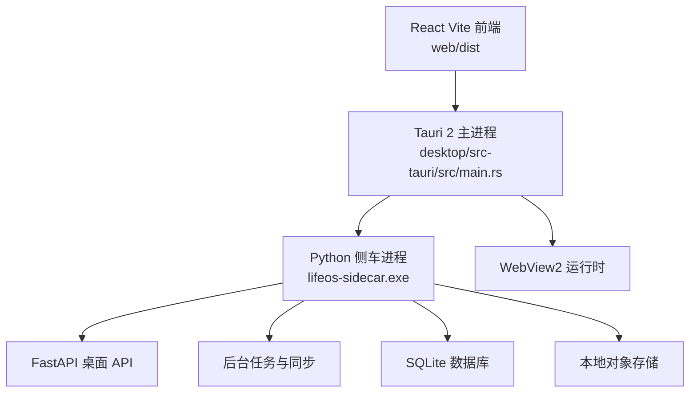
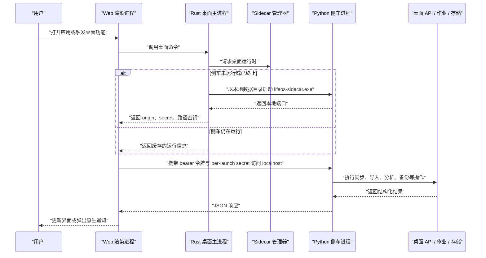
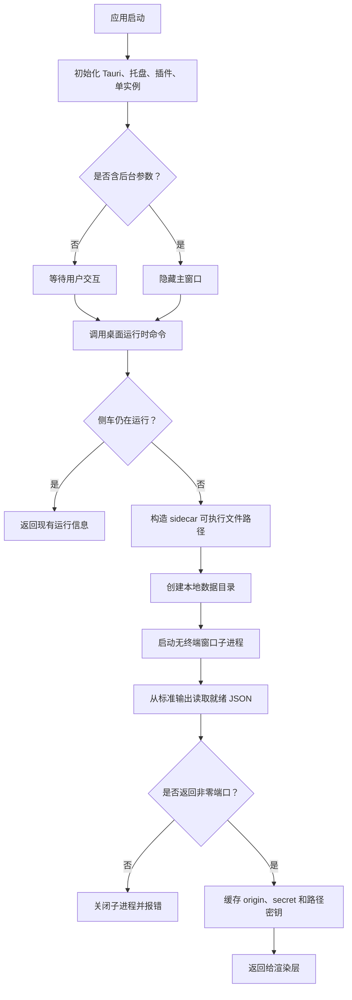
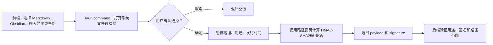
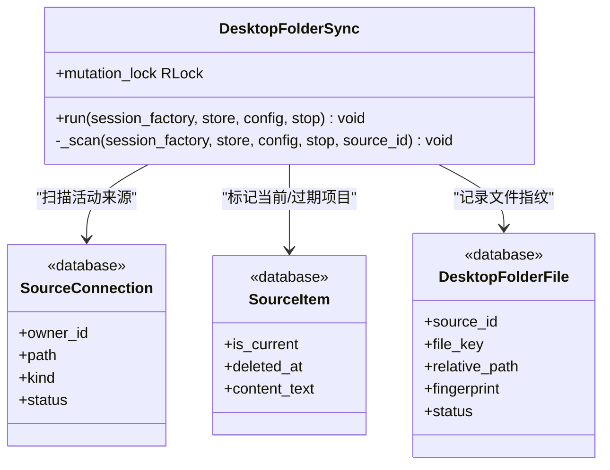
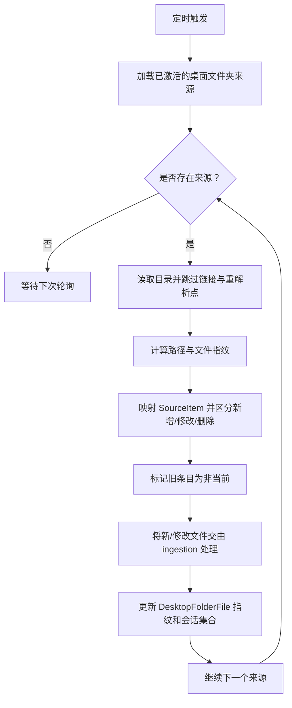
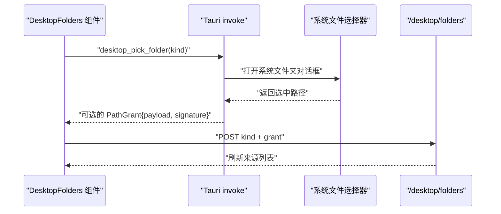
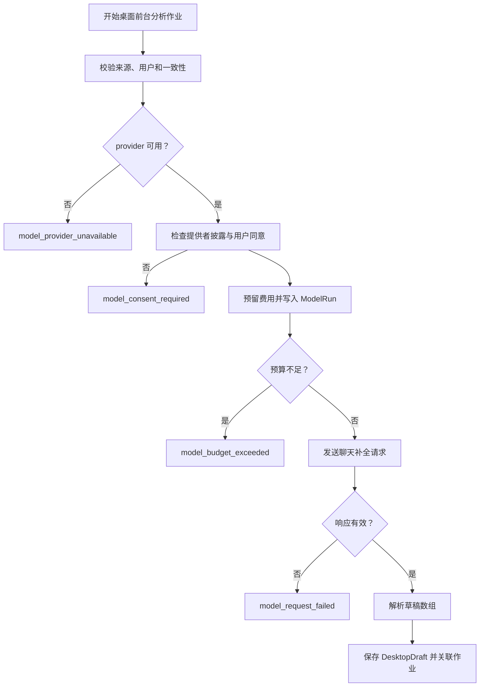
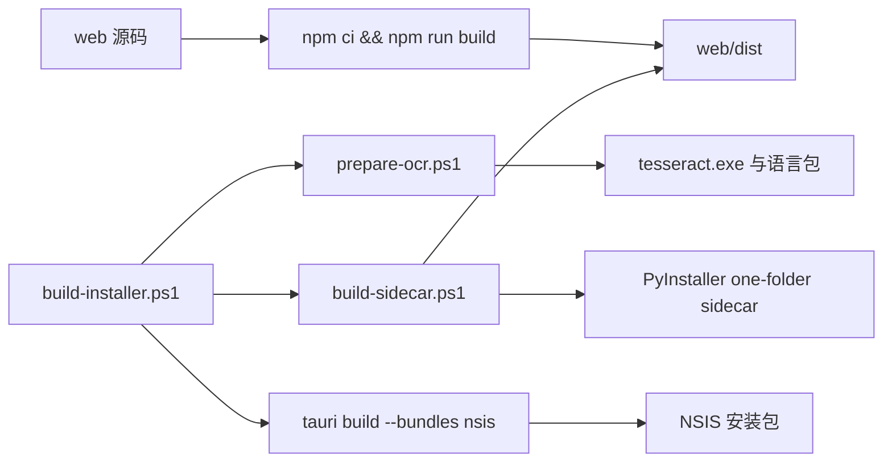

# 桌面应用集成

<cite>
**本文引用的文件**   
- [桌面壳层入口](file://desktop/src-tauri/src/main.rs)
- [Tauri 配置](file://desktop/src-tauri/tauri.conf.json)
- [Rust 依赖定义](file://desktop/src-tauri/Cargo.toml)
- [Windows 桌面壳层架构决策](file://docs/architecture/decisions/0002-windows-desktop-shell.md)
- [打包安装器构建脚本](file://desktop/build-installer.ps1)
- [Sidecar 打包脚本](file://desktop/build-sidecar.ps1)
- [OCR 资源准备脚本](file://desktop/prepare-ocr.ps1)
- [任务计划同步注册脚本](file://scripts/register-scheduled-sync.ps1)
- [Web 端文件夹管理界面](file://web/src/DesktopFolders.tsx)
- [桌面文件夹同步服务](file://src/personal_ai_life_os/services/desktop_folders.py)
- [桌面草稿分析服务](file://src/personal_ai_life_os/services/desktop_analysis.py)
- [对象存储抽象与本地实现](file://src/personal_ai_life_os/storage.py)
- [Windows 桌面验收文档](file://docs/operations/desktop-acceptance.md)
</cite>

## 目录
1. [引言](#引言)
2. [项目结构](#项目结构)
3. [核心组件](#核心组件)
4. [系统架构总览](#系统架构总览)
5. [详细组件分析](#详细组件分析)
6. [依赖关系分析](#依赖关系分析)
7. [性能与容量特性](#性能与容量特性)
8. [故障排查指南](#故障排查指南)
9. [结论](#结论)

## 引言
本章节说明 Personal-AI-Life-OS 的 Windows 桌面形态：以 Tauri 2 作为 Rust 壳层，托管 React/Vite Web 前端；通过侧车进程运行现有 Python FastAPI 应用、后台 worker、SQLite 数据、Alembic 迁移及 OCR 工具。桌面壳层负责托盘图标、通知中心、自动登录启动、单实例窗口控制、原生文件与文件夹选择，以及路径授权签名。Python 后端保留业务逻辑，包括授权文件夹同步、增量扫描、聊天导出导入、备份恢复、本地对象存储和模型草稿生成。安装包使用 NSIS，默认采用当前用户模式安装，并预置 sidecar 和资源目录。

**章节来源**
- [Windows 桌面壳层架构决策:1-43](file://docs/architecture/decisions/0002-windows-desktop-shell.md#L1-L43)

## 项目结构
桌面相关代码按“前端—桌面壳层—侧车”三层组织：

- **前端**：普通 Web 客户端仍可作为开发参考客户端；桌面模式下由 `tauri.conf.json` 指定 `web/dist` 为静态资源，构建前执行 `web run build`。
- **桌面壳层**：Rust 进程提供 Tauri command，用于启动/停止侧车、托盘、通知、自动启动和路径权限。
- **侧车**：PyInstaller 打包出的 one-folder 可执行文件，内嵌 Python 3.12 x64、SQLAlchemy、SQLite、Alembic 迁移和 Tesseract（英文与简体中文）。
- **资源与安装程序**：OCR 资源与 sidecar 目录在构建时复制到打包产物，最终通过 NSIS 生成安装包。

**图表来源**
- [Rust 依赖定义:1-19](file://desktop/src-tauri/Cargo.toml#L1-L19)
- [Tauri 配置:1-29](file://desktop/src-tauri/tauri.conf.json#L1-L29)

**章节来源**
- [Tauri 配置:1-29](file://desktop/src-tauri/tauri.conf.json#L1-L29)
- [Windows 桌面壳层架构决策:9-31](file://docs/architecture/decisions/0002-windows-desktop-shell.md#L9-L31)

## 核心组件
- **Rust 主进程**
  - 管理侧车生命周期，包括随机端口就绪协议、标准输入输出初始化、失败清理和优雅退出。
  - 提供桌面命令：获取运行时地址和密钥、打开文件/文件夹选择器、设置自动启动、显示到期提醒、更新托盘状态、停止侧车。
  - 实现单实例、托盘菜单、关闭窗口时最小化到托盘、隐藏模式背景运行。
- **路径权限子系统**
  - 每次选择文件或文件夹后，主进程会组合路径、用途、时间戳，并使用每启动生成的 secret 进行 HMAC-SHA256 签名。
  - 只有具备有效签名的 sidecar 才允许访问对应文件，从而避免任意文件系统路径被直接传入。
- **通知与托盘**
  - 基于 `tauri-plugin-notification` 调用系统原生通知；托盘通过 `tray-icon` feature 和自定义菜单控制打开窗口和退出。
- **自动启动**
  - 通过 Windows HKEY_CURRENT_USER `Run` 键写回主程序路径加 `--background` 参数，支持启用、禁用和读取当前状态。
- **安全 CSP**
  - Tauri 配置文件启用严格的内容安全策略，限制脚本、连接、帧和表单来源；IPC 与本地回环地址显式允许。

**章节来源**
- [桌面壳层入口:1-385](file://desktop/src-tauri/src/main.rs#L1-L385)
- [Rust 依赖定义:1-19](file://desktop/src-tauri/Cargo.toml#L1-L19)
- [Tauri 配置:1-29](file://desktop/src-tauri/tauri.conf.json#L1-L29)

## 系统架构总览
系统采用“壳层—侧车—业务进程”边界清晰的设计：

- **通信边界**：侧车只在本地回环监听，并使用现有 Bearer Token 叠加每次启动分配的 per-launch secret。Web 页面通过 Tauri command 获取运行时地址后再连接 sidecar。
- **错误恢复**：当检测到子进程结束但仍收到运行时请求时，主进程会重新拉起侧车。
- **职责隔离**：Rust 壳层不复制复杂业务逻辑，只封装操作系统能力；所有源同步、导入、分析和删除事务留在 Python 后端。

**图表来源**
- [桌面壳层入口:168-260](file://desktop/src-tauri/src/main.rs#L168-L260)
- [Windows 桌面壳层架构决策:21-31](file://docs/architecture/decisions/0002-windows-desktop-shell.md#L21-L31)

## 详细组件分析

### 桌面壳层与侧车生命周期

该流程体现以下关键点：
- 侧车启动超时为 45 秒，错误提示引导查看日志。
- 正常退出使用 graceful stop；等待最多 8 秒后 kill 子进程。
- debug 构建可覆盖侧车数据目录，方便冒烟测试。

**图表来源**
- [桌面壳层入口:27-107](file://desktop/src-tauri/src/main.rs#L27-L107)
- [桌面壳层入口:209-248](file://desktop/src-tauri/src/main.rs#L209-L248)

**章节来源**
- [桌面壳层入口:27-107](file://desktop/src-tauri/src/main.rs#L27-L107)
- [桌面壳层入口:209-260](file://desktop/src-tauri/src/main.rs#L209-L260)

### 路径权限与用户授权对话框

关键行为：
- “聊天导出”只允许 `.json` 或 `.jsonl`；“备份”只允许 `.zip`。
- 每种目录用途都有独立标题，例如“选择 Markdown 记录目录”“选择备份目录”。
- 签名负载包含真实路径、用途和时间戳；signature 由主进程持有的 per-launch path_key 计算。
- 如果桌面服务未运行，则拒绝签名请求。

**图表来源**
- [桌面壳层入口:108-167](file://desktop/src-tauri/src/main.rs#L108-L167)
- [桌面壳层入口:201-208](file://desktop/src-tauri/src/main.rs#L201-L208)

**章节来源**
- [桌面壳层入口:108-167](file://desktop/src-tauri/src/main.rs#L108-L167)

### 文件夹同步与实时监听

桌面文件夹同步的核心职责是：按已授权目录轮询变更、维护 SourceItem 版本标记、排除链接和重解析点，并把新文件送入通用 ingestion 管线。

- **排除规则**：隐藏目录、`.obsidian`、`.git`、回收站、系统卷信息和 `LifeOS-Exports`；链接、符号链接和 Windows 重解析点均被视为不安全。
- **指纹**：对 Markdown 文件使用大小、纳秒级修改时间、设备号和 inode；聊天导出目录使用规范化相对路径哈希。
- **增量同步**：每次扫描先拉取已记录的 SourceItem，再标记不再存在的条目为“当前非当前”，必要时将证据不可用标记写入图索引。
- **会话导入**：聊天导入阶段会先校验文件未被外部篡改，且所选会话快照稳定，再通过 `ingest_file` 创建 SourceItem。
- **轮询频率**：同步循环约每 3 秒执行一次，异常不会中止整个 watcher。

**图表来源**
- [桌面文件夹同步服务:1-200](file://src/personal_ai_life_os/services/desktop_folders.py#L1-L200)

**章节来源**
- [桌面文件夹同步服务:1-200](file://src/personal_ai_life_os/services/desktop_folders.py#L1-L200)

### 桌面端实时事件与用户交互

Web 端并不自行轮询底层文件系统，而是：
- 每隔约 3 秒刷新 `/desktop/folders` 和待确认删除列表；
- 调用 `desktop_autostart` 显示或修改登录启动开关；
- 使用 Tauri `desktop_pick_folder` 打开系统原生选择器；
- 将前端选定的 `kind` 与后端返回的 `PathGrant` 一起发送到 `/desktop/folders`；
- 暂停、恢复、撤回来源，以及批量处理缺失文件。

**图表来源**
- [Web 端文件夹管理界面:1-121](file://web/src/DesktopFolders.tsx#L1-L121)

**章节来源**
- [Web 端文件夹管理界面:1-121](file://web/src/DesktopFolders.tsx#L1-L121)

### 备份管理与数据完整性保障

备份与恢复属于桌面端重要安全边界。后端通过 ObjectStore 接口抽象本地文件和 S3 对象存储，并维护三类删除墓碑：账户、来源、项。

- **写入原子性**：本地 `put` 先写入临时文件，再调用系统原子替换，避免半写对象。
- **键空间隔离**：对象 key 必须是非绝对路径、不含反斜杠和空字符；LocalObjectStore 还会校验最终解析路径落在配置根目录下。
- **删除一致性**：删除操作会写 `.deletion-tombstones`；S3 实现还加密存储删除账本，以便跨账号/来源审计和恢复。
- **身份验证**：墓碑写入时需要 UUID 类型的 owner/source/item，避免越权清理。

对于恢复场景，验收文档明确说明：先备份、再移除源文件并确认删除，随后恢复旧备份；已删除正文和对象不得重新出现。这表明恢复过程要重放删除记录，而不是简单回滚数据。

**章节来源**
- [对象存储抽象与本地实现:1-200](file://src/personal_ai_life_os/storage.py#L1-L200)
- [Windows 桌面验收文档:28-62](file://docs/operations/desktop-acceptance.md#L28-L62)

### 模型草稿分析与预算控制

桌面草稿分析不直接让 UI 决定是否可以调用云端模型，而是通过作业和检查顺序强制约束：

1. 检查来源、项目和用户是否仍然存在；
2. 判断数据来源同意版本是否过期；
3. 解析 provider；
4. 检查提供者披露和用户同意；
5. 估算成本，并与月预算、单次最大成本比较；
6. 若预算不足或同意缺失，以非重试错误快速结束；
7. 调用完成后根据 HTTP 错误、解析错误或审查版本变更记录状态。

**图表来源**
- [桌面草稿分析服务:1-147](file://src/personal_ai_life_os/services/desktop_analysis.py#L1-L147)

**章节来源**
- [桌面草稿分析服务:1-147](file://src/personal_ai_life_os/services/desktop_analysis.py#L1-L147)

## 依赖关系分析

### 桌面构建流水线

关键行为：
- `build-installer.ps1` 要求先在 web 目录执行 `npm ci`。
- 打包前先准备 OCR，下载并校验 Tesseract 安装程序和简中词库 SHA-256。
- `build-sidecar.ps1` 使用 uv 固定 Python 3.12，打包 `personal_ai_life_os/desktop.py`，并将 Alembic migrations 和 tzdata 加入资源；如有 OCR 目录，会将 OpenSSL DLL 拷贝到 `_internal/tesseract`。
- Tauri 构建目标为 `nsis`，使用 `currentUser` 安装模式和自定义 hooks。

**图表来源**
- [打包安装器构建脚本:1-18](file://desktop/build-installer.ps1#L1-L18)
- [Sidecar 打包脚本:1-27](file://desktop/build-sidecar.ps1#L1-L27)
- [OCR 资源准备脚本:1-34](file://desktop/prepare-ocr.ps1#L1-L34)
- [Tauri 配置:20-29](file://desktop/src-tauri/tauri.conf.json#L20-L29)

**章节来源**
- [打包安装器构建脚本:1-18](file://desktop/build-installer.ps1#L1-L18)
- [Sidecar 打包脚本:1-27](file://desktop/build-sidecar.ps1#L1-L27)
- [OCR 资源准备脚本:1-34](file://desktop/prepare-ocr.ps1#L1-L34)

### 系统集成依赖

| 能力 | 实现位置 | 作用 | 风险面 |
|---|---|---|---|
| 托盘图标与菜单 | Rust 主进程 | 打开窗口、退出、显示同步状态 | 仅 UI 和控制入口 |
| 自动启动 | Rust 主进程、HKEY_CURRENT_USER\Run | 支持后台同步和登录启动 | 写入用户注册表 |
| 通知中心 | Tauri Notification 插件 | 展示到期提醒和提示 | 不影响数据路径 |
| 单实例 | Single-instance 插件 | 已有窗口可见并获得焦点 | 防止多进程重复同步 |
| 系统文件选择 | Dialog 插件 | 选择 Markdown、Vault、聊天导出和备份 | 需要后续路径签名 |
| 原生权限请求 | Rust command + HMAC | 限制 sidecar 只能读取已授权路径 | Secret 泄露会导致路径访问扩大 |
| 调度器 | PowerShell 脚本 | 注册每日 `lifeos sync` 任务 | 仅驱动 CLI，仍需现有认证和来源白名单 |

**章节来源**
- [桌面壳层入口:108-385](file://desktop/src-tauri/src/main.rs#L108-L385)
- [任务计划同步注册脚本:1-96](file://scripts/register-scheduled-sync.ps1#L1-L96)

## 性能与容量特性

- **冷启动时间**：取决于 WebView2 初始化、Rust 主进程启动、Python 运行时启动、Sidecar 就绪和首次 API 握手。验收文档明确要求测量安装包尺寸和冷启动时间。
- **同步节奏**：文件夹同步为轮询机制，周期约 3 秒；异步 watcher 中的单个 scan 失败只会记录警告，不会中断后续同步。
- **大文件导入**：验收使用超过 570 MiB 的合成聊天文件验证预览、会话选择和增量入库流程；峰值工作集和耗时可作为性能基线。
- **内存使用**：PyInstaller one-folder 打包 Python 运行时和 Tesseract；sidecar 常驻内存用于保持长连接、轮询和后台任务。
- **磁盘 I/O**：本地对象存储使用原子写和逐步删除空目录；删除操作依赖墓碑和源级清理，避免脏读。
- **DPI 兼容性**：验收涵盖 150% DPI 下的 WebView2 视口、原生对话框和键盘聚焦；应持续关注横滚动溢出问题。

**章节来源**
- [Windows 桌面验收文档:1-27](file://docs/operations/desktop-acceptance.md#L1-L27)
- [桌面文件夹同步服务:145-200](file://src/personal_ai_life_os/services/desktop_folders.py#L145-L200)
- [对象存储抽象与本地实现:1-120](file://src/personal_ai_life_os/storage.py#L1-L120)

## 故障排查指南

### 常见现象与定位建议

| 现象 | 可能原因 | 诊断步骤 | 预期修复 |
|---|---|---|---|
| 启动时报“侧车未就绪” | 侧车 stdout 未在 45 秒内返回就绪 JSON；标准输入或标准输出丢失 | 检查 `logs/sidecar.log`；确认 sidecar 可执行文件存在并可达；debug 模式可使用环境变量覆盖数据目录 | 修复 sidecar 启动参数或日志路径 |
| 选择文件后无法同步 | 路径签名无效、来源未被授权、侧车进程已退出 | 确认前端是否传递 `grant.payload` 和 `grant.signature`；确认 `/desktop/folders` 返回该来源 | 重新选择原文件；确保桌面服务正在运行 |
| 托盘图标点击无反应 | 托盘尚未初始化或窗口句柄不存在 | 观察 Rust 启动阶段是否构建 tray；检查 `main` 窗口 label 是否为 `main` | 修正托盘事件和窗口 label |
| 登录启动后没有侧车进程 | `Run` 注册值缺少 `--background`，或者侧车被杀 | 检查当前用户 Run 键；重启后检查用户 Session | 重新开启登录启动 |
| 通知不出现 | 通知插件未初始化、count 为 0 或系统设置阻止通知 | 检查 `desktop_notify_due` 调用方是否传入非零 count；在系统通知设置中确认 | 调整计数或通知偏好 |
| OCR 或中文识别失败 | 缺少 tesseract.exe、eng.traineddata 或 chi_sim.traineddata | 检查 `desktop/dist/lifeos-sidecar/_internal/tesseract` | 重新运行 OCR 资源准备脚本 |
| 备份恢复后仍显示已删内容 | 删除记录未正确重放或墓碑不完整 | 检查删除 tombstone、源删除和项删除三个层级 | 补充删除记录并重试恢复 |
| Scheduled Task 同步未执行 | PATH 中没有 `uv`、目标路径无效或时间格式错误 | 手动运行注册脚本的 `-WhatIf`；检查日志目录和 wrapper 路径 | 修复环境或路径 |

### 调试技巧

- **Rust debug 模式**：使用 Tauri debug 构建可以直接指向本地 dist 目录，而不必每次重新打包侧车。
- **Smoke 数据目录**：Rust 进程在 debug 下优先使用 `LIFEOS_SMOKE_DATA`，便于隔离测试数据。
- **侧车单独测试**：验收脚本支持 `--full` 启动 sidecar，可绕过 Tauri 直接验证启动认证、重启保留、退出和 OCR。
- **本地安装器验证**：验收流程要求执行 smoke installer 并记录安装包 SHA-256，同时验证静默安装、静默卸载和数据保留。
- **WebView2 与 DPI**：验收中记录 WebView2 版本、`devicePixelRatio` 和原生对话框表现；在 150% DPI 下重点检查文本缩放和横向滚动。
- **Windows 凭据管理器**：桌面端将模型 API 密钥保存在 Windows Credential Manager；恢复时应排除这些凭据，避免 ZIP 泄露密钥。

### 安全与沙箱考虑

- **Webshell 最小化**：Rust 壳层不包含业务逻辑，只做 OS 集成；Tauri CSP 禁用 `object-src`、`frame-src`、`base-uri`、`form-action`，限制脚本和连接来源。
- **回环绑定**：侧车只接受 loopback 地址，并叠加每启动一次的 per-launch secret。
- **路径权限**：只有通过 `desktop_pick_*` 获得的签名路径才允许访问；chat_folder 还会进一步校验导出路径必须在授权目录子树内。
- **链接与硬链接保护**：同步过程中排除符号链接和重解析点，降低通过链接逃逸授权目录的风险。
- **对象存储键验证**：本地对象 key 必须是安全 POSIX 路径，写入前校验最终绝对路径位于配置的 storage root 内。
- **删除幂等**：删除操作会写多个 tombstone，并在还原场景中重放；避免“只删数据库或只删文件”的不一致。

**章节来源**
- [桌面壳层入口:1-385](file://desktop/src-tauri/src/main.rs#L1-L385)
- [对象存储抽象与本地实现:1-160](file://src/personal_ai_life_os/storage.py#L1-L160)
- [桌面文件夹同步服务:1-60](file://src/personal_ai_life_os/services/desktop_folders.py#L1-L60)
- [Windows 桌面验收文档:1-75](file://docs/operations/desktop-acceptance.md#L1-L75)

## 结论
Personal-AI-Life-OS 的桌面集成以 Tauri 2 为外壳，Python 侧车承载全部领域能力，形成清晰的职责边界和安全边界。Windows 集成能力集中在 Rust 主进程和 Tauri 插件中，包括托盘、通知、自动启动、单实例和路径授权签名；增量文件夹同步、聊天导入、备份恢复与模型草稿分析则由 Python 后端完成。安装流水线通过 PowerShell 脚本、PyInstaller、Tesseract 与 NSIS 串联，满足 MVP 场景下的本地优先、隐私保护和本机可用性要求。

下一步公开分发门禁仍包括代码签名、SmartScreen 信誉和自动更新；在内部开发和验收阶段，应以 Windows 10/11、DPI、断网、升级、侧车存活、删除幂等和权限撤销为关键回归点。