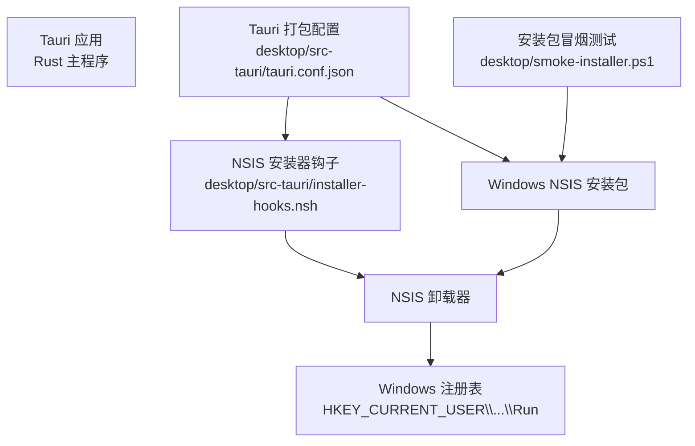

# NSIS 安装器钩子

<cite>
**本文引用的文件**   
- [installer-hooks.nsh](file://desktop/src-tauri/installer-hooks.nsh)
- [tauri.conf.json](file://desktop/src-tauri/tauri.conf.json)
- [main.rs](file://desktop/src-tauri/src/main.rs)
- [smoke-installer.ps1](file://desktop/smoke-installer.ps1)
</cite>

## 目录

1. [简介](#简介)
2. [项目结构](#项目结构)
3. [核心组件](#核心组件)
4. [架构总览](#架构总览)
5. [详细组件分析](#详细组件分析)
6. [依赖分析](#依赖分析)
7. [性能与可靠性考虑](#性能与可靠性考虑)
8. [故障排除指南](#故障排除指南)
9. [调试与日志最佳实践](#调试与日志最佳实践)
10. [结论](#结论)

## 简介

本项目使用 Tauri 在 Windows 上生成 NSIS 安装包。安装器的卸载阶段通过一个小型 NSIS 宏实现钩子逻辑：当用户执行常规卸载或首次安装后的清理时，应移除当前用户的自动启动注册表项；当检测到更新模式时，则保留该键值以避免覆盖正在升级的程序行为。

该设计将平台相关、安装器相关的副作用集中在一处可插拔的扩展点中，便于未来新增自定义卸载逻辑（例如清理计划任务、删除服务、清理侧车程序残留等），同时不侵入业务应用的主代码。

## 项目结构

NSIS 安装器钩子位于桌面应用打包配置附近，由 Tauri 在构建包时被加载。关键文件位置如下：

- 安装器钩子脚本：`desktop/src-tauri/installer-hooks.nsh`
- Tauri 打包配置：`desktop/src-tauri/tauri.conf.json`
- 应用自身注册表操作实现：`desktop/src-tauri/src/main.rs`
- 安装包冒烟测试：`desktop/smoke-installer.ps1`

**图表来源**   
- [tauri.conf.json:20-29](file://desktop/src-tauri/tauri.conf.json#L20-L29)
- [install