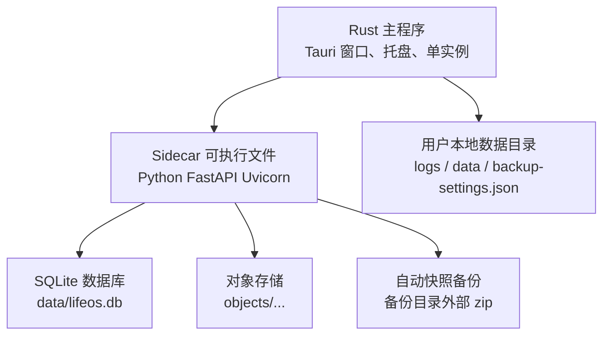
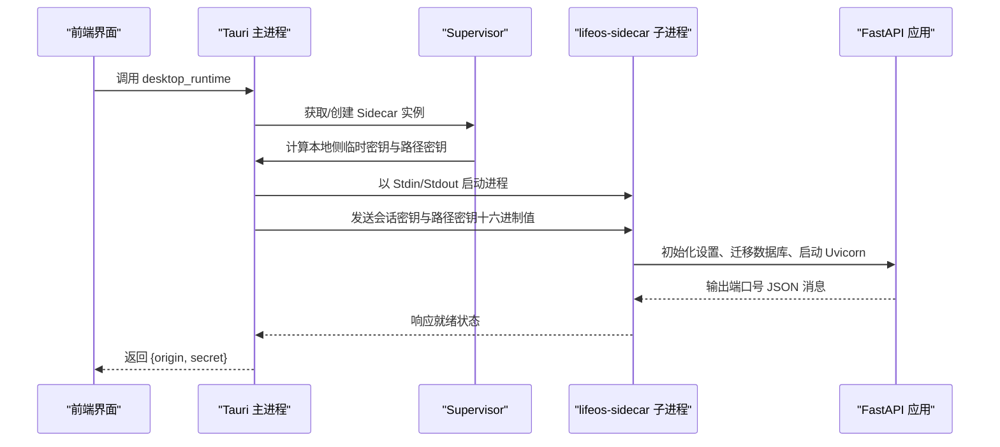
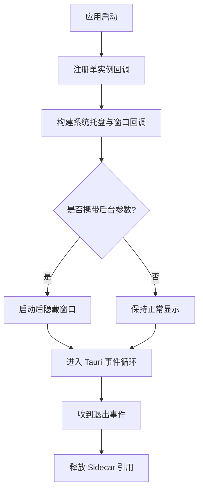
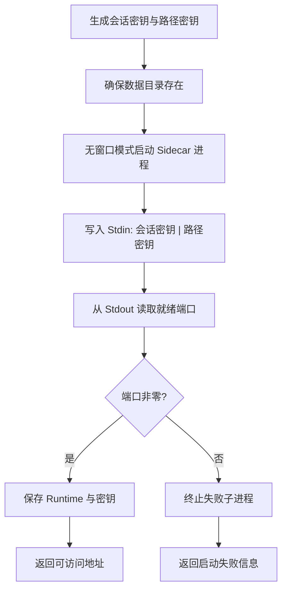
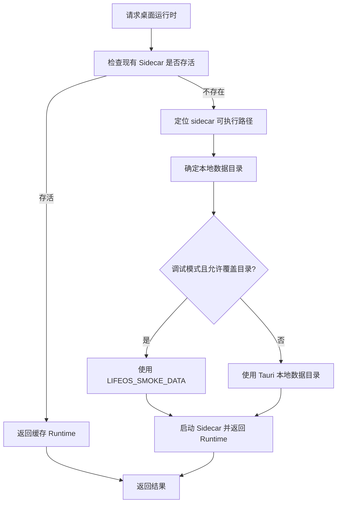
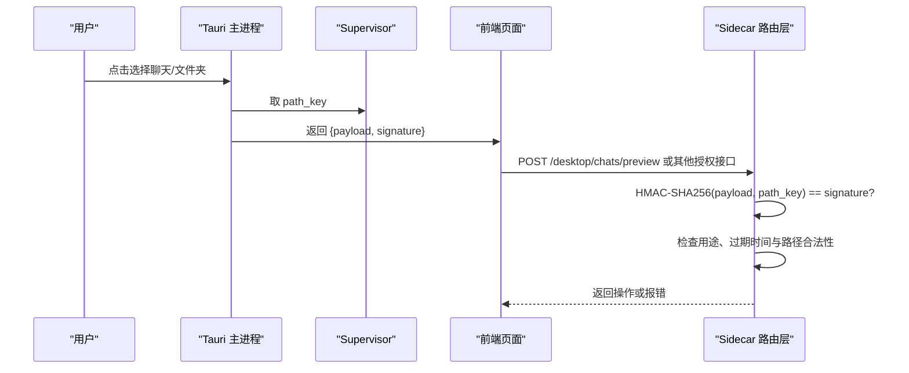
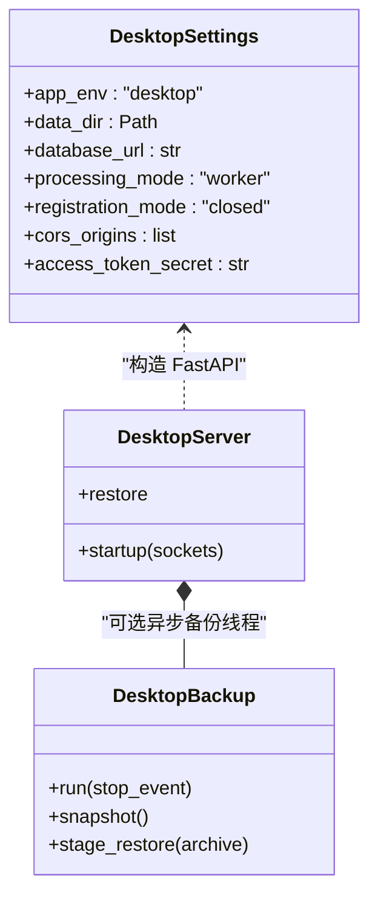
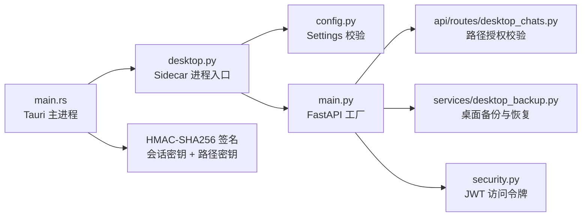

# Tauri 主进程与 Sidecar 管理

<cite>
**本文引用的文件 **
- [main.rs](file://desktop/src-tauri/src/main.rs)
- [tauri.conf.json](file://desktop/src-tauri/tauri.conf.json)
- [build-sidecar.ps1](file://desktop/build-sidecar.ps1)
- [smoke-sidecar.py](file://desktop/smoke-sidecar.py)
- [desktop.py](file://src/personal_ai_life_os/desktop.py)
- [config.py](file://src/personal_ai_life_os/config.py)
- [security.py](file://src/personal_ai_life_os/security.py)
- [main.py](file://src/personal_ai_life_os/main.py)
- [desktop_chats.py](file://src/personal_ai_life_os/api/routes/desktop_chats.py)
- [desktop_backup.py](file://src/personal_ai_life_os/services/desktop_backup.py)
</cite>

## 目录
1. [引言](#引言)
2. [项目结构](#项目结构)
3. [核心组件](#核心组件)
4. [架构总览](#架构总览)
5. [详细组件分析](#详细组件分析)
6. [依赖关系分析](#依赖关系分析)
7. [性能考量](#性能考量)
8. [故障排查指南](#故障排查指南)
9. [结论](#结论)

## 引言
本文聚焦于 Windows 桌面端 Personal AI Life OS 的 Tauri 主进程及其 Sidecar Python 子进程的协作机制。内容覆盖：
- Tauri 主程序生命周期、单实例控制和窗口行为
- Sidecar 子进程的启动、监控与优雅关闭
- 标准输入输出通信、随机密钥生成和路径签名验证
- 桌面运行时初始化、数据目录与调试模式处理、环境变量注入
- 基于 HMAC-SHA256 的本地进程间安全通道协议
- 错误处理策略、日志记录以及关键恢复流程
- 调试技巧和常见问题定位方法

本文同时面向对 Rust、Tauri 和 Python FastAPI 生态熟悉程度不同的读者，通过“从高层到代码层”的方式逐步说明实现细节。

## 项目结构
本项目的桌面端位于 `desktop/`，核心代码分为两层：
- Rust 层：由 Tauri 构建并负责桌面窗口、系统托盘、单实例控制以及与 Sidecar 的生命周期交互。
- Python 层：Sidecar 是打包后的 `lifeos-sidecar.exe`，内部基于 FastAPI/Uvicorn 运行私有 API，并提供数据库迁移、备份、OCR 等能力。

**图表来源 **
- [main.rs:200-300](file://desktop/src-tauri/src/main.rs#L200-L300)
- [desktop.py:85-170](file://src/personal_ai_life_os/desktop.py#L85-L170)
- [desktop_backup.py:1-120](file://src/personal_ai_life_os/services/desktop_backup.py#L1-L120)

**章节来源 **
- [tauri.conf.json:1-29](file://desktop/src-tauri/tauri.conf.json#L1-L29)

## 核心组件
- **Tauri 主进程**：提供 `desktop_runtime`、`desktop_pick_chat`、`desktop_pick_folder`、`desktop_autostart`、`desktop_stop_sidecar` 等命令，并在后台维护一个 `Supervisor` 实例。
- **Sidecar 子进程**：读取主进程写入的标准输入，生成或接收密钥后启动 Uvicorn HTTP Server；绑定回环地址并返回可用端口。
- **路径签名授权**：通过 HMAC-SHA256 在 Rust 侧签名路径凭证，Python 侧再验签，确保只有经过原生对话框选择的合法路径可被读取。
- **桌面配置与服务**：Sidecar 内加载专用 `DesktopSettings`，禁止继承 Web 环境，使用本地数据库、可选 Tesseract OCR 及 Alembic 迁移。

**章节来源 **
- [main.rs:1-60](file://desktop/src-tauri/src/main.rs#L1-L60)
- [desktop.py:1-45](file://src/personal_ai_life_os/desktop.py#L1-L45)

## 架构总览
Tauri 主进程与 Sidecar 通过“标准输入 + 标准输出 + 本地回环端口”形成安全的进程边界。主进程不直接调用业务逻辑，仅完成启动、监控和授权签发；真实数据处理完全发生在 Sidecar 中。

**图表来源 **
- [main.rs:60-140](file://desktop/src-tauri/src/main.rs#L60-L140)
- [desktop.py:45-170](file://src/personal_ai_life_os/desktop.py#L45-L170)

## 详细组件分析

### Tauri 主进程生命周期
Tauri 主程序启动时执行以下流程：
- 启用单实例插件：若已存在旧实例，则将焦点恢复到已有窗口。
- 注册系统托盘菜单：“打开”唤起主窗口，“退出”结束应用。
- 关闭窗口事件拦截：默认阻止直接关闭窗口，改为隐藏任务栏化。
- 初始化 `Supervisor(Mutex<Option<Sidecar>>)`, 用于持有 Sidecar 进程和临时密钥。
- 启动时支持 `--background` 参数：启动后立即隐藏主窗口，适合开机自启场景。
- 应用退出钩子：清理 `Supervisor` 中的 Sidecar 实例，触发资源回收。

**图表来源 **
- [main.rs:240-385](file://desktop/src-tauri/src/main.rs#L240-L385)

**章节来源 **
- [main.rs:240-385](file://desktop/src-tauri/src/main.rs#L240-L385)

### Sidecar 子进程启动、监控与关闭
**启动流程：**
1. 生成 32 字节加密密钥，并使用其十六进制形式作为会话密钥。
2. 另生成 32 字节路径密钥，用于后续 HMAC 签名本地路径访问。
3. 创建或复用用户本地数据目录。
4. 通过 Windows `CREATE_NO_WINDOW` 标志启动不可见 Sidecar 子进程。
5. 将会话密钥与路径密钥写入标准输入。
6. 从标准输出读取一行 JSON，解析出 `port`。
7. 超时保护：最多等待 45 秒；若未就绪则终止子进程并返回错误。
8. 成功后持久化 `Runtime{origin, secret}` 至 `Supervisor`。

**停止策略：**
- 优雅等待：先丢弃 Subprocess 的标准输入句柄，随后循环轮询子进程状态。
- 强制终止：超过 8 秒仍未退出则调用 `kill()` 并等待最终退出状态。
- `Drop` 实现确保 Rust 析构时也能尝试清理子进程。

**图表来源 **
- [main.rs:15-95](file://desktop/src-tauri/src/main.rs#L15-L95)

**章节来源 **
- [main.rs:15-140](file://desktop/src-tauri/src/main.rs#L15-L140)

### 桌面运行时初始化与本地数据目录
当浏览器侧需要连接后端时，会调用 `desktop_runtime`：
- 如果已有活跃 Sidecar，则直接复用；若已退出则重建。
- 发布版本默认从 Tauri 资源目录加载 `sidecar/lifeos-sidecar.exe`。
- 开发模式下优先检查 `dist/lifeos-sidecar/lifeos-sidecar.exe`，便于本地构建测试。
- 本地数据目录默认位于 Tauri 的 `local-data-dir/PersonalAILifeOS`。
- 调试模式可通过环境变量 `LIFEOS_SMOKE_DATA` 指向绝对路径，替代默认数据目录。
- 最终生成的 `origin` 为 `http://127.0.0.1:<port>`，`secret` 为每进程唯一令牌。

**图表来源 **
- [main.rs:205-270](file://desktop/src-tauri/src/main.rs#L205-L270)
- [desktop.py:105-170](file://src/personal_ai_life_os/desktop.py#L105-L170)

**章节来源 **
- [main.rs:205-300](file://desktop/src-tauri/src/main.rs#L205-L300)
- [desktop.py:105-170](file://src/personal_ai_life_os/desktop.py#L105-L170)

### 标准输入输出通信与安全通道建立
主进程与 Sidecar 的握手过程如下：
1. 主进程写入两行：第一行为 64 位十六进制的会话密钥；第二行为 32 字节路径密钥的十六进制字符串。
2. Sidecar 读取这两行，校验密钥格式长度是否符合预期。
3. Sidecar 初始化桌面备份服务、Alembic 数据库迁移、可选 OCR 环境变量。
4. Uvicorn 绑定 `127.0.0.1:0`，由操作系统分配动态端口。
5. Uvicorn 启动完成后打印 JSON `{ port }`，主进程据此确认服务就绪。

安全要点：
- 通信仅限本地回环。
- 每次运行生成新会话密钥，避免跨进程重用。
- URL 中包含端口号，但无法被远程进程主动发现。
- 后续 HTTP 接口还需通过请求头 `X-LifeOS-Desktop` 匹配该会话密钥。

**章节来源 **
- [main.rs:60-120](file://desktop/src-tauri/src/main.rs#L60-L120)
- [desktop.py:45-130](file://src/personal_ai_life_os/desktop.py#L45-L130)

### 路径签名与 HMAC-SHA256 验证
为了防止任意路径被传入 Sidecar，路径授权采用两段式签名方案：
1. **Rust 侧签名**：从当前活跃 `Supervisor` 中取出 `path_key`，对包含文件路径、用途和签发时间的 payload 做 HMAC-SHA256 签名，并将签名与原始 payload 一起传给前端。
2. **Python 侧验签**：路由层接收到带 `payload` 与 `signature` 的请求后，用 Sidecar 初始化的 `desktop_path_key` 再次进行 HMAC-SHA256 比较。
3. **校验范围**：用途必须匹配；签发时间需在 ±120 秒内；路径必须是绝对路径；否则拒绝访问。

**图表来源 **
- [main.rs:200-240](file://desktop/src-tauri/src/main.rs#L200-L240)
- [desktop_chats.py:60-206](file://src/personal_ai_life_os/api/routes/desktop_chats.py#L60-L206)

**章节来源 **
- [main.rs:200-240](file://desktop/src-tauri/src/main.rs#L200-L240)
- [desktop_chats.py:60-206](file://src/personal_ai_life_os/api/routes/desktop_chats.py#L60-L206)

### 桌面后端服务初始化
Sidecar 的 Python 后端在执行初始化时：
- 使用 `DesktopSettings`，明确排除 web `.env` 和云配置，保证桌面侧最小依赖。
- 数据库位置固定为 `<data_dir>/data/lifeos.db`，目录按需创建。
- 使用 Alembic 执行迁移：若检测到迁移差异，先创建带时间戳的 SQLite 预迁快照。
- 若迁移失败，会将预迁快照恢复到 `lifeos.db`。
- Tesseract OCR 优先使用打包附带的 `tesseract.exe`，并向 pytesseract 与进程环境变量注入相关路径。
- CORS 限定为 Tauri 允许的本地 origin，不允许普通浏览器访问。
- Access Token Secret 在服务启动时随机生成，用于 JWT 签发与验证。

**图表来源 **
- [desktop.py:10-44](file://src/personal_ai_life_os/desktop.py#L10-L44)
- [desktop.py:85-170](file://src/personal_ai_life_os/desktop.py#L85-L170)
- [main.py:70-110](file://src/personal_ai_life_os/main.py#L70-L110)

**章节来源 **
- [desktop.py:10-170](file://src/personal_ai_life_os/desktop.py#L10-L170)
- [main.py:50-110](file://src/personal_ai_life_os/main.py#L50-L110)

### 窗口行为与单实例控制
- 单实例控制：当已有实例运行时，新进程通过 Tauri 单实例插件回调通知原窗口。
- “打开”菜单与托盘图标左键单击都会使现有窗口展示、取消最小化并聚焦。
- 窗口关闭按钮不会真正关闭窗口，而是转为隐藏；这支持应用常驻任务栏。
- 通过命令行参数 `--background` 启动时，主窗口会自动隐藏，适合配合系统“启动项”开机运行。

**章节来源 **
- [main.rs:300-385](file://desktop/src-tauri/src/main.rs#L300-L385)

### 自动化启动与通知
- 自动启动通过 Windows 注册表 `HKCU\Software\Microsoft\Windows\CurrentVersion\Run` 写入条目。
- 启用时写入包含当前可执行路径和 `--background` 参数的完整命令。
- 禁用时删除对应条目，忽略“找不到键”的错误。
- 到期提醒通过系统通知模块展示；托盘提示根据当前同步源数量更新。

**章节来源 **
- [main.rs:130-180](file://desktop/src-tauri/src/main.rs#L130-L180)
- [main.rs:290-335](file://desktop/src-tauri/src/main.rs#L290-L335)

### 构建与产物组织
Sidecar 通过 PowerShell 脚本使用 PyInstaller 构建：
- 入口文件：`src/personal_ai_life_os/desktop.py`。
- 名称：`lifeos-sidecar`。
- 打包目标：`desktop/dist/lifeos-sidecar`，产物名 `lifeos-sidecar.exe`。
- 附带迁移脚本、tzdata、pysqlite，以及必要的 Hidden Import。
- 可选附带 Tesseract OCR 二进制与训练数据。
- Tauri 打包时会将打包完成的 sidecar 目录复制到安装包资源 `sidecar/`。

**章节来源 **
- [build-sidecar.ps1:1-27](file://desktop/build-sidecar.ps1#L1-L27)
- [tauri.conf.json:12-29](file://desktop/src-tauri/tauri.conf.json#L12-L29)

## 依赖关系分析
下图说明主进程、Sidecar 以及相关安全与服务模块之间的关系。

**图表来源 **
- [main.rs:15-120](file://desktop/src-tauri/src/main.rs#L15-L120)
- [desktop.py:1-170](file://src/personal_ai_life_os/desktop.py#L1-L170)
- [main.py:50-110](file://src/personal_ai_life_os/main.py#L50-L110)
- [desktop_chats.py:60-206](file://src/personal_ai_life_os/api/routes/desktop_chats.py#L60-L206)
- [desktop_backup.py:1-200](file://src/personal_ai_life_os/services/desktop_backup.py#L1-L200)

**章节来源 **
- [main.rs:1-140](file://desktop/src-tauri/src/main.rs#L1-L140)
- [desktop.py:1-170](file://src/personal_ai_life_os/desktop.py#L1-L170)

## 性能考量
- 侧边进程独立运行，避免 UI 线程被阻塞；主进程只处理进程启动与简单系统交互。
- Sidecar 使用 `h11` HTTP server，并关闭默认 access log，减少 I/O 负载。
- 聊天导入会话使用线程池串行化处理，并通过最大并发与会话过期策略限制内存占用。
- 数据库迁移失败时保留预迁快照，降低损坏风险。
- 大文件预览与导入流程中，路径指纹变化会中断操作，避免长时间扫描变动中的大导出文件。
- 自动化备份每 60 分钟检查一次，必要时压缩归档并删除多余历史备份。

[本节为通用性能说明，未直接分析具体行]

## 故障排查指南

### Sidecar 启动失败
常见现象：
- 主进程报告“Sidecar could not start”。
- 标准输出没有收到就绪 JSON。
- logs/sidecar.log 存在但无有用内容或出现启动异常。

定位建议：
1. 检查 Tauri 资源配置是否正确将打包的 sidecar 目录放入安装资源。
2. 在开发模式确认 `CARGO_MANIFEST_DIR/../dist/lifeos-sidecar/lifeos-sidecar.exe` 是否存在。
3. 查看 smoke 测试用例使用的 stdin/stdout 契约：首行应为 64 位十六进制秘密，第二行为 32 字节路径密钥的十六进制。
4. 确认 Sidecar 日志目录存在并可写。

**章节来源 **
- [main.rs:15-95](file://desktop/src-tauri/src/main.rs#L15-L95)
- [smoke-sidecar.py:60-120](file://desktop/smoke-sidecar.py#L60-L120)

### 端口冲突或服务未就绪
现象：
- 主进程等待 45 秒后仍无端口返回。
- Python 进程已经退出，但没有显式日志。

建议：
- 确认本机未被防火墙或杀毒软件禁止 Sidecar 监听 `127.0.0.1`。
- Sidecar 绑定时使用独占地址选项，因此同一 IP+端口冲突会在绑定阶段失败。
- 使用 smoke 测试脚本快速验证打包产物可读性与接口可用。

**章节来源 **
- [desktop.py:110-170](file://src/personal_ai_life_os/desktop.py#L110-L170)
- [smoke-sidecar.py:60-120](file://desktop/smoke-sidecar.py#L60-L120)

### 路径选择无效或频繁过期
现象：
- Sidecar 返回“需要重新在原生选择器中选择文件”。
- 提示签名无效或路径已变更。

原因与建议：
- 路径授权有有效期约 120 秒。
- 用途必须严格匹配，例如聊天导入、备份还原、不同目录用途。
- 所选文件可能在选中后移动、替换或删除。
- 每次重新选择都会生成新的 payload 和 HMAC 签名。

**章节来源 **
- [desktop_chats.py:160-206](file://src/personal_ai_life_os/api/routes/desktop_chats.py#L160-L206)
- [main.rs:200-240](file://desktop/src-tauri/src/main.rs#L200-L240)

### 备份与恢复问题
现象：
- 备份不可用或自动备份失败。
- 恢复时提示备份格式不支持、体积过大或缺少对象。

诊断步骤：
1. 检查 `backup-settings.json` 指向的外部目录是否仍然存在且可写。
2. 确认归档名称前缀一致、不包含符号链接或不合法相对路径。
3. 检查归档 manifest 是否为受支持的桌面备份格式。
4. 恢复前会执行数据库完整性检查，并清理无关权限与模型同意。
5. 恢复失败会回滚临时 staging 目录。

**章节来源 **
- [desktop_backup.py:1-200](file://src/personal_ai_life_os/services/desktop_backup.py#L1-L200)

### 资源清理异常
现象：
- 主程序退出后仍有残留子进程。
- 磁盘空间被 logs 或临时文件占用。

清理策略：
- 主进程退出钩子会移除 Supervisor 持有的 Sidecar 引用。
- Sidecar Drop 会尝试优雅退出并在超时时终止子进程。
- 日志按大小滚动，保留最近 3 份日志。
- 打包备份默认保留最新若干份历史归档。

**章节来源 **
- [main.rs:80-120](file://desktop/src-tauri/src/main.rs#L80-L120)
- [desktop.py:90-140](file://src/personal_ai_life_os/desktop.py#L90-L140)
- [desktop_backup.py:100-200](file://src/personal_ai_life_os/services/desktop_backup.py#L100-L200)

## 结论
该 Tauri 桌面应用采用清晰的主进程 — Sidecar 分层架构：主进程专注用户体验、系统集成本地与 Sidecar 生命周期管理；Sidecar 负责所有业务数据、迁移、搜索、导入、备份和安全接口。通信层通过进程边界、回环网络、会话密钥与 HMAC 路径签名构成多层次防御，既满足安全需求，又方便本地开发调试。

实践中最重要的调试抓手包括：
- 统一使用标准输入输出契约测试 Sidecar。
- 利用 `LIFEOS_SMOKE_DATA` 隔离本地调试数据。
- 借助 smoke 测试脚本验证端到端可用性。
- 始终关注 logs/sidecar.log 与本地数据目录状态，避免路径或备份目录权限问题掩盖真正的业务错误。