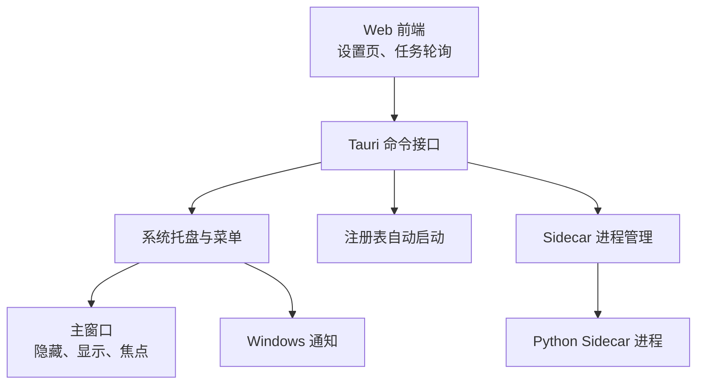
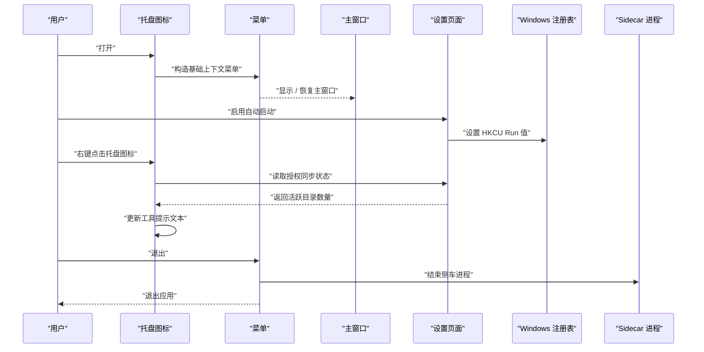
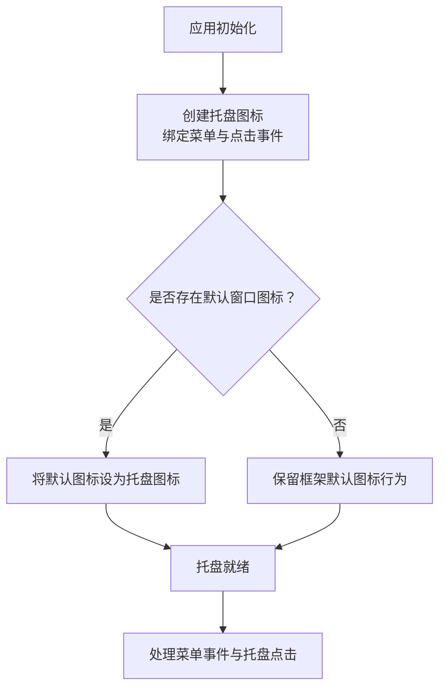
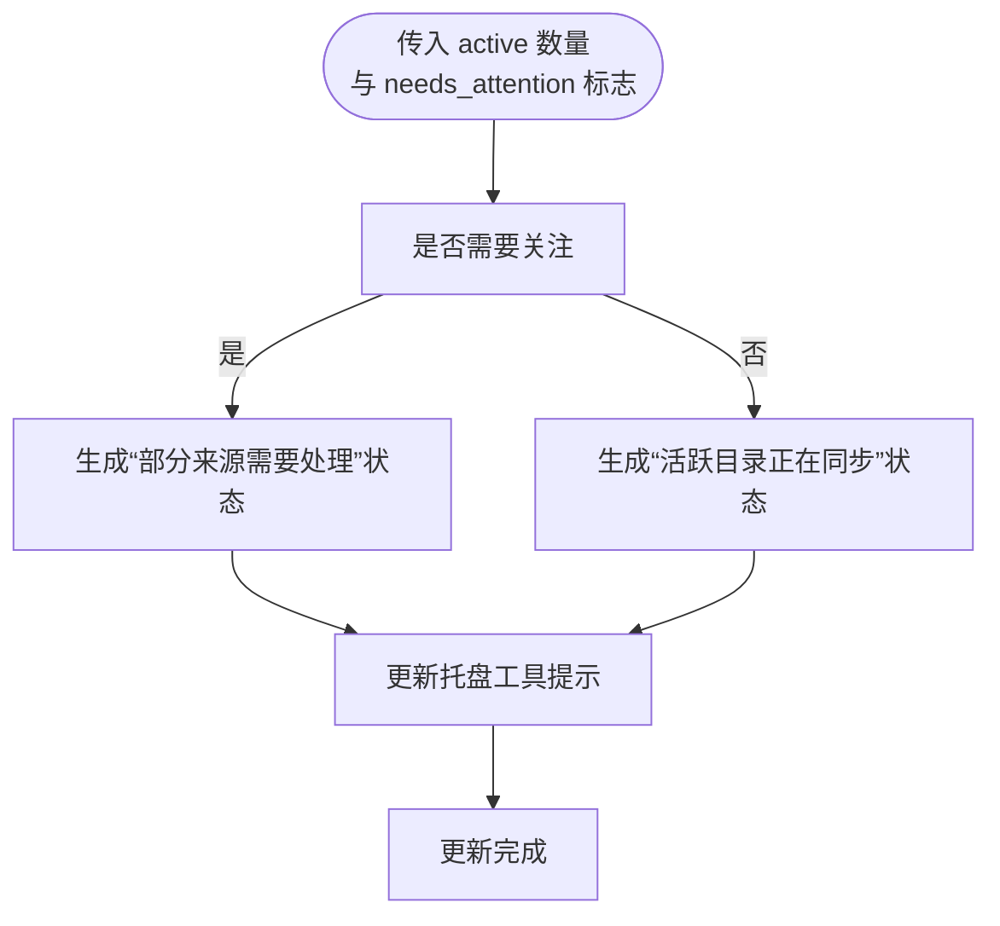
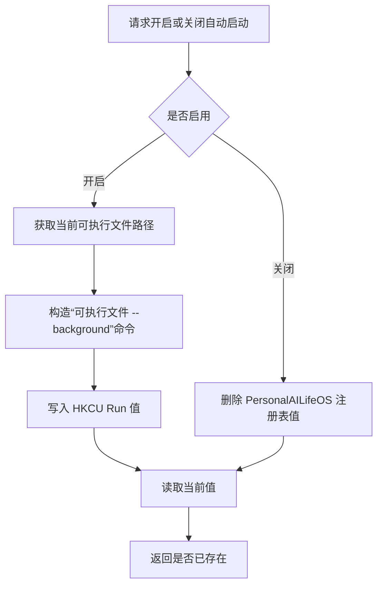
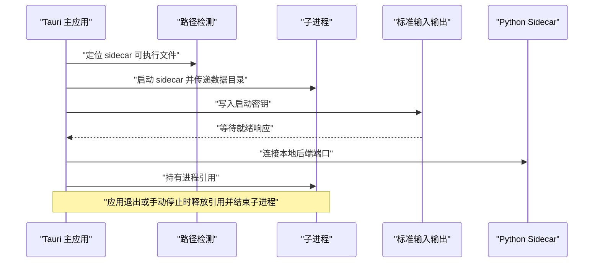
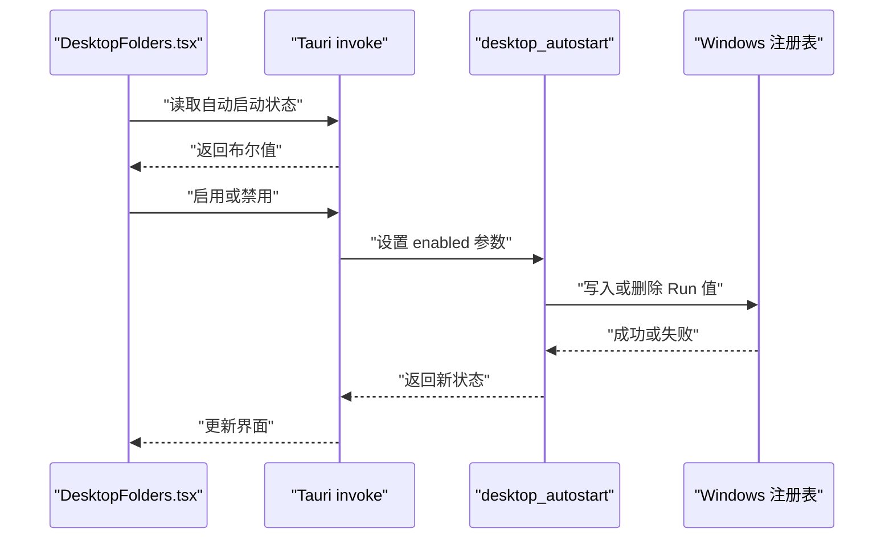
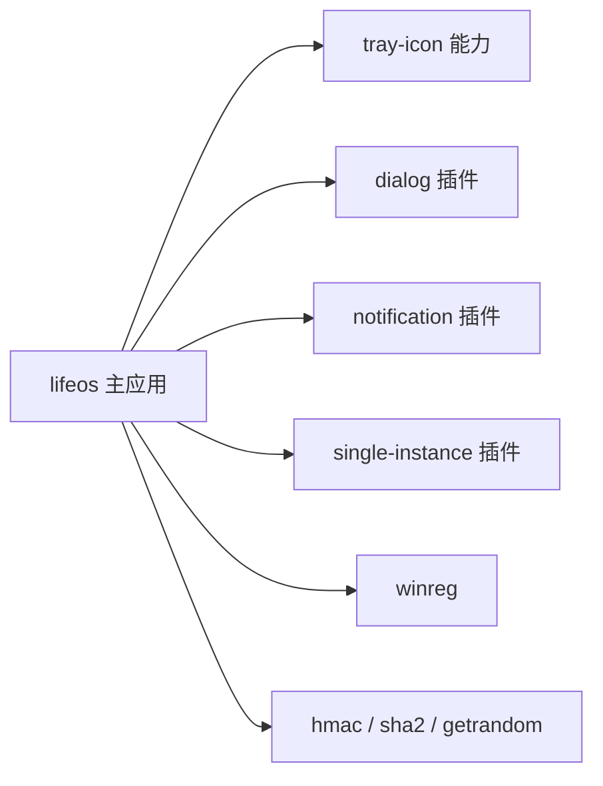

# 系统托盘与自动启动

<cite>
**本文引用的文件**
- [desktop/src-tauri/src/main.rs](file://desktop/src-tauri/src/main.rs)
- [desktop/src-tauri/Cargo.toml](file://desktop/src-tauri/Cargo.toml)
- [src/personal_ai_life_os/desktop.py](file://src/personal_ai_life_os/desktop.py)
- [web/src/DesktopFolders.tsx](file://web/src/DesktopFolders.tsx)
- [web/src/App.tsx](file://web/src/App.tsx)
- [tests/test_desktop_mvp.py](file://tests/test_desktop_mvp.py)
- [docs/operations/desktop-acceptance.md](file://docs/operations/desktop-acceptance.md)
</cite>

## 目录
1. [引言](#引言)
2. [项目结构](#项目结构)
3. [核心组件](#核心组件)
4. [架构总览](#架构总览)
5. [详细组件分析](#详细组件分析)
6. [依赖分析](#依赖分析)
7. [性能考虑](#性能考虑)
8. [故障排除指南](#故障排除指南)
9. [结论](#结论)

## 引言
本文聚焦 Windows 桌面应用的系统托盘集成与自动启动能力。项目采用 Tauri 构建原生桌面外壳，托盘图标、上下文菜单和主窗口控制由 Rust 实现；通过 Tauri 命令暴露给前端界面使用。Windows 注册表的自动启动项写入同样在 Rust 中完成，并通过 --background 参数区分后台模式。Python 侧提供 sidecar 进程管理，负责启动本地后端服务，但不直接维护托盘或注册表项。

## 项目结构
与托盘和自动启动相关的主要代码分布在以下位置：
- Rust 原生层（Tauri）：托盘、菜单、窗口控制、注册表自动启动、通知、sidecar 启动与资源清理。
- Python sidecar：封装本地后端服务、端口发现、日志和优雅退出，但不操作系统托盘。
- 前端界面：提供自动启动开关，调用 Tauri 命令更新注册表，并根据状态刷新托盘工具提示。

图示来源
- [desktop/src-tauri/src/main.rs:201-385](file://desktop/src-tauri/src/main.rs#L201-L385)

章节来源
- [desktop/src-tauri/src/main.rs:1-385](file://desktop/src-tauri/src/main.rs#L1-L385)
- [src/personal_ai_life_os/desktop.py:1-178](file://src/personal_ai_life_os/desktop.py#L1-L178)

## 核心组件
- 托盘管理器：创建应用托盘图标、上下文菜单、左键单击行为，以及基于应用状态更新的工具提示文本。
- 自动启动管理器：通过 HKCU Run 键添加、删除当前用户登录时启动的应用程序项。
- 侧车进程监管器：启动 Python sidecar、获取本地后端地址、监控子进程生命周期并在主程序退出时释放资源。
- 前端的自动启动开关：读取并更新 Windows 启动项状态。
- 通知与窗口控制：到期提醒触发原生通知，主窗口支持最小化到托盘及重新显示。

章节来源
- [desktop/src-tauri/src/main.rs:201-385](file://desktop/src-tauri/src/main.rs#L201-L385)
- [web/src/DesktopFolders.tsx:23-56](file://web/src/DesktopFolders.tsx#L23-L56)

## 架构总览
系统托盘与自动启动的交互流程可概括为：
- 托盘图标常驻系统托盘区，默认展示品牌名称和静态工具提示。
- 业务逻辑根据授权同步状态向托盘发送动态文本与工具提示。
- 自动启动开关通过 Tauri 命令读写当前用户的 Run 注册表项，并为后续开机启动附加 --background。
- 启动入口检查 --background，若是后台模式则隐藏主窗口。
- Python sidecar 作为本地后端服务被托管运行，前端与其通信；托盘不直接访问它。

图示来源
- [desktop/src-tauri/src/main.rs:201-385](file://desktop/src-tauri/src/main.rs#L201-L385)
- [web/src/App.tsx:364-399](file://web/src/App.tsx#L364-L399)
- [src/personal_ai_life_os/desktop.py:1-178](file://src/personal_ai_life_os/desktop.py#L1-L178)

## 详细组件分析

### Windows 系统托盘集成
托盘实现位于 Tauri 主进程中。主要职责包括：
- 以固定 ID 创建托盘图标。
- 绑定带有“打开”和“退出”两个动作的菜单。
- 监听托盘图标左键抬起事件以唤醒主窗口。
- 监听关闭请求事件以避免直接退出主进程，改为隐藏主窗口。
- 从应用配置获取默认图标，若失败则继续使用框架默认行为。
- 接收来自业务层的托盘状态命令，更新工具提示中的动态文案。

托盘菜单是基础且固定的：没有按权限或来源类型切换的可见性，也没有高级设置菜单。这使托盘体验简洁一致，但也意味着所有扩展能力都需要通过 Tauri 命令或其他方式新增。

图示来源
- [desktop/src-tauri/src/main.rs:311-385](file://desktop/src-tauri/src/main.rs#L311-L385)

章节来源
- [desktop/src-tauri/src/main.rs:201-385](file://desktop/src-tauri/src/main.rs#L201-L385)

### 右键菜单与用户交互事件
当前托盘右键菜单包含两个选项：
- “打开 Personal AI Life OS”：显示、还原并聚焦已存在的主窗口。
- “退出”：终止应用。该路径会停止托盘菜单事件循环，最终进入应用退出流程，并释放侧车进程。

左侧按钮单击也会触发相同显示主窗口的逻辑，适合用户直接从系统图标区域唤起应用。

注意事项：
- 托盘只响应基础事件，未实现复杂的多级菜单、带校验的管理菜单或来源特定选项。
- 托盘状态更新通过专用命令进行，而不是直接在每个窗口事件中修改。

章节来源
- [desktop/src-tauri/src/main.rs:311-361](file://desktop/src-tauri/src/main.rs#L311-L361)

### 托盘状态与动态文本更新
托盘的工具提示文本根据调用 `desktop_tray_status` 时传入的活跃目录数量和是否需要关注标志进行变更。文案逻辑如下：
- 需要关注：展示部分来源待处理的状态提示。
- 无需关注：显示活跃授权目录数量，并提示正在同步。
- 如果无法找到托盘实例，该命令直接忽略，不会抛出错误。

前端侧在轮询任务结果或来源状态后调用该命令。由于文案是中文硬编码字符串，目前不具备多语言机制。

图示来源
- [desktop/src-tauri/src/main.rs:335-349](file://desktop/src-tauri/src/main.rs#L335-L349)

章节来源
- [desktop/src-tauri/src/main.rs:335-349](file://desktop/src-tauri/src/main.rs#L335-L349)
- [web/src/App.tsx:364-399](file://web/src/App.tsx#L364-L399)

### 自动启动与注册表管理
自动启用的核心逻辑通过 Tauri 命令暴露：
- 目标注册表路径：HKCU\Software\Microsoft\Windows\CurrentVersion\Run。
- 注册项名：PersonalAILifeOS。
- 开启时：写入当前可执行文件的绝对路径，并附带 --background 参数。
- 关闭时：删除对应注册表值，找不到值被视为成功。
- 查询时：判断是否存在该项值。

这是当前用户范围内的设置，不需要管理员权限即可读写当前用户的 HKCU 分支。

图示来源
- [desktop/src-tauri/src/main.rs:138-176](file://desktop/src-tauri/src/main.rs#L138-L176)

章节来源
- [desktop/src-tauri/src/main.rs:138-176](file://desktop/src-tauri/src/main.rs#L138-L176)

### --background 参数与主窗口行为
Rust 主应用在初始化托盘和菜单后检查命令行参数：
- 如果检测到 --background，则尝试查找名为 main 的 WebView 窗口并隐藏它。
- 这样用户在无交互场景下可以仅启动托盘和后台服务，而不显示主界面。

注意：当前启动逻辑并不会显式解析该参数来决定完全隐藏托盘本身；其作用主要是避免主窗口在前台显示。

章节来源
- [desktop/src-tauri/src/main.rs:361-385](file://desktop/src-tauri/src/main.rs#L361-L385)

### Windows 通知与到期提醒
托盘侧提供 `desktop_notify_due` 命令，用于展示 Windows 原生通知。当有到期提醒时，消息标题固定为应用名，内容中包含到期提醒数量。文案是中文硬编码；若计数为零，则直接跳过发送通知。

章节来源
- [desktop/src-tauri/src/main.rs:351-358](file://desktop/src-tauri/src/main.rs#L351-L358)

### 侧车进程与资源清理
托盘应用不是后端服务本身，而是启动并管理 Python sidecar 的原生外壳：
- 使用固定 id 的 Supervisor 保存可选的 sidecar 进程。
- 首次调用运行时命令时会查找打包后的 lifeos-sidecar.exe，或在调试模式下回退到开发目录。
- 为 sidecar 创建用户数据目录，向其标准输入注入随机密钥。
- 等待 sidecar 输出就绪 JSON，其中包含本地服务端口。
- 主窗口关闭时使用 CloseRequested 拦截关闭请求并隐藏窗口。
- 收到应用 Exit 事件时释放侧车进程引用，触发 drop 逻辑中止子进程。
- stop 命令允许直接丢弃 supervisor 中的进程记录，让 sidecar 在外部结束或随会话结束而退出。

图示来源
- [desktop/src-tauri/src/main.rs:1-137](file://desktop/src-tauri/src/main.rs#L1-L137)
- [desktop/src-tauri/src/main.rs:201-334](file://desktop/src-tauri/src/main.rs#L201-L334)
- [src/personal_ai_life_os/desktop.py:1-178](file://src/personal_ai_life_os/desktop.py#L1-L178)

章节来源
- [desktop/src-tauri/src/main.rs:1-176](file://desktop/src-tauri/src/main.rs#L1-L176)
- [desktop/src-tauri/src/main.rs:201-334](file://desktop/src-tauri/src/main.rs#L201-L334)
- [src/personal_ai_life_os/desktop.py:1-178](file://src/personal_ai_life_os/desktop.py#L1-L178)

### 前端自动启动开关
前端在来源设置页面中加载当前自动启动状态，并在用户切换复选框时调用 desktop_autostart 命令更新注册表。启用成功后刷新状态；出错时捕获错误信息并显示。

图示来源
- [web/src/DesktopFolders.tsx:23-56](file://web/src/DesktopFolders.tsx#L23-L56)
- [desktop/src-tauri/src/main.rs:138-176](file://desktop/src-tauri/src/main.rs#L138-L176)

章节来源
- [web/src/DesktopFolders.tsx:23-56](file://web/src/DesktopFolders.tsx#L23-L56)

## 依赖分析
Tauri 原生层需要以下关键依赖来支持托盘、弹窗、通知、单实例、注册表和哈希算法：
- tauri：托盘图标、菜单、窗口管理。
- tauri-plugin-dialog、tauri-plugin-notification、tauri-plugin-single-instance：原生对话框、通知与单实例行为。
- winreg：HKCU 注册表读写。
- hmac/sha2/getrandom：路径授权签名和随机密钥。

图示来源
- [desktop/src-tauri/Cargo.toml:9-19](file://desktop/src-tauri/Cargo.toml#L9-L19)

章节来源
- [desktop/src-tauri/Cargo.toml:9-19](file://desktop/src-tauri/Cargo.toml#L9-L19)

## 性能考虑
- 托盘图标与菜单由操作系统和原生窗口库管理，开销极低，不应频繁重建，只需更新 tooltip。
- 自动启动写注册表属于低频操作，通常在用户确认开关时发生。
- sidecar 启动过程中读取 stdout、等待就绪、复制剩余日志并限制超时；长时间无法就绪会中止子进程。
- 通知和托盘状态更新只是轻量 UI 回调，但应避免在高频轮询中反复调用，以免触发过多 GDI/DPI 重绘。
- 关闭窗口行为使用 hide 而非销毁，减少重复创建窗口的代价，同时保持后台进程继续运行。

[本节为通用指导，不直接分析具体文件]

## 故障排除指南

### 托盘图标不显示
可能原因与处理步骤：
- 系统托盘区域被折叠或未显示：在任务栏设置中启用系统托盘或通知区域可见。
- 默认窗口图标不可用：Rust 会在图标缺失时保留框架默认行为，因此托盘可能仍然出现但没有自定义图标。
- 应用以受限会话启动：确保不是被某些沙箱或终端管理服务限制了托盘创建。
- 多显示器或高 DPI：验收文档覆盖过 150% DPI 行为；必要时重启应用刷新托盘缓存。

验证方法：
- 查看托盘是否有“Personal AI Life OS”图标。
- 右键点击托盘图标，若菜单出现则说明原生托盘已正确创建。

章节来源
- [docs/operations/desktop-acceptance.md](file://docs/operations/desktop-acceptance.md)

### 菜单无响应或点击无效
可能原因与处理步骤：
- 菜单事件绑定了 open 和 quit；其他未知 id 会被忽略。
- 多次实例问题已被 single-instance 插件处理；第二实例应聚焦原窗口。
- 主窗口被隐藏：托盘左键点击或菜单“打开”都应唤醒窗口。

操作步骤：
- 尝试左键单击托盘图标唤出窗口。
- 通过菜单“退出”重新完整启动应用。
- 检查任务管理器中是否存在残留窗口句柄或僵尸进程；如存在，重新启动应用。

章节来源
- [desktop/src-tauri/src/main.rs:311-385](file://desktop/src-tauri/src/main.rs#L311-L385)
- [tests/test_desktop_mvp.py](file://tests/test_desktop_mvp.py)

### 注册表写入失败
可能原因与处理步骤：
- 虽然 HKCU 通常不需要管理员权限，但仍可能因账户策略、注册表权限损坏或被安全软件拦截而失败。
- 值名 PersonalAILifeOS 可能被其他软件占用。
- 应用路径包含空格时，实现会以引号包裹命令字符串，符合 Windows Run 键规范。

解决方式：
- 使用同一账户重新尝试自动启动开关。
- 检查 HKCU\Software\Microsoft\Windows\CurrentVersion\Run 下是否存在异常项。
- 临时关闭第三方安全软件或注册表保护工具后重试。
- 若只需临时禁用开机自启，可在注册表中删除 PersonalAILifeOS 值。

章节来源
- [desktop/src-tauri/src/main.rs:138-176](file://desktop/src-tauri/src/main.rs#L138-L176)

### 托盘工具提示不更新
可能原因与处理步骤：
- 业务逻辑没有调用 desktop_tray_status，或传入了无效状态。
- 托盘对象尚未构建成功时就调用更新。
- 多语言界面需要硬编码字符串扩展；当前文案不支持国际化。

诊断建议：
- 检查前端是否在获取来源状态后调用托盘状态命令。
- 观察窗口是否处于正常可用状态。
- 如需多语言，应将“活跃目录正在同步”“部分来源需要处理”等中文文案迁移到 i18n 资源，并在 Rust 侧接收语言标识。

章节来源
- [desktop/src-tauri/src/main.rs:335-349](file://desktop/src-tauri/src/main.rs#L335-L349)
- [web/src/App.tsx:364-399](file://web/src/App.tsx#L364-L399)

### 自动启动不生效或开机仍显示主窗口
可能原因与处理步骤：
- Run 值未包含 --background 参数，导致系统登录后前台启动窗口。
- 当前实现的值是完整命令字符串，包含应用路径和 --background。
- 用户手动删改 Run 值可能导致行为不一致。

修复步骤：
- 在应用内关闭再重新启用自动启动。
- 检查 HKCU\Software\Microsoft\Windows\CurrentVersion\Run 中 PersonalAILifeOS 的值是否为带参数的完整路径。
- 若只希望静默启动，保留 --background；若希望用户看到主界面，移除该参数（需要明确的业务决策）。

章节来源
- [desktop/src-tauri/src/main.rs:138-176](file://desktop/src-tauri/src/main.rs#L138-L176)
- [docs/operations/desktop-acceptance.md](file://docs/operations/desktop-acceptance.md)

### UAC 权限与管理员权限检测
现有自动启动逻辑面向 HKCU，理论上不需要管理员权限。但是，如果未来功能扩展到 HKLM 或其他受保护路径，则需要：
- 启动时检测是否以管理员身份运行。
- 对需要提升权限的操作弹出 UAC 提权请求。
- 对非管理员用户降级可用功能，例如只允许当前用户自动启动。

当前仓库中并未在托盘或自动启动模块中直接实现 UAC 检测，该部分属于增强建议而非既有实现。

[本节为扩展建议，不直接分析具体文件]

### 资源清理与后台进程残留
常见问题：
- 侧车进程未随主进程退出。
- Windows 注销或强制结束时 sidecar 未优雅退出。

现状说明：
- Rust 侧在 Exit 事件中释放 sidecar 引用，drop 实现会尝试终止子进程。
- sidecar 标准输入被关闭后会退出服务；日志目录为 logs/sidecar.log。
- 验收文档记录了托盘退出后两个进程均结束的测试路径。

建议措施：
- 先调用桌面提供的停止侧车命令再退出应用。
- 若仍有残留，在任务管理器中检查 lifeos-sidecar.exe，避免误杀同名外部进程。
- 检查 logs/sidecar.log 确定 sidecar 是否正常输出就绪信息和异常堆栈。

章节来源
- [desktop/src-tauri/src/main.rs:1-176](file://desktop/src-tauri/src/main.rs#L1-L176)
- [src/personal_ai_life_os/desktop.py:1-178](file://src/personal_ai_life_os/desktop.py#L1-L178)
- [docs/operations/desktop-acceptance.md](file://docs/operations/desktop-acceptance.md)

## 结论
该项目实现了稳定且简洁的 Windows 托盘与自动启动能力：
- 托盘提供基础图标、菜单、左键唤醒主窗口和动态工具提示。
- 自动启用在当前用户注册表中进行，并以 --background 支持后台模式。
- Python sidecar 专注本地后端服务生命周期，与原生托盘解耦。
- 当前设计偏向保守：没有多级菜单、没有来源特定菜单项，也没有多语言托盘文案或 UAC 检测。
- 若需要更丰富的系统托盘体验，应在保持当前 API 稳定的基础上扩展托盘命令、菜单能力和本地化资源。

[本节为总结，不直接分析具体文件]