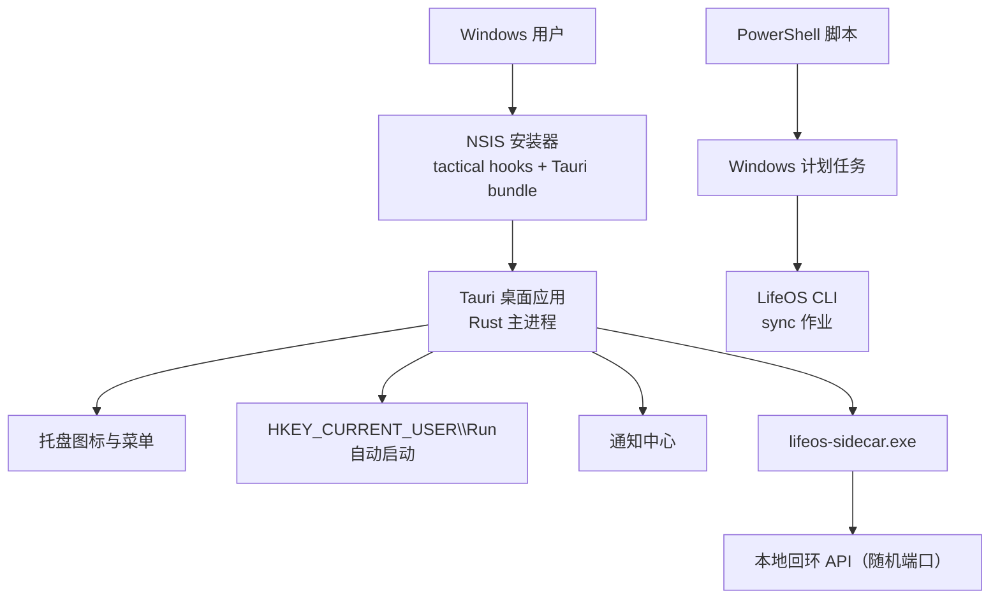
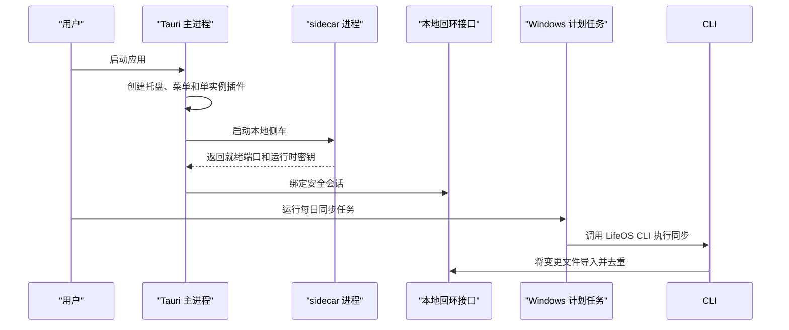
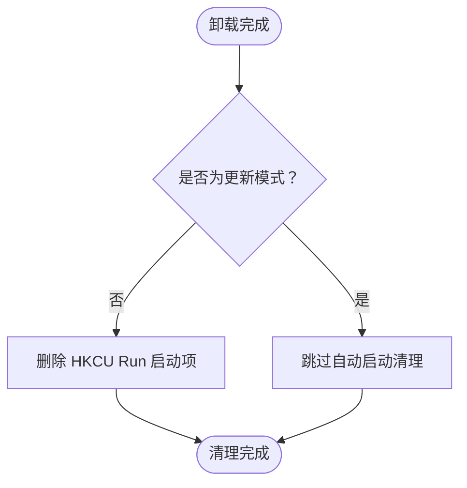
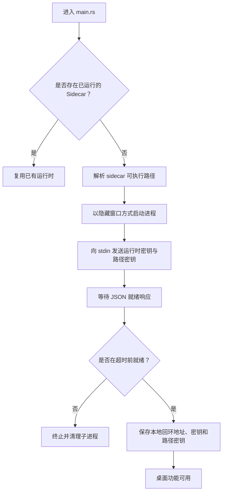
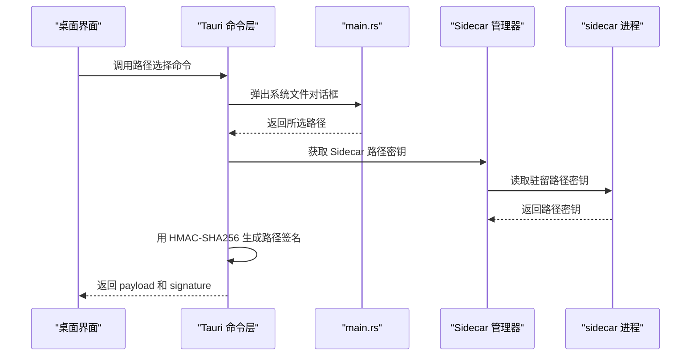
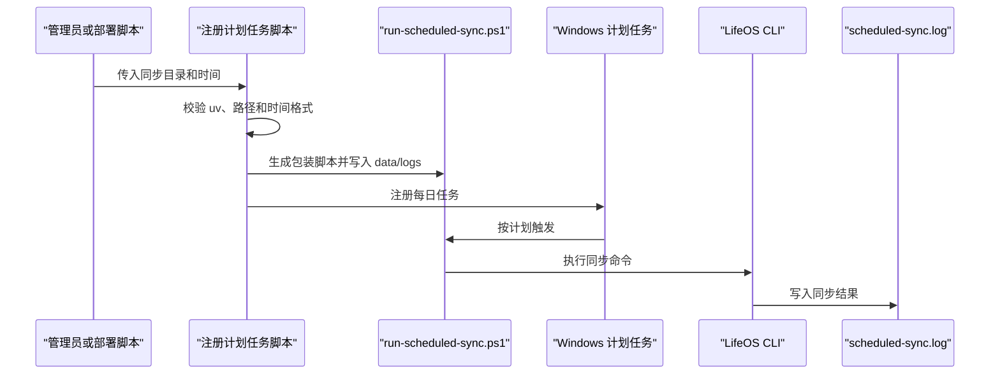
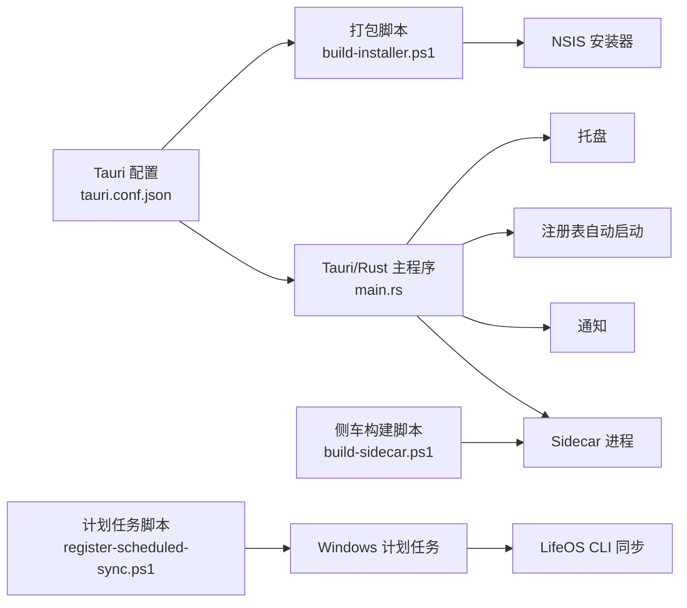

# 系统集成能力

<cite>
**本文引用的文件**   
- [desktop/src-tauri/installer-hooks.nsh](file://desktop/src-tauri/installer-hooks.nsh)
- [desktop/build-installer.ps1](file://desktop/build-installer.ps1)
- [desktop/build-sidecar.ps1](file://desktop/build-sidecar.ps1)
- [desktop/src-tauri/tauri.conf.json](file://desktop/src-tauri/tauri.conf.json)
- [desktop/src-tauri/src/main.rs](file://desktop/src-tauri/src/main.rs)
- [scripts/register-scheduled-sync.ps1](file://scripts/register-scheduled-sync.ps1)
- [docs/architecture/privacy.md](file://docs/architecture/privacy.md)
</cite>

## 目录
1. [引言](#引言)
2. [项目结构](#项目结构)
3. [核心系统集成功能](#核心系统集成功能)
4. [架构总览](#架构总览)
5. [详细组件分析](#详细组件分析)
6. [权限与安全模型](#权限与安全模型)
7. [依赖关系分析](#依赖关系分析)
8. [性能与资源特性](#性能与资源特性)
9. [故障排除指南](#故障排除指南)
10. [结论](#结论)

## 引言
本文面向 Windows 桌面端，系统性梳理 Personal AI Life OS 的系统集成能力。内容覆盖：
- Tauri/Rust 托盘、自动启动注册、通知和窗口行为；
- NSIS 安装器钩子中的卸载清理逻辑；
- PowerShell 计划任务脚本提供的定时同步；
- Sidecar 后台进程的生命周期管理；
- 用户选择路径时的签名授权机制；
- 隐私策略、权限最小化和审计边界；
- Windows Shell 交互现状、已有能力以及未来可扩展点。

## 项目结构
Windows 系统集成相关代码分布在以下几层：
- Rust 前端宿主：托盘图标、菜单、自动启动注册、通知、Sidecar 生命周期。
- 安装器配置与钩子：NSIS 构建产物中写入安装器参数及卸载时清理。
- PowerShell 脚本：打包 Tauri 安装包、打包 Python Sidecar、注册计划任务。
- 业务文档：隐私策略定义数据收集、存储、外部调用和删除的边界。

**图表来源**
- [desktop/src-tauri/tauri.conf.json:1-29](file://desktop/src-tauri/tauri.conf.json#L1-L29)
- [desktop/src-tauri/src/main.rs:183-385](file://desktop/src-tauri/src/main.rs#L183-L385)
- [desktop/src-tauri/installer-hooks.nsh:1-5](file://desktop/src-tauri/installer-hooks.nsh#L1-L5)
- [scripts/register-scheduled-sync.ps1:1-96](file://scripts/register-scheduled-sync.ps1#L1-L96)

**章节来源**
- [desktop/src-tauri/tauri.conf.json:1-29](file://desktop/src-tauri/tauri.conf.json#L1-L29)
- [desktop/build-installer.ps1:1-18](file://desktop/build-installer.ps1#L1-L18)
- [desktop/build-sidecar.ps1:1-27](file://desktop/build-sidecar.ps1#L1-L27)
- [desktop/src-tauri/src/main.rs:1-385](file://desktop/src-tauri/src/main.rs#L1-L385)
- [desktop/src-tauri/installer-hooks.nsh:1-5](file://desktop/src-tauri/installer-hooks.nsh#L1-L5)
- [scripts/register-scheduled-sync.ps1:1-96](file://scripts/register-scheduled-sync.ps1#L1-L96)

## 核心系统集成功能
### 系统托盘图标管理
- 托盘通过固定标识创建，支持提示文本动态更新。
- 左键点击托盘图标会显示主窗口。
- 托盘菜单提供“打开”和“退出”操作。
- 应用关闭主窗口时不会退出，而是隐藏到托盘。

当前托盘仅用于状态展示与基础操作，未包含高级右键菜单扩展。

**章节来源**
- [desktop/src-tauri/src/main.rs:315-385](file://desktop/src-tauri/src/main.rs#L315-L385)

### 自动启动注册
- 通过 HKEY_CURRENT_USER 下的 Run 子项完成自动启动设置。
- 启用时在注册表写入命令行，并在启动参数中包含后台标志。
- 禁用时删除对应键值。
- 读取该键值可判断当前是否已开启自动启动。

自动启动使用当前用户上下文注册，不涉及管理员注册表范围，因此默认不需要提升权限。

**章节来源**
- [desktop/src-tauri/src/main.rs:104-168](file://desktop/src-tauri/src/main.rs#L104-L168)

### 通知中心集成
- 当存在到期提醒时，通过平台原生通知 API 发送通知。
- 通知标题为产品名，正文包含待处理提醒数量。
- 无待处理提醒时不触发通知。

通知只展示摘要信息，不直接暴露内部敏感路径或原始聊天内容。

**章节来源**
- [desktop/src-tauri/src/main.rs:298-313](file://desktop/src-tauri/src/main.rs#L298-L313)

### 应用关联与文件协议
- 当前实现未发现 `.json`、`.jsonl`、`.zip` 等应用关联、URL 协议注册、全局 Shell 右键菜单扩展或 Windows Search 索引注册的代码。
- 文件选择采用应用内对话框，并根据用途附加文件名后缀过滤器。
- 如需扩展应用关联或协议注册，建议在 Tauri 配置、NSIS 安装逻辑和 Windows Shell 注册表中增加相关目标。

本节为现状评估，不代表禁止后续扩展。

**章节来源**
- [desktop/src-tauri/src/main.rs:169-238](file://desktop/src-tauri/src/main.rs#L169-L238)
- [desktop/src-tauri/tauri.conf.json:1-29](file://desktop/src-tauri/tauri.conf.json#L1-L29)

## 架构总览
桌面端的系统集成围绕四个子系统协同：
1. **Tauri 主进程**：负责界面消息、托盘、注册表、通知和 Sidecar 管理。
2. **Sidecar 后端**：一个独立的本地服务，监听本机回环地址上的随机端口。
3. **安装器与打包工具链**：使用 Tauri、NSIS、PyInstaller 生成可分发包。
4. **PowerShell 自动化脚本**：负责侧车构建、OCR 依赖、计划任务注册和注销。

**图表来源**
- [desktop/src-tauri/src/main.rs:190-285](file://desktop/src-tauri/src/main.rs#L190-L285)
- [desktop/src-tauri/src/main.rs:333-385](file://desktop/src-tauri/src/main.rs#L333-L385)
- [scripts/register-scheduled-sync.ps1:21-96](file://scripts/register-scheduled-sync.ps1#L21-L96)

## 详细组件分析

### NSIS 安装器钩子与打包
#### 卸载清理
- 安装器在卸载后宏中检查更新模式。
- 非更新卸载时会删除当前用户的自动启动注册表键值。
- 更新模式下保留现有自动启动设置。

该钩子是卸载阶段的最小化清理动作之一，避免残留的开机启动项。

**图表来源**
- [desktop/src-tauri/installer-hooks.nsh:1-5](file://desktop/src-tauri/installer-hooks.nsh#L1-L5)

**章节来源**
- [desktop/src-tauri/installer-hooks.nsh:1-5](file://desktop/src-tauri/installer-hooks.nsh#L1-L5)
- [desktop/src-tauri/tauri.conf.json:20-29](file://desktop/src-tauri/tauri.conf.json#L20-L29)

#### 安装包构建流程
- `build-installer.ps1` 校验 Tauri 环境并运行 OCR 准备脚本与侧车打包脚本。
- 随后调用 Tauri 构建 NSIS 安装包。
- 构建失败会立即抛出错误，便于持续集成发现打包问题。

**章节来源**
- [desktop/build-installer.ps1:1-18](file://desktop/build-installer.ps1#L1-L18)

### Sidecar 打包与本地服务
- `build-sidecar.ps1` 使用 PyInstaller 打包 Python 入口模块。
- 可配置是否复制 Tesseract OCR 资源到打包输出目录。
- 打包命令显式包含迁移数据和部分数据库驱动、JSON 解析后端依赖。
- 主进程以“隐藏控制台”方式启动 sidecar，并将日志重定向或丢弃到约定位置。
- Sidecar 必须在规定超时内报告本地端口，否则主进程终止该子进程。

**图表来源**
- [desktop/src-tauri/src/main.rs:190-285](file://desktop/src-tauri/src/main.rs#L190-L285)

**章节来源**
- [desktop/build-sidecar.ps1:1-27](file://desktop/build-sidecar.ps1#L1-L27)
- [desktop/src-tauri/src/main.rs:190-285](file://desktop/src-tauri/src/main.rs#L190-L285)

### 路径选择与签名授权
用户对文件路径的选择由应用内部对话框发起，再由 Rust 层生成临时授权凭证：
- 对话框根据用途设置标题和过滤器，例如聊天导出、备份、Markdown、Obsidian Vault、导出目录等。
- 授权凭证包含目标路径、用途和签发时间。
- 签名使用当前 Sidecar 进程派生出的路径密钥进行 HMAC-SHA256 计算。
- 只有仍在内存中运行的 Sidecar 才能为路径签名，防止任意进程伪造访问令牌。

**图表来源**
- [desktop/src-tauri/src/main.rs:169-238](file://desktop/src-tauri/src/main.rs#L169-L238)
- [desktop/src-tauri/src/main.rs:240-285](file://desktop/src-tauri/src/main.rs#L240-L285)

**章节来源**
- [desktop/src-tauri/src/main.rs:169-285](file://desktop/src-tauri/src/main.rs#L169-L285)

### 计划任务调度脚本
`register-scheduled-sync.ps1` 为目录同步提供 Windows 计划任务管理能力：
- 支持注册、模拟执行和移除计划任务。
- 要求 PATH 中存在 `uv`，并使用其调起项目的 LifeOS CLI。
- 对输入路径做严格验证，要求目录存在。
- 时间参数需符合 24 小时格式。
- 脚本生成一个包装脚本，将 CLI 同步命令的输出追加到 `data/logs/scheduled-sync.log`。
- 计划任务每日指定时间运行，允许低电量模式下执行。
- 通过 `-WhatIf` 可预览注册而不实际写入。

**图表来源**
- [scripts/register-scheduled-sync.ps1:1-96](file://scripts/register-scheduled-sync.ps1#L1-L96)

**章节来源**
- [scripts/register-scheduled-sync.ps1:1-96](file://scripts/register-scheduled-sync.ps1#L1-L96)

## 权限与安全模型

### 管理员权限请求流程
当前代码未实现主动 UAC 提升对话框或交互式权限降级流程：
- 自动启动注册只操作 HKEY_CURRENT_USER，通常不需要管理员权限。
- 主进程默认以当前用户身份运行；托盘和窗口行为也不涉及提权。
- 若未来需要修改受保护的系统范围配置，应引入明确的提权入口和降级策略，而不是静默提升。

建议新增的权限模型应满足：
- 首次需要管理员权限时显示明确提示。
- 失败时回滚已写入状态。
- 普通权限失败时给出降级方案，例如改为仅在当前用户范围工作。

**章节来源**
- [desktop/src-tauri/src/main.rs:104-168](file://desktop/src-tauri/src/main.rs#L104-L168)
- [desktop/src-tauri/installer-hooks.nsh:1-5](file://desktop/src-tauri/installer-hooks.nsh#L1-L5)

### UAC 对话框处理
当前实现没有自定义 UAC 对话框逻辑，也没有通过清单或进程属性强制要求提升权限。这意味着：
- 大多数桌面集成功能在常规用户账户下可用。
- 如果需要写入所有用户范围的设置、系统级右键菜单或受保护的开机启动位置，则需在后续设计中显式引入权限检查。

本节为安全性约束说明，不是现有交互实现描述。

### 权限最小化原则
现有设计已经体现若干最小权限实践：
- Sidecar 使用本地回环地址，并通过新生成的 secret 初始化通信。
- Sidecar 使用随机端口，而非固定易被猜测的端口。
- 路径访问通过应用内签名的轻量 token 授权，避免把完整路径作为通用 API 凭据。
- Sidecar 进程标准错误流不直接向宿主公开，日志应由后端服务统一记录。
- 安装器只在非更新卸载时清理当前用户自动启动项，避免不必要的持久化污染。

**章节来源**
- [desktop/src-tauri/src/main.rs:1-80](file://desktop/src-tauri/src/main.rs#L1-L80)
- [desktop/src-tauri/src/main.rs:190-285](file://desktop/src-tauri/src/main.rs#L190-L285)
- [desktop/src-tauri/installer-hooks.nsh:1-5](file://desktop/src-tauri/installer-hooks.nsh#L1-L5)

### 审计日志记录
当前日志相关内容主要存在于：
- 计划任务同步日志由 PowerShell 包装脚本生成到本地 log 文件。
- Sidecar 启动失败时会引导查看日志路径。
- 主进程错误多以内联字符串形式返回，并非集中式结构化审计日志。

隐私文档强调日志不应包含源文本或图像字节，但仓库层面更偏向部署方职责，例如生产环境的日志保留、脱敏和安全访问控制。

**章节来源**
- [scripts/register-scheduled-sync.ps1:64-96](file://scripts/register-scheduled-sync.ps1#L64-L96)
- [desktop/src-tauri/src/main.rs:52-80](file://desktop/src-tauri/src/main.rs#L52-L80)
- [docs/architecture/privacy.md:1-53](file://docs/architecture/privacy.md#L1-L53)

## 依赖关系分析

**图表来源**
- [desktop/src-tauri/tauri.conf.json:1-29](file://desktop/src-tauri/tauri.conf.json#L1-L29)
- [desktop/build-installer.ps1:1-18](file://desktop/build-installer.ps1#L1-L18)
- [desktop/build-sidecar.ps1:1-27](file://desktop/build-sidecar.ps1#L1-L27)
- [desktop/src-tauri/src/main.rs:183-385](file://desktop/src-tauri/src/main.rs#L183-L385)
- [scripts/register-scheduled-sync.ps1:1-96](file://scripts/register-scheduled-sync.ps1#L1-L96)

**章节来源**
- [desktop/src-tauri/tauri.conf.json:1-29](file://desktop/src-tauri/tauri.conf.json#L1-L29)
- [desktop/build-installer.ps1:1-18](file://desktop/build-installer.ps1#L1-L18)
- [desktop/build-sidecar.ps1:1-27](file://desktop/build-sidecar.ps1#L1-L27)
- [desktop/src-tauri/src/main.rs:1-385](file://desktop/src-tauri/src/main.rs#L1-L385)
- [scripts/register-scheduled-sync.ps1:1-96](file://scripts/register-scheduled-sync.ps1#L1-L96)

## 性能与资源特性
- 托盘菜单结构简单，CPU 占用极低，适合长期驻留。
- Sidecar 使用异步通道接收就绪状态，主进程在 45 秒超时内等待，避免长时间阻塞。
- 如果 Sidecar 未在限期内报告端口，主进程尝试优雅退出该子进程。
- 计划任务脚本将耗时 I/O 和 CLI 同步写入日志文件，避免阻塞计划任务主线程。
- 当前未看到复杂后台队列或批量扫描的实现；大文件预览发生在设备本地，符合隐私策略中“尽量本地化处理”的方向。

注意：当前实现未展示完整的 Sidecar 日志落盘细节，日志级别和性能监控建议继续从部署层完善。

**章节来源**
- [desktop/src-tauri/src/main.rs:22-80](file://desktop/src-tauri/src/main.rs#L22-L80)
- [scripts/register-scheduled-sync.ps1:64-96](file://scripts/register-scheduled-sync.ps1#L64-L96)

## 故障排除指南

### 托盘图标不显示或菜单不可用
可能原因：
- Tauri 应用未正确加载托盘 ID。
- 主窗口事件阻止关闭后被隐藏，托盘仍在运行。
- 图标缺失或未成功从默认窗口图标复制。

排查步骤：
1. 确认托盘 ID 是否与构建和事件处理器一致。
2. 检查托盘菜单事件路由是否正确转发到“打开”和“退出”。
3. 观察窗口关闭事件是否转换为托盘驻留行为。

**章节来源**
- [desktop/src-tauri/src/main.rs:315-385](file://desktop/src-tauri/src/main.rs#L315-L385)

### 自动启动无效
可能原因：
- 自动启动注册使用了当前用户注册表路径，而非所有用户路径。
- 手动启停逻辑出错。
- 卸载清理在更新模式下保留了旧设置。

排查步骤：
1. 检查当前用户 Run 键值是否存在。
2. 确认命令行参数是否携带后台启动标志。
3. 卸载时检查是否为更新模式导致的跳过清理。

**章节来源**
- [desktop/src-tauri/src/main.rs:104-168](file://desktop/src-tauri/src/main.rs#L104-L168)
- [desktop/src-tauri/installer-hooks.nsh:1-5](file://desktop/src-tauri/installer-hooks.nsh#L1-L5)

### 计划任务未执行
可能原因：
- PATH 中没有 `uv`。
- 目标路径不存在或不是目录。
- 时间格式不符合 24 小时格式。
- 包装脚本路径或日志路径不可写。

排查步骤：
1. 手动运行脚本并加 `-WhatIf` 模拟。
2. 验证计划任务是否已注册且处于启用状态。
3. 查看 `data/logs/scheduled-sync.log`。
4. 检查包装脚本中的环境变量和路径是否被正确替换。

**章节来源**
- [scripts/register-scheduled-sync.ps1:21-96](file://scripts/register-scheduled-sync.ps1#L21-L96)

### Sidecar 无法就绪
可能原因：
- 侧车可执行文件路径解析失败。
- Sidecar 未能在规定时间内返回 JSON 就绪消息。
- 本地回环端口占用或服务启动异常。

排查步骤：
1. 确认 sidecar 资源目录和打包产物存在。
2. 检查 Sidecar 本地日志路径。
3. 观察主进程侧车超时时产生的错误信息。

**章节来源**
- [desktop/src-tauri/src/main.rs:20-80](file://desktop/src-tauri/src/main.rs#L20-L80)
- [desktop/src-tauri/src/main.rs:190-285](file://desktop/src-tauri/src/main.rs#L190-L285)
- [desktop/build-sidecar.ps1:1-27](file://desktop/build-sidecar.ps1#L1-L27)

## 结论
本项目在当前实现中提供了稳定的 Windows 桌面系统集成基座：
- 托盘常驻、主窗口隐藏与恢复；
- 基于当前用户的自动启动注册；
- 系统通知提醒；
- NSIS 安装器在卸载阶段的自动启动清理；
- Sidecar 后台服务的随机端口、本地回环与安全密钥；
- 计划任务驱动的定时同步；
- 基于 HMAC 的路径签名授权。

尚未实现的集成点包括应用关联文件处理、Windows Shell 右键扩展、URL 协议注册和搜索索引注册。这些方向可按需扩展，但必须遵循现有隐私策略：优先本地处理、最小权限访问、清晰的用户选择、明确的审计边界和不泄露敏感原文。