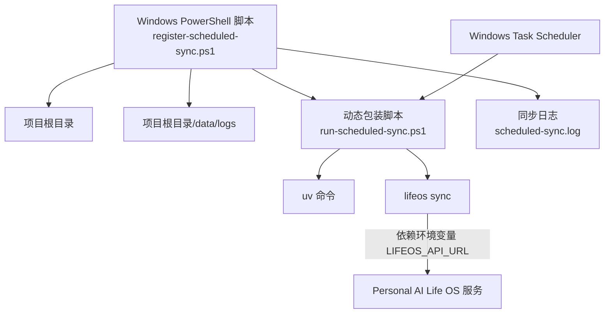
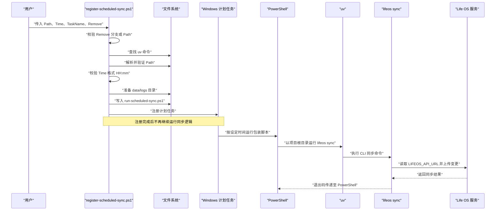
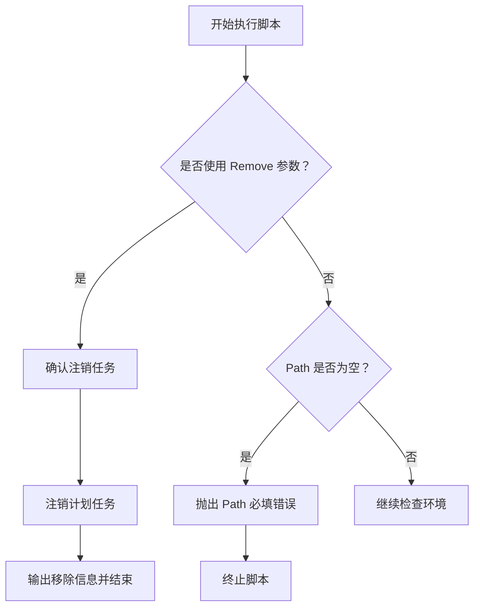
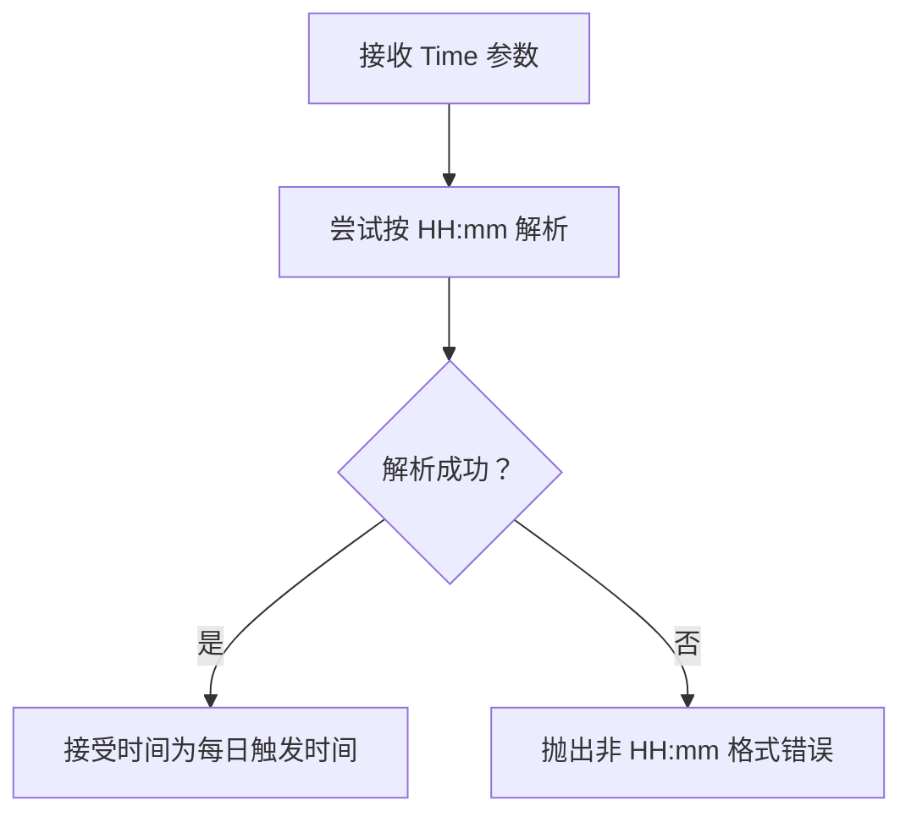
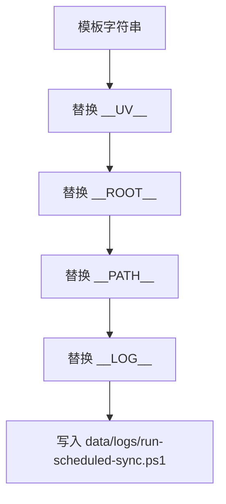
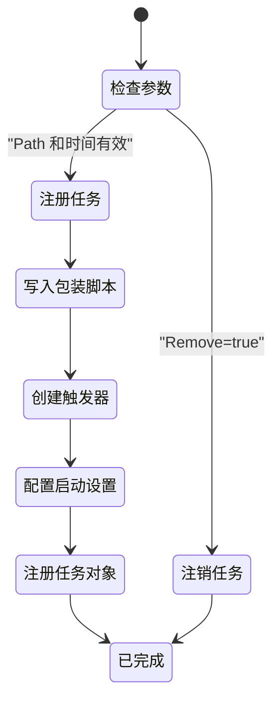
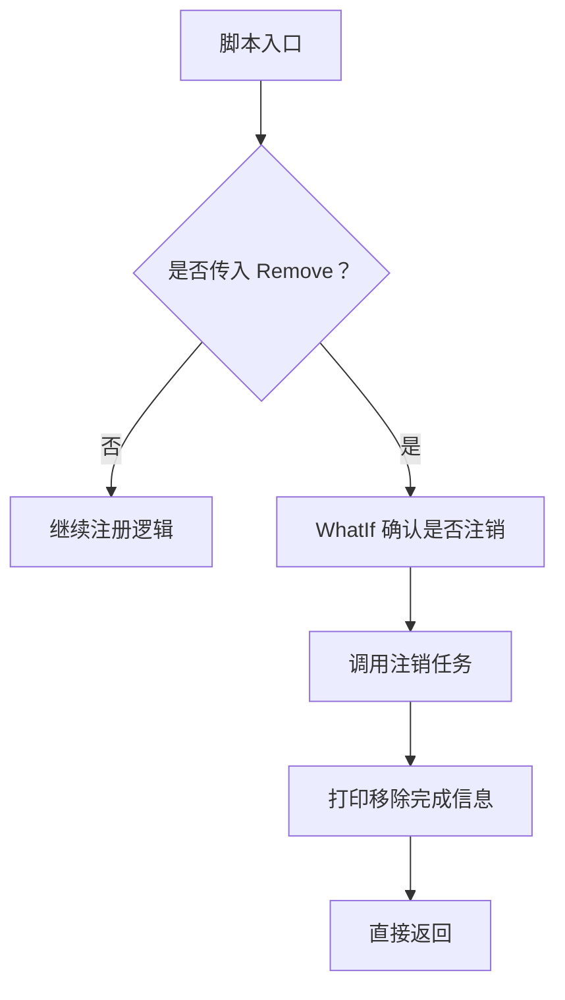
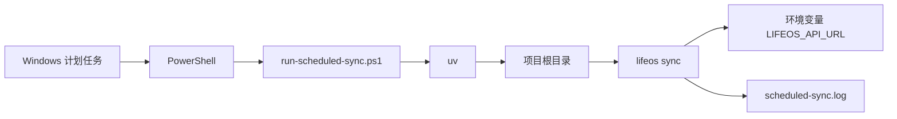

# 计划任务同步脚本

<cite>
**本文引用的文件**
- [scripts/register-scheduled-sync.ps1](file://scripts/register-scheduled-sync.ps1)
</cite>

## 目录
1. [简介](#简介)
2. [项目结构定位](#项目结构定位)
3. [核心组件与参数](#核心组件与参数)
4. [架构总览](#架构总览)
5. [详细实现分析](#详细实现分析)
6. [依赖与环境要求](#依赖与环境要求)
7. [依赖关系分析](#依赖关系分析)
8. [性能与维护特征](#性能与维护特征)
9. [故障排除指南](#故障排除指南)
10. [结论](#结论)

## 简介
本脚本用于在 Windows 系统中注册一个定时同步任务。该任务会周期性调用项目的 CLI 工具，把指定文件夹中的增量数据同步到已运行的 Personal AI Life OS 服务中。脚本完成以下工作：
- 解析命令行参数并校验输入。
- 检查 uv、目标路径等前置条件。
- 校验触发时间格式。
- 生成一个动态包装脚本，封装 uv、项目根目录、目标路径和日志输出。
- 配置 Windows Task Scheduler，设置每日触发器、启动选项和执行策略绕过。
- 支持使用 `--Remove`（或 `-Remove`）注销并删除已有任务。
- 支持 WhatIf 预览操作而不实际修改系统。

## 项目结构定位
脚本位于仓库的 `scripts` 目录下，通过 `$PSScriptRoot` 向上推导项目根目录，从而稳定引用相对路径：
- 日志目录：项目根目录下的 `data/logs`。
- 同步日志文件名：`scheduled-sync.log`。
- 动态生成的包装脚本：`data/logs/run-scheduled-sync.ps1`。
- 计划的 Windows 任务名称默认为 `Personal AI Life OS Sync`。

**图表来源**
- [scripts/register-scheduled-sync.ps1:28-48](file://scripts/register-scheduled-sync.ps1#L28-L48)
- [scripts/register-scheduled-sync.ps1:60-70](file://scripts/register-scheduled-sync.ps1#L60-L70)

**章节来源**
- [scripts/register-scheduled-sync.ps1:5-15](file://scripts/register-scheduled-sync.ps1#L5-L15)
- [scripts/register-scheduled-sync.ps1:28-48](file://scripts/register-scheduled-sync.ps1#L28-L48)

## 核心组件与参数
脚本通过 PowerShell 的参数定义暴露四个关键元素：

| 参数 | 类型 | 默认值 | 作用 |
|---|---|---|---|
| `Path` | 字符串 | 必填 | 需要被同步的本地文件夹路径 |
| `Time` | 字符串 | `09:00` | 每日触发时间，必须为 24 小时制 |
| `TaskName` | 字符串 | `Personal AI Life OS Sync` | Windows 计划任务显示名 |
| `Remove` | 开关 | 否 | 仅执行注销任务；不使用时注册任务 |

重要行为说明：
- `Path` 在未启用 `Remove` 时为必填项。
- 所有可能修改系统资源的步骤都受 `[CmdletBinding(SupportsShouldProcess)]` 保护，因此可以通过 WhatIf 模式查看将要执行的动作。
- `$ErrorActionPreference = "Stop"` 使严重错误直接中断脚本。

**章节来源**
- [scripts/register-scheduled-sync.ps1:5-20](file://scripts/register-scheduled-sync.ps1#L5-L20)
- [scripts/register-scheduled-sync.ps1:22-42](file://scripts/register-scheduled-sync.ps1#L22-L42)

## 架构总览
整个流程分为三个阶段：**注册阶段** 与 **执行阶段**。

**图表来源**
- [scripts/register-scheduled-sync.ps1:12-48](file://scripts/register-scheduled-sync.ps1#L12-L48)
- [scripts/register-scheduled-sync.ps1:60-96](file://scripts/register-scheduled-sync.ps1#L60-L96)

## 详细实现分析

### 命令行参数解析与前置控制流
脚本首先判断是否传入了 `Remove` 参数。若为真，则调用 WhatIf 机制确认后再注销任务；否则进入任务注册主流程。随后对 `Path` 进行空值检查。

**图表来源**
- [scripts/register-scheduled-sync.ps1:22-42](file://scripts/register-scheduled-sync.ps1#L22-L42)

**章节来源**
- [scripts/register-scheduled-sync.ps1:22-42](file://scripts/register-scheduled-sync.ps1#L22-L42)

### 依赖检查：uv
脚本通过 `Get-Command uv` 探测当前 PATH 中是否存在 uv。如果找不到，则抛出包含项目根目录路径的错误提示，帮助用户知道在哪里执行 `uv sync`。

| 检查项 | 实现方式 | 失败影响 |
|---|---|---|
| uv 可用 | 通过 PowerShell 命令发现 | 找不到 uv 时直接抛出异常 |
| 可执行入口 | 使用 `$uvCommand.Source` | 后续替换模板时使用绝对路径 |

**章节来源**
- [scripts/register-scheduled-sync.ps1:34-38](file://scripts/register-scheduled-sync.ps1#L34-L38)

### 路径存在性与容器类型校验
脚本先使用 `Resolve-Path -LiteralPath` 解析路径，再使用 `Test-Path -LiteralPath -PathType Container` 确认它是一个存在的目录。注意：
- 路径会被规范化为绝对路径形式。
- 只有目录被接受，文件和不存在的路径都会触发异常。

| 输入情况 | 预期行为 |
|---|---|
| 空字符串 | 抛出 Path 必填异常 |
| 不存在的文件 | 抛出路径必须是现有目录异常 |
| 没有访问权限 | PowerShell 路径解析可能失败或测试失败，导致脚本终止 |

**章节来源**
- [scripts/register-scheduled-sync.ps1:39-41](file://scripts/register-scheduled-sync.ps1#L39-L41)

### 时间格式校验：HH:mm
脚本使用 `DateTime.ParseExact` 配合固定区域文化的不变文化，严格校验 `Time` 必须符合 `HH:mm` 格式。例如 `09:00` 有效，`9:00`、`9:00 AM`、`25:00` 等均会失败并抛出明确异常。

**图表来源**
- [scripts/register-scheduled-sync.ps1:43-47](file://scripts/register-scheduled-sync.ps1#L43-L47)

**章节来源**
- [scripts/register-scheduled-sync.ps1:43-47](file://scripts/register-scheduled-sync.ps1#L43-L47)

### 动态包装脚本模板生成
脚本会将一段模板文本复制到 `data/logs/run-scheduled-sync.ps1`。模板中预留了以下占位符：

| 占位符 | 含义 | 替换来源 |
|---|---|---|
| `__UV__` | uv 的绝对路径 | `$uvCommand.Source` |
| `__ROOT__` | 项目根目录 | `$ProjectRoot` |
| `__PATH__` | 要同步的目标目录 | `$resolved.Path` |
| `__LOG__` | 日志完整路径 | `$logPath` |

模板的执行语义如下：
1. 将 PowerShell 错误中止策略设为严格模式。
2. 使用绝对路径启动 uv。
3. 使用 `--project` 指定项目根目录。
4. 调用 `lifeos sync __PATH__ --yes`。
5. 将标准输出和标准错误追加到日志文件。
6. 返回上一个命令的退出码。

**图表来源**
- [scripts/register-scheduled-sync.ps1:60-68](file://scripts/register-scheduled-sync.ps1#L60-L68)

**章节来源**
- [scripts/register-scheduled-sync.ps1:60-70](file://scripts/register-scheduled-sync.ps1#L60-L70)

### Windows 计划任务配置
任务配置包括动作、触发器、启动设置和描述：

| 配置项 | 值 | 说明 |
|---|---|---|
| 执行程序 | `powershell.exe` | 由 Windows 调度器调用的程序 |
| 参数 | 以无配置文件、执行策略绕过方式运行包装脚本 | 避免用户级执行策略阻止脚本运行 |
| 工作目录 | 项目根目录 | 保证 `--project __ROOT__` 和项目内部相对解析一致 |
| 触发器 | 每日一次，时间在 `Time` 参数处 | 对应 `HH:mm` 已校验时间 |
| 启动设置 | 开机未启动时仍执行、允许电池运行、电池供电不停止 | 适合笔记本和移动设备场景 |
| 描述 | 说明该任务从指定路径导入变更文件并通过 SHA-256 去重 | 便于管理员理解任务用途 |
| 覆盖策略 | `Force` | 同任务名重复注册时覆盖旧配置 |

**图表来源**
- [scripts/register-scheduled-sync.ps1:72-96](file://scripts/register-scheduled-sync.ps1#L72-L96)

**章节来源**
- [scripts/register-scheduled-sync.ps1:72-96](file://scripts/register-scheduled-sync.ps1#L72-L96)

### `--Remove` 参数的任务注销逻辑
当 `Remove` 为真时：
1. 不调用任何路径、uv 或时间校验。
2. 使用 WhatIf 机制询问是否注销目标任务。
3. 调用注销任务 cmdlet。
4. 输出已成功移除的信息。
5. 立即返回，不执行注册流程。

这个设计让 `--Remove` 成为一个安全、幂等的清理入口。即使多次运行也不会报“任务不存在”之类的阻塞错误，因为 ShouldProcess 可以在模拟模式下跳过真实注销。

**图表来源**
- [scripts/register-scheduled-sync.ps1:22-27](file://scripts/register-scheduled-sync.ps1#L22-L27)

**章节来源**
- [scripts/register-scheduled-sync.ps1:22-27](file://scripts/register-scheduled-sync.ps1#L22-L27)

### 日志记录策略
- 日志目录：项目根目录下的 `data\logs`。
- 日志文件：`data\logs\scheduled-sync.log`。
- 日志写入方式：包装脚本中将 stdout 和 stderr 追加写入日志文件。
- 日志内容来源：主要来自 `lifeos sync` 的输出以及底层 uv 或 Python 运行环境的错误信息。
- 日志位置不是由脚本在运行时自动扫描，而是通过模板硬编码嵌入到包装脚本中。

建议运维人员定期归档该日志文件，尤其是任务执行频繁或同步数据量较大时。

**章节来源**
- [scripts/register-scheduled-sync.ps1:60-68](file://scripts/register-scheduled-sync.ps1#L60-L68)
- [scripts/register-scheduled-sync.ps1:72-96](file://scripts/register-scheduled-sync.ps1#L72-L96)

### 环境变量 LIFEOS_API_URL 的使用要求
根据脚本顶部注释，实际同步由已有的 CLI 命令处理。该 CLI 期望目标 API 已经在环境变量 `LIFEOS_API_URL` 中配置。脚本本身并不读取或改写该变量。因此：
- 如果使用计划任务运行，需确保计划任务的运行上下文具备该环境变量。
- 常用方式是通过系统级用户变量或环境组策略设置。
- 当前默认文档化注释中提到默认值为 `http://127.0.0.1:8000`，但这是背景说明，并非代码中的默认注入值。
- 如果 Life OS 部署在非本地主机或非默认端口，必须正确设置该环境变量。

| 场景 | 建议做法 |
|---|---|
| 本地开发 | 通过系统用户环境变量设置为 `http://127.0.0.1:8000` |
| 本地服务器 | 设置为实际地址，如 `http://localhost:<端口>` |
| 远程服务 | 设置为公网或内网可达的服务地址 |
| 容器或服务账户 | 通过服务账户的环境配置传入 |

**章节来源**
- [scripts/register-scheduled-sync.ps1:5-9](file://scripts/register-scheduled-sync.ps1#L5-L9)

## 依赖与环境要求
| 类别 | 要求 | 原因 |
|---|---|---|
| PowerShell | Windows PowerShell（脚本版本 5 及以上更稳妥） | 脚本使用了 CmdletBinding、ShouldProcess、ScheduledTask cmdlet |
| uv | PATH 中可见且可用 | 包装脚本通过其绝对路径调用 Python 虚拟环境和 CLI |
| lifeos CLI | uv 项目中可执行的 CLI | `lifeos sync` 是真正执行业务同步的命令 |
| 同步目标文件夹 | 必须存在的目录 | 路径校验要求是容器类型 |
| LIFEOS_API_URL | 在服务运行上下文中设置 | CLI 使用它连接 Life OS 后端服务 |
| Windows 计划任务权限 | 能访问目标目录和用户环境变量 | 计划任务以指定账号运行 |
| 磁盘空间 | data/logs 所在分区有足够空间 | 累积日志可能导致文件变大 |

如果 uv 未被安装，脚本会在注册阶段就失败，并在错误消息中提示应在项目根目录执行 `uv sync`。

**章节来源**
- [scripts/register-scheduled-sync.ps1:34-38](file://scripts/register-scheduled-sync.ps1#L34-L38)

## 依赖关系分析
下面展示脚本、动态包装脚本和 Windows 计划任务之间的依赖关系。

**图表来源**
- [scripts/register-scheduled-sync.ps1:72-96](file://scripts/register-scheduled-sync.ps1#L72-L96)
- [scripts/register-scheduled-sync.ps1:60-68](file://scripts/register-scheduled-sync.ps1#L60-L68)

**章节来源**
- [scripts/register-scheduled-sync.ps1:60-96](file://scripts/register-scheduled-sync.ps1#L60-L96)

## 性能与维护特征
- 注册阶段复杂度：几乎为常量时间。主要开销是文件写入、计划任务注册和环境检测。
- 执行阶段职责分离：真正的同步逻辑委托给 `lifeos sync`，脚本只负责环境与调度。
- 日志追加写入：随时间增长的文件体积需要注意磁盘空间和轮转策略。
- 每日一次触发：频率低，但大量文件或网络异常时仍可能造成单次执行时间较长。
- 任务覆盖注册：使用 `Force` 注册时不会创建重复任务，但会更新既有任务的配置。

[本节提供一般性维护建议，不直接分析具体代码行]

## 故障排除指南

| 问题 | 现象 | 诊断方法 | 解决建议 |
|---|---|---|---|
| 权限不足 | 注册任务失败或任务执行时报错 | 检查执行 PowerShell 的账户是否有读写 `data/logs` 和创建计划任务的权限 | 以管理员运行，或将 `data/logs` 权限授予任务所用账户 |
| 路径无效 | 报错指出 Path 必须是现有目录 | 手动执行 `Resolve-Path` 或浏览该目录确认存在 | 传入真实文件夹路径，不要传文件或临时路径 |
| uv 未安装 | 报错明确提示 PATH 中未找到 uv | 在 PowerShell 执行 `Get-Command uv` | 安装 uv 后重试；或在项目根目录执行 `uv sync` |
| 时间格式错误 | 报错指出必须使用 HH:mm 格式 | 检查传入值是否为两位小时和两位分钟 | 改为 `09:00`、`14:30` 这类合法时间 |
| 任务已经存在 | 注册逻辑覆盖任务 | 查看计划任务管理器中的任务配置 | 如需完全重置，可先使用 `--Remove` 再重新注册 |
| 计划任务不执行 | 任务列表中状态正常但没有日志 | 检查系统事件日志、任务历史和服务账户环境变量 | 确认 `LIFEOS_API_URL` 和 `PATH` 可用 |
| uv 路径失效 | 包装脚本中的 uv 路径不可用 | 检查 `data/logs/run-scheduled-sync.ps1` 中的 uv 绝对路径 | 重新运行注册脚本生成新的包装脚本 |
| Life OS 服务不可达 | 同步失败但没有 uv 或 CLI 错误 | 检查 `scheduled-sync.log` 中的后端请求结果 | 设置或修正 `LIFEOS_API_URL`，确保服务可访问 |
| 日志过大 | `scheduled-sync.log` 持续增大 | 观察磁盘空间和文件大小 | 引入日志轮转或使用外部日志收集方案 |
| 执行策略阻止脚本 | Windows 拒绝执行 PowerShell 脚本 | 计划任务执行失败，可能与 ExecutionPolicy 有关 | 脚本已使用 `-ExecutionPolicy Bypass`，仍需确保系统策略和证书策略允许包装脚本运行 |

常见操作步骤总结：
1. 先用 `--Remove` 清除旧任务，再用原命令重新注册，确保包装脚本路径一致。
2. 查看 `data/logs/scheduled-sync.log`，获取最接近实际的错误信息。
3. 在计划任务管理器中手动触发一次任务，确认任务账户具有读取目标目录和调用 uv 的能力。
4. 若服务不在本机，请重点核查 `LIFEOS_API_URL`。

**章节来源**
- [scripts/register-scheduled-sync.ps1:22-42](file://scripts/register-scheduled-sync.ps1#L22-L42)
- [scripts/register-scheduled-sync.ps1:60-68](file://scripts/register-scheduled-sync.ps1#L60-L68)
- [scripts/register-scheduled-sync.ps1:72-96](file://scripts/register-scheduled-sync.ps1#L72-L96)
- [scripts/register-scheduled-sync.ps1:5-9](file://scripts/register-scheduled-sync.ps1#L5-L9)

## 结论
`scripts/register-scheduled-sync.ps1` 是一个围绕 Windows Task Scheduler 的小型编排脚本。它自身不负责同步业务逻辑，而是负责：
- 在注册阶段完成参数校验、路径检查和 uv 可用性检测。
- 生成稳定的包装脚本，把 uv、项目根目录、目标路径和日志文件路径嵌入到任务执行路径中。
- 配置计划任务的每日触发器和电源相关启动选项。
- 为运维提供清晰的日志位置和卸载能力。

最佳实践是把它作为一次性初始化或重建步骤：新增或迁移 uv、项目路径或目标文件夹后，重新运行注册脚本以生成最新包装脚本，并始终将 `LIFEOS_API_URL` 配置到计划任务的运行环境中。