# 路径授权与安全选择器

<cite>
**本文引用的文件列表**   
- [desktop.py](file://src/personal_ai_life_os/desktop.py)
- [desktop_chats.py](file://src/personal_ai_life_os/api/routes/desktop_chats.py)
- [desktop_folders.py](file://src/personal_ai_life_os/api/routes/desktop_folders.py)
- [main.rs](file://desktop/src-tauri/src/main.rs)
- [DesktopChatImport.tsx](file://web/src/DesktopChatImport.tsx)
- [DesktopFolders.tsx](file://web/src/DesktopFolders.tsx)
</cite>

## 目录
1. [引言](#引言)
2. [项目结构与边界划分](#项目结构与边界划分)
3. [核心组件与职责](#核心组件与职责)
4. [系统架构总览](#系统架构总览)
5. [PathGrant 安全令牌机制](#pathgrant-安全令牌机制)
6. [用途参数与权限语义](#用途参数与权限语义)
7. [三种安全选择场景](#三种安全选择场景)
8. [详细处理流程](#详细处理流程)
9. [恶意路径防护与路径规范化](#恶意路径防护与路径规范化)
10. [防重放、最小权限与进程隔离](#防重放最小权限与进程隔离)
11. [依赖关系分析](#依赖关系分析)
12. [性能与并发特性](#性能与并发特性)
13. [故障排查指南](#故障排查指南)
14. [安全最佳实践与渗透测试建议](#安全最佳实践与渗透测试建议)
15. [结论](#结论)

## 引言
本文围绕“路径授权与安全选择器”这一桌面安全能力展开，重点说明如何通过 Windows 原生对话框选择用户数据文件，并借助 **PathGrant** 安全令牌把可信的文件路径传递给后端服务。它覆盖了聊天导出导入、备份恢复、以及 Markdown/Obsidian/聊天导出等目录授权三类典型场景。

该机制的核心思想是：
- 浏览器或 Web 前端不能直接枚举本机文件系统；
- 只有原生层能够调用操作系统原生对话框；
- 原生层生成一个带 HMAC-SHA256 签名和时间戳的 Payload；
- 后端在严格校验后，才允许以受控方式读取路径。

这种设计既支持用户体验（系统原生选择器），也实现了安全边界（密钥不出进程、用途固定、时间窗口短、范围可审计）。

**章节来源**
- [desktop.py:91-146](file://src/personal_ai_life_os/desktop.py#L91-L146)
- [main.rs:129-263](file://desktop/src-tauri/src/main.rs#L129-L263)

## 项目结构与边界划分
项目分为三层：
1. **Web 前端**：提供用户交互界面，但不直接访问本机文件系统。
2. **Tauri 原生侧**：运行在主进程中，调用操作系统文件对话框，负责生成 PathGrant。
3. **Sidecar 子进程**：独立的 Python 后端服务，持有敏感 `path_key`，实现真实的路径验证和业务逻辑。

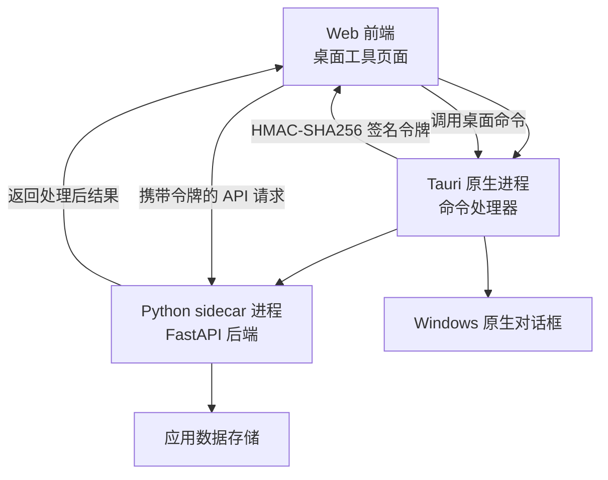

**图表来源**
- [desktop_chats.py:27-59](file://src/personal_ai_life_os/api/routes/desktop_chats.py#L27-L59)
- [main.rs:222-263](file://desktop/src-tauri/src/main.rs#L222-L263)
- [desktop.py:91-146](file://src/personal_ai_life_os/desktop.py#L91-L146)

**章节来源**
- [DesktopChatImport.tsx:1-151](file://web/src/DesktopChatImport.tsx#L1-L151)
- [DesktopFolders.tsx:1-121](file://web/src/DesktopFolders.tsx#L1-L121)
- [main.rs:129-385](file://desktop/src-tauri/src/main.rs#L129-L385)
- [desktop.py:1-178](file://src/personal_ai_life_os/desktop.py#L1-L178)

## 核心组件与职责
| 组件 | 代码位置 | 主要职责 |
|---|---|---|
| Web 桌面聊天导入组件 | [DesktopChatImport.tsx](file://web/src/DesktopChatImport.tsx#L1-L151) | 显示“选择导出文件”入口、轮询导入进度、可选同步到已授权聊天导出目录 |
| Web 文件夹授权组件 | [DesktopFolders.tsx](file://web/src/DesktopFolders.tsx#L1-L121) | 切换目的类型，调用原生文件夹选择，提交 PathGrant 完成目录授权 |
| Tauri 原生命令层 | [main.rs](file://desktop/src-tauri/src/main.rs#L129-L263) | 使用 Windows 原生对话框获取路径，用 `path_key` 计算 HMAC-SHA256，返回 PathGrant |
| Sidecar 启动与密钥分发 | [desktop.py](file://src/personal_ai_life_os/desktop.py#L91-L146) | 通过标准输入接收 launcher secret 和 path_key，构建 FastAPI 应用 |
| 聊天导出 PathGrant 校验 | [desktop_chats.py](file://src/personal_ai_life_os/api/routes/desktop_chats.py#L59-L93) | 验证签名、用途、时间戳、路径绝对性并最终解析为绝对路径 |
| 目录授权 PathGrant 校验 | [desktop_folders.py](file://src/personal_ai_life_os/api/routes/desktop_folders.py#L1-L132) | 再次校验 PathGrant，并强制目录必须落在应用数据目录之外 |

**章节来源**
- [DesktopChatImport.tsx:26-151](file://web/src/DesktopChatImport.tsx#L26-L151)
- [DesktopFolders.tsx:20-121](file://web/src/DesktopFolders.tsx#L20-L121)
- [main.rs:158-263](file://desktop/src-tauri/src/main.rs#L158-L263)
- [desktop.py:91-146](file://src/personal_ai_life_os/desktop.py#L91-L146)
- [desktop_chats.py:27-93](file://src/personal_ai_life_os/api/routes/desktop_chats.py#L27-L93)
- [desktop_folders.py:1-91](file://src/personal_ai_life_os/api/routes/desktop_folders.py#L1-L91)

## 系统架构总览
整个路径授权流程可分为三个阶段：
1. **用户触发选择**：前端调用 Tauri 原生命令。
2. **原生层签名**：Tauri 调用 Windows 对话框，拿到用户实际选择的绝对路径后计算 HMAC。
3. **后端层验证**：Sidecar 校验签名、用途、时间窗口，再执行后续业务。

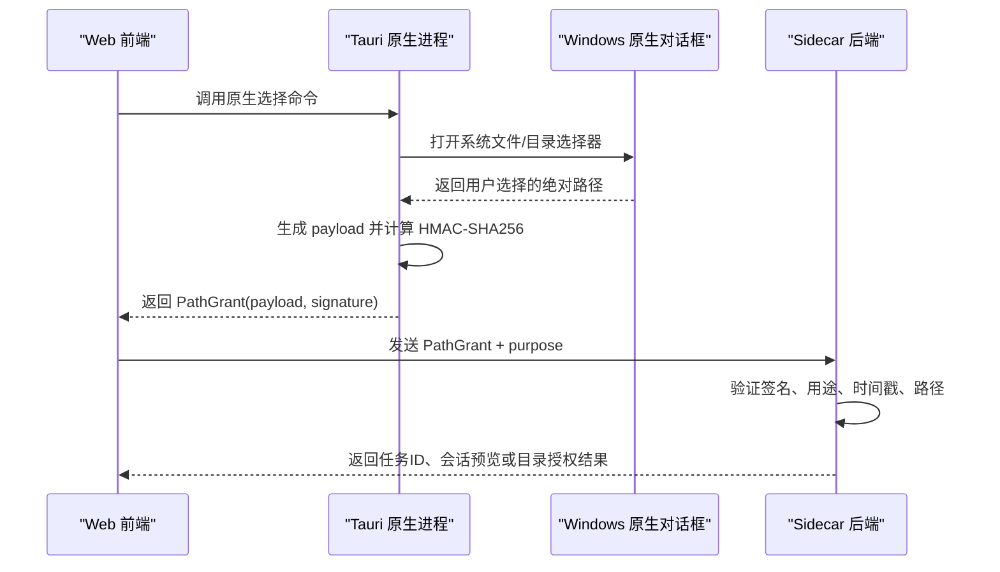

**图表来源**
- [DesktopChatImport.tsx:84-120](file://web/src/DesktopChatImport.tsx#L84-L120)
- [DesktopFolders.tsx:71-89](file://web/src/DesktopFolders.tsx#L71-L89)
- [main.rs:158-263](file://desktop/src-tauri/src/main.rs#L158-L263)
- [desktop_chats.py:71-93](file://src/personal_ai_life_os/api/routes/desktop_chats.py#L71-L93)
- [desktop_folders.py:55-73](file://src/personal_ai_life_os/api/routes/desktop_folders.py#L55-L73)

## PathGrant 安全令牌机制
### 数据结构
PathGrant 由两部分组成：

| 字段 | 含义 | 约束 |
|---|---|---|
| `payload` | JSON 字符串，包含路径、用途和签发时间 | 最大长度限制，后端解析为 JSON |
| `signature` | HMAC-SHA256 十六进制哈希值 | 固定长度哈希，用于不可伪造校验 |

Payload 的 JSON 结构：

| 字段 | 含义 |
|---|---|
| `path` | 用户从系统选择器中选择的绝对路径 |
| `purpose` | 本次路径使用的业务用途 |
| `issued` | 签发时 UNIX 时间戳（秒） |

**章节来源**
- [desktop_chats.py:34-39](file://src/personal_ai_life_os/api/routes/desktop_chats.py#L34-L39)
- [main.rs:203-232](file://desktop/src-tauri/src/main.rs#L203-L232)
- [desktop_chats.py:71-93](file://src/personal_ai_life_os/api/routes/desktop_chats.py#L71-L93)

### HMAC-SHA256 签名
签名过程是：
1. Tauri 从共享状态读取 sidecar 生成的 `path_key`；
2. 构造 JSON Payload；
3. 使用 HMAC-SHA256 对 Payload 字节进行签名；
4. 将二进制结果转为十六进制作为 `signature`。

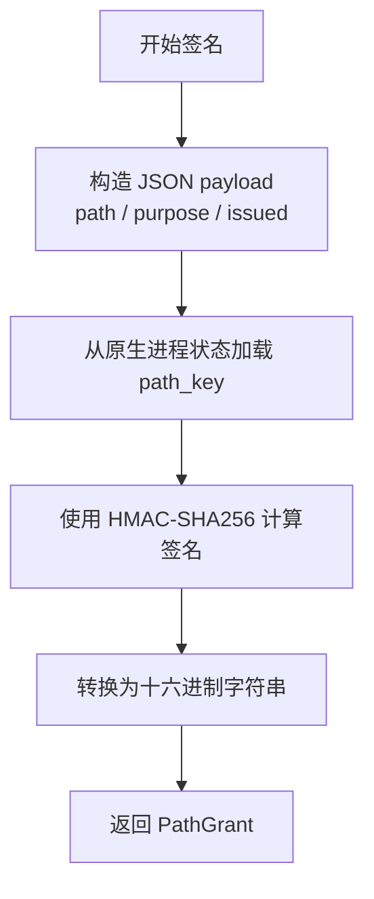

**图表来源**
- [main.rs:187-206](file://desktop/src-tauri/src/main.rs#L187-L206)
- [main.rs:203-232](file://desktop/src-tauri/src/main.rs#L203-L232)

**章节来源**
- [main.rs:187-232](file://desktop/src-tauri/src/main.rs#L187-L232)
- [desktop_chats.py:71-93](file://src/personal_ai_life_os/api/routes/desktop_chats.py#L71-L93)

### `path_key` 密钥管理
`path_key` 是一个 32 字节随机密钥，生命周期如下：
- Tauri 原生主进程调用 `new_key()` 生成；
- Tauri 通过标准输入把 hex 编码的 launcher secret 和 path_key 发送给 sidecar；
- sidecar 解析 hex 并保存原始字节供 HMAC 运算；
- 密钥不暴露给 Web 前端，也不写入普通配置文件；
- sidecar 退出后，密钥被销毁。

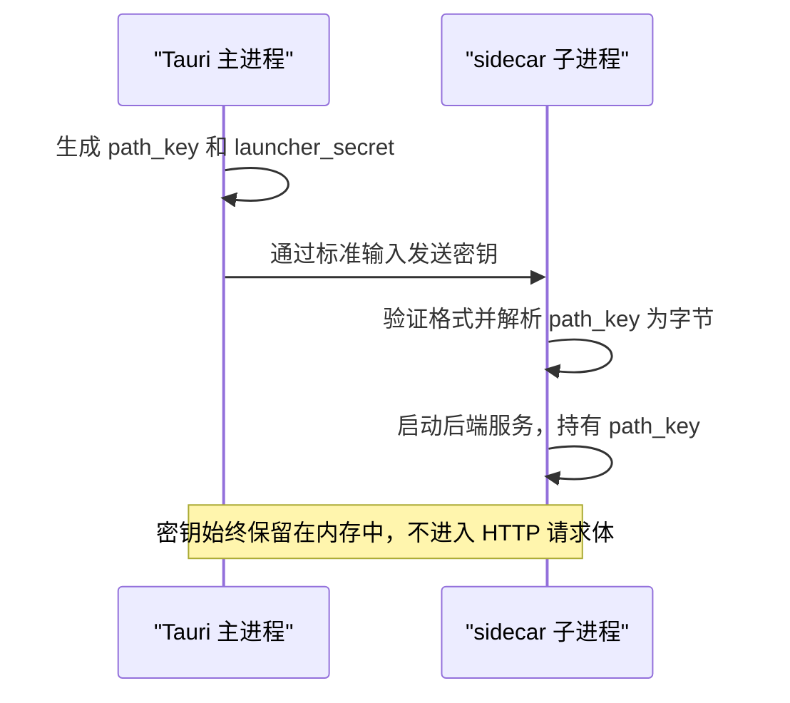

**图表来源**
- [main.rs:28-45](file://desktop/src-tauri/src/main.rs#L28-L45)
- [main.rs:72-123](file://desktop/src-tauri/src/main.rs#L72-L123)
- [desktop.py:91-122](file://src/personal_ai_life_os/desktop.py#L91-L122)

**章节来源**
- [main.rs:28-45](file://desktop/src-tauri/src/main.rs#L28-L45)
- [main.rs:72-123](file://desktop/src-tauri/src/main.rs#L72-L123)
- [desktop.py:91-122](file://src/personal_ai_life_os/desktop.py#L91-L122)

## 用途参数与权限语义
| `purpose` | 触发入口 | 安全含义 | 后端验证要点 |
|---|---|---|---|
| `chat` | 聊天导出文件选择 | 只能读取单个聊天导出文件 | 必须是绝对路径，后续解析为存在的绝对路径 |
| `restore` | Life OS 备份选择 | 只能恢复单个备份 ZIP | 与 chat 相同的签名和时间校验，但用途必须是 restore |
| `markdown` | 文件夹目录选择 | 授权 Markdown 记录目录 | 必须是应用数据目录外的目录 |
| `obsidian` | 文件夹目录选择 | 授权 Obsidian Vault 目录 | 必须是应用数据目录外的目录 |
| `chat_folder` | 文件夹目录选择 | 授权聊天导出目录，用于后台增量同步 | 必须是应用数据目录外的目录 |
| `backup` | 文件夹目录选择 | 授权备份输出目录 | 必须是应用数据目录外的目录 |
| `export` | 文件夹目录选择 | 授权 Markdown 导出目录 | 必须是应用数据目录外的目录 |

注意：虽然多个用途都允许选文件夹，但每个后端接口只接受一个固定的 `purpose`。例如文件夹授权接口只允许 `markdown`、`obsidian`、`chat_folder`；聊天导入接口只允许 `chat`。

**章节来源**
- [main.rs:158-185](file://desktop/src-tauri/src/main.rs#L158-L185)
- [main.rs:209-232](file://desktop/src-tauri/src/main.rs#L209-L232)
- [desktop_folders.py:14-21](file://src/personal_ai_life_os/api/routes/desktop_folders.py#L14-L21)
- [desktop_chats.py:34-39](file://src/personal_ai_life_os/api/routes/desktop_chats.py#L34-L39)
- [desktop_chats.py:71-93](file://src/personal_ai_life_os/api/routes/desktop_chats.py#L71-L93)

## 三种安全选择场景

### 场景一：聊天导出文件选择
用户使用“从聊天导出导入”，前端调用 `desktop_pick_chat`。Tauri 只允许选择 `.json` 或 `.jsonl` 文件，之后以 `chat` 用途签名。

流程图：

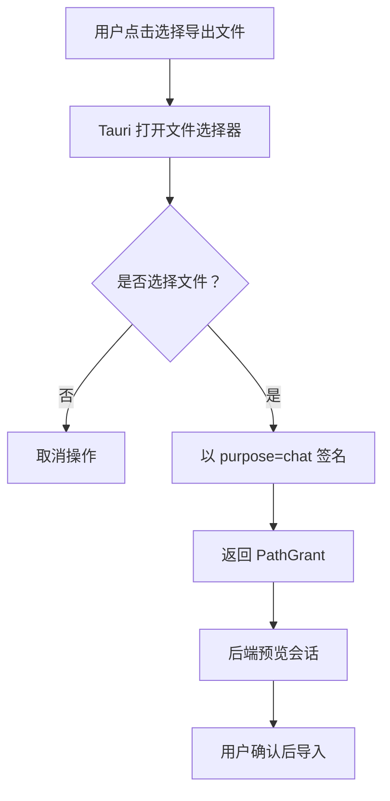

**图表来源**
- [DesktopChatImport.tsx:96-120](file://web/src/DesktopChatImport.tsx#L96-L120)
- [main.rs:158-185](file://desktop/src-tauri/src/main.rs#L158-L185)
- [desktop_chats.py:59-93](file://src/personal_ai_life_os/api/routes/desktop_chats.py#L59-L93)

**章节来源**
- [DesktopChatImport.tsx:26-151](file://web/src/DesktopChatImport.tsx#L26-L151)
- [main.rs:158-185](file://desktop/src-tauri/src/main.rs#L158-L185)
- [desktop_chats.py:27-93](file://src/personal_ai_life_os/api/routes/desktop_chats.py#L27-L93)

### 场景二：备份文件选择
用户需要恢复 Life OS 本地备份时，前端调用 `desktop_pick_backup`。对话框仅允许选择 `.zip` 文件，且用途为 `restore`。

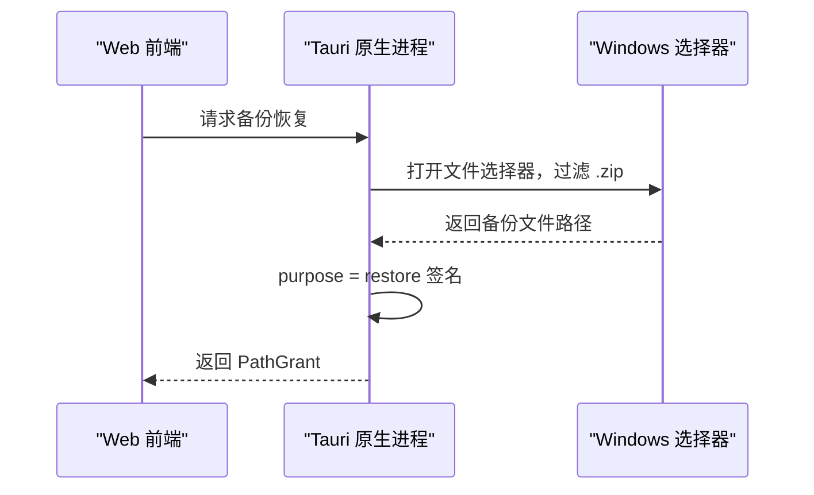

**图表来源**
- [main.rs:187-206](file://desktop/src-tauri/src/main.rs#L187-L206)

**章节来源**
- [main.rs:187-206](file://desktop/src-tauri/src/main.rs#L187-L206)

### 场景三：文件夹目录选择
文件夹用途更多样，包括 `markdown`、`obsidian`、`chat_folder`、`backup`、`export`。用户选择的是目录而非单文件。

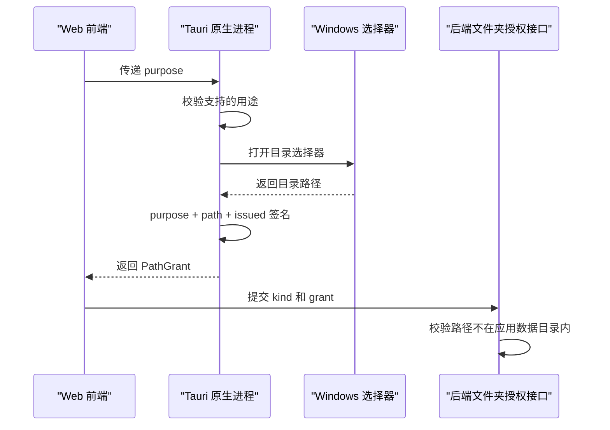

**图表来源**
- [main.rs:209-232](file://desktop/src-tauri/src/main.rs#L209-L232)
- [desktop_folders.py:55-91](file://src/personal_ai_life_os/api/routes/desktop_folders.py#L55-L91)

**章节来源**
- [DesktopFolders.tsx:60-89](file://web/src/DesktopFolders.tsx#L60-L89)
- [main.rs:209-232](file://desktop/src-tauri/src/main.rs#L209-L232)
- [desktop_folders.py:55-91](file://src/personal_ai_life_os/api/routes/desktop_folders.py#L55-L91)

## 详细处理流程

### PathGrant 验证流程
后端校验发生在两个入口：

1. 聊天导入入口：`verify_path_grant(grant, key, "chat")`
2. 文件夹授权入口：`verify_path_grant(grant, key, "markdown"/"obsidian"/"chat_folder")`

共同验证步骤包括：
- 使用 sidecar 持有的 `path_key` 重新计算 HMAC；
- 比对传入签名；
- 解析 JSON payload；
- 检查 `purpose` 是否与当前接口允许值一致；
- 检查 `issued` 是否在 `-3 <= now - issued <= 120` 的安全时间窗内；
- 要求路径必须是绝对路径；
- 最终使用 `resolve(strict=True)` 解析为存在的路径。

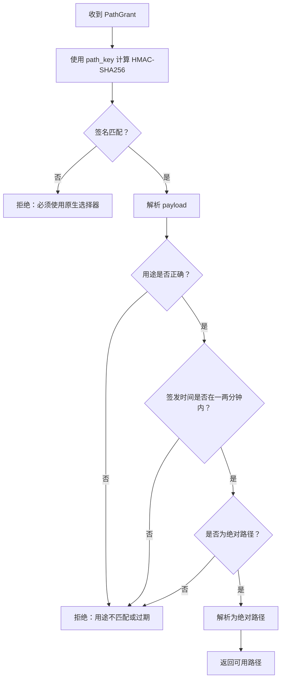

**图表来源**
- [desktop_chats.py:71-93](file://src/personal_ai_life_os/api/routes/desktop_chats.py#L71-L93)
- [desktop_folders.py:61-69](file://src/personal_ai_life_os/api/routes/desktop_folders.py#L61-L69)

**章节来源**
- [desktop_chats.py:59-93](file://src/personal_ai_life_os/api/routes/desktop_chats.py#L59-L93)
- [desktop_folders.py:55-73](file://src/personal_ai_life_os/api/routes/desktop_folders.py#L55-L73)

## 恶意路径防护与路径规范化
除了通用的 PathGrant 校验，目录授权还做了额外保护：

| 防护措施 | 作用 |
|---|---|
| 非目录检查 | 拒绝不是目录的路径 |
| 根目录拒绝 | 拒绝像盘符这样的顶层锚点目录 |
| 排除应用数据目录内部 | 不允许选择应用数据目录自身或其子目录 |
| `resolve(strict=True)` | 确保路径指向真实存在的路径 |
| 文件名截断 | 避免超长源名称造成存储异常 |
| 来源键去重 | 使用目录 key 去重避免重复授权 |
| 删除前二次确认 | 删除待清理条目时需要确认状态 |

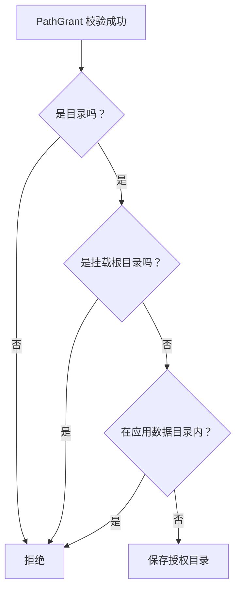

**图表来源**
- [desktop_folders.py:61-91](file://src/personal_ai_life_os/api/routes/desktop_folders.py#L61-L91)

**章节来源**
- [desktop_folders.py:55-91](file://src/personal_ai_life_os/api/routes/desktop_folders.py#L55-L91)
- [desktop_chats.py:71-93](file://src/personal_ai_life_os/api/routes/desktop_chats.py#L71-L93)

## 防重放、最小权限与进程隔离

### 防重放保护
PathGrant 使用时间戳和严格校验函数共同防御重放：
- Payload 中包含 UNIX 时间戳；
- 后端要求签发时间与当前时间差不超过约两分钟；
- 允许很小的负偏差以容忍时钟轻微差异；
- HMAC 绑定用途，使旧 token 无法跨用途复用；
- 聊天会话还会比较文件指纹，防止读取过程中文件被替换。

### 最小权限原则
- `purpose` 参数将路径用途限定到具体语义；
- 聊天导出只允许单个文件；
- 备份恢复只允许 ZIP；
- 文件夹授权必须在应用数据目录外；
- 文件夹授权会创建 `SourceConnection` 和 `DesktopFolder`，便于后续审计和撤销；
- 删除文件时会经过状态机和资源清理流程。

### 进程间安全边界
Tauri 主进程和 sidecar 是两个独立进程：
- 密钥通过标准输入一次性传输；
- sidecar 监听回环地址 `127.0.0.1`，端口动态分配；
- `proxy_headers=False`，避免代理头注入影响本地信任；
- CORS 仅允许 Tauri 协议来源；
- 外部网络不能直接使用 sidecar；
- 子进程退出时会通过 stdin 关闭机制停止服务器。

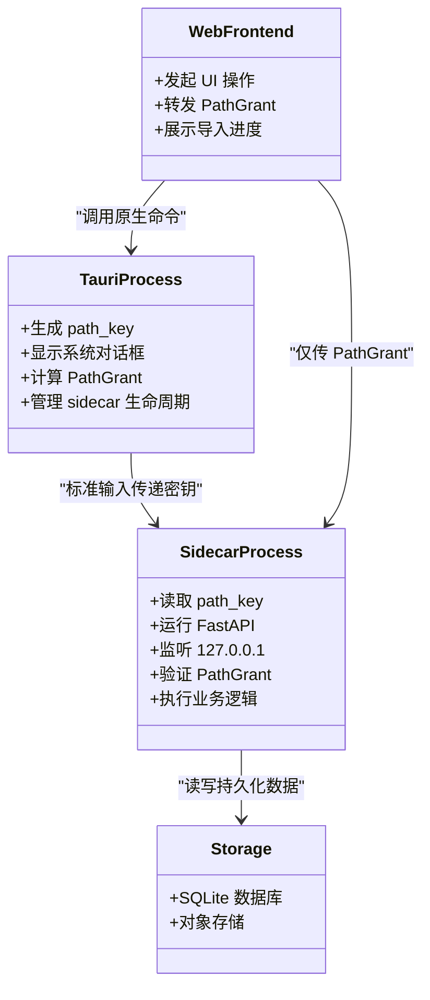

**图表来源**
- [desktop.py:91-146](file://src/personal_ai_life_os/desktop.py#L91-L146)
- [main.rs:72-123](file://desktop/src-tauri/src/main.rs#L72-L123)
- [desktop_chats.py:59-93](file://src/personal_ai_life_os/api/routes/desktop_chats.py#L59-L93)

**章节来源**
- [desktop.py:91-146](file://src/personal_ai_life_os/desktop.py#L91-L146)
- [main.rs:72-123](file://desktop/src-tauri/src/main.rs#L72-L123)
- [main.rs:222-263](file://desktop/src-tauri/src/main.rs#L222-L263)
- [desktop_chats.py:59-93](file://src/personal_ai_life_os/api/routes/desktop_chats.py#L59-L93)

## 依赖关系分析
以下关系体现了关键模块间的依赖流向：

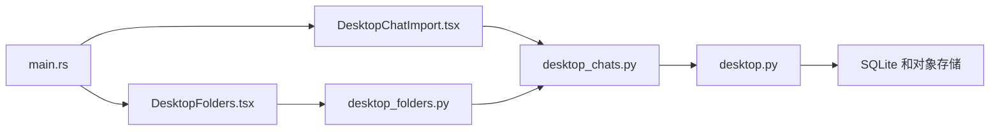

**图表来源**
- [DesktopFolders.tsx:60-89](file://web/src/DesktopFolders.tsx#L60-L89)
- [DesktopChatImport.tsx:84-120](file://web/src/DesktopChatImport.tsx#L84-L120)
- [desktop_chats.py:27-93](file://src/personal_ai_life_os/api/routes/desktop_chats.py#L27-L93)
- [desktop_folders.py:1-91](file://src/personal_ai_life_os/api/routes/desktop_folders.py#L1-L91)
- [main.rs:222-263](file://desktop/src-tauri/src/main.rs#L222-L263)

**章节来源**
- [desktop_chats.py:1-93](file://src/personal_ai_life_os/api/routes/desktop_chats.py#L1-L93)
- [desktop_folders.py:1-91](file://src/personal_ai_life_os/api/routes/desktop_folders.py#L1-L91)
- [main.rs:158-263](file://desktop/src-tauri/src/main.rs#L158-L263)
- [DesktopChatImport.tsx:26-151](file://web/src/DesktopChatImport.tsx#L26-L151)
- [DesktopFolders.tsx:60-121](file://web/src/DesktopFolders.tsx#L60-L121)

## 性能与并发特性
| 关注点 | 当前实现 | 评价与建议 |
|---|---|---|
| 并发聊天会话数 | 使用会话管理器限制最大会话数，并在超限时等待活跃操作完成 | 适合小批量桌面导入；大体积文件需限制并发，防止磁盘竞争 |
| 聊天读取线程 | 使用线程池，但配置了工作线程上限 | 应避免同时大量读取超大导出文件；建议加排队限流 |
| 文件变更检测 | 读取前后统计文件大小、修改时间、设备号和 inode | 有助于防止文件在预览和导入之间被替换 |
| 超时与就绪检查 | 原生进程等待 sidecar 就绪最多 45 秒 | 启动失败时应清晰提示查看日志 |
| 响应时间预期 | PathGrant 计算和本地验证很快；真正开销在后续导入/恢复阶段 | 应在导入前做容量预览和速率提示 |

**章节来源**
- [desktop_chats.py:41-59](file://src/personal_ai_life_os/api/routes/desktop_chats.py#L41-L59)
- [desktop_chats.py:95-108](file://src/personal_ai_life_os/api/routes/desktop_chats.py#L95-L108)
- [desktop.py:108-146](file://src/personal_ai_life_os/desktop.py#L108-L146)
- [main.rs:72-123](file://desktop/src-tauri/src/main.rs#L72-L123)

## 故障排查指南

| 现象 | 可能原因 | 排查步骤 |
|---|---|---|
| 返回“必须使用原生选择器” | 签名校验失败 | 检查 path_key 是否一致、是否经过非原生途径构造 Payload |
| 返回“原生选择已过期或不可用” | JWT 类时间超出范围 | 用户延迟过久；重新从原生选择器选择 |
| 路径不存在 | 文件或目录已被移动或删除 | 重新选择路径；不要缓存绝对路径 |
| 目录授权报错“请选择应用数据目录外的特定文件夹” | 选择了应用数据目录或其父级 | 选择外层用户目录或其他非受限目录 |
| Tauri 启动侧边车失败 | 标准输入未正确传递密钥或 sidecar 未在时限内就绪 | 查看 `logs/sidecar.log` |
| 聊天导出导入中被判文件变化 | 文件内容或属性发生变化 | 重新预览并重新导入 |
| 文件夹同步缺失项 | 源文件被删除但未刷新同步状态 | 使用“待确认删除”界面确认删除记录 |

**章节来源**
- [desktop_chats.py:59-108](file://src/personal_ai_life_os/api/routes/desktop_chats.py#L59-L108)
- [desktop_folders.py:55-132](file://src/personal_ai_life_os/api/routes/desktop_folders.py#L55-L132)
- [desktop.py:108-146](file://src/personal_ai_life_os/desktop.py#L108-L146)
- [main.rs:72-123](file://desktop/src-tauri/src/main.rs#L72-L123)

## 安全最佳实践与渗透测试建议

### 最佳实践
1. **不要让用户手动构造 PathGrant**：所有路径都必须来自 Tauri 原生对话框。
2. **不要放宽用途校验**：即使签名有效，也必须严格按当前接口要求的 `purpose` 校验。
3. **保持短时间窗口**：120 秒左右的时间戳限制能有效降低重放风险。
4. **坚持目录授权外部化**：不要允许应用数据目录本身成为监控目录。
5. **记录授权元数据**：通过 `SourceConnection`、`DesktopFolder`、`selected_scope` 记录谁授权了什么用途和来源。
6. **最小化日志输出**：sidecar 启动失败日志不应打印路径和密钥。
7. **仅监听回环地址**：避免将侧进程暴露给其他主机。
8. **禁止继承 Web 环境变量**：桌面端应有独立设置来源，避免意外加载云配置。

### 漏洞防护策略
| 攻击面 | 风险 | 防护建议 |
|---|---|---|
| HMAC 密钥泄露 | 可伪造任意路径 | 防止 path_key 泄漏，限制标准输入读取长度，避免将密钥写入临时文件或日志 |
| 重放攻击 | 拦截一次 PathGrant 后反复利用 | 缩短有效期，绑定用途，配合客户端会话上下文 |
| 路径遍历 | 尝试访问不受授权目录 | 统一要求绝对路径并结合 `resolve`；对目录场景再加根目录和应用数据目录过滤 |
| 权限提升 | 通过符号链接跳转到敏感目录 | 在高安全场景中考虑在 `resolve` 后再判断目标目录白名单 |
| 进程逃逸 | 原生层注入或篡改侧进程 | 保证 sidecar 启动路径来源可信；运行时校验侧进程存活状态 |
| 本地信息泄露 | sidecar 监听端口开放给本地攻击者 | 默认只绑定 `127.0.0.1`，必要时进一步限制 PID/CAP/访问控制 |
| 文件替换攻击 | 预览通过后文件中写恶意数据 | 继续维持 fingerprint 检查和流式导入中的中断检测 |

### 渗透测试建议
- 使用抓包工具尝试向 sidecar 发送手工 PathGrant，观察签名校验、用途校验和时间窗口效果。
- 尝试复制合法的 PathGrant 并在不同用途上复现。
- 在 PathGrant 过期后重试，验证错误返回。
- 尝试选择应用数据目录、系统盘根目录、符号链接、网络路径。
- 在预览过程中替换或重命名文件，验证指纹变化是否阻止导入。
- 长时间挂起 PathGrant 后再发送，观察是否被判定为过期。
- 启动失败后检查 sidecar.log，确认没有打印用户路径或密钥。
- 使用非 Tauri 客户端直连侧进程端口，测试 CORS、代理头禁用和鉴权缺口。

[本节为通用安全建议，不直接分析具体源码行]

## 结论
本项目的路径授权机制通过三个层次形成完整防线：前端仅承担交互，原生层承担可信路径捕获和签名，sidecar 负责密钥使用和最终路径验证。PathGrant 通过 HMAC-SHA256、用途绑定和短期时间戳防止伪造与重放；目录授权进一步限制应用数据目录，保障监控范围的合法性。

改进方向可以包括：
- 更严格的符号链接和软链接校验；
- 显式的路径白名单或受限目录策略；
- 更细粒度的令牌生命周期，比如单用一次性 token；
- 增加用户可见的授权清单和撤销审计；
- 对超大导出添加显式的速率限制和进度配额。

这些增强应以不牺牲现有简洁性和用户安全性为前提，优先强化已知路径选择器的可信边界。