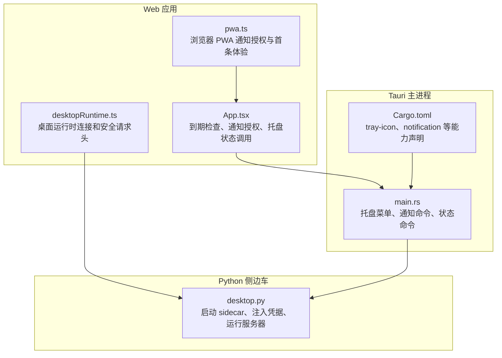
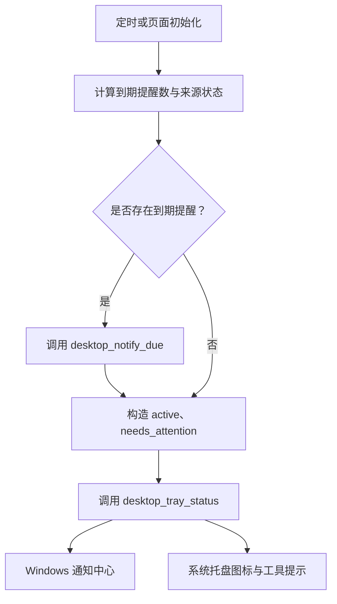
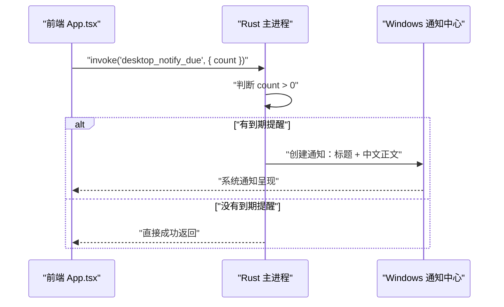
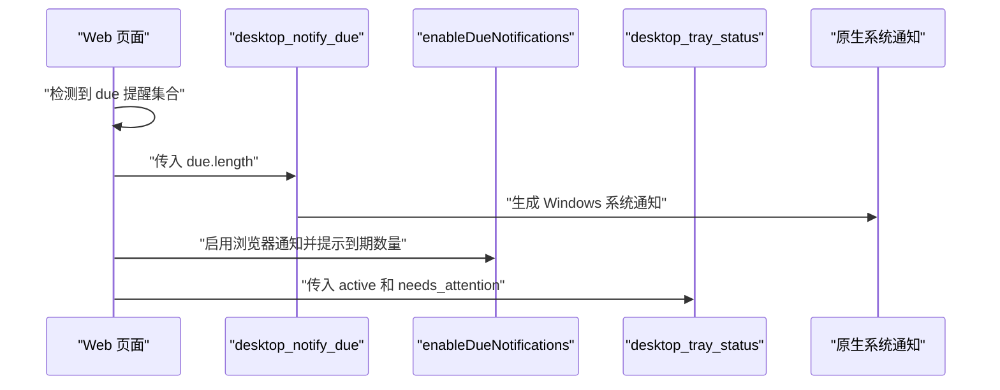
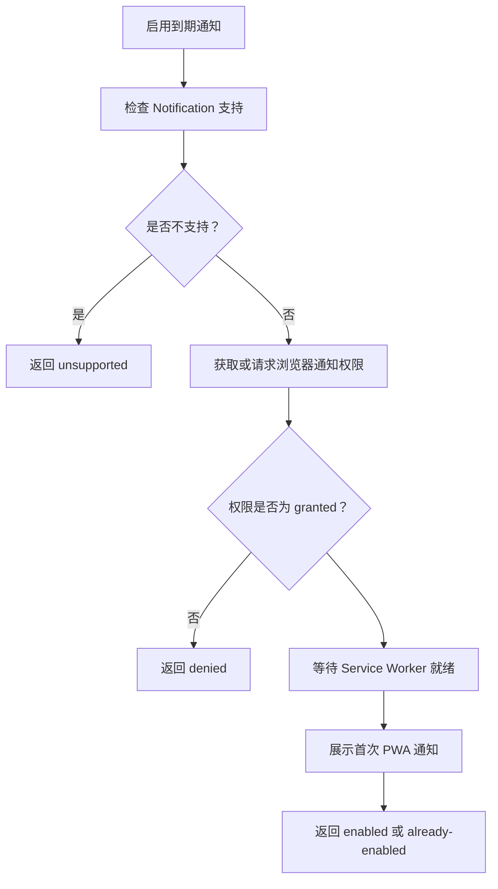
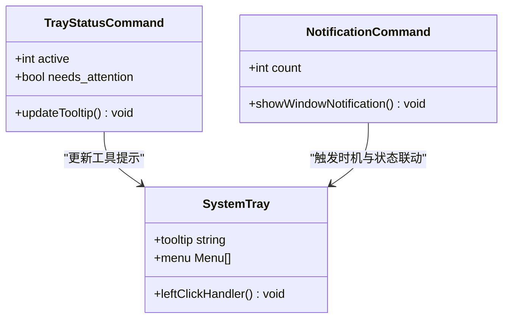
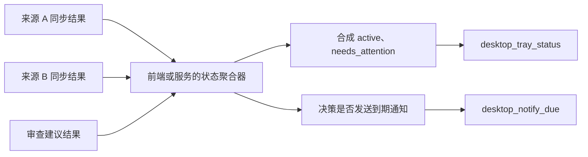
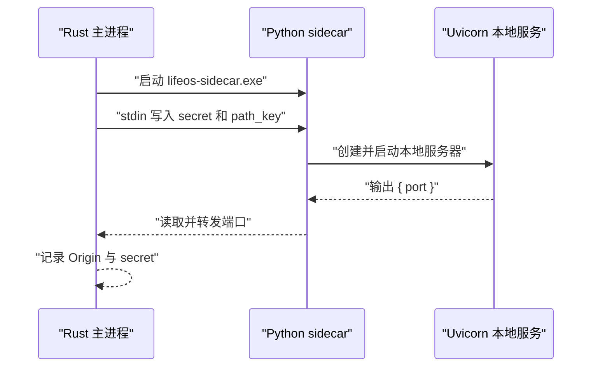

# 通知系统与托盘状态管理

<cite>
**本文引用的文件 **
- [main.rs](file://desktop/src-tauri/src/main.rs)
- [Cargo.toml](file://desktop/src-tauri/Cargo.toml)
- [desktop.py](file://src/personal_ai_life_os/desktop.py)
- [desktopRuntime.ts](file://web/src/desktopRuntime.ts)
- [App.tsx](file://web/src/App.tsx)
- [pwa.ts](file://web/src/pwa.ts)
</cite>

## 目录
1. [简介](#简介)
2. [项目结构与相关组件](#项目结构与相关组件)
3. [核心机制总览](#核心机制总览)
4. [Windows 通知中心集成](#windows-通知中心集成)
5. [到期提醒触发流程](#到期提醒触发流程)
6. [notify_due API 参数与中文文案](#notify_due-api-参数与中文文案)
7. [浏览器 PWA 通知辅助](#浏览器-pwa-通知辅助)
8. [托盘状态同步机制](#托盘状态同步机制)
9. [active 计数器与 needs_attention 标志](#active-计数器与-needs_attention-标志)
10. [多任务并行状态一致性](#多任务并行状态一致性)
11. [异步消息传递与性能优化](#异步消息传递与性能优化)
12. [跨平台兼容性](#跨平台兼容性)
13. [系统主题适配和无障碍访问](#系统主题适配和无障碍访问)
14. [用户反馈场景实现建议](#用户反馈场景实现建议)
15. [故障排查](#故障排查)
16. [结论](#结论)

## 简介
本文件面向 Personal AI Life OS 桌面端的通知系统和托盘状态管理，说明以下内容：
- Windows 通知中心如何通过 Tauri `tauri-plugin-notification` 插件展示到期提醒。
- 前端如何计算待处理提醒数量、调用原生托盘命令和更新系统托盘提示。
- Python 侧边车进程如何启动本地服务、注入安全凭据并配合桌面托盘能力工作。
- 在多个任务并行运行时，托盘的活跃目录数、注意力标志和工具提示如何保持一致。
- 跨浏览器与跨平台的兼容性边界，以及无障碍访问支持现状和改进建议。

该能力由四层协作构成：Web 应用层决定“是否显示通知”和“托盘状态语义”，Tauri 主进程负责“操作系统级通知和托盘图标更新”，Python 侧边车提供实际业务数据和后台处理能力，托盘状态则由前端主动上报到 Rust 主进程。

## 项目结构与相关组件
与通知及托盘相关的实现主要分布在三个位置：
- Tauri Rust 主进程：注册托盘菜单、暴露原生命令、输出 Windows 通知。
- Web 前端：负责业务计算（例如到期提醒数量）、调用 Tauri 命令和配置系统通知权限。
- Python 侧边车：承载 FastAPI 应用、迁移数据、通过标准输入与 Tauri 启动器通信。

**图表来源 **
- [App.tsx:320-370](file://web/src/App.tsx#L320-L370)
- [pwa.ts:80-108](file://web/src/pwa.ts#L80-L108)
- [desktopRuntime.ts:1-45](file://web/src/desktopRuntime.ts#L1-L45)
- [main.rs:270-385](file://desktop/src-tauri/src/main.rs#L270-L385)
- [Cargo.toml:1-19](file://desktop/src-tauri/Cargo.toml#L1-L19)
- [desktop.py:90-178](file://src/personal_ai_life_os/desktop.py#L90-L178)

**章节来源**
- [App.tsx:320-370](file://web/src/App.tsx#L320-L370)
- [desktopRuntime.ts:1-45](file://web/src/desktopRuntime.ts#L1-L45)
- [main.rs:270-385](file://desktop/src-tauri/src/main.rs#L270-L385)
- [desktop.py:90-178](file://src/personal_ai_life_os/desktop.py#L90-L178)
- [Cargo.toml:1-19](file://desktop/src-tauri/Cargo.toml#L1-L19)

## 核心机制总览
系统的通知和托盘状态可以看作两个独立但联动的通道：
1. **系统通知通道**：用于向用户发出短时、明确的提醒，如“有 N 条提醒已到期”。它适合一次性事件，不需要长期状态。
2. **托盘状态通道**：用于表达应用的常驻态信息，包括“有多少授权目录正在同步”以及“是否有需要用户注意的来源”。它适合长生命周期、可能频繁变化的界面外状态。

**图表来源 **
- [App.tsx:338-364](file://web/src/App.tsx#L338-L364)
- [main.rs:292-320](file://desktop/src-tauri/src/main.rs#L292-L320)

**章节来源**
- [App.tsx:338-364](file://web/src/App.tsx#L338-L364)
- [main.rs:292-320](file://desktop/src-tauri/src/main.rs#L292-L320)

## Windows 通知中心集成
Tauri 主进程使用 `tauri-plugin-notification` 插件向 Windows 通知中心发送通知。其关键路径如下：
- `Cargo.toml` 启用 `tauri-plugin-notification = "2"` 和 `tray-icon` 能力。
- Rust 主进程通过 `NotificationExt::builder()` 设置通知标题、正文并展示。
- 只有当计数大于 0 时才真正发送通知；否则直接返回成功，避免空通知。

当前实现将：
- 标题固定为 “Personal AI Life OS”。
- 正文使用带计数的中文格式：“有 {count} 条提醒已到期”。

**图表来源 **
- [main.rs:292-304](file://desktop/src-tauri/src/main.rs#L292-L304)

**章节来源**
- [main.rs:292-304](file://desktop/src-tauri/src/main.rs#L292-L304)
- [Cargo.toml:12-17](file://desktop/src-tauri/Cargo.toml#L12-L17)

## 到期提醒触发流程
到期提醒的触发由 Web 页面控制。其大致流程为：
1. 前端发现存在到期或逾期提醒。
2. 调用 `desktop_notify_due`，传入待处理的提醒数量。
3. 同时尝试启用浏览器 PWA 通知作为补充通道。
4. 根据数据来源的同步状态构建托盘状态，并调用 `desktop_tray_status`。

**图表来源 **
- [App.tsx:338-364](file://web/src/App.tsx#L338-L364)
- [main.rs:292-320](file://desktop/src-tauri/src/main.rs#L292-L320)

**章节来源**
- [App.tsx:338-364](file://web/src/App.tsx#L338-L364)

## notify_due API 参数与中文文案
Rust 主进程暴露的命令可理解为桌面端的“到期提醒入口”，其设计要点如下：

| 项目 | 含义 |
|---|---|
| 命令名称 | `desktop_notify_due` |
| 入参 | `count`，类型为无符号整数，表示需要提醒用户的到期提醒条数 |
| 行为 | 若 `count` 为 0，不发送系统通知；若大于 0，则发送一次 Windows 通知 |
| 返回值 | 成功或错误字符串，供前端统一错误处理 |
| 标题文案 | “Personal AI Life OS”，代表应用身份 |
| 正文文案 | 中文格式：“有 {count} 条提醒已到期” |

从接口契约看：
- 如果多条提醒批量到期，只发送一条聚合通知。
- 每次调用都依赖当前传入的数值进行判断，而不是维护 Rust 侧的过期计数状态。
- 错误会转成字符串异常返回，不会静默失败，有利于前端日志和调试。

这种设计适合“事件驱动型通知”：通知的粒度取决于前端何时触发调用，而不是 Rust 端自动轮询。

**章节来源**
- [main.rs:292-304](file://desktop/src-tauri/src/main.rs#L292-L304)

## 浏览器 PWA 通知辅助
除了 Windows 系统通知，前端还提供 PWA 通知能力，作为增强或替代方案：
- 如果浏览器不支持 `window.Notification`，返回 `unsupported`。
- 首次请求权限时使用 `requestPermission`；已授权时不重复弹窗。
- 成功后展示一条带有标签、图标和数据链接的首次通知，帮助用户理解提醒预期。
- Service Worker 就绪超时为 5 秒；即使超时也按失败处理，而不阻止其他功能。

| PWA 通知状态 | 含义 |
|---|---|
| `enabled` | 本次首次成功获得权限并显示通知 |
| `already-enabled` | 之前已有权限，直接复用 |
| `denied` | 用户拒绝通知 |
| `unsupported` | 浏览器不支持 `Notification` API |
| `failed` | 权限或通知发送发生异常 |

PWA 通知主要用于用户体验增强：即使用户关闭系统通知或处于 Web 环境，也可通过浏览器自身通知了解提醒情况。

**图表来源 **
- [pwa.ts:80-108](file://web/src/pwa.ts#L80-L108)

**章节来源**
- [pwa.ts:80-108](file://web/src/pwa.ts#L80-L108)

## 托盘状态同步机制
托盘状态的核心目标是：在不让用户一直打开窗口的情况下，通过托盘图标工具提示反映应用的整体工作状态。Rust 主进程提供的命令 `desktop_tray_status` 接受两个字段：
- `active`：通常表示“正在同步的授权目录数量”。
- `needs_attention`：布尔值，表示是否有来源需要用户处理，比如待审内容、导入冲突或其他需要关注的事项。

托盘文本逻辑如下：
- 如果 `needs_attention` 为真，工具提示状态文本采用 “部分来源需要处理”。
- 否则状态文本使用格式化后的活动目录计数：“{active} 个授权目录正在同步”。
- 完整工具提示以 “Personal AI Life OS · {状态文本}” 的形式呈现。

托盘本身还具备菜单项：
- “打开 Personal AI Life OS”：显示主窗口。
- “退出”：结束应用。

**图表来源 **
- [main.rs:305-320](file://desktop/src-tauri/src/main.rs#L305-L320)
- [main.rs:335-364](file://desktop/src-tauri/src/main.rs#L335-L364)

**章节来源**
- [main.rs:305-320](file://desktop/src-tauri/src/main.rs#L305-L320)
- [main.rs:335-364](file://desktop/src-tauri/src/main.rs#L335-L364)

## active 计数器与 needs_attention 标志
### active 计数器语义
在现有调用中，`active` 被用作“同步中的授权目录数”。它是一个非负整数，常用于以下语义：
- 0 个：可能表示没有活跃的订阅来源或未激活任何同步目标。
- 正数：表示有多少来源当前处于可用且参与同步的状态。
- 高并发：如果多个来源同时扫描、提取或入库，只要它们仍被视为“活动中”，就应累加到 `active`。

由于托盘文案直接拼接这个数字，后端或前端应在计数变更时尽量去重、避免瞬时抖动造成频繁 UI 刷新。

### needs_attention 标志语义
`needs_attention` 更像一个优先级标志，而不是一个计数：
- 真值表示存在比“常规同步”更需要用户介入的状态。
- 典型含义包括：有未审阅的审查建议、存在无法自动合并的来源、导入失败需要人工处理等。
- 它的优先级高于普通的 active 计数描述，因此会覆盖默认状态文本。

在实际系统中，该标志不应仅凭某个临时错误置位；建议使用稳定的后端状态，例如：
- 某类作业处于 `failed` 且尚未重试或取消。
- 某批来源标记为需要审批。
- 备份恢复流程进入需要用户选择策略的阶段。

**章节来源**
- [main.rs:305-320](file://desktop/src-tauri/src/main.rs#L305-L320)

## 多任务并行状态一致性
### 当前一致性保证模型
当前 Rust 端：
- `desktop_notify_due` 是无状态的；通知行为完全依赖前端传入的 `count`。
- `desktop_tray_status` 是无状态的；托盘文本完全依赖前端传入的 `active` 和 `needs_attention`。

这意味着 Rust 侧不维护“活动会话数”“待处理条目数”或“错误计数”的全局状态。状态一致性主要由调用方保证。

### 并发风险
如果没有统一的聚合器，可能出现以下问题：
- 多个来源并发完成同步，导致托盘状态在短时间内来回变化。
- 某些快速失败的异步任务提前清理计数，而另一些任务仍在进行中，导致数字不准。
- `needs_attention` 由局部错误短暂设置为真，随后很快消失，引起工具提示闪动。

### 建议的一致性模型
建议在前端或某个稳定服务组件中引入聚合状态对象，至少包含：
- `active_count`: 当前活跃的数据源数。
- `has_attention_item`: 是否存在需用户关注的条目。
- `last_stable_snapshot_time`: 最近一次稳定快照时间，用于防抖。
- `attention_reasons`: 导致 attention 的具体原因集合，便于后续扩展为详细摘要。

[无图表来源，因为这是通用一致性模型建议]

## 异步消息传递与性能优化
### Tauri 到 Python 的初始通信
Rust 主进程负责启动 Python 侧边车进程，并通过标准输入写入随机生成的密钥和路径签名 key。Python 侧读取这些值后启动 Uvicorn 服务，并通过标准输出写出服务就绪 JSON。

关键流程包括：
1. Rust 启动子进程，禁用控制台窗口。
2. Rust 写入 `secret` 和 `path_key`。
3. Rust 从子进程 stdout 读取一行 JSON，解析 `port`。
4. 若未在超时时间内收到有效端口，视为启动失败。
5. 主进程保存子进程句柄，并在退出时终止子进程。

这保证了前端只能通过已启动的侧边车访问内部 API，且 API 请求头携带 `X-LifeOS-Desktop: secret`，用于身份校验。

**图表来源 **
- [main.rs:1-120](file://desktop/src-tauri/src/main.rs#L1-L120)
- [desktop.py:60-178](file://src/personal_ai_life_os/desktop.py#L60-L178)

### 通知与托盘的性能考虑
- 系统通知是一次性操作，开销较小，但仍应避免每秒多次触发。
- 托盘工具提示更新成本较低，但高频更新仍然会影响 UI 响应。
- 建议在触发频率高于一定阈值时使用防抖或增量比较：只有数字或 attention 标志发生变化时才调用托盘更新命令。

**章节来源**
- [main.rs:1-120](file://desktop/src-tauri/src/main.rs#L1-L120)
- [desktop.py:60-178](file://src/personal_ai_life_os/desktop.py#L60-L178)
- [main.rs:292-320](file://desktop/src-tauri/src/main.rs#L292-L320)

## 跨平台兼容性
### 已知兼容面
当前实现显式使用：
- `tauri-plugin-notification` 用于通知。
- `tauri-plugin-dialog` 用于文件选择和文件夹选择。
- Windows 注册表项设置开机自启动。
- Windows 专用进程创建标志用于隐藏控制台窗口。
- Python 侧通过 `sys.platform == 'win32'` 启用 socket 独占绑定选项。

### 潜在限制
- 文档目标强调 Windows 通知中心集成，但代码中也使用了通用的 Tauri 托盘和通知接口；不同操作系统的行为会有差异。
- `tray_by_id("lifeos-tray")` 只在托盘已成功创建的窗口实例上可用；如果调用早于托盘构建完成，状态更新会被忽略。
- PWA 通知依赖 `Notification` API 和 Service Worker，在受限浏览器或旧版环境中可能不可用。

### 兼容性改进建议
1. 对托盘 ID 查询增加明确的前置保护：如果托盘不存在，记录警告而不是静默失败。
2. 对通知 API 封装统一错误类型，区分“平台不支持”“权限拒绝”“系统限制”等场景。
3. 在 Web 层检测 `isTauri()`，在非桌面环境下跳过 `desktop_notify_due` 和 `desktop_tray_status` 调用，避免无关平台错误。

**章节来源**
- [main.rs:201-260](file://desktop/src-tauri/src/main.rs#L201-L260)
- [main.rs:322-385](file://desktop/src-tauri/src/main.rs#L322-L385)
- [desktop.py:130-178](file://src/personal_ai_life_os/desktop.py#L130-L178)
- [desktopRuntime.ts:1-45](file://web/src/desktopRuntime.ts#L1-L45)

## 系统主题适配和无障碍访问
### 主题适配
当前实现：
- 标题和正文为纯文本。
- 托盘 tooltip 使用系统默认样式。
- 图标来自 Tauri 默认窗口图标。

因此，通知和托盘文字会自动跟随系统主题颜色，但不会有专门的暗色模式富文本或品牌配色通知体。对于无障碍而言，这对屏幕阅读器较友好。

### 无障碍访问建议
1. 将托盘 tooltip 保持简短可读：当前“Personal AI Life OS · 状态”的格式符合无障碍阅读习惯。
2. 如果需要扩展为详细通知内容，应使用语义化的短标题加上清晰的摘要正文，避免冗长技术细节。
3. 避免仅用颜色或闪烁传达状态；`needs_attention` 已经是一种明确的状态信号，可在未来配合可访问的高对比度提示。
4. 如果将来托盘支持更多交互按钮，应确保键盘导航和屏幕阅读器支持。

[本节提供通用指导，不直接分析具体代码片段]

## 用户反馈场景实现建议
基于当前已有的通知和托盘状态机制，可扩展出以下几类常见反馈场景：

### 批量处理完成通知
适用场景：数据导入、OCR 处理、知识图谱抽取完成后告知用户。
设计方案：
- 后端返回批次总结：成功数、失败数、跳过数。
- 前端根据汇总结果触发一条通知。
- 若全部成功，使用中性通知文案。
- 若有失败，提高 `needs_attention`，并附带简要失败来源。

### 错误警告
适用场景：连接源断开、权限失效、数据库迁移回滚、备份写入失败。
设计方案：
- 错误分类为 recoverable 和 unrecoverable。
- 可恢复错误使用较低优先级的托盘状态更新。
- 不可恢复错误提高 attention 标志，并在通知正文中给出可操作动作，如“查看来源”或“重新认证”。

### 进度指示
适用场景：长时间导入、大文件 OCR、图遍历。
设计方案：
- 定期调用 `desktop_tray_status` 更新活跃任务数和估计剩余量。
- 为避免频繁刷新，使用节流和差量比较：只在新数字或注意力标志变化时更新。
- 进度通知不要每步都发，而是合并为阶段性摘要，例如“已完成 40%”“开始最终索引构建”。

### 中断与恢复
适用场景：网络中断、用户切换来源、服务重启。
设计方案：
- 停止时立即将 `active` 重置为 0 或未知。
- 恢复后重新加载来源清单，再推送一次稳定的托盘状态。
- 通知中提示用户任务已中断，并提供恢复入口。

[本节为通用设计思路，不包含特定代码实现]

## 故障排查
### 常见问题与建议
| 现象 | 可能原因 | 排查建议 |
|---|---|---|
| 桌面通知不显示 | `count=0`、平台限制、通知权限关闭 | 检查前端调用时的计数，确认通知命令确实执行 |
| 托盘工具提示不更新 | 托盘尚未构建完成、ID 不一致、调用在托盘前 | 确保托盘初始化后更新；可增加失败日志 |
| PWA 通知被拒绝 | 用户拒权或浏览器不支持 | 查看 `enableDueNotifications` 返回状态 |
| 本地服务启动失败 | Python sidecar 未就绪、端口未返回 | 检查 `logs/sidecar.log` 和 Rust 启动超时 |
| 托盘状态频繁跳动 | 多处并行调用未聚合 | 引入前端聚合器和防抖机制 |

### Rust 侧关键排查点
- `desktop_notify_due` 只有在计数大于 0 时才会输出通知。
- `desktop_tray_status` 依赖托盘 ID “lifeos-tray”。
- 托盘菜单事件处理使用左键点击触发窗口显示。
- 窗口关闭事件被拦截并隐藏窗口，符合桌面应用常驻行为。

### Web 侧关键排查点
- `connectDesktop` 必须拿到有效的 runtime origin 才能向后端发请求。
- 桌面模式下所有 `/api/v1/...` 请求都会通过 Tauri 启动的本地服务发起。
- `enableDueNotifications` 可能因浏览器权限策略而无法发送通知，但不影响基础功能。

**章节来源**
- [main.rs:292-385](file://desktop/src-tauri/src/main.rs#L292-L385)
- [desktopRuntime.ts:1-45](file://web/src/desktopRuntime.ts#L1-L45)
- [pwa.ts:80-108](file://web/src/pwa.ts#L80-L108)

## 结论
本项目的通知与托盘状态管理以 Web 前端为决策入口，以 Tauri 主进程为系统能力桥接层，以 Python 侧边车为数据处理和服务层。核心设计优点是职责清晰：
- 通知命令专注一次性事件提醒。
- 托盘命令专注持续状态提示。
- PWA 通知作为 Web 环境的补充渠道。
- Rust 不持有复杂的应用状态，降低锁竞争与一致性问题。

如果要进一步提升稳定性和用户体验，建议重点完善：
1. 统一的活动状态聚合器，保证 `active` 和 `needs_attention` 的一致性和抗抖动。
2. 更丰富的错误分类和用户可操作提示。
3. 跨平台能力检测与降级策略。
4. 更完善的无障碍支持和可访问性测试。
5. 对托盘和通知调用的可观测性日志，便于生产环境定位间歇性问题。