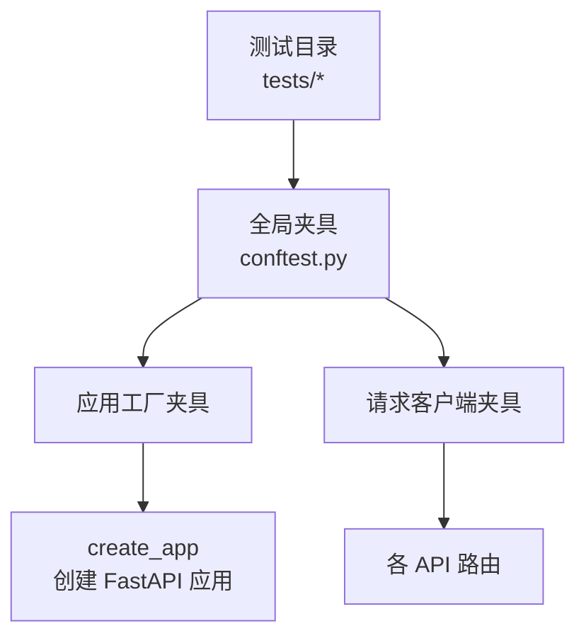
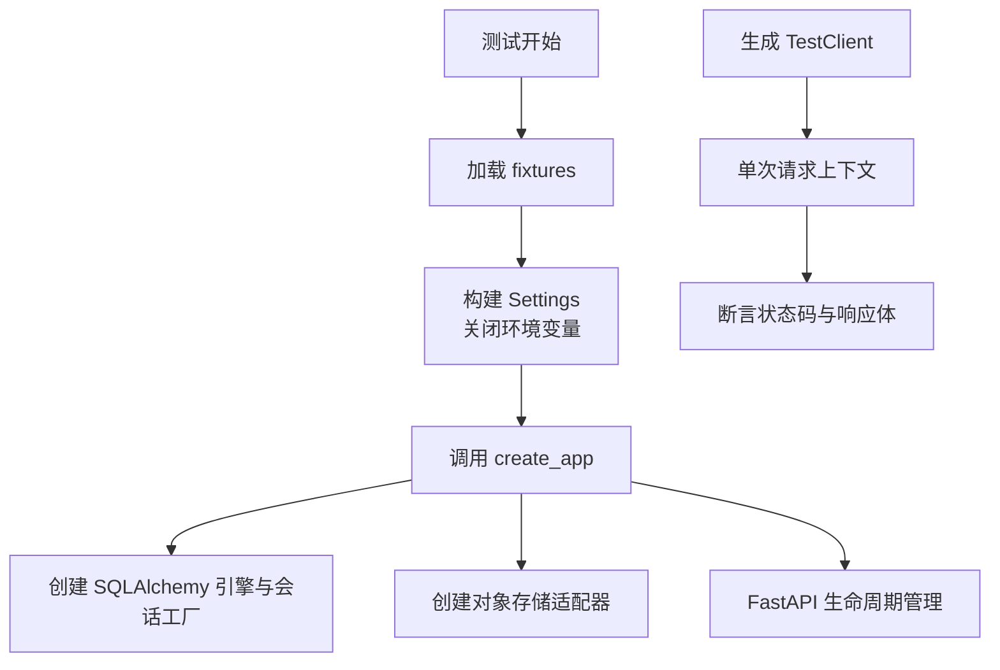
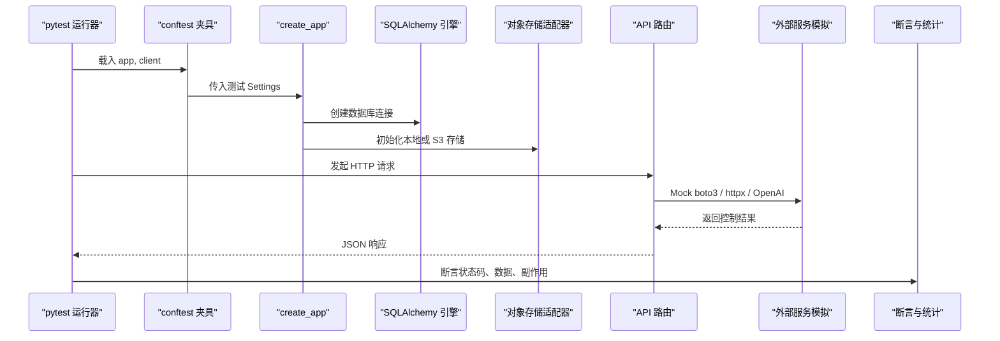
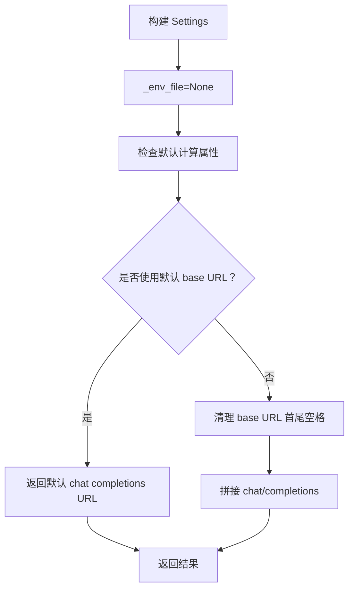
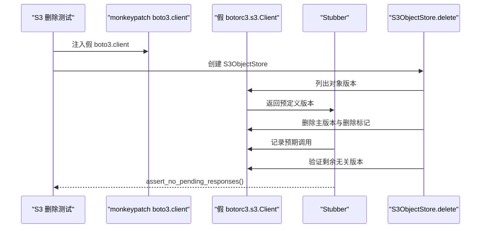
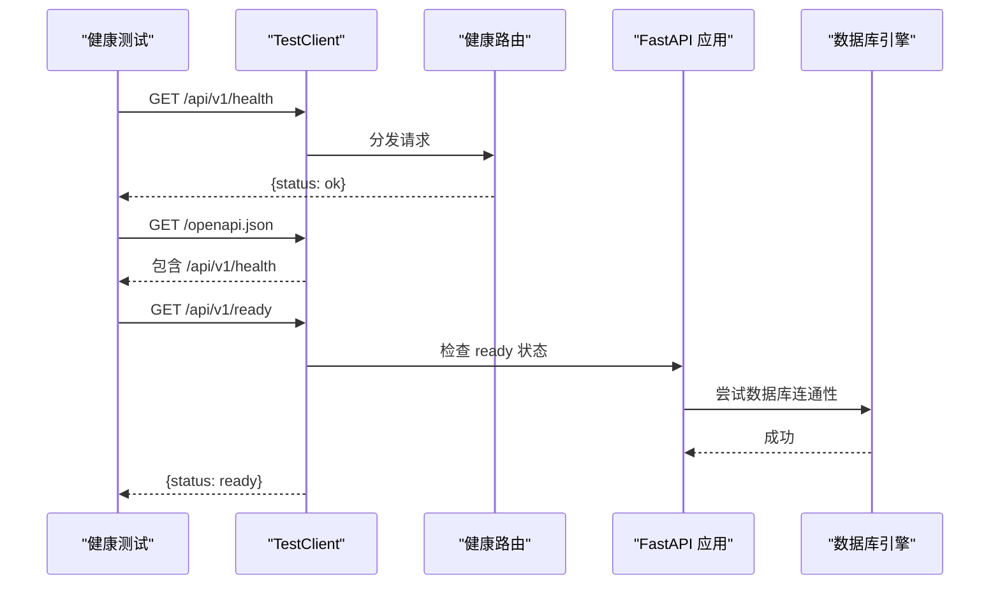
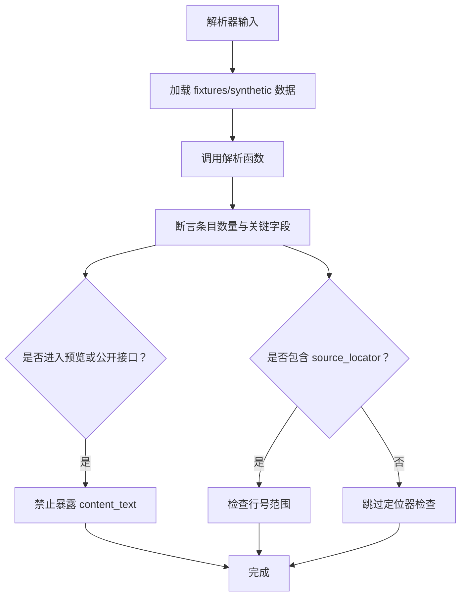
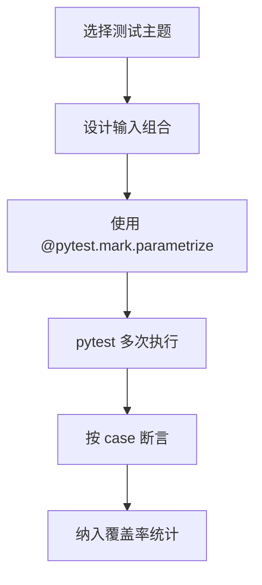
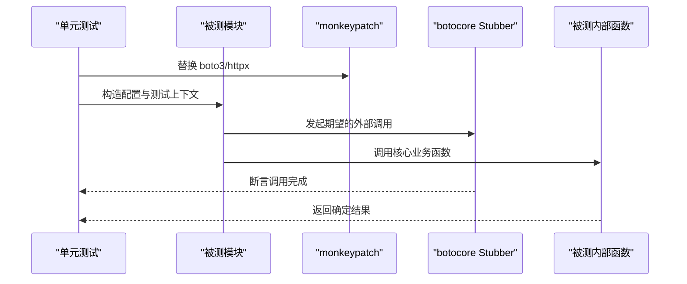
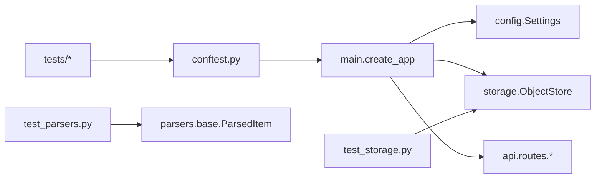

# 单元测试

<cite>
**本文引用的文件**
- [tests/conftest.py](file://tests/conftest.py)
- [pyproject.toml](file://pyproject.toml)
- [src/personal_ai_life_os/main.py](file://src/personal_ai_life_os/main.py)
- [src/personal_ai_life_os/config.py](file://src/personal_ai_life_os/config.py)
- [src/personal_ai_life_os/storage.py](file://src/personal_ai_life_os/storage.py)
- [src/personal_ai_life_os/parsers/base.py](file://src/personal_ai_life_os/parsers/base.py)
- [tests/test_health.py](file://tests/test_health.py)
- [tests/test_config.py](file://tests/test_config.py)
- [tests/test_storage.py](file://tests/test_storage.py)
- [tests/test_parsers.py](file://tests/test_parsers.py)
- [tests/test_imports_api.py](file://tests/test_imports_api.py)
- [tests/test_agent_actions.py](file://tests/test_agent_actions.py)
- [tests/test_graph_extraction.py](file://tests/test_graph_extraction.py)
</cite>

## 目录
1. [简介](#简介)
2. [项目测试结构](#项目测试结构)
3. [核心组件与入口](#核心组件与入口)
4. [架构总览](#架构总览)
5. [详细组件分析](#详细组件分析)
6. [依赖分析与隔离策略](#依赖分析与隔离策略)
7. [性能与执行特性](#性能与执行特性)
8. [故障排查指南](#故障排查指南)
9. [结论](#结论)
10. [附录：关键断言模式参考](#附录关键断言模式参考)

## 简介
本文面向 Personal-AI-Life-OS 项目的单元测试文档，重点说明基于 pytest 的测试实践。项目采用 FastAPI 应用、SQLAlchemy 数据库引擎和分层服务/解析器架构；测试通过 `conftest.py` 中的固定夹具构造受控应用实例，使用内存 SQLite 实现数据库隔离，并通过 Mock、参数化、路径临时目录等 pytest 能力保证可重复执行、快速失败和高覆盖率。

核心测试价值包括：
- 配置校验、安全默认值和生产环境约束验证。
- 对象存储适配器在本地和 S3 场景下的行为断言。
- 导入、注册登录、所有权隔离、限流和中断态的健康检查端点验证。
- 解析器的确定性输出、边界输入处理和隐私敏感字段过滤。
- 图谱提取流程中外部模型调用的 Mock 与幂等性验证。

## 项目测试结构
测试根目录为 `tests/`，pytest 将自动扫描该目录下的测试文件。项目元数据定义了依赖组和 pytest 基础选项：

- 开发依赖包含 pytest 和 pytest-cov。
- pytest 配置指定测试路径和报告优化开关。

**图示来源**
- [pyproject.toml:1-58](file://pyproject.toml#L1-L58)
- [tests/conftest.py:1-31](file://tests/conftest.py#L1-L31)

本节关注项目级 pytest 组织和运行入口，不直接分析具体业务测试，因此不包含“节来源”。

## 核心组件与入口
### 测试应用构建链
项目测试的核心入口是全局 fixture：

- `app(tmp_path)`：创建测试用 `Settings`，关闭环境变量读取、启用测试环境、将数据库 URL 指向临时目录下的 SQLite 文件、启用自动建表，并最终调用应用工厂。
- `client(app)`：在请求范围内包装 `TestClient`，确保每次测试共享一个稳定的 FastAPI 应用实例。
- `tmp_path`：由 pytest 提供，为每个测试用例提供隔离的临时目录，用于数据目录、SQLite 文件和日志清理。

应用工厂 `create_app` 负责组装数据库引擎、会话工厂、对象存储后端、桌面相关资源、后台工作线程和调度任务。测试环境下一般只启用基础 HTTP 能力，避免启动完整的 worker 或远端依赖。

**图示来源**
- [tests/conftest.py:6-31](file://tests/conftest.py#L6-L31)
- [src/personal_ai_life_os/main.py:1-150](file://src/personal_ai_life_os/main.py#L1-L150)

**节来源**
- [tests/conftest.py:6-31](file://tests/conftest.py#L6-L31)
- [src/personal_ai_life_os/main.py:1-200](file://src/personal_ai_life_os/main.py#L1-L200)

## 架构总览
下图展示了单元测试在执行时如何串起配置、应用、数据库、存储服务、API 路由、外部依赖模拟和测试结果断言。

**图示来源**
- [tests/conftest.py:6-31](file://tests/conftest.py#L6-L31)
- [src/personal_ai_life_os/main.py:1-200](file://src/personal_ai_life_os/main.py#L1-L200)
- [src/personal_ai_life_os/storage.py:1-120](file://src/personal_ai_life_os/storage.py#L1-L120)
- [tests/test_storage.py:1-59](file://tests/test_storage.py#L1-L59)

## 详细组件分析

### 配置模块测试
配置模块 `Settings` 是强类型设置模型，负责从环境变量加载、派生计算属性，并实现生产环境安全检查。测试覆盖以下维度：

| 测试目标 | 说明 |
|---|---|
| Chat Completions 默认 URL | 确认未显式配置时返回 OpenAI 标准补全地址。 |
| 兼容 Base URL 处理 | 确认首尾空格被去除、路径拼接正确。 |
| 生产环境校验 | 应覆盖默认 secret、自动建表、开放注册、CORS 源、S3 bucket 和外置模型隐私配置等约束。 |
| 开发或测试模式放行 | 非生产模式不应触发生产安全异常。 |

当前已存在的测试直接实例化 `Settings(_env_file=None)`，避免读 `.env`，使配置构造完全确定。这符合“测试环境不要读取真实环境变量”的最佳实践。

**图示来源**
- [src/personal_ai_life_os/config.py:1-132](file://src/personal_ai_life_os/config.py#L1-L132)

**节来源**
- [tests/test_config.py:1-11](file://tests/test_config.py#L1-L11)
- [src/personal_ai_life_os/config.py:1-132](file://src/personal_ai_life_os/config.py#L1-L132)

### 存储服务测试
对象存储接口通过 `ObjectStore` Protocol 抽象，实现包括 `LocalObjectStore` 和 `S3ObjectStore`。测试主要关注 S3 侧复杂删除和删除日志回放逻辑，因为本地文件系统可以依赖真实路径语义进行快速验证。

关键点：
- 使用 `monkeypatch` 替换 `boto3.client`，让所有 S3 客户端访问同一个假对象。
- 使用 `botocore.stub.Stubber` 添加预期调用链，并在结束时检查无待定请求。
- 断言版本对象与删除标记同时被删除，不会因删除再次产生新的 marker。
- 断言主 bucket 和日志 bucket 职责分离时的 tombstone 迁移。

**图示来源**
- [tests/test_storage.py:1-59](file://tests/test_storage.py#L1-L59)
- [src/personal_ai_life_os/storage.py:120-264](file://src/personal_ai_life_os/storage.py#L120-L264)

**节来源**
- [tests/test_storage.py:1-59](file://tests/test_storage.py#L1-L59)
- [src/personal_ai_life_os/storage.py:1-120](file://src/personal_ai_life_os/storage.py#L1-L120)

### 健康端点与应用生命周期
健康检查测试验证：
- `/api/v1/health` 返回服务正常状态。
- OpenAPI 描述中包含健康端点。
- `/api/v1/ready` 能够完成数据库可用性检查并返回就绪状态。

测试使用 `client` fixture，隐式复用 `create_app` 生成的应用实例。这表明健康检查属于无状态基础设施探针，应在应用启动后很快可用。

**图示来源**
- [tests/test_health.py:1-22](file://tests/test_health.py#L1-L22)
- [src/personal_ai_life_os/main.py:1-100](file://src/personal_ai_life_os/main.py#L1-L100)

**节来源**
- [tests/test_health.py:1-22](file://tests/test_health.py#L1-L22)

### 解析器测试
解析器公共模型位于 `parsers.base.ParsedItem`，测试围绕记忆 markdown 解析和 ChatGPT 导出解析展开。典型测试目标包括：

- 保留分段标题、行号定位器和空日期解析。
- 支持 Windows 换行符和空文档。
- 根据所选 conversation ID 筛选内容。
- 预览模式不返回原始消息正文。
- 拒绝不支持的输出格式或缺少选择参数的错误路径。

这些测试强调输入边界、跨平台换行、结构化定位信息和隐私输出。对于大型文档或网络导入，建议将大文本放在 `fixtures/synthetic/` 下，并通过相对路径加载，减少测试文件膨胀。

**图示来源**
- [tests/test_parsers.py:1-67](file://tests/test_parsers.py#L1-L67)
- [src/personal_ai_life_os/parsers/base.py:1-17](file://src/personal_ai_life_os/parsers/base.py#L1-L17)

**节来源**
- [tests/test_parsers.py:1-67](file://tests/test_parsers.py#L1-L67)
- [src/personal_ai_life_os/parsers/base.py:1-17](file://src/personal_ai_life_os/parsers/base.py#L1-L17)

### 异步与并发相关的测试要点
尽管现有展示示例以同步 FastAPI 路由为主，但仓库中存在多线程、后台 worker 和调度器逻辑，测试需要注意：

| 场景 | 建议实践 |
|---|---|
| 异步端点 | 使用 `pytest-asyncio`，并将测试函数声明为异步；对数据库操作封装异步会话或使用 `AsyncSession`。 |
| 后台线程 | 在 `create_app` 生命周期中等待 worker、scheduler 停止信号；必要时使用 `time.sleep` 或条件变量进行收敛，但应限制超时。 |
| 并发上传或搜索 | 使用 `ThreadPoolExecutor` 或 pytest 的 xdist；确保每租户隔离和幂等导入，避免写入竞态。 |
| 时间相关行为 | 使用虚拟时钟或直接断言 ISO 字符串；避免直接使用系统时钟做相等断言。 |

项目中已经存在 `from concurrent.futures import ThreadPoolExecutor` 的导入位置，表明导入与指标统计等端到端测试会涉及并发场景。编写并发测试时，应优先保证每个用例使用独立的 `tmp_path`、独立 session 和独立 object store root，再断言聚合指标。

**节来源**
- [tests/test_imports_api.py:1-150](file://tests/test_imports_api.py#L1-L150)

### 参数化测试实践
参数化适合测试同一逻辑在不同输入组合下的结果。本项目已有如下风格示例：

- 使用 `@pytest.mark.parametrize("newline", ["\\n", "\\r\\n", "\\r"])` 验证不同换行符下的解析器输出一致。
- 为 parser 空文档、缺失 key、未知 shape 提供多组异常路径。
- 在配置测试中，分别断言默认 URL 和自定义 base URL 的行为。

推荐扩展方式：
- 对外部 provider URL、object store backend、CSV/Markdown/JSON 输入组合参数化。
- 对配额上限、上传大小限制、认证重试次数参数化。
- 使用 `[pytest] markers` 将长时间运行的 S3 测试或网络测试标注为可选。

[本图为概念说明，不对应具体源码结构，因此不包含图示来源。]

### Mock 外部依赖与服务调用
本项目测试主要采用两类 mock 机制：

1. **进程内替换**：pytest `monkeypatch` 替换模块属性，例如替换 `cli.httpx.post`，从而避免真实网络请求。
2. **SDK 仿真器**：`botocore.stub.Stubber` 精确约定 boto3 调用的参数顺序与返回值，适合 S3 协议测试。
3. **函数级补丁**：对业务模块内部函数如 `_call_graph_model` 进行替换，绕过远程模型调用。

Mock 原则：
- 只替换外部 I/O 和行为不可预测的部分。
- 保留业务函数内部的真实校验逻辑。
- 明确期望副作用，例如对象删除数量、索引重建、事件记录。
- 对共享 `settings` 做隔离修改，或在 fixture 层传入 test-only instance。

**图示来源**
- [tests/test_storage.py:1-59](file://tests/test_storage.py#L1-L59)
- [tests/test_cli.py:1-120](file://tests/test_cli.py#L1-L120)
- [tests/test_graph_extraction.py:1-120](file://tests/test_graph_extraction.py#L1-L120)

**节来源**
- [tests/test_storage.py:1-59](file://tests/test_storage.py#L1-L59)
- [tests/test_cli.py:1-120](file://tests/test_cli.py#L1-L120)
- [tests/test_graph_extraction.py:1-120](file://tests/test_graph_extraction.py#L1-L120)

### 针对配置模块、存储服务、解析器等核心组件的测试示例说明

| 组件 | 代表测试文件 | 测试重点 |
|---|---|---|
| 配置模块 | [test_config.py](file://tests/test_config.py) | Settings 默认值、URL 派生、生产环境强制校验。 |
| 存储服务 | [test_storage.py](file://tests/test_storage.py) | S3 删除版本与标记、主 bucket 与日志 bucket 回填。 |
| 解析器 | [test_parsers.py](file://tests/test_parsers.py) | Markdown/ChatGPT 解析、定位信息、隐私输出、异常形状。 |
| 健康与应用 | [test_health.py](file://tests/test_health.py) | 健康、OpenAPI、就绪检查。 |
| 导入与所有权 | [test_imports_api.py](file://tests/test_imports_api.py) | 暂停导入、注册登录、鉴权、幂等、租户隔离、指标窗口。 |
| Agent 动作审计 | [test_agent_actions.py](file://tests/test_agent_actions.py) | 创建、撤销、预算耗尽拒绝、红线工具审计。 |
| 图谱提取 | [test_graph_extraction.py](file://tests/test_graph_extraction.py) | 模型输出 mock、实体关系持久化、低置信度审查、幂等提取。 |

**节来源**
- [tests/test_config.py:1-11](file://tests/test_config.py#L1-L11)
- [tests/test_storage.py:1-59](file://tests/test_storage.py#L1-L59)
- [tests/test_parsers.py:1-67](file://tests/test_parsers.py#L1-L67)
- [tests/test_health.py:1-22](file://tests/test_health.py#L1-L22)
- [tests/test_imports_api.py:1-150](file://tests/test_imports_api.py#L1-L150)
- [tests/test_agent_actions.py:1-200](file://tests/test_agent_actions.py#L1-L200)
- [tests/test_graph_extraction.py:1-120](file://tests/test_graph_extraction.py#L1-L120)

## 依赖分析与隔离策略

### 组件耦合图

**图示来源**
- [tests/conftest.py:6-31](file://tests/conftest.py#L6-L31)
- [src/personal_ai_life_os/main.py:1-150](file://src/personal_ai_life_os/main.py#L1-L150)
- [src/personal_ai_life_os/config.py:1-132](file://src/personal_ai_life_os/config.py#L1-L132)
- [src/personal_ai_life_os/storage.py:1-120](file://src/personal_ai_life_os/storage.py#L1-L120)
- [src/personal_ai_life_os/parsers/base.py:1-17](file://src/personal_ai_life_os/parsers/base.py#L1-L17)

### 隔离策略
| 依赖类型 | 隔离方式 | 原因 |
|---|---|---|
| 数据库 | 临时目录 SQLite + `auto_create_schema=True` | 避免污染真实数据库，每次测试具备相同初始结构。 |
| 文件系统 | `tmp_path` 隔离 data_dir 和 object store root | 防止写入冲突，便于 pytest 自动清理。 |
| 网络 | 不使用真实网络 | 通过 `TestClient`、`httpx` patch、Stubber 提高稳定性。 |
| 外部模型 | 替换内部调用函数 | 避免 OOM、速率限制、费用和非确定性结果。 |
| 环境变量 | `_env_file=None` 和 `monkeypatch` | 避免 CI 或本地 `.env` 影响测试断言。 |

**节来源**
- [tests/conftest.py:6-31](file://tests/conftest.py#L6-L31)
- [src/personal_ai_life_os/main.py:1-150](file://src/personal_ai_life_os/main.py#L1-L150)

## 性能与执行特性
- pytest 配置启用了 `-ra` 选项，以便收集全部测试结果的附加信息，帮助调试失败案例。
- 测试路径默认限定为 `tests`，有利于缩小测试集规模。
- SQLite 在 `tmp_path` 下执行，适合大多数单元测试；PostgreSQL 相关逻辑可通过 `ensure_postgres_search_indexes` 分支在需要时单独集成测试覆盖。
- S3 测试使用 Stubber，不涉及真实 HTTP 请求；对大规模数据集建议按 fixture 拆分，避免单例测试过慢。
- 对于并发测试，应谨慎使用线程池；优先保证幂等性，再用短时间 sleep 收敛后台事件。

[本节为通用性能建议，不直接分析具体源码片段，因此不包含“节来源”。]

## 故障排查指南

### 常见失败原因与定位方法
1. **数据库相关失败**
   - 检查是否使用了共享数据库而非 tmp_path SQLite。
   - 检查 schema 是否自动创建，或未提交事务导致下游查询为空。
   - 对 PostgreSQL 特有分支，确认是否在独立集成测试环境中运行。

2. **外部依赖未 Mock**
   - 如果出现网络请求失败，优先排查是否遗漏了 `monkeypatch` 或 `Stubber`。
   - 对 S3 测试，确认 `assert_no_pending_responses()` 是否被调用。

3. **环境变量污染**
   - 如果配置断言不符合预期，检查是否在测试外设置了 `.env` 或环境变量。
   - 配置类测试应始终传递 `_env_file=None`。

4. **并发与线程竞争**
   - 中断导入、指标采样、worker 和 scheduler 并发时，适当延长短暂等待或使用原子断言。
   - 避免多个测试同时写相同 `data_dir`。

5. **断言过于脆弱**
   - 使用业务关键词断言响应状态和 error code，而不是硬编码完整 JSON。
   - 对列表顺序不敏感的字段使用集合比较或排序后再断言。

### 调试失败测试用例
推荐步骤：
- 使用 `pytest -vv` 获得更详细的输出。
- 对单个文件使用 `pytest tests/test_xxx.py -v --tb=long`。
- 查看 pytest 捕获的 stdout/stderr、临时目录和 SQLite 文件。
- 在断言前打印被测对象的序列化形式，但不要泄露令牌或敏感数据。
- 将失败复现用例拆分为最小测试，便于持续集成定位。

[本节为通用调试建议，不包含“节来源”。]

## 结论
Personal-AI-Life-OS 的测试体系围绕 FastAPI、配置对象、存储服务、解析器和工作流 API 构建，以 `conftest.py` 中的 application fixture 为中心，结合 pytest 的参数化、monkeypatch、stubbing、tmp_path、测试客户端和覆盖率插件，形成可维护、可隔离且高度确定性的单元测试环境。

最佳实践总结：
- 使用 fixture 统一构建 Settings、FastAPI 应用和 TestClient。
- 对外部依赖使用 monkeypatch 或 Stubber，避免网络与非确定性行为。
- 使用 tmp_path 管理数据库、对象存储和用户文件。
- 对解析器输入进行多形态参数化，覆盖换行、空文档、缺失字段和隐私数据。
- 对长流程使用业务状态、错误代码和幂等性断言，而不是浅层 JSON 匹配。
- 使用 pytest-cov 评估覆盖率，并定期审视未覆盖分支。

## 附录：关键断言模式参考

### 测试覆盖率工具使用方法
- 安装依赖：项目已将 `pytest>=8.3,<10` 与 `pytest-cov>=6,<8` 列为开发依赖。
- 基本执行：在项目根目录运行 pytest，并在命令中追加 `--cov=personal_ai_life_os --cov-report=term-missing`。
- 生成 HTML：追加 `--cov-report=html`，可在浏览器中查看未覆盖行。
- 仅运行测试模块：例如 `pytest tests/test_config.py -v`。
- 忽略非必要外部依赖：可为 S3、网络、OpenAI 等测试添加 marker 并按需运行。

覆盖率报告解读技巧：
- 优先补充配置模块、异常分支、生产环境校验和存储路径验证分支。
- 对高成本外部调用分支保持 stubbed 高覆盖，避免网络随机因素干扰阈值。
- 不要把覆盖率当作唯一质量指标，还需关注回归测试、端到端流程和安全性。

[本附录提供通用工具指导，不直接引用源码，因此不包含“节来源”。]