# 测试基础设施

<cite>
**本文引用的文件**   
- [README.md](file://README.md)
- [CONTRIBUTING.md](file://CONTRIBUTING.md)
- [pyproject.toml](file://pyproject.toml)
- [docker-compose.yml](file://docker-compose.yml)
- [docker-compose.production.yml](file://docker-compose.production.yml)
- [Dockerfile](file://Dockerfile)
- [docs/operations/desktop-acceptance.md](file://docs/operations/desktop-acceptance.md)
- [fixtures/synthetic/README.md](file://fixtures/synthetic/README.md)
- [.github/workflows/ci.yml](file://.github/workflows/ci.yml)
- [.github/workflows/desktop.yml](file://.github/workflows/desktop.yml)
- [tests/conftest.py](file://tests/conftest.py)
- [src/personal_ai_life_os/config.py](file://src/personal_ai_life_os/config.py)
- [src/personal_ai_life_os/main.py](file://src/personal_ai_life_os/main.py)
- [scripts/benchmark_mvp.py](file://scripts/benchmark_mvp.py)
- [scripts/evaluate_reviews.py](file://scripts/evaluate_reviews.py)
- [scripts/evaluate_search.py](file://scripts/evaluate_search.py)
- [scripts/evaluate_graph_qa.py](file://scripts/evaluate_graph_qa.py)
- [scripts/verify_photo_ocr.py](file://scripts/verify_photo_ocr.py)
- [scripts/rebuild_search_index.py](file://scripts/rebuild_search_index.py)
</cite>

## 目录
1. [简介](#简介)
2. [项目结构](#项目结构)
3. [核心组件](#核心组件)
4. [架构总览](#架构总览)
5. [详细组件分析](#详细组件分析)
6. [依赖关系分析](#依赖关系分析)
7. [性能考量](#性能考量)
8. [故障排查指南](#故障排查指南)
9. [结论](#结论)

## 简介
本文件系统梳理 Personal-AI-Life-OS 的质量保障和测试基础设施，重点覆盖单元测试、合成数据验证脚本、基准测试、端到端验收、持续集成流水线以及容器化测试环境。项目的自动化测试围绕以下目标展开：

- 为 API、CLI、导入解析器、图谱证据、周复盘检索等核心流程提供可复现的单元测试与端到端校验。
- 使用合成数据集运行确定性评估脚本，验证模型模板输出质量、搜索准确性与图片 OCR 正确性。
- 通过独立基准脚本测量时间线查询、批量导入、检索延迟和准确率，支撑性能基线和回归检测。
- 使用 Docker Compose 拉起 PostgreSQL、API 和 Web 服务，为本地和 CI 环境准备一致的数据库和服务依赖。
- 在 GitHub Actions 中并行执行多 Python 版本、Web 前端构建、Docker Compose 冒烟检查，并产出 Windows 桌面候选包作为工作流产物。
- 借助 PyTest、Ruff 和 `pytest-cov`（由配置启用）提供静态检查、测试结果收集和覆盖率统计基础。

该文档同时说明如何扩展基准数据、引入随机种子控制、隔离测试数据、生成覆盖率报告，以及在持续集成中集成这些步骤以形成质量门禁。

**章节来源**
- [README.md:82-105](file://README.md#L82-L105)
- [CONTRIBUTING.md:1-25](file://CONTRIBUTING.md#L1-L25)

## 项目结构
仓库中的测试和质量相关内容主要分布在以下区域：

| 路径 | 职责 | 关键文件 |
| --- | --- | --- |
| `tests/` | PyTest 单元测试入口和公共 fixture | `conftest.py` 以及多个模块级测试文件 |
| `scripts/` | 合成评估、基准测试、索引重建和 OCR 验证脚本 | `benchmark_mvp.py`、`evaluate_reviews.py`、`evaluate_search.py`、`evaluate_graph_qa.py`、`verify_photo_ocr.py`、`rebuild_search_index.py` |
| `fixtures/synthetic/` | 不可真实替换的合成数据，用于导入、审查、评估和重复导入去重验证 | `README.md`、`review-eval.json`、`expected-ingest.json`、`conversations.json` 等 |
| `.github/workflows/` | GitHub Actions 持续集成和 Windows 桌面验证 | `ci.yml`、`desktop.yml` |
| `docker-compose*.yml` 及 `Dockerfile` | 开发、生产部署与服务健康探针；测试环境可复用其服务和环境变量模式 | `docker-compose.yml`、`docker-compose.production.yml`、`Dockerfile` |
| `web/e2e/` 和 `web/playwright.config.ts` | 浏览器端到端用例和 Playwright 配置（与后端 API、OCR、索引重建配合） | `m10.spec.ts`、`workflow.spec.ts` |
| `pyproject.toml` | PyTest 路径、参数、覆盖率包、Ruff 代码质量工具配置 | `pyproject.toml` |

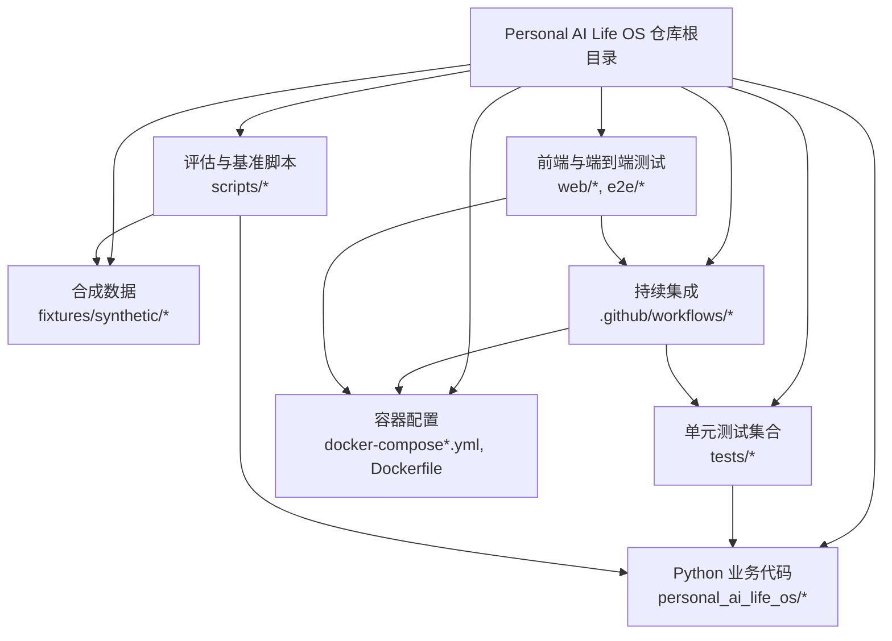

**图表来源**
- [README.md:96-105](file://README.md#L96-L105)
- [pyproject.toml:32-58](file://pyproject.toml#L32-L58)
- [.github/workflows/ci.yml:1-57](file://.github/workflows/ci.yml#L1-L57)

**章节来源**
- [README.md:96-105](file://README.md#L96-L105)
- [pyproject.toml:32-58](file://pyproject.toml#L32-L58)

## 核心组件
测试基础设施的核心由四层组成：

1. **测试运行时环境**：PyTest 从 `tests` 目录加载用例，默认 `-ra` 失败摘要选项；Ruff 提供静态检查；`pytest-cov` 支持覆盖率收集。
2. **应用测试夹具**：`tests/conftest.py` 通过 `Settings` 创建测试配置，构造 SQLite 数据库和 FastAPI 的 `TestClient`，实现测试隔离。
3. **合成数据与评估脚本**：`fixtures/synthetic/` 提供固定的数据场景，评估脚本分别验证模板式周复盘、统一搜索准确性和图谱问答准确性。
4. **基准测试与外部集成验证**：基准脚本在 SQLite 或临时 PostgreSQL 中注入约一万条数据并测量 P95 延迟；OCR 验证脚本通过 HTTP 客户端对接实际运行的 Compose 栈。
5. **持续集成流水线**：CI 矩阵执行 Python lint、单元测试和 Web 构建；Docker Compose 冒烟检查启动 API、数据库并探测健康端口；Windows 桌面工作流负责打包与冒烟安装。

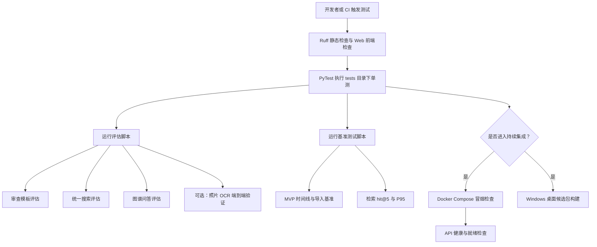

**图表来源**
- [.github/workflows/ci.yml:8-57](file://.github/workflows/ci.yml#L8-L57)
- [.github/workflows/desktop.yml:1-47](file://.github/workflows/desktop.yml#L1-L47)
- [scripts/benchmark_mvp.py:1-200](file://scripts/benchmark_mvp.py#L1-L200)
- [scripts/evaluate_search.py:1-50](file://scripts/evaluate_search.py#L1-L50)

**章节来源**
- [pyproject.toml:32-58](file://pyproject.toml#L32-L58)
- [tests/conftest.py:1-31](file://tests/conftest.py#L1-L31)
- [scripts/evaluate_reviews.py:1-50](file://scripts/evaluate_reviews.py#L1-L50)

## 架构总览
下面的类图展示了评估相关的主要对象与其依赖关系。评估脚本通常依赖应用配置、FastAPI 应用构造、模型实体、服务层和持久化接口；基准脚本进一步直接操作 SQLAlchemy 引擎与 schema。

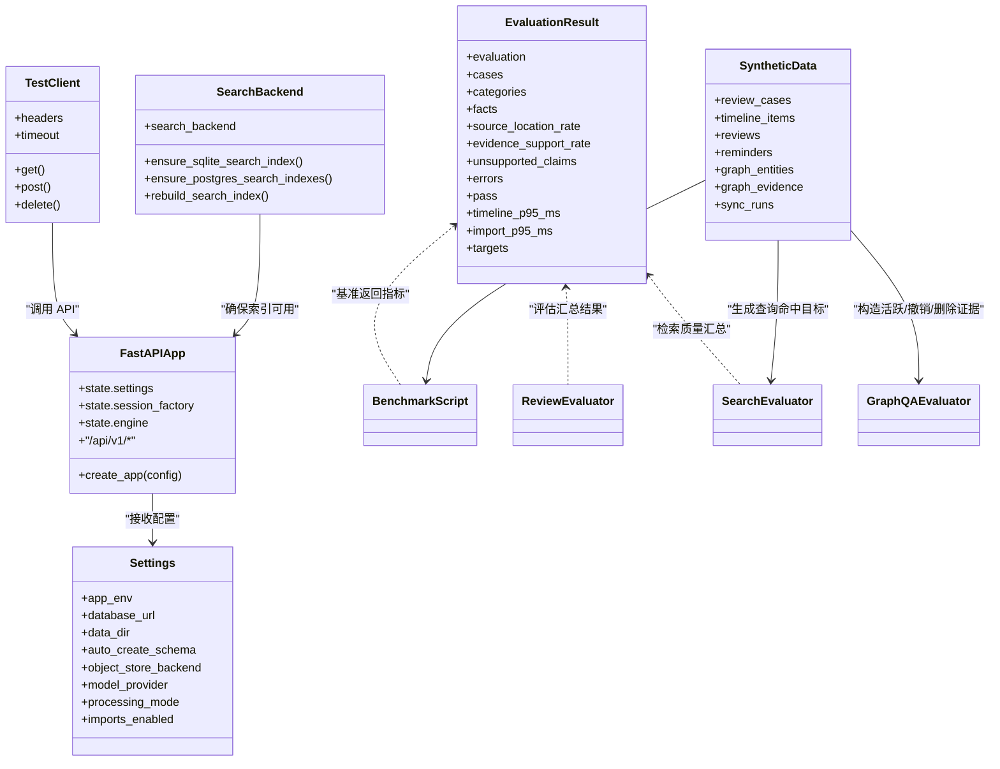

**图表来源**
- [src/personal_ai_life_os/config.py:10-132](file://src/personal_ai_life_os/config.py#L10-L132)
- [src/personal_ai_life_os/main.py:1-200](file://src/personal_ai_life_os/main.py#L1-L200)
- [scripts/benchmark_mvp.py:1-200](file://scripts/benchmark_mvp.py#L1-L200)
- [scripts/evaluate_search.py:1-120](file://scripts/evaluate_search.py#L1-L120)

## 详细组件分析

### 测试夹具与应用注入
`tests/conftest.py` 定义了两个关键 fixture：

- `app`：使用 `Settings` 显式关闭外部环境读取 `_env_file=None`，设置 `app_env="test"`，指向临时 `tmp_path` 下的 SQLite 数据库，并启用自动建表。对象存储设为 `local`，模型提供方设为 `none`，注册模式设为 `open`，从而保证单元测试不需要外部服务、AI 提供商或网络。
- `client`：基于 FastAPI 的 `TestClient` 包裹应用实例，为每个需要 HTTP 交互的用例提供上下文管理器。

这种设计的优势是：

- 每个用例拥有临时、隔离的 SQLite 文件和资源目录。
- 不依赖外部 Postgres、Redis、Tesseract、S3 或 OpenAI。
- 通过显式配置替代全局环境变量，提高用例的可组合性和可移植性。

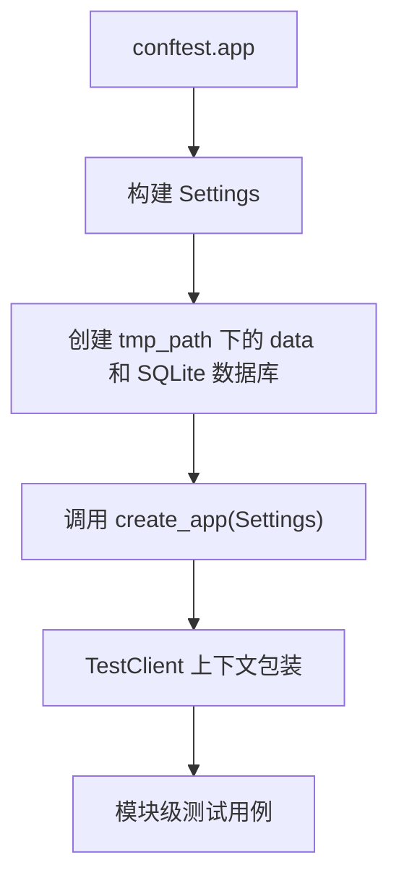

**图表来源**
- [tests/conftest.py:1-31](file://tests/conftest.py#L1-L31)
- [src/personal_ai_life_os/config.py:10-40](file://src/personal_ai_life_os/config.py#L10-L40)
- [src/personal_ai_life_os/main.py:34-130](file://src/personal_ai_life_os/main.py#L34-L130)

**章节来源**
- [tests/conftest.py:1-31](file://tests/conftest.py#L1-L31)
- [src/personal_ai_life_os/config.py:10-40](file://src/personal_ai_life_os/config.py#L10-L40)

### 应用生命周期与后台任务
应用入口 `main.py` 暴露 `create_app`，并由测试夹具和所有脚本共用。它完成以下与测试相关的工作：

- 初始化数据库引擎、Session 工厂和对象存储。
- 在应用 lifespan 中创建 schema、SQLite/PostgreSQL 搜索索引，并重放删除墓碑。
- 当 `PROCESSING_MODE=worker` 时启动后台 worker、计划任务和可选桌面同步与备份线程。
- 注册通用中间件：桌面模式令牌校验、登录/注册/导入速率限制、上传暂停控制和响应头注入。
- 把 settings、engine、session_factory、object_store、请求样本队列等状态挂到 `FastAPI.application.state`。

对于测试来说，最重要的行为是：

- 大多数普通单测使用 `inline` 处理模式（或完全不调用 worker），因此无需外部 Tesseract。
- 真正需要 OCR、异步 job 的场景应由 `scripts/verify_photo_ocr.py` 在 Compose 环境中执行，或在明确启用了 worker 模式的应用实例上执行。

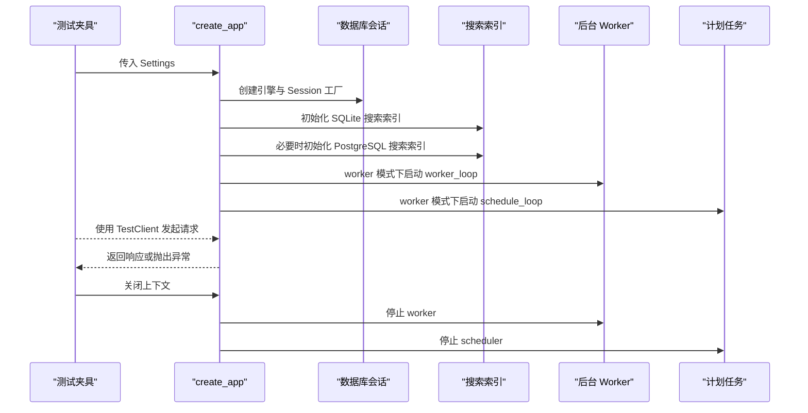

**图表来源**
- [src/personal_ai_life_os/main.py:34-200](file://src/personal_ai_life_os/main.py#L34-L200)

**章节来源**
- [src/personal_ai_life_os/main.py:1-200](file://src/personal_ai_life_os/main.py#L1-L200)

### 基准测试脚本：`benchmark_mvp.py`
`benchmark_mvp.py` 是一个面向时间线和批量导入的基准测试脚本。其行为包括：

- 支持两种后端：默认 SQLite 临时文件，或通过在环境变量 `LIFEOS_BENCHMARK_POSTGRES_URL` 中提供可临时使用的 PostgreSQL 连接地址。
- 对 PostgreSQL 使用 UUID 生成的临时 schema，并在脚本结束时自动 drop，避免污染共享数据库。
- 通过 `TestClient(create_app(...))` 启动内存中的 FastAPI 应用，注册一个合成用户，创建一个 synthetic benchmark 来源。
- 直接向 session_factory 写入约一万条 `SourceItem` 和一条 `SyncRun`，确保时间线基线足够大。
- 对三类时间线查询各采样 30 次，记录毫秒延迟并计算 P95。
- 将一份固定 Markdown 文本分割为 30 个样例，每个样例包含 500 行内容，进行批量导入并记录耗时。
- 最后输出环境描述、输入条目数量、查询和导入 P95、是否通过目标的布尔值。

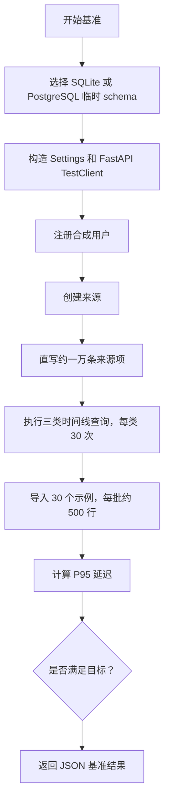

**图表来源**
- [scripts/benchmark_mvp.py:1-200](file://scripts/benchmark_mvp.py#L1-L200)

设计要点如下：

| 特性 | 当前实现 | 建议实践 |
| --- | --- | --- |
| 数据规模 | 约一万条 `SourceItem` | 根据性能目标增加不同数据分布，如长正文、短标题、大量空字段。 |
| 后端隔离 | SQLite 临时文件或 PostgreSQL 临时 schema | PostgreSQL 场景应配合 CI 中的 disposable 数据库，避免并发冲突。 |
| 随机性控制 | 使用固定日期字符串、固定内容和循环生成标记 | 如需扩展随机噪声，应使用固定随机种子并保持基准期望稳定。 |
| 指标输出 | `timeline_p95_ms`、`import_p95_ms`、`targets.pass` | 新增指标时应保持 JSON 字段语义稳定，便于归档对比。 |
| 回归策略 | 脚本内硬编码 target 比较 | 建议引入基准档案比对，例如把上次结果存入工件或数据库后做 diff。 |

**章节来源**
- [scripts/benchmark_mvp.py:1-200](file://scripts/benchmark_mvp.py#L1-L200)

### 审查模板评估：`evaluate_reviews.py`
`evaluate_reviews.py` 使用 `fixtures/synthetic/review-eval.json` 中的 30 个确定性强例，直接调用内部审查模板函数渲染周复盘，而不依赖外部 AI 模型。

评估逻辑核心包括：

- 加载 fixtures 并确保正好有 30 个案例。
- 将原始条目转换为内存对象。
- 构造审查草稿并渲染为 Markdown。
- 统计事实数量、成功定位 source_id 的比例、被原始条目支持的文本比例。
- 对 `timezone_boundary` 案例校验局部时间区间的边界小时数。
- 要求 source location rate 为 100%，evidence support rate 不低于 95%。
- 输出结构化报告，包含错误列表；若存在错误则进程退出码非零。

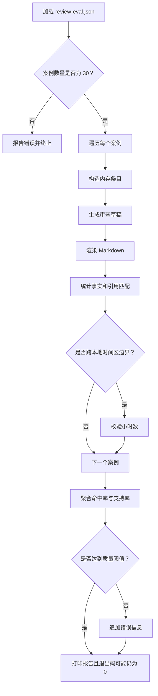

**图表来源**
- [scripts/evaluate_reviews.py:1-134](file://scripts/evaluate_reviews.py#L1-L134)

注意事项：

- 该脚本测量的是模板渲染质量，不是外部模型输出质量。
- 外部模型相关评估由其他工具和 UI 提供，而本脚本保证确定性、可回归的底线质量。
- 如果未来新增评估维度，应保持报告的 JSON 结构稳定，并更新所需分类集合。

**章节来源**
- [scripts/evaluate_reviews.py:1-134](file://scripts/evaluate_reviews.py#L1-L134)
- [fixtures/synthetic/README.md:1-13](file://fixtures/synthetic/README.md#L1-L13)

### 搜索评估脚本：`evaluate_search.py`
`evaluate_search.py` 的目标是衡量统一搜索的准确性与延迟。它会：

- 在一个临时数据库中注入约一万条 `SourceItem`，并加入少量真实的周期性复习和提醒。
- 定义多种中英文查询，涵盖时间线标题、正文、部分片段、分页位置。
- 向真实 `/api/v1/search` 发起请求，以 group 为单位检查前五个结果中是否命中预期记录，即 hit@5。
- 计算 P95 延迟并与目标比较。
- 可以选择 SQLite 或 PostgreSQL 临时 schema，与基准脚本共享相同的隔离策略。
- 即使未达成性能目标也优先输出测量结果，因为规范强调“记录测量值而非直接中断运行”。

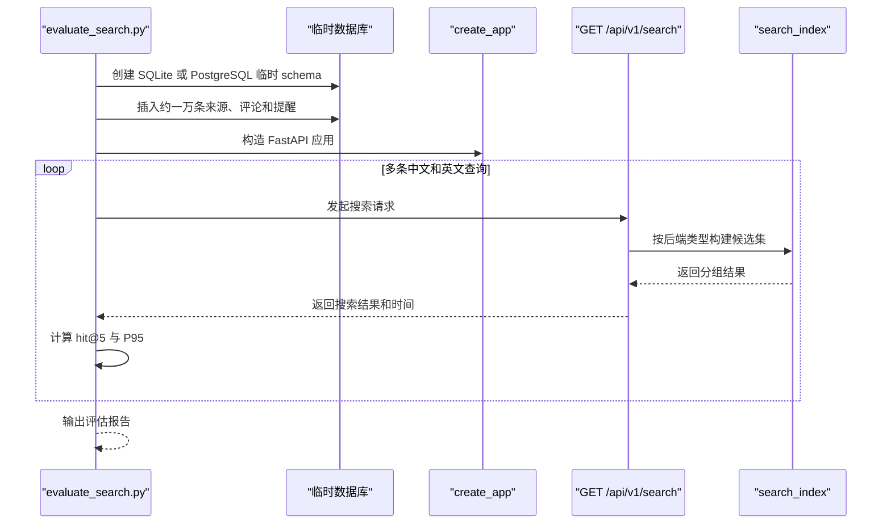

**图表来源**
- [scripts/evaluate_search.py:1-200](file://scripts/evaluate_search.py#L1-L200)

扩展建议：

- 当前脚本会记录未达目标的测量值而不是直接失败，这对 CI 友好，但需要在上层添加回归判断。
- 建议在报告中增加每组 backend、query_id、group、latency、hit_at_5 明细，便于可视化趋势。
- 如果需要对比历史结果，可在脚本末尾追加一个 baseline 比对分支，例如比较最近一次运行的 JSON 基准。

**章节来源**
- [scripts/evaluate_search.py:1-200](file://scripts/evaluate_search.py#L1-L200)

### 图谱问答评估：`evaluate_graph_qa.py`
`evaluate_graph_qa.py` 针对证据图谱问答功能，使用 SQLite 构建活跃、撤销和删除的证据子集，然后向 `/api/v1/qa` 发起双语问答请求。

评估内容包括：

- 引用准确性。
- 不支持或未充分证据的声明。
- P95 延迟。
- 待审队列数量。
- 多语言意图，包括决策、项目、成长类等场景。

该脚本遵循“记录测量值”的原则：在没有外部模型依赖的前提下运行合成数据评估，并不以绝对性能目标断言整个运行是否失败，而是让结果反映质量变化趋势。

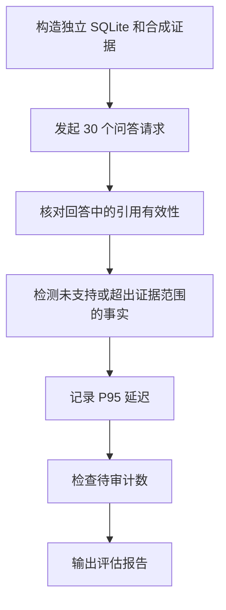

**图表来源**
- [scripts/evaluate_graph_qa.py:1-200](file://scripts/evaluate_graph_qa.py#L1-L200)

**章节来源**
- [scripts/evaluate_graph_qa.py:1-200](file://scripts/evaluate_graph_qa.py#L1-L200)

### OCR 端到端验证：`verify_photo_ocr.py`
该脚本不同于纯内存基准脚本，它需要对运行中的 API 发起 HTTP 请求。主要流程：

1. 通过 Pillow 创建一张包含英文和简体中文的合成 JPEG，并写入 GPS EXIF。
2. 注册账户并获取 bearer token。
3. 创建 photo 类型的来源并上传图像。
4. 等待后台 job 完成。
5. 确认可通过原文关键词搜索到新记录。
6. 拉取原始文件，确认已移除 GPS EXIF。
7. 清理账户。

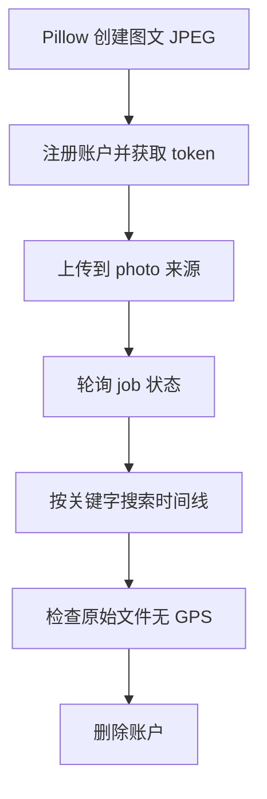

**图表来源**
- [scripts/verify_photo_ocr.py:1-68](file://scripts/verify_photo_ocr.py#L1-L68)
- [Dockerfile:1-25](file://Dockerfile#L1-L25)

最佳实践：

- 运行此脚本前需启动 Compose 环境，并确保安装了 Tesseract 引擎（English + Simplified Chinese）。
- `font` 参数必须指向系统或容器中可识别拉丁与简体中文字体的字体文件。
- 默认端口为 8000，适合本机回环测试；若使用隧道或代理，可通过 `--port` 修改。
- 不建议将该脚本纳入普通 PyTest 单测，除非测试环境完整提供 OCR 和 worker 能力。

**章节来源**
- [scripts/verify_photo_ocr.py:1-68](file://scripts/verify_photo_ocr.py#L1-L68)
- [Dockerfile:1-25](file://Dockerfile#L1-L25)
- [docker-compose.yml:1-78](file://docker-compose.yml#L1-L78)

### 索引重建工具：`rebuild_search_index.py`
该脚本用于从权威行重建搜索候选索引。它可以作为评估前后的辅助工具，例如在批量导入后重建索引再运行搜索评估，确保评估基于最新索引。

脚本返回值包括：

- 搜索后端。
- 当前有效 `SourceItem` 数量。
- 未失效的 Review 数量。
- Reminder 数量。

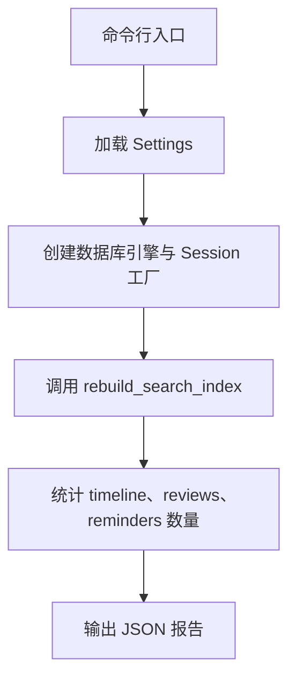

**图表来源**
- [scripts/rebuild_search_index.py:1-41](file://scripts/rebuild_search_index.py#L1-L41)

**章节来源**
- [scripts/rebuild_search_index.py:1-41](file://scripts/rebuild_search_index.py#L1-L41)

### 桌面验收与端到端测试
桌面验收文档记录了 Windows x64 本机构建、Sidecar 冒烟、安装包签名、升级、备份恢复、权限、通知、Vault 导出等验收项。CI 中的 `desktop.yml` 将以下内容串联：

- 检出代码。
- 安装 Rust 工具链。
- 安装 Node 24。
- 同步 desktop 依赖组。
- 运行 `tests/test_desktop_mvp.py`。
- 构建 NSIS 安装包。
- 运行 `smoke-installer.ps1`。
- 采集安装包 SHA 并上传工件。

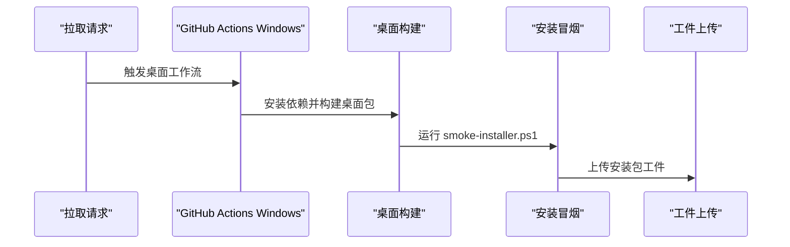

**图表来源**
- [.github/workflows/desktop.yml:1-47](file://.github/workflows/desktop.yml#L1-L47)
- [docs/operations/desktop-acceptance.md:1-75](file://docs/operations/desktop-acceptance.md#L1-L75)

**章节来源**
- [docs/operations/desktop-acceptance.md:1-75](file://docs/operations/desktop-acceptance.md#L1-L75)
- [.github/workflows/desktop.yml:1-47](file://.github/workflows/desktop.yml#L1-L47)

## 依赖关系分析
测试基础设施依赖的主要模块和外部服务如下图所示：

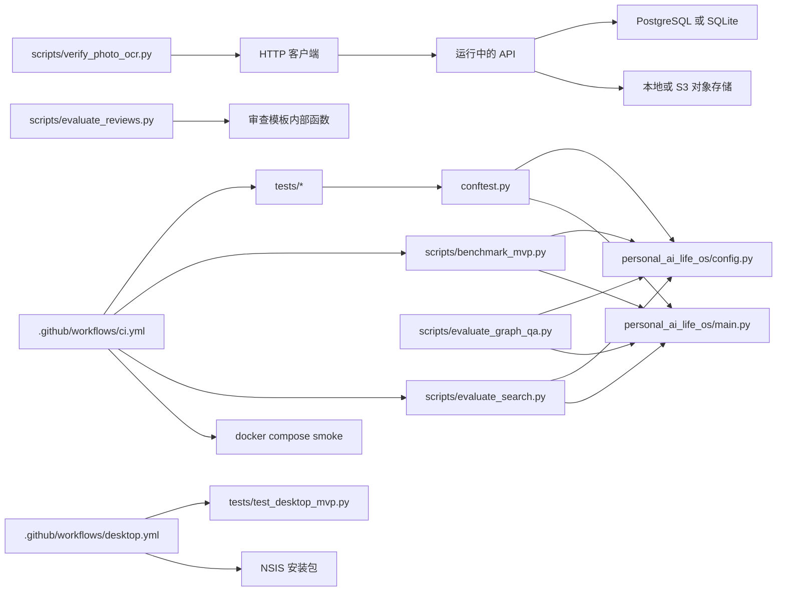

**图表来源**
- [.github/workflows/ci.yml:8-57](file://.github/workflows/ci.yml#L8-L57)
- [.github/workflows/desktop.yml:1-47](file://.github/workflows/desktop.yml#L1-L47)
- [tests/conftest.py:1-31](file://tests/conftest.py#L1-L31)
- [src/personal_ai_life_os/config.py:10-132](file://src/personal_ai_life_os/config.py#L10-L132)
- [src/personal_ai_life_os/main.py:1-200](file://src/personal_ai_life_os/main.py#L1-L200)

耦合与内聚分析：

- 测试夹具和应用入口高度耦合于 `Settings` 和 `create_app`，这是优点，保证了基准脚本与单元夹具共享相同生命周期逻辑。
- 评估脚本大多采用无副作用方式访问内部渲染函数；基准和搜索脚本依赖真实 API，属于轻量 E2E 风格。
- OCR 验证脚本直接与 HTTP 接口交互，对外部服务依赖最强，适合作为专项验证。
- CI 对 Python 和 Node 两端均有检查，降低了跨语言边界回归风险。

潜在风险：

- PostgreSQL 基准如果并发执行，需要使用不同的临时 schema；当前脚本已在 PostgreSQL 场景下创建带 UUID 的 schema 并在 finally 中删除。
- 搜索评估默认记录测量值而不直接失败，容易被忽视；应在上层增加质量门禁判断。
- OCR 验证脚本假设 Tesseract 和环境字体已经安装，不应误放入标准单测。

**章节来源**
- [scripts/benchmark_mvp.py:1-200](file://scripts/benchmark_mvp.py#L1-L200)
- [scripts/evaluate_search.py:1-200](file://scripts/evaluate_search.py#L1-L200)
- [scripts/verify_photo_ocr.py:1-68](file://scripts/verify_photo_ocr.py#L1-L68)

## 性能考量
基准脚本关注的主要性能特征是：

| 指标 | 含义 | 数据来源 | 典型目标 |
| --- | --- | --- | --- |
| 时间线查询 P95 | 时间线筛选接口响应时间的第 95 百分位 | `benchmark_mvp.py` 中三类查询采样 | 单个查询类别不超过数百毫秒级别 |
| 批量导入 P95 | 每次导入约 500 条记录的总耗时 | `benchmark_mvp.py` 导入采样 | 单次导入不超过秒级上限 |
| 搜索 hit@5 | 每组结果前五名中是否正确命中预期 | `evaluate_search.py` | 越高越准确 |
| 搜索 P95 | 统一搜索接口的第 95 百分位延迟 | `evaluate_search.py` | 目标为约 500ms |
| 图谱问答精度 | 引用有效且答案未超出证据范围 | `evaluate_graph_qa.py` | 偏向准确性记录而非硬失败 |
| 源定位率 | 事实对应的 source_id 是否能在渲染结果中定位 | `evaluate_reviews.py` | 应为 100% |
| 证据支持率 | 事实是否能回溯到原始内容 | `evaluate_reviews.py` | 不低于 95% |

优化方向建议：

- 对时间线查询区分简单过滤器、全文搜索和组合过滤的不同成本曲线。
- 对导入分块大小、事务批次、索引更新频率进行分析。
- 对搜索后端分别评估 SQLite FTS5 trigram 与 PostgreSQL `pg_trgm` GIN 的差异。
- 对 OCR 路径分离 image decode、resize、metadata strip、Tesseract 调用和 job write 的成本。
- 引入基准数据归档与回归告警，将本次结果与上一个 CI 构建进行比较，超阈则阻断合并。

[本节提供通用指导，不直接分析特定文件]

## 故障排查指南

### 常见问题分类与定位思路

| 现象 | 可能原因 | 排查步骤 |
| --- | --- | --- |
| `pytest` 失败但不涉及 API | 夹具路径、配置字段、导入顺序或 mock 问题 | 先缩小到最小测试文件；查看 conftest 是否使用了正确的 temp path、SQLite 和 test secret。 |
| API 测试出现数据库不存在或建表失败 | `auto_create_schema` 未启用，或 database URL 被意外覆盖 | 检查 fixture 构造的 Settings 是否指定了临时 SQLite 路径。 |
| 基准脚本报 PostgreSQL URL 无效 | `LIFEOS_BENCHMARK_POSTGRES_URL` 未设置或后端名称不是 PostgreSQL | 确认环境变量格式；基准脚本要求可临时使用的 PostgreSQL 并自动创建临时 schema。 |
| 搜索评估始终低 hit@5 | 未重建索引或数据与索引不一致 | 在评估前运行 `rebuild_search_index.py`，确保 index 与权威行一致。 |
| OCR 验证失败但单测通过 | 缺少 Tesseract、字体、worker 模式或外部 API | 确认 Compose 运行、Tesseract 安装、字体路径、job 完成状态和图片元数据。 |
| CI 容器冒烟失败 | API 未就绪、数据库连接失败、端口占用 | 查看 `docker compose logs`，确认 healthcheck、ready endpoint 与端口绑定。 |
| Windows 桌面测试构建失败 | Rust 工具链、Node、Desktop 依赖或 Tauri 环境缺失 | 检查工作流日志、uv lock 同步和 README 中桌面本地验收命令。 |

### 基准与搜索评估失败时的诊断顺序
1. 确认脚本选择了预期的后端：SQLite 默认位于临时目录；若设置了 `LIFEOS_BENCHMARK_POSTGRES_URL`，则创建独立 schema。
2. 确认数据确实写入：检查导入返回数量、时间线行数或预期索引记录。
3. 确认查询参数与期望命中位置一致，特别是中英文查询与偏移索引。
4. 对 search 场景，先重建索引再运行评估。
5. 查看脚本输出的 JSON 报告中的 `errors`、`timeline_p95_ms`、`import_p95_ms`、`target` 对比结果。

### 审查模板评估失败的诊断顺序
1. 确认 `fixtures/synthetic/review-eval.json` 仍存在 30 个案例。
2. 检查新增事实或模板渲染变更是否破坏 source location。
3. 确认时间区边界场景的小时数计算未改变。
4. 如果新增评估类别，需同步更新必需分类集合。

### 持续集成失败定位
- 对于 `lint-and-smoke`：分别检查 Python lint、PyTest、Web lint 和 Web build。
- 对于 `container-smoke`：使用 `docker compose config --quiet` 检查 Compose 配置，再执行 `docker compose up --build --detach --wait` 并抓取日志。
- 对于 `desktop.yml`：确认触发布局中的路径变更、Rust 工具链和 Tauri/Nsis 构建产物是否存在。

**章节来源**
- [tests/conftest.py:1-31](file://tests/conftest.py#L1-L31)
- [scripts/benchmark_mvp.py:1-200](file://scripts/benchmark_mvp.py#L1-L200)
- [scripts/evaluate_search.py:1-200](file://scripts/evaluate_search.py#L1-L200)
- [scripts/evaluate_reviews.py:1-134](file://scripts/evaluate_reviews.py#L1-L134)
- [scripts/verify_photo_ocr.py:1-68](file://scripts/verify_photo_ocr.py#L1-L68)
- [.github/workflows/ci.yml:8-57](file://.github/workflows/ci.yml#L8-L57)
- [.github/workflows/desktop.yml:1-47](file://.github/workflows/desktop.yml#L1-L47)

## 结论
Personal-AI-Life-OS 的测试基础设施已经形成了从单测、合成评估、基准测试、端到端验证到持续集成的闭环：

- PyTest 通过隔离夹具保护日常模块测试；
- 合成数据驱动确定性评估脚本保障审查模板和检索质量；
- 基准脚本为时间线、导入、搜索量化提供 P95 和准确性数据；
- OCR 脚本覆盖真实图片处理链路；
- Docker Compose 和桌面工作流确保 API、前端和 Windows 端的一致性验证；
- GitHub Actions 支持多 Python 版本矩阵、Web 构建和容器冒烟检查。

下一步最值得投入的改进是：建立稳定的基准基准线档案、将评估脚本与质量门禁结合、完善覆盖率报告呈现、引入随机种子一致性约束，并把更多端到端场景纳入可复现的容器化运行中。

[本节总结不直接分析具体文件]