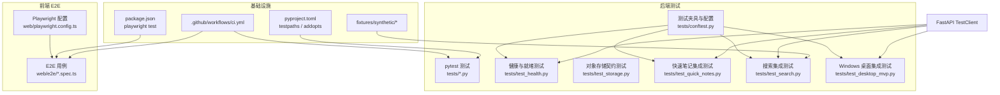
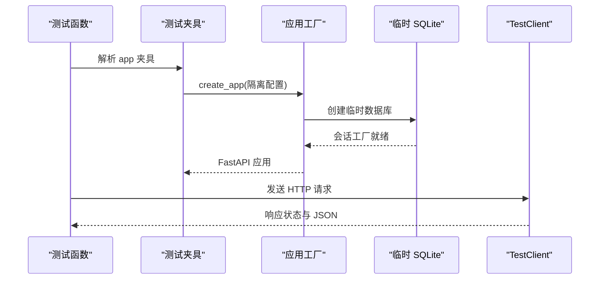
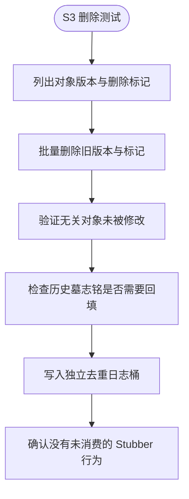
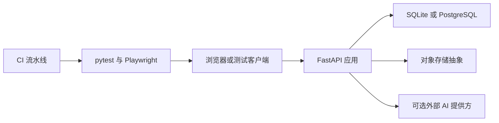
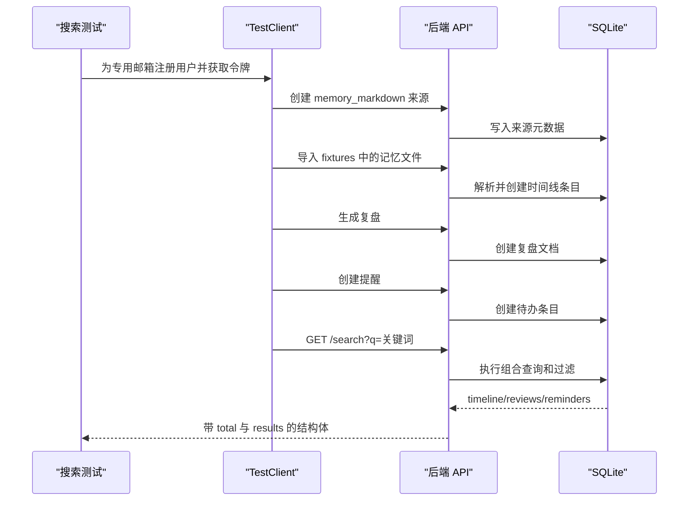
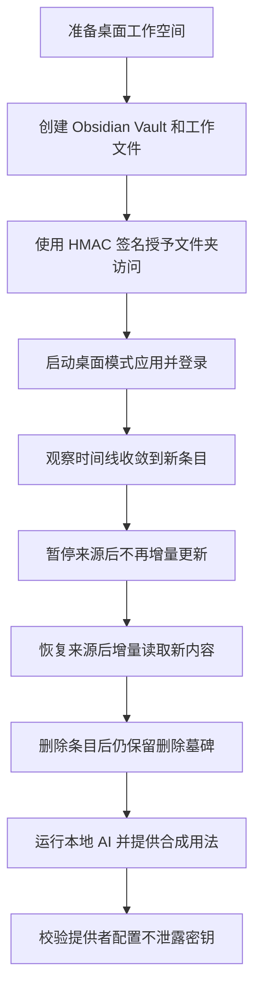
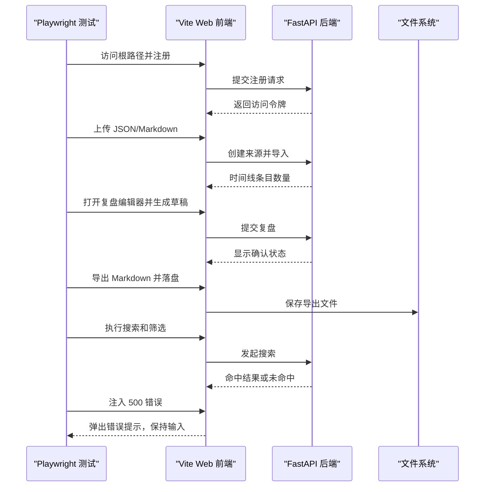
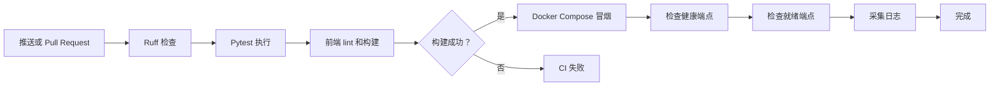

# 测试策略

<cite>
**本文引用的文件**
- [tests/conftest.py](file://tests/conftest.py)
- [pyproject.toml](file://pyproject.toml)
- [web/playwright.config.ts](file://web/playwright.config.ts)
- [web/package.json](file://web/package.json)
- [.github/workflows/ci.yml](file://.github/workflows/ci.yml)
- [README.md](file://README.md)
- [tests/test_health.py](file://tests/test_health.py)
- [tests/test_storage.py](file://tests/test_storage.py)
- [tests/test_search.py](file://tests/test_search.py)
- [tests/test_quick_notes.py](file://tests/test_quick_notes.py)
- [tests/test_desktop_mvp.py](file://tests/test_desktop_mvp.py)
- [web/e2e/m10.spec.ts](file://web/e2e/m10.spec.ts)
- [web/e2e/workflow.spec.ts](file://web/e2e/workflow.spec.ts)
</cite>

## 目录
1. [引言](#引言)
2. [项目结构](#项目结构)
3. [核心组件](#核心组件)
4. [架构总览](#架构总览)
5. [详细组件分析](#详细组件分析)
6. [依赖关系分析](#依赖关系分析)
7. [性能与基准测试](#性能与基准测试)
8. [持续集成与覆盖率](#持续集成与覆盖率)
9. [调试与故障诊断](#调试与故障诊断)
10. [最佳实践与常见陷阱](#最佳实践与常见陷阱)
11. [结论](#结论)

## 引言
本测试策略文档面向 Personal-AI-Life-OS 的开发者、贡献者和运维人员，说明当前项目的质量保证体系：后端基于 pytest 的分层测试（API、服务逻辑和外部依赖），前端基于 Playwright 的端到端交互测试，以及通过 Docker Compose 的冒烟验证。文档重点解释如何隔离数据库、模拟外部 AI 服务、验证所有权隔离与可恢复删除语义，并在 CI 中稳定运行整个流程。

本项目采用多语言栈：Python FastAPI 后端、React/TypeScript Web 前端、Tauri Windows 桌面侧车，并通过 Alembic 管理数据库迁移。测试覆盖从配置校验到真实 API 调用，从对象存储契约到完整用户工作流，同时强调可重复性、可观测性和失败复现能力。

[无特定源码引用]

## 项目结构
测试相关代码主要分布在以下位置：
- `tests/`：pytest 测试套件，包括配置文件、健康检查、存储抽象、搜索、快速笔记、桌面 MVP 等用例。
- `web/e2e/`：Playwright 端到端测试，覆盖 M10 导出行为和跨模块工作流。
- `web/playwright.config.ts`：E2E 环境启动与浏览器配置。
- `.github/workflows/ci.yml`：CI 流水线，包含 Python lint、pytest、Web 构建和 Docker Compose 冒烟。
- `pyproject.toml`：pytest 入口参数和项目依赖。
- `web/package.json`：Web E2E 命令。
- `fixtures/synthetic/`：供测试使用的合成数据，如记忆文件和对话导入样本。

**图表来源**
- [tests/conftest.py:1-31](file://tests/conftest.py#L1-L31)
- [web/playwright.config.ts:1-53](file://web/playwright.config.ts#L1-L53)
- [web/package.json:1-29](file://web/package.json#L1-L29)
- [.github/workflows/ci.yml:1-57](file://.github/workflows/ci.yml#L1-L57)
- [pyproject.toml:38-44](file://pyproject.toml#L38-L44)

**章节来源**
- [pyproject.toml:38-44](file://pyproject.toml#L38-L44)
- [web/package.json:1-29](file://web/package.json#L1-L29)
- [web/playwright.config.ts:1-53](file://web/playwright.config.ts#L1-L53)
- [.github/workflows/ci.yml:1-57](file://.github/workflows/ci.yml#L1-L57)

## 核心组件
### pytest 夹具与应用程序隔离
测试夹具负责为每个测试创建独立的应用实例和临时数据库目录：
- `app` 夹具构造轻量级 `Settings`，启用自动建表，使用内存或临时 SQLite，并关闭外部模型提供者。
- `client` 夹具封装 FastAPI `TestClient`，在请求结束后自动释放资源。
- 测试通过直接 POST 注册账号、获取令牌，再调用业务接口，从而避免启动真实服务器。

**图表来源**
- [tests/conftest.py:1-31](file://tests/conftest.py#L1-L31)
- [tests/test_health.py:1-22](file://tests/test_health.py#L1-L22)

**章节来源**
- [tests/conftest.py:1-31](file://tests/conftest.py#L1-L31)
- [tests/test_health.py:1-22](file://tests/test_health.py#L1-L22)

### 对象存储抽象测试
S3 存储实现被用 Stubber 和 Monkeypatch 进行契约式测试，确保删除对象时不仅删除版本还处理删除标记，并能在遗留墓志铭与去重日志桶之间回填一致性数据。这类测试不依赖真实云存储，但精确验证 API 调用顺序。

关键点：
- 通过 `monkeypatch` 替换 AWS 客户端。
- 通过 `Stubber` 记录期望行为，防止意外调用。
- 测试“仅删除目标对象版本”和“不影响无关对象”。
- 测试从主存储发现遗漏的删除记录，并将其写入专门的去重日志桶。

**图表来源**
- [tests/test_storage.py:1-59](file://tests/test_storage.py#L1-L59)

**章节来源**
- [tests/test_storage.py:1-59](file://tests/test_storage.py#L1-L59)

## 架构总览
系统测试按分层方式组织：

| 层级 | 目标 | 主要技术 | 典型用例 |
|---|---|---|---|
| 单元测试 | 校验小粒度纯函数、配置和序列化行为 | pytest + 配置类 | OpenAI 兼容基址合并 |
| 单元测试 | 验证配置默认值和规范化行为 | Settings 配置对象 | 聊天补全地址推导 |
| 集成测试 | 验证 API 路由、鉴权、数据隔离 | FastAPI TestClient + SQLite | 健康检查、就绪探针 |
| 集成测试 | 验证复杂业务流程和数据一致性与审计 | 真实迁移数据库 | 快速笔记 CRUD、删除回放 |
| 集成测试 | 验证搜索范围、分组、限制、标题优先 | 源导入、复盘生成、提醒创建 | 组合查询断言 |
| 平台集成测试 | 验证 Windows 桌面授权、本地文件夹同步、预算控制 | 本地 Mock HTTP Server | Obsidian Vault 写入策略 |
| E2E 测试 | 模拟浏览器真实操作路径 | Playwright | 导入、复盘、搜索、导出、权限拒绝回退 |

[无特定源码引用]

## 详细组件分析

### 后端测试：健康与可用性
健康与就绪接口测试是系统可达性的最小保证：
- `/api/v1/health` 返回服务标识和服务状态。
- `/openapi.json` 暴露健康端点，便于自动生成文档工具发现。
- `/api/v1/ready` 连接数据库，确认应用已就绪。

这些测试通过共享 `client` 夹具运行，无需外部服务，且适合放入快速冒烟流程。

**章节来源**
- [tests/test_health.py:1-22](file://tests/test_health.py#L1-L22)

### 后端测试：快速笔记全流程
快速笔记测试覆盖了较完整的业务域：注册、创建、时间线聚合、搜索、更新、归档、删除、所有者隔离、状态冲突保护、清理字段、以及墓碑回放语义。它展示了高质量集成测试的典型模式：

1. 使用统一注册工具函数创建用户和访问令牌。
2. 通过高层封装函数创建资源，减少重复请求。
3. 用 SQL 直查内部模型，验证删除不是物理消失而是软删除。
4. 触发墓碑回放机制，确认软删除可恢复且再次生效。
5. 验证其他账户无法越权修改或删除数据。
6. 对不可变内部来源执行禁止操作，验证状态保护。
7. 清理时间戳字段后，确认字段确实归空。

该测试将 UI 可见的业务结果与数据库持久化结果结合判断，避免只断言 HTTP 成功而遗漏真实数据行为。

**章节来源**
- [tests/test_quick_notes.py:1-180](file://tests/test_quick_notes.py#L1-L180)

### 后端测试：搜索整合断言
搜索测试是一个典型的跨领域聚合测试，它同时写入来源、引入记忆 Markdown、生成复盘、创建提醒，然后断言三类结果都被找到。它还覆盖了：
- 搜索结果分组的总数和条数限制。
- 标题匹配的优先级。
- 片段长度上限。
- 已删除来源和失效复盘不被返回。
- 搜索参数为空、空白或超长时的输入校验。
- 不同所有者的数据隔离。

**图表来源**
- [tests/test_search.py:1-213](file://tests/test_search.py#L1-L213)
- [tests/conftest.py:1-31](file://tests/conftest.py#L1-L31)

**章节来源**
- [tests/test_search.py:1-213](file://tests/test_search.py#L1-L213)
- [tests/conftest.py:1-31](file://tests/conftest.py#L1-L31)

### 后端测试：Windows 桌面 MVP 集成
桌面测试使用 `pytestmark.skipif` 只在 Windows 平台上运行，模拟真实桌面侧车环境：
- 设置 `desktop_secret` 和桌面路径签名密钥。
- 以桌面 profile 身份登录，设置 CORS、worker poll interval 和 closed registration 模式。
- 模拟真实的文件变更轮询、暂停来源、取消删除、导出三种策略。
- 使用线程 HTTP Server 作为本地 AI 提供方，注入用量和成本信息，验证预算和控制面。
- 校验聊天记录白名单是否跨文件更新持久化。
- 通过等待收敛函数 `until` 观察异步工作队列最终结果。

**图表来源**
- [tests/test_desktop_mvp.py:1-200](file://tests/test_desktop_mvp.py#L1-L200)

**章节来源**
- [tests/test_desktop_mvp.py:1-200](file://tests/test_desktop_mvp.py#L1-L200)

### 前端 E2E：M10 导出行为
Playwright 用例覆盖 M10 的关键体验：
- 生成稳定 Markdown frontmatter。
- 文件名安全化和 review frontmatter 拼接。
- keep、copy、overwrite 冲突策略。
- 在浏览器中走完整目录选择流程，检测“保留现有文件”“已写入 Vault”“已改为下载”状态。
- 当 `showDirectoryPicker` 抛出权限拒绝错误时，回退为浏览器下载。
- 移动端视口捕获分享链接生成的快速笔记，并验证页面不会横向滚动。

该测试同时包含对静态导出函数的纯函数断言和对页面行为的交互断言，体现了前端 E2E 中“业务逻辑 + 用户界面”的双层断言风格。

**章节来源**
- [web/e2e/m10.spec.ts:1-244](file://web/e2e/m10.spec.ts#L1-L244)

### 前端 E2E：跨模块用户工作流
Workflow 测试模拟一个完整用户旅程：
1. 注册账号并进入时间线。
2. 上传未知文件验证错误提示。
3. 导入合成对话，选择便携式格式。
4. 导入大段 Markdown 并触发分页加载。
5. 生成周复盘，编辑并确认。
6. 查看证据，跳转到对应时间线条目。
7. 创建提醒， snooze、忽略、到期展示与完成。
8. 保存自动周复盘计划，观察下次执行预期。
9. 打开搜索，分别定位复盘、提醒和时间线。
10. 注入服务器错误响应，验证前端错误提示而不崩溃。
11. 在设置页允许云端抽取并撤回来源。
12. 模拟用户取消删除对话框，确保操作幂等且符合用户意图。

此外，还包含中文问答、证据不足回复、问答历史删除、图谱低置信度审批的前端路由拦截与状态断言。这种设计既覆盖正向路径，也覆盖异常和用户取消路径。

**图表来源**
- [web/e2e/workflow.spec.ts:1-479](file://web/e2e/workflow.spec.ts#L1-L479)

**章节来源**
- [web/e2e/workflow.spec.ts:1-479](file://web/e2e/workflow.spec.ts#L1-L479)

## 依赖关系分析
### pytest 配置与测试入口
pytest 的配置集中在 `pyproject.toml`：
- 测试根目录为 `tests`。
- 默认追加选项 `-ra`，即打印所有失败的摘要。
- 开发依赖包含 pytest 和 pytest-cov，可用于扩展覆盖率统计。

运行时由 `uv run pytest` 驱动，也可按需添加选项，例如指定路径、并行或覆盖率阈值。

**章节来源**
- [pyproject.toml:38-44](file://pyproject.toml#L38-L44)

### Playwright 配置与环境
Playwright 配置定义了两个 webServer：
1. 启动后端 API：使用 uvicorn，端口 `18000`，环境变量包括测试型数据库、本地对象存储、合成 OpenAI 兼容提供方。
2. 启动前端 Vite 开发服务器：端口 `15173`，并向前端注入 `LIFEOS_API_ORIGIN`。

`baseURL` 指向前端地址，E2E 用例访问的是浏览器用户界面，而不是直接调用后端。这样更接近真实用户行为，也能检测前端构建、代理、PWA manifest 等服务端副作用。

**章节来源**
- [web/playwright.config.ts:1-53](file://web/playwright.config.ts#L1-L53)
- [web/package.json:1-29](file://web/package.json#L1-L29)

### CI 流水线职责
CI 分为两个主要阶段：
- `lint-and-smoke`：安装 Python 和 Node 依赖，运行 ruff、pytest 和前端 lint/build。
- `container-smoke`：拉起 Docker Compose，等待容器就绪，调用 `/api/v1/health` 和 `/api/v1/ready`，最后收集日志并销毁卷。

**图表来源**
- [.github/workflows/ci.yml:1-57](file://.github/workflows/ci.yml#L1-L57)

**章节来源**
- [.github/workflows/ci.yml:1-57](file://.github/workflows/ci.yml#L1-L57)

## 性能与基准测试
项目提供的基准脚本位于 `scripts/benchmark_mvp.py`，并且 README 明确说明其基于本地 SQLite 合成数据，不代表托管 PostgreSQL 的生产性能。因此，它应视为“回归参考”，而不是生产性能 SLA。

推荐的性能基准做法：
- **本地基准**：运行 `benchmark_mvp.py` 监控关键路径是否出现明显回归，例如大文件导入、大量 Markdown 解析、搜索延迟。
- **场景基准**：在独立环境中压测 `search`、`reviews/generate`、`items/raw`、`account/archive` 等耗时接口。
- **数据库基准**：比较 SQLite 和 PostgreSQL 在不同索引条件和数据量下的查询延迟。
- **并发基准**：针对 worker 模式和异步处理路径评估吞吐量和稳定性。
- **E2E 时序基准**：在不改变 UI 行为的前提下，测量页面关键操作的平均耗时，避免误判为视觉回归。

注意事项：
- 基准结果不能仅凭一次跑通就认为可用，必须记录环境、数据集大小、CPU 和网络状态。
- 不要在生产流量上直接跑重型负载测试；建议建立独立的 staging 环境。
- 对异步任务（OCR、外部审查）要分别度量阻塞链和后台完成延迟。

[无特定源码引用]

## 持续集成与覆盖率
### 现有 CI 状态
当前 CI 没有显式运行 `pytest --cov`，也没有设置覆盖率阈值。当前质量保证主要由：
- ruff 语法和格式化检查。
- pytest 常规用例。
- web lint 和 build。
- Docker Compose 健康检查。

若要提升保障强度，建议在 CI 中增加：
- 使用 `pytest-cov` 生成文本和 HTML 覆盖率报告。
- 设置最低覆盖率要求，例如后端关键模块达到约定值。
- 在 E2E 失败时上传 Playwright 截图、视频和后端日志。

**章节来源**
- [pyproject.toml:33-44](file://pyproject.toml#L33-L44)
- [.github/workflows/ci.yml:1-57](file://.github/workflows/ci.yml#L1-L57)

### 覆盖率建议
建议按以下范围设定目标：
- 业务服务逻辑：高覆盖率，尤其是数据建模、删除回放、对象存储抽象、搜索过滤。
- API 路由：至少覆盖成功、鉴权失败、输入校验和所有权边界。
- 前端导出工具函数：通过现有 E2E 配合静态断言保证 stable frontmatter 不被破坏。
- 配置类：覆盖默认值、兼容 base URL、空值和边缘字符串。
- Windows 桌面功能：因其平台限制，单独维护平台相关覆盖率视图，不污染通用指标。

[无特定源码引用]

## 调试与故障诊断
### 定位失败的后端测试
- 使用默认的 `-ra` 输出查看失败摘要。
- 对于网络或状态码失败，打印响应文本和内容以便比对 JSON 结构。
- 如果需要更细粒度的失败原因，可附加详细日志或临时开启请求跟踪。
- 涉及数据库的问题应检查测试夹具创建的临时 SQLite 是否按预期清空。
- 所有权隔离问题可通过双账号路径对比：一个账号产生数据，另一个账号查询时应为空。

**章节来源**
- [pyproject.toml:38-44](file://pyproject.toml#L38-L44)
- [tests/test_search.py:1-213](file://tests/test_search.py#L1-L213)
- [tests/test_quick_notes.py:1-180](file://tests/test_quick_notes.py#L1-L180)

### 定位失败的 E2E 测试
- Playwright 测试默认提供交互式调试支持；可在本地使用 `npm test:e2e` 并配合调试模式。
- 使用测试内截图、控制台日志、路由拦截和 mock 接口缩小问题范围。
- 如果失败发生在文件写入或权限拒绝场景，检查测试初始化脚本是否按预期替换 `showDirectoryPicker`。
- 若 API 响应不一致，先在 `web/playwright.config.ts` 定义的备用后端端口检查健康就绪。

**章节来源**
- [web/e2e/m10.spec.ts:1-244](file://web/e2e/m10.spec.ts#L1-L244)
- [web/e2e/workflow.spec.ts:1-479](file://web/e2e/workflow.spec.ts#L1-L479)
- [web/playwright.config.ts:1-53](file://web/playwright.config.ts#L1-L53)

### 定位性能瓶颈
- 先区分是前端渲染、浏览器交互、后端查询还是外部 AI 调用导致延迟。
- 对后端接口添加延迟和吞吐量采样，尤其在 worker 模式下。
- 对搜索接口关注候选集规模、排序规则和片段截断。
- 对大文件导入和 OCR 路径分别测量排队时间和实际执行时间。
- 使用合成数据而非真实数据评估回归，避免真实隐私数据干扰。

[无特定源码引用]

## 最佳实践与常见陷阱
### 编写高质量测试用例的原则
1. **单一职责**：一个测试验证一个明确的行为，不要在一个测试中混合太多业务流程。
2. **可重复环境**：每个测试创建独立配置、数据库、临时数据和会话。
3. **显式断言**：不仅断言状态码，还要断言关键字段、总数、结果结构和边界响应。
4. **隔离外部依赖**：用 stub、mock 或本地 HTTP server 替代云存储和 AI 提供方。
5. **覆盖异常路径**：权限拒绝、输入非法、网络错误、部分导入都应验证系统表现。
6. **数据所有权清晰**：用多账号断言跨租户隔离，特别是时间线、复盘、提醒和图谱。
7. **UI 和行为解耦**：E2E 测试聚焦用户目标，而不是 DOM 实现细节；必要时用角色名、标签和属性定位。
8. **避免脆弱等待**：尽量使用 Playwright 的自动等待和 expect，仅在需要轮询后台任务时使用稳定的收敛函数。

### 常见陷阱
- **共享测试数据库**：测试间相互污染，导致间歇性失败。
- **隐式全局状态**：依赖上一次测试写入的数据，使测试顺序耦合。
- **过度使用真实外部服务**：引入网络不稳定、计费问题和合规风险。
- **只断言 HTTP 成功**：忽略响应体结构、业务状态和数据库事实。
- **E2E 只选成功路径**：没有覆盖权限拒绝、部分导入、弹窗取消等失败分支。
- **把性能回归当成普通失败**：缺少基线和环境信息，难以定位波动原因。
- **Windows 桌面测试在非 Windows 环境误跑**：应使用 pytest skip 条件，或在 CI 矩阵中分离。

**章节来源**
- [tests/test_storage.py:1-59](file://tests/test_storage.py#L1-L59)
- [tests/test_quick_notes.py:1-180](file://tests/test_quick_notes.py#L1-L180)
- [tests/test_desktop_mvp.py:1-200](file://tests/test_desktop_mvp.py#L1-L200)
- [web/e2e/m10.spec.ts:1-244](file://web/e2e/m10.spec.ts#L1-L244)
- [web/e2e/workflow.spec.ts:1-479](file://web/e2e/workflow.spec.ts#L1-L479)

## 结论
Personal-AI-Life-OS 的测试体系已经覆盖了配置、后端 API、对象存储契约、桌面集成、前端 E2E 和 Docker 冒烟检查。pytest 通过 `TestClient` 和临时配置形成快速、可重复的后端集成测试；Playwright 通过启动真实后端与前端，模拟真实用户路径并断言关键业务结果；CI 则保证每次提交都能执行基础质量和容器冒烟。

未来改进方向可以聚焦于：
- 引入统一的 pytest-cov 覆盖率门禁。
- 明确各模块最低覆盖率阈值。
- 将性能基准纳入回归检测。
- 在 CI 中缓存 Playwright 浏览器和执行产物。
- 增加更多异常和降级路径的前端 E2E。
- 分离 Windows 桌面测试矩阵，提高跨平台稳定性。

通过这些增强，项目可以在保证隐私和安全的前提下，继续迭代复杂个人知识工作流，并保持测试反馈的快速性、稳定性和可诊断性。