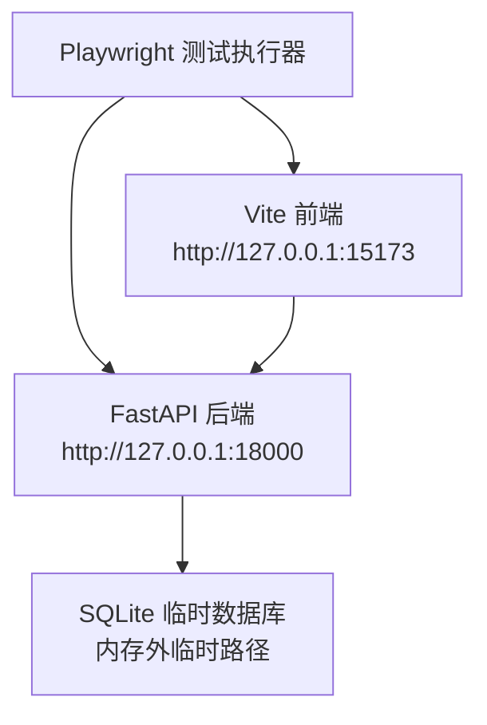
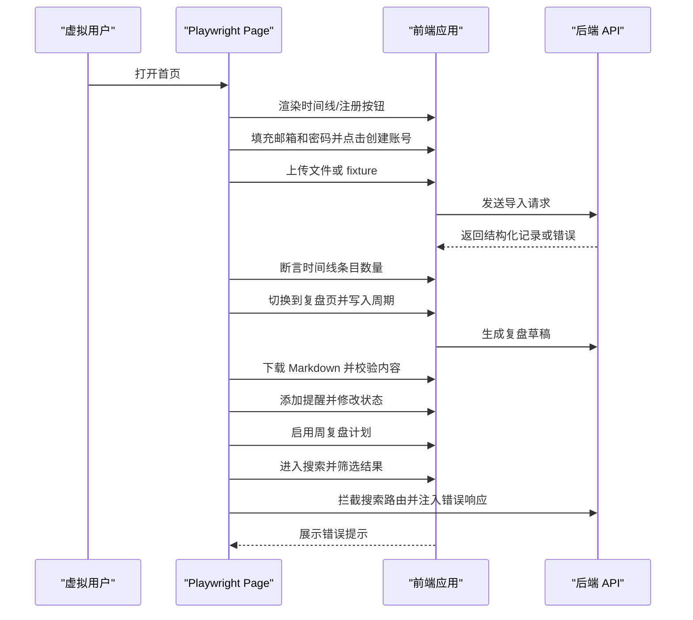
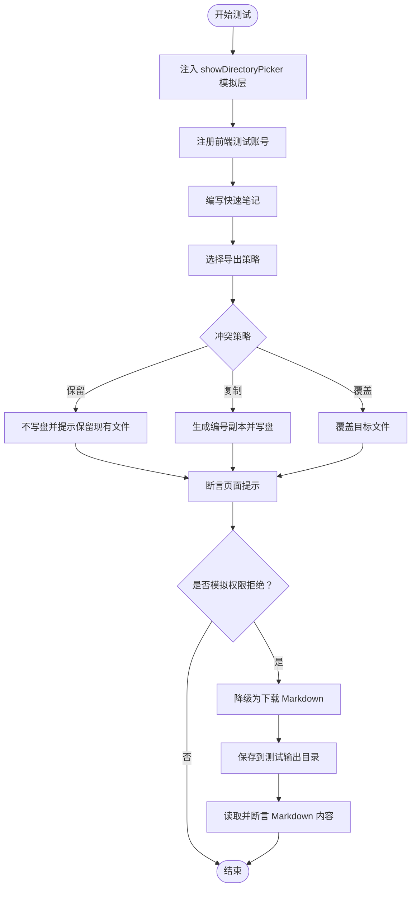
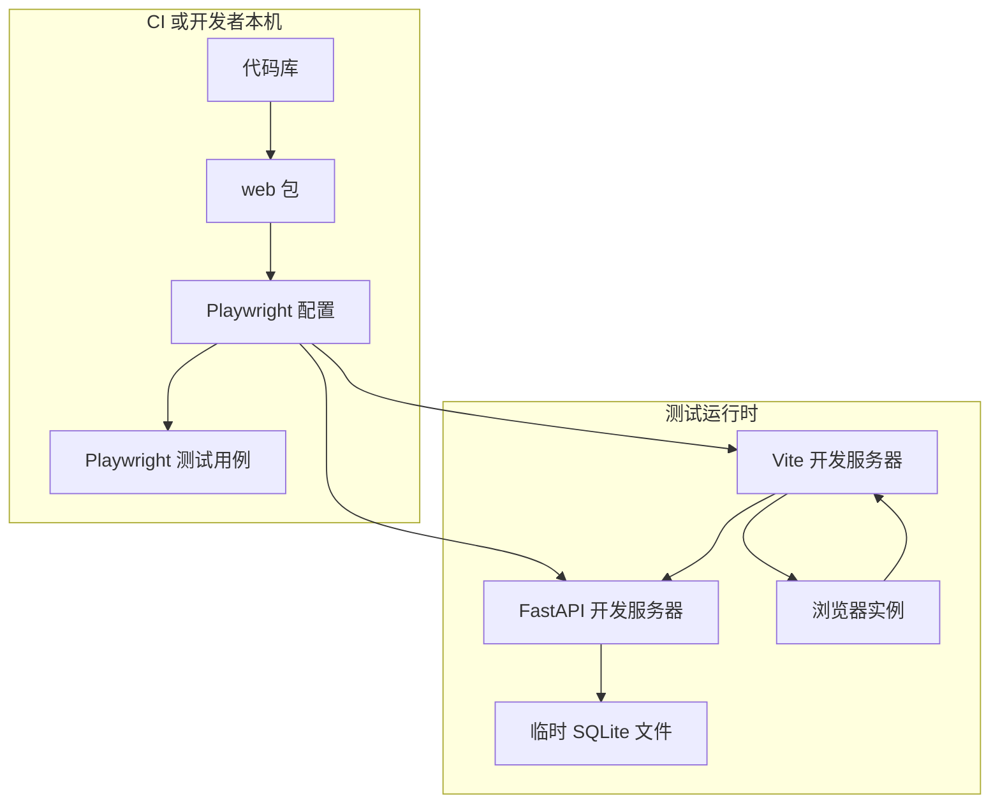
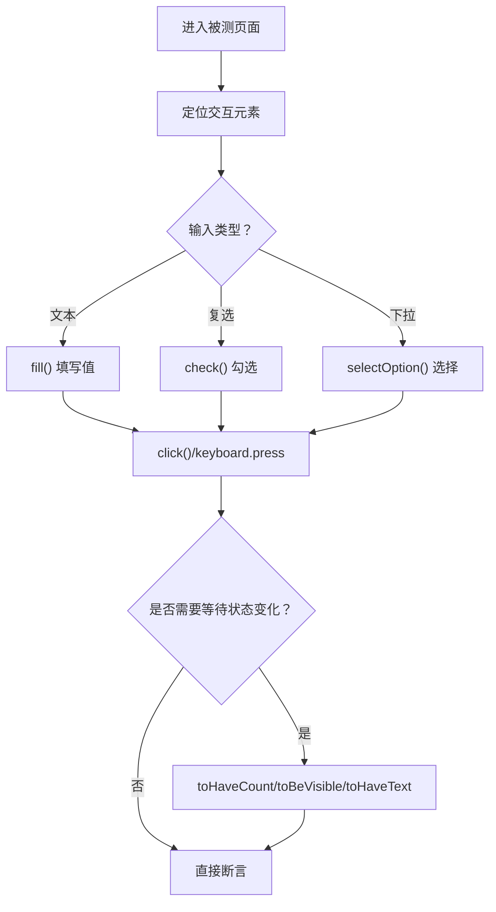
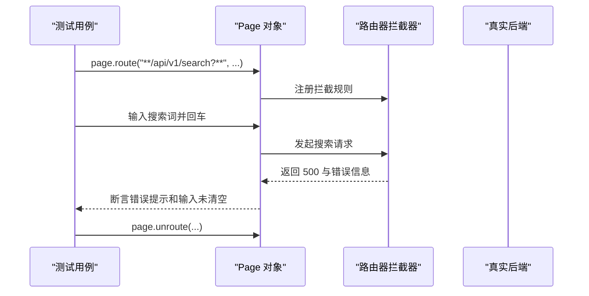
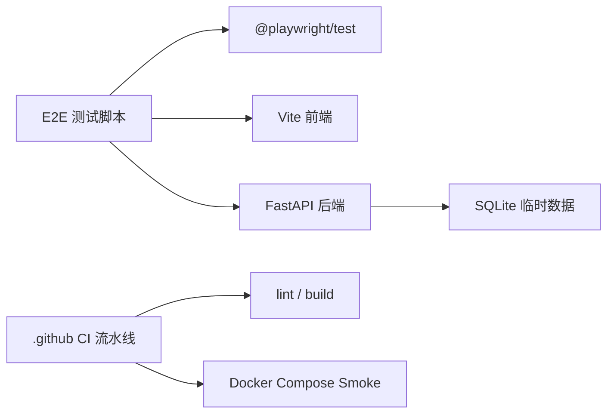

# 端到端测试

<cite>
**本文引用的文件**   
- [playwright.config.ts](file://web/playwright.config.ts)
- [workflow.spec.ts](file://web/e2e/workflow.spec.ts)
- [m10.spec.ts](file://web/e2e/m10.spec.ts)
- [package.json](file://web/package.json)
- [ci.yml](file://.github/workflows/ci.yml)
- [README.md](file://web/README.md)
</cite>

## 目录
1. [简介](#简介)
2. [项目结构](#项目结构)
3. [核心组件](#核心组件)
4. [架构总览](#架构总览)
5. [详细组件分析](#详细组件分析)
6. [依赖关系分析](#依赖关系分析)
7. [性能与稳定性考虑](#性能与稳定性考虑)
8. [故障排查指南](#故障排查指南)
9. [结论](#结论)
10. [附录：常用断言与定位清单](#附录常用断言与定位清单)

## 简介
本文面向 Personal-AI-Life-OS 前端项目的端到端测试体系，聚焦基于 Playwright 的前端验收测试。文档会解释 `playwright.config.ts` 如何启动真实后端与前端、注入测试环境变量，并说明两个现有测试脚本 `workflow.spec.ts` 和 `m10.spec.ts` 所覆盖的核心能力：
- 用户注册、登录态假设、页面导航。
- 文件上传和导入。
- 复盘创建、提醒管理、搜索过滤。
- 网络请求拦截与服务端失败模拟。
- Vault/PWA 导出、文件冲突处理、移动端共享捕获。

同时给出截图比对、元素定位、断言语句的通用最佳实践，以及如何扩展到真实用户场景中的图谱生成、回顾创建、搜索筛选等功能模块。

## 项目结构
当前前端的 E2E 测试位于 `web/e2e` 目录下，由 Playwright 统一调度。Playwright 配置文件在 `web/playwright.config.ts` 中定义了以下关键设置：
- 测试入口目录指向 `./e2e`。
- `baseURL` 指向 Vite 开发服务端口，便于在浏览器中访问界面。
- 通过 `webServer` 顺序启动：
  - 第一个 web server 运行 Python FastAPI 后端进程，监听固定本地端口，提供 `/api/v1/ready` 就绪探测接口。
  - 第二个 web server 运行 Vite 前端，注入 `LIFEOS_API_ORIGIN` 使其访问同机的后端地址。
- 通过环境变量将后端配置为“测试环境”，包括 SQLite 临时数据库、开放注册、本地对象存储、合成模型密钥与自定义基础 URL。

**图表来源**
- [playwright.config.ts:9-53](file://web/playwright.config.ts#L9-L53)

**章节来源**
- [playwright.config.ts:1-53](file://web/playwright.config.ts#L1-L53)
- [README.md:1-32](file://web/README.md#L1-L32)
- [package.json:7-11](file://web/package.json#L7-L11)

## 核心组件
### Playwright 配置与环境准备
Playwright 配置实现了“前端 + 后端 + 临时数据”三端联动的可重复实验基座。核心设计点包括：
- **临时数据隔离**：使用 Node.js 临时目录创建独立数据库文件，每次测试前生成新路径，避免跨用例污染。
- **双服务启动**：先等待后端 `/api/v1/ready`，再启动前端；前端环境变量明确指定后端根地址。
- **合成模型提供者**：通过 `OPENAI_*`、`MODEL_PROVIDER`、`MODEL_PROVIDERS` 等变量构造虚假模型调用链，避免真实 AI 请求。
- **浏览器渠道可控**：通过环境变量 `LIFEOS_BROWSER_CHANNEL` 传入 Chromium/Firefox/WebKit 等浏览器通道，实现跨浏览器运行。
- **默认基准地址**：`baseURL` 使相对导航如 `page.goto('/')` 直接映射到本地开发服务器。

| 配置项 | 作用 | 扩展建议 |
|---|---|---|
| `testDir` | 指定 E2E 测试目录 | 可按业务模块拆分测试子目录 |
| `baseURL` | 浏览器请求的基础地址 | 结合 `--project` 切换不同部署地址 |
| `channel` | 指定浏览器发行渠道 | CI 中可用矩阵区分 Chrome、Firefox、Safari |
| `webServer.command`（后端） | 启动后端 Uvicorn | 可引入测试夹具或种子数据脚本 |
| `webServer.url`（后端） | 健康检查接口 | 增加更严格的 API schema 检查 |
| `webServer.env` | 后端测试环境变量 | 分离敏感值至 Secrets 或 CI 变量 |
| `webServer.command`（前端） | 启动 Vite dev server | 可使用构建产物代替开发模式以提升一致性 |

**章节来源**
- [playwright.config.ts:1-53](file://web/playwright.config.ts#L1-L53)

### 工作流测试：从注册到任务完成
`workflow.spec.ts` 是一个完整的领域流程验证脚本，涵盖：
- 打开首页并聚焦邮箱输入框。
- 点击“创建账号”按钮完成注册。
- 使用时间线页面加载导入结果。
- 向上传区设置输入文件，包括二进制 buffer 与 fixture JSON。
- 分页加载更多条目。
- 进入复盘页，填写周期并提交草稿。
- 打开证据、跳转回时间线并确认决策文本。
- 编辑复盘内容并保存。
- 触发 Markdown 下载，读取磁盘输出进行内容断言。
- 添加提醒、设置稍后/忽略、查看到期面板及状态徽章变化。
- 开启自动周复盘计划。
- 使用主导航进入搜索、按关键词筛选时间线、复盘、提醒三类结果。
- 对空搜索结果进行空结果断言。
- 使用 `page.route` 模拟搜索接口返回 500，断言前端错误提示，随后恢复路由。
- 进入设置页管理已导入来源，撤销云抽取许可。
- 拦截页面对话框，取消删除并验证消息文案。

该测试展示了**用户行为建模**的标准写法：先描述可观测界面元素，再进行键盘、鼠标操作，最后使用 `expect` 做断言。

**图表来源**
- [workflow.spec.ts:1-200](file://web/e2e/workflow.spec.ts#L1-L200)
- [workflow.spec.ts:200-479](file://web/e2e/workflow.spec.ts#L200-L479)

**章节来源**
- [workflow.spec.ts:1-479](file://web/e2e/workflow.spec.ts#L1-L479)

### M10 导出与移动捕获测试
`m10.spec.ts` 关注可移植笔记导出与移动端捕获体验，包含：
- 静态工具函数断言：检查笔记和复盘导出的 YAML frontmatter、标签、集合、时间戳等字段。
- Vault 文件冲突策略：“保留”“复制”“覆盖”三种语义的行为验证。
- 移动端共享捕获输入规范化：标题、正文长度截断、过期时间处理。
- 浏览器文件系统 API 代理：通过 `addInitScript` 伪造 `showDirectoryPicker`，让导出逻辑走 Web APIs。
- 权限拒绝回退：当目录写入被拒绝时，降级为下载 Markdown 文件并在 CI 输出目录落盘。
- 移动端视口和触摸模拟：使用 `viewport`、`isMobile`、`hasTouch` 组合参数。

**图表来源**
- [m10.spec.ts:1-244](file://web/e2e/m10.spec.ts#L1-L244)

**章节来源**
- [m10.spec.ts:1-244](file://web/e2e/m10.spec.ts#L1-L244)

## 架构总览
E2E 测试在执行时并不是只测浏览器前端，而是拉起完整栈：

**图表来源**
- [playwright.config.ts:9-53](file://web/playwright.config.ts#L9-L53)
- [package.json:7-11](file://web/package.json#L7-L11)

## 详细组件分析

### 1. 浏览器与环境配置
Playwright 通过 `defineConfig` 定义测试运行方式。推荐在使用者扩展时遵循：
- 把默认 `baseURL`、超时、重试次数、截图配置放在顶层 `use` 区域，避免每个测试重复声明。
- 将敏感环境变量与外部系统（数据库、模型接口）解耦到 `.env` 或 CI Secret。
- 使用项目名矩阵运行多个浏览器通道，例如分别跑 Chromium、Firefox、WebKit。
- 在生产镜像中可将 `webServer` 替换为已构建静态资源服务器，以减少开发依赖差异。

**章节来源**
- [playwright.config.ts:9-53](file://web/playwright.config.ts#L9-L53)

### 2. 页面导航与交互
当前测试使用了多种 Playwright 定位方式：
- **语义化定位优先**：`getByRole`、`getByLabel`、`getByText`。
- **可键盘操作的控件**：通过 `focus()` 然后 `keyboard.press('Enter')` 模拟键盘回车。
- **表单输入**：通过 `fill()` 填写输入框，配合正则匹配占位符、名称。
- **复选框下拉**：通过 `check()`、`selectOption()` 选择复选和枚举选项。
- **按钮精确匹配**：对于同名按钮，使用 `exact: true` 避免命中多个元素。

**图表来源**
- [workflow.spec.ts:1-200](file://web/e2e/workflow.spec.ts#L1-L200)
- [m10.spec.ts:1-244](file://web/e2e/m10.spec.ts#L1-L244)

**章节来源**
- [workflow.spec.ts:1-200](file://web/e2e/workflow.spec.ts#L1-L200)
- [m10.spec.ts:1-244](file://web/e2e/m10.spec.ts#L1-L244)

### 3. 文件上传与导出
测试覆盖两类文件相关场景：
- **导入文件**：使用 `input.setInputFiles()` 设置 JSON、Markdown 或 fixture 路径；也可构造 `mimeType` 与 `buffer` 直接写入内存数据。
- **导出文件**：通过 `waitForEvent('download')` 捕获下载事件，读取 `download.path()` 并读取磁盘内容进行断言。

注意事项：
- 大体积文件应合理预估等待时间，必要时配合可见性计数断言（例如时间线条数）。
- 使用文件系统临时目录时，确保 Playwright 有写权限，并把期望结果存入 `testInfo.outputPath()`。

**章节来源**
- [workflow.spec.ts:1-200](file://web/e2e/workflow.spec.ts#L1-L200)
- [m10.spec.ts:1-244](file://web/e2e/m10.spec.ts#L1-L244)

### 4. 工作流测试：登录、导入、复盘、提醒、搜索
#### 用户注册与初始页面
测试通过首页上的“创建账号”按钮构造新用户，而不是复用数据库管理员账户，这样更接近普通用户首次使用路径。注册成功后应断言跳转到时间线标题。

#### 文件导入与分页
导入分两步：
- 先尝试未知文件以触发错误提示。
- 再导入 fixture 并勾选便携式笔记格式，断言决策提示和时间线条数增长。

对于大量内容，通过 Markdown 缓冲构造 101 条标记内容后断言上限分页，并通过“加载更多”按钮继续翻页。

#### 复盘创建与 Markdown 导出
复盘测试涉及：
- 通过导航按钮打开复盘界面。
- 填写起止日期并生成草稿。
- 打开证据视图。
- 编辑复盘内容。
- 点击导出并读取生成的 Markdown。

#### 提醒与自动化复盘
提醒分支验证了“待办 → 稍后 → 忽略 → 已完成 → 倒计时徽章清零”的状态变迁；同时验证自动周复盘计划的开关、星期选择和下次时间显示。

#### 搜索过滤
搜索部分覆盖了三个分组：时间线、复盘、提醒；并对无结果情况和后端 500 错误做了负向验证。

**章节来源**
- [workflow.spec.ts:1-479](file://web/e2e/workflow.spec.ts#L1-L479)

### 5. 网络请求拦截与错误模拟
`workflow.spec.ts` 展示了用 `page.route` 拦截特定 API 并注入虚假响应：
- 拦截 `/api/v1/search?` 请求。
- 返回 HTTP 500 与合成错误消息。
- 断言前端弹出告警并保留搜索输入内容。
- 使用 `unroute` 清理拦截，避免影响后续步骤。

这种写法适合验证：
- 接口超时或错误时前端的友好提示。
- 重试按钮、降级入口、空数据视图。
- 鉴权失败、权限变更导致的数据不可见。

**图表来源**
- [workflow.spec.ts:1-200](file://web/e2e/workflow.spec.ts#L1-L200)

**章节来源**
- [workflow.spec.ts:1-200](file://web/e2e/workflow.spec.ts#L1-L200)

### 6. 图谱审查与工作队列模拟
测试通过 route 改写图谱相关的 review 查询接口，使待审队列返回一条虚构低置信度实体；随后预期界面进入审查入口并可批准该条目。这是一种通过“注入服务端返回值”驱动前端流程的做法，适合：
- 没有真正图谱提取任务时的冒烟测试。
- 需要稳定重现边缘审查场景。
- 在不依赖异步后台任务的前提下，模拟状态推进。

实际使用中，建议把合成响应拆成 fixtures 文件，并配合数据工厂函数生成 ID、时间戳等随机字段。

**章节来源**
- [workflow.spec.ts:200-479](file://web/e2e/workflow.spec.ts#L200-L479)

### 7. 移动端适配与共享捕获
`m10.spec.ts` 通过 `test.use({ viewport, isMobile, hasTouch })` 创建小屏幕、带触摸能力的浏览器上下文，用于：
- 验证移动端导航栏与布局。
- 模拟来自移动应用的共享捕获数据。
- 检查滚动范围不会超出容器宽度。
- 通过 Service Worker share target manifest 验证分享接口的 action、method 和参数映射。

推荐扩展：
- 使用 Playwright 的多设备预设或自定义视口。
- 对横屏/竖屏分别建立测试组。
- 增加手势操作（长按、双指缩放）以覆盖真实移动端问题。

**章节来源**
- [m10.spec.ts:1-244](file://web/e2e/m10.spec.ts#L1-L244)

### 8. Vault 导出与权限降级
测试模拟了三种文件系统访问情境：
- 手动编辑文件存在且选择“保留”。
- 冲突时使用“复制”策略生成带编号的新文件。
- 选择“覆盖”策略写回原文件。
- 当 `showDirectoryPicker` 抛出 `NotAllowedError` 时，前端降级为下载 Markdown，并通过测试专用目录接收文件。

这是典型的渐进增强路径测试：**优先本地写盘 → 失败则安全下载**。

**章节来源**
- [m10.spec.ts:1-244](file://web/e2e/m10.spec.ts#L1-L244)

### 9. 截图与视觉回归
虽然现有 E2E 用例未直接使用截图断言，但 Playwright 支持：
- `expect(page).toMatchSnapshot()`：比较全页快照。
- `locator.screenshot()`：对某个区域截图。
- `testInfo.attachments`：将额外图片附带到报告。

最佳实践：
- 不要在像素级截图上做不稳定断言；优先语义断言 + 局部截图取证。
- 在 CI 上使用一致的 CSS/font/platform 缓存。
- 将视觉回归测试与业务流程测试分离，单独组成慢速任务。

**章节来源**
- [playwright.config.ts:1-53](file://web/playwright.config.ts#L1-L53)

### 10. 测试数据准备
当前测试主要采用两类数据策略：
- 合成 UUID 与一次性邮箱：避免账号冲突。
- 使用仓库内置 `fixtures/synthetic/conversations.json` 作为真实结构的轻量输入。

建议扩展：
- 将公共数据抽象为 fixtures 文件。
- 对长序列内容（如分页 Markdown、图谱节点）使用工厂函数生成。
- 对敏感字段统一脱敏后再打印到测试报告或日志。

**章节来源**
- [workflow.spec.ts:1-200](file://web/e2e/workflow.spec.ts#L1-L200)

### 11. 并发与幂等性
Playwright 测试默认可能并发运行同一 spec 中的多个 test，也可能并行执行不同 spec。为确保幂等：
- 每个测试使用唯一用户名或 UUID。
- 避免共享可变全局 state；必要时使用 `beforeAll`/`afterEach` 清理资源。
- 对外部资源（下载文件、临时目录）写入测试输出目录，不要侵入工程根目录。
- 若共享单例 API client 或浏览器上下文，需自行实现线程或进程隔离。

**章节来源**
- [workflow.spec.ts:1-200](file://web/e2e/workflow.spec.ts#L1-L200)
- [m10.spec.ts:1-244](file://web/e2e/m10.spec.ts#L1-L244)

## 依赖关系分析
E2E 测试的直接依赖如下：
- Playwright 测试框架负责浏览器控制、定位、断言与报告。
- Vite 前端被 `npm run dev` 启动并提供页面。
- Uvicorn + FastAPI 后端提供业务 API。
- SQLite 由配置生成的临时路径提供。
- CI 仅执行 lint、build、Docker Compose smoke，当前未在 GitHub Actions 中直接包含 E2E 流水线，但可作为 CI 的扩展阶段加入。

**图表来源**
- [package.json:7-11](file://web/package.json#L7-L11)
- [playwright.config.ts:9-53](file://web/playwright.config.ts#L9-L53)
- [ci.yml:1-57](file://.github/workflows/ci.yml#L1-L57)

**章节来源**
- [package.json:1-29](file://web/package.json#L1-L29)
- [playwright.config.ts:1-53](file://web/playwright.config.ts#L1-L53)
- [ci.yml:1-57](file://.github/workflows/ci.yml#L1-L57)

## 性能与稳定性考虑
- **避免频繁截图**：截图对比开销较大，建议在关键 UI 变化路径才启用。
- **减少网络抖动**：尽量使用 `page.waitForResponse` 或 API 就绪探测，而非固定 sleep。
- **限制并行度**：在复杂数据库状态或共享文件场景中，降低 `workers` 数或改用串行测试组。
- **合理使用路由拦截**：只在真正需要伪造状态的用例中使用 `page.route`，避免所有用例产生额外拦截成本。
- **复用浏览器上下文**：如需多个测试共享登录态，可使用 `test.beforeAll` 与持久上下文；但要注意账号隔离。

[本节为通用指导，不涉及具体文件]

## 故障排查指南
### 常见失败原因
| 现象 | 可能原因 | 排查方法 |
|---|---|---|
| 找不到页面元素 | 加载未完成、动态渲染延迟、元素选择器不准确 | 使用语义化 locator，增加显式等待或截图附加 |
| 注册失败 | 后端尚未就绪或注册限流未关闭 | 检查后端健康接口、环境变量 `REGISTRATION_MODE` |
| 导入失败 | 临时文件夹无权限或文件路径错误 | 确认临时数据库和 `DATA_DIR` 可写，检查 fixture 路径 |
| 截图不一致 | 字体、CSS、平台差异 | 锁定字体/浏览器版本，只截图关键区域 |
| 搜索报错未展示 | 路由未正确拦截或未清理 | 检查 `page.route` 正则、`unroute` 调用 |
| Vault 导出无法写盘 | 目录权限被拒绝或 `showDirectoryPicker` 未 polyfill | 检查 `addInitScript` 是否注入成功 |
| 移动端异常 | 视口或触摸状态不正确 | 检查 `viewport`、`isMobile`、`hasTouch` |

### 调试技巧
- 使用 Playwright Trace Viewer 或 HTML 报告查看每一步 DOM、网络和日志。
- 在失败用例中自动附加截图和录屏。
- 将后端日志输出到 CI artifact，便于关联浏览器请求与服务器错误。
- 将复杂 fixture 放入 `fixtures/` 并命名清晰，方便多测试共用。

**章节来源**
- [playwright.config.ts:9-53](file://web/playwright.config.ts#L9-L53)
- [workflow.spec.ts:1-200](file://web/e2e/workflow.spec.ts#L1-L200)
- [m10.spec.ts:1-244](file://web/e2e/m10.spec.ts#L1-L244)

## 结论
Personal-AI-Life-OS 前端的 E2E 测试已经具备一条可运行的基础设施：Playwright 同时启动 Vite 前端和 FastAPI 后端，使用临时 SQLite、合成模型配置，避免对真实外部服务的依赖。现有用例覆盖了注册、导入、分页、复盘、提醒、搜索、网络错误处理、Vault 导出与移动端共享捕获等核心场景。

下一步可扩展的方向包括：
- 增加截图对比测试并拆分为慢速任务。
- 完善 CI 中实际的 E2E 运行阶段。
- 对图谱生成、实体合并、组织标签、收藏管理等复杂流程补充端到端案例。
- 将网络拦截响应抽离为 fixtures，提高可读性和复用率。
- 针对移动端增加横竖屏、离线、弱网、弹窗授权等多种设备状态。

[本节为总结性内容，不涉及具体文件]

## 附录：常用断言与定位清单

### 推荐的定位策略优先级
1. `getByRole`：按钮、链接、标题、对话框。
2. `getByLabel`：表单输入。
3. `getByText`：确定性较强、稳定的文本片段。
4. `locator`：组合属性、父容器筛选、父子关系。
5. 尽量避免使用绝对 XPath 或脆弱 class name。

### 常用断言分类
| 类别 | 适用场景 | 示例说明 |
|---|---|---|
| 可见性 | 模态框、错误提示、空数据 | 断言 alert 或 heading 可见 |
| 聚焦 | 无障碍键盘导航 | 断言输入框被 focus |
| 文本 | 标题、状态、错误消息 | 断言按钮名称、通知文案 |
| 集合 | 列表条目数量 | 断言时间线条数等于期望 |
| 输入值 | 搜索框、表单值 | 断言输入内容与原始值一致 |
| 文件内容 | 下载产物 | 读取 path 后断言包含关键字 |
| 对话框 | 确认/取消删除 | 拦截 dialog 并断言 message |

### 与现有测试对应的能力索引
- 账号创建与主页跳转：[workflow.spec.ts:1-60](file://web/e2e/workflow.spec.ts#L1-L60)
- 文件导入与分页：[workflow.spec.ts:60-120](file://web/e2e/workflow.spec.ts#L60-L120)
- 复盘创建与导出：[workflow.spec.ts:120-200](file://web/e2e/workflow.spec.ts#L120-L200)
- 提醒与周计划：[workflow.spec.ts:160-240](file://web/e2e/workflow.spec.ts#L160-L240)
- 搜索与失败处理：[workflow.spec.ts:200-340](file://web/e2e/workflow.spec.ts#L200-L340)
- 图谱审查接口伪造与批准：[workflow.spec.ts:340-479](file://web/e2e/workflow.spec.ts#L340-L479)
- M10 frontmatter 与文件名处理：[m10.spec.ts:1-80](file://web/e2e/m10.spec.ts#L1-L80)
- Vault 冲突与权限降级：[m10.spec.ts:80-200](file://web/e2e/m10.spec.ts#L80-L200)
- 移动端共享捕获：[m10.spec.ts:200-244](file://web/e2e/m10.spec.ts#L200-L244)

**章节来源**
- [workflow.spec.ts:1-479](file://web/e2e/workflow.spec.ts#L1-L479)
- [m10.spec.ts:1-244](file://web/e2e/m10.spec.ts#L1-L244)