# 集成测试

<cite>
**本文引用的文件**   
- [tests/conftest.py](file://tests/conftest.py)
- [src/personal_ai_life_os/config.py](file://src/personal_ai_life_os/config.py)
- [src/personal_ai_life_os/db.py](file://src/personal_ai_life_os/db.py)
- [src/personal_ai_life_os/main.py](file://src/personal_ai_life_os/main.py)
- [alembic.ini](file://alembic.ini)
- [migrations/env.py](file://migrations/env.py)
- [migrations/script.py.mako](file://migrations/script.py.mako)
- [src/personal_ai_life_os/services/jobs.py](file://src/personal_ai_life_os/services/jobs.py)
- [src/personal_ai_life_os/services/search_index.py](file://src/personal_ai_life_os/services/search_index.py)
- [tests/test_imports_api.py](file://tests/test_imports_api.py)
- [tests/test_worker_claim.py](file://tests/test_worker_claim.py)
- [tests/test_review_schedule.py](file://tests/test_review_schedule.py)
- [tests/test_search_organization.py](file://tests/test_search_organization.py)
- [tests/test_plugins.py](file://tests/test_plugins.py)
- [src/personal_ai_life_os/models.py](file://src/personal_ai_life_os/models.py)
</cite>

## 目录
1. [引言](#引言)
2. [项目结构与测试入口](#项目结构与测试入口)
3. [核心组件](#核心组件)
4. [架构总览](#架构总览)
5. [详细组件与集成测试分析](#详细组件与集成测试分析)
6. [依赖关系分析](#依赖关系分析)
7. [性能与慢查询测试](#性能与慢查询测试)
8. [故障排查指南](#故障排查指南)
9. [结论](#结论)

## 引言
本文围绕 Personal-AI-Life-OS 的集成测试策略，说明如何从 API 入口进入、经过业务服务与数据库层，验证图谱抽取、问答、搜索索引、外部模型调用和异步工作器等多模块交互。文档重点覆盖：
- 基于 pytest 的 FastAPI 应用夹具
- 临时 SQLite 数据库事务与迁移验证
- 数据准备、租户隔离和状态断言
- 工作队列、作业续租与重试恢复
- 外部 AI 服务模拟策略
- 端到端请求链路及复杂业务回退路径
- 插件权限与审计
- 性能监控、指标采样与慢查询定位技巧

## 项目结构与测试入口
集成测试主要位于 `tests/` 目录下，使用 pytest 组织；核心夹具在 `tests/conftest.py` 中提供。该夹具通过 `Settings` 创建测试运行所需的配置，构造一个内存隔离的 SQLite 数据库 URL，并启用自动建表，随后由 `main.create_app` 生成用于 `TestClient` 的 FastAPI 应用实例。

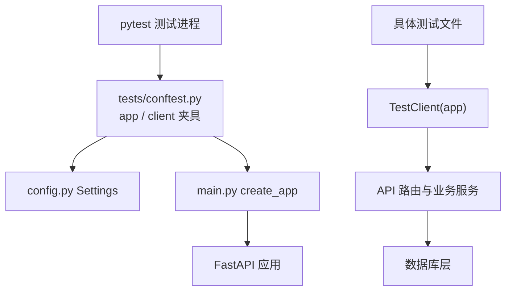

**图表来源**
- [tests/conftest.py:1-31](file://tests/conftest.py#L1-L31)
- [src/personal_ai_life_os/config.py:12-124](file://src/personal_ai_life_os/config.py#L12-L124)
- [src/personal_ai_life_os/main.py:90-100](file://src/personal_ai_life_os/main.py#L90-L100)

**章节来源**
- [tests/conftest.py:1-31](file://tests/conftest.py#L1-L31)
- [src/personal_ai_life_os/config.py:12-124](file://src/personal_ai_life_os/config.py#L12-L124)
- [src/personal_ai_life_os/main.py:90-100](file://src/personal_ai_life_os/main.py#L90-L100)

## 核心组件
本节总结集成测试所依赖的关键代码组件及其职责。

| 组件 | 职责 | 测试相关行为 |
|---|---|---|
| `Settings` | 聚合应用配置，包含数据库、对象存储、模型提供商、注册模式等字段 | 测试夹具直接注入 `database_url`、`object_store_backend`、`model_provider` 等值，避免真实依赖 |
| `create_database_engine` | 创建 SQLAlchemy 引擎，适配 SQLite | 测试使用临时 SQLite 文件，便于快速清理 |
| `create_app` | 挂载路由、初始化服务、处理 schema 与迁移 | 测试环境可选择自动建表或显式运行迁移 |
| 背景作业系统 | 入队、竞争获取、续约、失败重试、取消与恢复 | 并发 worker 测试、中断恢复、过期 lease 抢占 |
| 搜索索引 | SQLite FTS5 或 PostgreSQL pg_trgm | 测试验证搜索后端、触发器和重建索引 |
| 插件系统 | 安装、启用、权限控制、审计 | 测试断言未声明权限被拒绝和失败隔离 |

**章节来源**
- [src/personal_ai_life_os/config.py:12-124](file://src/personal_ai_life_os/config.py#L12-L124)
- [src/personal_ai_life_os/db.py:45-65](file://src/personal_ai_life_os/db.py#L45-L65)
- [src/personal_ai_life_os/main.py:90-100](file://src/personal_ai_life_os/main.py#L90-L100)
- [src/personal_ai_life_os/services/jobs.py:1-200](file://src/personal_ai_life_os/services/jobs.py#L1-L200)
- [src/personal_ai_life_os/services/search_index.py:1-120](file://src/personal_ai_life_os/services/search_index.py#L1-L120)

## 架构总览
下图展示了从测试客户端到数据库的完整集成链路，以及外部服务模拟点。

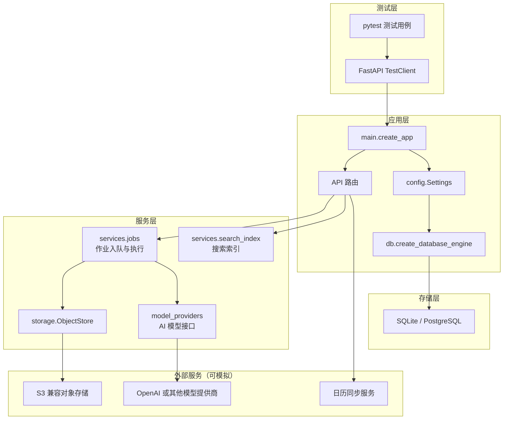

**图表来源**
- [tests/conftest.py:11-31](file://tests/conftest.py#L11-L31)
- [src/personal_ai_life_os/config.py:23-69](file://src/personal_ai_life_os/config.py#L23-L69)
- [src/personal_ai_life_os/main.py:232-232](file://src/personal_ai_life_os/main.py#L232-L232)
- [src/personal_ai_life_os/services/jobs.py:1-60](file://src/personal_ai_life_os/services/jobs.py#L1-L60)
- [src/personal_ai_life_os/services/search_index.py:1-40](file://src/personal_ai_life_os/services/search_index.py#L1-L40)

## 详细组件与集成测试分析

### 测试数据库与应用程序夹具
`tests/conftest.py` 定义了 `app` 和 `client` 两个核心 fixture：
- `app` 使用临时目录生成唯一 `data_dir` 和 SQLite 数据库地址，关闭环境变量加载，显式设置测试所需的最小配置。
- `client` 用 `TestClient(app)` 包裹生命周期，保证每个测试获得独立客户端。

这个夹具是大多数 API 集成测试的基础，包括导入、搜索、插件、工作流和作业测试。

**章节来源**
- [tests/conftest.py:1-31](file://tests/conftest.py#L1-L31)

### 数据库事务管理与迁移验证
Alembic 配置文件指向本地 SQLite 数据库，并在 `migrations/env.py` 中根据运行时设置连接数据库。在线模式会创建连接、开启事务并运行迁移。脚本模板定义标准 `upgrade()` 和 `downgrade()`，配合版本化文件完成演进。

集成测试通常有两种迁移验证方式：
1. 通过 `auto_create_schema=True` 在应用启动时自动建表，适合简单端到端场景。
2. 对迁移本身编写测试，验证升级和回滚是否符合预期。测试可通过 `alembic.ini` 中的 URL 运行 `alembic upgrade/head` 或指定 revision。

推荐实践：
- 使用临时 SQLite 作为默认迁移目标。
- 若有额外 schema、外键或扩展，使用单独 test-only migration revision。
- 在每个大型测试套件开始前显式执行一次 `upgrade`，之后由 pytest 的 session-level 配置管理重置。

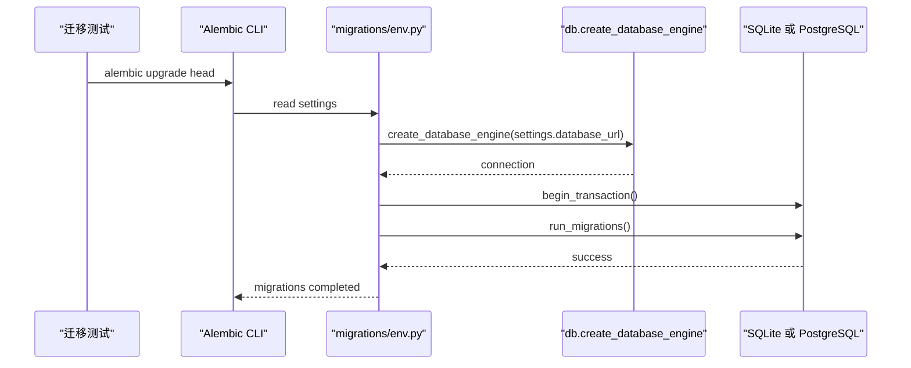

**图表来源**
- [alembic.ini:1-39](file://alembic.ini#L1-L39)
- [migrations/env.py:12-59](file://migrations/env.py#L12-L59)
- [migrations/script.py.mako:1-25](file://migrations/script.py.mako#L1-L25)

**章节来源**
- [alembic.ini:1-39](file://alembic.ini#L1-L39)
- [migrations/env.py:12-59](file://migrations/env.py#L12-L59)
- [migrations/script.py.mako:1-25](file://migrations/script.py.mako#L1-L25)

### 端到端 API 调用链路与导入幂等性
导入测试展示了完整的“注册 -> 创建来源 -> 上传文件 -> 写入 items -> timeline 查询”链路，还验证了：
- 导入响应包含 `sync_run` 和新增 `items`。
- 重复导入不会产生多余条目，而是记录重复数量。
- timeline 返回的 item 保留原始位置信息。
- owner 隔离：其他用户无法读取同来源或同 item。
- 暂停、撤销、删除来源后阻止后续导入并影响后续访问。

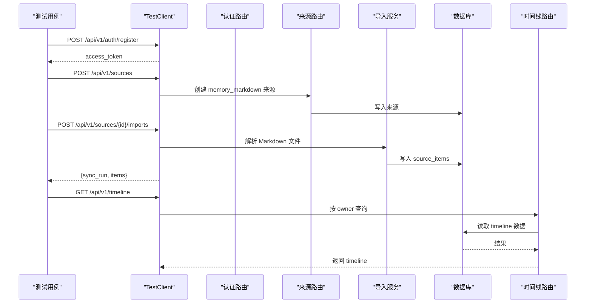

**图表来源**
- [tests/test_imports_api.py:23-61](file://tests/test_imports_api.py#L23-L61)
- [tests/test_imports_api.py:87-127](file://tests/test_imports_api.py#L87-L127)
- [src/personal_ai_life_os/models.py:BackgroundJob 等相关实体参考](file://src/personal_ai_life_os/models.py#L1-L50)

**章节来源**
- [tests/test_imports_api.py:23-220](file://tests/test_imports_api.py#L23-L220)

### 搜索索引集成测试
搜索测试验证 FTS 后端选择、过滤条件、分页类型、提醒与回顾搜索，以及保存搜索、标签、集合和组织隔离。测试流程通常：
1. 注册账号并导入一段合成记忆数据。
2. 查询 search endpoint，确认返回 index_backend 为 `sqlite-fts5-trigram`。
3. 断言搜索结果数量和标题关键词。
4. 修改提醒状态，再按 type=reminders 和 status=snoozed 过滤。
5. 创建回顾后，用 review 内容参与搜索。
6. 测试 saved-searches 的增删改查、唯一性和过滤参数持久化。
7. 断言跨用户隔离：另一个用户无法访问前一个用户的组织资源。

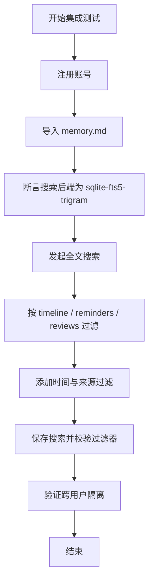

**图表来源**
- [tests/test_search_organization.py:12-97](file://tests/test_search_organization.py#L12-L97)
- [src/personal_ai_life_os/services/search_index.py:18-80](file://src/personal_ai_life_os/services/search_index.py#L18-L80)

**章节来源**
- [tests/test_search_organization.py:12-120](file://tests/test_search_organization.py#L12-L120)
- [src/personal_ai_life_os/services/search_index.py:1-120](file://src/personal_ai_life_os/services/search_index.py#L1-L120)

### 异步作业与工作器竞争测试
背景作业系统是多个复杂流程的共享能力：图谱照片 OCR、描述生成、每周回顾、桌面分析等都依赖它。测试重点覆盖：
- 作业排队和重复 idempotency key。
- worker 之间 lease 竞争，旧 worker 应忽略后来者。
- 长时间作业期间，若 source/pause/revoke/delete，应在下一次 claim 时被丢弃。
- 进程中断后的新进程 recover。
- expired lease 的 replacement worker 成功接管并完成。
- failed attempt 的记录成本只写一次。

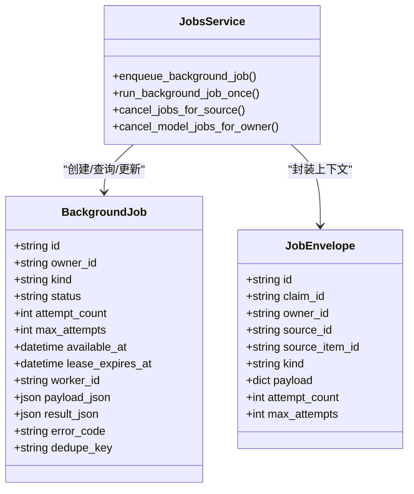

**图表来源**
- [src/personal_ai_life_os/services/jobs.py:21-80](file://src/personal_ai_life_os/services/jobs.py#L21-L80)
- [tests/test_worker_claim.py:22-71](file://tests/test_worker_claim.py#L22-L71)
- [tests/test_worker_claim.py:72-155](file://tests/test_worker_claim.py#L72-L155)

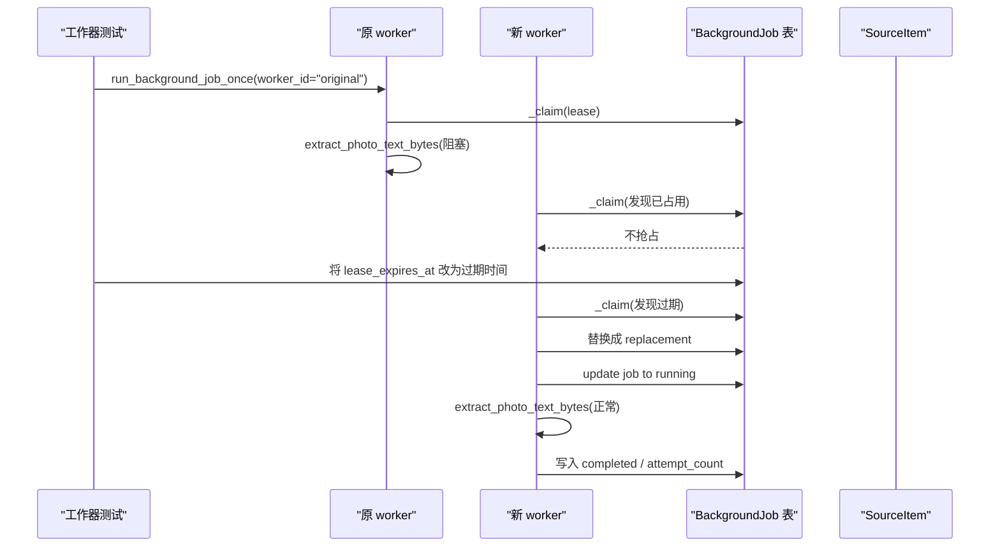

**图表来源**
- [tests/test_worker_claim.py:71-124](file://tests/test_worker_claim.py#L71-L124)
- [tests/test_worker_claim.py:155-200](file://tests/test_worker_claim.py#L155-L200)
- [src/personal_ai_life_os/services/jobs.py:60-200](file://src/personal_ai_life_os/services/jobs.py#L60-L200)

**章节来源**
- [tests/test_worker_claim.py:22-200](file://tests/test_worker_claim.py#L22-L200)
- [src/personal_ai_life_os/services/jobs.py:1-200](file://src/personal_ai_life_os/services/jobs.py#L1-L200)

### 调度器、外部模型提供者与预算回退
计划任务测试验证：
- 没有同意使用时，外部 review 会被标记为 `consent_withdrawn`，且不会真正入队到 background job。
- 有同意但预算上限极低时，review 的模型阶段落在 `budget_fallback`。
- 设置 `processing_mode=worker` 后，调度器会生成 review 并 enqueue `weekly_review` 作业，测试随后检查 job 记录。

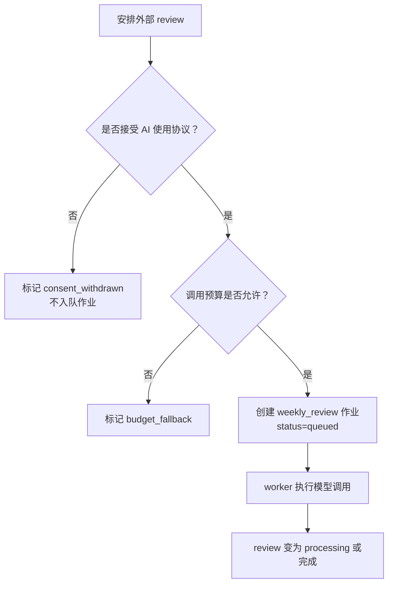

**图表来源**
- [tests/test_review_schedule.py:187-226](file://tests/test_review_schedule.py#L187-L226)
- [tests/test_review_schedule.py:229-257](file://tests/test_review_schedule.py#L229-L257)
- [src/personal_ai_life_os/services/jobs.py:120-200](file://src/personal_ai_life_os/services/jobs.py#L120-L200)

**章节来源**
- [tests/test_review_schedule.py:187-257](file://tests/test_review_schedule.py#L187-L257)
- [src/personal_ai_life_os/services/jobs.py:120-200](file://src/personal_ai_life_os/services/jobs.py#L120-L200)

### 图谱抽取、问答与插件调用链路的集成思路
虽然部分图谱逻辑主要在 unit 或 feature 测试文件中，但集成测试可以通过以下模式组合现有路径：
- 先用 import 或 sources API 创建来源和 items。
- 通过 agent 动作或 plugin 的 `invoke` 触发行文、图检索、项目创建等操作。
- 利用 `/api/v1/plugins/catalog`、`/api/v1/plugins/install`、`/api/v1/plugins/{id}/status`、`/api/v1/plugins/{id}/invoke`、`/api/v1/plugins/audit` 完整走通插件生命周期。
- 断言插件权限控制：未授予的 action 返回 403 或未实现错误。
- 对于图谱搜索 agent，先创建 project，再以 plugin 的 search action 查找该 project，并断言证据字段存在。

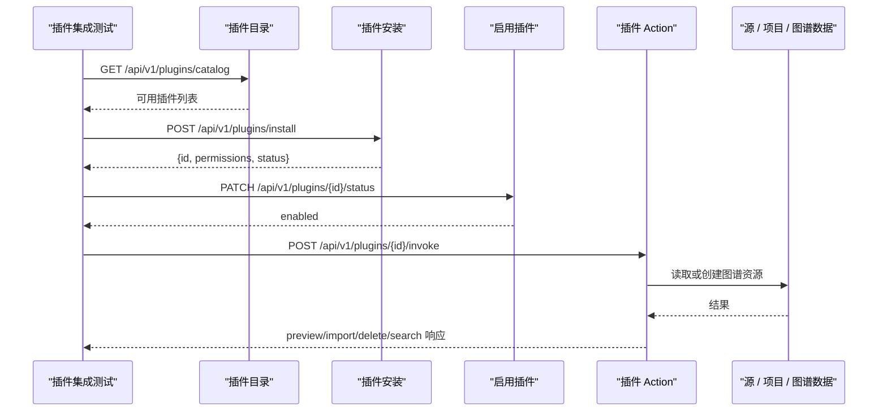

**图表来源**
- [tests/test_plugins.py:8-57](file://tests/test_plugins.py#L8-L57)
- [tests/test_plugins.py:59-124](file://tests/test_plugins.py#L59-L124)
- [tests/test_plugins.py:160-188](file://tests/test_plugins.py#L160-L188)

**章节来源**
- [tests/test_plugins.py:8-188](file://tests/test_plugins.py#L8-L188)

### 外部服务模拟方法
仓库测试对“外部依赖”采取不同层次模拟：

| 外部依赖 | 模拟方式 | 测试关注点 |
|---|---|---|
| AI 模型提供商 | 通过 `Settings.model_provider`、`Settings.model_providers` 以及专用测试函数设置假定价和行为；必要时直接 monkeypatch jobs 中的文本提取过程 | 同意状态、预算回退、fallback、错误路径 |
| 对象存储 | 测试夹具把 `object_store_backend` 设为 local；S3 行为仅在特定分支测试中覆盖 | 本地对象读写、journal tombstone |
| 日历同步 | 通过 ICS 解析测试和导入测试间接验证格式处理，复杂 sync 可由 worker 路径结合 mock 验证 | 日历事件解析、重复与冲突 |
| 文件系统 | 使用 pytest 的 tmp_path 或固定 fixtures/synthetic 数据 | 桌面分析、备份、导入、OCR 输入 |

最佳实践：
- 尽量使用应用配置切换后端，而不是大量 patch 全局变量。
- 当业务逻辑直接调用网络或服务层时，优先 monkeypatch 具体函数，例如 `jobs.extract_photo_text_bytes`。
- 对外部 AI 调用，同时断言数据库中的 ModelRun、Review draft model status 与 BackgroundJob 记录。

**章节来源**
- [tests/conftest.py:11-26](file://tests/conftest.py#L11-L26)
- [tests/test_worker_claim.py:71-124](file://tests/test_worker_claim.py#L71-L124)
- [tests/test_review_schedule.py:187-226](file://tests/test_review_schedule.py#L187-L226)

### 端到端 API 链路测试策略
推荐的端到端链路顺序如下：
1. **环境与配置验证**  
   - 确保 `app.state.settings` 包含期望的 `database_url`、`object_store_backend`、`registration_mode`、`model_provider`。
   - 检查 application startup 是否创建 schema。
2. **身份与会话**  
   - 通过注册、登录获取 bearer token，再验证匿名访问被拒绝。
3. **数据准备**  
   - 创建 sources，上传 fixtures/synthetic 下的 memory.md、图片等文件。
   - 如需要，创建 tags、collections，组织 items。
4. **主业务操作**  
   - 调用 search、timeline、reviews、quick_notes、insights、plugins 等接口。
   - 对后台作业设置 `processing_mode = "worker"` 或使用 `run_background_job_once` 手动推进。
5. **结果状态验证**  
   - 检查业务实体表、job 表、model usage 表和 audit 表的状态。
6. **副作用验证**  
   - 断言 timeline、search index、search backend、saved searches、tags、plugins audit 的变更。
7. **隔离与安全性验证**  
   - 用第二个用户发起相同请求，断言 404、403 或 422。

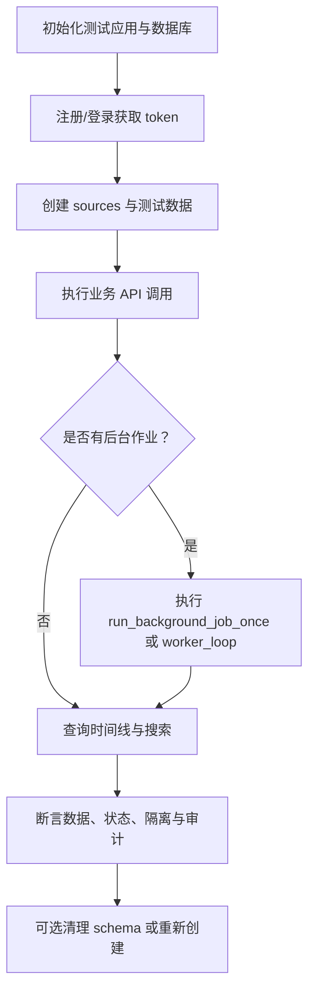

[此图为概念流程，不绑定具体源码，因此无需图表来源]

### 数据准备与状态验证清单
- 新用户注册返回 201，access_token 存在。
- 登录返回 bearer token。
- 匿名访问 sources 返回 401。
- 导入 memory.md 后 timeline.total 符合行数。
- 重复导入 items_created 为 0，items_duplicate 增加。
- owner B 读取 owner A 的 items/raw/timeline 均被拒绝。
- 暂停、撤销、删除来源后再次导入返回 409。
- 并发导入最多创建一个 item 集合，不重复。
- 搜索返回正确 index_backend，并按类型、时间、来源、标签过滤。
- 插件安装成功后能 preview/import，未授权 permission 时返回错误。
- background job 在竞争、过期、中断、source 变更后表现符合预期。

**章节来源**
- [tests/test_imports_api.py:23-220](file://tests/test_imports_api.py#L23-L220)
- [tests/test_search_organization.py:12-200](file://tests/test_search_organization.py#L12-L200)
- [tests/test_plugins.py:59-188](file://tests/test_plugins.py#L59-L188)
- [tests/test_worker_claim.py:71-200](file://tests/test_worker_claim.py#L71-L200)

## 依赖关系分析

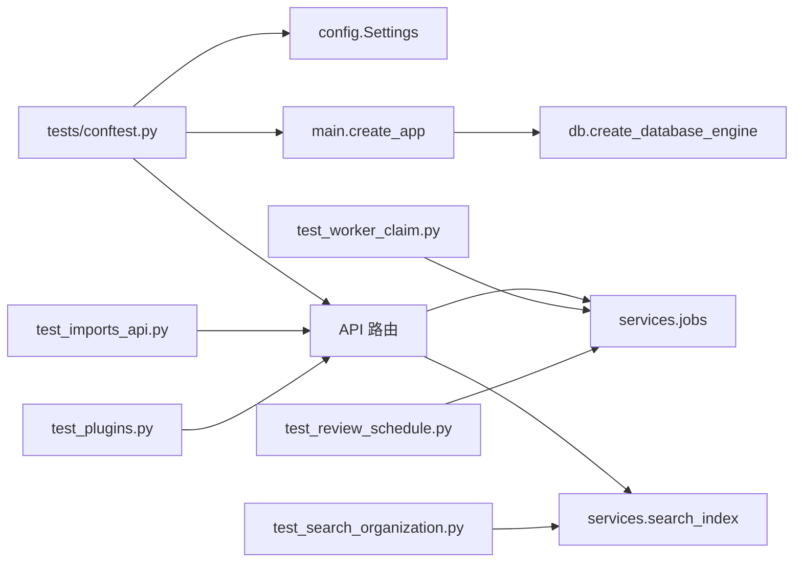

**图表来源**
- [tests/conftest.py:11-31](file://tests/conftest.py#L11-L31)
- [src/personal_ai_life_os/config.py:12-69](file://src/personal_ai_life_os/config.py#L12-L69)
- [src/personal_ai_life_os/db.py:45-65](file://src/personal_ai_life_os/db.py#L45-L65)
- [tests/test_imports_api.py:23-220](file://tests/test_imports_api.py#L23-L220)
- [tests/test_worker_claim.py:22-200](file://tests/test_worker_claim.py#L22-L200)
- [tests/test_review_schedule.py:187-257](file://tests/test_review_schedule.py#L187-L257)
- [tests/test_search_organization.py:12-200](file://tests/test_search_organization.py#L12-L200)
- [tests/test_plugins.py:59-188](file://tests/test_plugins.py#L59-L188)

**章节来源**
- [tests/conftest.py:1-31](file://tests/conftest.py#L1-L31)
- [tests/test_imports_api.py:23-220](file://tests/test_imports_api.py#L23-L220)
- [tests/test_worker_claim.py:22-200](file://tests/test_worker_claim.py#L22-L200)
- [tests/test_review_schedule.py:187-257](file://tests/test_review_schedule.py#L187-L257)
- [tests/test_search_organization.py:12-200](file://tests/test_search_organization.py#L12-L200)
- [tests/test_plugins.py:59-188](file://tests/test_plugins.py#L59-L188)

## 性能与慢查询测试
项目中已有指标与耗时采样能力，测试可以从应用状态观察慢请求、5xx 采样、导入开关等元信息：
- 设置 `settings.metrics_token` 并通过 `/api/v1/metrics` 读取指标。
- 通过写入 `request_samples` 模拟最近一段时间的高延迟和错误，然后断言 metrics 中 `http_5xx_sampled` 增长。
- 对 FTS 触发器和重建索引的性能回归，可以测量插入大量 timeline、reviews、reminders 后 rebuild 的执行次数和最终后端。
- 针对 worker 并发，使用线程池并发提交 import 或 worker 调用，验证无重复且耗时可预测。

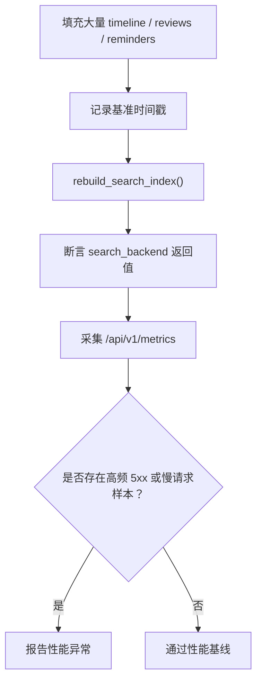

**图表来源**
- [tests/test_imports_api.py:33-61](file://tests/test_imports_api.py#L33-L61)
- [src/personal_ai_life_os/services/search_index.py:101-120](file://src/personal_ai_life_os/services/search_index.py#L101-L120)

**章节来源**
- [tests/test_imports_api.py:33-61](file://tests/test_imports_api.py#L33-L61)
- [src/personal_ai_life_os/services/search_index.py:101-120](file://src/personal_ai_life_os/services/search_index.py#L101-L120)

## 故障排查指南

| 问题现象 | 可能原因 | 定位步骤 | 修复建议 |
|---|---|---|---|
| 迁移失败 | Alembic 配置 URL 错误或数据库权限不足 | 检查 `alembic.ini`、`migrations/env.py`、SQLAlchemy 日志 | 修正 SQLALCHEMY_URL，确认 SQLite/PG 可扩展权限 |
| API 调用报错但没有清晰错误码 | 前端 token 缺失或 token 过期 | 打印 `auth_required` 相关响应体 | 检查 Authorization header 和登录流程 |
| 并发导入产生重复 item | 去重 key 或唯一约束未生效 | 查看 sync_run.items_created 与 database 唯一键 | 强化 dedupe_key、source locator 唯一约束 |
| background job 多次重复执行 | idempotency key 不一致或 worker 未正确记录 completed | 检查 BackgroundJob.dedupe_key 与 status | 复用统一 enqueue 函数并检查 attempt_count |
| worker 长时间阻塞后被抢占 | 旧 worker lease 未过期 | 检查 lease_expires_at 与 renewal 逻辑 | 合理设置过期时间，确保 replacement worker 可接管 |
| 外部 review 不生成 job | 未同意或使用协议未生效 | 检查 AI consent 与 model provider 配置 | 设置 consent 和有效 model providers |
| 插件调用失败但不影响主 API | sandbox/permission isolation 生效 | 查看 plugins/audit 和 error.code | 补全权限或修正 payload |
| 搜索无结果 | FTS5/trigram 不可用 | 检查 search_backend 是否降级到 like | 安装 SQLite FTS5 或 PostgreSQL pg_trgm |

**章节来源**
- [alembic.ini:1-39](file://alembic.ini#L1-L39)
- [migrations/env.py:12-59](file://migrations/env.py#L12-L59)
- [src/personal_ai_life_os/services/search_index.py:18-100](file://src/personal_ai_life_os/services/search_index.py#L18-L100)
- [tests/test_plugins.py:59-188](file://tests/test_plugins.py#L59-L188)
- [tests/test_imports_api.py:87-220](file://tests/test_imports_api.py#L87-L220)

## 结论
Personal-AI-Life-OS 的集成测试以 FastAPI TestClient 为基础，通过临时 SQLite 数据库、Fixture 数据和应用配置完成模块间交互验证。测试不仅覆盖导入、搜索、组织和插件等基本路径，还深入到了背景作业的生命周期、工作器竞争与恢复、外部模型回退和预算控制、计划任务调度等复杂领域。要扩展新的集成场景，应遵循现有模式：用配置驱动外部依赖、用 Fixture 数据构造初始状态、用 API 与数据库双重断言验证端到端行为，并结合 `/api/v1/metrics` 和 search backend 诊断性能退化。