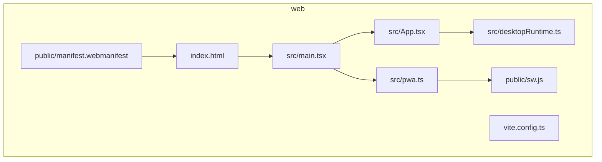
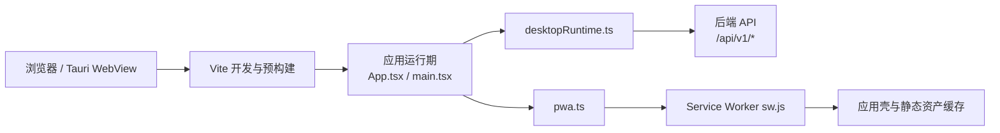
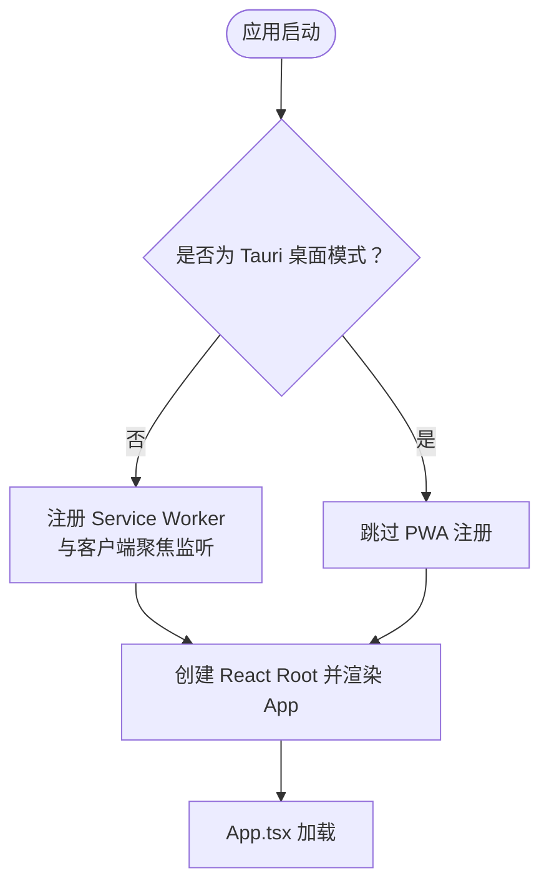
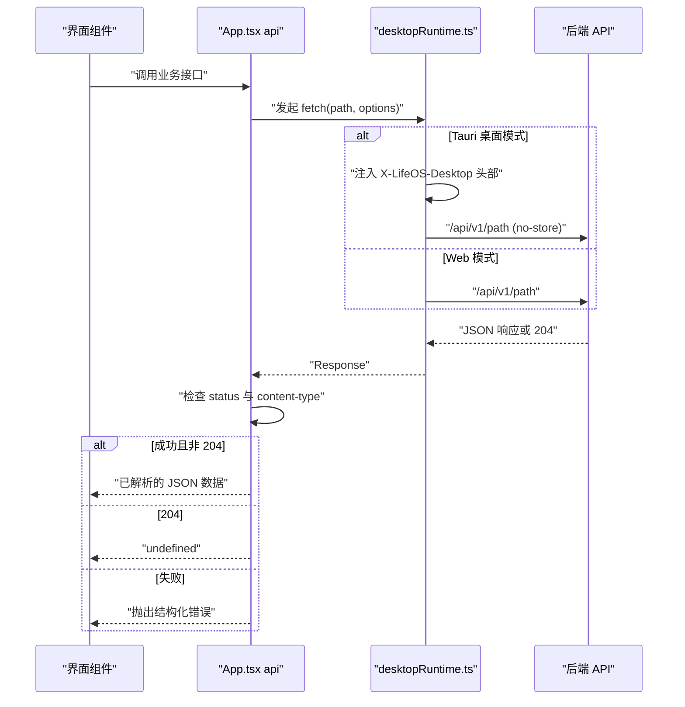
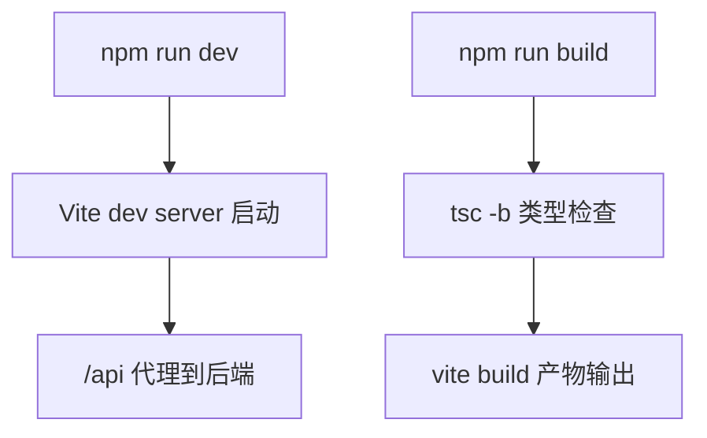
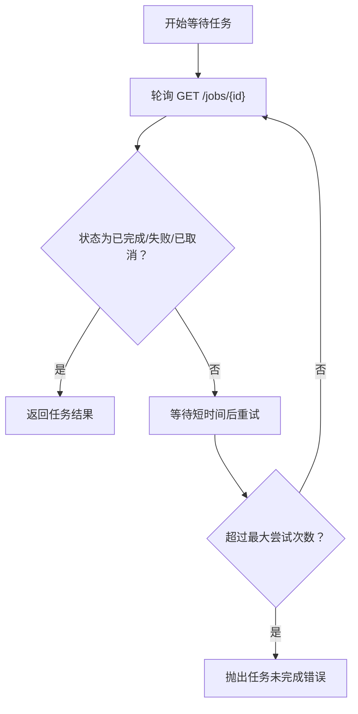
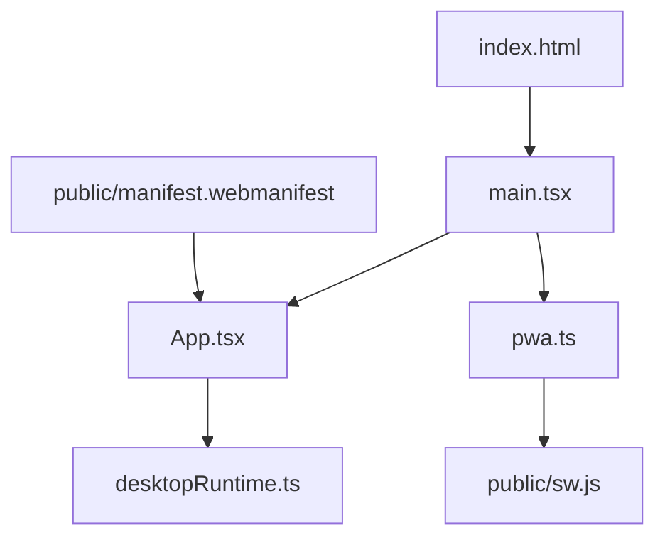

# 前端架构

<cite>
**本文引用的文件**
- [web/package.json](file://web/package.json)
- [web/vite.config.ts](file://web/vite.config.ts)
- [web/index.html](file://web/index.html)
- [web/tsconfig.app.json](file://web/tsconfig.app.json)
- [web/tsconfig.json](file://web/tsconfig.json)
- [web/src/main.tsx](file://web/src/main.tsx)
- [web/src/App.tsx](file://web/src/App.tsx)
- [web/src/desktopRuntime.ts](file://web/src/desktopRuntime.ts)
- [web/src/pwa.ts](file://web/src/pwa.ts)
- [web/public/manifest.webmanifest](file://web/public/manifest.webmanifest)
- [web/public/sw.js](file://web/public/sw.js)
</cite>

## 目录
1. [引言](#引言)
2. [项目结构](#项目结构)
3. [核心组件](#核心组件)
4. [架构总览](#架构总览)
5. [详细组件分析](#详细组件分析)
6. [依赖关系分析](#依赖关系分析)
7. [性能与构建](#性能与构建)
8. [故障排查指南](#故障排查指南)
9. [结论](#结论)

## 引言
本文件系统性梳理 Personal-AI-Life-OS 的前端架构，聚焦于 React + TypeScript + Vite 技术栈的设计决策、应用入口与根组件组织结构、状态管理策略、前后端 API 集成方式、构建优化、PWA 实现，并给出架构图与流程图。目标读者包括产品、后端和前端工程师，既适合快速理解整体设计，也适合作为长期维护的参考文档。

## 项目结构
前端工程位于 `web` 目录，采用基于 Vite 的单页应用结构：
- 资源与配置：`index.html`、`public/manifest.webmanifest`、`public/sw.js`、`vite.config.ts`、`package.json`、TypeScript 配置。
- 源代码：`src/main.tsx` 作为 React 应用启动入口；`src/App.tsx` 承载页面路由、状态、API 调用及业务逻辑；其他独立功能模块（如 PWA、Tauri 桌面运行时、导出工具等）按职责拆分。
- 静态资源：图标、Web Manifest、Service Worker 脚本在 `public` 下托管。



**图表来源**
- [web/index.html:1-17](file://web/index.html#L1-L17)
- [web/src/main.tsx:1-17](file://web/src/main.tsx#L1-L17)
- [web/src/App.tsx:1-10](file://web/src/App.tsx#L1-L10)
- [web/src/desktopRuntime.ts:1-45](file://web/src/desktopRuntime.ts#L1-L45)
- [web/src/pwa.ts:1-108](file://web/src/pwa.ts#L1-L108)
- [web/public/manifest.webmanifest:1-38](file://web/public/manifest.webmanifest#L1-L38)
- [web/public/sw.js:1-129](file://web/public/sw.js#L1-L129)
- [web/vite.config.ts:1-17](file://web/vite.config.ts#L1-L17)

**章节来源**
- [web/index.html:1-17](file://web/index.html#L1-L17)
- [web/package.json:1-29](file://web/package.json#L1-L29)

## 核心组件
- `main.tsx`：React 根渲染器、PWA 初始化、开发环境聚焦检测。
- `App.tsx`：根业务组件，包含大量数据模型类型、UI 控件、页面路由映射、HTTP 请求封装、任务轮询、导入解析、设置与权限、图分析、审查与工作流等核心逻辑。
- `desktopRuntime.ts`：统一区分 Tauri 桌面模式与普通 Web 模式的请求路径、鉴权头与环境选择，并提供桌面侧文件夹选择与导出对接。
- `pwa.ts`：PWA Service Worker 注册、通知授权与客户端聚焦事件桥接、共享内容读取与清理。
- `sw.js`：Service Worker，处理静态资源缓存、导航回退、分享目标接收与推送通知点击跳转。

这些组件共同构成“启动 → 环境判断 → 网络封装 → 页面状态”的前端主链路。

**章节来源**
- [web/src/main.tsx:1-17](file://web/src/main.tsx#L1-L17)
- [web/src/App.tsx:1-100](file://web/src/App.tsx#L1-L100)
- [web/src/desktopRuntime.ts:1-45](file://web/src/desktopRuntime.ts#L1-L45)
- [web/src/pwa.ts:1-108](file://web/src/pwa.ts#L1-L108)

## 架构总览
前端以 React 函数组件和 Hooks 为主，未使用第三方全局状态库。App 内部通过 `useState`、`useMemo`、`useEffect`、`useRef` 管理页面局部或跨子树状态；异步操作通过自封装的 HTTP 方法直接触发。部署模式分为：
- 普通 Web：由 Vite dev server 代理 `/api` 到本地 `127.0.0.1:8000`，或通过环境变量指向远端。
- Tauri 桌面：由后端暴露桌面运行时 secret，前端通过 `X-LifeOS-Desktop` 头部直连后端。



**图表来源**
- [web/vite.config.ts:9-17](file://web/vite.config.ts#L9-L17)
- [web/src/main.tsx:6-17](file://web/src/main.tsx#L6-L17)
- [web/src/App.tsx:1-30](file://web/src/App.tsx#L1-L30)
- [web/src/desktopRuntime.ts:1-45](file://web/src/desktopRuntime.ts#L1-L45)
- [web/src/pwa.ts:66-108](file://web/src/pwa.ts#L66-L108)
- [web/public/sw.js:1-129](file://web/public/sw.js#L1-L129)

## 详细组件分析

### 应用启动与根组件
`main.tsx` 在 `StrictMode` 中挂载 `App.tsx`，并根据是否运行在 Tauri 决定是否注册 PWA Service Worker 和追踪客户端聚焦事件。该设计确保 Web 模式下可用 PWA 特性，桌面模式下则交由后端或系统能力统一管理。

`App.tsx` 不仅负责 UI 渲染，还承担以下职责：
- 定义页面枚举与路由映射。
- 声明业务模型类型，如 Source、Item、Job、Review、Ontology、Plugin、AgentAction、Budget、Qa、Graph 等。
- 封装统一的异步 API 方法与后台任务轮询。
- 提供日历、聊天导入、草稿分析、桌面文件夹管理等关键流程。



**图表来源**
- [web/src/main.tsx:1-17](file://web/src/main.tsx#L1-L17)
- [web/src/App.tsx:1-30](file://web/src/App.tsx#L1-L30)

**章节来源**
- [web/src/main.tsx:1-17](file://web/src/main.tsx#L1-L17)
- [web/src/App.tsx:1-30](file://web/src/App.tsx#L1-L30)

### 状态管理模式
当前前端采用“集中式根状态 + 组件本地状态”的策略：
- 全局或跨组件状态由 `App.tsx` 中的状态变量持有，例如登录令牌、用户信息、当前页面、待执行操作等。这种方式简单直观，避免引入第三方状态库带来的学习与维护成本。
- 局部表单、展示状态、DOM 引用保存在各函数组件内部，符合 React Hooks 约定。
- API 状态通常通过响应对象或状态机字段表达，如 Job 的 `status`、Review 的 `draft/final_text`、Graph Review 的 `status` 等。

优点：
- 降低依赖复杂度，代码路径清晰。
- 与现有复杂业务模型高度匹配。

风险：
- App 体积增长后可能出现“巨型组件”。
- 跨层级状态更新需要显式回调传递或使用复用 Hook。

建议：
- 将大组件拆分为按页面划分的子组件。
- 对频繁使用的组合状态（如登录、租户、主题、错误边界）抽取自定义 Hook。
- 对于复杂异步工作流（如 graph extraction/review merge），可考虑轻量状态机或上下文封装。

**章节来源**
- [web/src/App.tsx:31-150](file://web/src/App.tsx#L31-L150)

### 前端与后端 API 集成
API 集成分三层：
1. **环境与运行时选择**：`desktopRuntime.ts` 根据 `@tauri-apps/api/core` 的 `isTauri()` 判断运行模式，并在桌面模式下从 Tauri 后端取得运行时 origin 与 secret。
2. **请求封装与鉴权**：`desktopRuntime.apiFetch` 负责拼接基础 URL 与 `/api/v1` 前缀；`App.tsx` 中的 `api` 或 `desktopRequest` 添加 Bearer Token、Content-Type、响应检查。
3. **错误处理与响应转换**：非 2xx 返回抛出带错误消息的错误对象；204 无内容响应转换为 `undefined`；其他响应体通过 JSON 反序列化。



**图表来源**
- [web/src/desktopRuntime.ts:1-45](file://web/src/desktopRuntime.ts#L1-L45)
- [web/src/App.tsx:31-90](file://web/src/App.tsx#L31-L90)

请求拦截与错误处理要点：
- 路径校验：仅允许绝对路径开头。
- Web 模式代理：`vite.config.ts` 将 `/api` 代理到 `http://127.0.0.1:8000`。
- 桌面模式强制不缓存、重定向错误，保证实时性。
- 统一错误格式依赖后端返回 `{ error: { message } }`，否则包装通用错误消息。

**章节来源**
- [web/src/desktopRuntime.ts:10-45](file://web/src/desktopRuntime.ts#L10-L45)
- [web/vite.config.ts:9-17](file://web/vite.config.ts#L9-L17)
- [web/src/App.tsx:31-90](file://web/src/App.tsx#L31-L90)

### 构建系统与开发工作流
Vite 与 TypeScript 的配置体现以下设计：
- TypeScript 目标 ES2023，使用 `react-jsx`、`bundler` 模块解析，并启用较严格 linting 选项（未使用本地变量/参数、switch fallthrough 检查）。
- Vite 仅引入官方 React 插件，dev server 开放 `0.0.0.0`，支持 Codespaces 域名白名单，并将 `/api` 反向代理到后端服务。
- 包脚本中构建流程先执行 `tsc -b` 进行类型检查与增量编译，再执行 `vite build`。



**图表来源**
- [web/package.json:5-15](file://web/package.json#L5-L15)
- [web/vite.config.ts:9-17](file://web/vite.config.ts#L9-L17)
- [web/tsconfig.app.json:1-26](file://web/tsconfig.app.json#L1-L26)

**章节来源**
- [web/package.json:1-29](file://web/package.json#L1-L29)
- [web/vite.config.ts:1-17](file://web/vite.config.ts#L1-L17)
- [web/tsconfig.app.json:1-26](file://web/tsconfig.app.json#L1-L26)

### PWA 与离线能力
PWA 功能由三个部分组成：
- `manifest.webmanifest` 定义应用名称、短名、显示模式、主题色、图标集、快捷启动项以及“分享目标”，使移动端可直接将标题、文本、URL 分享至 Life OS。
- `src/pwa.ts` 在普通 Web 环境下注册 Service Worker，并向窗口发送聚焦消息以便 Service Worker 记住最后活跃客户端；同时提供通知权限申请与提醒发送能力。
- `public/sw.js` 实现应用壳缓存、静态资源懒缓存、导航回退、`/share-target` POST 请求接收分享、通知点击定位与页面跳转。

```mermaid
sequenceDiagram
  participant User as "用户"
  participant Browser as "浏览器"
  participant PWA as "pwa.ts"
  participant SW as "sw.js"
  App as "App/Capture 页面"
  Browser->>PWA: "registerLifeosServiceWorker()"
  PWA->>SW: "navigator.serviceWorker.register('/sw.js')"
  SW-->>PWA: "安装成功，skipWaiting"
  User->>Browser: "从外部分享标题/文本/URL"
  Browser->>SW: "POST /share-target"
  SW->>SW: "写入 lifeos-share-inbox 缓存"
  SW->>App: "导航到 /capture?shared=1"
  App->>PWA: "readPendingSharedCapture()"
  PWA-->>App: "清洗后的 SharedCapture 对象"
```

**图表来源**
- [web/public/manifest.webmanifest:1-38](file://web/public/manifest.webmanifest#L1-L38)
- [web/src/pwa.ts:1-108](file://web/src/pwa.ts#L1-L108)
- [web/public/sw.js:1-129](file://web/public/sw.js#L1-L129)

服务工作者策略要点：
- 应用壳与关键静态资源在安装阶段预缓存。
- 对 `/assets/`、`/icons/`、`/manifest.webmanifest`、`/favicon.svg` 优先命中缓存，未命中则网络拉取并回填。
- SPA 导航在未命中时回退到根页面缓存。
- 共享内容使用专用缓存 key，具备过期时间并由前端主动删除。
- 通知点击携带数据，用于重新聚焦原窗口并跳转到指定路径。

**章节来源**
- [web/public/manifest.webmanifest:20-38](file://web/public/manifest.webmanifest#L20-L38)
- [web/src/pwa.ts:18-108](file://web/src/pwa.ts#L18-L108)
- [web/public/sw.js:1-129](file://web/public/sw.js#L1-L129)

### 后台任务与长流程
部分后端操作耗时较长，前端通过任务轮询等待完成，例如获取 job 状态直到 completed、failed 或 cancelled。当前实现为固定次数的间隔轮询，并返回最终 job 结果。这避免了 WebSocket 复杂度，但对超长任务存在超时风险，可通过渐进延迟、重试上限与取消信号改进。



**图表来源**
- [web/src/App.tsx:31-70](file://web/src/App.tsx#L31-L70)

**章节来源**
- [web/src/App.tsx:31-70](file://web/src/App.tsx#L31-L70)

### 组件层次结构与页面组织
根组件 `App.tsx` 内部定义了页面集合和路由映射：timeline、ask、graph、pending、projects、reviews、search、organize、account、capture。它还提供通用 SVG 图标、搜索聚合结果结构、标签与集合组织模型、插件审计与 Agent Action、预算统计、QA 问答、证据图等类型。实际页面组件目前以同包内多个文件形式存在，例如桌面相关页面与导入工具。

建议进一步拆分为：
- `pages/TimelinePage`、`pages/AskPage`、`pages/GraphPage` 等页面级组件。
- `components/Layout`、`components/Header`、`components/Sidebar`、`components/SearchBar` 等布局与公共 UI。
- `features/*` 按业务能力划分，例如 `features/capture`、`features/reviews`、`features/graph`、`features/search`。

这种“页面级组件 + 特征分包 + 共享组件”的组合能在不引入重型状态框架的前提下提升可维护性。

**章节来源**
- [web/src/App.tsx:1-30](file://web/src/App.tsx#L1-L30)
- [web/src/App.tsx:31-200](file://web/src/App.tsx#L31-L200)

## 依赖关系分析



- `App.tsx` 直接依赖 `desktopRuntime.ts`，并通过后者访问后端 API。
- `main.tsx` 在运行时依赖 `pwa.ts`。
- PWA 逻辑与 `public/sw.js` 通过 `navigator.serviceWorker`、`caches`、`Notification`、Web Share Target 机制协作。
- `index.html` 是唯一页面入口，引入 `src/main.tsx`。
- `manifest.webmanifest` 被浏览器用作 PWA 元数据，同时声明分享目标。

**图表来源**
- [web/src/main.tsx:1-17](file://web/src/main.tsx#L1-L17)
- [web/src/App.tsx:1-20](file://web/src/App.tsx#L1-L20)
- [web/src/desktopRuntime.ts:1-10](file://web/src/desktopRuntime.ts#L1-L10)
- [web/src/pwa.ts:66-108](file://web/src/pwa.ts#L66-L108)
- [web/public/sw.js:1-30](file://web/public/sw.js#L1-L30)
- [web/index.html:10-17](file://web/index.html#L10-L17)
- [web/public/manifest.webmanifest:1-19](file://web/public/manifest.webmanifest#L1-L19)

## 性能与构建
- **构建目标**：ES2023 与 ESNext 模块，有利于现代浏览器的 tree-shaking 和原生 import/export 行为。
- **Vite 插件**：仅启用官方 React 插件，减少打包时代码侵入。
- **开发服务器**：绑定 `0.0.0.0`，适配容器或远程开发场景；自动代理 `/api` 到后端。
- **TypeScript 编译**：`noEmit` 表明由 Vite 管理模块，`tsc -b` 用于类型检查和增量编译，适合 monorepo 或多项目引用。
- **代码分割与懒加载**：当前源码未发现显式的 `lazy()` 或动态导入；可考虑对大型页面与第三方依赖进行按需加载，以减少首屏体积。
- **样式组织**：已有 `App.css` 和 `index.css` 以及桌面特定样式；建议逐步转向 CSS Modules、CSS-in-JS 或原子化方案，配合组件粒度控制作用域与主题变量。

[本节为通用建议，未直接分析具体代码片段]

## 故障排查指南
- **无法访问后端 API**
  - Web 模式确认 vite proxy 配置与 `LIFEOS_API_ORIGIN` 环境变量；生产部署应确保 Nginx 或反向代理转发 `/api/v1`。
  - 桌面模式确认 `connectDesktop()` 已成功获取 runtime 并探测 `/ready`。
- **CORS 或跨域错误**
  - 检查后端 CORS 配置，允许前端 origin；Vite 开发时代理会自动处理 `changeOrigin`。
- **Service Worker 未生效**
  - 仅在非 Tauri 环境注册；确认生产环境可访问 `/sw.js` 与 `/manifest.webmanifest`。
  - 检查缓存命名版本 `lifeos-static-v2`，升级时更新版本号以清理旧缓存。
- **分享功能异常**
  - 确认 manifest 中 share_target 字段有效；浏览器需支持 Web Share Target。
  - 检查 `lifeos-share-inbox-v1` 缓存是否写入成功，以及过期时间是否导致内容被提前丢弃。
- **通知不可用**
  - 若浏览器不支持 `Notification`，则返回 unsupported 并降级到应用内提醒。
  - 若权限被拒绝，提示用户手动开启；注意 Service Worker ready 超时保护。
- **后台任务长时间未完成**
  - 当前轮询有固定上限；可考虑增加进度反馈、指数退避与中断标志。

**章节来源**
- [web/vite.config.ts:9-17](file://web/vite.config.ts#L9-L17)
- [web/src/desktopRuntime.ts:8-45](file://web/src/desktopRuntime.ts#L8-L45)
- [web/src/pwa.ts:18-108](file://web/src/pwa.ts#L18-L108)
- [web/public/sw.js:1-129](file://web/public/sw.js#L1-L129)

## 结论
本项目前端采用简洁直观的 React + TypeScript + Vite 架构，以 App.tsx 为核心，整合了路由、数据模型、API 封装与业务流程；Tauri 与 Web 两种运行模式共用同一前端代码库。状态管理以本地和集中式状态为主，避免了重型框架；PWA 提供了稳定的离线外壳、分享目标与通知能力。当前架构的优势是轻量和清晰，后续可在组件拆分、分页懒加载、状态抽象和监控可观测性方面持续演进。