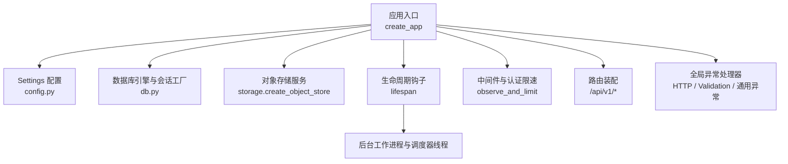
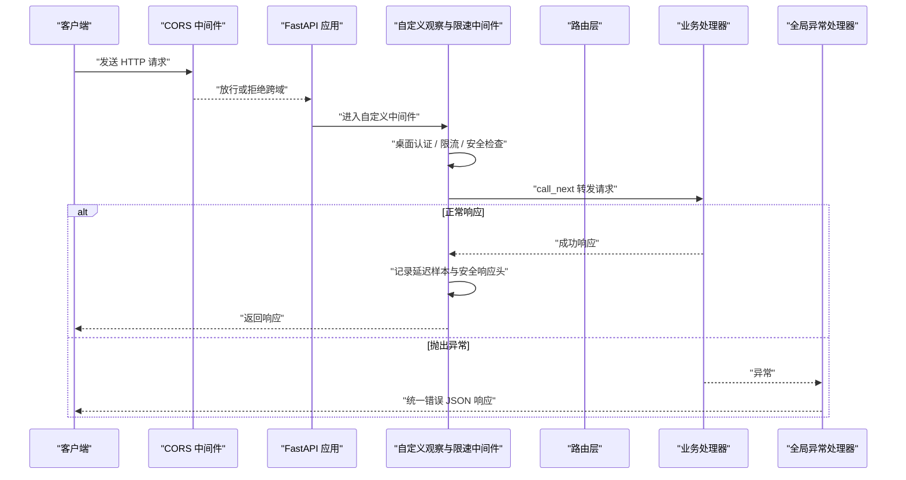
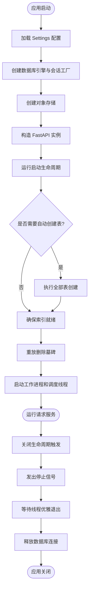
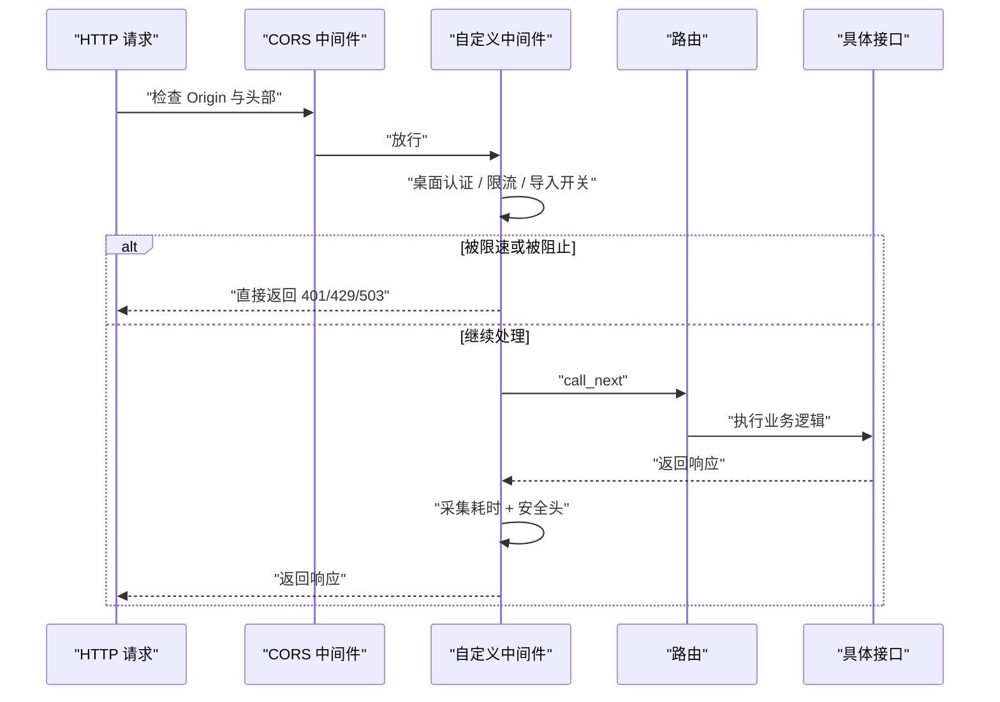
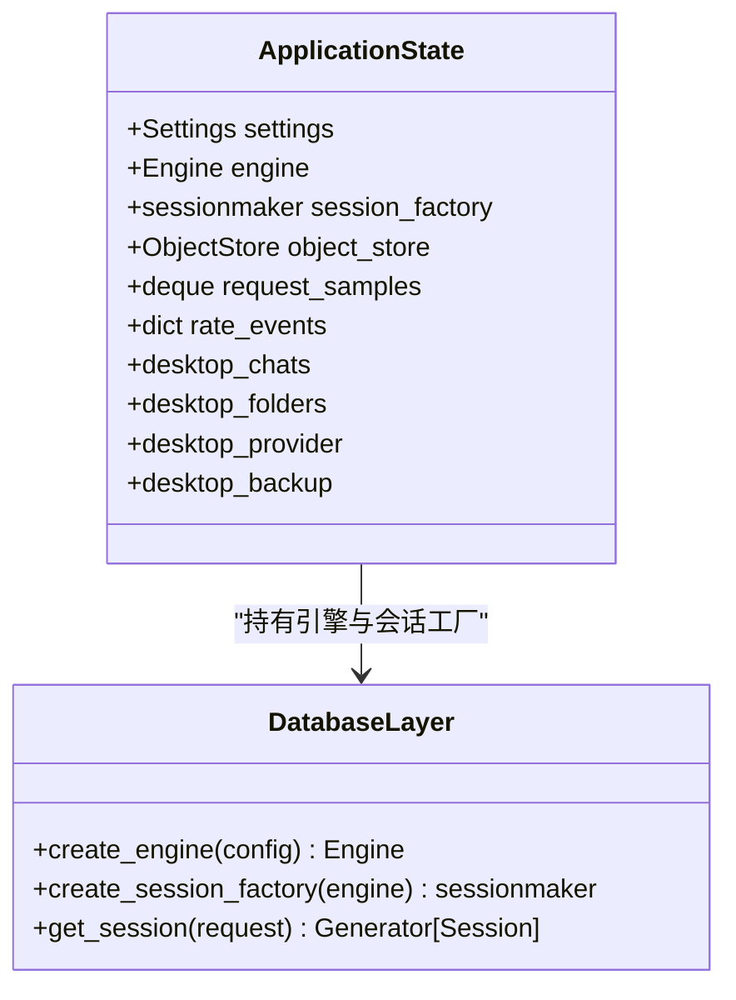
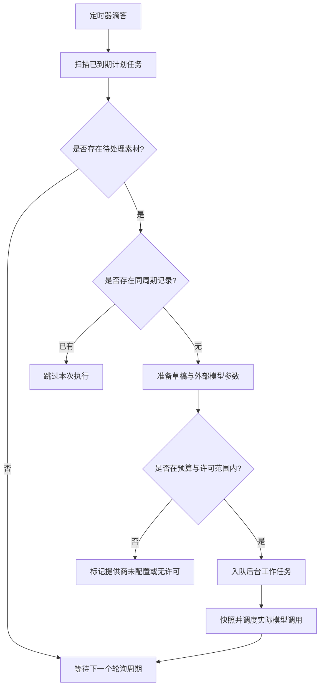
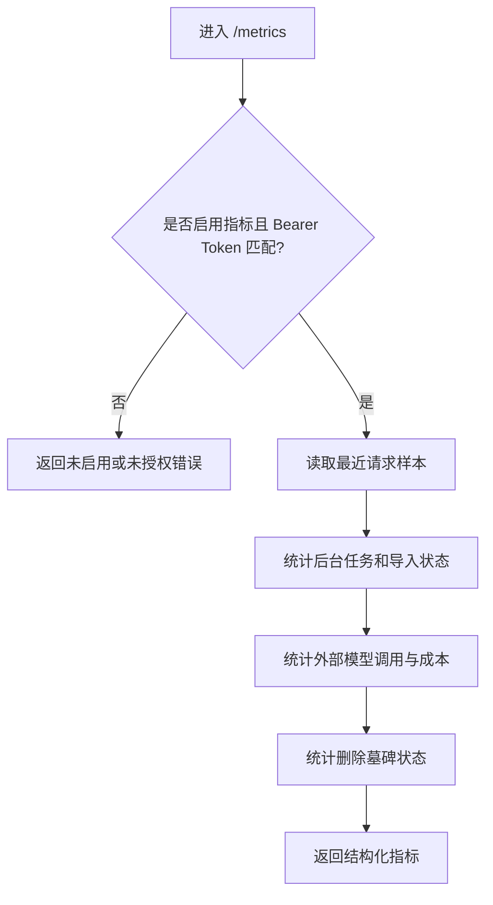
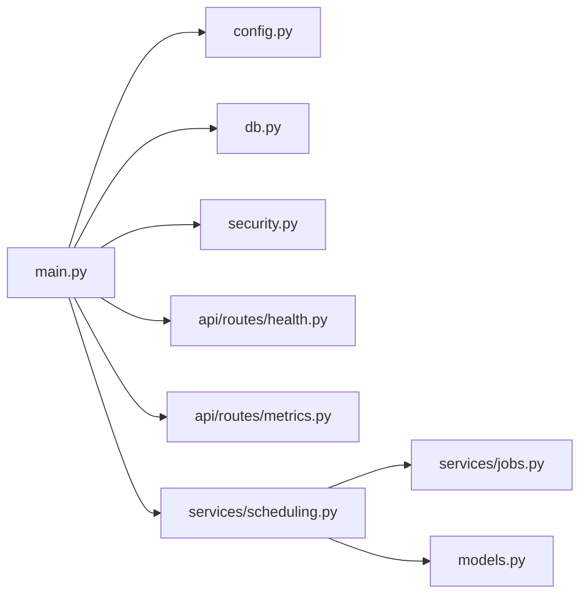

# FastAPI 应用装配与生命周期管理

<cite>
**本文引用的文件**
- [src/personal_ai_life_os/main.py](file://src/personal_ai_life_os/main.py)
- [src/personal_ai_life_os/db.py](file://src/personal_ai_life_os/db.py)
- [src/personal_ai_life_os/config.py](file://src/personal_ai_life_os/config.py)
- [src/personal_ai_life_os/services/scheduling.py](file://src/personal_ai_life_os/services/scheduling.py)
- [src/personal_ai_life_os/security.py](file://src/personal_ai_life_os/security.py)
- [src/personal_ai_life_os/api/routes/health.py](file://src/personal_ai_life_os/api/routes/health.py)
- [src/personal_ai_life_os/api/routes/metrics.py](file://src/personal_ai_life_os/api/routes/metrics.py)
- [tests/conftest.py](file://tests/conftest.py)
</cite>

## 目录
1. [引言](#引言)
2. [项目结构与应用入口](#项目结构与应用入口)
3. [核心组件](#核心组件)
4. [系统架构总览](#系统架构总览)
5. [详细组件分析](#详细组件分析)
6. [依赖关系分析](#依赖关系分析)
7. [性能特征与可观测性](#性能特征与可观测性)
8. [故障排查指南](#故障排查指南)
9. [结论](#结论)

## 引言
本文件面向个人智能生活操作系统中基于 FastAPI 的后端服务，系统性说明应用装配、中间件链、依赖注入容器、启动和关闭生命周期、定时调度、异步上下文共享状态、统一异常响应以及可观测性设计。读者无需深入阅读源码即可理解请求从进入服务器到返回响应的完整路径、后台资源的生命周期，以及在开发、测试和生产环境中的差异化行为。

## 项目结构与应用入口
FastAPI 应用由统一的工厂函数创建，负责：
- 加载配置并校验生产环境约束。
- 初始化数据库引擎与会话工厂。
- 创建对象存储服务。
- 注册全局中间件和路由。
- 定义启动和关闭生命周期钩子。
- 安装全局异常处理器。
- 通过 `FastAPI.state` 保存跨请求共享的运行时状态。

**图示来源**
- [src/personal_ai_life_os/main.py:1-200](file://src/personal_ai_life_os/main.py#L1-L200)
- [src/personal_ai_life_os/main.py:201-315](file://src/personal_ai_life_os/main.py#L201-L315)
- [src/personal_ai_life_os/db.py:1-75](file://src/personal_ai_life_os/db.py#L1-L75)
- [src/personal_ai_life_os/config.py:1-132](file://src/personal_ai_life_os/config.py#L1-L132)

**章节来源**
- [src/personal_ai_life_os/main.py:1-200](file://src/personal_ai_life_os/main.py#L1-L200)
- [src/personal_ai_life_os/config.py:1-132](file://src/personal_ai_life_os/config.py#L1-L132)

## 核心组件
- **应用工厂与运行模式**
  - 桌面模式下需要每启动一次生成随机密钥。
  - 生产环境强制启用带迁移的工作模式，禁用自动建表和外网自注册。
- **配置层**
  - 使用类型化设置模型加载环境变量。
  - 提供 CORS 源列表解析方法。
  - 包含访问令牌、速率限制、存储后端、模型调用等大量业务开关。
- **数据库层**
  - SQLite 开启外键、WAL 日志；连接池使用预检查 ping。
  - 会话工厂关闭自动刷新和提交后失效。
  - 按请求提供会话的生成器依赖。
- **安全性**
  - 密码哈希验证。
  - JWT 访问令牌签发与解码，包含受众、发行方、类型和安全过期校验。
- **健康检查与指标**
  - 轻量存活检查和数据库就绪检查。
  - 需 Bearer Token 鉴权的指标端点，汇总请求延迟分位、后台任务、外部模型调用成本与失败计数。

**章节来源**
- [src/personal_ai_life_os/main.py:1-200](file://src/personal_ai_life_os/main.py#L1-L200)
- [src/personal_ai_life_os/db.py:1-75](file://src/personal_ai_life_os/db.py#L1-L75)
- [src/personal_ai_life_os/security.py:1-54](file://src/personal_ai_life_os/security.py#L1-L54)
- [src/personal_ai_life_os/api/routes/health.py:1-27](file://src/personal_ai_life_os/api/routes/health.py#L1-L27)
- [src/personal_ai_life_os/api/routes/metrics.py:1-129](file://src/personal_ai_life_os/api/routes/metrics.py#L1-L129)

## 系统架构总览
FastAPI 应用的请求处理经过以下层次：
1. **网络入口**：FastAPI 接收 HTTP 请求。
2. **CORS 中间件**：跨域策略，桌面模式允许特殊头部。
3. **自定义中间件**：桌面认证、接口限流、暂停导入控制、统一安全响应头、请求耗时采样。
4. **路由分发**：根据 `/api/v1` 前缀分发给功能路由。
5. **业务处理**：验证器、依赖注入的数据库会话、业务服务层。
6. **统一错误处理**：将业务异常、参数校验异常、未捕获异常映射为一致的 `{ error: { code, message, ... } }` 格式。
7. **响应输出**：附加内容类型安全头、帧保护、引用策略和内容安全策略。

**图示来源**
- [src/personal_ai_life_os/main.py:1-200](file://src/personal_ai_life_os/main.py#L1-L200)
- [src/personal_ai_life_os/main.py:201-315](file://src/personal_ai_life_os/main.py#L201-L315)
- [src/personal_ai_life_os/api/routes/health.py:1-27](file://src/personal_ai_life_os/api/routes/health.py#L1-L27)

## 详细组件分析

### 应用启动流程与生命周期钩子
#### 应用实例创建顺序
1. 读取或构造 `Settings`，判断当前是否为桌面模式。
2. 在桌面模式下按需创建聊天会话、文件夹同步、本地提供者与备份服务。
3. 调用 `create_database_engine` 创建引擎，再调用 `create_session_factory` 创建会话工厂。
4. 通过 `create_object_store` 创建对象存储实例。
5. 定义 `lifespan` 异步上下文管理器，并在其中构建 `FastAPI` 实例。
6. 将配置、引擎、会话工厂、对象存储、请求样本队列和速率事件缓存写入 `application.state`。
7. 注册自定义 HTTP 中间件和 CORSMiddleware。
8. 挂载所有 `/api/v1` 路由。
9. 安装三个全局异常处理器。

#### 启动阶段生命周期
- 加载桌面提供者数据。
- 可选执行所有实体表初始化。
- 使用会话确保 SQLite 搜索索引存在。
- 条件性地初始化 Postgres 搜索索引。
- 重放删除墓碑以恢复数据一致性。
- 在工作模式中启动后台工作进程与调度循环。
- 在桌面模式下启动备份与文件夹同步守护线程。

#### 关闭阶段生命周期
- 设置调度停止信号与工作停止信号。
- 等待调度器、后台工作进程退出，超时释放。
- 关闭桌面相关资源。
- 合并非守护线程并释放数据库引擎连接。

**图示来源**
- [src/personal_ai_life_os/main.py:1-200](file://src/personal_ai_life_os/main.py#L1-L200)

**章节来源**
- [src/personal_ai_life_os/main.py:1-200](file://src/personal_ai_life_os/main.py#L1-L200)

### 中间件链设计与执行时序
当前中间件链的主要阶段如下：
- **CORS 中间件**：由 `add_middleware` 显式添加，允许 GET、POST、PUT、PATCH、DELETE，并根据是否桌面模式决定是否允许凭证和特定头部。
- **自定义观察与限速中间件**：
  - 桌面模式通过比较请求头中的密钥进行访问控制，失败返回 401。
  - 对登录、注册、批量导入路径实现基于主机地址的滑动窗口限流。
  - 禁止导入时可返回 503。
  - 统计请求延迟，仅保留最近 1000 条样本，指标端点从中计算 P95 延迟。
  - 给每个响应附加基础安全响应头。

**图示来源**
- [src/personal_ai_life_os/main.py:1-200](file://src/personal_ai_life_os/main.py#L1-L200)
- [src/personal_ai_life_os/main.py:201-315](file://src/personal_ai_life_os/main.py#L201-L315)

**章节来源**
- [src/personal_ai_life_os/main.py:1-200](file://src/personal_ai_life_os/main.py#L1-L200)
- [src/personal_ai_life_os/main.py:201-315](file://src/personal_ai_life_os/main.py#L201-L315)

### 依赖注入容器与共享状态
应用把全局共享对象集中在 `FastAPI.state` 中：
- `settings`：运行时 Settings 实例。
- `engine`：SQLAlchemy 数据库引擎。
- `session_factory`：会话工厂，用于创建会话。
- `object_store`：对象存储适配器。
- `request_samples`：固定长度队列，存放请求时间戳、毫秒耗时和状态码。
- `rate_events`：基于 key 和客户端主机的滑动窗口事件队列。

数据库会话通过 Pydantic 风格的依赖生成器注入：
- 会话工厂来自 `application.state.session_factory`。
- 每个请求创建一个会话。
- `autoflush=False` 避免隐式刷新，`expire_on_commit=False` 减少重复查询。

**图示来源**
- [src/personal_ai_life_os/main.py:1-200](file://src/personal_ai_life_os/main.py#L1-L200)
- [src/personal_ai_life_os/db.py:1-75](file://src/personal_ai_life_os/db.py#L1-L75)

**章节来源**
- [src/personal_ai_life_os/main.py:1-200](file://src/personal_ai_life_os/main.py#L1-L200)
- [src/personal_ai_life_os/db.py:1-75](file://src/personal_ai_life_os/db.py#L1-L75)

### 定时任务与后台工作进程
- 当 `processing_mode == "worker"` 时，启动两个独立线程：
  - `worker_loop`：持续拉取并处理数据库中的异步任务。
  - `schedule_loop`：周期性扫描应执行的计划任务，如每周回顾生成。
- 调度器具备幂等控制、预算审查、用户同意校验、Provider 解析与费用预估能力。
- 工作进程可通过 `enqueue_background_job` 投递去重键，避免重复执行相同任务。

**图示来源**
- [src/personal_ai_life_os/services/scheduling.py:1-200](file://src/personal_ai_life_os/services/scheduling.py#L1-L200)

**章节来源**
- [src/personal_ai_life_os/services/scheduling.py:1-200](file://src/personal_ai_life_os/services/scheduling.py#L1-L200)
- [src/personal_ai_life_os/main.py:1-200](file://src/personal_ai_life_os/main.py#L1-L200)

### 自定义异常处理机制
FastAPI 中默认会暴露部分内部结构，本项目通过三个全局处理器收敛响应格式：
- `HTTPException`：若 detail 不是携带 `code` 的字典，则包装为 `{ code: "request_failed", message: ... }`。
- `RequestValidationError`：将所有 Pydantic 验证错误展平为带位置、类型和消息的数组，统一返回 `validation_error`。
- 通用 `Exception`：记录不可恢复错误的类型名称，返回统一 `internal_error`，避免泄漏堆栈和敏感信息。

这使下游 CLI、前端和监控工具都能根据稳定字段解析错误。CLI 中也明确优先解析响应体中的 `error.code` 与 `error.message`。

**章节来源**
- [src/personal_ai_life_os/main.py:201-315](file://src/personal_ai_life_os/main.py#L201-L315)
- [src/personal_ai_life_os/cli.py:1-200](file://src/personal_ai_life_os/cli.py#L1-L200)

### 健康检查与可观测性端点
- `/health`：轻量存活探针，不访问数据库。
- `/ready`：尝试执行简单查询，失败返回 503，并给出稳定的 `database_unavailable` 错误代码。
- `/metrics`：
  - 要求配置了 `metrics_token`。
  - 使用 HMAC 比较 Bearer Token。
  - 聚合过去一分钟内采样到的延迟、HTTP 5xx 数量、P95 延迟。
  - 统计近期导入失败数、后台任务排队与运行状态、清理墓碑数量及最老未完成项。
  - 统计外部模型调用次数、失败次数、预算回退和预估成本。

**图示来源**
- [src/personal_ai_life_os/api/routes/metrics.py:1-129](file://src/personal_ai_life_os/api/routes/metrics.py#L1-L129)
- [src/personal_ai_life_os/main.py:1-200](file://src/personal_ai_life_os/main.py#L1-L200)

**章节来源**
- [src/personal_ai_life_os/api/routes/health.py:1-27](file://src/personal_ai_life_os/api/routes/health.py#L1-L27)
- [src/personal_ai_life_os/api/routes/metrics.py:1-129](file://src/personal_ai_life_os/api/routes/metrics.py#L1-L129)
- [src/personal_ai_life_os/main.py:1-200](file://src/personal_ai_life_os/main.py#L1-L200)

## 依赖关系分析
应用装配阶段的依赖方向清晰，模块之间耦合度较低：
- `main.py` 协调配置、数据库、对象存储、生命周期、中间件、路由和异常。
- `config.py` 提供纯数据类型驱动的配置与校验，无运行时副作用。
- `db.py` 只关注 SQLAlchemy 引擎与会话。
- `security.py` 只实现密码和 JWT 辅助逻辑。
- 路由位于 `api/routes`，多数依赖 Session 依赖注入和上层 services。

**图示来源**
- [src/personal_ai_life_os/main.py:1-200](file://src/personal_ai_life_os/main.py#L1-L200)
- [src/personal_ai_life_os/services/scheduling.py:1-200](file://src/personal_ai_life_os/services/scheduling.py#L1-L200)

**章节来源**
- [src/personal_ai_life_os/main.py:1-200](file://src/personal_ai_life_os/main.py#L1-L200)

## 性能特征与可观测性
- **请求延迟采样**：每个成功请求都会计算 `perf_counter` 差值并追加至固定长度双端队列，避免无限增长占用内存。
- **P95 延迟计算**：指标端点对采样数据进行排序后取近似第 95 百分位。
- **滑动窗口限流**：按接口名、客户端主机维护有序事件队列，先清理过期事件，再判断是否超限。
- **异步安全共享**：共享状态存储在进程级 FastAPI 状态中；数据库会话在每个请求内生成，不跨请求复用，降低异步任务中的并发风险。
- **线程隔离注意**：后台工作线程和调度线程使用独立 `stop_event` 控制退出，但共享对象（例如备份、文件夹同步、存储）需保证自身线程安全。

优化建议：
- 对于高频限流场景，可将内存窗口改为 Redis 分布式限流键，支持多 Worker 部署。
- 可将请求样本持久化为时序数据，而不是仅保存在内存中。
- 对长时间运行的工作线程加入更细粒度的进度和重试策略。

**章节来源**
- [src/personal_ai_life_os/main.py:1-200](file://src/personal_ai_life_os/main.py#L1-L200)
- [src/personal_ai_life_os/main.py:201-315](file://src/personal_ai_life_os/main.py#L201-L315)

## 故障排查指南
常见问题与定位方式：
- **启动时报生产配置错误**：检查生产环境下的令牌长度、CORS 源、对象存储、自动建表和工作模式是否符合 `validate_production_configuration` 的规则。
- **桌面 API 无法访问**：确认请求头中包含正确的 `X-LifeOS-Desktop` 值，该值会在启动期与传入的 `desktop_secret` 做常量比较。
- **导入被暂停或限速**：查看是否命中 imports 关闭标志，或是否超过登录、注册、导入路径的请求频率上限。
- **数据库不可用**：通过 `/ready` 诊断，503 响应会包含 `database_unavailable` 错误码。
- **验证失败响应不明确**：统一验证错误响应包含 `issues` 数组，每个错误包含位置、类型和消息。
- **指标端点无法访问**：检查 `metrics_token` 是否启用并通过 Bearer Token 传递，未启用时返回 `metrics_disabled`。

调试技巧：
- 测试夹具使用临时路径、SQLite 数据库和最小配置构造应用，适合单元测试覆盖生命周期启动行为。
- 利用健康检查和指标端点组合验证服务可用性和资源占用趋势。

**章节来源**
- [src/personal_ai_life_os/config.py:1-132](file://src/personal_ai_life_os/config.py#L1-L132)
- [src/personal_ai_life_os/api/routes/health.py:1-27](file://src/personal_ai_life_os/api/routes/health.py#L1-L27)
- [src/personal_ai_life_os/api/routes/metrics.py:1-129](file://src/personal_ai_life_os/api/routes/metrics.py#L1-L129)
- [tests/conftest.py:1-31](file://tests/conftest.py#L1-L31)
- [src/personal_ai_life_os/main.py:1-200](file://src/personal_ai_life_os/main.py#L1-L200)
- [src/personal_ai_life_os/main.py:201-315](file://src/personal_ai_life_os/main.py#L201-L315)

## 结论
FastAPI 应用通过统一的工厂函数集中管理装配顺序，配合异步上下文管理器实现健壮的资源初始化和清理。中间件链承担跨领域横切关注点，包括跨域、桌面认证、限速、安全防护和性能采样。全局异常处理器将差异化的 Python 异常标准化为机器可读的错误文档。生命周期钩子确保数据库、索引、对象存储、后台工作进程、定时任务在启动期就绪，并在关闭期平滑退出。配合健康检查与受限指标端点，运维团队可以在不暴露敏感数据的前提下完成可用性探测与容量规划。