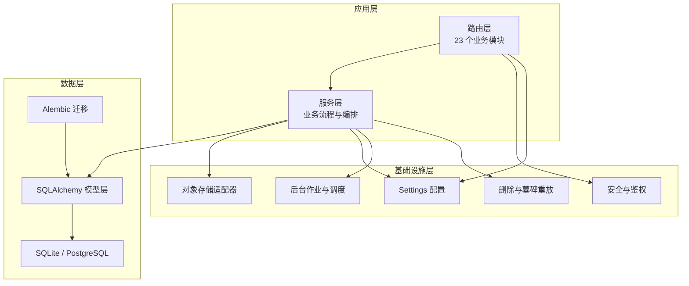
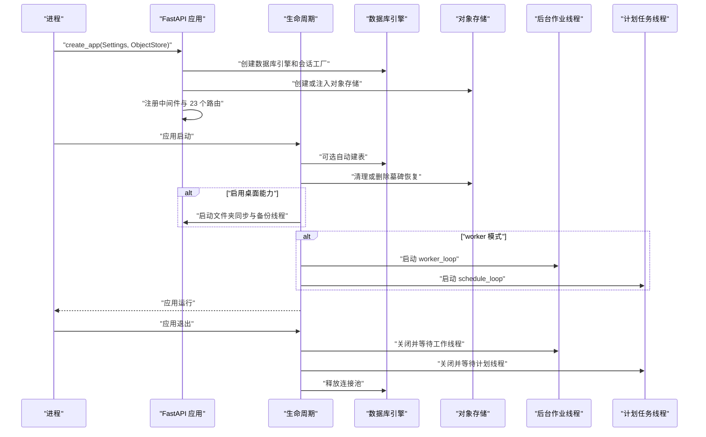
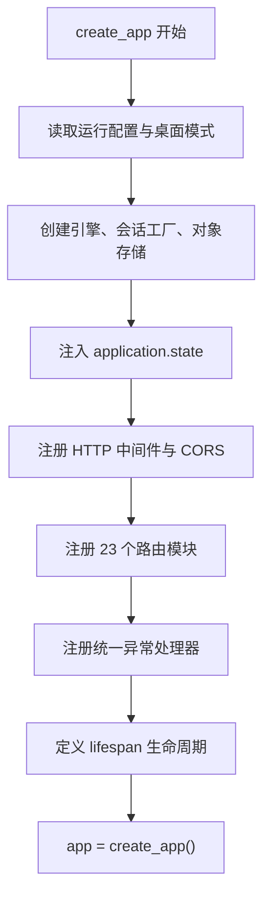
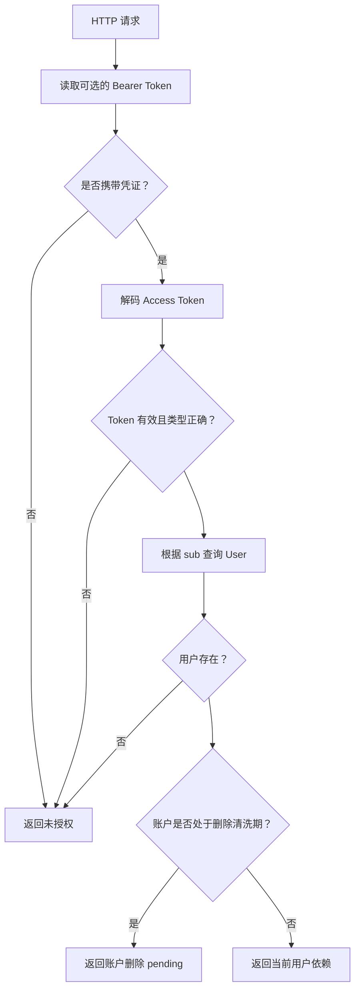
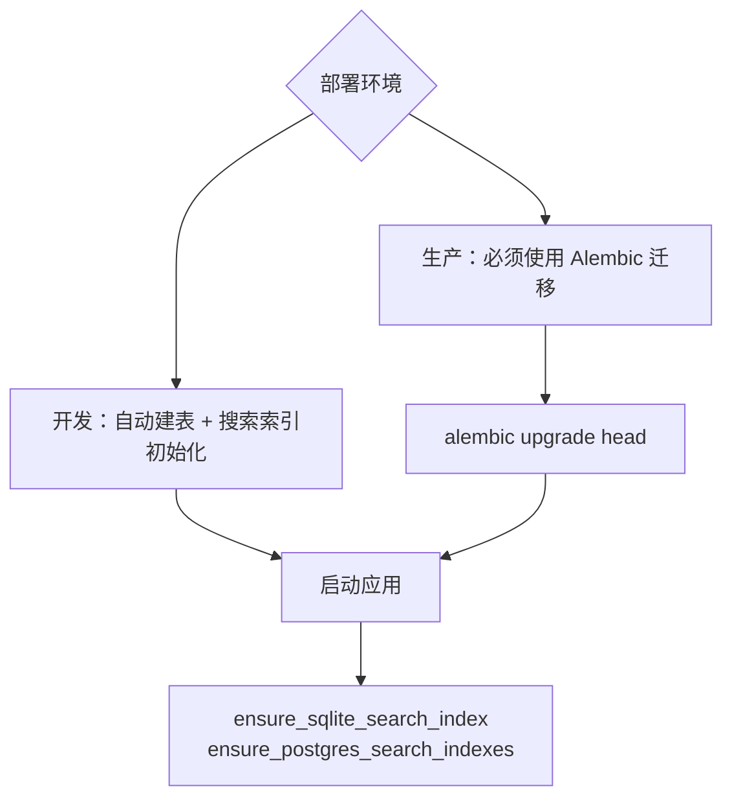
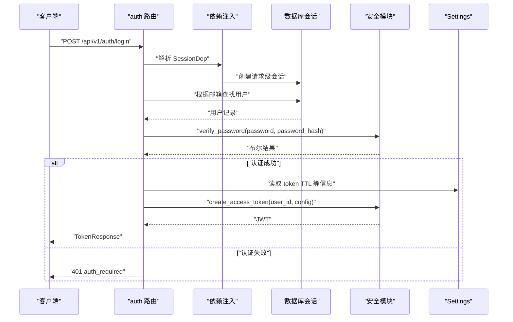
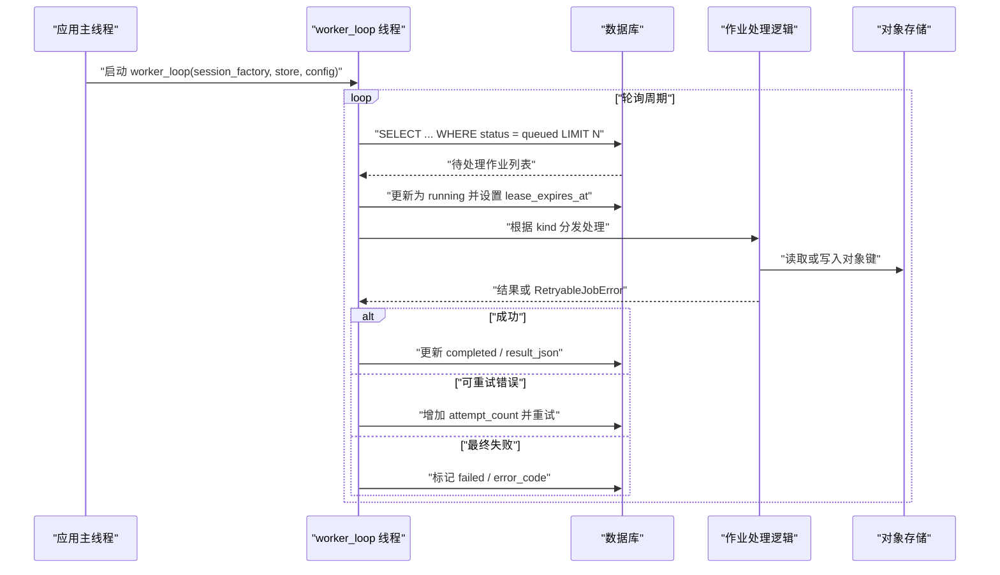
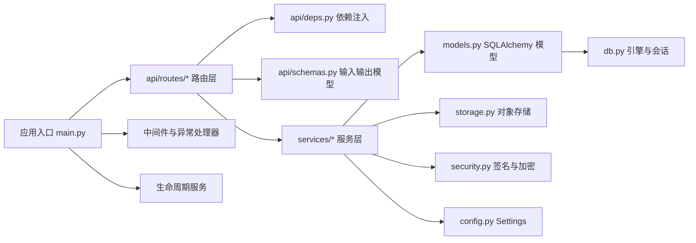
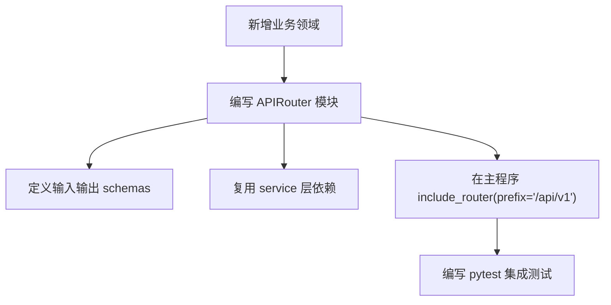
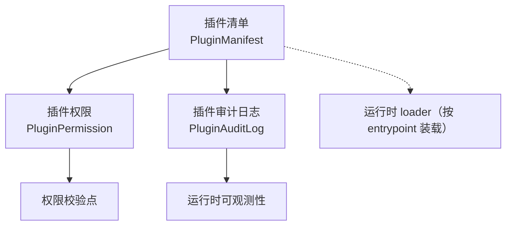

# 后端架构

<cite>
**本文引用的文件**   
- [main.py](file://src/personal_ai_life_os/main.py)
- [config.py](file://src/personal_ai_life_os/config.py)
- [db.py](file://src/personal_ai_life_os/db.py)
- [models.py](file://src/personal_ai_life_os/models.py)
- [security.py](file://src/personal_ai_life_os/security.py)
- [storage.py](file://src/personal_ai_life_os/storage.py)
- [api/deps.py](file://src/personal_ai_life_os/api/deps.py)
- [api/schemas.py](file://src/personal_ai_life_os/api/schemas.py)
- [api/routes/auth.py](file://src/personal_ai_life_os/api/routes/auth.py)
- [services/jobs.py](file://src/personal_ai_life_os/services/jobs.py)
- [services/deletion.py](file://src/personal_ai_life_os/services/deletion.py)
- [cli.py](file://src/personal_ai_life_os/cli.py)
- [README.md](file://README.md)
- [alembic.ini](file://alembic.ini)
</cite>

## 目录
1. [简介](#简介)
2. [项目结构](#项目结构)
3. [核心组件](#核心组件)
4. [系统架构总览](#系统架构总览)
5. [详细组件分析](#详细组件分析)
6. [依赖关系分析](#依赖关系分析)
7. [性能与可伸缩性](#性能与可伸缩性)
8. [故障排查指南](#故障排查指南)
9. [结论](#结论)
10. [附录：扩展点设计](#附录扩展点设计)

## 简介
Personal-AI-Life-OS 是一个以 FastAPI 为核心的个人记忆操作系统后端。它把聊天导出、日历、照片、文档和本地 Agent 记忆等来源统一解析后，持久化为用户时间线、图谱证据、复盘、提醒和搜索索引，并提供插件化连接器和工作单元机制。后端采用清晰的分层架构：路由层按业务领域划分为 23 个 API 模块；服务层抽象业务编排与外部模型调用；模型层基于 SQLAlchemy 表达租户/所有者隔离的领域实体。运行时由一个集中装配函数创建应用，通过中间件完成跨域、速率限制、安全头加固，通过 Pydantic Settings 实现环境变量驱动配置，并通过 SQLite 与 PostgreSQL 两套数据库路径支持开发到生产的环境切换。

## 项目结构
仓库后端代码集中在 `src/personal_ai_life_os` 下，采用面向领域与能力拆分的目录布局：

| 层级 | 主要职责 | 代表性文件或目录 |
|---|---|---|
| 应用装配 | 创建 FastAPI 应用、注册路由器、中间件、生命周期、全局错误处理 | [main.py:1-315](file://src/personal_ai_life_os/main.py#L1-L315) |
| 配置管理 | 环境变量驱动的 Settings，含生产环境校验 | [config.py:1-132](file://src/personal_ai_life_os/config.py#L1-L132) |
| 数据访问基础 | SQLAlchemy Base、引擎、会话工厂、UTC 类型装饰器 | [db.py:1-75](file://src/personal_ai_life_os/db.py#L1-L75) |
| 领域模型 | 用户、来源、条目、图谱、复盘、任务、插件清单等表映射 | [models.py:1-875](file://src/personal_ai_life_os/models.py#L1-L875) |
| 接口输入输出 | 版本化 API 的 Pydantic 请求与响应模型 | [api/schemas.py:1-1151](file://src/personal_ai_life_os/api/schemas.py#L1-L1151) |
| 认证与安全 | Bearer Token、密码哈希、Access Token 编解码 | [security.py:1-54](file://src/personal_ai_life_os/security.py#L1-L54) |
| 依赖注入 | 当前用户、数据库会话等共享依赖 | [api/deps.py:1-65](file://src/personal_ai_life_os/api/deps.py#L1-L65) |
| 路由层 | 23 个按领域组织的 API 模块 | [api/routes/*](file://src/personal_ai_life_os/api/routes/) |
| 服务层 | 作业调度、删除重放、对象存储、模型提供者、搜索索引等 | [services/*](file://src/personal_ai_life_os/services/) |
| 对象存储 | 本地与 S3 兼容的私有对象存储适配 | [storage.py:1-264](file://src/personal_ai_life_os/storage.py#L1-L264) |
| 命令行工具 | 本地预览、登录、鉴权、导入辅助 | [cli.py:1-638](file://src/personal_ai_life_os/cli.py#L1-L638) |
| 迁移 | Alembic 配置与版本化迁移脚本 | [alembic.ini:1-39](file://alembic.ini#L1-L39), [migrations/*](file://migrations/) |



图表来源
- [main.py:60-185](file://src/personal_ai_life_os/main.py#L60-L185)
- [config.py:10-132](file://src/personal_ai_life_os/config.py#L10-L132)
- [db.py:1-75](file://src/personal_ai_life_os/db.py#L1-L75)
- [models.py:200-875](file://src/personal_ai_life_os/models.py#L200-L875)
- [storage.py:1-264](file://src/personal_ai_life_os/storage.py#L1-L264)
- [services/jobs.py:1-250](file://src/personal_ai_life_os/services/jobs.py#L1-L250)
- [services/deletion.py:1-260](file://src/personal_ai_life_os/services/deletion.py#L1-L260)
- [alembic.ini:1-39](file://alembic.ini#L1-L39)

章节来源
- [README.md:1-118](file://README.md#L1-L118)
- [main.py:1-200](file://src/personal_ai_life_os/main.py#L1-L200)

## 核心组件
本项目的核心运行构件包括：

| 组件 | 作用 | 关键实现位置 |
|---|---|---|
| 应用装配函数 | 根据环境创建 FastAPI、注入状态、注册全部路由、挂载中间件与异常处理器 | [main.py:25-315](file://src/personal_ai_life_os/main.py#L25-L315) |
| 配置系统 | 从 `.env` 和环境变量加载 Settings，执行生产模式强约束 | [config.py:10-132](file://src/personal_ai_life_os/config.py#L10-L132) |
| 数据库连接 | SQLite 或 PostgreSQL 引擎、会话工厂、请求级会话注入 | [db.py:1-75](file://src/personal_ai_life_os/db.py#L1-L75) |
| 领域模型 | 用户、来源、来源条目、图谱证据、复核、任务、插件等表 | [models.py:1-875](file://src/personal_ai_life_os/models.py#L1-L875) |
| 安全与令牌 | 密码哈希、Bearer Token 签发与解码 | [security.py:1-54](file://src/personal_ai_life_os/security.py#L1-L54) |
| 依赖注入 | 当前用户、授权删除用户、数据库会话共享依赖 | [api/deps.py:1-65](file://src/personal_ai_life_os/api/deps.py#L1-L65) |
| 对象存储 | 本地磁盘与 S3 兼容存储的统一 Protocol 接口 | [storage.py:1-264](file://src/personal_ai_life_os/storage.py#L1-L264) |
| 后台作业 | 幂等入队、租约领取、重试与取消，Worker 线程循环执行 | [services/jobs.py:1-250](file://src/personal_ai_life_os/services/jobs.py#L1-L250) |
| 删除治理 | 墓碑写入、所有者/来源/条目擦除、启动时墓碑重放 | [services/deletion.py:1-352](file://src/personal_ai_life_os/services/deletion.py#L1-L352) |
| 命令行客户端 | 本地文件预览、登录凭据管理、认证 HTTP 调用 | [cli.py:1-200](file://src/personal_ai_life_os/cli.py#L1-L200) |
| 迁移系统 | Alembic 配置文件及 versions 目录中的版本迁移脚本 | [alembic.ini:1-39](file://alembic.ini#L1-L39) |

章节来源
- [main.py:25-315](file://src/personal_ai_life_os/main.py#L25-L315)
- [config.py:10-132](file://src/personal_ai_life_os/config.py#L10-L132)
- [db.py:1-75](file://src/personal_ai_life_os/db.py#L1-L75)
- [models.py:200-875](file://src/personal_ai_life_os/models.py#L200-L875)
- [security.py:1-54](file://src/personal_ai_life_os/security.py#L1-L54)
- [api/deps.py:1-65](file://src/personal_ai_life_os/api/deps.py#L1-L65)
- [storage.py:1-264](file://src/personal_ai_life_os/storage.py#L1-L264)
- [services/jobs.py:1-250](file://src/personal_ai_life_os/services/jobs.py#L1-L250)
- [services/deletion.py:1-352](file://src/personal_ai_life_os/services/deletion.py#L1-L352)
- [cli.py:1-200](file://src/personal_ai_life_os/cli.py#L1-L200)

## 系统架构总览
FastAPI 应用通过一个中心工厂方法组装。该方法首先处理桌面模式和在线模式的差异，再初始化数据库引擎、对象存储和可选的桌面组件，随后注册 CORS、HTTP 中间件以及 23 个领域路由；最后在 `lifespan` 钩子中完成建表、搜索索引、删除事务重放，并按部署模式启动后台作业线程和计划任务线程。



图表来源
- [main.py:41-185](file://src/personal_ai_life_os/main.py#L41-L185)
- [main.py:201-315](file://src/personal_ai_life_os/main.py#L201-L315)

章节来源
- [main.py:25-315](file://src/personal_ai_life_os/main.py#L25-L315)

## 详细组件分析

### FastAPI 应用装配与生命周期
装配过程遵循“先资源、后行为”的顺序：

1. **运行期配置选择**：如果传入未提供配置，则使用模块级默认 Settings。桌面模式需要每启动一次生成唯一密钥，否则会抛出配置异常。
2. **桌面能力条件加载**：只有在 native path grant 参数有效且启用桌面模式时，才注入桌面聊天、文件夹同步、Provider 存储和本地备份能力。
3. **数据资源准备**：创建引擎和会话工厂；若启用自动建表，则在生命周期内调用 `Base.metadata.create_all`。
4. **对象存储接入**：优先使用注入测试用存储，否则根据 Settings 构建本地或 S3 存储。
5. **应用状态注入**：将 Settings、引擎、会话工厂、对象存储、采样数据和限流事件队列放入 `application.state`，避免直接耦合模块单例。
6. **HTTP 中间件**：
   - 通用观察者：记录延迟与响应码，追加安全响应头，拦截未预期异常并记录日志。
   - 桌面密钥校验：桌面模式下要求 `X-LifeOS-Desktop` 头部与每启动密钥进行常量比较。
   - 速率限制：为登录、注册、来源导入分别统计客户端地址请求次数，返回标准 429 错误。
   - 上传暂停：当 `imports_enabled` 为假时，来源导入返回 503。
7. **CORS 与路由注册**：根据是否桌面模式决定是否允许凭据，然后统一以 `/api/v1` 前缀注册所有业务模块。
8. **异常处理器**：区分 HTTPException、请求验证错误与未捕获异常，统一为带 `error.code` 的结构体。



图表来源
- [main.py:25-185](file://src/personal_ai_life_os/main.py#L25-L185)
- [main.py:201-315](file://src/personal_ai_life_os/main.py#L201-L315)

章节来源
- [main.py:25-315](file://src/personal_ai_life_os/main.py#L25-L315)

### 分层架构：路由层、服务层、模型层

#### 路由层
路由层负责协议边界和请求路由，不包含复杂业务逻辑。当前项目中至少包含以下业务方向：

| 领域 | 对应路由模块 | 典型职责 |
|---|---|---|
| 健康指标 | health | 服务可用性检查 |
| 认证 | auth | 注册、登录、个人信息、AI 提供方同意 |
| 账户 | account | 用户资料管理 |
| 来源 | sources | 连接创建、状态、范围、云同意 |
| 导入 | imports | 源文件导入流水线入口 |
| 工作项 | jobs | 后台作业状态查询 |
| 内容 | items | 时间线、来源条目检索 |
| 图谱 | graph | 图谱抽取入口 |
| 图谱合并 | graph_merge | 实体合并 |
| 图谱审查 | graph_review | 低置信度审查 |
| 本体 | ontology | 自定义类型审批 |
| 组织 | organization | 标签、集合等组织元数据 |
| 提取 | extractions | 提取运行结果 |
| 问答 | qa | 基于证据的提问线程 |
| 快速笔记 | quick_notes | 记忆型笔记 CRUD |
| 洞察 | insights | 规则洞察与误报忽略 |
| Agent | agent | Agent 操作审计与撤销 |
| 插件 | plugins | 连接器与 Agent 工具安装 |
| 预算 | budget | 外部模型成本预算 |
| 复盘 | reviews | 周期复盘生成与管理 |
| 复查计划 | review_schedule | 自动化复盘任务 |
| 提醒 | reminders | 到期提醒管理 |
| 搜索 | search | 时间线、复盘、提醒联合搜索 |
| 已保存搜索 | saved_searches | 检索条件模板 |

这些模块通过 `APIRouter` 组织，由主程序统一加上 `/api/v1` 前缀。路由之间不直接依赖彼此，而是依赖服务层、依赖注入和数据层。

章节来源
- [main.py:227-250](file://src/personal_ai_life_os/main.py#L227-L250)

#### 服务层
服务层承载跨路由的业务编排，例如：

- 作业服务：入队、去重、租约、重试、取消、模型提供者相关取消、批量 owner 取消。
- 删除服务：写入不可变的删除墓碑、擦除引用字段、清理草稿、标记证据不可用、在启动时重放未完成删除。
- 模型提供者服务：按配置解析 Provider，控制同意和成本。
- 搜索索引服务：维护 SQLite FTS5 与 PostgreSQL `pg_trgm` 索引。
- 调度服务：驱动周期复盘和清理任务。

服务层应被视为“事务边界 + 领域流程”的组合，而不是对模型层的简单封装。

章节来源
- [services/jobs.py:1-250](file://src/personal_ai_life_os/services/jobs.py#L1-L250)
- [services/deletion.py:1-260](file://src/personal_ai_life_os/services/deletion.py#L1-L260)

#### 模型层
模型层通过 SQLAlchemy 声明式基类表达租户/所有者隔离的数据：

- `User`：账号与 AI 同意。
- `SourceConnection`：来源连接与权限状态。
- `SourceItem`：时间线核心条目，保持版本化与可删除语义。
- `GraphEntity / GraphRelation / GraphEvidence`：图谱实体、关系、证据链。
- `Review / ReviewVersion`：复盘及其可对比版本。
- `BackgroundJob`：幂等、可重试、带租约的持久化工作项。
- `PluginManifest / PluginPermission / PluginAuditLog`：插件清单、权限与审计。
- `ModelRun / InsightDismissal / AgentAction`：模型用量、洞察状态与 Agent 变更审计。

所有持久化主键均以字符串形式 UUID 存储，时间字段通过 `UTCDateTime` 装饰器统一转为 UTC，从而缓解 SQLite 在不同时区下的读写问题。

章节来源
- [models.py:1-875](file://src/personal_ai_life_os/models.py#L1-L875)

### 中间件配置、依赖注入与错误处理

#### 中间件与请求处理管道
每个 HTTP 请求依次经过：

1. CORS 中间件决定是否允许跨域和携带凭据。
2. 自定义 HTTP 中间件完成：
   - 桌面模式头部密钥比对；
   - 指定端点的速率限制；
   - 上传开关检查；
   - 延迟和响应码采样；
   - 添加安全响应头。
3. 路由匹配。
4. 依赖解析，如当前用户和数据会话。
5. 视图或控制器逻辑。
6. 统一异常处理器标准化错误响应。

章节来源
- [main.py:123-226](file://src/personal_ai_life_os/main.py#L123-L226)
- [main.py:270-315](file://src/personal_ai_life_os/main.py#L270-L315)

#### 依赖注入机制
核心依赖包括：

| 依赖 | 获取方式 | 用途 |
|---|---|---|
| 数据库会话 | `SessionDep = Annotated[Session, Depends(get_session)]` | 每次请求创建一个 SQLAlchemy Session |
| 当前用户 | `CurrentUserDep` | 解析 Bearer Token 并加载用户 |
| 删除专用用户 | `DeletionUserDep` | 允许正在删除账户的请求继续访问部分资源 |

用户鉴权的判定顺序是：是否存在 Authorization 头 → 是否可解码 Token → 是否存在有效用户 → 账户是否在删除清洗期间。



图表来源
- [api/deps.py:17-65](file://src/personal_ai_life_os/api/deps.py#L17-L65)
- [security.py:19-54](file://src/personal_ai_life_os/security.py#L19-L54)
- [config.py:17-45](file://src/personal_ai_life_os/config.py#L17-L45)

#### 错误处理策略
系统为三类错误提供统一格式：

| 异常类型 | HTTP 状态码 | 错误码 | 说明 |
|---|---:|---|---|
| HTTPException | 继承原状态码 | 默认 `request_failed` | 业务已抛出的结构化错误，可带 headers |
| RequestValidationError | 422 | `validation_error` | Pydantic 校验失败，展开 location、type、message |
| 未捕获 Exception | 500 | `internal_error` | 记录未预期的服务器内部错误 |

这种设计让前端和 CLI 能统一解析 `error.code` 与 `error.message`，而不必猜测 Python 堆栈信息。

章节来源
- [main.py:270-315](file://src/personal_ai_life_os/main.py#L270-L315)

### 类型安全的配置管理系统
Settings 基于 `pydantic-settings.BaseSettings`，支持从 `.env` 与环境变量加载，同时具备严格的生产模式校验。关键字段包括：

| 配置类别 | 关键字段 | 安全含义 |
|---|---|---|
| 应用环境 | `app_env` | development / test / production / desktop |
| 网络 | `api_host`, `api_port`, `cors_origins` | 禁止生产环境监听 127.0.0.1，CORS 必须为部署域名 |
| 数据库 | `database_url`, `auto_create_schema` | 生产环境禁用自动建表，强制使用 Alembic |
| 处理模式 | `processing_mode` | 生产环境必须是可恢复的 worker 模式 |
| 鉴权 | `access_token_secret`, `access_token_ttl_hours`, `registration_mode` | 长密钥、短 TTL、拒绝开放注册 |
| 存储 | `object_store_backend`, `s3_bucket`, `s3_deletion_journal_bucket` | 生产需 S3 及独立的删除日志桶 |
| 外部模型 | `model_provider`, `openai_api_key`, cost 相关字段 | 禁止匿名、负值或不完整定价 |
| 插件与扩展 | `plugin_max_installed` | 限制已安装插件数量 |

生产校验的核心规则包括：Secret 长度、禁止开发 Secret、关闭自动建表、固定 worker 模式、禁用开放注册、强制真实 CORS、Metrics Token、S3 存储、删除日志桶、外部模型隐私 URL 与成本字段。

章节来源
- [config.py:10-132](file://src/personal_ai_life_os/config.py#L10-L132)

### ORM 抽象层设计与 SQLite / PostgreSQL 兼容
ORM 抽象由三层构成：

1. **类型装饰层**：`UTCDateTime(TypeDecorator)` 保证绑定与返回值始终带 UTC 时区。
2. **引擎与会话层**：`create_database_engine` 针对 SQLite 设置非多线程锁、WAL 模式（桌面模式）和外键开启；对 PostgreSQL 使用 `pool_pre_ping`。
3. **模型层**：使用 DeclarativeBase 和 `mapped_column` 表达式，明确主键、索引、唯一约束与 `ondelete=CASCADE` 关系。

SQLite 与 PostgreSQL 的差异被收敛在连接参数上，而不在模型层分散判断。

| 行为 | SQLite | PostgreSQL |
|---|---|---|
| 时区 | 强制转换到 UTC，读取后恢复时区 | 原生时区支持 |
| 外键 | 显式启用 `PRAGMA foreign_keys=ON` | 原生外键 |
| 并发 | `check_same_thread=False` | 使用连接池 |
| 高可用 | 不适用 | 可通过外部数据库集群实现 |
| 自动建表 | 通常用于开发 | 生产禁用，改用 Alembic |

章节来源
- [db.py:1-75](file://src/personal_ai_life_os/db.py#L1-L75)
- [models.py:1-875](file://src/personal_ai_life_os/models.py#L1-L875)

### 数据迁移策略
项目使用 Alembic 进行版本化迁移：

- `alembic.ini` 指定脚本目录 `migrations`，并将 `src` 加入 Python 路径以便识别项目包。
- 迁移脚本位于 `migrations/versions/`，例如初始租户 schema、删除同意、图表 QA 线程、插件、搜索索引、桌面来源、背景作业等。
- 开发环境可以启用 `auto_create_schema` 直接建表，但生产环境 Settings 强制关闭该开关，要求通过迁移部署。
- 应用启动时会先执行 Schema 建立，再确保搜索索引就绪。



图表来源
- [config.py:15-23](file://src/personal_ai_life_os/config.py#L15-L23)
- [config.py:83-132](file://src/personal_ai_life_os/config.py#L83-L132)
- [alembic.ini:1-39](file://alembic.ini#L1-L39)
- [main.py:67-93](file://src/personal_ai_life_os/main.py#L67-L93)

章节来源
- [alembic.ini:1-39](file://alembic.ini#L1-L39)
- [config.py:83-132](file://src/personal_ai_life_os/config.py#L83-L132)

### 关键业务流程：认证登录时序
登录流程体现了从路由层到服务层、安全层和数据层的完整链路。



图表来源
- [api/routes/auth.py:144-188](file://src/personal_ai_life_os/api/routes/auth.py#L144-L188)
- [api/deps.py:37-65](file://src/personal_ai_life_os/api/deps.py#L37-L65)
- [security.py:25-54](file://src/personal_ai_life_os/security.py#L25-L54)
- [db.py:54-75](file://src/personal_ai_life_os/db.py#L54-L75)

章节来源
- [api/routes/auth.py:144-188](file://src/personal_ai_life_os/api/routes/auth.py#L144-L188)

### 关键业务流程：后台作业执行时序
后台作业通过 `BackgroundJob` 表持久化，Worker 在应用启动时以独立线程轮询。



图表来源
- [services/jobs.py:36-150](file://src/personal_ai_life_os/services/jobs.py#L36-L150)
- [main.py:103-143](file://src/personal_ai_life_os/main.py#L103-L143)
- [models.py:768-830](file://src/personal_ai_life_os/models.py#L768-L830)

章节来源
- [services/jobs.py:1-250](file://src/personal_ai_life_os/services/jobs.py#L1-L250)

### 组件关系与类图
以下是与后端架构密切相关的核心类图。该图聚焦实际数据结构、Protocol 与关键服务对象之间的静态关系。

```mermaid
classDiagram
    class Settings {
        +string app_env
        +string database_url
        +int api_port
        +bool auto_create_schema
        +string processing_mode
        +string access_token_secret
        +bool imports_enabled
        +string object_store_backend
        +string model_provider
        +Property cors_origin_list()
        +validator validate_production_configuration()
    }

    class ObjectStore {
        <<Protocol>>
        +put(key, content, content_type)
        +get(key) bytes
        +delete(key)
        +write_deletion_tombstone(owner_id, payload)
        +list_deletion_tombstones()
    }

    class LocalObjectStore {
        +root Path
        +put(...)
        +get(...)
        +delete(...)
        +write_*_deletion_tombstone(...)
    }

    class S3ObjectStore {
        +bucket string
        +client boto3.client
        +put(...)
        +get(...)
        +delete(...)
        +write_deletion_tombstone(...)
    }

    class BackgroundJob {
        +string id
        +string owner_id
        +string kind
        +string status
        +dict payload_json
        +int attempt_count
        +int max_attempts
    }

    class ServicesJobs {
        +enqueue_background_job(...)
        +cancel_jobs_for_source(...)
        +retry_background_job(...)
        +worker_loop(...)
    }

    class Settings ..> ObjectStore : "决定后端类型"
    LocalObjectStore <.. ObjectStore
    S3ObjectStore <.. ObjectStore
    ServicesJobs --> BackgroundJob : "读取与更新"
    ServicesJobs --> ObjectStore : "读取附件或删除事务"
```

图表来源
- [config.py:10-132](file://src/personal_ai_life_os/config.py#L10-L132)
- [storage.py:16-264](file://src/personal_ai_life_os/storage.py#L16-L264)
- [models.py:768-830](file://src/personal_ai_life_os/models.py#L768-L830)
- [services/jobs.py:36-250](file://src/personal_ai_life_os/services/jobs.py#L36-L250)

章节来源
- [config.py:10-132](file://src/personal_ai_life_os/config.py#L10-L132)
- [storage.py:16-264](file://src/personal_ai_life_os/storage.py#L16-L264)
- [models.py:768-830](file://src/personal_ai_life_os/models.py#L768-L830)
- [services/jobs.py:36-250](file://src/personal_ai_life_os/services/jobs.py#L36-L250)

## 依赖关系分析
应用顶层依赖如下：



图表来源
- [main.py:60-185](file://src/personal_ai_life_os/main.py#L60-L185)
- [api/deps.py:1-65](file://src/personal_ai_life_os/api/deps.py#L1-L65)
- [api/schemas.py:1-1151](file://src/personal_ai_life_os/api/schemas.py#L1-L1151)
- [config.py:10-132](file://src/personal_ai_life_os/config.py#L10-L132)
- [db.py:1-75](file://src/personal_ai_life_os/db.py#L1-L75)
- [models.py:1-875](file://src/personal_ai_life_os/models.py#L1-L875)
- [security.py:1-54](file://src/personal_ai_life_os/security.py#L1-L54)
- [storage.py:1-264](file://src/personal_ai_life_os/storage.py#L1-L264)

### 耦合性与内聚性
- **低耦合点**：路由模块之间几乎无直接导入；主要通过 FastAPI 的 `Depends` 传递依赖，避免横向循环。
- **高内聚点**：`models.py` 集中描述所有持久化实体；`settings` 集中封装运行时参数；`storage.py` 隐藏 I/O 后端差异。
- **潜在风险点**：`main.py` 同时承担装配、路由注册、中间件和异常处理，属于高聚合入口，扩展时应避免在其内部写业务分支，而是通过新路由或服务扩展。
- **外部依赖**：JWT、Pydantic、SQLAlchemy、boto3、fastapi/cors 等，均通过显式 import 进入运行时。

章节来源
- [main.py:60-250](file://src/personal_ai_life_os/main.py#L60-L250)

## 性能与可伸缩性
- **请求延迟采样**：每个请求耗时存入 `deque(maxlen=1000)`，便于监控健康指标。
- **速率限制**：登录、注册、导入采用内存计数器 + Redis-style deque；适合单机场景，多副本应替换为分布式限流。
- **数据库连接池**：PostgreSQL 使用 `pool_pre_ping`；SQLite 使用单文件并关闭线程间检查，适合本地或桌面环境。
- **异步 I/O**：FastAPI 路由与服务调用应保持异步友好；当前 Worker 使用线程而非进程，因此需注意长期阻塞任务的隔离。
- **对象存储优化**：
  - 本地存储使用临时文件原子替换，减少写入损坏风险。
  - S3 存储强制 SSE-S3 加密，并将删除事务写入独立 journal bucket。
- **搜索索引**：启动阶段同步确保 SQLite 和 PostgreSQL 搜索索引，避免首次查询冷启动抖动。
- **可伸缩性建议**：
  - 将请求级限流、热点缓存转移到 Redis。
  - 将 Worker 线程扩展为多进程 Worker 或使用 Celery/RQ。
  - 将 S3 deletion journal 改为消息队列消费模型，提高大规模删库回放可靠性。
  - 为高频查询增加索引覆盖，避免全量扫描。
  - 在 Worker 中引入任务优先级与背压控制。

[本节为通用性能讨论，未直接分析具体代码片段]

## 故障排查指南

### 认证失败
常见原因包括：

| 现象 | 可能原因 | 排查要点 |
|---|---|---|
| 401 未携带凭证 | 缺少 `Authorization: Bearer <token>` | 检查客户端是否正确附加 Bearer Token |
| `invalid_access_token` | Token 过期、签名错误或 subject 无效 | 检查 `ACCESS_TOKEN_SECRET`、TTL 和服务端时间 |
| `account_deletion_pending` | 用户已发起删除清洗 | 等待清理完成，或使用专用删除依赖 |
| 429 Too many requests | 短时间内多次注册或登录 | 调整频率或使用正确的 rate limit 回退策略 |
| 桌面客户端 401 | 缺少 `X-LifeOS-Desktop` 或缺少 secret | 确认桌面侧每启动 secret 一致 |

章节来源
- [api/deps.py:26-65](file://src/personal_ai_life_os/api/deps.py#L26-L65)
- [security.py:33-54](file://src/personal_ai_life_os/security.py#L33-L54)
- [main.py:140-175](file://src/personal_ai_life_os/main.py#L140-L175)

### 数据库与迁移问题
| 现象 | 可能原因 | 修复建议 |
|---|---|---|
| 生产启动报错 | `AUTO_CREATE_SCHEMA=true` | 设为 false，并使用 `alembic upgrade head` |
| 生产启动报错 | 仍使用开发 JWT Secret | 设置足够长的 `ACCESS_TOKEN_SECRET` |
| 生产启动报错 | registration_mode=open | 改为邀请制或关闭注册 |
| 生产启动报错 | 未配置 S3 或删除日志桶 | 配置 `S3_BUCKET` 与 `S3_DELETION_JOURNAL_BUCKET` |
| 迁移缺失 | 数据库结构与模型不一致 | 运行 Alembic 迁移，不要直接修改迁移脚本 |
| SQLite 时区异常 | 时间字段未转 UTC | 使用 `UTCDateTime`，并确保写入和读取路径一致 |

章节来源
- [config.py:83-132](file://src/personal_ai_life_os/config.py#L83-L132)
- [alembic.ini:1-39](file://alembic.ini#L1-L39)
- [db.py:12-53](file://src/personal_ai_life_os/db.py#L12-L53)

### 对象存储与删除一致性
| 现象 | 可能原因 | 修复建议 |
|---|---|---|
| 对象键越界 | key 包含 `..`、空段、反斜杠或零字节 | 检查上传流程和下游拼接逻辑 |
| 删除不完整 | 墓碑尚未被 replay | 重启 Worker 或手动触发 delete tombstone replay |
| S3 对象删除失败 | Bucket 版本控制未开启或权限不足 | 检查 S3 权限、版本控制和服务端加密配置 |
| 所有者数据删除异常 | 目标路径是符号链接 | 检查数据目录结构，不允许绕过 root 的符号链接 |

章节来源
- [storage.py:25-200](file://src/personal_ai_life_os/storage.py#L25-L200)
- [services/deletion.py:1-120](file://src/personal_ai_life_os/services/deletion.py#L1-L120)

### 后台作业卡住
| 现象 | 可能原因 | 修复建议 |
|---|---|---|
| 作业停留在 queued | Worker 未启动 | 确认 `processing_mode=worker` 并且应用启动了 worker_loop |
| 作业不断重试 | 业务逻辑抛出 RetryableJobError | 检查底层对象存储、OCR 或外部模型调用 |
| Lease 永久占用 | Worker 崩溃后未释放 | 应用退出时应重置停止事件，并依赖 lease 超时回收 |
| 用户删除后作业仍运行 | 未正确取消 owner job | 检查账户删除流程中的 cancel 调用 |

章节来源
- [services/jobs.py:36-250](file://src/personal_ai_life_os/services/jobs.py#L36-L250)
- [main.py:103-185](file://src/personal_ai_life_os/main.py#L103-L185)

### CLI 登录失败
CLI 会先从环境变量或用户目录凭据文件中读取 Bearer Token，并对本地 URL 和非 HTTPS 场景做安全检查。常见问题包括：

- 未执行登录命令；
- 凭证文件损坏或非 symlink；
- CLI 指向远程 API 却使用明文 HTTP；
- API 返回结构化错误时 CLI 未正确解析 `error.code`。

章节来源
- [cli.py:35-120](file://src/personal_ai_life_os/cli.py#L35-L120)
- [cli.py:121-200](file://src/personal_ai_life_os/cli.py#L121-L200)

## 结论
Personal-AI-Life-OS 的后端以 FastAPI 为核心装配面，采用环境变量驱动的类型安全配置、统一的异常与鉴权处理、清晰的三层层级划分，以及 SQLite 到 PostgreSQL 的可演进 ORM 抽象。路由层按领域拆分，服务层承载跨领域的生命周期任务，数据层通过模型表和对象存储共同保证完整性。后台作业与删除墓碑机制使长时间任务和数据删除具备可恢复性，而 Alembic 迁移则支撑从开发到生产的平滑演进。未来扩展应优先考虑通过服务层接口、插件 manifest 和新的路由模块扩展能力，而非修改主装配函数。

## 附录：扩展点设计

### 领域路由扩展点
新增领域应在 `api/routes` 下新建模块，并在 `main.py` 的装配函数中注册：



图表来源
- [main.py:227-250](file://src/personal_ai_life_os/main.py#L227-L250)
- [api/routes/auth.py:1-45](file://src/personal_ai_life_os/api/routes/auth.py#L1-L45)

章节来源
- [main.py:227-250](file://src/personal_ai_life_os/main.py#L227-L250)

### 插件化架构：Connector 与工作单元
插件体系由三个部分组成：

1. **manifest 模型**：记录插件名称、版本、类型（connector 或 agent_tool）、入口路径、权限和配置。
2. **权限模型**：每个权限有 granted 标志，未被声明或拒绝的权限直接阻断。
3. **审计日志模型**：记录安装、启用、停用、运行等动作的状态和细节。

当前数据库中已经定义了 `PluginManifest`、`PluginPermission` 和 `PluginAuditLog`，这构成了插件化的持久化契约。



图表来源
- [models.py:702-766](file://src/personal_ai_life_os/models.py#L702-L766)

章节来源
- [models.py:702-766](file://src/personal_ai_life_os/models.py#L702-L766)

### Connector 扩展步骤示例
假设要新增一个名为 `custom_file_connector` 的连接器：

1. 在 `api/schemas.py` 或独立 schema 文件中新增连接器配置请求模型。
2. 在 `services/plugins.py` 或新服务中实现：
   - manifest 校验；
   - 入口点动态加载；
   - 权限白名单校验；
   - 预览和导入工作单元；
   - 写入 `BackgroundJob` 以支持异步处理；
   - 记录 `PluginAuditLog`。
3. 在 `api/routes/plugins.py` 暴露安装、启用、预览、导入和管理端点。
4. 在 `models.py` 中如需新增字段，通过 Alembic 迁移添加，而不是直接修改旧表结构。
5. 在 CLI 中提供可选的预评估入口，帮助用户在上传前预览隐私影响。

章节来源
- [api/schemas.py:1-1151](file://src/personal_ai_life_os/api/schemas.py#L1-L1151)
- [models.py:702-766](file://src/personal_ai_life_os/models.py#L702-L766)
- [services/jobs.py:36-150](file://src/personal_ai_life_os/services/jobs.py#L36-L150)
- [alembic.ini:1-39](file://alembic.ini#L1-L39)

### 工作单元与事务边界最佳实践
建议将工作单元组织为以下层次：

| 层次 | 职责 | 推荐实现方式 |
|---|---|---|
| 事务管理器 | 封装 Session 生命周期 | 通过依赖注入 `get_session` |
| 仓储/DAO | 单一实体集查询与改写 | 尽量薄封装 SQLAlchemy 查询 |
| 工作单元 | 协调多个仓储、外部调用、对象存储 | 返回领域状态变化 |
| 作业处理器 | 解耦长期任务和 UI 响应 | 写入 `BackgroundJob` |
| 审计层 | 不可变变更记录 | 写入 `BackgroundJob.result_json`、`AuditLog`、`SyncRun` |

这样的设计能保证：

- 路由层保持简短和可测试；
- 服务层能够组合多个领域变更；
- 失败后可通过作业重试；
- 删除、撤回和审计均可追溯；
- 新模式和新连接器可以通过 manifest 或新的服务模块扩展，而不破坏现有装配。

章节来源
- [db.py:54-75](file://src/personal_ai_life_os/db.py#L54-L75)
- [models.py:572-830](file://src/personal_ai_life_os/models.py#L572-L830)
- [services/jobs.py:36-250](file://src/personal_ai_life_os/services/jobs.py#L36-L250)