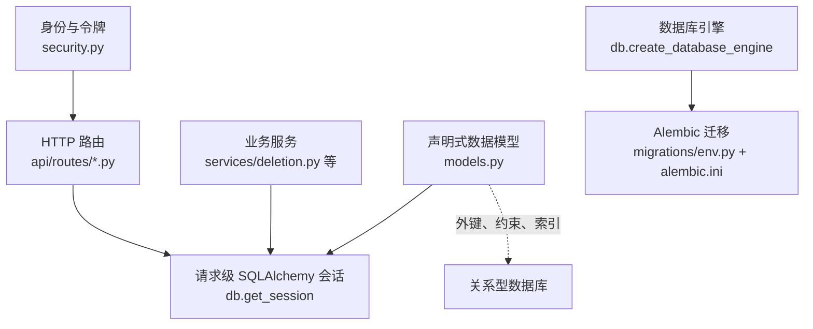
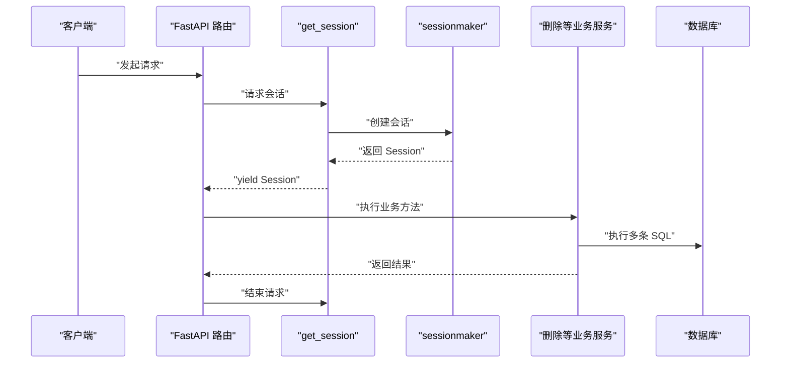
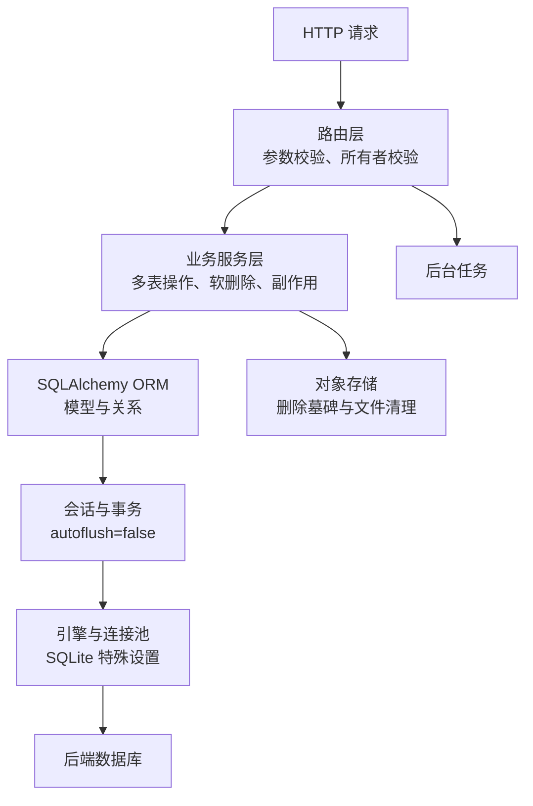
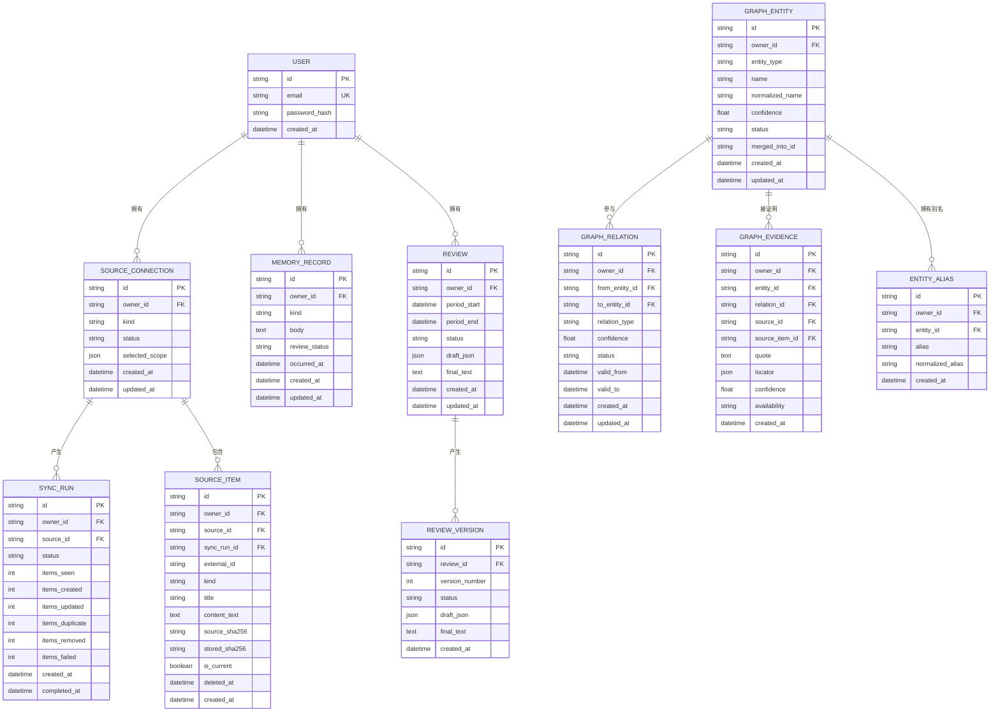
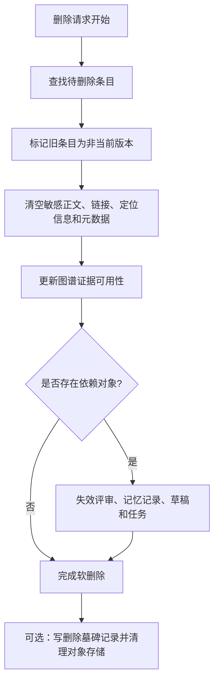
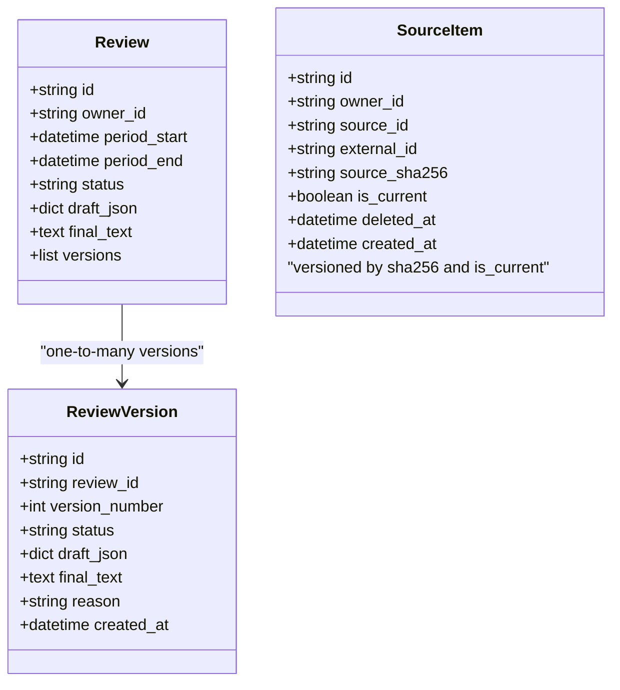
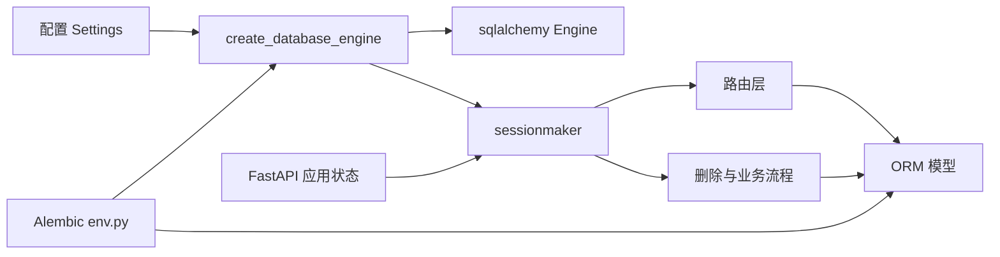
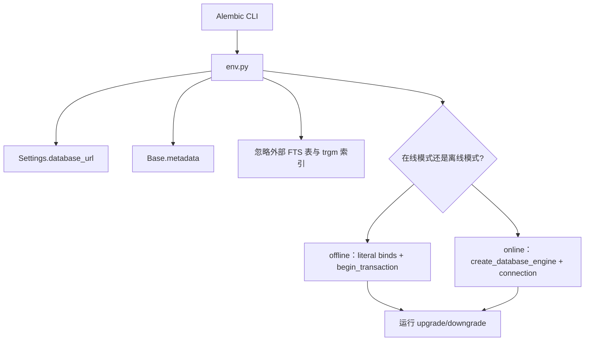
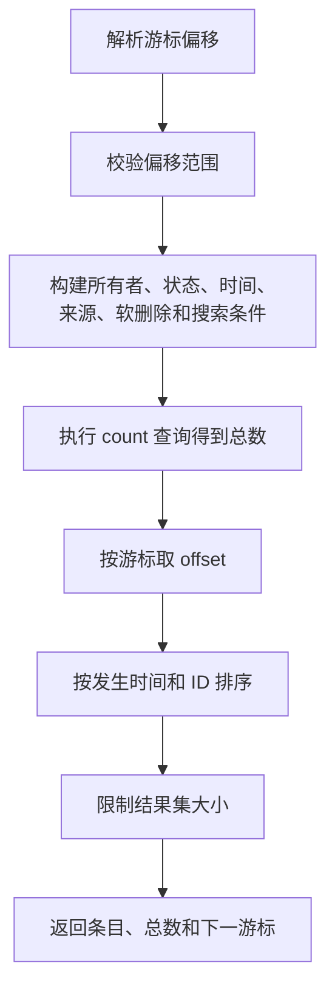
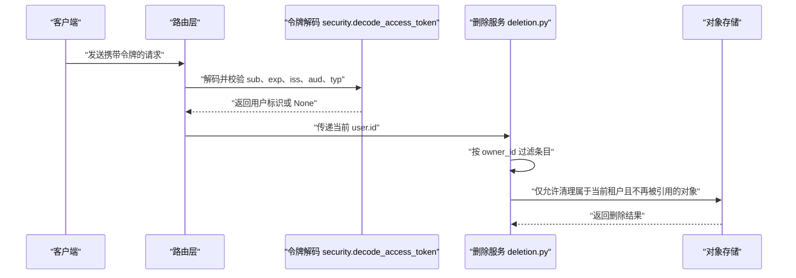

# 数据访问层与 ORM 抽象

<cite>
**本文引用的文件**   
- [数据库配置与会话管理 db.py](file://src/personal_ai_life_os/db.py)
- [数据模型 models.py](file://src/personal_ai_life_os/models.py)
- [账户与时间线接口 items.py](file://src/personal_ai_life_os/api/routes/items.py)
- [删除流程服务 deletion.py](file://src/personal_ai_life_os/services/deletion.py)
- [安全工具 security.py](file://src/personal_ai_life_os/security.py)
- [Alembic 迁移环境 migrations/env.py](file://migrations/env.py)
- [Alembic 配置文件 alembic.ini](file://alembic.ini)
- [初始租户表结构迁移 0de3d72c2e1f_initial_tenant_scoped_schema.py](file://migrations/versions/0de3d72c2e1f_initial_tenant_scoped_schema.py)
</cite>

## 目录
1. [简介](#简介)
2. [项目结构与职责划分](#项目结构与职责划分)
3. [核心组件](#核心组件)
4. [架构总览](#架构总览)
5. [详细组件分析](#详细组件分析)
6. [依赖关系分析](#依赖关系分析)
7. [性能优化策略](#性能优化策略)
8. [数据迁移管理机制](#数据迁移管理机制)
9. [复杂查询构建模式](#复杂查询构建模式)
10. [数据安全注意事项](#数据安全注意事项)
11. [常见问题排查](#常见问题排查)
12. [结论](#结论)

## 简介
本文件面向 SQLAlchemy ORM 与数据访问层，围绕该项目的实际实现，系统性说明以下主题：
- 分层设计：应用层接口 → 业务服务层 → SQLAlchemy 会话与引擎。
- 多方言支持：SQLite 与 PostgreSQL 的差异处理、连接池行为、外键行为控制。
- 数据模型原则：按用户隔离的 `owner_id` 贯穿、软删除与版本共存、审计字段统一习惯。
- 迁移机制：Alembic 在线/离线执行、排除外部全文索引表、回滚脚本规范。
- 查询优化：条件过滤、排序分页、游标翻页、关联加载、复合索引策略。
- 安全实践：SQL 注入防护、敏感凭证加密、令牌签发校验与对象存储清理约束。

该项目的数据访问并不依赖传统“每个实体一个 DAO”的强封装 ORM 框架；而是基于 SQLAlchemy Core/ORM 直接编写声明式模型，通过 FastAPI 依赖注入提供请求级会话。这种设计的优点是简单透明、易于审计和优化，代价是跨模块的一致性需要靠约定和代码审查保证。

## 项目结构与职责划分
关键目录与文件在数据访问维度中的定位如下：

| 位置 | 主要职责 |
| --- | --- |
| `src/personal_ai_life_os/db.py` | SQLAlchemy 基类、UTC 时间类型装饰器、引擎创建、会话工厂、FastAPI 会话依赖。 |
| `src/personal_ai_life_os/models.py` | 所有持久化实体定义、主键生成函数、一对多与多对多关系、常用索引与唯一约束。 |
| `src/personal_ai_life_os/api/routes/` | HTTP 路由中组合业务参数、调用会话或后台任务，并限制结果属于当前 `owner_id`。 |
| `src/personal_ai_life_os/services/deletion.py` | 跨实体删除一致性逻辑、软删除、外部对象存储清理、墓碑记录写入与恢复能力。 |
| `src/personal_ai_life_os/security.py` | 密码哈希、JWT 令牌创建与解码、最小可用权限解析。 |
| `migrations/env.py` + `alembic.ini` | Alembic 迁移运行环境、日志等级、默认 URL、元数据来源与目标对象过滤规则。 |
| `migrations/versions/...py` | 版本化 DDL 变更及对应 `upgrade` / `downgrade`。 |

**图表来源**  
- [数据库配置与会话管理 db.py:10-75](file://src/personal_ai_life_os/db.py#L10-L75)  
- [数据模型 models.py:81-875](file://src/personal_ai_life_os/models.py#L81-L875)  
- [数据迁移管理机制迁移环境 migrations/env.py:1-59](file://migrations/env.py#L1-L59)  
- [Alembic 配置文件 alembic.ini:1-39](file://alembic.ini#L1-L39)

**章节来源**  
- [数据库配置与会会话管理 db.py:1-75](file://src/personal_ai_life_os/db.py#L1-L75)  
- [数据模型 models.py:81-875](file://src/personal_ai_life_os/models.py#L81-L875)

## 核心组件
### 1. 基础模型基类与 UTC 时间装饰器
- `Base` 继承自 `DeclarativeBase`，是所有实体模型的公共基类。
- `UTCDateTime` 使用 TypeDecorator 将 Python `datetime` 统一转为带时区的时间值再入库，并在读回时确保仍保持 UTC 语义，缓解 SQLite 在处理带时区时间时的兼容性问题。
- 模型普遍使用自定义 `utcnow()` 作为默认值，保证全局一致的时间来源。

该设计的关键效果是：不同数据库方言下，时间字段不会隐式丢失时区信息；而业务层始终拿到 UTC 时间，避免应用层反复判断数据库方言。

**章节来源**  
- [数据库配置与会话管理 db.py:12-31](file://src/personal_ai_life_os/db.py#L12-L31)  
- [数据模型 models.py:15-18](file://src/personal_ai_life_os/models.py#L15-L18)

### 2. 引擎创建与多方言适配
针对 SQLite 与非 SQLite 分支分别创建引擎：
- SQLite：
  - 允许跨线程访问：`check_same_thread=False`。
  - 自动准备本地数据目录。
  - 通过事件监听开启外键约束：`PRAGMA foreign_keys=ON`。
  - 桌面环境切换为 WAL 日志模式，改善并发写性能。
- 非 SQLite：
  - 启用 `pool_pre_ping=True`，提高已失效连接检测可靠性。
  - 不附加额外 dialect 参数，由 SQLAlchemy 使用默认连接池行为。

这体现了“优先可移植、在常见方言差异点显式处理”的策略。当前没有为每种方言定义独立连接参数映射，而是按是否以 `sqlite` 开头进行分流。

**章节来源**  
- [数据库配置与会话管理 db.py:33-52](file://src/personal_ai_life_os/db.py#L33-L52)

### 3. 会话工厂与 FastAPI 生命周期绑定
- 会话工厂关闭自动刷新，避免误提交未显式提交的变更；提交后不刷新实例状态，可减少不必要的懒加载查询。
- `get_session` 从 FastAPI 应用状态读取共享的 `session_factory`，并在请求期间创建一个 `Session`。
- 这意味着事务边界应明确放在业务层，而不是依赖 ORM 自动提交。

**图表来源**  
- [数据库配置与会会话管理 db.py:54-75](file://src/personal_ai_life_os/db.py#L54-L75)  
- [账户与时间线接口 items.py:27-138](file://src/personal_ai_life_os/api/routes/items.py#L27-L138)

**章节来源**  
- [数据库配置与会会话管理 db.py:54-75](file://src/personal_ai_life_os/db.py#L54-L75)

## 架构总览
从整体看，该项目采用“轻封装 + 重声明模型 + 服务编排”的数据访问方式：

- 基础设施层：Engine、Session、TypeDecorator。
- 模型层：声明式 ORM 模型，描述表、列、关系、索引和约束。
- 接口层：FastAPI 路由接收输入、校验权限边界、构造查询。
- 服务层：聚合多个模型写入，处理跨表一致性与软删除。
- 迁移层：Alembic 管理增量 DDL，与模型元数据保持一致。

**图表来源**  
- [数据库配置与会会话管理 db.py:33-75](file://src/personal_ai_life_os/db.py#L33-L75)  
- [账户与时间线接口 items.py:27-250](file://src/personal_ai_life_os/api/routes/items.py#L27-L250)  
- [删除流程服务 deletion.py:18-200](file://src/personal_ai_life_os/services/deletion.py#L18-L200)

## 详细组件分析

### 数据模型设计与租户隔离
#### 模型总览
项目中核心实体包括：
- `User`：账户主体。
- `SourceConnection`：数据源连接。
- `SyncRun`：同步批次追踪。
- `SourceItem`：统一来源条目，包含软删除、内容文本、哈希与版本标识。
- `MemoryRecord`、`Review`、`Reminder`：记忆、审阅周期、提醒。
- `GraphEntity`、`GraphRelation`、`GraphEvidence`、`EntityAlias`、`EntityMergeLog`：知识图谱相关实体。
- `PluginManifest`、`PluginPermission`、`PluginAuditLog`：插件扩展点。
- `ModelRun`、`BackgroundJob`、`DesktopDraft`、`QaThread`、`QaMessage` 等：系统支撑与 AI 工作流。

大量表具有 `owner_id` 字段，并通过数据库外键引用 `users.id`，同时使用 `ondelete="CASCADE"` 保障主账号删除时的级联清理。

**图表来源**  
- [数据模型 models.py:81-875](file://src/personal_ai_life_os/models.py#L81-L875)  
- [初始租户表结构迁移 0de3d72c2e1f_initial_tenant_scoped_schema.py:10-175](file://migrations/versions/0de3d72c2e1f_initial_tenant_scoped_schema.py#L10-L175)

#### 租户隔离字段 `owner_id`
几乎每个业务实体都有 `owner_id`，并通过外键引用 `users.id`。这种做法带来的效果：
1. 每条记录天然归属于一个用户。
2. 删除用户时可级联删除其所有子资源。
3. 查询可以基于 `owner_id` 建立单表过滤条件，降低跨用户数据泄露风险。
4. 迁移层通过 `FOREIGN KEY(owner_id) REFERENCES users.id ON DELETE CASCADE` 保证底层约束存在。

但现有代码并非在所有地方都强制附加 `where(owner_id == ...)`：例如 `SyncRun` 模型定义中有 `owner_id`，但有迁移创建了对应的索引，表明它在设计上是被租户隔离的。因此实际部署时应通过服务层或路由层强制注入该条件，否则仅凭 ORM 模型不足以阻止越权访问。

#### 软删除机制
`SourceItem` 同时具备：
- `deleted_at`：软删除标记。
- `is_current`：用于区分同一外部 ID 的多版本中最新一条。
- 组合唯一约束：`(owner_id, source_id, external_id, source_sha256)`，体现“同一来源 + 外部标识 + 内容哈希”的版本控制思想。

删除逻辑不仅将 `deleted_at` 赋值，还清空敏感正文、重置关联图证据可用性，并将衍生对象标记无效。典型路径为：
- 上层触发删除请求，生成或删除墓碑记录。
- 服务层查找当前条目，标记旧版本为非当前版本。
- 清理正文、object_key、locator、metadata 等可能携带敏感信息的字段。
- 更新图谱证据状态为不可用或删除。
- 必要时取消或作废相关的后台任务和评审。

**图表来源**  
- [删除流程服务 deletion.py:18-200](file://src/personal_ai_life_os/services/deletion.py#L18-L200)

#### 审计追踪字段 `created_at` / `updated_at`
多数可变实体都包含创建时间与更新时间。常见用法包括：
- `default=utcnow`：插入时写入创建时间。
- `onupdate=utcnow`：更新时维护更新时间。
- 部分只追加字段如 `occurred_at`、`completed_at` 仅写一次。
- 某些记录由模型字段命名体现审计意图，例如 `last_sync_at`、`last_run_at`、`next_run_at`。

该模式不是借助 SQLAlchemy Event 或基类 mixin 自动注入，而是通过在模型列上显式声明默认值与 onupdate 回调实现。优点是简单明确，缺点是新增模型容易遗漏审计字段。

#### 版本控制模式
版本控制主要体现在两个层面：
1. 数据来源项版本：`SourceItem` 使用 `(owner_id, source_id, external_id, source_sha256)` 保证同一个外部来源条目的重复幂等与去重；`is_current` 表示当前活跃版本。
2. 审阅结果版本：`Review` 和 `ReviewVersion` 分表保存每次审阅草稿和最终文本，并使用 `version_number` 和 `(review_id, version_number)` 唯一约束维护顺序。

**图表来源**  
- [数据模型 models.py:338-388](file://src/personal_ai_life_os/models.py#L338-L388)  
- [数据模型 models.py:207-259](file://src/personal_ai_life_os/models.py#L207-L259)

**章节来源**  
- [数据模型 models.py:81-875](file://src/personal_ai_life_os/models.py#L81-L875)  
- [初始租户表结构迁移 0de3d72c2e1f_initial_tenant_scoped_schema.py:10-175](file://migrations/versions/0de3d72c2e1f_initial_tenant_scoped_schema.py#L10-L175)  
- [删除流程服务 deletion.py:18-200](file://src/personal_ai_life_os/services/deletion.py#L18-L200)

## 依赖关系分析

**图表来源**  
- [数据库配置与会会话管理 db.py:10-75](file://src/personal_ai_life_os/db.py#L10-L75)  
- [Alembic 迁移环境 migrations/env.py:1-59](file://migrations/env.py#L1-L59)  
- [数据模型 models.py:81-875](file://src/personal_ai_life_os/models.py#L81-L875)

耦合特征：
- `db.py` 依赖 `config.Settings` 获取数据库 URL 与应用环境。
- `models.py` 依赖 `Base` 与 `UTCDateTime`。
- 路由与服务层均依赖 `models.py` 的实体定义，并通过 `SessionDep` 获取会话。
- Alembic 直接导入 `models`，因此模型变化会直接影响迁移对比。
- `security.py` 未被 ORM 层直接依赖，主要通过 API 层鉴权间接影响数据访问边界。

潜在风险：
- 路由和服务中对 `owner_id` 的约束分散，缺少统一的租户过滤器基类。
- ORM 中许多关系未显式指定 `lazy`，默认加载策略可能导致批量场景下的 N+1 查询。
- 时间戳默认值位于业务模型中，如果未来引入通用审计基类，可能需要迁移策略保证历史数据一致性。

**章节来源**  
- [数据库配置与会会话管理 db.py:10-75](file://src/personal_ai_life_os/db.py#L10-L75)  
- [Alembic 迁移环境 migrations/env.py:1-59](file://migrations/env.py#L1-L59)

## 性能优化策略

### 1. N+1 查询问题
`Relationship` 默认策略通常是 lazy loading，这对单条记录查询友好，但对批量查询危险。常见风险点包括：
- `User.sources`、`User.model_consents`、`SourceConnection.items`、`SourceConnection.sync_runs`。
- `Review.versions`、`MemoryRecord.source_items`、`Review.source_items`。
- 图谱中实体的别名和证据列表。

建议原则：
- 列表接口中，若视图需要关联对象，使用 `selectinload` 预加载多端集合。
- 单条详情接口中，按需使用 `joinedload` 或 `selectinload`。
- 仅需计数或过滤时，避免加载大字段和无关关联。
- 对于多对多中间表，可在聚合查询中直接使用表表达式，减少 Python 侧合并成本。

由于这些关系大多无显式 `lazy=` 参数，默认延迟加载必须结合查询上下文判断是否造成额外 SQL。

### 2. 懒加载与预加载选择
| 场景 | 推荐策略 | 理由 |
| --- | --- | --- |
| 单个实体详情且只访问少量关联 | 懒加载 | 减少首次响应体积。 |
| 列表渲染需要完整关联对象 | `selectinload` | 用固定次数的 N+1 次查询替换逐条懒加载。 |
| 深层关联且父对象数量有限 | `joinedload` | 减少往返次数，但要注意笛卡尔积膨胀。 |
| 只做计数、分组、投影 | 直接聚合查询 | 避免把整个实体拉入内存。 |

### 3. 复合索引设计
模型和迁移中已经构建了大量复合索引，尤其是“所有者 + 其他高频筛选字段”形式，例如：
- 来源项所有者与发生时间。
- 所有者与数据来源。
- 记忆记录所有者与审核状态。
- 审阅记录所有者与状态。
- 同步批次所有者与创建时间。
- 图谱实体所有者与实体类型、标准化名称。
- 图谱关系来源和目标实体。
- QA 消息所属线程和创建时间。

这些索引适合常见的过滤、排序和范围查询，尤其是按时间和所有者切片的时序列表。

### 4. 查询性能分析与改进建议
当前代码中使用的是标准 `select(...).where(...).order_by(...).offset(...).limit(...)`，性能诊断应从以下几方面入手：
- 检查路由是否每次都加载完整对象，而不是先投影必要字段。
- 使用 SQLAlchemy 日志或数据库慢查询日志观察 SQL 语句数量和执行计划。
- 对高延迟列表接口增加连接监控，验证是否命中复合索引。
- 对大型时间线查询考虑游标翻页，当前 `items.py` 已使用 offset + base64 cursor 的模式，这是比较实用的轻量方案。
- 对统计型接口改用 `count(distinct ...)` 或数据库专用聚合函数，而非在 Python 中汇总。

### 5. 典型时间线查询复杂度
当前时间线查询的主要步骤包括：
1. 组装过滤条件：所有者、软删除、当前版本、来源状态、时间区间、来源限定、关键词模糊匹配。
2. 先计算总数，用于返回下一页游标。
3. 使用 `ORDER BY occurred_at IS NULL, occurred_at DESC, id` 实现稳定分页。
4. 使用 base64 偏移游标替代纯 offset，避免深度分页时的大偏移开销。

其数据库复杂度接近：
- 主查询复杂度：**O(扫描过滤记录数 + 排序)**，受复合索引和排序键影响。
- 总数查询复杂度：**O(count)**，可通过索引覆盖提升效率，但仍需全量扫描符合条件的记录。
- 时间复杂度受 `include_undated` 影响：当包含未设定时间的记录时，查询需要兼顾 `occurred_at IS NULL` 的情况，可能无法完全走普通范围索引。

**章节来源**  
- [账户与时间线接口 items.py:27-250](file://src/personal_ai_life_os/api/routes/items.py#L27-L250)  
- [数据模型 models.py:120-259](file://src/personal_ai_life_os/models.py#L120-L259)

## 数据迁移管理机制

### 1. Alembic 环境行为
`migrations/env.py` 的核心职责：
- 加载项目配置中的 `database_url`。
- 将 `Base.metadata` 作为迁移目标元数据。
- 排除外部全文搜索表和对应 trgm 索引，因为这些表不属于应用 ORM 模型。
- 离线模式直接传入 URL 和字面绑定。
- 在线模式通过 `create_database_engine` 复用应用引擎创建逻辑，确保连接和方言行为一致。
- 迁移均在事务中进行（`context.begin_transaction()`），便于原子应用或回滚。

**图表来源**  
- [Alembic 迁移环境 migrations/env.py:1-59](file://migrations/env.py#L1-L59)

### 2. 迁移脚本编写规范
现有迁移脚本遵循 Alembic 惯例：
- `revision` 标识当前版本。
- `down_revision` 指明前驱版本。
- `upgrade()` 创建表、添加列、创建索引和约束。
- `downgrade()` 反向删除索引、列和表。
- 初始迁移明确命名为“initial tenant scoped schema”，表明设计从一开始就强调用户级隔离。
- 后续迁移围绕新增功能扩展：模型使用记录、审阅版本、桌面文件夹、图表证据、背景任务、搜索索引和组织等。

建议新迁移遵循：
- 每次仅做一件事：加列、加索引、改名、拆表等分开版本。
- 对破坏性变更（改名、改列类型）先迁移空列，双写数据，再切换读写，最后删除旧列。
- 在 `downgrade()` 中提供清晰反操作，至少能还原到上一个版本。
- 对只读的搜索表和临时表，使用 `include_object` 过滤，不要让它干扰 ORM 模型与真实表的差异比较。

### 3. 版本兼容性保证
当前模型与迁移高度耦合：
- `env.py` 直接导入 `models`，因此 ORM 模型变更后，再次生成或比较迁移时会基于最新模型元数据。
- 初始迁移定义了 `source_items.is_current`、`deleted_at` 等核心字段，说明软删除策略已经沉淀为持久契约。
- 多张表的 `owner_id` 及其复合索引在各迁移中逐步补齐，保证后续查询依赖的索引可见。

需要注意：当前没有展示自动生成迁移脚本的自动化流程，因此实际生产流程需要确保：
- 修改 ORM 前先确认是否需要新迁移。
- 修改迁移时不能手动覆盖已经发布版本的 `upgrade` 语义。
- 对已有列的增删改要评估既有数据和索引。

### 4. 回滚策略
每个迁移的 `downgrade()` 应做到：
- 先删除依赖对象的索引和外键。
- 再删除列或表。
- 对外部搜索表，不在 Alembic 中处理，由专用脚本或运维流程负责。

例如初始迁移的 `downgrade()` 会按相反顺序删除索引、表和关联表，符合一般回滚要求。

### 5. 零停机部署思路
虽然当前仓库未内置完整在线变更脚本，但可以结合现有迁移结构采取零停机策略：
1. **加列不加锁**：新增 `nullable=True` 字段，旧应用与新应用并存。
2. **双向兼容写入**：新旧列同时写入，直到全部节点上线。
3. **历史数据回填**：后台任务异步填充新列。
4. **切换读取**：应用改为读取新列，并保留旧列作为降级缓冲。
5. **删除旧列**：确认老节点下线后再删除旧列。
6. **索引变更分批执行**：大表加索引分批次进行，避免长时间持有写锁。

**章节来源**  
- [Alembic 迁移环境 migrations/env.py:1-59](file://migrations/env.py#L1-L59)  
- [Alembic 配置文件 alembic.ini:1-39](file://alembic.ini#L1-L39)  
- [初始租户表结构迁移 0de3d72c2e1f_initial_tenant_scoped_schema.py:1-220](file://migrations/versions/0de3d72c2e1f_initial_tenant_scoped_schema.py#L1-L220)

## 复杂查询构建模式

### 1. 条件过滤
项目中常见条件过滤包括：
- 所有者隔离：`SourceItem.owner_id == user.id`、`SourceConnection.owner_id == user.id`。
- 软删除过滤：`SourceItem.deleted_at.is_(None)`。
- 状态过滤：`SourceConnection.status != "deleting"`。
- 当前版本过滤：`SourceItem.is_current.is_(True)`。
- 时间范围过滤：`occurred_at >= start_at` 与 `occurred_at < end_at`。
- 来源限定：`source_id` 过滤。
- 模糊搜索：标题、正文、JSON 内用户描述的 `icontains`。

这些条件通常组合成一个布尔表达式列表，传给 `where(*conditions)`。

### 2. 排序与分页
时间线接口使用三重排序：
- 无时间记录排在前面或后方取决于业务需求。
- 有时间的记录按 `occurred_at.desc()` 倒序。
- 在同一时间时使用 `id` 做二次排序，确保游标分页稳定。

分页则采用偏移量游标：
- 前端传 base64 偏移字符串。
- 后端验证取值范围，防止过大偏移导致数据库负担。
- `limit` 默认 25，最大 100。
- 返回 `total` 和可选 `next_cursor`。

**图表来源**  
- [账户与时间线接口 items.py:37-138](file://src/personal_ai_life_os/api/routes/items.py#L37-L138)

### 3. 聚合统计
模型中包含多处统计字段，比如 `SyncRun.items_seen`、`items_created`、`items_updated`、`items_duplicate`、`items_removed`、`items_failed`，以及 `ModelRun` 和 `BackgroundJob` 的使用记录。这体现了“写放大换查询简化”的设计：在写入同步任务时累计各类记录数，查询指标接口即可直接读取整数字段，而不必反复扫描源条目。

### 4. 多表关联的高级用法
- 一对多：`User` 到 `SourceConnection`、`SourceConnection` 到 `SyncRun` 和 `SourceItem`、`Review` 到 `ReviewVersion`。
- 多对多：`SourceItem` 与 `Tag`、`Collection`、`MemoryRecord`、`Review`、`Reminder` 之间使用关联表。
- 自关联：`GraphEntity.merged_into_id` 指向自身，支持实体合并。
- 外键约束：普遍使用 `ondelete="CASCADE"`，保证删除主实体时附属数据一致。
- 条件关联：路由中常把 `join(SourceConnection)` 和所有者判断放在一起，以避免关联到错误租户。

**章节来源**  
- [账户与时间线接口 items.py:27-250](file://src/personal_ai_life_os/api/routes/items.py#L27-L250)  
- [数据模型 models.py:120-875](file://src/personal_ai_life_os/models.py#L120-L875)  
- [删除流程服务 deletion.py:66-200](file://src/personal_ai_life_os/services/deletion.py#L66-L200)

## 数据安全注意事项

### 1. SQL 注入防护
项目使用 SQLAlchemy ORM 和结构化查询构造，参数通过 SQLAlchemy 表达式传入，而不是拼接原始 SQL 字符串。因此原生 SQL 注入风险较低。但是仍需注意：
- JSON 字段查询：如 `metadata_json["user_description"].as_string().icontains(...)` 会将字符串拼入 SQLAlchemy 表达式；虽然仍是参数化查询，但不应拼接未经校验的用户输入到函数名或列名中。
- 动态查询条件数组：应确保只加入合法字段，不暴露内部模型字段名给用户可控输入。
- 如需执行原生 SQL，应使用 `bindparam` 或数据库驱动的安全参数占位符。

### 2. 敏感字段加密
目前密码存储在 `User.password_hash`，并通过 `pwdlib.PasswordHash.recommended()` 进行哈希与验证，而不是明文存储。具体实现：
- `hash_password` 使用推荐的密码哈希器。
- `verify_password` 捕获未知哈希、校验失败和值异常，并统一返回 false，避免枚举攻击线索。
- JWT 令牌使用 HS256 算法，通过配置中的密钥、受众、发行者、类型和时间戳校验登录态。

不过需注意：
- 该文件的函数并未直接处理数据库连接，所以它不能被视为数据库层加密；它更多服务于身份认证和令牌验证。
- 其他敏感对象如远程存储 object key、来源定位器等，当前主要靠所有权校验和数据销毁逻辑保护，而没有看到统一的字段级加密逻辑。

### 3. 访问权限控制
权限控制主要通过以下层次：
- API 层从依赖注入中获取当前用户。
- 所有数据查询附加 `owner_id == user.id` 条件。
- 删除流程在服务层重新校验 `owner_id`，避免根据前端提供的 id 直接删除任意数据。
- 删除对象存储时，要求 object key 以 `owners/{owner_id}/` 开头，并二次检查该 key 是否还被其他有效条目使用。

**图表来源**  
- [安全工具 security.py:1-54](file://src/personal_ai_life_os/security.py#L1-L54)  
- [删除流程服务 deletion.py:125-160](file://src/personal_ai_life_os/services/deletion.py#L125-L160)

**章节来源**  
- [安全工具 security.py:1-54](file://src/personal_ai_life_os/security.py#L1-L54)  
- [删除流程服务 deletion.py:100-160](file://src/personal_ai_life_os/services/deletion.py#L100-L160)

## 常见问题排查

### 1. 连接超时或数据库断开
症状：生产环境中偶尔出现连接失效。  
可能原因：
- 远端数据库主动关闭空闲连接。  
建议检查：
- 非 SQLite 引擎是否正确启用 `pool_pre_ping=True`。
- 数据库连接池大小是否超过数据库最大连接数。
- 长事务是否占用连接过久。

**章节来源**  
- [数据库配置与会会话管理 db.py:48-52](file://src/personal_ai_life_os/db.py#L48-L52)

### 2. SQLite 外键约束未生效
症状：删除主记录后子记录仍存在，或应用预期失败的地方没有报错。  
可能原因：
- SQLite 默认不强制执行外键。  
解决方案：
- 确认通过 `event.listens_for(engine, "connect")` 在每个连接上执行 `PRAGMA foreign_keys=ON`。
- 桌面环境下检查 WAL 模式是否因环境配置未启用。

**章节来源**  
- [数据库配置与会会话管理 db.py:33-47](file://src/personal_ai_life_os/db.py#L33-L47)

### 3. 时间字段时区不一致
症状：开发环境时间是本地时区，SQLite 读回后缺失时区。  
原因与解决：
- 项目通过 `UTCDateTime` 类型装饰器统一转 UTC。
- 确保插入前时间值是 aware 的，或者依赖类型装饰器的默认补全逻辑。
- 对历史数据，建议在迁移中按业务含义回填时区字段。

**章节来源**  
- [数据库配置与会会话管理 db.py:16-31](file://src/personal_ai_life_os/db.py#L16-L31)

### 4. 删除后仍可查到旧数据
症状：点击删除后，页面仍能显示刚删除的内容。  
排查重点：
- 查询条件是否包含 `deleted_at.is_(None)`。
- `is_current` 是否为真。
- 是否在缓存层返回了未更新的旧对象。
- 删除服务是否成功写入了墓碑并清理了衍生物。

**章节来源**  
- [账户与时间线接口 items.py:85-138](file://src/personal_ai_life_os/api/routes/items.py#L85-L138)  
- [删除流程服务 deletion.py:112-200](file://src/personal_ai_life_os/services/deletion.py#L112-L200)

### 5. Alembic 迁移与实际表不一致
症状：迁移报告发现额外表或未反映模型变更。  
排查重点：
- 外部全文搜索表是否被 `include_object` 正确排除。
- 模型中是否添加了新表但没有生成迁移。
- 是否手动修改数据库而未生成相应迁移。
- 线上环境连接的 database_url 是否与测试环境一致。

**章节来源**  
- [Alembic 迁移环境 migrations/env.py:13-44](file://migrations/env.py#L13-L44)

## 结论
本项目的数据访问层以清晰的三段式组织落地 SQLAlchemy 能力：`db.py` 负责引擎与会话基础设施，`models.py` 承载领域实体和租户隔离约束，路由和服务层负责组织事务和业务流程。其特点包括：
- 对 SQLite 和非 SQLite 的分流处理合理覆盖了常见差异。
- 通过 `owner_id` 在外键和查询条件双重约束租户边界。
- 采用软删除加当前版本标记的混合机制，既能追溯数据来源又能隐藏逻辑删除记录。
- 审计字段以模型级别默认值和更新回调实现，简单直观但需人工保持一致性。
- 迁移脚本与 Alembic 环境配合良好，能够排除外部搜索表并与应用连接参数对齐。
- 时间线和对象删除等核心路径具备良好的边界意识和基础安全性。

如果需要进一步增强该数据层，建议优先补充：
- 统一的租户过滤器中间件，让 `owner_id` 过滤成为强制约定。
- 对关键关系的显式加载策略和批量查询审计。
- 统一审计基类或数据库触发器，避免新增实体遗漏审计字段。
- 更系统的在线迁移模板，指导双向兼容升级。
- 对敏感数据进行字段级加密评估，尤其针对个人记忆、照片描述、来源定位器等私有数据。