# 服务层架构设计

<cite>
**本文引用的文件**   
- [services/ingestion.py](file://src/personal_ai_life_os/services/ingestion.py)
- [services/graph_extraction.py](file://src/personal_ai_life_os/services/graph_extraction.py)
- [services/jobs.py](file://src/personal_ai_life_os/services/jobs.py)
- [services/search_index.py](file://src/personal_ai_life_os/services/search_index.py)
- [services/model_providers.py](file://src/personal_ai_life_os/services/model_providers.py)
- [models.py](file://src/personal_ai_life_os/models.py)
- [db.py](file://src/personal_ai_life_os/db.py)
- [config.py](file://src/personal_ai_life_os/config.py)
</cite>

## 目录

1. [引言](#引言)
2. [项目结构](#项目结构)
3. [核心服务组件](#核心服务组件)
4. [架构总览](#架构总览)
5. [详细组件分析](#详细组件分析)
6. [依赖关系分析](#依赖关系分析)
7. [性能与可扩展性](#性能与可扩展性)
8. [错误处理与重试策略](#错误处理与重试策略)
9. [事务、数据访问与缓存模式](#事务数据访问与缓存模式)
10. [服务间通信与事件驱动](#服务间通信与事件驱动)
11. [故障排查指南](#故障排查指南)
12. [结论](#结论)

## 引言

本项目的服务层围绕“本地知识库+AI 图谱 + 可撤销后台任务”这条主线展开。API 路由仅负责身份校验、参数校验和简单编排，真正业务逻辑集中在 `services` 目录下：

- 导入服务：统一解析多种文件格式，生成标准化的条目并维护去重版本。
- 图谱抽取服务：协调外部 AI 模型完成实体与关系识别，并将结果落库。
- 作业服务：使用数据库实现的可靠任务队列，支持租约、重试、取消和状态同步。
- 搜索索引服务：在 SQLite 和 PostgreSQL 上分别提供 FTS 或全文索引候选过滤，保证查询一致性。
- 模型提供者服务：封装多源 OpenAI 兼容模型的配置、合法性校验和成本估算。

该设计强调边界清晰：外部 API 不直接操作持久层，而是通过服务组合复杂流程；跨系统调用（对象存储、AI 提供商）被限制在服务内部；所有需要长期恢复的任务都必须进入作业表。

## 项目结构

当前仓库是一个典型的 FastAPI Python 应用：

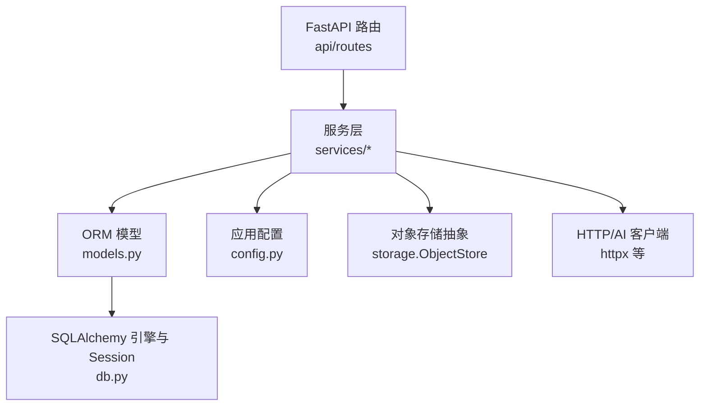

**图表来源**
- [db.py:1-75](file://src/personal_ai_life_os/db.py#L1-L75)
- [config.py:1-132](file://src/personal_ai_life_os/config.py#L1-L132)
- [models.py:200-520](file://src/personal_ai_life_os/models.py#L200-L520)

服务层采用“按领域分组”的组织方式。每个核心能力对应一个服务模块，模块之间通过显式函数调用协作，避免隐式全局状态。数据模型集中在 `models.py`，数据库连接和会话由 `db.py` 提供，运行时配置集中在 `config.py`。

**章节来源**
- [db.py:1-75](file://src/personal_ai_life_os/db.py#L1-L75)
- [config.py:1-132](file://src/personal_ai_life_os/config.py#L1-L132)
- [models.py:200-520](file://src/personal_ai_life_os/models.py#L200-L520)

## 核心服务组件

| 服务模块 | 主要职责 | 关键数据结构 | 对外暴露的典型入口 |
|---|---|---|---|
| 导入服务 | 解析 Markdown、文档、通用聊天、ChatGPT 导出、日历 ICS、照片；写入标准化条目 | `SourceConnection`、`SyncRun`、`SourceItem` | `ingest_file` |
| 图谱抽取服务 | 选择模型提供者、拼装证据、调用 AI 返回实体与关系 | `GraphEntity`、`GraphRelation`、`GraphEvidence`、`GraphModelProvider` | 模型提供者解析、批量证据抽取相关函数 |
| 作业服务 | 入队、抢占、租约、重试、取消、执行具体任务类型 | `BackgroundJob`、`JobEnvelope`、`RetryableJobError` | `enqueue_background_job`、`_claim`、`retry_background_job` |
| 搜索索引服务 | 创建 FTS 表或 gin_trgm 索引、构建候选 ID 过滤器 | 无强领域状态，专注 SQL DDL 和行级过滤 | `rebuild_search_index`、`fts_candidate_filter` |
| 模型提供者服务 | 解析环境配置、注册多个提供者、计算成本、验证可用性 | `ModelProvider` | `list_model_providers`、`resolve_model_provider` |
| 配置与数据库 | 应用设置、引擎创建、会话工厂、会话注入 | `Settings`、`Session`、`Base` | `settings`、`create_session_factory`、`get_session` |

**章节来源**
- [services/ingestion.py:1-199](file://src/personal_ai_life_os/services/ingestion.py#L1-L199)
- [services/graph_extraction.py:1-200](file://src/personal_ai_life_os/services/graph_extraction.py#L1-L200)
- [services/jobs.py:1-180](file://src/personal_ai_life_os/services/jobs.py#L1-L180)
- [services/search_index.py:1-162](file://src/personal_ai_life_os/services/search_index.py#L1-L162)
- [services/model_providers.py:1-179](file://src/personal_ai_life_os/services/model_providers.py#L1-L179)
- [db.py:1-75](file://src/personal_ai_life_os/db.py#L1-L75)
- [config.py:1-132](file://src/personal_ai_life_os/config.py#L1-L132)

## 架构总览

整体数据流分为四段：文件输入 → 解析与标准化 → 可选的异步扩展任务 → 持久化后的查询与检索。

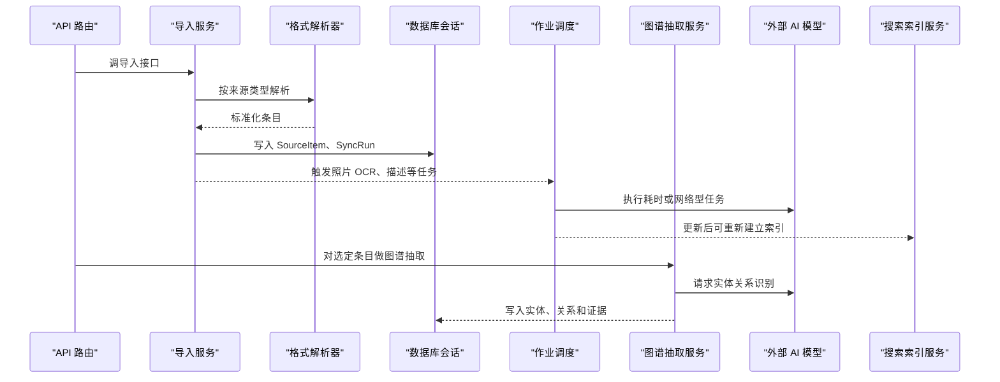

这个图展示了服务层的典型分层：

1. **API 路由层**：不负责业务细节，只转发到服务。
2. **服务层**：聚合 ORM、解析器、存储和外部服务调用。
3. **作业层**：把不可控、耗时的调用移到独立工作流。
4. **数据层**：通过 SQLAlchemy 模型表达所有权、版本、软删除和索引约束。

**图表来源**
- [services/ingestion.py:350-600](file://src/personal_ai_life_os/services/ingestion.py#L350-L600)
- [services/jobs.py:200-555](file://src/personal_ai_life_os/services/jobs.py#L200-L555)
- [services/graph_extraction.py:200-450](file://src/personal_ai_life_os/services/graph_extraction.py#L200-L450)
- [services/search_index.py:1-162](file://src/personal_ai_life_os/services/search_index.py#L1-L162)

## 详细组件分析

### 导入服务：多格式解析与幂等入库

导入服务的核心目标是把一个二进制负载转成稳定的 `SourceItem` 序列，同时记录 `SyncRun` 统计信息、版本号和内容摘要。它不是一个简单的一次性脚本，而是一个具有幂等、软删除、去重和时间语义的设计：

- 根据 `source.kind` 分发到不同解析器，包括记忆标记、文档、通用聊天、ChatGPT 导出、iCalendar 和照片。
- ChatGPT 导出会校验用户选择的对话集合是否为授权范围的子集，越权时返回明确的失败状态。
- 日历导入实现增量对比，区分新增、更新、取消、缺失和跳过项。
- 照片导入可延迟 OCR，优先保存规范化文本或元数据，OCR 作为异步任务执行。
- 插入语句按数据库方言选择 PostgreSQL 或 SQLite 的去重语法，并以 `owner_id`、`source_id`、`external_id`、`source_sha256` 作为唯一键。

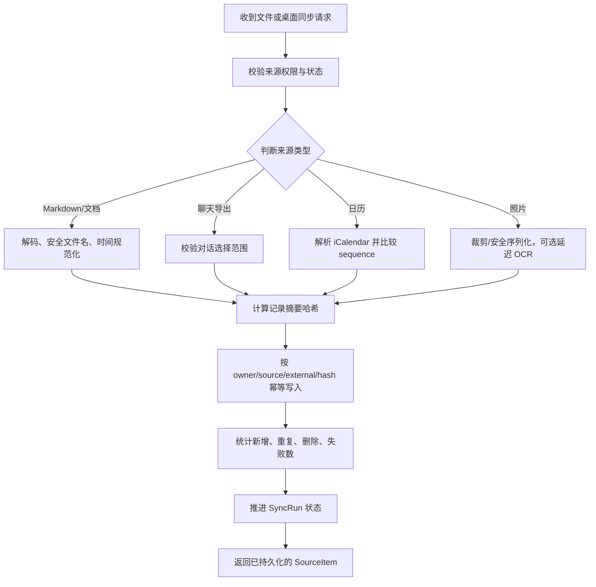

**图表来源**
- [services/ingestion.py:1-199](file://src/personal_ai_life_os/services/ingestion.py#L1-L199)
- [services/ingestion.py:200-400](file://src/personal_ai_life_os/services/ingestion.py#L200-L400)
- [services/ingestion.py:350-600](file://src/personal_ai_life_os/services/ingestion.py#L350-L600)
- [models.py:200-245](file://src/personal_ai_life_os/models.py#L200-L245)

值得注意的数据建模约束是 `SourceItem` 的复合唯一约束：`owner_id`、`source_id`、`external_id`、`source_sha256`。这使相同来源、相同外部标识且内容不变的数据不会被重复入库，从而实现“按哈希去重”的简化版幂等语义。对于日历场景，服务还基于 `ics_sequence`、`ics_status` 和现有快照维护更复杂的变更顺序。

**章节来源**
- [services/ingestion.py:1-199](file://src/personal_ai_life_os/services/ingestion.py#L1-L199)
- [services/ingestion.py:200-400](file://src/personal_ai_life_os/services/ingestion.py#L200-L400)
- [services/ingestion.py:350-600](file://src/personal_ai_life_os/services/ingestion.py#L350-L600)
- [models.py:200-245](file://src/personal_ai_life_os/models.py#L200-L245)

#### 日历增删改处理流程

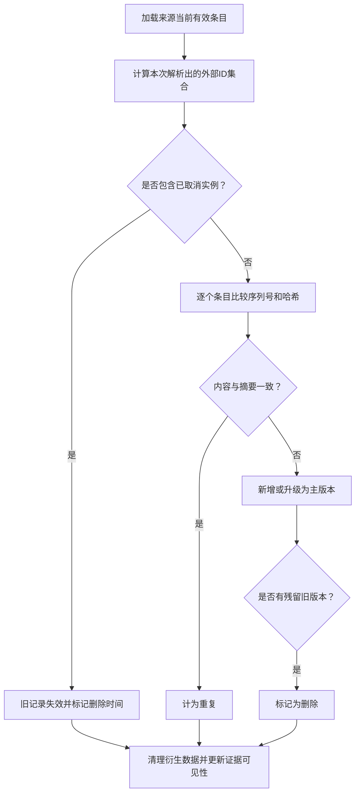

**图表来源**
- [services/ingestion.py:200-400](file://src/personal_ai_life_os/services/ingestion.py#L200-L400)

### 图谱抽取服务：AI 协调、本体校验与证据落库

图谱抽取服务负责从“用户明确选择的来源条目”中提取实体与关系。它并不是一个独立的 LLM 运行框架，而是以 ORM 和外部 HTTP 调用为中心的协调器。

关键职责包括：

- 解析 `GRAPH_MODEL_PROVIDERS` 或通过默认 OpenAI 设置选择提供者。
- 计算预估 token 数，调用模型返回 JSON 结构的实体和关系。
- 校验实体类型和关系类型，允许已知核心类型，也支持已审批的本体类型。
- 将未命中的新类型标记为“提案”，供后续审核。
- 通过归一化名称合并同义实体，并为不同写法创建别名。
- 将模型输出的证据链接回 `SourceItem`，形成可追溯的证据链。

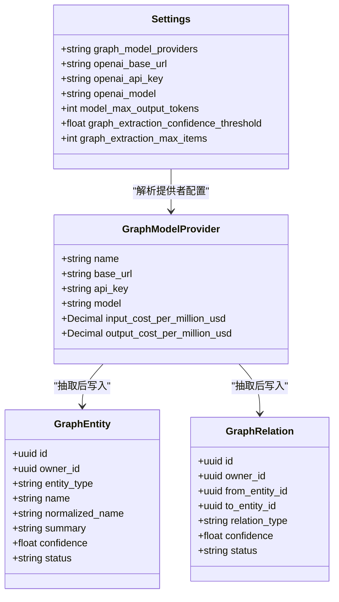

**图表来源**
- [services/graph_extraction.py:1-120](file://src/personal_ai_life_os/services/graph_extraction.py#L1-L120)
- [services/model_providers.py:1-179](file://src/personal_ai_life_os/services/model_providers.py#L1-L179)
- [models.py:330-520](file://src/personal_ai_life_os/models.py#L330-L520)

**章节来源**
- [services/graph_extraction.py:1-120](file://src/personal_ai_life_os/services/graph_extraction.py#L1-L120)
- [services/graph_extraction.py:200-450](file://src/personal_ai_life_os/services/graph_extraction.py#L200-L450)
- [model_providers.py:1-179](file://src/personal_ai_life_os/services/model_providers.py#L1-L179)
- [models.py:330-520](file://src/personal_ai_life_os/models.py#L330-L520)

#### 调用 AI 进行图谱抽取的顺序

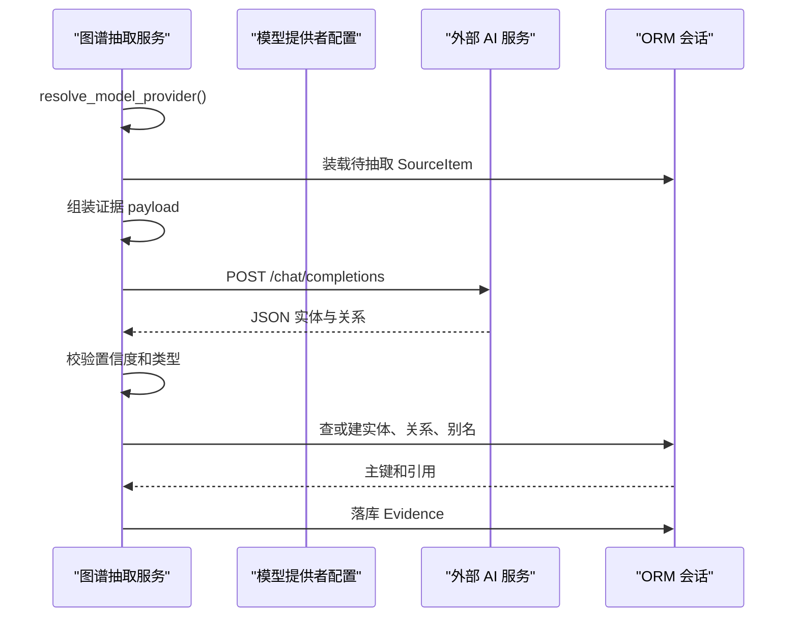

**图表来源**
- [services/graph_extraction.py:200-450](file://src/personal_ai_life_os/services/graph_extraction.py#L200-L450)

### 作业服务：可靠任务、租约、重试与取消

作业服务是整个系统的“后台运行时”。它不使用 Redis 或 Celery，而是基于 SQLAlchemy 的 `BackgroundJob` 表实现，适合单进程或有限并发场景。

核心机制如下：

- `enqueue_background_job` 使用 `dedupe_key` 去重，防止重复提交相同任务。
- 如果已完成、失败或被取消的任务再次入队，会被重置为排队状态，而不是创建第二条记录。
- `_claim` 模拟抢占式消费：PostgreSQL 使用 `SELECT ... FOR UPDATE SKIP LOCKED`，SQLite 则退化为较弱的并发模型。
- 每条任务有最大尝试次数和租约过期时间；超过最大值后进入最终失败状态。
- 任务类型包括照片 OCR、图片描述、周度审查、桌面分析等，不同类型在 `_execute_*` 中分支执行。
- 取消任务时，除了标记 `BackgroundJob`，还会同步更新 `SyncRun`、`SourceItem.metadata_json` 和部分 `Review.draft_json`。

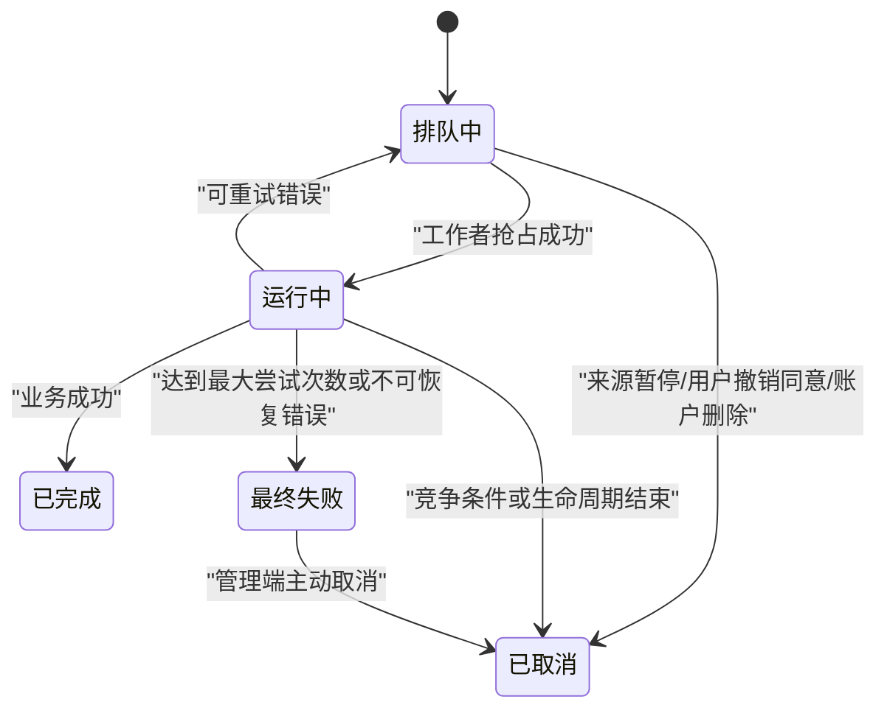

**图表来源**
- [services/jobs.py:1-180](file://src/personal_ai_life_os/services/jobs.py#L1-L180)
- [services/jobs.py:200-555](file://src/personal_ai_life_os/services/jobs.py#L200-L555)
- [models.py:1-200](file://src/personal_ai_life_os/models.py#L1-L200)

**章节来源**
- [services/jobs.py:1-180](file://src/personal_ai_life_os/services/jobs.py#L1-L180)
- [services/jobs.py:200-555](file://src/personal_ai_life_os/services/jobs.py#L200-L555)
- [services/ingestion.py:1-40](file://src/personal_ai_life_os/services/ingestion.py#L1-L40)
- [models.py:1-200](file://src/personal_ai_life_os/models.py#L1-L200)

#### 照片描述任务的作业执行流程

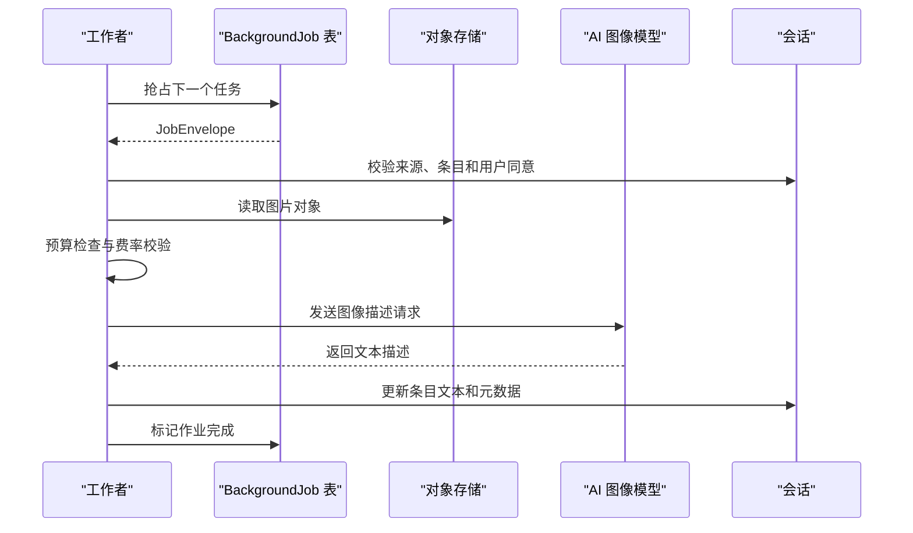

**图表来源**
- [services/jobs.py:200-555](file://src/personal_ai_life_os/services/jobs.py#L200-L555)

### 搜索索引服务：后端检测与触发式更新

搜索索引服务的设计非常保守：它不对主查询路径做强依赖，而是先检测数据库能力，再决定走 FTS 还是 LIKE 回退方案。

- SQLite 下创建 `timeline_fts`、`review_fts`、`reminder_fts` 虚拟表，并通过触发器保持同步。
- PostgreSQL 下创建 `pg_trgm` 扩展，并为标题、内容、备注字段建 gin_trgm 索引。
- `search_backend` 返回实际后端标识：sqlite-fts5-trigram、postgresql-pg_trgm 或 like。
- `fts_candidate_filter` 只对短查询和非 LIKE 模式启用快速候选过滤，否则返回空谓词让上层继续处理。
- `rebuild_search_index` 用于重建索引，常用于迁移、运维脚本或首次启动。

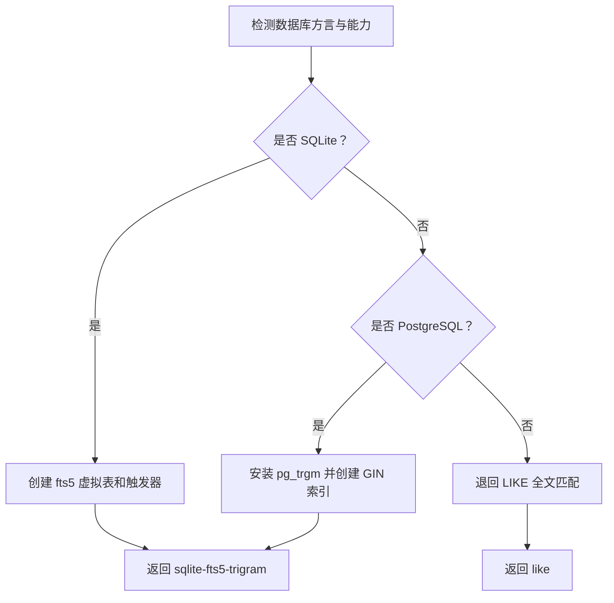

**图表来源**
- [services/search_index.py:1-162](file://src/personal_ai_life_os/services/search_index.py#L1-L162)

**章节来源**
- [services/search_index.py:1-162](file://src/personal_ai_life_os/services/search_index.py#L1-L162)

### 模型提供者服务：多提供者注册与安全校验

模型提供者服务承担两个重要职责：一是枚举可用模型提供者，二是对外暴露统一的提供者抽象。

- 内置默认提供者基于 `OPENAI_*` 系列环境变量构建。
- 额外提供者通过 JSON 字符串 `MODEL_PROVIDERS` 注册，键名不得为 `default`。
- 本地提供者必须指向回环地址，除非显式声明为本地；非本地提供者通常要求提供密钥。
- 每个提供者都包含披露版本、数据说明、保留说明、隐私 URL、最大输出 token 和成本定价。
- `resolve_model_provider` 不仅校验提供者是否存在，还校验所选模型是否在提供者声明的模型列表中。

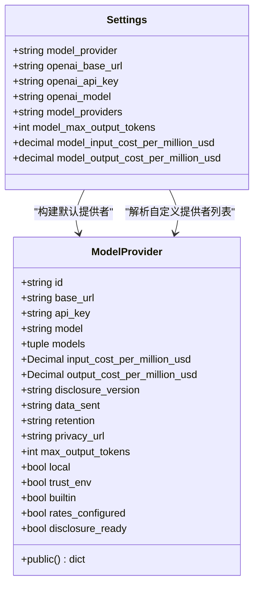

**图表来源**
- [services/model_providers.py:1-223](file://src/personal_ai_life_os/services/model_providers.py#L1-L223)
- [config.py:1-132](file://src/personal_ai_life_os/config.py#L1-L132)

**章节来源**
- [services/model_providers.py:1-223](file://src/personal_ai_life_os/services/model_providers.py#L1-L223)
- [config.py:1-132](file://src/personal_ai_life_os/config.py#L1-L132)

## 依赖关系分析

服务层的关键耦合如下：

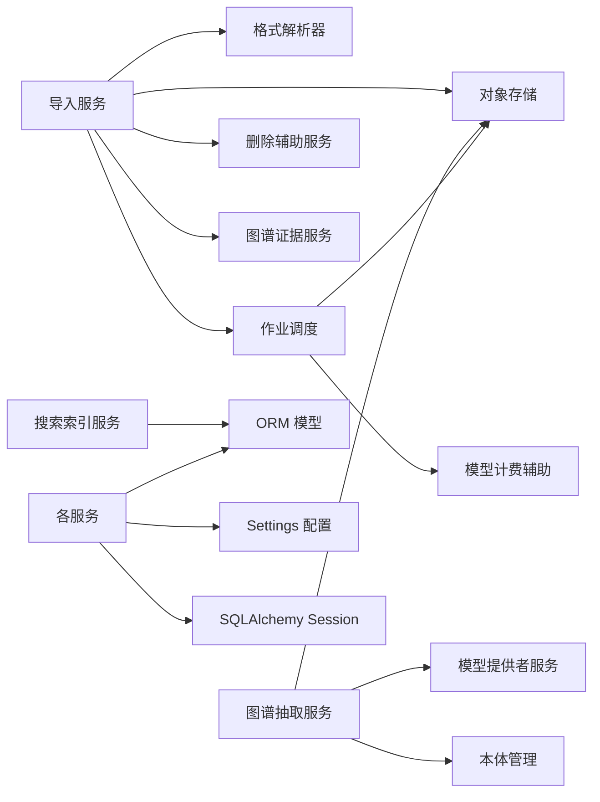

**图表来源**
- [services/ingestion.py:1-40](file://src/personal_ai_life_os/services/ingestion.py#L1-L40)
- [services/graph_extraction.py:1-120](file://src/personal_ai_life_os/services/graph_extraction.py#L1-L120)
- [services/jobs.py:1-40](file://src/personal_ai_life_os/services/jobs.py#L1-L40)
- [services/search_index.py:1-30](file://src/personal_ai_life_os/services/search_index.py#L1-L30)
- [services/model_providers.py:1-60](file://src/personal_ai_life_os/services/model_providers.py#L1-L60)
- [db.py:40-75](file://src/personal_ai_life_os/db.py#L40-L75)

### 直接依赖

- `ingestion.py` 依赖解析器模块、删除辅助服务、图谱证据服务和作业服务。
- `graph_extraction.py` 依赖模型提供者配置、本体服务和对象存储。
- `jobs.py` 依赖对象存储、模型费用辅助以及部分 API 路由中的常量。
- `search_index.py` 只依赖模型和原始 SQL，避免引入业务模型循环。
- `model_providers.py` 仅依赖 `Settings`，便于在测试中替换配置。

### 间接依赖与风险点

- 作业服务在执行某些任务时动态导入 API 路由中的常量和渲染函数，说明“持久化任务逻辑”和“请求路径中的展示逻辑”之间还存在弱耦合。
- 导入服务在照片处理路径中通过 `enqueue_background_job` 发起异步任务，若消费者未启动，照片 OCR 或描述会长期停留在等待状态。
- 图谱抽取使用 httpx 直接调用外部模型，若不提供超时或降级策略，可能阻塞前台同步流程。

**章节来源**
- [services/ingestion.py:30-80](file://src/personal_ai_life_os/services/ingestion.py#L30-L80)
- [services/jobs.py:480-555](file://src/personal_ai_life_os/services/jobs.py#L480-L555)
- [services/graph_extraction.py:200-260](file://src/personal_ai_life_os/services/graph_extraction.py#L200-L260)

## 性能与可扩展性

### 批量与幂等操作

导入服务避免全量重建条目，而是基于外部 ID 和哈希比对：

- 内容完全相同的条目计为重复，不会覆盖已有记录。
- 新版本通过新的 `id` 创建，并标记旧条目为非当前版本，从而保留历史轨迹。
- 对日历场景使用序列号控制版本顺序，避免乱序更新导致回退。
- 对删除候选项先发出删除事务日志，再标记软删除和清理事件证据。

### 索引与查询优化

搜索索引服务对高代价操作保持懒加载：

- 不是每次写入都强制重建 FTS，而是依赖 SQLite 触发器自动同步，或 PG trgm 索引静态维护。
- 查询时使用 `fts_candidate_filter` 仅在合适模式下生效，否则回退为 LIKE。
- 管理员可通过 `rebuild_search_index` 手动重建，适合上线后一致性校验。

### 外部调用成本控制

模型提供者服务要求生产环境配置收入、输出单价、单次调用预算和月预算。作业服务在照片描述任务中会预留成本并根据配置拒绝超预算调用；若模型提供方未正确配置价格，则返回明确的“成本未配置”错误。

**章节来源**
- [services/ingestion.py:200-400](file://src/personal_ai_life_os/services/ingestion.py#L200-L400)
- [services/search_index.py:1-162](file://src/personal_ai_life_os/services/search_index.py#L1-L162)
- [services/model_providers.py:1-120](file://src/personal_ai_life_os/services/model_providers.py#L1-L120)
- [services/jobs.py:430-555](file://src/personal_ai_life_os/services/jobs.py#L430-L555)

## 错误处理与重试策略

### 导入错误

导入服务抛出业务错误的自定义异常类型，携带错误码、消息和默认 HTTP 状态码。常见场景包括：

- 文件编码非法。
- 不支持的文档、聊天导出、日历或照片类型。
- 未选择必要对话范围。
- 选择范围超出授权范围。
- 来源不存在或不活跃。

这些错误通常是“配置类或用户输入错误”，不应由作业重试解决。

**章节来源**
- [services/ingestion.py:1-100](file://src/personal_ai_life_os/services/ingestion.py#L1-L100)
- [services/ingestion.py:350-600](file://src/personal_ai_life_os/services/ingestion.py#L350-L600)

### 作业重试策略

作业服务使用 `RetryableJobError` 包装可重试错误，例如：

- 照片文件暂时不可用。
- OCR 提取失败但可能随下次调用恢复。
- 支持的图片格式不符合预期。
- 模型成本未配置或超过单次预算。

相反，以下错误标记为最终失败：

- 工作者租约过期。
- 工作者自身报错。
- 图片描述最终失败。
- 模型成本预算超限或成本未配置（特定任务中转为不可重试）。
- 资源被提前删除。
- 用户撤回 AI 同意。

#### 错误分支决策

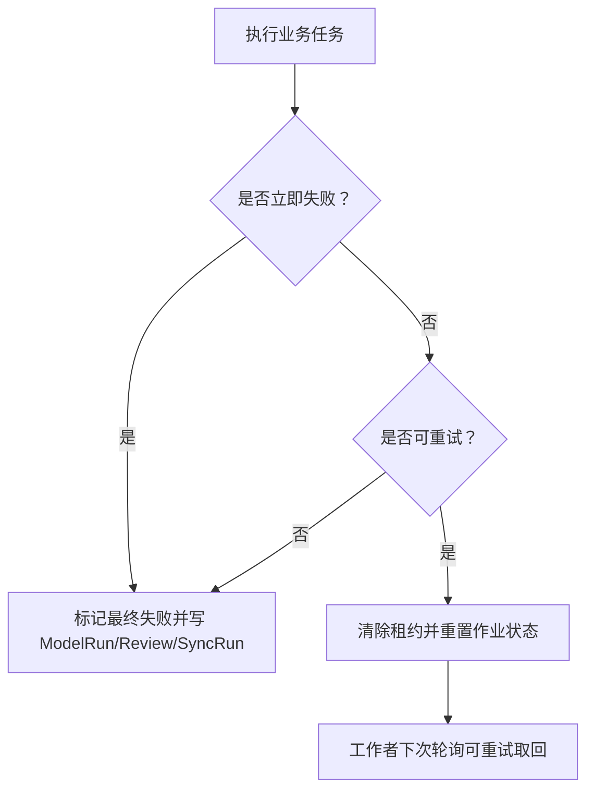

**图表来源**
- [services/jobs.py:200-555](file://src/personal_ai_life_os/services/jobs.py#L200-L555)

### 网络与 AI 服务降级

- 图谱抽取使用显式超时构造 HTTP 客户端，并对非 JSON 响应抛出结构化错误。
- 照片描述任务在确认同意后才会发送图像，避免违反隐私或浪费成本。
- 若模型提供方缺少必需配置，作业会在开始前快速失败，而不是无限重试。
- 周度审查遇到模型错误时会回落到本地模板草稿。

需要注意的是，当前的“网络超时”防护主要集中于 httpx 的超时配置和服务端 response.raise_for_status；真正的指数退避或半衰式断路器并未在当前代码中体现。

**章节来源**
- [services/graph_extraction.py:200-260](file://src/personal_ai_life_os/services/graph_extraction.py#L200-L260)
- [services/jobs.py:300-555](file://src/personal_ai_life_os/services/jobs.py#L300-L555)

## 事务、数据访问与缓存模式

### Repository 模式的近似实现

当前代码没有抽象出通用的 repository 层，而是让服务直接操作 SQLAlchemy 会话。这是一种轻量的“行为内聚”模式：

- 每个服务知道该领域需要的查询、写入、冲突处理和副作用。
- 数据写入大多放在同一个会话事务中，通过显式 commit 控制边界。
- 复杂逻辑如日历增量更新、实体归属复制、软删除和证据标记集中在少数几个服务函数内。

这种方式比传统 Repository 更易理解，但缺点是跨模块共享的 ORM 查询容易分散。建议在引入新的数据访问聚合点时，考虑为高频访问的对象建立内部查询助手，以减少重复 SQL 片段。

**章节来源**
- [services/ingestion.py:200-400](file://src/personal_ai_life_os/services/ingestion.py#L200-L400)
- [services/graph_extraction.py:300-450](file://src/personal_ai_life_os/services/graph_extraction.py#L300-L450)

### 事务管理策略

数据库引擎初始化时对 SQLite 启用了外键约束，并根据部署模式开启 WAL 模式。会话工厂关闭自动 flush 和提交后过期，避免意外写入；大多数服务函数接收外部传入的 `Session`，由调用方决定事务边界。

建议补充的事务原则：

1. 同一业务流程的所有写入应放入同一事务。
2. 外部服务调用（对象存储、AI 模型）应在最小化事务范围内执行。
3. 长时间运行的网络调用不应持有写锁。
4. 需要读稳定性的场景（例如日历来源锁定）使用数据库级锁。
5. 对长事务进行监控，防止 workers 崩溃造成租约泄漏或索引不一致。

**章节来源**
- [db.py:1-75](file://src/personal_ai_life_os/db.py#L1-L75)
- [services/ingestion.py:350-600](file://src/personal_ai_life_os/services/ingestion.py#L350-L600)
- [services/jobs.py:250-430](file://src/personal_ai_life_os/services/jobs.py#L250-L430)

### 缓存策略

当前服务层没有集中式缓存层，也没有显式 Redis 客户端。其“缓存”主要体现在：

- 数据库索引与触发器维护搜索候选集合。
- 图谱实体按 `owner_id`、`entity_type`、`normalized_name` 合并，避免同义实体分裂。
- 作业去重用 `dedupe_key` 避免重复提交。
- 模型成本按月度统计，用于预算限制。

如果需要高频读路径上的性能提升，推荐：

- 对热点模型提供者配置增加轻量内存缓存，并在设置变更时失效。
- 对搜索结果缓存短期候选集。
- 不要在缓存中绕过所有者隔离和数据有效性检查。

[本节为一般性设计建议，不直接分析具体代码文件]

## 服务间通信与事件驱动

当前系统的主要协作方式是“命令式服务调用 + 数据库作业队列”。严格来说，这不是纯事件驱动架构，更像“事件后备队列”：

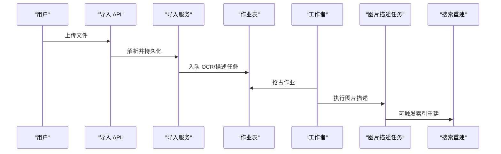

**图表来源**
- [services/ingestion.py:1-80](file://src/personal_ai_life_os/services/ingestion.py#L1-L80)
- [services/jobs.py:400-555](file://src/personal_ai_life_os/services/jobs.py#L400-L555)
- [services/search_index.py:1-162](file://src/personal_ai_life_os/services/search_index.py#L1-L162)

### 异步任务编排要点

- 同步导入负责“确定的本地数据入库存档”，不直接做昂贵的外部推理。
- 异步任务负责“可能失败的网络任务”和“可能需要重试的操作”。
- 任务载荷应尽量小，避免重复传大文件；图片二进制走对象存储 key。
- 任务完成后更新可观测字段，如 `ocr_status`、`description_status`、`Review.status`、`SyncRun.error_code`。

### 消息传递的状态同步

由于使用的是数据库而非消息中间件，系统通过状态机字段保证一致性：

| 层级 | 状态字段 | 作用 |
|---|---|---|
| 来源 | `SourceConnection.status` | 控制导入或后续处理是否允许 |
| 同步运行 | `SyncRun.status` | 追踪一次导入的生命周期 |
| 条目 | `SourceItem.is_current`、`deleted_at` | 表示最新副本和软删除 |
| 作业 | `BackgroundJob.status`、`attempt_count` | 表示调度、重试、失败 |
| 模型调用 | `ModelRun.cost_usd`、`purpose` | 记录用量与费用 |
| 搜索索引 | `search_backend()` 返回值 | 告诉查询后端是否走 FTS/trigram 或 LIKE |

**章节来源**
- [services/jobs.py:180-360](file://src/personal_ai_life_os/services/jobs.py#L180-L360)
- [services/search_index.py:90-162](file://src/personal_ai_life_os/services/search_index.py#L90-L162)
- [models.py:200-520](file://src/personal_ai_life_os/models.py#L200-L520)

## 故障排查指南

| 症状 | 可能原因 | 排查方向 |
|---|---|---|
| 导入后立即显示重复或未变 | 内容摘要哈希相同，被识别为重复项 | 检查 `SyncRun.items_duplicate`、`SourceItem.stored_sha256` |
| 日历条目没有按预期删除 | 版本序列不足或被标记为不支持的循环规则 | 检查 `metadata_json` 中的 `ics_sequence`、`ics_status` |
| 照片 OCR 卡住 | 工作者未运行或任务被取消 | 检查 `BackgroundJob.status`、`item.metadata_json.ocr_status` |
| 图片描述失败 | 用户不同意、格式不支持、文件丢失、预算不足 | 检查 `user.ai_consent_*`、内容类型、作业错误码 |
| 模型抽取返回异常 | 外部模型返回非 JSON 或 token 配置错误 | 检查响应结构、`model_max_output_tokens` 和模型 URL |
| 搜索慢 | FTS/trgm 未安装 | 检查 `search_backend` 返回值，运行索引重建 |
| 生产启动失败 | 配置不安全 | 检查 `ACCESS_TOKEN_SECRET`、`MODEL_PROVIDERS`、CORS、S3 设置 |

**章节来源**
- [services/jobs.py:300-555](file://src/personal_ai_life_os/services/jobs.py#L300-L555)
- [services/search_index.py:1-162](file://src/personal_ai_life_os/services/search_index.py#L1-L162)
- [config.py:80-132](file://src/personal_ai_life_os/config.py#L80-L132)

## 结论

该项目的服务层设计体现了三个关键取舍：

1. **用轻量数据表替代重型消息队列**。优点是可部署成本低、一致性强；缺点是多 worker 并发保护不如专业中间件健壮。
2. **用同步导入配合异步扩展任务**。这避免了用户上传大文件时等待 OCR 或 AI 描述，也把不确定性任务移出 HTTP 路径。
3. **用显式的状态字段和软删除维护历史**。这使得导入、图谱、证据和审查之间的因果关系可回溯。

若要进一步演进服务层，建议优先加强以下几方面：

- 为作业系统增加指数退避、死信队列和任务优先级。
- 为外部模型调用增加统一重试层、超时上限和熔断保护。
- 将高频查询中的 ORM 逻辑抽象为领域内的查询辅助。
- 在关键路径添加分布式锁，避免多实例并行重建索引或并发写入同一条数据来源。
- 明确区分“命令式服务方法”和“事件处理器”，并为未来引入事件总线留下稳定契约。