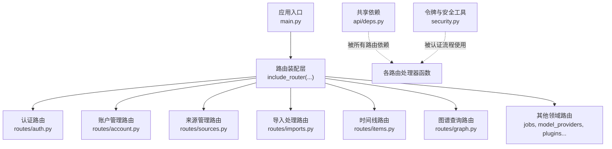
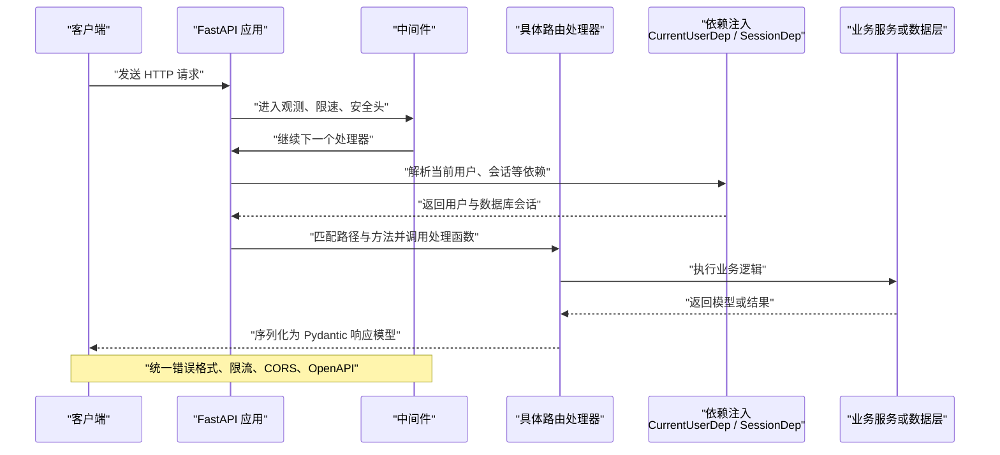
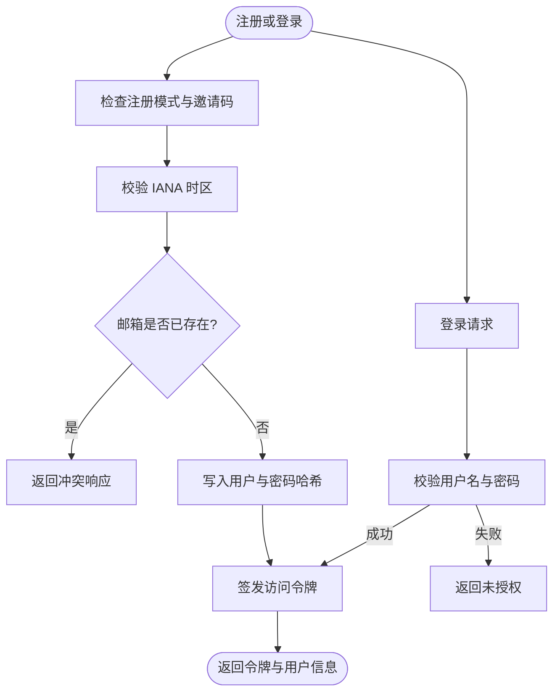
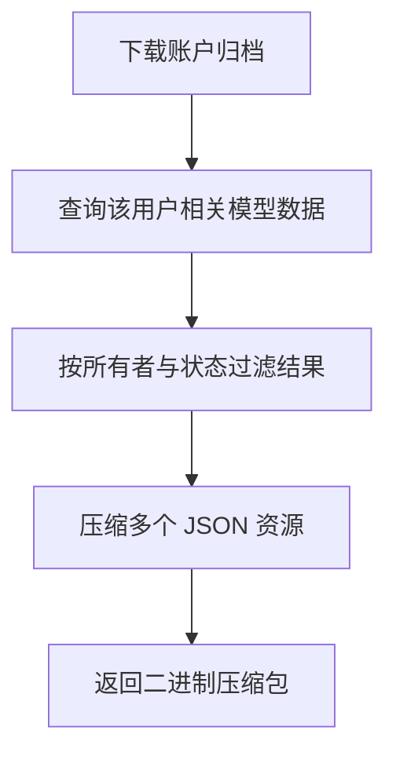
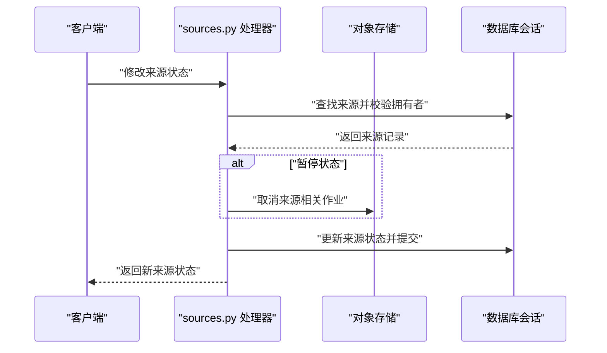
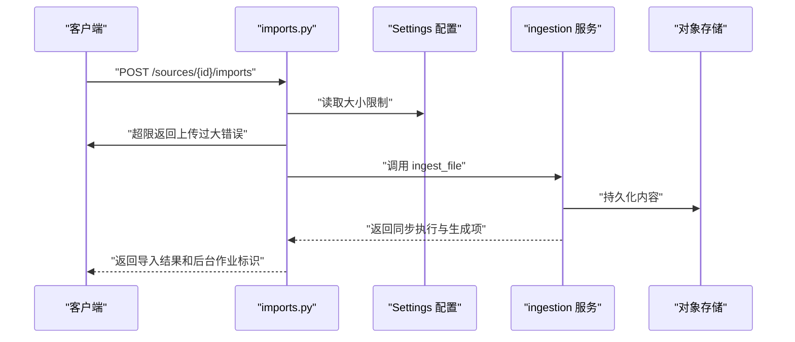
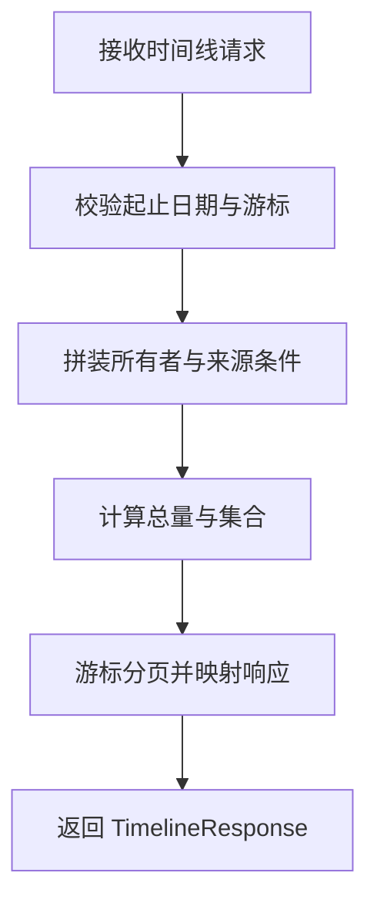
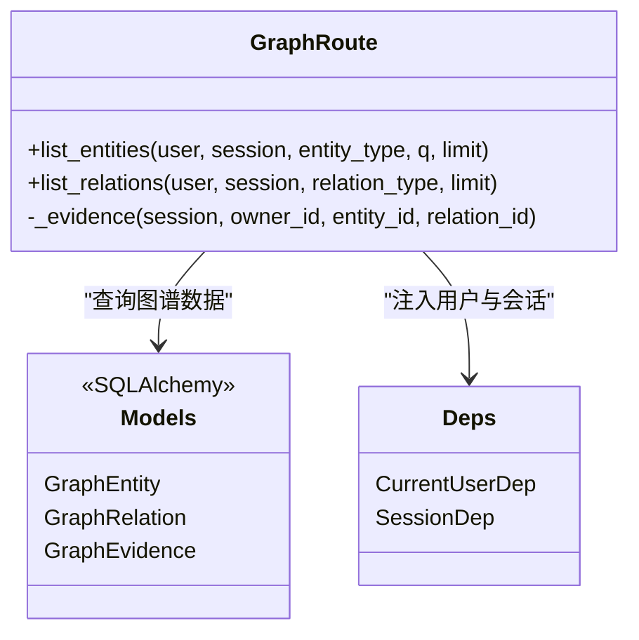
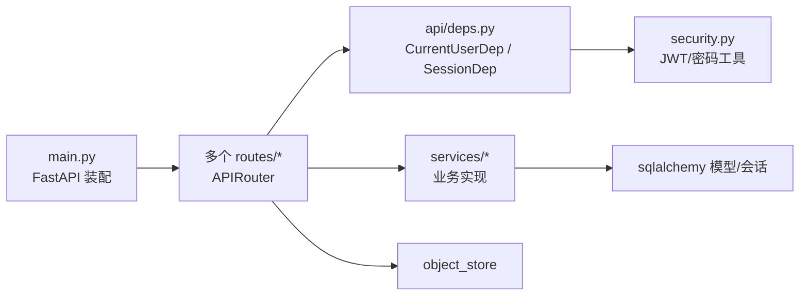

# 模块化路由系统设计

<cite>
**本文引用的文件列表**   
- [main.py](file://src/personal_ai_life_os/main.py)
- [deps.py](file://src/personal_ai_life_os/api/deps.py)
- [security.py](file://src/personal_ai_life_os/security.py)
- [auth.py](file://src/personal_ai_life_os/api/routes/auth.py)
- [account.py](file://src/personal_ai_life_os/api/routes/account.py)
- [sources.py](file://src/personal_ai_life_os/api/routes/sources.py)
- [imports.py](file://src/personal_ai_life_os/api/routes/imports.py)
- [items.py](file://src/personal_ai_life_os/api/routes/items.py)
- [graph.py](file://src/personal_ai_life_os/api/routes/graph.py)
</cite>

## 目录
1. [引言](#引言)
2. [项目结构概览](#项目结构概览)
3. [核心组件](#核心组件)
4. [架构总览](#架构总览)
5. [详细组件分析](#详细组件分析)
6. [依赖关系分析](#依赖关系分析)
7. [性能与可扩展性考虑](#性能与可扩展性考虑)
8. [故障排查指南](#故障排查指南)
9. [结论](#结论)

## 引言
本文件系统性梳理后端模块化路由系统的设计。整体采用 FastAPI，按业务领域拆分为多个路由器模块；所有对外接口通过统一入口装配，使用 `/api/v1` 作为版本前缀，并结合 OpenAPI 实现文档自动生成与调试支持。请求处理遵循清晰的分层管道：路径解析、查询参数校验、请求体反序列化、身份与租户权限校验、业务逻辑调用及响应模型序列化。横切关注点（用户认证、会话注入、速率限制、安全头、健康检查等）通过依赖注入和中间件解耦到通用组件。

## 项目结构概览
路由系统的组织方式是“领域优先 + 集中装配”：
- 每个业务域一个 Python 模块，负责定义自己的 `APIRouter`、依赖注入和响应模型。
- 应用入口只负责创建生命周期、安装中间件、注册所有子路由，并统一设置全局错误处理器。
- 共享的认证、数据库会话、配置访问等横切能力集中在 `api/deps.py` 和 `security.py`。

**图示来源**
- [main.py:108-160](file://src/personal_ai_life_os/main.py#L108-L160)
- [main.py:240-315](file://src/personal_ai_life_os/main.py#L240-L315)
- [auth.py:7-45](file://src/personal_ai_life_os/api/routes/auth.py#L7-L45)
- [account.py:10-45](file://src/personal_ai_life_os/api/routes/account.py#L10-L45)
- [sources.py:7-45](file://src/personal_ai_life_os/api/routes/sources.py#L7-L45)
- [imports.py:8-35](file://src/personal_ai_life_os/api/routes/imports.py#L8-L35)
- [items.py:11-35](file://src/personal_ai_life_os/api/routes/items.py#L11-L35)
- [graph.py:5-25](file://src/personal_ai_life_os/api/routes/graph.py#L5-L25)

**章节来源**
- [main.py:1-200](file://src/personal_ai_life_os/main.py#L1-L200)
- [main.py:200-315](file://src/personal_ai_life_os/main.py#L200-L315)

## 核心组件
### 应用装配与生命周期
FastAPI 应用由工厂函数创建，负责：
- 根据运行环境决定是否开启 OpenAPI 文档。
- 将数据库引擎、会话工厂、对象存储、配置对象挂到 `application.state`。
- 启动后台任务、搜索索引构建、删除墓碑恢复等工作。
- 挂载 CORS 中间件、HTTP 观测与限速中间件。
- 集中注册 23 个业务路由模块。
- 注册三类全局异常处理器：HTTP 异常、Pydantic 验证异常、未捕获异常。

关键点：
- 版本控制通过在 `include_router` 时统一传入 `prefix="/api/v1"` 完成，因此除少数内部模块外，对外 API 均位于 `/api/v1/...`。
- 桌面模式下文档被关闭，生产模式也关闭 `/docs`/`/redoc`，但保留 `/openapi.json`（非桌面）。

**章节来源**
- [main.py:24-75](file://src/personal_ai_life_os/main.py#L24-L75)
- [main.py:95-160](file://src/personal_ai_life_os/main.py#L95-L160)
- [main.py:180-315](file://src/personal_ai_life_os/main.py#L180-L315)

### 共享依赖注入机制
`api/deps.py` 提供可复用的认证和用户上下文：
- `get_current_user` 解析 Bearer Token，查库加载用户，若用户处于删除中则返回特定状态码。
- `CurrentUserDep` 和 `DeletionUserDep` 封装为类型化 Annotated 依赖，供各个路由直接注入。
- `SessionDep` 把 SQLAlchemy Session 注入进路由或内部服务。
- `optional_bearer` 允许在某些场景下不强制鉴权，用于可选认证分支。

`security.py` 提供：
- 密码哈希与验证。
- JWT 访问令牌签发与解码，包括 audience、issuer、token type、过期时间等签名校验。

**章节来源**
- [deps.py:1-65](file://src/personal_ai_life_os/api/deps.py#L1-L65)
- [security.py:1-54](file://src/personal_ai_life_os/security.py#L1-L54)

## 架构总览

**图示来源**
- [main.py:160-240](file://src/personal_ai_life_os/main.py#L160-L240)
- [deps.py:10-65](file://src/personal_ai_life_os/api/deps.py#L10-L65)
- [auth.py:140-210](file://src/personal_ai_life_os/api/routes/auth.py#L140-L210)

## 详细组件分析

### 认证路由 `auth.py`
职责边界：
- 桌面环境自动配置文件读取与创建。
- 用户注册、登录、当前用户查询、AI 提供者披露与同意操作。
- 使用 `register/login/me` 等典型 REST 语义；对管理员/环境配置进行差异化处理。

设计要点：
- 注册受注册模式控制：关闭、邀请码或开放。
- 登录失败与凭证不正确都抛出统一结构的 HTTPException。
- `/me` 通过 `CurrentUserDep` 保证已认证用户。
- AI 提供者能力披露和同意变更使用配置与外部服务的组合逻辑。

**图示来源**
- [auth.py:60-120](file://src/personal_ai_life_os/api/routes/auth.py#L60-L120)
- [auth.py:140-210](file://src/personal_ai_life_os/api/routes/auth.py#L140-L210)
- [security.py:28-54](file://src/personal_ai_life_os/security.py#L28-L54)

**章节来源**
- [auth.py:1-210](file://src/personal_ai_life_os/api/routes/auth.py#L1-L210)

### 账户管理路由 `account.py`
职责边界：
- 用户数据的完整归档导出与重试式账户删除流程。
- 涉及大量领域模型汇总：来源、同步记录、时间线条目、审查记录、图谱实体、插件审计日志、收藏标签等。

关键特点：
- 归档接口以 zip 流式输出多 JSON 文件，体现面向用户的资产迁移能力。
- 多处条件过滤 owner_id，确保租户隔离和数据所有权约束。
- 删除流程借助后台任务和状态机，避免直接硬删除引发的一致性问题。

**图示来源**
- [account.py:42-80](file://src/personal_ai_life_os/api/routes/account.py#L42-L80)
- [account.py:90-190](file://src/personal_ai_life_os/api/routes/account.py#L90-L190)

**章节来源**
- [account.py:1-120](file://src/personal_ai_life_os/api/routes/account.py#L1-L120)

### 来源管理路由 `sources.py`
职责边界：
- 管理外部数据来源连接及其状态、作用域、云提取同意开关。
- 删除操作走异步取消与衍生数据处理流程，禁止直接操作内部快速笔记来源。

重点逻辑：
- `_source_or_404` 复用来源查找和四零四错误包装。
- 状态更新需要区分激活与暂停，暂停时取消对应后台作业。
- 云提取同意需要比对配置版本号，并在桌面模式禁用时清理运行中的任务。

**图示来源**
- [sources.py:40-95](file://src/personal_ai_life_os/api/routes/sources.py#L40-L95)
- [sources.py:95-170](file://src/personal_ai_life_os/api/routes/sources.py#L95-L170)

**章节来源**
- [sources.py:1-200](file://src/personal_ai_life_os/api/routes/sources.py#L1-L200)

### 导入处理路由 `imports.py`
职责边界：
- 接收有限制的文件上传和文本源导入，解析后写回对象存储与数据库。
- 结合速率限制与功能开关控制导入能力。

重要设计：
- 文件大小限制依据来源类型动态切换。
- 可选表单参数包括对话 ID 列表、抓取时间和时区，并进行严格校验。
- 处理失败转换为结构化错误码，便于前端反馈。

**图示来源**
- [imports.py:20-134](file://src/personal_ai_life_os/api/routes/imports.py#L20-L134)

**章节来源**
- [imports.py:1-134](file://src/personal_ai_life_os/api/routes/imports.py#L1-L134)

### 时间线路由 `items.py`
职责边界：
- 提供按所有者范围筛选的时间线查询、单条明细、图片描述确认等能力。
- 通过游标分页、日期边界、来源过滤、关键词模糊匹配组合出高效查询。

复杂度说明：
- 游标偏移基于 Base64 编码整数，支持百万级页内滑动且带上下界保护。
- 查询条件拼接了来源状态、删除标记、当前态标志，保障用户数据可见性。
- 统计总数使用子查询 count，再配合 offset/limit 完成分页。

**图示来源**
- [items.py:25-110](file://src/personal_ai_life_os/api/routes/items.py#L25-L110)
- [items.py:110-200](file://src/personal_ai_life_os/api/routes/items.py#L110-L200)

**章节来源**
- [items.py:1-220](file://src/personal_ai_life_os/api/routes/items.py#L1-L220)

### 图谱操作路由 `graph.py`
职责边界：
- 提供图谱实体和关系的只读查询，并按所有者隔离。
- 针对实体与关系分别返回证据片段，限制证据数量避免大结果集。

实现特征：
- 查询过滤包含实体类型、名称模糊搜索、状态排除无效节点。
- 关联的证据集合按需附加到每条实体或关系中，提升单一响应可读性。

**图示来源**
- [graph.py:5-135](file://src/personal_ai_life_os/api/routes/graph.py#L5-L135)
- [deps.py:10-65](file://src/personal_ai_life_os/api/deps.py#L10-L65)

**章节来源**
- [graph.py:1-135](file://src/personal_ai_life_os/api/routes/graph.py#L1-L135)

### 其他常见领域路由
其余路由例如 agent、budget、jobs、model-providers、plugins、quick-notes、reminders、search、saved-searches 等均遵循同样的模式：
- 独立 APIRouter 定义前缀与分组标签。
- 主要依赖 `CurrentUserDep` 与 `SessionDep`。
- 对复杂逻辑委托到 services 层，路由保持薄控制器职责。

这符合“路由负责边界与服务负责逻辑”的拆分原则，便于测试、文档分组和扩展。

## 依赖关系分析

**图示来源**
- [main.py:100-180](file://src/personal_ai_life_os/main.py#L100-L180)
- [deps.py:1-65](file://src/personal_ai_life_os/api/deps.py#L1-L65)
- [security.py:1-54](file://src/personal_ai_life_os/security.py#L1-L54)
- [imports.py:60-134](file://src/personal_ai_life_os/api/routes/imports.py#L60-L134)

**章节来源**
- [main.py:100-315](file://src/personal_ai_life_os/main.py#L100-L315)

## 性能与可扩展性考虑
- 请求观测与限流：中间件按 POST 路由键计数，登录、注册、来源导入有专用窗口和阈值；超过阈值返回 429，并带 `Retry-After` 提示。
- 安全响应头：统一添加内容类型嗅探防护、帧点击劫持防护、引用来源策略和内容安全策略。
- CORS：显式列出允许的来源方法、头部，桌面模式和非桌面模式区别对待。
- 文档开关：桌面和生产环境默认关闭交互式文档，减少暴露面。
- 分页和上限：时间线和图谱查询使用 `limit` 参数限制最大返回量，配合游标降低服务端排序与扫描压力。
- 异步工作：导入和图相关处理可以转入后台作业队列，避免长同步请求阻塞请求处理通道。

[本节提供一般性指导，不直接分析具体代码行]

## 故障排查指南

### 未携带或无效令牌
现象：
- 401 未授权，错误码 `auth_required` 或 `invalid_access_token`。
- 响应可能带 `WWW-Authenticate: Bearer`。

诊断步骤：
1. 确认请求 Header 是否包含 `Authorization: Bearer <token>`。
2. 检查 token 是否过期或被篡改。
3. 如用户账户已被标记删除且不是明确允许删除的场景，会收到账户删除中止状态。

**章节来源**
- [deps.py:20-65](file://src/personal_ai_life_os/api/deps.py#L20-L65)
- [security.py:28-54](file://src/personal_ai_life_os/security.py#L28-L54)

### 请求验证失败
现象：
- 422 响应，错误码 `validation_error`，并附带问题数组。

常见问题：
- 字段缺失、类型错误或超出长度。
- 日期格式、时区不合法。
- 字符串为空或未满足正则约定。

建议：
- 参考返回的 `issues` 数组定位具体字段和错误类型。
- 对于时间线接口，注意游标必须是有效的 Base64 编码值，且有取值范围限制。

**章节来源**
- [main.py:280-315](file://src/personal_ai_life_os/main.py#L280-L315)
- [items.py:35-80](file://src/personal_ai_life_os/api/routes/items.py#L35-L80)

### 速率限制
现象：
- 登录后短时间重复尝试，可能收到 `rate_limited`。
- 来源导入在功能关闭时返回 `imports_paused`。

处理方式：
- 遵循 `Retry-After` 等待一段时间。
- 确认是否启用了导入功能和服务器配置。

**章节来源**
- [main.py:160-220](file://src/personal_ai_life_os/main.py#L160-L220)
- [main.py:200-240](file://src/personal_ai_life_os/main.py#L200-L240)

## 结论
该系统以 FastAPI 为基础，围绕 23 个按业务划分的路由模块构建了清晰的后端 API 边界。入口统一装配版本前缀、跨域、限流、健康与文档能力；依赖注入贯穿认证、租户隔离和数据库访问；路由处理器保持简单可控，复杂逻辑下沉至服务层。这个分层结构使系统具备良好的可读性、测试性和扩展性：新增领域只需新建路由文件并注册到主应用，现有横切能力无需重复实现。