# 类型安全的配置管理系统

<cite>
**本文引用的文件**
- [config.py](file://src/personal_ai_life_os/config.py)
- [test_config.py](file://tests/test_config.py)
- [db.py](file://src/personal_ai_life_os/db.py)
- [storage.py](file://src/personal_ai_life_os/storage.py)
- [model_providers.py](file://src/personal_ai_life_os/services/model_providers.py)
- [security.py](file://src/personal_ai_life_os/security.py)
- [health.py](file://src/personal_ai_life_os/api/routes/health.py)
- [docker-compose.yml](file://docker-compose.yml)
- [docker-compose.production.yml](file://docker-compose.production.yml)
- [pyproject.toml](file://pyproject.toml)
</cite>

## 目录
1. [引言](#引言)
2. [项目结构中的配置位置](#项目结构中的配置位置)
3. [核心组件：基于 Pydantic Settings 的配置对象](#核心组件基于-pydantic-settings-的配置对象)
4. [架构总览](#架构总览)
5. [详细组件分析](#详细组件分析)
6. [依赖关系与配置消费点](#依赖关系与配置消费点)
7. [配置优先级与环境变量映射](#配置优先级与环境变量映射)
8. [生产环境安全检查](#生产环境安全检查)
9. [热重载与运行时动态更新](#热重载与运行时动态更新)
10. [常见配置场景](#常见配置场景)
11. [性能特性与扩展建议](#性能特性与扩展建议)
12. [故障诊断指南](#故障诊断指南)
13. [结论](#结论)

## 引言
本文面向使用 FastAPI、Pydantic v2 和 pydantic-settings 的 Python 后端服务，详细说明当前仓库中的类型安全配置体系。其核心是一个强类型的 `Settings` 模型：通过 pydantic-settings 将环境变量或 `.env` 文件中的值解析、校验并注入为 Python 对象；同时提供生产环境安全检查、外部存储适配、AI 提供商建模以及 API 健康检查等上下游集成点。

该配置系统承担以下职责：
- 把字符串形式的环境变量转换为强类型字段。
- 对数值范围、枚举、必填项进行 Pydantic 层校验。
- 根据运行环境（开发、测试、本地桌面、生产）执行差异化验证规则。
- 暴露只读属性和便捷方法，如跨域来源列表与聊天补全接口地址。
- 驱动数据库引擎、对象存储、JWT 鉴权、AI 模型提供商等模块。

本文件不假设存在未列出的源码实现，所有行为描述均可在源文件中追溯。

**章节来源**
- [config.py:1-132](file://src/personal_ai_life_os/config.py#L1-L132)

## 项目结构中的配置位置
配置相关的关键代码分布在以下几个位置：

| 分类 | 文件 | 职责 |
|---|---|---|
| 配置模型 | [config.py](file://src/personal_ai_life_os/config.py) | 定义应用设置、默认值、类型约束和生产环境校验逻辑 |
| 单元测试 | [test_config.py](file://tests/test_config.py) | 校验 OpenAI 聊天接口路径拼接默认行为 |
| 数据库初始化 | [db.py](file://src/personal_ai_life_os/db.py) | 使用配置创建 SQLAlchemy 引擎，区分 SQLite 和 PostgreSQL，并处理外键与 WAL |
| 对象存储 | [storage.py](file://src/personal_ai_life_os/storage.py) | 根据 `object_store_backend`、S3 配置选择本地或 S3 存储适配层 |
| AI 提供商 | [model_providers.py](file://src/personal_ai_life_os/services/model_providers.py) | 构建默认 provider、解析 `MODEL_PROVIDERS` JSON、校验本地 endpoint |
| JWT 安全 | [security.py](file://src/personal_ai_life_os/security.py) | 使用 `ACCESS_TOKEN_SECRET`、`ACCESS_TOKEN_TTL_HOURS` 签发和校验访问令牌 |
| 健康检查 | [health.py](file://src/personal_ai_life_os/api/routes/health.py) | 轻量就绪检查，配合 Docker healthcheck 检测数据库可用性 |
| 容器环境 | [docker-compose.yml](file://docker-compose.yml)、[docker-compose.production.yml](file://docker-compose.production.yml) | 注入环境变量到 API 和数据库服务 |
| 包依赖 | [pyproject.toml](file://pyproject.toml) | 声明 pydantic-settings 等依赖版本范围 |

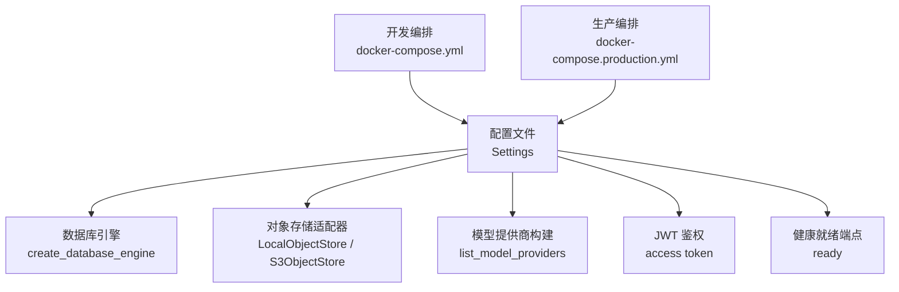

**图表来源**
- [config.py:1-132](file://src/personal_ai_life_os/config.py#L1-L132)
- [db.py:1-75](file://src/personal_ai_life_os/db.py#L1-L75)
- [storage.py:1-200](file://src/personal_ai_life_os/storage.py#L1-L200)
- [model_providers.py:1-200](file://src/personal_ai_life_os/services/model_providers.py#L1-L200)
- [security.py:1-54](file://src/personal_ai_life_os/security.py#L1-L54)
- [health.py:1-27](file://src/personal_ai_life_os/api/routes/health.py#L1-L27)
- [docker-compose.yml:1-78](file://docker-compose.yml#L1-L78)
- [docker-compose.production.yml:1-101](file://docker-compose.production.yml#L1-L101)

## 核心组件：基于 Pydantic Settings 的配置对象
`Settings` 继承自 pydantic-settings 的 `BaseSettings`，是全局配置的唯一入口。它具备以下特征：

| 维度 | 说明 |
|---|---|
| 加载方式 | 自动读取 `.env` 文件，并通过环境变量覆盖字段值 |
| 大小写敏感性 | 忽略环境变量名大小写 |
| 额外字段 | 未知环境变量被忽略，不会报错 |
| 类型约束 | 使用 Pydantic 内置注解、字段的 `ge`/`le` 约束、`Literal` 枚举、可选类型和 `Decimal` |
| 派生属性 | 提供跨域来源列表、OpenAI 聊天补全 URL 等计算属性 |
| 后置校验 | 通过 model validator 完成生产环境的严格安全检查 |
| 全局实例 | 文件末尾直接创建 `settings` 单例供其他模块使用 |

关键设计要点：
- 运行模式字段支持开发、测试、生产和桌面四种模式，决定后续安全策略和行为差异。
- 注册模式支持开放、邀请、关闭，生产中禁止开放注册。
- CORS 原始配置以逗号分隔字符串存储，运行时拆分为字符串列表。
- OpenAI 基地址最终会被规范化为包含 `/chat/completions` 的标准路径。
- 生产环境强制要求工作进程模式、独立的 S3 删除日志桶、严格的 Token 与安全参数。

**章节来源**
- [config.py:10-132](file://src/personal_ai_life_os/config.py#L10-L132)

## 架构总览
从数据流向来看，系统启动时加载 `Settings`，再由基础设施模块读取配置并建立连接池、存储客户端、鉴权密钥和模型提供者。下游 API 在处理请求时无需再次读取环境变量，而是直接消费已类型化的 `Settings` 实例或其派生对象。

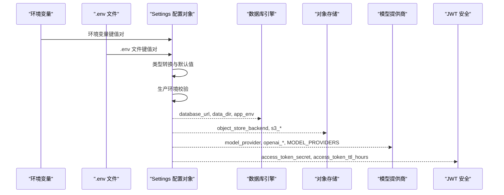

**图表来源**
- [config.py:10-132](file://src/personal_ai_life_os/config.py#L10-L132)
- [db.py:28-75](file://src/personal_ai_life_os/db.py#L28-L75)
- [storage.py:20-200](file://src/personal_ai_life_os/storage.py#L20-L200)
- [model_providers.py:1-200](file://src/personal_ai_life_os/services/model_providers.py#L1-L200)
- [security.py:28-54](file://src/personal_ai_life_os/security.py#L28-L54)

## 详细组件分析

### Settings 类及其验证机制
`Settings` 是一个集中式配置类。它不仅负责“如何取值”，还负责“是否可用”。

- **类型化字段**  
  例如端口为整数、路径为 `Path`、启用开关为布尔值、上传上限为字节数、价格字段为 `Decimal`。
- **枚举字段**  
  通过 `Literal` 限制运行环境、处理模式、注册模式、对象存储后端和模型提供商。
- **范围字段**  
  注册速率限制使用带上下界的字段约束，避免极端值。
- **派生属性**  
  - `cors_origin_list` 将逗号分隔字符串转为非空字符串列表。
  - `openai_chat_completions_url` 标准化基础地址并追加聊天补全路径。
- **生产安全校验器**  
  当 `app_env == "production"` 时，必须满足多个安全条件，否则抛出明确的错误消息。

这些规则保证：开发者可能在本地随意配置，但部署到生产时必须显式补齐必要的安全信息。

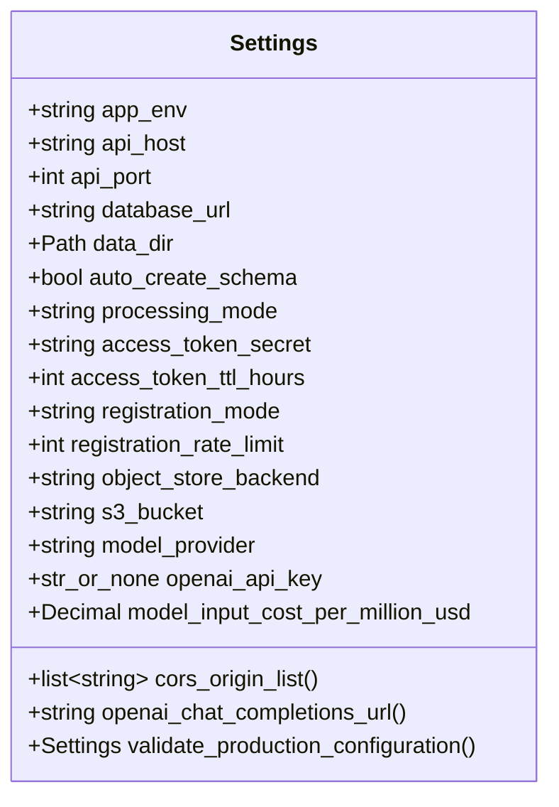

**图表来源**
- [config.py:10-132](file://src/personal_ai_life_os/config.py#L10-L132)

**章节来源**
- [config.py:10-132](file://src/personal_ai_life_os/config.py#L10-L132)
- [test_config.py:1-11](file://tests/test_config.py#L1-L11)

### 配置加载流程
配置加载顺序符合 pydantic-settings 的通用约定，并结合当前项目的设置明确 `.env` 文件名和环境编码。

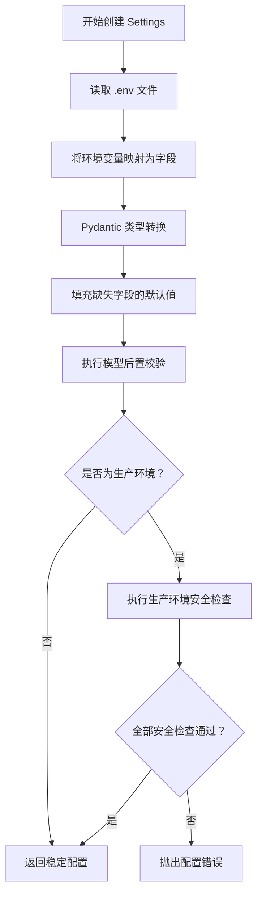

**图表来源**
- [config.py:10-56](file://src/personal_ai_life_os/config.py#L10-L56)
- [config.py:56-132](file://src/personal_ai_life_os/config.py#L56-L132)

**章节来源**
- [config.py:10-132](file://src/personal_ai_life_os/config.py#L10-L132)

## 依赖关系与配置消费点
配置并不孤立运行，它被多个子系统消费：

- **数据库模块**  
  使用 `database_url` 创建 SQLAlchemy 引擎，并在 SQLite 场景下确保数据目录存在；同时根据 `app_env` 决定是否启用 WAL。
- **对象存储模块**  
  根据 `object_store_backend` 选择本地存储或 S3 客户端；S3 模式下还区分主桶与删除日志桶。
- **模型提供商模块**  
  根据 `model_provider`、OpenAI 配置和 `MODEL_PROVIDERS` 解析可用的 AI 提供商列表；对外暴露是否可用作判断标志。
- **安全模块**  
  使用 `access_token_secret` 和 `access_token_ttl_hours` 生成、解码访问令牌。
- **健康检查模块**  
  提供轻量 liveness 与 readiness 接口，后者尝试查询数据库并返回状态码 503 表示不可用。

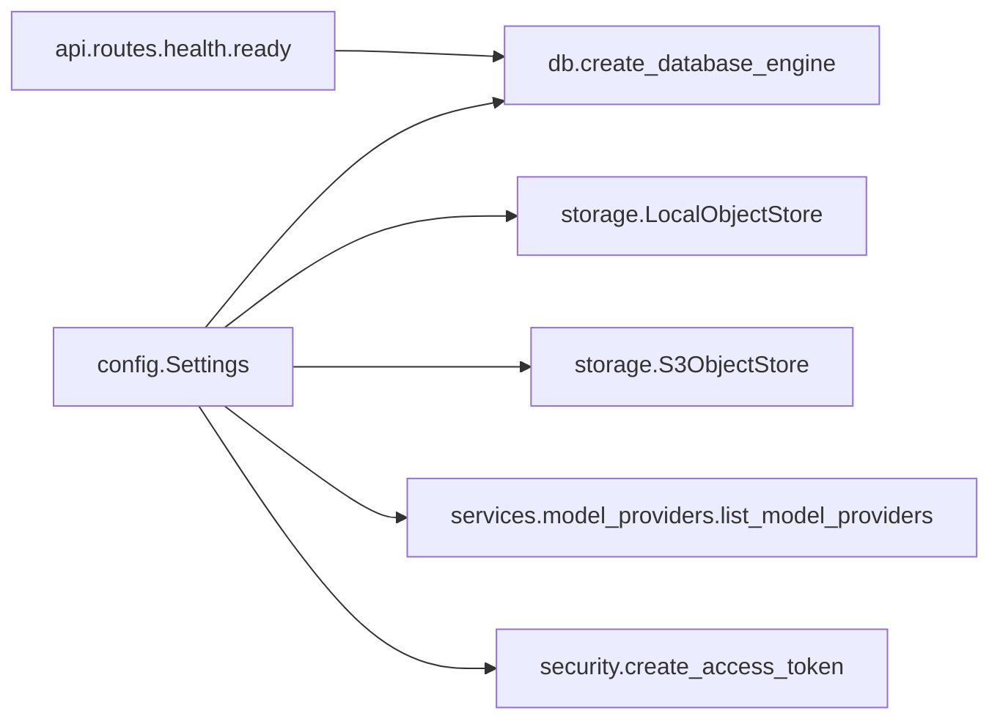

**图表来源**
- [config.py:10-132](file://src/personal_ai_life_os/config.py#L10-L132)
- [db.py:28-75](file://src/personal_ai_life_os/db.py#L28-L75)
- [storage.py:20-200](file://src/personal_ai_life_os/storage.py#L20-L200)
- [model_providers.py:1-200](file://src/personal_ai_life_os/services/model_providers.py#L1-L200)
- [security.py:28-54](file://src/personal_ai_life_os/security.py#L28-L54)
- [health.py:15-27](file://src/personal_ai_life_os/api/routes/health.py#L15-L27)

**章节来源**
- [db.py:28-75](file://src/personal_ai_life_os/db.py#L28-L75)
- [storage.py:20-200](file://src/personal_ai_life_os/storage.py#L20-L200)
- [model_providers.py:1-200](file://src/personal_ai_life_os/services/model_providers.py#L1-L200)
- [security.py:28-54](file://src/personal_ai_life_os/security.py#L28-L54)
- [health.py:15-27](file://src/personal_ai_life_os/api/routes/health.py#L15-L27)

## 配置优先级与环境变量映射

### 优先级规则
当前实现遵循如下优先级（从高到低）：
1. **运行时传入的配置参数**  
   例如测试中通过构造函数显式传入 `_env_file=None` 或自定义字段值时，会直接覆盖默认值和 `.env`。
2. **环境变量**  
   由操作系统或容器编排系统提供的真实值。
3. **`.env` 文件**  
   项目名称固定为 `.env`，编码为 UTF-8。
4. **模型字段默认值**  
   当以上来源都未设置时，使用 Python 侧默认值。

需要注意的是，当前代码并未实现一个“多文件优先级链”（如 `base.env → local.env → dev.env`），而是单一 `.env` 文件叠加环境变量。

### 重要环境变量映射表
以下为开发与生产环境中实际出现、并被 `Settings` 或下游模块消费的核心环境变量：

| 环境变量 | 对应配置字段或用途 | 默认行为或约束 |
|---|---|---|
| `APP_ENV` | 运行环境 | 允许 development、test、production、desktop |
| `API_HOST` | HTTP 监听主机 | 通常为 `127.0.0.1` 或 `0.0.0.0` |
| `API_PORT` | HTTP 监听端口 | 默认 8000，受 Pydantic 整数约束 |
| `DATABASE_URL` | 数据库连接串 | SQLite 或 PostgreSQL 连接地址 |
| `DATA_DIR` | 本地数据存储根目录 | 解析为 `Path` |
| `AUTO_CREATE_SCHEMA` | 是否自动建表 | 生产环境强制为 false |
| `PROCESSING_MODE` | 内联处理或 worker 模式 | 生产环境必须为 worker |
| `OBJECT_STORE_BACKEND` | 对象存储后端 | 仅允许 local 或 s3 |
| `S3_BUCKET` | S3 主桶 | 生产环境必需 |
| `S3_DELETION_JOURNAL_BUCKET` | 删除操作日志桶 | 生产环境必需且不得等于 `S3_BUCKET` |
| `OPENAI_API_KEY` | AI 提供商密钥 | 若启用 OpenAI 则生产环境必需 |
| `OPENAI_BASE_URL` | OpenAI 兼容基础地址 | 最终拼接到 `/chat/completions` |
| `OPENAI_MODEL` | OpenAI 默认模型 | 作为默认 provider 的模型 |
| `MODEL_INPUT_COST_PER_MILLION_USD` | 每百万 token 输入成本 | 生产环境要求正数 |
| `MODEL_OUTPUT_COST_PER_MILLION_USD` | 每百万 token 输出成本 | 生产环境要求正数 |
| `MODEL_MAX_COST_PER_CALL_USD` | 单次调用预算 | 生产环境要求正数 |
| `ACCESS_TOKEN_SECRET` | JWT 签名密钥 | 生产环境长度至少 32 |
| `REGISTRATION_MODE` | 注册模式 | 生产环境不允许 open |
| `SIGNUP_INVITE_CODE` | 邀请码 | invitation 模式下必需 |
| `METRICS_TOKEN` | 指标访问令牌 | 生产环境要求长度至少 32 |
| `CORS_ORIGINS` | 允许的跨域来源 | 生产环境不得使用 localhost |
| `MODEL_PROVIDERS` | 额外模型提供商 JSON | 必须是有效 JSON 对象 |

开发编排会将 `DATABASE_URL`、`DATA_DIR`、`PROCESSING_MODE` 等变量传入容器；生产编排则强制要求更多安全变量。这体现了环境区分配置的基本思路：开发允许宽松默认值，生产拒绝缺省和安全风险配置。

**章节来源**
- [config.py:10-132](file://src/personal_ai_life_os/config.py#L10-L132)
- [docker-compose.yml:11-43](file://docker-compose.yml#L11-L43)
- [docker-compose.production.yml:22-79](file://docker-compose.production.yml#L22-L79)
- [test_config.py:1-11](file://tests/test_config.py#L1-L11)

## 生产环境安全检查
当 `app_env == "production"` 时，系统在配置构造阶段即拒绝不安全组合。主要保护如下：

| 安全检查 | 目的 | 失败后果 |
|---|---|---|
| 删除日志桶不能等于主桶 | 防止删除原数据的同时丢失恢复线索 | 抛出配置异常 |
| 默认开发 secret 未被替换 | 防止 JWT 签名密钥泄漏 | 抛出配置异常 |
| Token 长度不足 | 提高暴力破解成本 | 抛出配置异常 |
| 允许自动创建数据库表 | 防止自动化脚本在生产意外建表 | 抛出配置异常 |
| 非 worker 处理模式 | 降低任务可靠性和可恢复性 | 抛出配置异常 |
| 开放注册 | 防止未经授权创建账户 | 抛出配置异常 |
| 邀请模式缺少邀请码 | 防止邀请入口不可用 | 抛出配置异常 |
| CORS 包含本地地址 | 防止浏览器跨域绕过 | 抛出配置异常 |
| 指标令牌缺失或过短 | 防止未授权监控数据泄露 | 抛出配置异常 |
| 非 S3 或缺少 S3 桶 | 防止本地对象存储上线 | 抛出配置异常 |
| 缺少删除日志桶 | 防止无法追踪删除恢复 | 抛出配置异常 |
| 启用 OpenAI 但无密钥 | 防止上游调用失败 | 抛出配置异常 |
| 外部模型缺少隐私链接或保留策略过短 | 提升外部 AI 合规性 | 抛出配置异常 |
| 外部模型定价或预算为零或负数 | 防止成本失控 | 抛出配置异常 |
| `MODEL_PROVIDERS` JSON 非法 | 防止错误解析 | 抛出配置异常 |

这些校验都在配置对象创建阶段生效，因此很多危险配置在服务真正处理业务请求前就会被发现。

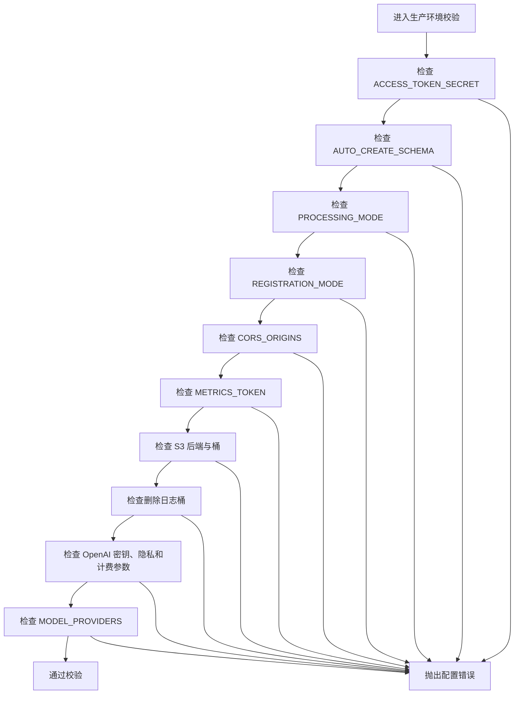

**图表来源**
- [config.py:56-132](file://src/personal_ai_life_os/config.py#L56-L132)

**章节来源**
- [config.py:56-132](file://src/personal_ai_life_os/config.py#L56-L132)

## 热重载与运行时动态更新
当前仓库中没有实现原生“热重载配置”的组件。也就是说，修改环境变量并不会让已在内存中的 `settings` 实例自动刷新；现有模块大多在导入阶段或通过依赖注入获取配置，没有统一的配置监听器。

不过，可以通过以下思路实现运行时更新而不重启主进程：
1. **引入配置变更事件总线**  
   新增一个轻量级的配置变更监听器，订阅环境变量变化或配置文件修改。
2. **原子替换配置对象**  
   当检测到新配置有效后，先构造新的 `Settings`，再替换引用位置，例如进程级共享上下文。
3. **通知相关组件**  
   数据库连接池、对象存储客户端和 AI 提供商都应支持在不中断请求的前提下重新连接或重建客户端。
4. **回滚机制**  
   如果新配置的下游连通性检查失败，应保留旧配置并记录错误。

由于该功能未在仓库源码中体现，这里仅给出概念性流程图：

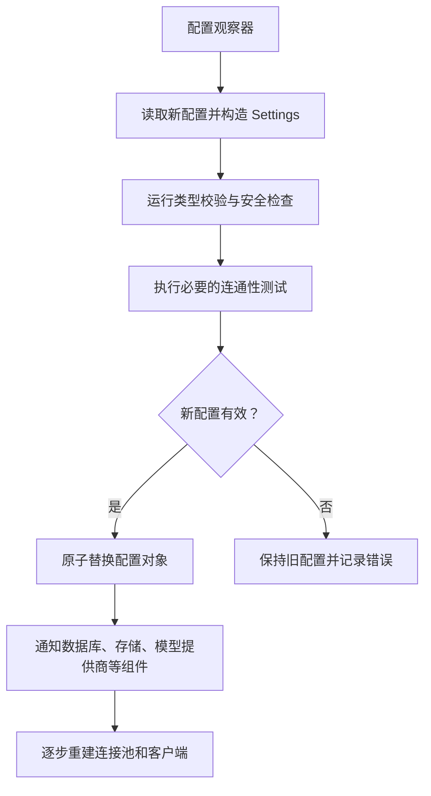

**本节为概念说明，不对应特定源码实现。**

## 常见配置场景

### 数据库连接字符串
推荐通过 `DATABASE_URL` 传入完整连接串。本地开发可以使用 SQLite，容器中使用 PostgreSQL。

- SQLite 场景下，若使用相对路径，数据库模块会自动创建父目录。
- PostgreSQL 场景下，建议使用连接池并开启底层 ping。
- 健康就绪接口通过查询数据库确认连接可用。

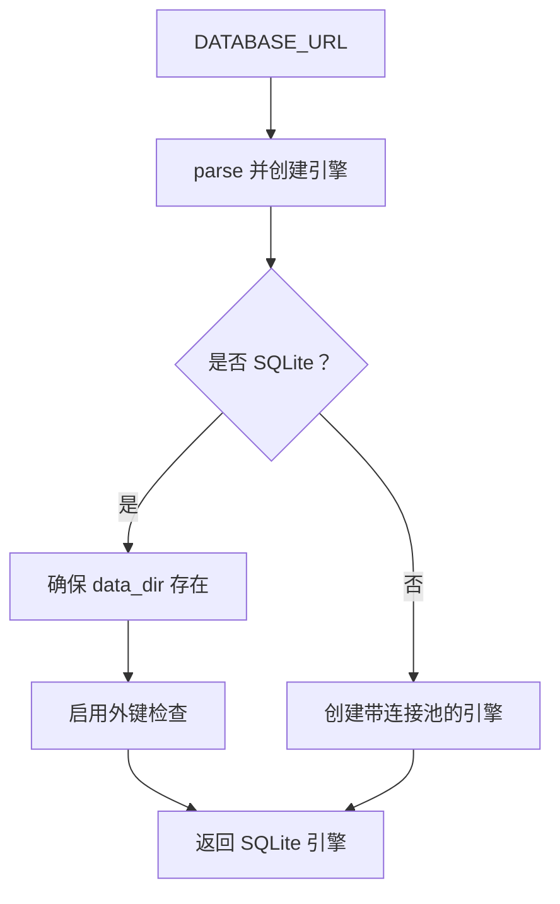

**图表来源**
- [db.py:28-75](file://src/personal_ai_life_os/db.py#L28-L75)

**章节来源**
- [config.py:16-23](file://src/personal_ai_life_os/config.py#L16-L23)
- [db.py:28-75](file://src/personal_ai_life_os/db.py#L28-L75)
- [health.py:15-27](file://src/personal_ai_life_os/api/routes/health.py#L15-L27)

### AI 提供商 API 密钥
对于默认 OpenAI 兼容模型：
- 通过 `MODEL_PROVIDER=openai` 激活。
- 通过 `OPENAI_API_KEY`、`OPENAI_BASE_URL`、`OPENAI_MODEL` 控制连接和目标模型。
- 默认 Base URL 会在最终接口路径前去除尾部斜杠，然后追加 `/chat/completions`。
- 生产环境要求隐私链接、保留说明、正向成本和预算。

测试用例覆盖了默认 URL 及带空白字符或兼容网关 URL 的路径构造行为。

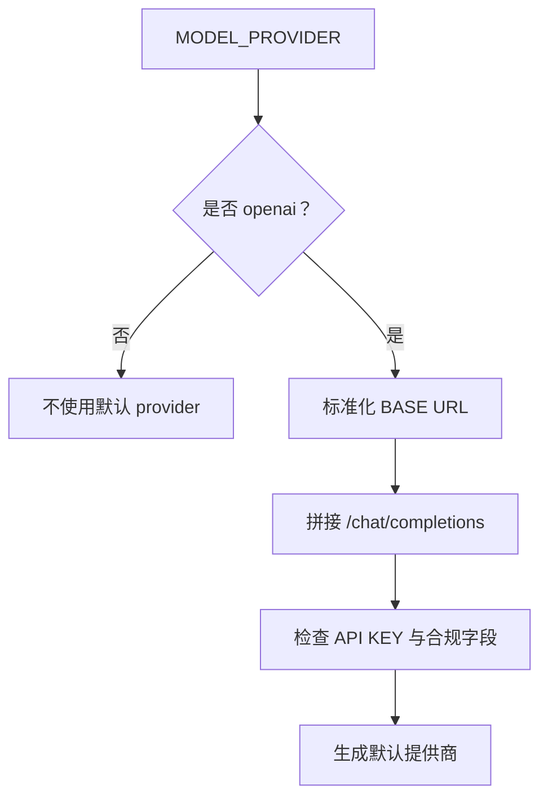

**图表来源**
- [config.py:45-55](file://src/personal_ai_life_os/config.py#L45-L55)
- [model_providers.py:1-120](file://src/personal_ai_life_os/services/model_providers.py#L1-L120)
- [test_config.py:1-11](file://tests/test_config.py#L1-L11)

**章节来源**
- [config.py:45-55](file://src/personal_ai_life_os/config.py#L45-L55)
- [model_providers.py:1-120](file://src/personal_ai_life_os/services/model_providers.py#L1-L120)
- [test_config.py:1-11](file://tests/test_config.py#L1-L11)

### 存储路径映射
本地对象存储以 `data_dir` 为根目录。每个 key 都会经过路径清理与安全校验，确保不会出现目录穿越、绝对路径或非法字符。

关键点：
- root 路径会被解析为绝对路径。
- 写入时使用临时文件 + 原子替换，减少部分写入造成的损坏。
- 删除时会尽量清理空父目录，但不破坏根目录。
- owner/source/item 的删除路径都有 UUID 格式与安全性校验。

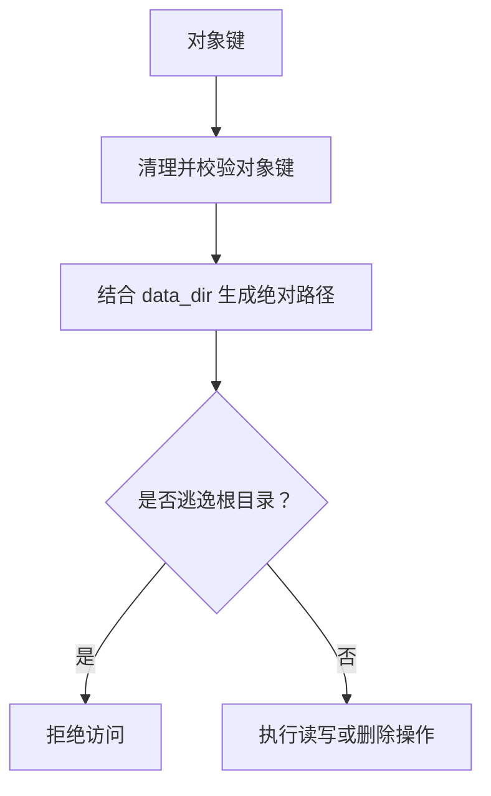

**图表来源**
- [storage.py:20-120](file://src/personal_ai_life_os/storage.py#L20-L120)

**章节来源**
- [config.py:16-18](file://src/personal_ai_life_os/config.py#L16-L18)
- [storage.py:20-140](file://src/personal_ai_life_os/storage.py#L20-L140)

### 缓存策略参数
当前配置对象中没有专门的 Redis、Memcached 或内存缓存策略字段。如果有缓存需求，可以沿用现有 `Settings` 的设计方式：
- 新增缓存后端 `Literal` 字段。
- 增加缓存主机、端口、超时、最大连接数等结构化字段。
- 在生产环境中对缓存连通性增加额外校验。
- 通过环境变量覆盖缓存连接串，并与数据库、对象存储保持一致的部署风格。

该场景为扩展建议，不代表当前已实现。

### 环境区分配置
当前系统通过 `APP_ENV` 区分开发、测试、生产和桌面模式，并由生产环境校验逻辑实施差异化约束。开发环境允许更宽松的默认值，生产环境强制高安全要求：

| 环境 | 典型配置倾向 |
|---|---|
| development | 允许本地数据库、本地存储、开放注册；worker 模式用于本地异步任务 |
| test | 使用隔离数据目录、关闭敏感能力 |
| production | 强制 worker、S3、唯一密钥、邀请制注册、严格 CORS 和外部模型治理 |
| desktop | SQLite WAL 模式、本地存储、桌面相关路径策略 |

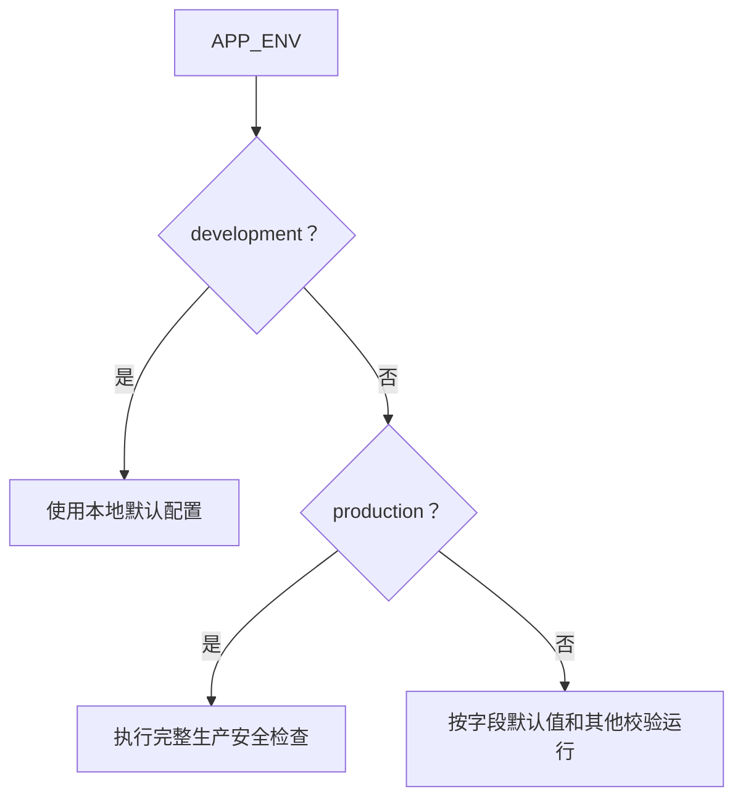

**图表来源**
- [config.py:16-18](file://src/personal_ai_life_os/config.py#L16-L18)
- [config.py:56-132](file://src/personal_ai_life_os/config.py#L56-L132)
- [db.py:44-65](file://src/personal_ai_life_os/db.py#L44-L65)

**章节来源**
- [config.py:16-132](file://src/personal_ai_life_os/config.py#L16-L132)
- [db.py:44-65](file://src/personal_ai_life_os/db.py#L44-L65)

## 性能特性与扩展建议
- **类型开销极低**：`Settings` 仅在构造期做解析和校验，正常运行路径只消费已经转换好的字段。
- **依赖简单**：直接使用 Pydantic v2 与 pydantic-settings，不需要复杂配置框架。
- **扩展方式清晰**：新增字段只需添加类型注解与默认值，生产校验可在统一 validator 中补充。
- **潜在改进点**：
  - 如果需要多环境文件，可在 `model_config` 中切换 `env_file`，或在加载阶段显式传入不同文件。
  - 如果需要动态配置，应引入监听器并保证连接对象的线程安全更新。
  - 如果某些字段是大型数组或冗长 JSON，建议在入口处做一次最小合法校验，以减少后续解析成本。
  - 可考虑把敏感字段标记为“不应打印”，避免日志泄漏密钥。

**本节为一般性讨论，不直接分析具体源码行。**

## 故障诊断指南

### 常见错误与排查顺序
1. **构造 `Settings` 时抛出值错误或类型错误**  
   检查环境变量名称是否与字段名匹配，注意 pydantic-settings 默认不区分大小写，但值必须可转换为目标类型。
2. **生产环境启动失败**  
   重点核对：`ACCESS_TOKEN_SECRET`、`AUTO_CREATE_SCHEMA`、`PROCESSING_MODE`、`REGISTRATION_MODE`、`SIGNUP_INVATE_CODE`、`CORS_ORIGINS`、`METRICS_TOKEN`、`OBJECT_STORE_BACKEND`、`S3_BUCKET`、`S3_DELETION_JOURNAL_BUCKET`、外部模型相关字段。
3. **OpenAI 聊天接口路径异常**  
   确认 `OPENAI_BASE_URL` 是否有前导空白或多余尾斜杠，测试用例已覆盖自动去空白与去尾斜杠后的标准拼接。
4. **数据库健康检查失败**  
   检查 `DATABASE_URL` 是否正确； readiness 接口会在查询失败时返回 503。
5. **对象存储写入失败**  
   检查 `DATA_DIR` 是否存在可写权限，或 S3 凭证、区域、桶名称和 Endpoint URL 是否正确。
6. **JWT Token 无效或鉴权失败**  
   检查 `ACCESS_TOKEN_SECRET` 是否在服务和客户端一致；生产环境必须更换默认密钥。

### 定位工具与日志建议
- 在本地调试时，可临时打印 `Settings` 关键字段，但要避免打印密钥。
- Docker 编排中可通过 `docker compose logs` 查看容器启动阶段的异常。
- 健康就绪接口适合集成 Kubernetes Liveness/Readiness 探针。
- 建议把配置校验失败的信息输出为人类可读的诊断提示，而不是只返回 generic error。

**章节来源**
- [config.py:56-132](file://src/personal_ai_life_os/config.py#L56-L132)
- [test_config.py:1-11](file://tests/test_config.py#L1-L11)
- [health.py:15-27](file://src/personal_ai_life_os/api/routes/health.py#L15-L27)
- [docker-compose.yml:45-78](file://docker-compose.yml#L45-L78)
- [docker-compose.production.yml:46-101](file://docker-compose.production.yml#L46-L101)

## 结论
该配置管理系统以 `Settings` 为核心，将环境变量和 `.env` 文件转换为强类型对象，并通过 Pydantic 的类型约束与后置验证保障基本正确性与生产安全。它与数据库、对象存储、AI 提供商、JWT 安全和健康检查模块紧密耦合，构成清晰的依赖边界。

最佳实践包括：
- 始终为每个配置字段添加明确类型和默认值。
- 对生产环境敏感字段单独加强校验。
- 将容器编排中的环境变量与实际 `Settings` 字段一一对应。
- 在接入第三方服务时，先配置再启动，确保构造期就能暴露问题。
- 如需热重载，应在配置观察者中完成“校验 → 连通性检查 → 原子替换 → 通知依赖模块”的完整闭环。