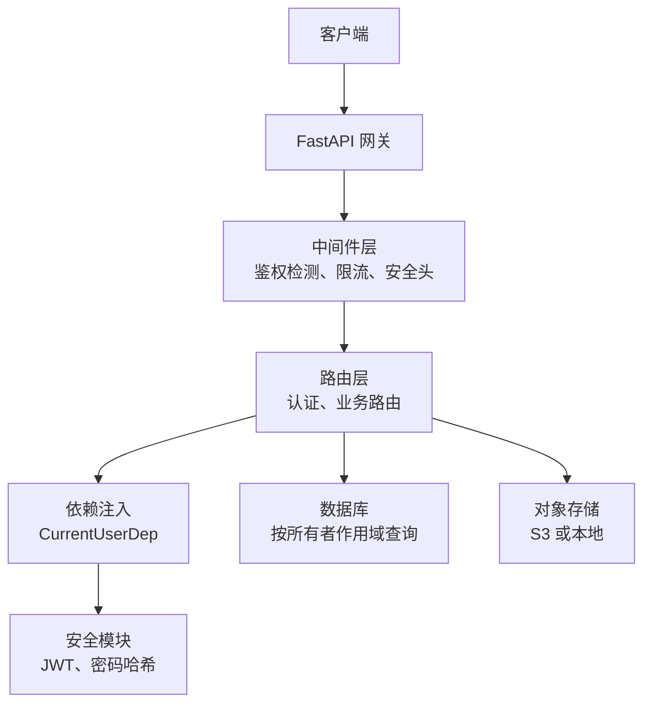
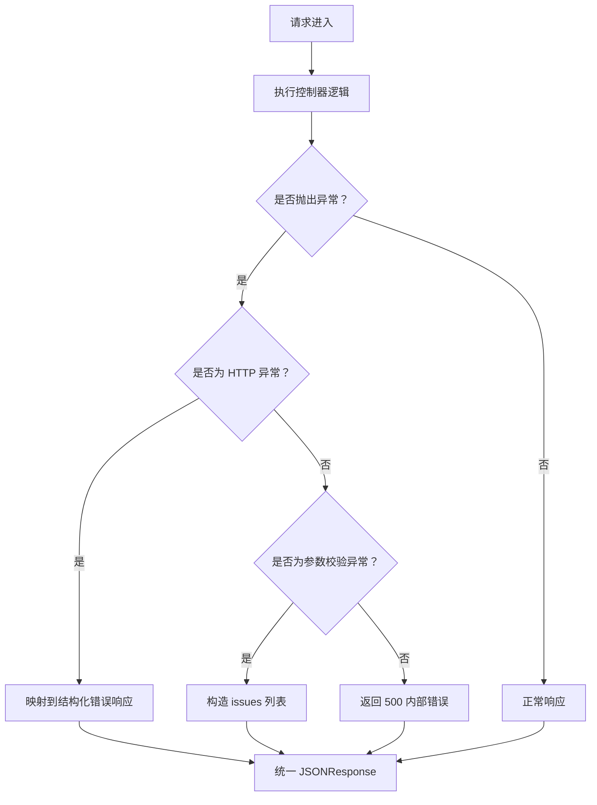
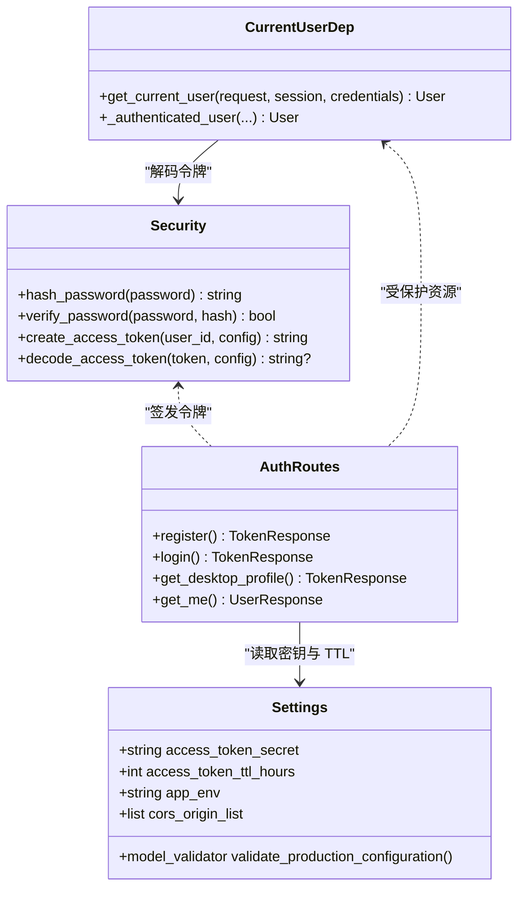
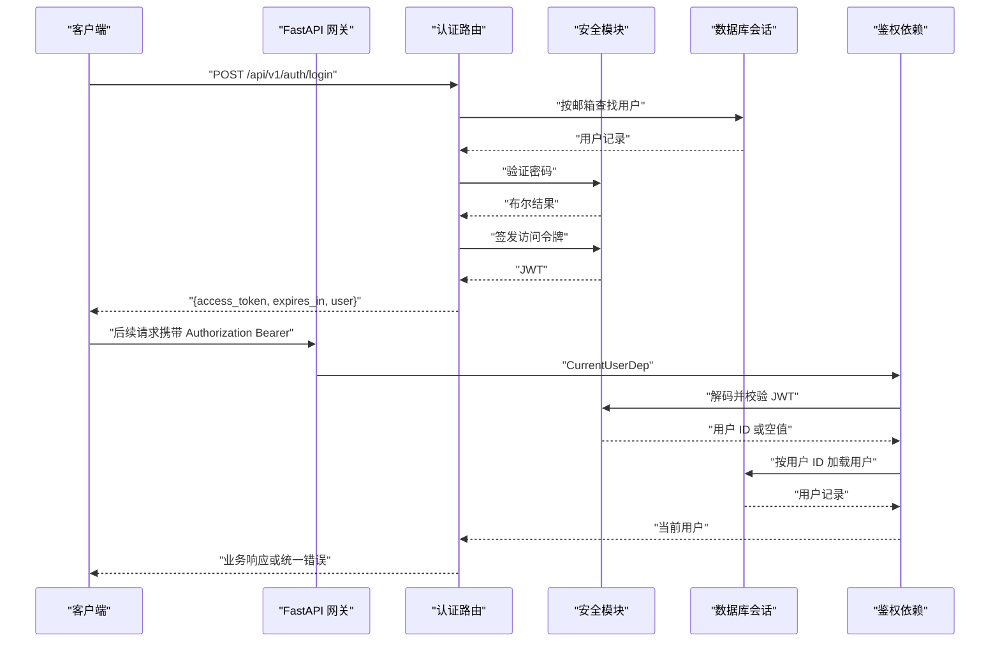
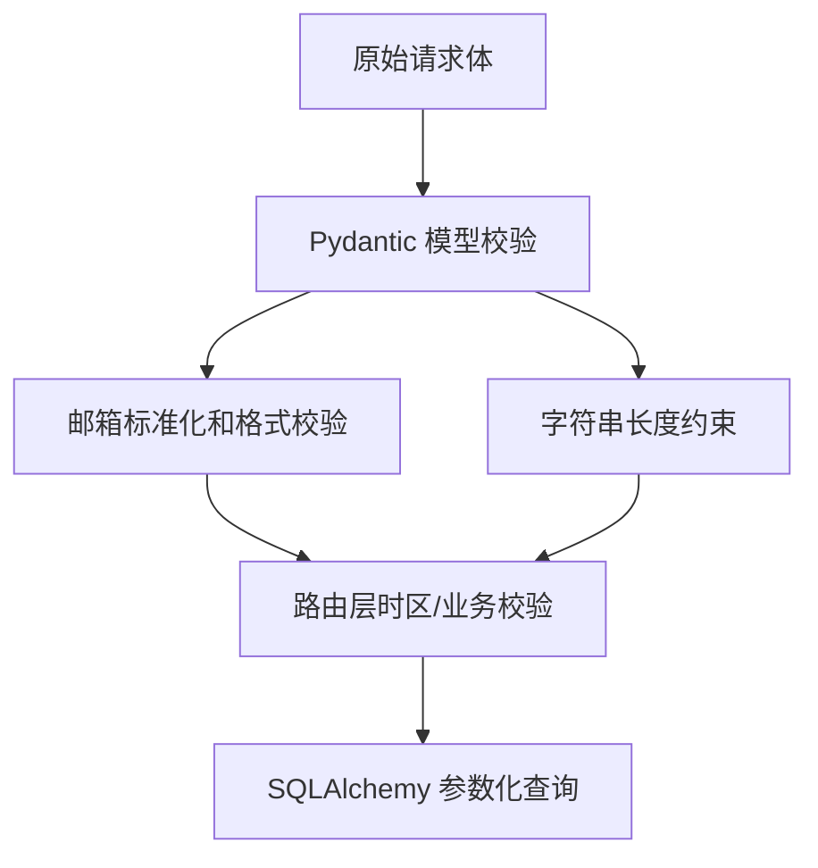
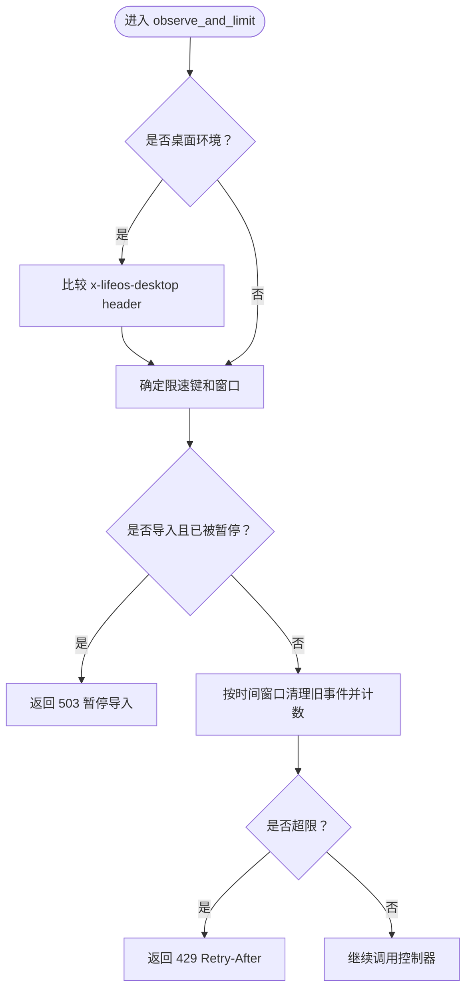
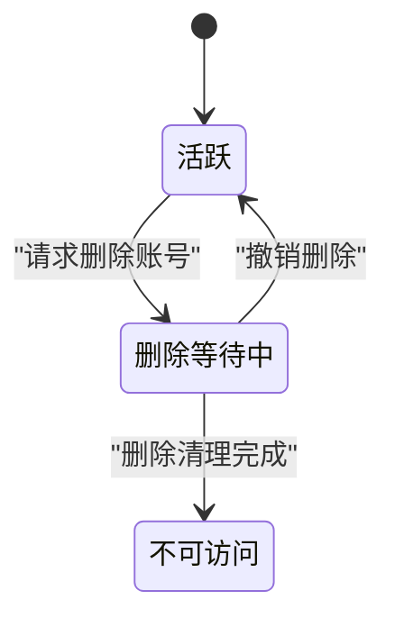
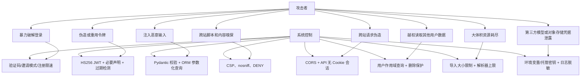
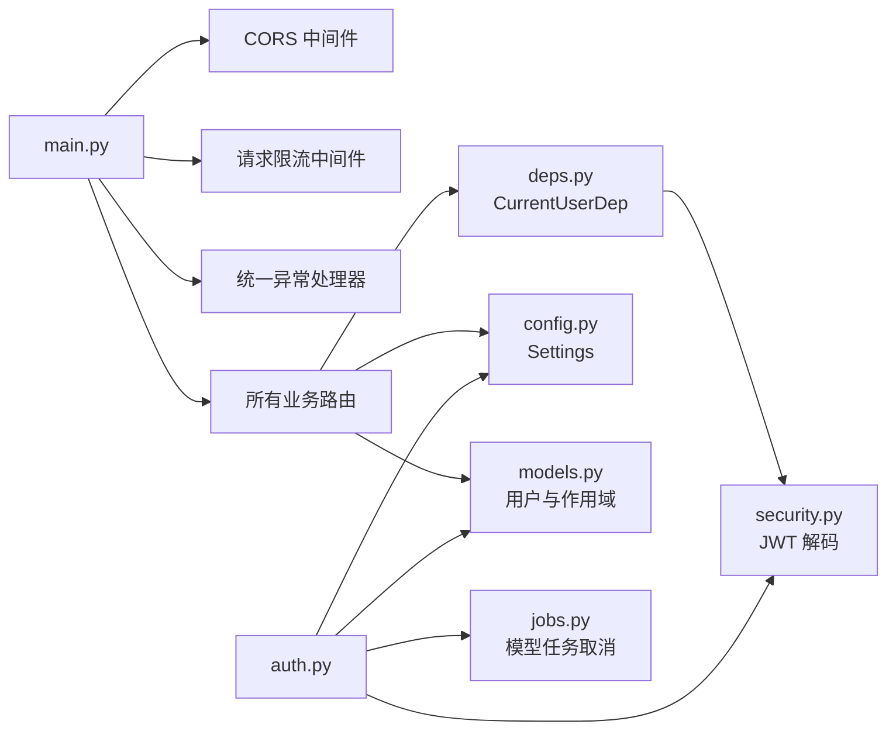

# 错误处理与安全机制

<cite>
**本文引用的文件**
- [security.py](file://src/personal_ai_life_os/security.py)
- [main.py](file://src/personal_ai_life_os/main.py)
- [config.py](file://src/personal_ai_life_os/config.py)
- [deps.py](file://src/personal_ai_life_os/api/deps.py)
- [auth.py](file://src/personal_ai_life_os/api/routes/auth.py)
- [schemas.py](file://src/personal_ai_life_os/api/schemas.py)
- [models.py](file://src/personal_ai_life_os/models.py)
- [imports.py](file://src/personal_ai_life_os/api/routes/imports.py)
- [plugins.py](file://src/personal_ai_life_os/api/routes/plugins.py)
- [SECURITY.md](file://SECURITY.md)
- [privacy.md](file://docs/architecture/privacy.md)
</cite>

## 目录
1. [引言](#引言)
2. [项目结构与定位](#项目结构与定位)
3. [统一异常处理框架](#统一异常处理框架)
4. [JWT 认证机制](#jwt-认证机制)
5. [输入验证与数据安全](#输入验证与数据安全)
6. [网络安全策略](#网络安全策略)
7. [权限边界与多设备登录能力](#权限边界与多设备登录能力)
8. [安全威胁模型](#安全威胁模型)
9. [依赖关系分析](#依赖关系分析)
10. [故障诊断指南](#故障诊断指南)
11. [结论与建议](#结论与建议)

## 引言
本文件围绕仓库中的错误处理和安全控制进行系统化说明，重点关注：

- 统一异常处理和结构化响应格式。
- 使用 Pydantic、FastAPI 中间件、数据库作用域实现的输入验证体系。
- 基于 HS256 JWT 的访问令牌签发、校验流程及依赖注入式认证机制。
- CORS、通用安全头、速率限制和请求大小限制。
- 密码哈希、生产环境配置强校验、敏感日志脱敏原则。
- 当前仓库未直接实现 CSRF token、刷新令牌、撤销令牌和多设备会话管理；文档明确给出设计缺口和改进建议。
- 结合隐私规范，说明不可信导入数据、外部模型调用和数据删除恢复的安全边界。

## 项目结构与定位
与错误和安全相关的关键代码主要分布在以下位置：

| 层级 | 文件 | 责任 |
|---|---|---|
| 应用入口 | `main.py` | FastAPI 启动、CORS、中间件、全局异常处理器、鉴权中间件、限流、安全头。 |
| 认证与密码 | `security.py` | Argon2 密码哈希、HS256 JWT 签发和解码。 |
| API 鉴权依赖 | `api/deps.py` | `CurrentUserDep`、Bearer 校验、账号删除保护。 |
| 认证路由 | `api/routes/auth.py` | 注册、登录、桌面资料、账户信息、模型同意等认证相关接口。 |
| 输入模式 | `api/schemas.py` | Pydantic 字段长度、邮箱格式、时区等结构化验证。 |
| 运行时配置 | `config.py` | 令牌密钥、TTL、注册模式、CORS 来源、上传大小、生产强校验。 |
| 导入数据 | `api/routes/imports.py` | 大文件截断、超限返回、受控解析器。 |
| 扩展能力 | `api/routes/plugins.py` | 插件权限控制、审计日志接口。 |
| 安全政策 | `SECURITY.md` | 漏洞报告、凭据管理、日志脱敏原则。 |
| 隐私规范 | `docs/architecture/privacy.md` | 数据外发、本地/云端范围、审核同意、删除恢复、部署要求。 |

**图示来源**
- [main.py:138-315](file://src/personal_ai_life_os/main.py#L138-L315)
- [deps.py:1-65](file://src/personal_ai_life_os/api/deps.py#L1-L65)
- [security.py:1-54](file://src/personal_ai_life_os/security.py#L1-L54)
- [config.py:17-132](file://src/personal_ai_life_os/config.py#L17-L132)

**章节来源**
- [main.py:138-315](file://src/personal_ai_life_os/main.py#L138-L315)
- [config.py:17-132](file://src/personal_ai_life_os/config.py#L17-L132)

## 统一异常处理框架
### 设计目标
系统提供统一的错误输出形状，使前端和其他集成方可以依据错误码而非文本消息处理业务状态，同时避免将内部堆栈泄露给客户端。

### 三层异常处理器
| 类型 | 触发条件 | HTTP 状态码 | 错误结构 | 语义 |
|---|---|---:|---|---|
| HTTP 异常处理器 | 路由中抛出 `HTTPException` | 原 `status_code` | `{ "error": { "code", "message" } }` | 将非结构化 detail 转为带 code 的结构化错误。 |
| 验证异常处理器 | Pydantic/FastAPI 参数校验失败 | 422 | `{ "error": { "code": "validation_error", "message", "issues[]": { "location", "code", "message" } } }` | 描述具体字段和错误类型。 |
| 通用异常处理器 | 未被捕获的其他异常 | 500 | `{ "error": { "code": "internal_error", "message": "The request could not be completed." } }` | 对客户端不泄露内部细节；服务端记录异常类型。 |

**图示来源**
- [main.py:229-315](file://src/personal_ai_life_os/main.py#L229-L315)

### 关键特征
- **结构化错误：** 所有已知错误都包含 `error.code`，部分包含 `error.issues`。
- **可观测性：** 500 错误由日志记录异常类型，便于运维排查。
- **前端兼容：** 非业务 `HTTPException.detail` 会被包装为统一格式，保证接口契约稳定。
- **局限：** 目前没有统一的“业务异常基类”。业务代码更倾向直接抛出携带结构化 `detail` 的 `HTTPException`。建议在后续版本引入显式业务异常层次。

### 建议的业务异常层次
未来可在现有依赖基础上定义抽象基类及子类，例如：

| 异常类别 | 推荐错误码 | HTTP 语义 | 示例场景 |
|---|---|---:|---|
| 无效凭证 | `invalid_credentials` / `invalid_access_token` | 401 | 密码错误、JWT 过期或缺失。 |
| 资源不存在 | `not_found` | 404 | 路由级资源缺失。 |
| 冲突 | `account_exists` / `already_registered` | 409 | 邮箱已存在、并发写入。 |
| 拒绝 | `registration_closed` / `invalid_invitation` | 403 | 邀请注册关闭或不匹配。 |
| 未授权/权限不足 | `forbidden` / `scope_denied` | 403/401 | 当前实现中尚未发现细粒度作用域判断。 |
| 资源清理中 | `account_deletion_pending` | 410 | 账号删除过渡期拒绝读写。 |
| 请求过大 | `request_too_large` | 413 | 需要新增全局限流器支持。 |
| 频率过高 | `rate_limited` | 429 | 登录、注册、导入限流。 |

**章节来源**
- [main.py:229-315](file://src/personal_ai_life_os/main.py#L229-L315)
- [auth.py:53-75](file://src/personal_ai_life_os/api/routes/auth.py#L53-L75)
- [auth.py:124-184](file://src/personal_ai_life_os/api/routes/auth.py#L124-L184)
- [deps.py:29-65](file://src/personal_ai_life_os/api/deps.py#L29-L65)

## JWT 认证机制
### 核心组件关系

**图示来源**
- [security.py:1-54](file://src/personal_ai_life_os/security.py#L1-L54)
- [deps.py:1-65](file://src/personal_ai_life_os/api/deps.py#L1-L65)
- [auth.py:1-210](file://src/personal_ai_life_os/api/routes/auth.py#L1-L210)
- [config.py:17-132](file://src/personal_ai_life_os/config.py#L17-L132)

### 令牌签发
- 算法：HS256。
- 载荷包含：
  - 用户标识 `sub`。
  - 签发时间 `iat`。
  - 过期时间 `exp`，使用 `access_token_ttl_hours` 计算。
  - 签发者 `iss` 固定为内部标识。
  - 受众 `aud` 固定为 API 标识。
  - 类型 `typ` 固定为 `access`。
- 响应中包含 `access_token` 和以秒表示的 `expires_in`。

### 令牌验证
- 通过 `optional_bearer` 获取 Authorization header。
- 使用配置的对称密钥解码。
- 强制检查必需声明、过期时间、签发者、受众和令牌类型。
- 根据 `sub` 查询用户实体；若找不到用户则认为令牌无效。
- 对于正在被删除的账号，普通访问会返回 410，仅允许某些特殊操作（如账号删除流程）继续。

### 认证时序图

**图示来源**
- [auth.py:124-184](file://src/personal_ai_life_os/api/routes/auth.py#L124-L184)
- [deps.py:18-65](file://src/personal_ai_life_os/api/deps.py#L18-L65)
- [security.py:18-54](file://src/personal_ai_life_os/security.py#L18-L54)

### 当前认证能力的边界
| 功能 | 当前实现 | 建议增强 |
|---|---|---|
| 签发访问令牌 | 已实现 | 保持最小载荷。 |
| 校验访问令牌 | 已实现 | 扩展作用域和租户上下文。 |
| 刷新令牌 | 未实现 | 增加独立 `refresh` 令牌表、滑动窗口和旧令牌撤销。 |
| 吊销单个令牌 | 未实现 | 使用令牌黑名单或短生命周期 + 服务器侧黑名单。 |
| 多设备登录 | 未直接管理 | 可增加设备标识、最大活跃数和设备移除接口。 |
| 无状态鉴权 | 访问时查询用户实体，但不持有会话 | 如需细粒度撤销应改为有状态黑名单或引入短期重新验证。 |

**章节来源**
- [security.py:18-54](file://src/personal_ai_life_os/security.py#L18-L54)
- [deps.py:18-65](file://src/personal_ai_life_os/api/deps.py#L18-L65)
- [auth.py:21-46](file://src/personal_ai_life_os/api/routes/auth.py#L21-L46)
- [auth.py:96-115](file://src/personal_ai_life_os/api/routes/auth.py#L96-L115)

## 输入验证与数据安全
### Pydantic 模式层验证
系统使用 Pydantic BaseRequest 模型作为第一道防线：

| 字段 | 验证规则 | 防护目的 |
|---|---|---|
| 邮箱 | 去空白、小写、长度上限、至少一个 `@`、域名必须有点且不能包含空格。 | 规范化输入、减少非法字符传播。 |
| 密码 | 最小长度 12、最大长度 256。 | 防止弱口令和大负载输入。 |
| 时区 | 长度限制并进一步在路由层用 IANA 时区验证。 | 防御无效时区字符串。 |
| 邀请码 | 最大长度 256。 | 限制额外攻击面。 |

**图示来源**
- [schemas.py:17-49](file://src/personal_ai_life_os/api/schemas.py#L17-L49)
- [auth.py:77-115](file://src/personal_ai_life_os/api/routes/auth.py#L77-L115)

### SQL 注入防护
- 数据访问通过 SQLAlchemy ORM 进行参数化查询。
- 认证和用户查找使用 `select(User).where(User.email == ...)`，字符串直接参与 WHERE 条件时由 ORM 生成参数化语句。
- 文档明确禁止将未经验证的用户输入用于拼接 SQL。

### XSS 防护
- 响应层设置 `Content-Security-Policy: default-src 'none'; frame-ancestors 'none'`。
- 设置 `X-Content-Type-Options: nosniff`，防止浏览器 MIME 嗅探。
- 设置 `X-Frame-Options: DENY`，阻止内嵌帧点击劫持。
- PWA Service Worker 不缓存 API 响应、认证令牌或源数据。

### 路径遍历与任意文件访问
- 原生桌面模式使用一次性随机端口、随机 launcher secret 和 `x-lifeos-desktop` header 进行通道隔离。
- Web API 本身不直接暴露文件系统路径给用户。
- 对象存储后端由配置驱动，云模式下使用桶前缀和数据作用域隔离。
- 插件清单声明权限，未声明权限默认拒绝；插件调用失败不破坏主流程，并要求显式人工批准才能修改真实数据或发送外部消息。

### 导入与外部内容处理
- 导入文件先读取最大字节数，超过阈值后立即判定超限，不再继续处理。
- 日历 ICS 解析器对文件大小、事件数量等施加硬上限。
- 照片处理后重新编码，剥离 EXIF 和 GPS 元数据；OCR 输出作为搜索辅助数据，不会反向写回原图。
- ChatGPT 导出在本地做预览，只上传选定的会话，避免传输全部聊天历史。

**章节来源**
- [schemas.py:17-49](file://src/personal_ai_life_os/api/schemas.py#L17-L49)
- [SECURITY.md:1-13](file://SECURITY.md#L1-L13)
- [main.py:138-227](file://src/personal_ai_life_os/main.py#L138-L227)
- [privacy.md:5-53](file://docs/architecture/privacy.md#L5-L53)

## 网络安全策略
### CORS 配置
| 维度 | 行为 |
|---|---|
| 允许来源 | 从 `cors_origin_list` 读取；生产环境不允许 `localhost` 或 `127.0.0.1`。 |
| 认证头 | 允许 `Authorization` 和 `Content-Type`；桌面模式额外允许 `X-LifeOS-Desktop`。 |
| 凭据 | 非桌面模式允许凭据；桌面模式因本机密钥模式而关闭跨站凭据。 |
| 方法 | 允许 GET、POST、PUT、PATCH、DELETE。 |

生产环境的 `Settings.validate_production_configuration` 还会拒绝包含开发地址的来源，强制运营人员显式配置可信 HTTPS 来源。

### 速率限制
系统在中间件中维护按“接口键 + 客户端主机”分组的近期事件队列：

| 接口 | 限速键 | 限制次数 | 窗口秒数 | 返回值 |
|---|---|---:|---:|---:|
| `/api/v1/auth/login` | `login` | 10 | 300 | 429，提示重试间隔。 |
| `/api/v1/auth/register` | `register` | 可配置 | 3600 | 429。 |
| `/api/v1/sources/*/imports` | `import` | 30 | 60 | 429 或 503（当导入被暂停）。 |

注意：当前限流以 `client.host` 区分，未使用 Redis 或数据库共享计数器，因此多实例集群下不具备分布式限流一致性。

**图示来源**
- [main.py:167-205](file://src/personal_ai_life_os/main.py#L167-L205)
- [config.py:31-66](file://src/personal_ai_life_os/config.py#L31-L66)

### 请求大小限制
仓库中没有启用全局的 `max_request_body_size` 中间件。具体大对象处理如下：

| 场景 | 实现方式 |
|---|---|
| 注册、登录主体 | Pydantic 字段长度限制。 |
| 导入接口 | 主动读取 `limit + 1` 字节，超出后返回结构化错误。 |
| 日历导入 | 解析层对文件大小、事件总数施加硬性限制。 |
| 图片解析 | 最大像素、重编码、剥离元数据。 |
| 通用 Body 超大型请求 | 未全局拦截，属于需补充的安全点。 |

### CSRF 防护现状
仓库中没有显式 CSRF token 实现。由于该服务以 REST API 为主且通常配合 SPA/PWA，常见防护方式是：

- 后端不使用 cookie 进行身份认证（当前使用 Bearer token，符合无状态 API 实践）。
- 严格限制 CORS 来源。
- 在生产环境中禁用自动文档页。
- 对状态变更接口增加二次确认或短效一次性令牌，尤其是账号删除、取消模型同意、插件安装等高风险操作。

### 生产环境安全强校验
`Settings.validate_production_configuration` 强制多项部署参数：

| 配置项 | 生产规则 |
|---|---|
| `ACCESS_TOKEN_SECRET` | 必须更改且至少 32 位字符。 |
| `AUTO_CREATE_SCHEMA` | 必须关闭，改用 Alembic 迁移。 |
| `processing_mode` | 必须为 `worker`。 |
| `registration_mode` | 禁止开放注册；邀请模式时必须填写邀请码。 |
| `CORS_ORIGINS` | 只能部署使用的 HTTPS 来源，不允许 localhost。 |
| `METRICS_TOKEN` | 必须存在且至少 32 位字符。 |
| 对象存储 | 必须使用私有 S3 兼容后端。 |
| 删除回收桶 | 必须配置独立的删除日志桶。 |
| OpenAI 模型提供商 | 需提供 API key、隐私链接和保留策略披露，并提供费用预算。 |

**章节来源**
- [main.py:138-227](file://src/personal_ai_life_os/main.py#L138-L227)
- [config.py:90-132](file://src/personal_ai_life_os/config.py#L90-L132)
- [SECURITY.md:1-13](file://SECURITY.md#L1-L13)
- [privacy.md:5-53](file://docs/architecture/privacy.md#L5-L53)

## 权限边界与多设备登录能力
### 当前权限模型
- 认证依赖 `CurrentUserDep`，解析成功后将数据库用户对象注入控制器。
- 业务路由普遍通过 `user.id` 限制数据范围，但仓库路径中没有在本节分析的通用角色/作用域模型。
- 账号删除流程有一个保护状态：当用户标记删除后，常规资源访问会返回 410，只有专门的删除依赖允许有限访问。
- 插件能力遵循清单权限策略，未声明权限默认拒绝。

**图示来源**
- [deps.py:29-65](file://src/personal_ai_life_os/api/deps.py#L29-L65)

### 多设备登录现状
当前 JWT 是无状态的，同一用户可拥有多个有效令牌；仓库未提供：

- 设备 ID 绑定。
- 活跃设备列表查询。
- 单设备或多设备上限。
- 单点注销。
- 刷新令牌库和令牌吊销表。

### 建议的多设备与撤销方案
| 能力 | 推荐设计 |
|---|---|
| 刷新令牌 | 签发短期 `access` + 长期 `refresh`，刷新时轮换并可选撤销旧 refresh token。 |
| 撤销令牌 | 使用短期黑名单表或短 TTL + 最近 N 次签名指纹匹配；必要时引入令牌家族号。 |
| 多设备上限 | 为用户维护活动设备令牌集；达到上限时可要求确认最久设备下线。 |
| 细粒度权限 | 在 JWT 或数据库权限表中声明 `resource:action` 作用域，例如 `items:write`、`reviews:approve`。 |
| 撤销审计 | 记录谁在什么时间撤销了哪些会话或设备，但不得写入敏感正文。 |

### 插件审计与权限
- 插件清单声明权限。
- 未声明权限默认拒绝。
- 插件调用和失败可审计。
- 插件不影响主应用流程稳定性。
- 插件管理员可通过审计接口查看运行记录，从而间接获得平台扩展操作的可观测性。

**章节来源**
- [deps.py:29-65](file://src/personal_ai_life_os/api/deps.py#L29-L65)
- [plugins.py](file://src/personal_ai_life_os/api/routes/plugins.py)
- [security.py:18-54](file://src/personal_ai_life_os/security.py#L18-L54)

## 安全威胁模型

**图示来源**
- [main.py:167-227](file://src/personal_ai_life_os/main.py#L167-L227)
- [security.py:18-54](file://src/personal_ai_life_os/security.py#L18-L54)
- [configs.py:90-132](file://src/personal_ai_life_os/config.py#L90-L132)
- [SECURITY.md:1-13](file://SECURITY.md#L1-L13)
- [privacy.md:5-53](file://docs/architecture/privacy.md#L5-L53)

### 常见威胁与控制对照表
| 威胁 | 当前措施 | 可能风险 | 建议改进 |
|---|---|---|---|
| 用户名枚举 | 登录统一返回凭证无效。 | 仍可通过成功响应推断是否存在邮箱。 | 统一登录成功/失败相同耗时和响应形态。 |
| 暴力破解 | 登录 5 分钟内最多 10 次。 | 本地内存计数易丢失且不支持分布式。 | 使用持久化计数器和指数退避。 |
| 令牌重放 | JWT 含过期时间和必要声明。 | 过期前仍可重用。 | 短 TTL + 刷新令牌 + 可选黑名单。 |
| SQL 注入 | SQLAlchemy ORM 参数化查询。 | 动态排序、模糊搜索等需额外审查。 | 白名单列名、转义聚合查询。 |
| XSS | CSP、no-sniff、frame deny。 | 仍依赖前端渲染正确；API 不应信任输入。 | 对可展示数据实施输出编码，避免在服务端生成 HTML。 |
| CSRF | 依赖 Bearer 认证和无 Cookie 会话。 | 如果引入 Cookie 会话则失效。 | 引入 SameSite、Double Submit Cookie 或 nonce。 |
| 越权数据访问 | 路由普遍按当前用户过滤。 | 需逐个 API 审阅。 | 引入资源级权限校验中间件。 |
| 大请求 | 导入接口截断、解析层有上限。 | 通用 JSON/文件上传未全局限制。 | 添加通用请求体大小限制和连接池防护。 |
| 凭证泄露 | 安全政策要求环境变量托管。 | `.env` 可能误提交或日志泄漏。 | 使用容器 secrets、KMS；审计日志严格脱敏。 |
| 第三方模型调用 | 需要显式同意、披露和预算。 | 提供者策略或网络出口变化可能改变风险面。 | 明确数据流、代理出口、超时和重试限制。 |
| 对象存储泄露 | S3 桶分离、删除日志独立、所有者作用域。 | 桶配置错误或回滚不当。 | 最小权限策略、版本化、删除延迟和恢复演练。 |

**章节来源**
- [main.py:167-227](file://src/personal_ai_life_os/main.py#L167-L227)
- [auth.py:77-115](file://src/personal_ai_life_os/api/routes/auth.py#L77-L115)
- [config.py:90-132](file://src/personal_ai_life_os/config.py#L90-L132)
- [SECURITY.md:1-13](file://SECURITY.md#L1-L13)

## 依赖关系分析

**图示来源**
- [main.py:138-315](file://src/personal_ai_life_os/main.py#L138-L315)
- [deps.py:1-65](file://src/personal_ai_life_os/api/deps.py#L1-L65)
- [security.py:1-54](file://src/personal_ai_life_os/security.py#L1-L54)
- [auth.py:1-210](file://src/personal_ai_life_os/api/routes/auth.py#L1-L210)
- [config.py:17-132](file://src/personal_ai_life_os/config.py#L17-L132)

### 耦合与内聚
- `main.py` 承担较多横切关注点：中间件、CORS、异常处理器、路由挂载、状态对象。其职责较重，建议逐步将部分能力抽取为中间件组件。
- `security.py` 内聚度高，只负责密码和 JWT，是良好复用单元。
- `api/deps.py` 集中认证依赖，适合扩展更多权限前置条件。
- 业务路由直接耦合 `User` 实体和服务层，权限逻辑较分散，需要未来引入领域权限层以提升可测试性和内聚性。

### 潜在循环依赖
当前依赖方向清晰：路由 → 依赖 → 安全/配置/数据库；安全模块不反向依赖路由。未发现明显的循环 import 结构。

## 故障诊断指南
### 快速排错矩阵
| 现象 | 可能原因 | 排查要点 |
|---|---|---|
| 登录返回 401 | 邮箱密码错误、用户不存在或密码哈希不可验证。 | 检查 `verify_password` 行为、数据库记录和日志。 |
| 后续请求 401 | 缺少 Authorization、JWT 无效、过期或被拒绝。 | 检查 header、`access_token_secret` 配置、TTL。 |
| 请求 422 | Pydantic 字段校验失败。 | 查看 `issues[].location` 和 `type`。 |
| 注册失败 409 | 邮箱已存在或唯一约束冲突。 | 检查用户表唯一索引和事务回滚路径。 |
| 导入报 503 | 导入功能在配置中被临时暂停。 | 检查 `imports_enabled`。 |
| 请求 429 | 登录、注册或导入过快。 | 检查客户端 IP、窗口重置逻辑和 `Retry-After`。 |
| 统一 500 | 未捕获异常。 | 查看服务端日志中的 `Unhandled request failure`。 |
| 开发环境下报错生产安全校验 | 使用了默认密钥、开放注册、开发来源或非 worker 模式。 | 检查 `validate_production_configuration` 抛出的字段。 |

### 调试建议
1. 确认运行模式：development、test、production、desktop。
2. 检查 `access_token_secret` 是否与签发端一致。
3. 确认 CORS 配置是否与实际前端 origin 完全匹配。
4. 验证日志中是否出现原始密码、完整聊天文本、图片内容或 access token。
5. 对外部模型调用，确认已开启同意、披露版本和隐私 URL。
6. 对导入问题，优先查看文件名、大小、解析器和唯一校验逻辑。

**章节来源**
- [main.py:229-315](file://src/personal_ai_life_os/main.py#L229-L315)
- [deps.py:29-65](file://src/personal_ai_life_os/api/deps.py#L29-L65)
- [auth.py:124-184](file://src/personal_ai_life_os/api/routes/auth.py#L124-L184)
- [SECURITY.md:1-13](file://SECURITY.md#L1-L13)

## 结论与建议
该项目已经实现了较为实用的基础安全能力：Argon2 密码哈希、HS256 JWT、结构化异常响应、CORS、基本速率限制、对象存储隔离、外部模型同意与披露、删除恢复流程和敏感信息日志脱敏原则。

但仍存在重要安全增强空间：
1. 引入显式业务异常层次，统一错误码和语义。
2. 实现刷新令牌、令牌黑名单和多设备会话管理。
3. 补充全局请求体大小限制、分布式限器和 IP/账号级冷却策略。
4. 在需要 Cookie 交互的场景引入 CSRF 防护，或维持纯无状态 API 并使用 nonce。
5. 将权限校验从路由参数抽离为统一的作用域/资源层。
6. 建立更完善的审计日志：认证动作、插件调用、模型同意、删除操作、凭据变更。
7. 强化密码策略：最小长度、复杂度、历史重复检测、账户锁定和 Brute Force 保护。
8. 对动态 SQL、排序列、分页参数和外部模型数据加强白名单校验。
9. 为部署流程增加密钥轮换、TLS 证书监控和备份恢复演练。
10. 对日志收集系统实施严格的字段级屏蔽规则，避免把机密或可重放 token 送入集中式日志平台。

通过这些改进，该系统可以从“具备基础安全措施的个人 AI Life OS”演进为“具备完整认证撤销、作用域权限、可审计性和弹性抗攻击能力的生产就绪 API 平台”。