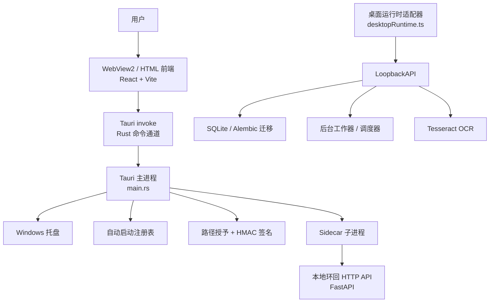
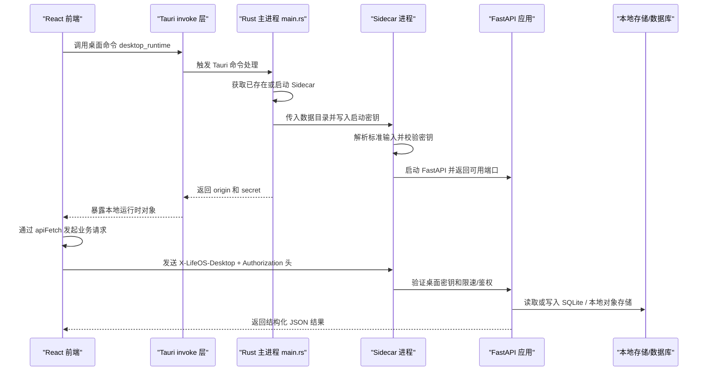
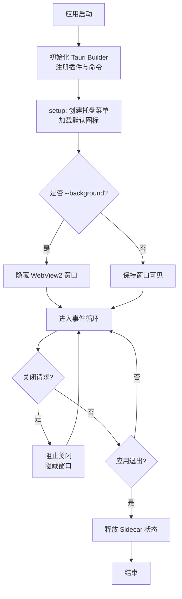
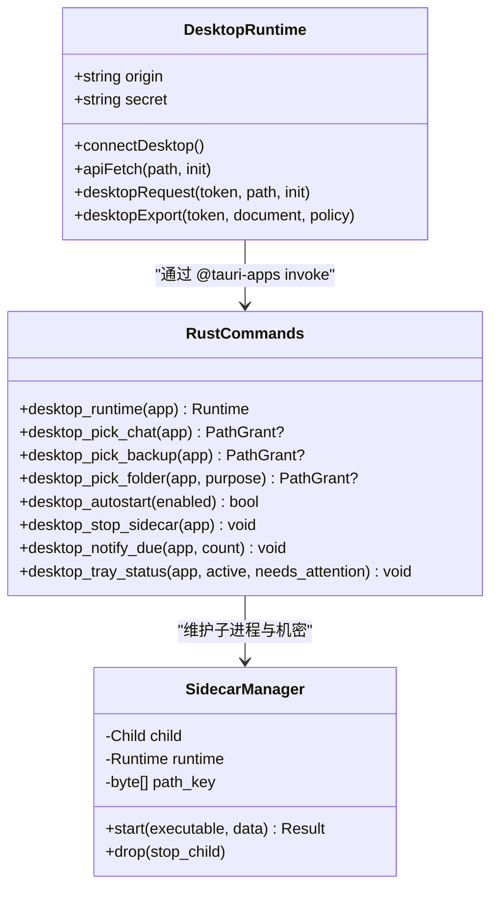
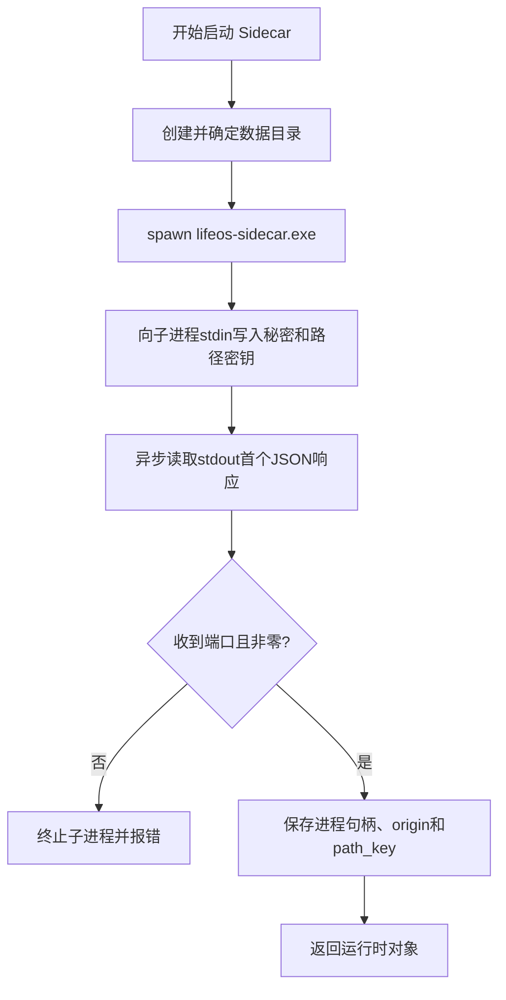
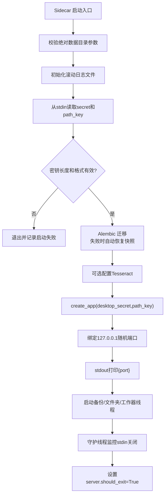
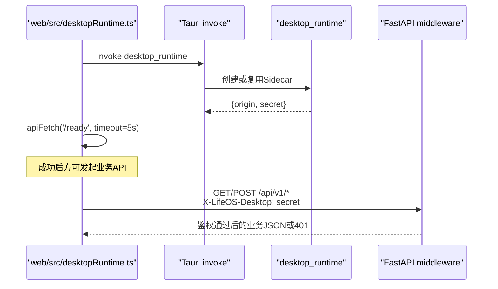
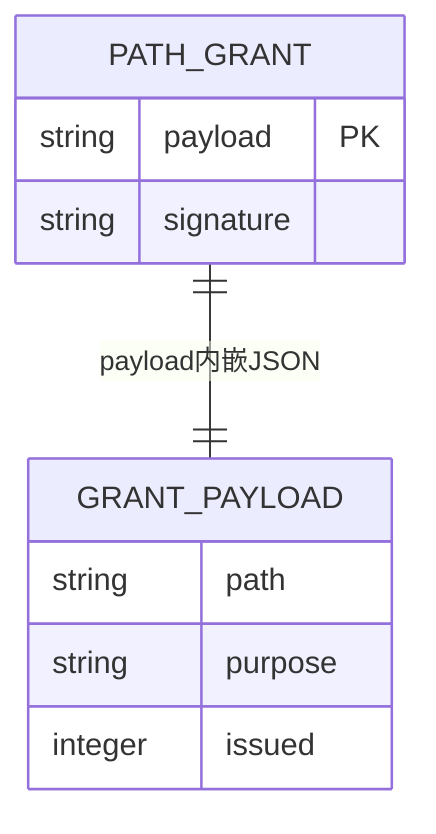
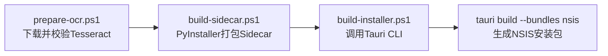
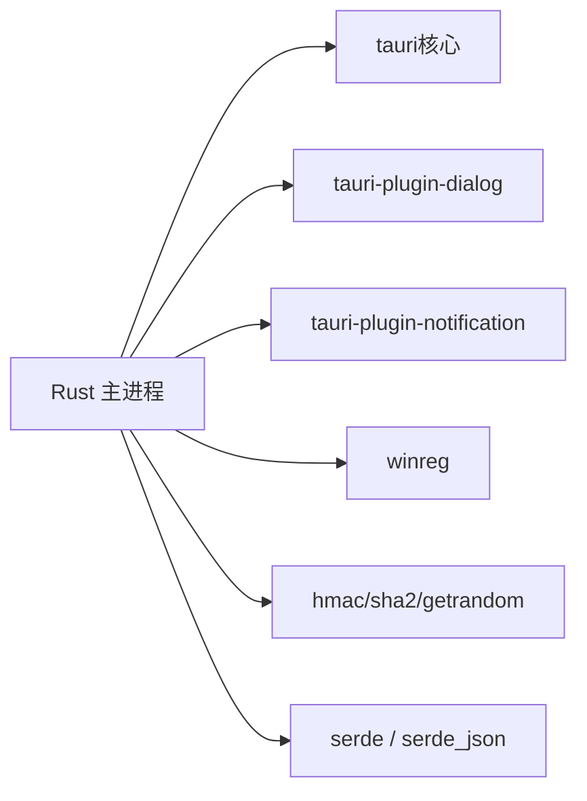

# 桌面应用架构

<cite>
**本文引用的文件列表**
- [desktop/src-tauri/src/main.rs](file://desktop/src-tauri/src/main.rs)
- [desktop/src-tauri/tauri.conf.json](file://desktop/src-tauri/tauri.conf.json)
- [desktop/src-tauri/Cargo.toml](file://desktop/src-tauri/Cargo.toml)
- [desktop/src-tauri/build.rs](file://desktop/src-tauri/build.rs)
- [src/personal_ai_life_os/desktop.py](file://src/personal_ai_life_os/desktop.py)
- [src/personal_ai_life_os/main.py](file://src/personal_ai_life_os/main.py)
- [web/src/App.tsx](file://web/src/App.tsx)
- [web/src/desktopRuntime.ts](file://web/src/desktopRuntime.ts)
- [docs/architecture/decisions/0002-windows-desktop-shell.md](file://docs/architecture/decisions/0002-windows-desktop-shell.md)
- [desktop/prepare-ocr.ps1](file://desktop/prepare-ocr.ps1)
- [desktop/build-sidecar.ps1](file://desktop/build-sidecar.ps1)
- [desktop/build-installer.ps1](file://desktop/build-installer.ps1)
</cite>

## 目录
1. [简介](#简介)
2. [项目结构](#项目结构)
3. [核心组件](#核心组件)
4. [架构总览](#架构总览)
5. [详细组件分析](#详细组件分析)
6. [依赖关系分析](#依赖关系分析)
7. [性能与资源特性](#性能与资源特性)
8. [问题排查指南](#问题排查指南)
9. [结论](#结论)

## 简介
Personal-AI-Life-OS 桌面版是一个基于 Tauri 2 + Rust 主进程、React + Vite 前端、以及打包的 Python FastAPI Sidecar 的跨平台本地桌面应用。它复用现有后端业务逻辑，通过安全、受限的进程间通信提供 Windows 托盘、通知、自动启动、原生文件选择和本地数据管理等功能。Sidecar 使用随机端口监听本地环回地址，并通过每启动一次的密钥和路径签名机制限制前台可访问的数据范围。安装程序由 NSIS 生成，OCR 依赖由 PowerShell 预构建脚本准备并随应用分发。

ADR 0002 明确选择了 Tauri 作为 Windows 桌面壳层，Python sidecar 负责 FastAPI、迁移、后台任务与 OCR，浏览器界面复用已有 React 前端，数据默认存放在用户本地路径。

**章节来源**
- [docs/architecture/decisions/0002-windows-desktop-shell.md:10-42](file://docs/architecture/decisions/0002-windows-desktop-shell.md#L10-L42)

## 项目结构
桌面相关代码主要分布在三个层次：
- Rust/Tauri 主进程：负责窗口、托盘、单实例、自动启动、侧进程生命周期和资源隔离。
- Python Sidecar：打包为 PyInstaller 单文件夹应用，运行 FastAPI、数据库迁移、后台任务和工作线程，并暴露仅本地可读的 HTTP API。
- Web 前端：在 Tauri 环境下调用 `invoke`，在非 Tauri 环境则回退到外部开发服务器。

**图示来源**
- [desktop/src-tauri/src/main.rs:186-385](file://desktop/src-tauri/src/main.rs#L186-L385)
- [src/personal_ai_life_os/desktop.py:125-178](file://src/personal_ai_life_os/desktop.py#L125-L178)
- [web/src/desktopRuntime.ts:1-45](file://web/src/desktopRuntime.ts#L1-L45)

**章节来源**
- [desktop/src-tauri/Cargo.toml:1-19](file://desktop/src-tauri/Cargo.toml#L1-L19)
- [desktop/src-tauri/tauri.conf.json:1-29](file://desktop/src-tauri/tauri.conf.json#L1-L29)

## 核心组件
- **Tauri 主进程入口**：注册菜单、托盘、窗口事件、单实例插件和 Tauri 命令处理器。
- **Sidecar 管理器**：封装子进程的创建、标准输入/输出通信、就绪检查、清理和退出钩子。
- **权限与路径授权**：通过 Hmac+Sha256 对选中的文件或目录进行目的绑定和时间戳签发，并由侧进程验证。
- **自动化登录管理**：读写当前用户注册表的 Run 键位控制开机自启动。
- **桌面服务初始化**：根据调试或发行模式定位 lifeos-sidecar.exe，建立独立数据目录并拉起侧进程。
- **Tray 状态与系统通知**：更新托盘提示文字；向系统提交到期提醒通知。
- **Web 端桌面运行时适配器**：在非浏览器环境中桥接 `invoke` 到本地下发 `X-LifeOS-Desktop` 请求头后访问本地 API。

**章节来源**
- [desktop/src-tauri/src/main.rs:18-25](file://desktop/src-tauri/src/main.rs#L18-L25)
- [desktop/src-tauri/src/main.rs:27-100](file://desktop/src-tauri/src/main.rs#L27-L100)
- [desktop/src-tauri/src/main.rs:102-242](file://desktop/src-tauri/src/main.rs#L102-L242)
- [desktop/src-tauri/src/main.rs:244-385](file://desktop/src-tauri/src/main.rs#L244-L385)
- [web/src/desktopRuntime.ts:1-45](file://web/src/desktopRuntime.ts#L1-L45)

## 架构总览
下图展示从 UI 点击到 Sidecar 完成工作的端到端流程。

**图示来源**
- [desktop/src-tauri/src/main.rs:244-322](file://desktop/src-tauri/src/main.rs#L244-L322)
- [src/personal_ai_life_os/desktop.py:86-178](file://src/personal_ai_life_os/desktop.py#L86-L178)
- [src/personal_ai_life_os/main.py:58-153](file://src/personal_ai_life_os/main.py#L58-L153)
- [web/src/desktopRuntime.ts:7-45](file://web/src/desktopRuntime.ts#L7-L45)

## 详细组件分析

### Tauri 主进程与 Windows 集成
主进程承担以下职责：
- 应用配置：产品名称、版本、标识符、主窗口尺寸、CSP、资源打包和 NSIS 目标。
- 插件：单实例、对话框、通知图标、Windows 托盘和消息处理。
- 状态：保存正在运行的 Sidecar 句柄、运行时 Origin、机密和路径加密密钥。
- 生命周期：阻止默认关闭，改为隐藏窗口；应用退出时释放 Sidecar 引用。
- 自动启动：根据布尔参数添加或删除当前用户的 Run 键项，并在禁用时忽略找不到旧值的错误。
- 托盘交互：左键单击打开主窗口；菜单支持打开和退出；动态更新 Tooltip。
- 通知：当待办提醒计数大于零时显示系统通知。

**图示来源**
- [desktop/src-tauri/src/main.rs:285-385](file://desktop/src-tauri/src/main.rs#L285-L385)
- [desktop/src-tauri/tauri.conf.json:1-29](file://desktop/src-tauri/tauri.conf.json#L1-L29)

#### Windows 托盘子系统
托盘 ID 固定为 `lifeos-tray`，菜单文本包括打开和退出。左键单击托盘图标会显示主窗口，菜单事件统一通过路由区分动作。托盘提示会根据同步中目录数量和是否需要关注进行刷新。

**章节来源**
- [desktop/src-tauri/src/main.rs:301-385](file://desktop/src-tauri/src/main.rs#L301-L385)

#### 自动启动配置
实现直接操作 `HKEY_CURRENT_USER\\Software\\Microsoft\\Windows\\CurrentVersion\\Run`，值名为 `PersonalAILifeOS`。启用时会以当前可执行文件和 `--background` 参数写入，禁用时删除该项，未找到旧值不会报错。查询时返回该键是否存在，以此判断当前是否已注册。

**章节来源**
- [desktop/src-tauri/src/main.rs:102-151](file://desktop/src-tauri/src/main.rs#L102-L151)

### 主进程命令系统与 Rust-JavaScript 通信
Rust 端暴露以下命令：
- `desktop_runtime`：获取或启动本地 Sidecar 并返回运行时对象。
- `desktop_pick_chat`：选择聊天导出 json/jsonl 文件，并签发路径授权。
- `desktop_pick_backup`：选择备份 zip 文件并签发授权。
- `desktop_pick_folder`：支持 markdown、obsidian、chat_folder、backup、export 等多种用途。
- `desktop_autostart`：查询、设置或清除自动启动注册表项。
- `desktop_stop_sidecar`：移除托管的 Sidecar 引用，协助进程清理。
- `desktop_notify_due`：将到期提醒数量转换为系统通知。
- `desktop_tray_status`：更新托盘状态文案。

JavaScript 前端通过 `@tauri-apps/api/core` 的 `invoke` 调用这些命令。Web 层的 `connectDesktop` 调用 `desktop_runtime` 后立即检查 `/ready`，失败时抛出“本机服务暂不可用”。

**图示来源**
- [desktop/src-tauri/src/main.rs:18-25](file://desktop/src-tauri/src/main.rs#L18-L25)
- [desktop/src-tauri/src/main.rs:102-242](file://desktop/src-tauri/src/main.rs#L102-L242)
- [desktop/src-tauri/src/main.rs:244-322](file://desktop/src-tauri/src/main.rs#L244-L322)
- [web/src/desktopRuntime.ts:1-45](file://web/src/desktopRuntime.ts#L1-L45)

**章节来源**
- [desktop/src-tauri/src/main.rs:27-322](file://desktop/src-tauri/src/main.rs#L27-L322)
- [web/src/App.tsx:1-20](file://web/src/App.tsx#L1-L20)
- [web/src/desktopRuntime.ts:1-45](file://web/src/desktopRuntime.ts#L1-L45)

### Sidecar 进程管理与生命周期控制
#### 子进程启动流程
Rust 主进程按如下规则拉起 Sidecar：
1. 使用 `Path::new(executable).join("data")` 作为 Sidecar 根目录。
2. 使用 `tauri::path::local_data_dir().join("PersonalAILifeOS")` 作为数据存储位置。
3. 调试模式下可使用环境变量覆盖数据目录，便于 smoke test。
4. 构造 `lifeos-sidecar.exe` 路径：发行模式使用打包资源 `sidecar/lifeos-sidecar.exe`；调试模式下如果未找到则回退到 `../dist/lifeos-sidecar/lifeos-sidecar.exe`。
5. 以无窗口方式 spawn，重定向 stdin 和 stdout，stderr 丢弃。
6. 先向子进程标准输入写入两条信息：启动密钥和路径密钥。
7. 异步读取子进程 stdout 第一行 JSON，期望包含端口字段；最长等待 45 秒，端口不能为零。
8. 成功时记录 Sidecar 状态，失败则尝试优雅终止并报告日志位置。

**图示来源**
- [desktop/src-tauri/src/main.rs:33-100](file://desktop/src-tauri/src/main.rs#L33-L100)
- [desktop/src-tauri/src/main.rs:244-284](file://desktop/src-tauri/src/main.rs#L244-L284)

#### 健康检查与健康恢复
- Rust 主进程不执行轮询 ping 检查；每次需要运行时信息时会检查子进程是否仍处于存活状态。
- `desktop_runtime` 调用后，前端立即调用 `/ready`，超时失败则提示本机服务不可用。
- FastAPI 层使用心跳式重试：调用方轮询最多约 2 分钟直到任务完成；这间接说明服务可能在冷启动期间短暂不可用。

**章节来源**
- [desktop/src-tauri/src/main.rs:33-100](file://desktop/src-tauri/src/main.rs#L33-L100)
- [desktop/src-tauri/src/main.rs:244-284](file://desktop/src-tauri/src/main.rs#L244-L284)
- [web/src/desktopRuntime.ts:7-20](file://web/src/desktopRuntime.ts#L7-L20)
- [web/src/App.tsx:110-155](file://web/src/App.tsx#L110-L155)

#### 进程清理策略
- 子进程 stdin 被显式关闭后，主进程最多轮询 8 秒；若仍未退出则强制 kill 并等待退出码。
- `Sidecar` 的 Drop 会在 Rust 对象销毁时触发停止逻辑。
- `Drop for Supervisor` 的实现未在源码片段中直接出现；当前代码通过 `AppHandle` 状态和 Tauri 退出事件来释放内部 `Mutex<Option<Sidecar>>`。
- 主进程 `on_window_event` 捕获关闭事件，阻止默认关闭并隐藏窗口；应用退出事件中释放 Sidecar 引用。

**章节来源**
- [desktop/src-tauri/src/main.rs:100-120](file://desktop/src-tauri/src/main.rs#L100-L120)
- [desktop/src-tauri/src/main.rs:322-385](file://desktop/src-tauri/src/main.rs#L322-L385)

### Python Sidecar 服务与安全边界
Sidecar 的入口位于 `personal_ai_life_os.desktop`，其职责包括：
- 定义仅继承初始化参数的 `DesktopSettings`，避免加载 web/.env 或云配置。
- 启动前准备日志目录；日志滚动上限 1MB，保留 3 份。
- 从 Rust 主进程的标准输入读取两个密钥：一个 64 字符十六进制字符串和一个十六进制路径密钥。
- 初始化备份服务、执行 Alembic 迁移、配置 Tesseract OCR（如 Bundled）。
- 使用 uvicorn 以 h11 协议、loopback `127.0.0.1:random` 绑定 FastAPI，关闭代理头和默认日志。
- 通过守护线程监听 stdin 关闭来主动退出服务。
- 如果检测到恢复标记或恢复过程未完成，在启动完成后或异常情况下进行回滚清理。

**图示来源**
- [src/personal_ai_life_os/desktop.py:13-85](file://src/personal_ai_life_os/desktop.py#L13-L85)
- [src/personal_ai_life_os/desktop.py:86-178](file://src/personal_ai_life_os/desktop.py#L86-L178)

**章节来源**
- [src/personal_ai_life_os/desktop.py:1-178](file://src/personal_ai_life_os/desktop.py#L1-L178)

### 前端与本地后端通信协议
前端在 Tauri 模式下的关键约定：
- 仅在 `isTauri()` 时为桌面模式。
- `connectDesktop` 调用 `invoke('desktop_runtime')`，获得 `{origin, secret}`。
- 随后立即调用 `/ready`；超时失败即认为本机服务不可用。
- 所有业务 API 请求拼接为基础路径 `/api/v1`。
- 桌面模式下额外注入请求头 `X-LifeOS-Desktop` 值为 Rust 端提供的 secret。
- 普通 fetch 场景禁用缓存、禁止重定向且不携带凭证。
- 非 Tauri 环境走环境变量或默认的离线开发接口路径。

后端 FastAPI 层要求：
- 桌面模式下必须附带与 per-launch secret 完全相等的 `X-LifeOS-Desktop` 头，否则返回 401。
- 敏感登录和注册路径启用了速率限制；导入路径也可能受限。
- 桌面模式的 OpenAPI 文档被禁用。

**图示来源**
- [web/src/desktopRuntime.ts:7-45](file://web/src/desktopRuntime.ts#L7-L45)
- [src/personal_ai_life_os/main.py:77-153](file://src/personal_ai_life_os/main.py#L77-L153)

**章节来源**
- [web/src/App.tsx:1-20](file://web/src/App.tsx#L1-L20)
- [web/src/desktopRuntime.ts:1-45](file://web/src/desktopRuntime.ts#L1-L45)
- [src/personal_ai_life_os/main.py:58-153](file://src/personal_ai_life_os/main.py#L58-L153)

### 原生权限与数据安全模型
#### 文件系统访问
- 用户不会把文件路径直接传给 Sidecar。
- 前端通过 `desktop_pick_chat`、`desktop_pick_backup`、`desktop_pick_folder` 选择目标。
- Rust 主进程将文件路径序列化成 payload，并使用 per-launch path_key 计算 HMAC-SHA256 签名，同时包含签发时间。
- JavaScript 只拿到 `{payload, signature}`，不能伪造路径。
- 后端应使用相同的 path_key 和用途校验签名，确保所选目标只能用于预期操作。

**图示来源**
- [desktop/src-tauri/src/main.rs:152-216](file://desktop/src-tauri/src/main.rs#L152-L216)

#### 本地存储与迁移备份
- 数据目录默认位于用户本地数据区下 `PersonalAILifeOS`。
- SQLite 数据库存放于 `data/lifeos.db`。
- 迁移前若发现当前 head 与脚本 head 不一致，会将现有数据库复制到 `migration-backups`，再执行升级；失败则自动回滚到快照。

#### 系统通知
- Rust 主进程使用 Tauri Notification 插件直接推送系统通知。
- 通知仅统计到期提醒数量，不对用户数据做额外传输。

**章节来源**
- [desktop/src-tauri/src/main.rs:152-216](file://desktop/src-tauri/src/main.rs#L152-L216)
- [desktop/src-tauri/src/main.rs:301-344](file://desktop/src-tauri/src/main.rs#L301-L344)
- [src/personal_ai_life_os/desktop.py:40-85](file://src/personal_ai_life_os/desktop.py#L40-L85)
- [src/personal_ai_life_os/desktop.py:125-178](file://src/personal_ai_life_os/desktop.py#L125-L178)

### 打包与分发流程
构建顺序如下：
1. 准备 OCR：`prepare-ocr.ps1` 下载带 SHA-256 校验的 Tesseract Windows 安装程序，提取 tesseract.exe、DLL 和英文语言包，同时单独获取简体中文训练数据，并通过命令行验证两种语言均可加载。
2. 构建 Sidecar：`build-sidecar.ps1` 使用 uv 和 PyInstaller 将 `src/personal_ai_life_os/desktop.py` 打包成 `desktop/dist/lifeos-sidecar/lifeos-sidecar.exe`，包含迁移数据和必要的 SQLAlchemy dialect；若提供 OCR 目录，则将 tesseract 资源拷贝进 PyInstaller 输出结构的 `_internal/tesseract`。
3. 构建 Tauri 安装包：`build-installer.ps1` 先校验 `web/node_modules/.bin/tauri.cmd`，再执行 OCR 准备和 Sidecar 构建，最终调用 Tauri 的 `build --bundles nsis`；可传 debug 开关。
4. Tauri 配置中指定产品名、版本号、应用 ID、主窗口参数、CSP、前端产出位置、NSIS 安装模式和安装钩子文件，并将 `dist/lifeos-sidecar/` 放入资源目录 `sidecar/`。

**图示来源**
- [desktop/prepare-ocr.ps1:1-34](file://desktop/prepare-ocr.ps1#L1-L34)
- [desktop/build-sidecar.ps1:1-27](file://desktop/build-sidecar.ps1#L1-L27)
- [desktop/build-installer.ps1:1-18](file://desktop/build-installer.ps1#L1-L18)
- [desktop/src-tauri/tauri.conf.json:1-29](file://desktop/src-tauri/tauri.conf.json#L1-L29)

**章节来源**
- [desktop/prepare-ocr.ps1:1-34](file://desktop/prepare-ocr.ps1#L1-L34)
- [desktop/build-sidecar.ps1:1-27](file://desktop/build-sidecar.ps1#L1-L27)
- [desktop/build-installer.ps1:1-18](file://desktop/build-installer.ps1#L1-L18)
- [desktop/src-tauri/tauri.conf.json:1-29](file://desktop/src-tauri/tauri.conf.json#L1-L29)

### Windows 特定功能与跨平台适配
- Windows 专用能力：托盘图标、Windows 注册表自动启动、系统通知、NSIS 安装包、单实例处理、本地会话回调。
- Tauri CSP 允许连接 `ipc:`、`http://ipc.localhost` 以及 `http://127.0.0.1:*`，这是 Rust 主进程动态分配本地侧进程端口所必需的。
- 发布模式隐藏窗口子系统，以减少控制台闪烁和系统弹窗。
- 非 Tauri 环境仍保留原 React 前端行为，因此仓库可同时作为 Web 产品和开发参考。
- Python Sidecar 在 Windows 上启用 SO_EXCLUSIVEADDRUSE，避免多个实例抢占同一 socket。
- ADR 说明 Electron 是备选方案，但当前实现已优先采用 Tauri 以降低体积和内存占用。

**章节来源**
- [desktop/src-tauri/src/main.rs:1-18](file://desktop/src-tauri/src-main.rs#L1-L18)
- [desktop/src-tauri/tauri.conf.json:6-23](file://desktop/src-tauri/tauri.conf.json#L6-L23)
- [src/personal_ai_life_os/desktop.py:145-178](file://src/personal_ai_life_os/desktop.py#L145-L178)
- [docs/architecture/decisions/0002-windows-desktop-shell.md:16-42](file://docs/architecture/decisions/0002-windows-desktop-shell.md#L16-L42)

## 依赖关系分析
Rust 主进程依赖如下 crate：
- `tauri`：窗口、托盘、单实例、IPC 和应用生命周期。
- `tauri-plugin-dialog`、`tauri-plugin-notification`：原生对话框和通知。
- `winreg`：写读 Windows 注册表 Run 项。
- `hmac`、`sha2`：路径授权签名。
- `serde`、`serde_json`：运行时对象序列化和子进程就绪消息解析。
- `getrandom`：生成 per-launch secret 和路径密钥。

**图示来源**
- [desktop/src-tauri/Cargo.toml:1-19](file://desktop/src-tauri/Cargo.toml#L1-L19)

**章节来源**
- [desktop/src-tauri/Cargo.toml:1-19](file://desktop/src-tauri/Cargo.toml#L1-L19)

## 性能与资源特性
- Sidecar 启动时存在冷启动成本：Python 解释器、PyInstaller 解压、FastAPI 初始化、Alembic 检测、SQLAlchemy 引擎创建、索引重建和可能的 OCR 配置。
- 就绪超时设置为 45 秒，避免因长耗时初始化阻塞主进程。
- 主进程不再反复轮询健康状态，而是按需检查进程生命周期；网络层面前端对任务有 2 分钟轮询缓冲，缓解初始阶段不稳定。
- 日志采用轮换策略：单个文件不超过 1MB，最多保留 3 份，降低磁盘增长风险。
- Sidecar 使用最小化 uvicorn 配置：关闭代理头、关闭访问日志、禁用 WebSocket、设置合理的 graceful shutdown 时间，避免频繁请求放大开销。
- 数据库迁移失败时会先备份当前数据库，再执行升级；失败后恢复快照，保证增量更新的安全性。

建议优化方向：
- 如需频繁唤醒 Sidecar，可增加轻量健康探测，但应避免在主 UI 线程阻塞。
- 可将首次启动耗时较大的步骤进一步拆分并给出进度反馈。
- 对 OCR 大文件导入增加客户端大小校验和断点重试机制，减少网络和本地 I/O 重试消耗。
- 定期归档迁移备份，防止 `%LOCALAPPDATA%` 空间持续增长。

**章节来源**
- [desktop/src-tauri/src/main.rs:62-100](file://desktop/src-tauri/src-main.rs#L62-L100)
- [src/personal_ai_life_os/desktop.py:58-85](file://src/personal_ai_life_os/desktop.py#L58-L85)
- [src/personal_ai_life_os/desktop.py:125-178](file://src/personal_ai_life_os/desktop.py#L125-L178)

## 问题排查指南
| 现象 | 可能原因 | 排查与建议 |
| --- | --- | --- |
| 桌面应用打开后本机提示“本机服务暂不可用” | `/ready` 失败、Sidecar 未正常启动、端口未被正确返回 | 查看 `%LOCALAPPDATA%\PersonalAILifeOS\logs\sidecar.log`；确认 `lifeos-sidecar.exe` 是否存在；重启应用后重试。 |
| Tauri 构建时报找不到 Tauri CLI | 未在前置安装 web 依赖 | 先在 `web/` 执行依赖安装命令，然后再运行打包脚本。 |
| Sidecar 打包失败 | PyInstaller 缺失依赖或未找到入口 | 检查 Python 3.12 环境和 uv 是否可用；确保 `src/personal_ai_life_os/desktop.py` 可被 import；必要时传入 Tesseract 目录。 |
| OCR 语言缺失 | Tesseract DLL 或未复制训练数据 | 重新运行 `prepare-ocr.ps1`；确认 eng 与 chi_sim 均能列出；注意 release 构建需将 tesseract 目录复制到 PyInstaller `_internal/tesseract`。 |
| 桌面模式 API 返回 401 | `X-LifeOS-Desktop` 头缺失或不匹配 | 不要绕过桌面运行时；确保通过 `desktopRuntime.ts` 发起请求；不要用外部浏览器直接访问 localhost 随机端口。 |
| 自动启动未生效 | 注册表写入失败或权限不足 | 以当前用户权限运行；手动检查 `HKEY_CURRENT_USER\Software\Microsoft\Windows\CurrentVersion\Run` 中是否存在对应项；再次通过 `desktop_autostart` 切换。 |
| 关闭窗口后应用仍存在 | 正常行为：应用会隐藏而非退出 | 通过托盘右键菜单“退出”退出应用；自动启动只启动后台 Shell 和 Tray。 |
| 数据库无法迁移 | 迁移脚本与数据库版本不匹配或权限不足 | 检查 `migration-backups` 是否生成了快照；手动确认后再次启动 Sidecar，允许自动回滚恢复。 |

**章节来源**
- [desktop/src-tauri/src/main.rs:33-120](file://desktop/src-tauri/src/main.rs#L33-L120)
- [desktop/src-tauri/src/main.rs:102-242](file://desktop/src-tauri/src/main.rs#L102-L242)
- [desktop/src-tauri/src/main.rs:301-385](file://desktop/src-tauri/src/main.rs#L301-L385)
- [src/personal_ai_life_os/desktop.py:58-178](file://src/personal_ai_life_os/desktop.py#L58-L178)
- [web/src/desktopRuntime.ts:7-20](file://web/src/desktopRuntime.ts#L7-L20)
- [desktop/build-sidecar.ps1:1-27](file://desktop/build-sidecar.ps1#L1-L27)
- [desktop/prepare-ocr.ps1:1-34](file://desktop/prepare-ocr.ps1#L1-L34)

## 结论
Personal-AI-Life-OS 桌面版通过在 Rust/Tauri 主进程中封装系统资源，并以受保护的 Sidecar 进程承载 Python 后端，实现了本地优先、安全可控的桌面体验。设计上的关键取舍是：不重写业务逻辑，而是让前端走同样的 `/api/v1` 接口，只在信任边界内增加 per-launch secret、路径签名、仅本地环回绑定和原生系统集成。这种分层使 Web 开发和桌面发布既能共享领域代码，又能满足 Windows 生态对托盘、通知、自启动和安装包的安全需求。未来扩展时应继续遵循：Sidecar 不直接信任前台提供的路径，系统操作始终由主进程或可信后端完成，并严格记录启动、权限和迁移相关日志以便排障。