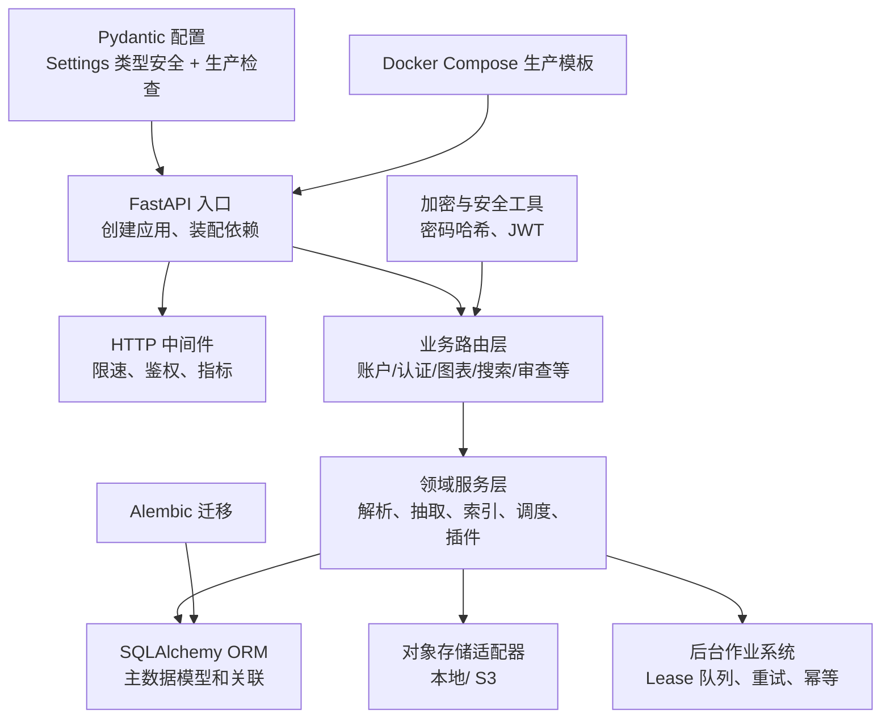
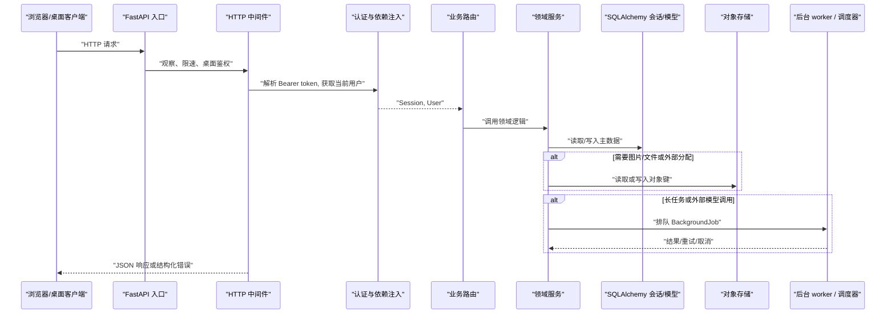
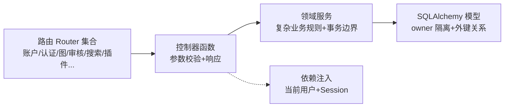
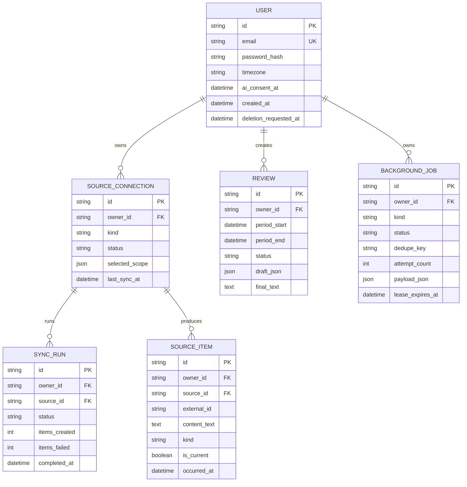
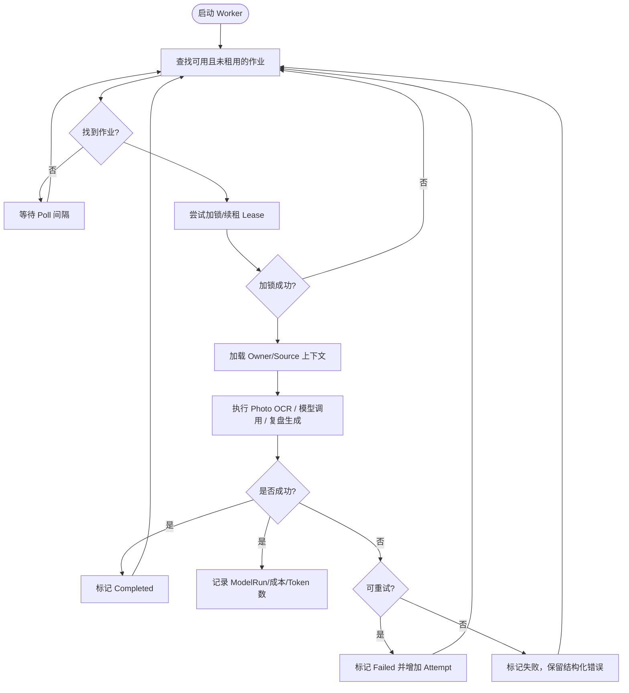
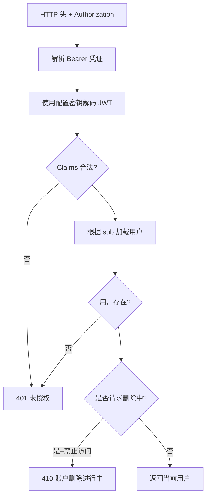
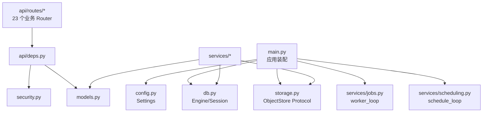
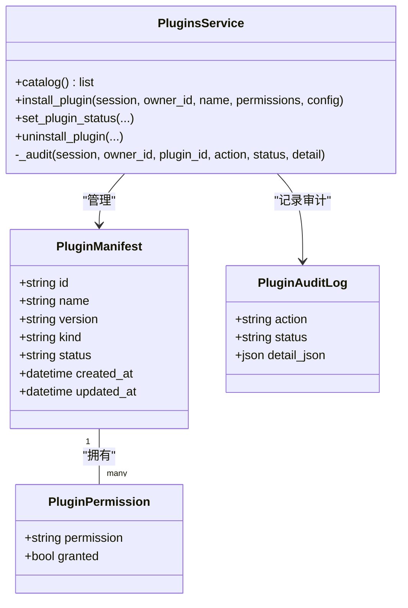

# 系统架构

<cite>
**本文引用的文件**   
- [main.py](file://src/personal_ai_life_os/main.py)
- [config.py](file://src/personal_ai_life_os/config.py)
- [db.py](file://src/personal_ai_life_os/db.py)
- [models.py](file://src/personal_ai_life_os/models.py)
- [deps.py](file://src/personal_ai_life_os/api/deps.py)
- [jobs.py](file://src/personal_ai_life_os/services/jobs.py)
- [scheduling.py](file://src/personal_ai_life_os/services/scheduling.py)
- [security.py](file://src/personal_ai_life_os/security.py)
- [storage.py](file://src/personal_ai_life_os/storage.py)
- [base.py](file://src/personal_ai_life_os/parsers/base.py)
- [plugins.py](file://src/personal_ai_life_os/services/plugins.py)
- [overview.md](file://docs/architecture/overview.md)
- [data-model.md](file://docs/architecture/data-model.md)
- [pyproject.toml](file://pyproject.toml)
- [docker-compose.production.yml](file://docker-compose.production.yml)
- [README.md](file://README.md)
</cite>

## 目录
1. [引言](#引言)
2. [项目结构](#项目结构)
3. [核心组件](#核心组件)
4. [架构总览](#架构总览)
5. [详细组件分析](#详细组件分析)
6. [依赖关系分析](#依赖关系分析)
7. [性能考量](#性能考量)
8. [故障排查指南](#故障排查指南)
9. [结论](#结论)
10. [附录：扩展点与插件化集成模式](#附录扩展点与插件化集成模式)

## 引言
Personal-AI-Life-OS 是一个以用户同意为中心的个人记忆与工作上下文操作系统。它从本地受控源导入聊天记录、日历快照、照片和笔记，通过时间线、证据图谱、周复盘和提醒组织内容，并保留可迁移的 Markdown 输出。后端采用 FastAPI，服务层封装业务领域逻辑，数据模型使用 SQLAlchemy 声明式 ORM，并通过 Alembic 管理跨 SQLite/PostgreSQL 的数据库演进。生产环境支持 S3 兼容对象存储与外部模型提供者，同时保持严格的类型安全配置与安全校验。

本系统架构文档聚焦以下主题：
- 路由层 → 服务层 → 模型层的清晰分层
- 应用装配、中间件、生命周期、错误处理
- 23 个业务模块与 Router 的组织方式
- Settings 类型安全的配置体系及生产检查
- SQL 兼容性设计与数据访问抽象
- 事件驱动与后台作业、定时任务的解耦
- 组件交互图、关键技术权衡以及扩展点设计

**Section sources**
- [README.md:1-118](file://README.md#L1-L118)
- [overview.md:1-123](file://docs/architecture/overview.md#L1-L123)

## 项目结构
后端代码集中在 `src/personal_ai_life_os` 中，按职责分为 API、服务、持久化、配置、安全、存储等子系统；web 前端在 `web/`，桌面端外壳在 `desktop/src-tauri`，部署模板在 `deploy/` 及 Compose 文件；`migrations/` 下为版本化的 Alembic 变更。

**图表来源**
- [main.py:1-315](file://src/personal_ai_life_os/main.py#L1-L315)
- [config.py:1-132](file://src/personal_ai_life_os/config.py#L1-L132)
- [db.py:1-75](file://src/personal_ai_life_os/db.py#L1-L75)
- [models.py:1-875](file://src/personal_ai_life_os/models.py#L1-L875)
- [storage.py:1-264](file://src/personal_ai_life_os/storage.py#L1-L264)
- [jobs.py:1-882](file://src/personal_ai_life_os/services/jobs.py#L1-L882)
- [docker-compose.production.yml:1-101](file://docker-compose.production.yml#L1-L101)

**Section sources**
- [main.py:1-120](file://src/personal_ai_life_os/main.py#L1-L120)
- [pyproject.toml:1-58](file://pyproject.toml#L1-L58)
- [README.md:80-118](file://README.md#L80-L118)

## 核心组件
- **应用入口与装配**：统一构建 FastAPI，注入配置、数据库引擎、会话工厂、对象存储，并在生命周期中启动后台 worker、定时调度器和桌面侧相关进程。
- **请求处理**：HTTP 中间件实现登录/注册/导入限速、桌面模式强制鉴权、健康与指标状态暴露，并对异常返回结构化 JSON。
- **依赖注入**：提供经过认证的当前用户、带事务边界的 Session，使路由函数只关注资源控制器逻辑。
- **领域服务**：每个业务功能（图抽取、复习回顾、搜索索引、计划任务、插件管理等）位于 `services`，避免把业务规则塞进路由。
- **数据访问**：基于 SQLAlchemy 的基础基类、UTC 时间装饰器和多租户 owner-scoped 模型，配合 Alembic 做无侵入演进。
- **对象存储**：通过 Protocol 定义抽象接口，LocalObjectStore 与 S3ObjectStore 实现不同后端，并统一写入删除掩埋记录以保证恢复安全。
- **后台作业与调度**：数据库驱动的 Lease 队列 + 独立线程 worker_loop，周期性 schedule_loop 计算下一次运行时间并生成或调度异步任务。

**Section sources**
- [main.py:120-315](file://src/personal_ai_life_os/main.py#L120-L315)
- [deps.py:1-65](file://src/personal_ai_life_os/api/deps.py#L1-L65)
- [storage.py:1-264](file://src/personal_ai_life_os/storage.py#L1-L264)
- [jobs.py:1-200](file://src/personal_ai_life_os/services/jobs.py#L1-L200)
- [scheduling.py:1-200](file://src/personal_ai_life_os/services/scheduling.py#L1-L200)

## 架构总览
应用启动后，FastAPI 承担 HTTP 入站端口和 OpenAPI 规范暴露；业务能力由多组 Router 暴露 `/api/v1/*` 路径。请求经过中间件后进入路由函数，后者调用领域服务完成数据准备、权限校验、业务约束和外侧调用；持久化通过 `get_session` 提供的 SQLAlchemy Session 操作模型。

**图表来源**
- [main.py:1-315](file://src/personal_ai_life_os/main.py#L1-L315)
- [deps.py:1-65](file://src/personal_ai_life_os/api/deps.py#L1-L65)
- [jobs.py:1-200](file://src/personal_ai_life_os/services/jobs.py#L1-L200)
- [storage.py:1-264](file://src/personal_ai_life_os/storage.py#L1-L264)

## 详细组件分析

### 路由层与模块化设计
路由层将 23 个以上业务领域拆分为独立文件，每个文件导出一个 FastAPI Router，再由应用入口集中挂载：
- 账户与认证：account、auth
- 数据输入：imports、sources、items、quick_notes、extractions
- 图形与知识：graph、graph_merge、graph_review、ontology、insights、qa
- 检索与组织：search、saved_searches、organization
- 工作流：reviews、review_schedule、reminders、agent
- 管理面：budget、model_providers、metrics、plugins、jobs、health、desktop_*

这种设计带来三个好处：
1. **高内聚、低耦合**：路由仅处理参数验证、权限校验、响应构造。
2. **易测试**：每个领域可以围绕其服务和模型编写单元测试，不需要完整 FastAPI 测试套间。
3. **易扩展**：新增领域只需新增 `routes` 和 `services` 一对文件，然后在应用装配时挂载 Router。

**图表来源**
- [main.py:15-60](file://src/personal_ai_life_os/main.py#L15-L60)
- [deps.py:1-65](file://src/personal_ai_life_os/api/deps.py#L1-L65)

**Section sources**
- [main.py:15-60](file://src/personal_ai_life_os/main.py#L15-L60)

### 应用装配、中间件、生命周期与错误处理
`create_app` 负责组装应用实例：
- 根据 `app_env` 控制是否启用交互式 API 文档和 OpenAPI JSON。
- 注入全局状态：Settings、Engine、session_factory、ObjectStore。
- 在 FastAPI lifespan 中：
  - 按需自动建表。
  - 初始化 SQLite/PostgreSQL 搜索索引。
  - 回放删除掩码，保证恢复后的数据库不会“复活”已删除数据。
  - 在 worker 模式下启动 background_worker 和 schedule_loop。
  - 桌面模式下启动桌面文件夹同步和本地备份线程。
  - 统一清理线程、引擎连接池。

HTTP 中间件提供：
- 桌面模式的 per-launch secret 头部比对。
- 登录、注册和导入接口的客户端级速率限制。
- 临时禁用上传时的 503 响应。
- 对未捕获异常进行 JSON 包裹，减少原始堆栈泄漏。

错误处理上，`RequestValidationError` 和其他异常会被包装为稳定字段，便于前端解析而非直接展示 Python 细节。

**Section sources**
- [main.py:60-315](file://src/personal_ai_life_os/main.py#L60-L315)

### 配置机制：类型安全的 Settings 与生产安全检查
所有运行配置集中在 Pydantic `BaseSettings` 子类中，支持 `.env`、环境变量和忽略未知变量。关键决策包括：

| 类别 | 设置项 | 作用与安全影响 |
|---|---|---|
| 运行环境 | `app_env` | development/test/production/desktop |
| API 网络 | `api_host`、`api_port` | 开发默认绑定 127.0.0.1:8000 |
| 数据库 | `database_url`、`auto_create_schema` | SQLite 或 PostgreSQL；生产必须关闭自动建表 |
| 处理模式 | `processing_mode` | inline 或 worker；生产要求 worker |
| 令牌密钥 | `access_token_secret` | HS256 JWT 签名密钥，生产最少 32 位 |
| 注册策略 | `registration_mode`、`signup_invite_code` | production 禁止 open |
| CORS | `cors_origins` | production 不允许 localhost/127.0.0.1 |
| 指标防护 | `metrics_token` | 生产需要长随机值 |
| 对象存储 | `object_store_backend`、`S3_*` | production 要求私有 S3 且 journal bucket 不可与主桶同名 |
| 外部模型 | `model_provider`、`openai_*`、预算与披露 | 生产必须有隐私链接、披露文本和费用预算 |

生产环境 validator 会拒绝以下不安全组合：
- 使用默认 `ACCESS_TOKEN_SECRET`。
- 自动建表。
- 非 worker 模式。
- 允许自注册。
- CORS 指向本地地址。
- metrics 太短或缺失。
- 对象存储不使用私有 S3。
- 未开启删除日记 bucket。
- 启用外部模型但缺少密钥、隐私 URL 或定价。

**Section sources**
- [config.py:1-132](file://src/personal_ai_life_os/config.py#L1-L132)

### 数据访问抽象与 ORM 策略
数据层采用以下设计：
- `Base` 作为所有 SQLAlchemy Declarative 模型的基础类。
- `UTCDateTime` 类型装饰器在绑定和查询结果阶段统一转为带时区 UTC 时间，避免 SQLite 丢失时区信息。
- `create_database_engine`：
  - SQLite 连接禁用同线程检查，并可通过 event 监听打开 foreign keys；桌面模式额外启用 WAL。
  - 非 SQLite 使用 pool_pre_ping 提升连接健壮性。
- `create_session_factory` 使用 autoflush=False、expire_on_commit=False，减少误刷提交和意外刷新。
- `get_session` 是基于 FastAPI Request 的生命周期 Session，由依赖注入提供。

模型采用主键 `as_uuid=False` 的稳定字符串标识，配合 many-to-many 关联表和审计/状态字段，形成 owner-scoped 实体域，例如 `User`、`SourceConnection`、`SourceItem`、`Review`、`Reminder`、`BackgroundJob`、`ModelRun`、`PluginManifest` 等。

**图表来源**
- [models.py:1-875](file://src/personal_ai_life_os/models.py#L1-L875)
- [db.py:1-75](file://src/personal_ai_life_os/db.py#L1-L75)
- [data-model.md:1-120](file://docs/architecture/data-model.md#L1-L120)

**Section sources**
- [db.py:1-75](file://src/personal_ai_life_os/db.py#L1-L75)
- [models.py:1-200](file://src/personal_ai_life_os/models.py#L1-L200)
- [data-model.md:1-120](file://docs/architecture/data-model.md#L1-L120)

### 后台作业系统与定时任务调度
背景作业是系统的异步骨架，避免阻塞 API：

- `enqueue_background_job` 写入 `BackgroundJob`，使用 `dedupe_key` 保证幂等；若重复入队且先前失败/完成，则重置为 queued。
- Job Envelope 只包含 ID、owner、kind、payload 和控制字段，不存储原始大图或敏感文本。
- Worker 线程持有 lease，防止多个 worker 抢占同一任务；支持重试次数和失败码。
- Scheduler 线程每隔固定间隔扫描 `ReviewSchedule`，计算本地时区下的下一次运行时间，并为符合条件的用户创建 Review 草稿或调度 review 作业。

**图表来源**
- [jobs.py:1-200](file://src/personal_ai_life_os/services/jobs.py#L1-L200)
- [scheduling.py:1-200](file://src/personal_ai_life_os/services/scheduling.py#L1-L200)
- [main.py:200-315](file://src/personal_ai_life_os/main.py#L200-L315)

**Section sources**
- [jobs.py:1-200](file://src/personal_ai_life_os/services/jobs.py#L1-L200)
- [scheduling.py:1-200](file://src/personal_ai_life_os/services/scheduling.py#L1-L200)
- [main.py:200-315](file://src/personal_ai_life_os/main.py#L200-L315)

### 安全机制：密码、令牌与会话上下文
- 密码使用推荐哈希方案，并捕获旧算法/解析错误，确保老数据仍能兼容但不降级整体安全性。
- Access Token 是 HS256 签名的 JWT，包含 sub、iat、exp、iss、aud、typ 必需 claim；解码时会严格校验 audience 和 issuer。
- 当前用户依赖会：
  - 拒绝空凭据，返回 401。
  - 解码失败返回无效 token。
  - 用户处于删除等待期时返回 410，阻止正常访问，只保留特定账号删除路径。
- 中间件在桌面模式下比较 `x-lifeos-desktop` 头部，防止未通过 Tauri 壳子代理的外部访问。

**图表来源**
- [security.py:1-54](file://src/personal_ai_life_os/security.py#L1-L54)
- [deps.py:1-65](file://src/personal_ai_life_os/api/deps.py#L1-L65)
- [main.py:60-140](file://src/personal_ai_life_os/main.py#L60-L140)

**Section sources**
- [security.py:1-54](file://src/personal_ai_life_os/security.py#L1-L54)
- [deps.py:1-65](file://src/personal_ai_life_os/api/deps.py#L1-L65)
- [main.py:60-140](file://src/personal_ai_life_os/main.py#L60-L140)

### 对象存储抽象与删除恢复
对象存储抽象通过 Python `Protocol` 描述，而不引入运行时硬耦合：
- `put/get/delete` 用于主体文件与对象元数据。
- 删除链路通过 `write_deletion_tombstone` 系列方法写入独立 .deletion-tombstones 目录或独立 bucket。
- `LocalObjectStore` 校验 key 不能逃逸根目录，写操作先落临时文件再原子替换。
- `S3ObjectStore` 启用 SSE-SSE（AES256）加密，并提供分版本删除和无版本回退。
- 应用生命周期开始时会遍历删除掩码并回放删除动作，避免从数据库备份恢复时重现已删除内容。

**Section sources**
- [storage.py:1-264](file://src/personal_ai_life_os/storage.py#L1-L264)
- [main.py:200-315](file://src/personal_ai_life_os/main.py#L200-L315)

### 解析器抽象与输入边界
解析器遵循统一的 `ParsedItem` 契约，包含外部 ID、类型、标题、正文、发生时间、来源定位器和可选元数据。该抽象让 Markdown、ChatGPT 导出、Memory、Photo、ICS、通用聊天等不同来源共享后续入库和引用追踪流程。

**Section sources**
- [base.py:1-17](file://src/personal_ai_life_os/parsers/base.py#L1-L17)
- [overview.md:15-60](file://docs/architecture/overview.md#L15-L60)

## 依赖关系分析

**图表来源**
- [main.py:1-120](file://src/personal_ai_life_os/main.py#L1-L120)
- [deps.py:1-65](file://src/personal_ai_life_os/api/deps.py#L1-L65)
- [config.py:1-132](file://src/personal_ai_life_os/config.py#L1-L132)

### 耦合与内聚评估
- 路由层对服务层单向依赖，服务层对模型和基础设施单向依赖。
- 存储与数据库通过抽象或工厂解耦；生产与开发后端通过环境变量切换。
- 后台作业与调度器与路由层松耦合，仅在路由或服务中入队，不直接调用对方。
- 危险耦合点集中在：
  - 应用状态 `application.state`：承载运行时单例，需在文档或测试中维护约定。
  - 模型层与调度逻辑之间的隐式协作，例如 scheduling.py 引用 review 生成相关的路由内部常量。

**Section sources**
- [main.py:1-120](file://src/personal_ai_life_os/main.py#L1-L120)
- [deps.py:1-65](file://src/personal_ai_life_os/api/deps.py#L1-L65)
- [jobs.py:1-200](file://src/personal_ai_life_os/services/jobs.py#L1-L200)

### 外部依赖与技术选型权衡
| 技术 | 选型理由 | 权衡与限制 |
|---|---|---|
| FastAPI | 异步友好、类型提示、OpenAPI 自动文档 | 运行时依赖较多；需依赖注入和自定义中间件实现强一致性行为 |
| Pydantic Settings | 强类型配置与环境变量装载 | 默认开发密钥存在安全隐患，必须由部署者显式覆盖 |
| SQLAlchemy + Alembic | 成熟的关系映射与迁移工具 | 需要手动维护迁移，复杂查询可读性不如纯 SQL |
| SQLite | 开发便捷、零配置 | 不适合多进程并发写和高吞吐；生产应使用 PostgreSQL |
| PostgreSQL | 适合 Compose/hosted 部署 | 某些环境可能缺 pg_trgm 权限，需回退 LIKE |
| Boto3/S3 | 生产对象存储可插拔 | S3 模拟或区域错误会直接影响导入和删除恢复 |
| PyJWT/pwdlib | 标准 JWT 与 Argon2 | 需要可靠密钥轮换；旧密码哈希升级不在 MVP 范围内 |

**Section sources**
- [pyproject.toml:1-58](file://pyproject.toml#L1-L58)
- [config.py:1-132](file://src/personal_ai_life_os/config.py#L1-L132)
- [docker-compose.production.yml:1-101](file://docker-compose.production.yml#L1-L101)

## 性能考量
- **同步优先的解析路径**：Markdown/ChatGPT/日历等受文件大小上限保护，避免长时间占用请求线程。
- **异步扩展点**：photo OCR、模型推理、每周复盘、桌面分析等在 worker 模式下走 `BackgroundJob`，减轻 HTTP 延迟峰值。
- **搜索索引**：SQLite 使用 FTS5 trigram，PostgreSQL 条件安装 pg_trm 并创建 GIN 索引；不足时回退到大小写不敏感 LIKE，保证降级可用。
- **数据库连接**：SQLite 关闭同线程检查以提升简单场景性能；非 SQLite 使用 pool_pre_ping 和 future mode 增强稳定性。
- **对象写入**：本地存储使用临时文件 + 原子 replace，避免部分写入造成的损坏。
- **并发限制**：worker_poll_interval_seconds、lease_seconds、rate_limit、upload size limit 共同构成吞吐与资源保护。

[本节为通用指导，不直接分析具体源码片段]

## 故障排查指南

| 现象 | 可能原因 | 排查步骤 |
|---|---|---|
| 启动时抛出配置错误 | 生产环境必填变量缺失或值不安全 | 检查 ACCESS_TOKEN_SECRET、CORS_ORIGINS、OBJECT_STORE_BACKEND、S3_BUCKET、METRICS_TOKEN 等 |
| 无法写入数据库表 | SQLite 目录未创建或权限不足；PostgreSQL 权限不足 | 确认 data 目录可写，检查数据库 URL 和迁移是否完成 |
| 对象保存失败 | 对象键非法或本地路径逃逸 root | 检查 object key、文件名是否含特殊字符 |
| 后台任务没有进展 | processing_mode 不是 worker，或 worker 线程未启动 | 检查环境变量 PROCESSING_MODE=worker 和应用日志 |
| 每周复盘未按预期生成 | 无活跃来源、超出模型预算、未审批、provider 未配置 | 查看 ReviewSchedule、Reviewer 状态和 scheduled_review 日志 |
| 桌面访问被拒绝 | 缺少 x-lifeos-desktop 头部或密钥不一致 | 在 Tauri 进程中检查每启动随机密钥 |
| 用户上传暂时不可用 | imports_enabled=false | 重新启用或检查部署模板中的 IMPORTS_ENABLED |
| 恢复数据库后出现重复删除内容 | 删除掩码未回放或对象存储未就绪 | 检查启动生命周期和 `.deletion-tombstones` 或 S3 journal bucket |

**Section sources**
- [config.py:1-132](file://src/personal_ai_life_os/config.py#L1-L132)
- [main.py:200-315](file://src/personal_ai_life_os/main.py#L200-L315)
- [jobs.py:200-400](file://src/personal_ai_life_os/services/jobs.py#L200-L400)
- [data-model.md:90-120](file://docs/architecture/data-model.md#L90-L120)

## 结论
Personal-AI-Life-OS 的分层架构清晰区分了 HTTP 请求边界、业务逻辑和持久化模型，并通过 Settings、依赖注入、中间件和生命周期钩子实现一致的应用装配。SQLite/PostgreSQL 双后端与对象存储抽象降低了开发和部署门槛；后台作业系统和定时调度将长期任务从请求路径剥离；对象存储的删除掩码机制保证了数据删除的最终语义。未来扩展应保持路由层薄、服务层富、模型层稳定的方向，并继续使用类型安全的 Settings、明确的生产检查和最小权限插件清单约束新特性。

[本节为总结性内容，不直接分析具体源码片段]

## 附录：扩展点与插件化集成模式

系统当前定义了两种内置插件：连接器插件和 Agent 工具插件。插件以清单形式声明，许可被集中控制，未声明许可一律拒绝调用。

### 插件清单与权限模型
- `BUILTIN_PLUGINS` 提供内置插件目录。
- `PERMISSION_CATALOG` 声明全部可用的细粒度权限。
- 安装插件时校验：
  - 插件是否在内置目录。
  - 是否已经安装。
  - 是否超过最大安装数量。
  - 申请权限是否已知且被 manifest 声明。
- 每次安装/启用/停用/卸载都会写审计日志，便于跟踪所有者行为。

### 组件交互

**图表来源**
- [plugins.py:1-260](file://src/personal_ai_life_os/services/plugins.py#L1-L260)

### 当前局限与建议扩展
- 当前插件目录以 Python 字典硬编码为主，尚未实现动态远程下载、签名校验、沙箱执行等机制。
- 建议的演进方向：
  1. 引入插件包的目录或二进制入口，但仍由白名单和签名校验控制。
  2. 将 `entrypoint` 与权限解耦：executor 只加载清单和权限集，不允许绕过。
  3. 对 connector 和 agent tool 分别建模调用上下文和资源边界，尤其是文件系统读写与外部发送。
  4. 将审计日志纳入统一告警和导出机制。

**Section sources**
- [plugins.py:1-260](file://src/personal_ai_life_os/services/plugins.py#L1-L260)
- [README.md:1-118](file://README.md#L1-L118)