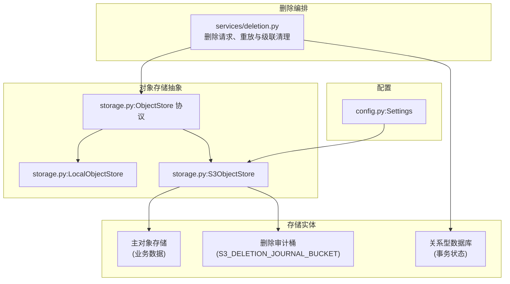
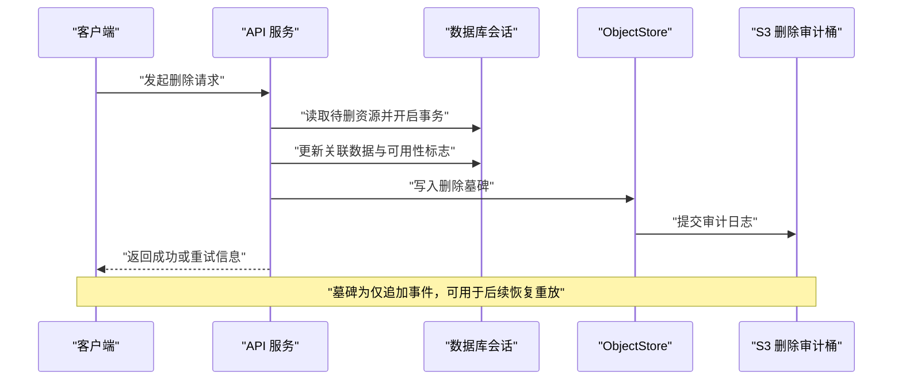
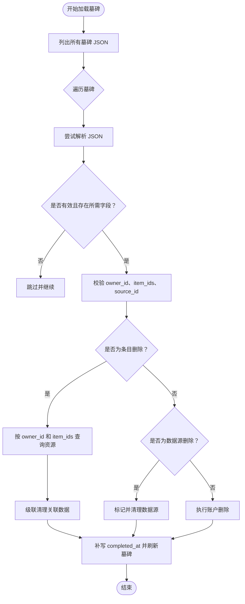
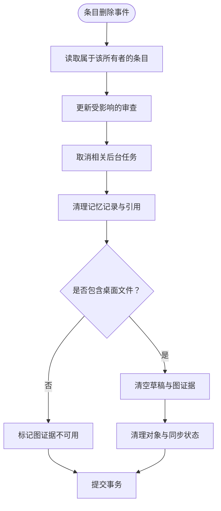
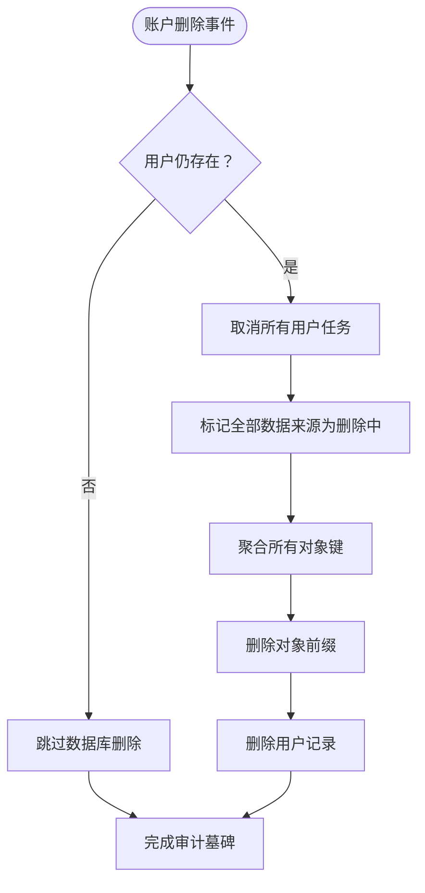
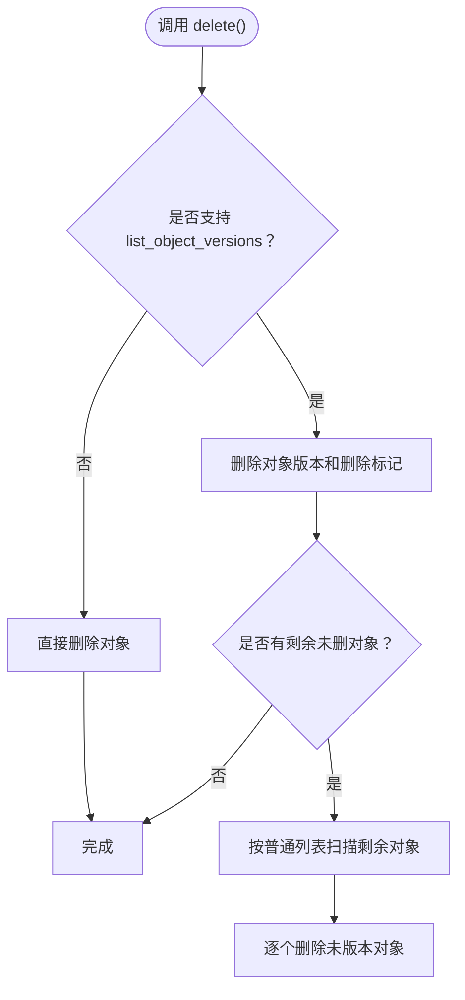
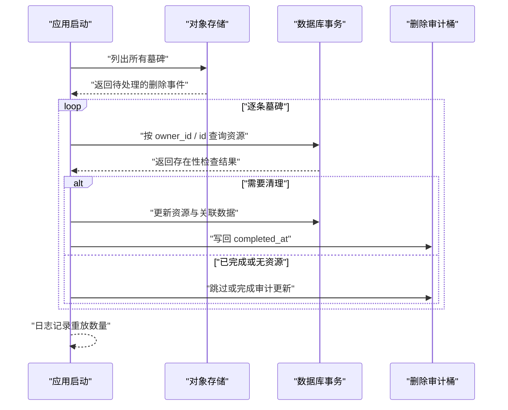
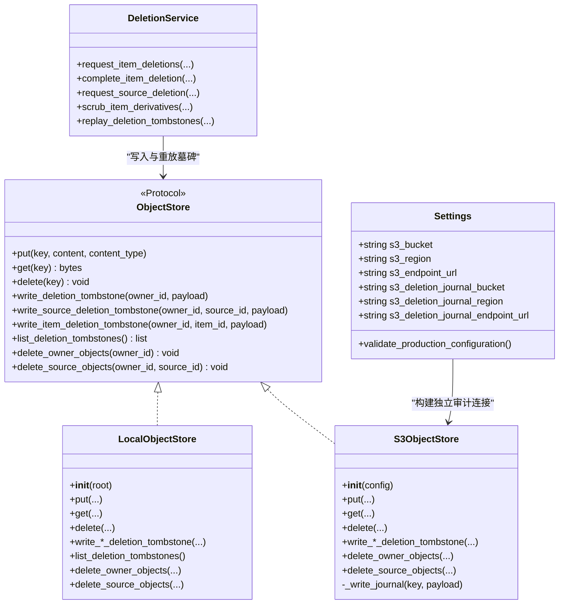
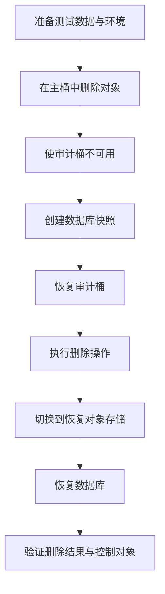

# 删除审计机制

<cite>
**本文引用的文件**   
- [deletion.py](file://src/personal_ai_life_os/services/deletion.py)
- [storage.py](file://src/personal_ai_life_os/storage.py)
- [config.py](file://src/personal_ai_life_os/config.py)
- [verify_joint_restore.py](file://scripts/verify_joint_restore.py)
</cite>

## 目录
1. [引言](#引言)
2. [项目结构与范围](#项目结构与范围)
3. [核心组件](#核心组件)
4. [架构总览](#架构总览)
5. [详细组件分析](#详细组件分析)
6. [依赖关系分析](#依赖关系分析)
7. [性能与容量优化](#性能与容量优化)
8. [故障排查指南](#故障排查指南)
9. [结论](#结论)
10. [附录：恢复操作与最佳实践](#附录恢复操作与最佳实践)

## 引言
本文件系统性说明 Personal-AI-Life-OS 中的删除审计机制。该机制通过“删除墓碑（tombstone）日志”实现不可变、可重放的删除历史，并将业务数据、对象存储和独立审计存储分离；在数据库与对象存储均发生故障时，仍能基于备份与审计记录完成数据恢复。文档涵盖以下关键主题：

- 删除时间的精确记录、操作者归属与关联资源的全量追踪。
- 对象存储中墓碑的实现方式与安全隔离设计。
- S3 删除审计日志的独立配置与安全边界。
- 级联清理逻辑：资源、索引状态、图证据以及外键约束。
- 删除操作的完整性校验、防误写与启动保护。
- 性能优化策略和资源清理最佳实践。
- 从备份恢复的流程与灾难场景处理指导。

需要注意：当前实现以时间顺序追加不可变的 JSON 删除事件，并通过启动阶段的重放流程保证幂等恢复；未实现基于数字签名或外部加密签名的内容完整性签名机制，因此防篡改能力主要来自独立的审计桶隔离与访问控制。

## 项目结构与范围
删除审计机制主要涉及三个层次：

- **服务层删除编排**：负责事务内清理用户资源、更新关联表、标记图证据可用性以及将删除事件写入对象存储。
- **对象存储抽象层**：提供统一 `ObjectStore` 接口，支持本地文件系统与 S3 兼容后端，并在 S3 后端把删除墓碑写入独立的审计桶。
- **配置验证层**：禁止生产环境使用相同桶作为主对象存储与删除审计日志。

图表来源
- [deletion.py:1-110](file://src/personal_ai_life_os/services/deletion.py#L1-L110)
- [storage.py:12-41](file://src/personal_ai_life_os/storage.py#L12-L41)
- [storage.py:129-264](file://src/personal_ai_life_os/storage.py#L129-L264)
- [config.py:46-111](file://src/personal_ai_life_os/config.py#L46-L111)

章节来源
- [deletion.py:1-352](file://src/personal_ai_life_os/services/deletion.py#L1-L352)
- [storage.py:12-264](file://src/personal_ai_life_os/storage.py#L12-L264)
- [config.py:46-111](file://src/personal_ai_life_os/config.py#L46-L111)

## 核心组件

### 删除服务与墓碑生命周期
删除服务定义三类删除事件：

| 删除类型 | 唯一标识字段 | 触发场景 | 典型用途 |
|---|---|---|---|
| 条目级删除 | `tombstone_id` | 单个文件条目被删除 | 原子化记录一个或多个条目的删除序列 |
| 数据源级删除 | `source_id` | 整个外部数据源被撤销或删除 | 清理某个接入源的元数据和对应对象 |
| 账户级删除 | 无单独 ID，按 `owner_id` 扫描墓碑 | 用户账号删除 | 清理全部用户资源、取消任务并删除账号记录 |

墓碑包含的关键审计字段包括：

- `owner_id`：拥有者标识。
- `requested_at` / `completed_at`：请求时间与完成时间。
- `item_ids`：被删除条目集合。
- `desktop_file_id` 与 `object_keys`：桌面相关文件及其对象键集合。
- `source_id`：当为数据源或账户级删除时的关联来源。

章节来源
- [deletion.py:16-117](file://src/personal_ai_life_os/services/deletion.py#L16-L117)

### 对象存储抽象与 S3 审计桶
`ObjectStore` 协议暴露对象读写、批量删除以及墓碑读写的标准方法。本地存储直接落盘到 `.deletion-tombstones` 子目录；S3 后端则将墓碑写入独立 bucket：

- 主对象桶用于存储用户内容。
- 删除审计桶默认复用主桶，但生产环境必须通过 `s3_deletion_journal_bucket` 指定不同桶。
- 可通过独立 region 或 endpoint_url 进一步隔离审计存储。

章节来源
- [storage.py:12-41](file://src/personal_ai_life_os/storage.py#L12-L41)
- [storage.py:129-200](file://src/personal_ai_life_os/storage.py#L129-L200)
- [storage.py:225-233](file://src/personal_ai_life_os/storage.py#L225-L233)
- [config.py:48-50](file://src/personal_ai_life_os/config.py#L48-L50)

## 架构总览

图表来源
- [deletion.py:39-117](file://src/personal_ai_life_os/services/deletion.py#L39-L117)
- [storage.py:170-200](file://src/personal_ai_life_os/storage.py#L170-L200)

## 详细组件分析

### 删除墓碑的完整性与不可变性
删除墓碑具有以下特征：

- 每个墓碑写入一次，随后通过覆盖字段增加完成标记；已有事件不会被重写为未完成状态。
- 条目级墓碑通过 `tombstone_id` 去重；ID 来自规范化后的 UUID。
- 加载墓碑时会解析 JSON，若格式非法则抛出异常并阻止启动，防止损坏日志污染正常业务流程。
- 本地路径拒绝软链接逃逸；S3 路径需通过合法键校验。

图表来源
- [deletion.py:201-352](file://src/personal_ai_life_os/services/deletion.py#L201-L352)

章节来源
- [deletion.py:11-25](file://src/personal_ai_life_os/services/deletion.py#L11-L25)
- [deletion.py:39-79](file://src/personal_ai_life_os/services/deletion.py#L39-L79)
- [deletion.py:191-200](file://src/personal_ai_life_os/services/deletion.py#L191-L200)

### 删除的时间戳、操作者与信息追溯
每个删除事件的审计字段都保留以下信息：

| 字段 | 语义 | 审计价值 |
|---|---|---|
| `owner_id` | 所属用户 | 判断权限边界和租户隔离 |
| `requested_at` | 首次记录时间 | 建立删除时间线起点 |
| `completed_at` | 完成时间 | 区分“已申请”和“已完成”状态 |
| `item_ids` | 受影响条目列表 | 精确定位可审计的最小数据单元 |
| `desktop_file_id` | 桌面附件条目 | 关联文件级清理与索引失效 |
| `source_id` | 数据源标识 | 用于溯源导入来源 |

此外，系统还会更新如下辅助审计痕迹：

- `deleted_at`：标记实际被删除或废弃的数据行。
- `is_current = False`：表示旧版本或临时资源不再生效。
- 审查记录和记忆记录的 `invalidated` 状态与精简内容，体现下游模型输入变化。
- 背景任务状态改为 `cancelled`，错误代码标注为 `source_deleting`，便于运维查看。

章节来源
- [deletion.py:39-79](file://src/personal_ai_life_os/services/deletion.py#L39-L79)
- [deletion.py:81-117](file://src/personal_ai_life_os/services/deletion.py#L81-L117)
- [deletion.py:119-175](file://src/personal_ai_life_os/services/deletion.py#L119-L175)
- [deletion.py:177-200](file://src/personal_ai_life_os/services/deletion.py#L177-L200)
- [deletion.py:201-271](file://src/personal_ai_life_os/services/deletion.py#L201-L271)

### 级联清理逻辑
#### 条目级清理
当单个 `SourceItem` 被删除时，系统会：

1. 获取所有者范围内的目标条目。
2. 将与这些条目关联的 Review 标记为 `invalidated`，清空最终文本，并移除被删条目的引用。
3. 取消仍排队或运行中与审查相关的后台任务。
4. 清理 MemoryRecord 的正文与作者身份，并将其状态标记为 `invalidated`。
5. 对桌面文件额外执行更严格的清理：
   - 清除草稿正文、引文及状态。
   - 将图证据的引文清空并把可用性设为 `deleted`。
   - 重置 SourceItem 的可识别字段。
   - 将文件夹项标记为 `deleted`。

图表来源
- [deletion.py:119-175](file://src/personal_ai_life_os/services/deletion.py#L119-L175)
- [deletion.py:271-287](file://src/personal_ai_life_os/services/deletion.py#L271-L287)

章节来源
- [deletion.py:119-175](file://src/personal_ai_life_os/services/deletion.py#L119-L175)

#### 数据源级清理
针对 `source_id` 的删除会：

1. 查找该来源下的所有 `SourceItem`。
2. 复用条目级衍生数据清理逻辑。
3. 收集与数据源相关的所有对象键。
4. 删除对象存储中的数据对象。
5. 删除数据源对象前缀，并删除数据库中的 `SourceConnection` 记录。

这一过程确保数据库与对象存储的一致性，同时把删除事件持久化到审计桶。

章节来源
- [deletion.py:273-277](file://src/personal_ai_life_os/services/deletion.py#L273-L277)
- [deletion.py:315-333](file://src/personal_ai_life_os/services/deletion.py#L315-L333)

#### 账户级清理
账户删除是最彻底的回收路径：

1. 如果用户仍存在，记录删除请求时间并取消全部后台任务。
2. 将该用户下所有数据源状态设置为 `deleting`。
3. 聚合用户下所有 `SourceItem.object_key` 与 `SyncRun.object_key`。
4. 删除这些对象，再删除账户对象前缀。
5. 删除数据库中的用户记录。
6. 完成墓碑标记。

图表来源
- [deletion.py:335-352](file://src/personal_ai_life_os/services/deletion.py#L335-L352)

章节来源
- [deletion.py:335-352](file://src/personal_ai_life_os/services/deletion.py#L335-L352)

### 对象存储中的删除与版本管理
对象存储删除并非简单“删除键”，而是考虑兼容性：

- S3 后端优先尝试删除具体对象的多个版本和删除标记。
- 如果不支持版本枚举，则回退为普通删除。
- 前缀删除会先列举对象版本，再列举常规对象；两者结合以覆盖更多 S3 兼容实现。
- 本地实现会在删除文件后尝试递归删除空父目录，以减少目录残留。

图表来源
- [storage.py:150-159](file://src/personal_ai_life_os/storage.py#L150-L159)
- [storage.py:234-264](file://src/personal_ai_life_os/storage.py#L234-L264)

章节来源
- [storage.py:129-159](file://src/personal_ai_life_os/storage.py#L129-L159)
- [storage.py:234-264](file://src/personal_ai_life_os/storage.py#L234-L264)

### S3 删除审计桶的安全隔离
S3 审计桶的主要安全措施：

| 安全属性 | 实现方式 |
|---|---|
| 桶隔离 | 配置文件要求生产环境中删除审计桶不能等于主对象桶 |
| 独立连接参数 | 可通过独立 region 和 endpoint_url 指向不同 S3 后端 |
| 服务器端加密 | 主对象写入和审计日志写入都启用 `AES256` 服务器端加密 |
| 不可变审计路径 | 墓碑键结构固定为 `.deletion-tombstones/*`，便于限定只读访问策略 |
| 启动保护 | 损坏或不完整墓碑会导致启动失败，避免静默丢失删除意图 |
| 键合法性校验 | 对象键不允许绝对路径、`.`、`..`、反斜杠或空字符 |
| 本地路径防护 | 本地存储拒绝软链接和路径逃逸 |

注意事项：

- 当前实现未对墓碑内容计算数字签名或使用外部密钥进行内容认证。
- 审计桶的“防篡改”主要通过权限最小化、网络隔离和加密实现；若要进一步提升防篡改能力，建议在上层引入内容摘要链或外部签名服务。

章节来源
- [storage.py:170-200](file://src/personal_ai_life_os/storage.py#L170-L200)
- [config.py:86-111](file://src/personal_ai_life_os/config.py#L86-L111)

### 数据恢复流程
系统通过启动阶段的墓碑重放函数完成恢复：

1. 应用启动时扫描删除审计桶中的墓碑。
2. 逐条解析并校验必需字段。
3. 在数据库事务中查找对应资源并执行增量清理。
4. 如果已有 `completed_at`，则视为已恢复，不再重复执行核心删除步骤。
5. 如果没有 `completed_at`，则补充完成时间戳并完成墓碑闭环。

这个机制使系统在“数据库备份恢复 + 新对象存储”的场景中能够自动补齐缺失的删除结果。

图表来源
- [deletion.py:201-352](file://src/personal_ai_life_os/services/deletion.py#L201-L352)

章节来源
- [deletion.py:201-352](file://src/personal_ai_life_os/services/deletion.py#L201-L352)

## 依赖关系分析

图表来源
- [storage.py:12-41](file://src/personal_ai_life_os/storage.py#L12-L41)
- [storage.py:44-126](file://src/personal_ai_life_os/storage.py#L44-L126)
- [storage.py:129-233](file://src/personal_ai_life_os/storage.py#L129-L233)
- [deletion.py:39-117](file://src/personal_ai_life_os/services/deletion.py#L39-L117)
- [deletion.py:201-352](file://src/personal_ai_life_os/services/deletion.py#L201-L352)
- [config.py:46-111](file://src/personal_ai_life_os/config.py#L46-L111)

章节来源
- [storage.py:12-264](file://src/personal_ai_life_os/storage.py#L12-L264)
- [deletion.py:39-352](file://src/personal_ai_life_os/services/deletion.py#L39-L352)
- [config.py:46-111](file://src/personal_ai_life_os/config.py#L46-L111)

## 性能与容量优化

### 事务批量化
- 多表更新尽量使用 SQL `update` 语句，而非逐个 ORM 实例修改。
- `scrub_item_derivatives` 在清理完成后延迟 commit，有利于在多次变更中减少事务开销。

### 对象删除迭代
- S3 后端采用分页列举版本，然后批量 `delete_objects`，减少 API 次数。
- 对于不支持版本的前缀删除，会再次使用通用列表接口兜底，避免遗漏。

### 审计日志写入
- 墓碑写入发生在对象存储层，而不是关系型数据库主表中，降低事务压力和数据库锁竞争。
- 审计事件按 `owner_id`、`source_id`、`item_id` 路径组织，便于按租户快速过滤。

### 清理范围控制
- 在删除桌面文件之前校验对象键前缀是否属于当前 `owner_id`，防止误删跨租户资源。
- 在账户级删除中先收集所有对象键后再执行删除，避免中途因部分失败进入不一致状态。

### 推荐实践
- 为对象存储启用版本控制，以便在不改动业务逻辑的情况下保留历史对象和删除标记。
- 定期归档或压缩旧的删除审计日志，避免审计桶无限增长。
- 监控墓碑重放过程中的错误日志，及时发现损坏事件。
- 在生产环境严格校验 `S3_DELETION_JOURNAL_BUCKET != S3_BUCKET`。

章节来源
- [deletion.py:81-117](file://src/personal_ai_life_os/services/deletion.py#L81-L117)
- [deletion.py:201-352](file://src/personal_ai_life_os/services/deletion.py#L201-L352)
- [storage.py:234-264](file://src/personal_ai_life_os/storage.py#L234-L264)

## 故障排查指南

### 启动时报墓碑格式错误
现象：应用无法启动并提示删除墓碑 malformed。

原因：

- 某个墓碑 JSON 缺少必需字段。
- `owner_id`、`tombstone_id`、`item_ids` 或 `source_id` 不是合法 UUID。
- JSON 序列化损坏或被外部工具改写。

处理建议：

1. 检查审计桶中 `.deion-tombstones/*` 下的 JSON 文件。
2. 确认损坏事件是否已在数据库中实际完成删除。
3. 如确实需要修复，先在独立测试环境复制审计日志，排除无效事件后重新启动。

章节来源
- [deletion.py:201-242](file://src/personal_ai_life_os/services/deletion.py#L201-L242)

### 删除后对象仍可被读取
可能原因：

- 对象存储未真正删除，或者版本控制引入了新的删除标记。
- 删除发生在数据库备份之后，尚未启动重放。
- S3 兼容实现未正确支持版本删除。

处理建议：

1. 检查是否存在对应的墓碑记录。
2. 核对主对象桶与恢复对象桶的键命名一致。
3. 在恢复后重新运行备份恢复流程，确保墓碑被重放。
4. 使用脚本或云控制台确认对象是否还存在隐藏版本或删除标记。

章节来源
- [storage.py:150-159](file://src/personal_ai_life_os/storage.py#L150-L159)
- [verify_joint_restore.py:47-137](file://scripts/verify_joint_restore.py#L47-L137)

### 审计桶与主桶共享
风险：

- 删除审计桶与主对象桶相同时，生产环境会被配置验证拒绝。
- 即使允许共用，也会削弱“删除不可见但审计可见”的设计优势。

处理建议：

- 始终设置独立的 `S3_DELETION_JOURNAL_BUCKET`。
- 如确需合并，应在外部审批流程中进行隔离策略验证，但当前实现明确禁止这种配置。

章节来源
- [config.py:86-111](file://src/personal_ai_life_os/config.py#L86-L111)

### 桌面文件删除后搜索或图谱仍引用旧数据
可能原因：

- 未在删除流程中更新索引或图证据可用性。
- 删除请求未完成，只有请求时间没有完成时间。

处理建议：

1. 确认审计桶中对应条目是否已有 `completed_at`。
2. 检查图证据的 availability 是否已被标记为 `deleted`。
3. 检查后台任务是否被取消，并根据需要重建搜索索引或缓存。

章节来源
- [deletion.py:119-175](file://src/personal_ai_life_os/services/deletion.py#L119-L175)
- [deletion.py:287-313](file://src/personal_ai_life_os/services/deletion.py#L287-L313)

## 结论
Personal-AI-Life-OS 的删除审计机制将“删除意图”和“实际数据保留”分离，通过对象存储中的审计墓碑解决分布式数据一致性难题。其核心优势包括：

- 删除事件可重放、可审计、支持幂等恢复。
- 审计日志与应用数据可物理隔离，满足数据安全与合规需求。
- 对 Review、MemoryRecord、GraphEvidence、BackgroundJob、DesktopDraft 和 SyncRun 等多类关联表进行了级联处理。
- 对桌面文件和外部数据源分别提供更细粒度的清理策略。
- 提供完整的备份恢复演练脚本，覆盖数据库与对象存储双重失效的场景。

需要持续改进的方向包括：

- 引入外部内容完整性校验，例如对每条墓碑附加数字摘要，由离线审计系统进行哈希校验。
- 将审计事件迁移至专用日志存储，以获得更好的时间序列查询与长期归档能力。
- 根据业务合规需求配置独立的保存窗口策略，并对过期墓碑进行归档或脱敏。

[无需章节来源，因为本节为总结性内容]

## 附录：恢复操作与最佳实践

### 数据恢复操作流程
建议按照以下步骤执行恢复：

1. 准备数据库备份文件。
2. 恢复到一个新数据库。
3. 创建新的 S3 兼容主存储桶用于恢复环境。
4. 从原对象存储导出必要对象或保持对象键一致。
5. 启动应用，使其自动重放删除审计桶中的墓碑。
6. 验证关键数据在恢复后可访问，而被删除数据不再暴露。
7. 使用联合恢复脚本验证主桶、恢复桶和审计桶的一致性。

章节来源
- [verify_joint_restore.py:47-137](file://scripts/verify_joint_restore.py#L47-L137)

### 备份验证方法
恢复脚本演示了典型的端到端验证：

- 注册两个用户，模拟跨用户隔离。
- 创建可删除和应保留的对象。
- 主动删除主对象并模拟对象桶损坏。
- 在审计桶暂时不可用时验证删除不应立即生效于数据访问。
- 恢复审计桶后执行正式删除。
- 切换主对象桶为恢复桶并恢复数据库。
- 启动后确认删除仍然生效，且被保留的控制对象不受影响。

图表来源
- [verify_joint_restore.py:47-137](file://scripts/verify_joint_restore.py#L47-L137)

### 灾难恢复数据处理指导
- 如果审计桶丢失：应假定无法安全地自动完成历史删除，需人工核验数据库状态并按最低可用原则恢复。
- 如果主对象桶丢失：可借助恢复环境恢复数据库后，再从备份还原对象或重新触发数据拉取。
- 如果两者都丢失：应依据数据库事务与外部系统状态重新评估数据一致性，必要时进入受限模式并通知受影响用户。
- 所有恢复操作都应记录审计日志和外部变更工单，避免无监督的大规模删除或恢复。

[无需章节来源，因为本节为操作性建议，不直接分析特定代码片段]