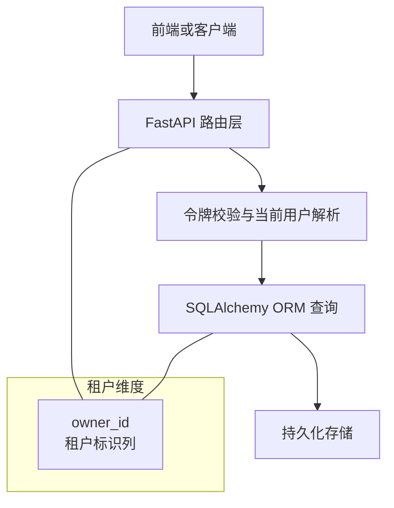
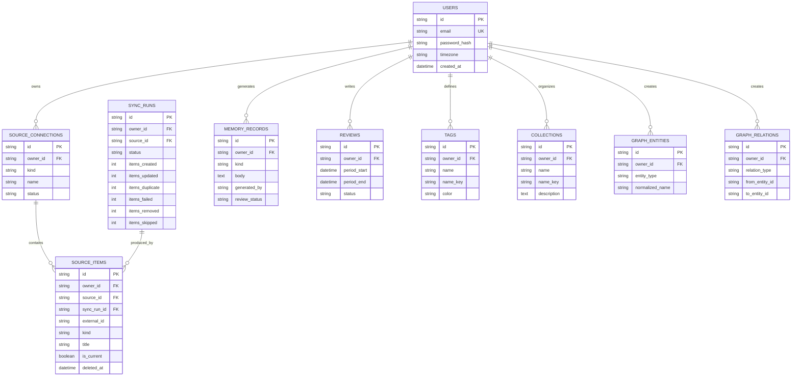
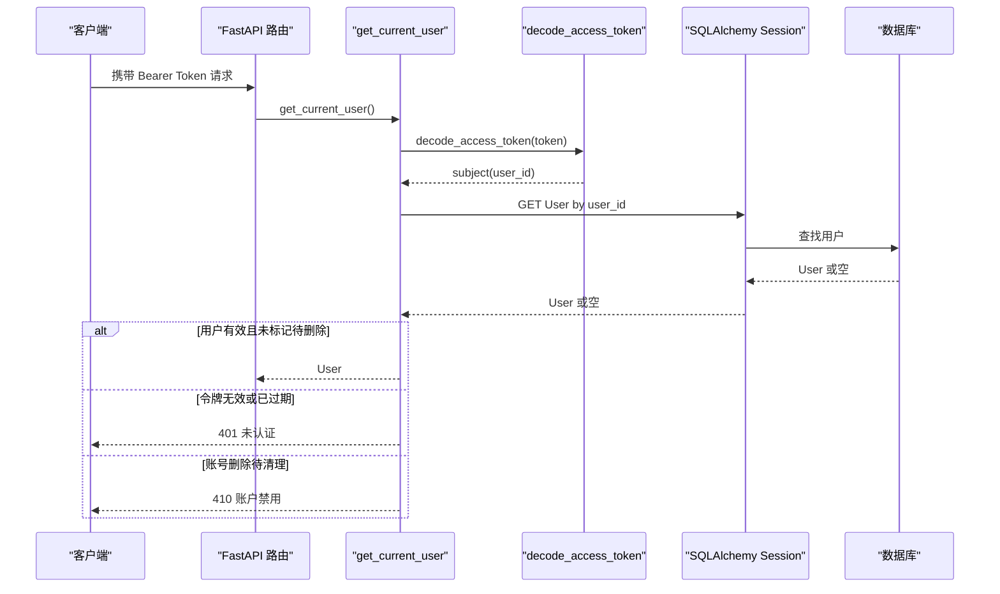
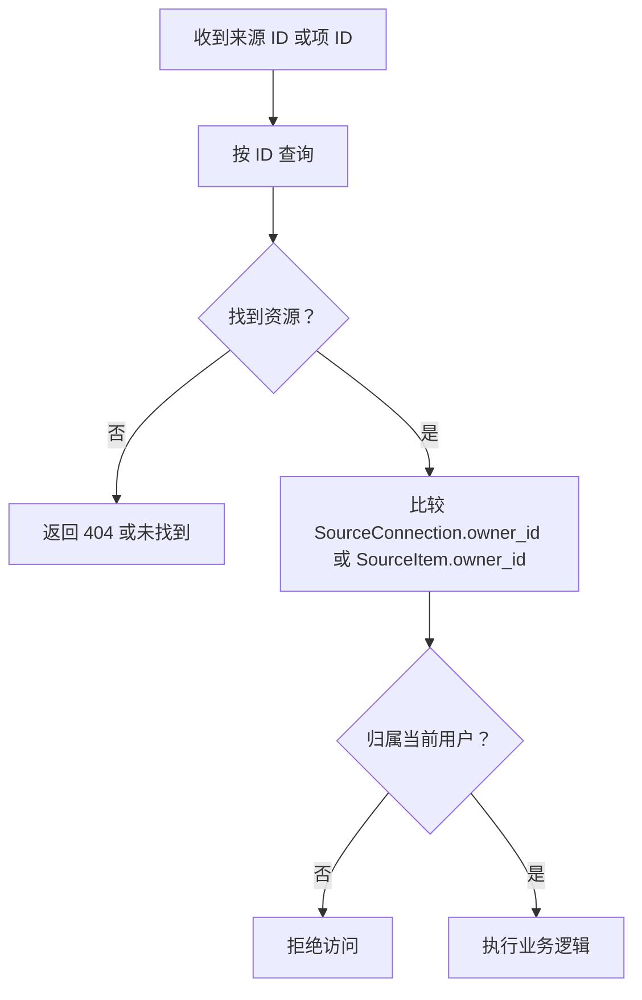
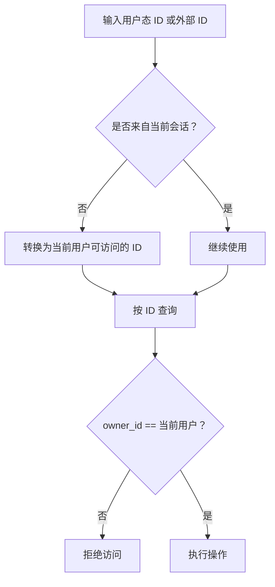

# 多租户数据隔离机制

<cite>
**本文引用文件**
- [models.py](file://src/personal_ai_life_os/models.py)
- [0de3d72c2e1f_initial_tenant_scoped_schema.py](file://migrations/versions/0de3d72c2e1f_initial_tenant_scoped_schema.py)
- [db.py](file://src/personal_ai_life_os/db.py)
- [security.py](file://src/personal_ai_life_os/security.py)
- [deps.py](file://src/personal_ai_life_os/api/deps.py)
- [account.py](file://src/personal_ai_life_os/api/routes/account.py)
- [sources.py](file://src/personal_ai_life_os/api/routes/sources.py)
- [graph_review.py](file://src/personal_ai_life_os/api/routes/graph_review.py)
- [qa.py](file://src/personal_ai_life_os/api/routes/qa.py)
- [organization.py](file://src/personal_ai_life_os/api/routes/organization.py)
- [reminders.py](file://src/personal_ai_life_os/api/routes/reminders.py)
- [reviews.py](file://src/personal_ai_life_os/api/routes/reviews.py)
- [saved_searches.py](file://src/personal_ai_life_os/api/routes/saved_searches.py)
- [jobs.py](file://src/personal_ai_life_os/api/routes/jobs.py)
- [plugins.py](file://src/personal_ai_life_os/services/plugins.py)
- [deletion.py](file://src/personal_ai_life_os/services/deletion.py)
- [graph_merges.py](file://src/personal_ai_life_os/services/graph_merges.py)
- [ingestion.py](file://src/personal_ai_life_os/services/ingestion.py)
- [test_reviews_account.py](file://tests/test_reviews_account.py)
</cite>

## 目录
1. [引言](#引言)
2. [项目结构与边界](#项目结构与边界)
3. [核心数据模型与租户字段](#核心数据模型与租户字段)
4. [数据库层面隔离设计](#数据库层面隔离设计)
5. [应用层认证与授权中间件](#应用层认证与授权中间件)
6. [API 路由中的租户过滤器模式](#api-路由中的租户过滤器模式)
7. [唯一约束与命名冲突防护](#唯一约束与命名冲突防护)
8. [跨租户数据泄露防护](#跨租户数据泄露防护)
9. [审计日志记录机制](#审计日志记录机制)
10. [性能特征与索引优化](#性能特征与索引优化)
11. [安全测试用例建议](#安全测试用例建议)
12. [常见问题排查指南](#常见问题排查指南)
13. [结论](#结论)

## 引言

Personal-AI-Life-OS 是多租户个人知识操作系统，但当前实现以“单租户”为核心：一个数据库连接对应一个逻辑用户，`owner_id` 用于强制每条业务实体都属于某个 `users` 表用户。文档对象、来源连接、提取项、记忆记录、标签、集合、图谱实体与关系、审阅等核心概念全部通过 `owner_id` 进行隔离。

该机制依赖三个层次：

| 层次 | 作用 | 关键实现位置 |
|---|---|---|
| 数据模型层 | 在所有核心表中声明 `owner_id` 外键 | [models.py](file://src/personal_ai_life_os/models.py) |
| 迁移与约束层 | 创建带 `owner_id` 的表结构和唯一约束 | [0de3d72c2e1f_initial_tenant_scoped_schema.py](file://migrations/versions/0de3d72c2e1f_initial_tenant_scoped_schema.py) |
| API 路由层 | 解析当前登录用户 ID，并在查询中显式附加 `owner_id` 条件 | [deps.py](file://src/personal_ai_life_os/api/deps.py)、[sources.py](file://src/personal_ai_life_os/api/routes/sources.py) 等路由文件 |

系统没有使用数据库 schema、行级安全策略或会话变量自动注入 `owner_id`；隔离责任主要落在代码层对 SQL 查询的限制上。因此，正确性高度依赖每个新增接口是否始终将请求中的 `user.id` 或接收到的 `owner_id` 与目标表做相等过滤。

## 项目结构与边界



这个架构说明两个重点：

1. 租户身份不直接传入 SQL。它首先经过 JWT 验证和 `get_current_user` 转换为用户实体。
2. `owner_id` 是显式的 SQL 过滤条件，不是数据库级自动规则。

**图表来源**
- [security.py:1-54](file://src/personal_ai_life_os/security.py#L1-L54)
- [deps.py:1-65](file://src/personal_ai_life_os/api/deps.py#L1-L65)
- [models.py:120-370](file://src/personal_ai_life_os/models.py#L120-L370)

**章节来源**
- [security.py:1-54](file://src/personal_ai_life_os/security.py#L1-L54)
- [deps.py:1-65](file://src/personal_ai_life_os/api/deps.py#L1-L65)

## 核心数据模型与租户字段

### 核心实体关系图



**图表来源**
- [models.py:87-370](file://src/personal_ai_life_os/models.py#L87-L370)
- [models.py:400-610](file://src/personal_ai_life_os/models.py#L400-L610)
- [0de3d72c2e1f_initial_tenant_scoped_schema.py:1-220](file://migrations/versions/0de3d72c2e1f_initial_tenant_scoped_schema.py#L1-L220)

### 每张表的租户实现摘要

| 表名 | 租户字段 | 主关系 | 隔离语义 |
|---|---|---|---|
| `users` | 无外层 `owner_id`，自身即租户根 | 账号本身 | 所有其他实体都指向该用户 |
| `source_connections` | `owner_id` | `User.sources` | 数据源属于单个用户 |
| `source_items` | `owner_id` | `SourceConnection.items`、`MemoryRecord.source_items` | 提取项属于某个用户的某条来源 |
| `sync_runs` | `owner_id` | `SyncRun.source` | 同步任务属于某个用户 |
| `memory_records` | `owner_id` | Memory record-to-item 关联 | 记忆记录属于单个用户 |
| `reviews` | `owner_id` | Review-to-item 关联 | 审阅报告按用户周期拆分 |
| `tags` | `owner_id` + `name_key` | Tag-to-item 多对多 | 用户内唯一标签名称 |
| `collections` | `owner_id` + `name_key` | Collection-to-item 多对多 | 用户内唯一集合名称 |
| `graph_entities` | `owner_id` | 图谱实体 | 图谱节点分租户 |
| `graph_relations` | `owner_id` | 图谱关系 | 图谱边分租户 |
| `plugin_audit_logs` | `owner_id` | 插件审计日志 | 记录用户范围内的插件行为 |
| `background_jobs` | `worker_id` 作为执行者，仍含 `owner_id` | 后台作业 | 作业与租户分离、由执行者运行 |

需要特别注意：`DesktopFolder` 和 `DesktopFolderFile` 是通过 `source_id` 间接归属到 `source_connections`，而不是直接使用 `users.owner_id`。这种间接链路增加了一条完整性检查链：要访问桌面文件夹数据，必须证明该 `source_id` 所属的 `source_connections.owner_id` 与当前用户一致。

**章节来源**
- [models.py:120-370](file://src/personal_ai_life_os/models.py#L120-L370)
- [0de3d72c2e1f_initial_tenant_scoped_schema.py:1-220](file://migrations/versions/0de3d72c2e1f_initial_tenant_scoped_schema.py#L1-L220)

## 数据库层面隔离设计

### 外键隔离链

大多数核心表通过 `owner_id` 直接外键指向 `users.id`，并配置 `ondelete="CASCADE"`。这意味着删除用户会级联删除其关联业务数据，防止孤立项跨租户泄漏。

| 外键方向 | 含义 |
|---|---|
| `source_connections.owner_id → users.id` | 数据来源属于用户 |
| `source_items.owner_id → users.id` | 提取项属于用户 |
| `source_items.source_id → source_connections.id` | 提取项来源于某来源连接 |
| `sync_runs.owner_id → users.id` | 同步运行属于用户 |
| `sync_runs.source_id → source_connections.id` | 同步运行写入某来源 |
| `memory_records.owner_id → users.id` | 记忆记录属于用户 |
| `reviews.owner_id → users.id` | 审阅记录属于用户 |
| `tags.owner_id → users.id` | 标签属于用户 |
| `collections.owner_id → users.id` | 集合属于用户 |

对于多对多关联表，如 `item_tags`、`item_collections`、`memory_record_sources`、`review_sources`，租户隔离依然依赖两端主实体上的 `owner_id`：只要 `items` 和 `tags`、`collections` 都属于同一用户，中间表不会造成天然跨租户关联。

**章节来源**
- [models.py:1-90](file://src/personal_ai_life_os/models.py#L1-L90)
- [models.py:120-370](file://src/personal_ai_life_os/models.py#L120-L370)
- [0de3d72c2e1f_initial_tenant_scoped_schema.py:1-220](file://migrations/versions/0de3d72c2e1f_initial_tenant_scoped_schema.py#L1-L220)

### SQLite 外键开启方式

项目在使用 SQLite 时启用外键约束：

```python
cursor.execute("PRAGMA foreign_keys=ON")
```

这是重要安全措施，使 SQLite 也受外键约束保护。若未来引入新的关联表而未设置外键或未加 `owner_id`，这条约束链就可能被绕过。

**章节来源**
- [db.py:26-56](file://src/personal_ai_life_os/db.py#L26-L56)

## 应用层认证与授权中间件

### 认证流程序列图



**图表来源**
- [security.py:1-54](file://src/personal_ai_life_os/security.py#L1-L54)
- [deps.py:1-65](file://src/personal_ai_life_os/api/deps.py#L1-L65)

### 当前用户解析逻辑

`deps.py` 暴露了两个依赖：

1. `get_current_user`：普通 API 使用。
2. `get_user_for_account_delete`：账号注销专用，允许在待清理期间访问受限删除接口。

解析过程包括：

1. 从请求头读取可选的 Bearer token。
2. 若缺少 token，返回 401。
3. 调用 `security.decode_access_token` 解析 JWT。
4. 用 SQLAlchemy Session 加载 `User`。
5. 若用户不存在，返回 401。
6. 若用户 `deletion_requested_at` 非空，且不是注销专用依赖，返回 410。

### JWT 中租户身份来源

JWT 载荷只包含 `sub`，也就是用户 ID，不包含 `tenant_id`、组织 ID 或其他环境信息。因此，“租户”在运行时就是当前鉴权成功的那个 `User.id`。

**章节来源**
- [security.py:1-54](file://src/personal_ai_life_os/security.py#L1-L54)
- [deps.py:1-65](file://src/personal_ai_life_os/api/deps.py#L1-L65)

## API 路由中的租户过滤器模式

### 来源连接的典型访问模式

`sources.py` 展示了完整的数据隔离模板：

- 创建来源时写入 `owner_id=user.id`。
- 列举来源时使用 `SourceConnection.owner_id == user.id`。
- 根据路径参数获取来源后再次校验 `SourceConnection.owner_id == user.id`。
- 查询同步任务时同样追加 `owner_id` 过滤器。
- 获取原始内容或删除条目时也要求 `SourceItem.owner_id == user.id`。

这构成一种常见的双重检查模式：**先通过主键定位资源，再用 `owner_id` 确认归属**。如果第二条查询返回空结果，表示当前用户无权访问该外部 ID。



**图表来源**
- [sources.py:63-366](file://src/personal_ai_life_os/api/routes/sources.py#L63-L366)

### 其他已验证的租户过滤点

| 模块 | 过滤场景 | 过滤表达式模式 |
|---|---|---|
| `account.py` | 归档页面列出用户的所有数据 | `where(..._id == user.id)` 或 `== owner_id` |
| `graph_review.py` | 图谱审查项列表 | `GraphReviewItem.owner_id == user.id` |
| `qa.py` | QA 线程读写 | `QaThread.owner_id == owner_id/user.id` |
| `organization.py` | 标签和集合访问 | `Tag.id == tag_id and Tag.owner_id == owner_id` |
| `reminders.py` | 提醒项列表和修改 | `Reminder.owner_id == user.id` |
| `reviews.py` | 审阅详情和列表 | `Review.owner_id == owner_id/user.id` |
| `saved_searches.py` | 保存搜索项读写 | `SavedSearch.owner_id == owner_id/user.id` |
| `jobs.py` | 后台作业读取 | `BackgroundJob.id == job_id and BackgroundJob.owner_id == owner_id` |
| `ingestion.py` | 同步入口来源校验 | `SourceConnection.id == source.id and SourceConnection.owner_id == owner_id` |

**章节来源**
- [sources.py:63-366](file://src/personal_ai_life_os/api/routes/sources.py#L63-L366)
- [graph_review.py:1-120](file://src/personal_ai_life_os/api/routes/graph_review.py#L1-L120)
- [qa.py:1-110](file://src/personal_ai_life_os/api/routes/qa.py#L1-L110)
- [organization.py:1-115](file://src/personal_ai_life_os/api/routes/organization.py#L1-L115)
- [reminders.py:1-100](file://src/personal_ai_life_os/api/routes/reminders.py#L1-L100)
- [reviews.py:1-330](file://src/personal_ai_life_os/api/routes/reviews.py#L1-L330)
- [saved_searches.py:1-60](file://src/personal_ai_life_os/api/routes/saved_searches.py#L1-L60)
- [jobs.py:1-30](file://src/personal_ai_life_os/api/routes/jobs.py#L1-L30)
- [ingestion.py:380-395](file://src/personal_ai_life_os/services/ingestion.py#L380-L395)

### 已知风险点：账户归档页面的公开数据限制

`account.py` 中存在一条注释明确指出，归档页面的某些响应仅暴露公开信息，不包含 `owner_id`，也不对用户数据做权限检查；该行为需要后续改进以避免未来新增字段泄漏。这表明并非所有 `owner_id` 相关查询都是隐式安全的：开发者必须在扩展归档响应结构时手动保持公开属性。

**章节来源**
- [account.py:53-144](file://src/personal_ai_life_os/api/routes/account.py#L53-L144)

## 唯一约束与命名冲突防护

系统广泛使用“用户+逻辑名称”的唯一约束，避免同一个用户在数据库中产生同名冲突。

### 关键唯一约束表

| 约束名 | 表 | 组合键 | 目的 |
|---|---|---|---|
| `uq_source_item_version` | `source_items` | `owner_id`、`source_id`、`external_id`、`source_sha256` | 同一来源的外部ID+内容哈希只能保留一个版本，抑制重复入库 |
| `uq_tag_owner_name` | `tags` | `owner_id`、`name_key` | 用户内标签名称唯一 |
| `uq_collection_owner_name` | `collections` | `owner_id`、`name_key` | 用户内集合名称唯一 |
| `uq_saved_search_owner_name` | `saved_searches` | `owner_id`、`name_key` | 用户内保存搜索名称唯一 |
| `uq_review_period` | `reviews` | `owner_id`、`period_start`、`period_end` | 同一用户在相同周期内只存在一份审阅 |
| `uq_model_consent_owner_provider` | `model_consents` | `owner_id`、`provider_id` | 用户对一个模型提供商只有一个同意条目 |
| `uq_desktop_folder_file` | `desktop_folder_files` | `source_id`、`file_key` | 同一桌面来源下文件键唯一 |

`uq_source_item_version` 是最核心的去重约束之一：它不仅区分用户，还区分来源、外部 ID 和源码哈希。这样可以确保：

1. 不同用户拥有相同 `external_id` 不会冲突。
2. 同一来源重复拉取相同外部项不会无限复制。
3. 内容发生变化时，新版本可以通过哈希值进入新记录或处理分支。

**章节来源**
- [models.py:190-220](file://src/personal_ai_life_os/models.py#L190-L220)
- [models.py:260-310](file://src/personal_ai_life_os/models.py#L260-L310)
- [models.py:340-370](file://src/personal_ai_life_os/models.py#L340-L370)
- [models.py:100-115](file://src/personal_ai_life_os/models.py#L100-L115)
- [models.py:190-200](file://src/personal_ai_life_os/models.py#L190-L200)

## 跨租户数据泄露防护

### 三层防护矩阵

| 层级 | 防护措施 | 失效影响 |
|---|---|---|
| 令牌层 | JWT 中 `sub` 为当前用户 ID，不接受伪造子身份 | 攻击者无法直接用另一个用户 ID 构造可用令牌 |
| 模型层 | 每类实体都有 `owner_id` 外键，级联删除用户数据 | 孤儿数据会在用户删除时被自动清理 |
| 应用层 | API 查询同时使用“主键 + `owner_id`”过滤 | 即使知道他人数据 ID，也无法越过边界读取 |

### 推荐的安全查询模板

每个新接口都应遵循以下原则：

1. 如果是“用户数据”，不能信任前端提供的 ID，应优先基于当前用户上下文生成或推导。
2. 如果接口接受外部 ID，应先通过主键查询，再校验 `owner_id == current_user.id`。
3. 如果涉及跨表查询，应在每条 `join` 或 `where` 中显式包含 `owner_id`。
4. 如果返回聚合或统计结果，要确认聚合窗口是否误将其它租户的数据纳入范围。
5. 如果接口支持导出或归档，要检查返回字段是否可能暴露敏感元数据。



**图表来源**
- [deps.py:14-65](file://src/personal_ai_life_os/api/deps.py#L14-L65)
- [sources.py:98-160](file://src/personal_ai_life_os/api/routes/sources.py#L98-L160)

### 服务层的边界检查

服务层通常以 `owner_id` 字符串形式接收调用方提供的租户 ID，并由上层路由或内部调度器保证这个值来自合法主体。例如：

- `services/deletion.py` 在服务方法中使用 `owner_id` 过滤 Review、MemoryRecord、Reminder 与 SourceItem。
- `services/graph_merges.py` 在合并证据时按 `GraphEvidence.owner_id == owner_id` 过滤。
- `services/plugins.py` 在列出插件审计日志时按 `PluginAuditLog.owner_id == owner_id` 过滤。
- `services/ingestion.py` 在校验来源连接时要求 `SourceConnection.owner_id == owner_id`。

这些函数假设调用方传入的 `owner_id` 已经过鉴权。如果将来有后台进程、批量脚本或第三方集成直接调用这些函数，就必须重新实现“当前租户”校验。

**章节来源**
- [deletion.py:160-210](file://src/personal_ai_life_os/services/deletion.py#L160-L210)
- [graph_merges.py:165-295](file://src/personal_ai_life_os/services/graph_merges.py#L165-L295)
- [plugins.py:540-550](file://src/personal_ai_life_os/services/plugins.py#L540-L550)
- [ingestion.py:380-395](file://src/personal_ai_life_os/services/ingestion.py#L380-L395)

## 审计日志记录机制

系统至少包含两类与审计相关的设计：

1. **插件审计日志**：`plugin_audit_logs` 表包含 `owner_id`、`plugin_id`、`permission` 以及多个日志列，用于记录某个用户在特定插件下的权限和插件行为。
2. **变更与审核流**：`reviews` 及其版本 `review_versions` 保留了草稿、定稿文本和版本号；`sync_runs` 记录了数据同步过程中的数量、状态、错误码和时间范围。

这些日志表不仅用于排障，也可以成为检测异常行为的基础设施。例如：

- 同一用户频繁访问失败，可能是枚举 ID 或越权尝试。
- 同一插件权限被多次拒绝，可能表明存在自动化探测。
- 同步失败集中在特定来源，可能需要限制该来源的写入频率。

```mermaid
classDiagram
    class PluginManifest {
        +string owner_id
        +string name
        +bool active
    }

    class PluginAuditLog {
        +string id
        +string owner_id
        +string plugin_id
        +string permission
        +datetime created_at
        +json details
    }

    class PluginService {
        +query_audit_logs(owner_id)
        +record_log(plugin_manifest, action, result)
    }

    PluginManifest ||--o{ PluginAuditLog : logs_behavior_of
    PluginService --> PluginAuditLog : "写入"
    PluginService --> PluginManifest : "校验权限"
```

**图表来源**
- [models.py:700-760](file://src/personal_ai_life_os/models.py#L700-L760)
- [plugins.py:540-550](file://src/personal_ai_life_os/services/plugins.py#L540-L550)

**章节来源**
- [models.py:700-760](file://src/personal_ai_life_os/models.py#L700-L760)
- [plugins.py:120-130](file://src/personal_ai_life_os/services/plugins.py#L120-L130)
- [plugins.py:540-550](file://src/personal_ai_life_os/services/plugins.py#L540-L550)

## 性能特征与索引优化

系统在 `owner_id` 上大量使用复合索引，以便按用户快速定位数据，避免全表扫描。

### 主要索引分类

| 用途 | 示例索引 | 查询意义 |
|---|---|---|
| 用户范围过滤 | `ix_*_owner_id` | 快速筛选当前租户数据 |
| 常用排序或状态扫描 | `ix_memory_owner_status`、`ix_reminders_owner_due`、`ix_sync_runs_owner_created` | 减少按用户+状态的二次过滤成本 |
| 命名查询优化 | `ix_tags_owner_name`、`ix_collections_owner_name`、`ix_graph_entities_owner_name` | 支持按用户+规范化名称查询 |
| 来源与时间扫描 | `ix_items_owner_source`、`ix_items_owner_occurred` | 支持来源聚合、时间线查询 |

### 复杂查询时的隔离成本

当查询涉及多表关联时，如果没有明确的 `owner_id` 过滤，SQL 引擎可能会扫描大量不属于当前用户的记录，再进行内存过滤。这会带来两类风险：

1. 性能退化，尤其在数据量增长后。
2. 容易因遗漏过滤条件而产生数据泄露。

建议在新增复杂 SQL、原生查询或批量删除流程中，优先选择先按 `owner_id` 缩小主表范围，再 join 或聚合。

**章节来源**
- [models.py:120-370](file://src/personal_ai_life_os/models.py#L120-L370)
- [0de3d72c2e1f_initial_tenant_scoped_schema.py:1-220](file://migrations/versions/0de3d72c2e1f_initial_tenant_scoped_schema.py#L1-L220)

## 安全测试用例建议

由于仓库现有测试覆盖功能场景较多，建议补充如下多租户隔离测试集：

| 测试编号 | 测试场景 | 期望结果 |
|---|---|---|
| T1 | 使用用户 A 的 JWT 获取来源连接 | 只返回 `A.sources` |
| T2 | 使用用户 A 的 JWT，通过用户 B 的来源 ID 发起请求 | 返回 404 或 403，不返回 B 的数据 |
| T3 | 用户 A 和用户 B 创建同名字段标签 | 两用户各自独立，互不影响 |
| T4 | 插入相同 `external_id` 的不同来源项 | 不触发唯一约束冲突 |
| T5 | 用户 A 获取同步运行列表 | 不应出现用户 B 的 `sync_runs` |
| T6 | 用户 A 尝试更新用户 B 的记忆记录 | 被权限拒绝 |
| T7 | 用户 A 和用户 B 分别创建同名回忆审阅周期 | 各周期独立存在 |
| T8 | 批量删除用户 A 数据后查询 | 不应残留孤儿记录 |
| T9 | 插件审计日志只返回当前 `owner_id` | 无跨租户日志暴露 |
| T10 | 使用已撤销或被拒的 JWT 访问 API | 返回 401 或相应错误 |

现有 `test_reviews_account.py` 和 `test_plugins.py` 中包含账号状态、插件权限、410 账号待删除等验证案例，可作为进一步扩展隔离场景的基础。

**章节来源**
- [test_reviews_account.py:1-120](file://tests/test_reviews_account.py#L1-L120)
- [test_plugins.py:130-140](file://tests/test_plugins.py#L130-L140)

## 常见问题排查指南

### 问题一：能凭 ID 读取到其他用户的数据

可能的原因：

1. 路由或查询只做了主键匹配，缺少 `owner_id` 相等条件。
2. 使用了 `session.get(model, id)`，但没有二次校验所属关系。
3. 查询了跨租户共享的主数据表，如用户列表，却把业务数据混入响应。
4. Service 层调用了内部函数，但未校验传入的 `owner_id` 是否与请求主体一致。

修复建议：

- 对所有“按外部 ID 访问”的路径，采用“主键 + `owner_id`”双条件查询。
- 对外暴露的用户数据查询只返回必要的可见字段。
- Service 层暴露明确的 `require_owner(session, owner_id, ...) -> ...` 封装函数。

参考实现位置：

- [sources.py:98-160](file://src/personal_ai_life_os/api/routes/sources.py#L98-L160)
- [organization.py:18-35](file://src/personal_ai_life_os/api/routes/organization.py#L18-L35)
- [qa.py:35-45](file://src/personal_ai_life_os/api/routes/qa.py#L35-L45)
- [jobs.py:10-25](file://src/personal_ai_life_os/api/routes/jobs.py#L10-L25)

### 问题二：同名标签或集合抛出唯一约束冲突

可能原因：

- 前端或服务端在同一 `owner_id` 下提交了重复 `name_key`。
- 大小写规范化后的名称发生冲突。
- 用户改名后，旧名称仍与其他记录冲突。

处理建议：

- 捕获约束冲突异常并返回更友好的提示。
- 在前端展示时可提示“该名称已被您的某个标签/集合占用”。
- 对名称修改操作先校验目标用户是否有权修改已有名称。

参考定义：

- `uq_tag_owner_name`：[models.py:264-265](file://src/personal_ai_life_os/models.py#L264-L265)
- `uq_collection_owner_name`：[models.py:283-284](file://src/personal_ai_life_os/models.py#L283-L284)

### 问题三：删除用户后仍有数据残留

可能原因：

- 删除流程没有级联删除关联表。
- 某些历史表或备份导入的数据未绑定正确的 `owner_id`。
- 缓存或外部存储仍以 `owner_id` 为 key，但清理逻辑未覆盖。

排查步骤：

1. 确认 `users` 删除是否触发 cascade。
2. 检查所有关联中间表是否随主表删除。
3. 审计日志和同步记录也应属于同户，避免留下孤立追踪数据。

参考实现：

- 用户级联删除模型关系位于 `User.sources` 和 `User.model_consents`。
- 删除服务中显式按 `owner_id` 清理评论、记忆、提醒等相关数据。

**章节来源**
- [sources.py:98-366](file://src/personal_ai_life_os/api/routes/sources.py#L98-L366)
- [deletion.py:160-210](file://src/personal_ai_life_os/services/deletion.py#L160-L210)
- [deletion.py:321-328](file://src/personal_ai_life_os/services/deletion.py#L321-L328)

### 问题四：异步任务或后台进程无法获得当前用户

当前系统通过 HTTP 请求中的 Bearer token 建立 `User` 上下文。后台 Job、批处理脚本或定时任务不应凭空假定当前用户。

建议做法：

- 为后台任务明确传递 `owner_id`，并确保任务仅操作该用户的数据。
- 为调度器增加“任务来源校验”，禁止任意 actor 读取任何 `owner_id` 的任务。
- 如果未来引入多租户后端，应在任务调度层加入租户分区或租户过滤队列。

参考位置：

- [jobs.py:10-25](file://src/personal_ai_life_os/api/routes/jobs.py#L10-L25)
- [deps.py:14-65](file://src/personal_ai_life_os/api/deps.py#L14-L65)

## 结论

Personal-AI-Life-OS 的多租户数据隔离是一个“轻量但严格”的实现：

1. **数据模型**在所有核心表中放置 `owner_id`，并通过外键和级联删除将租户数据与用户生命周期绑定。
2. **数据库迁移**明确建立了 `users`、`source_connections`、`source_items`、`sync_runs`、`memory_records`、`reviews`、`tags`、`collections` 等基础表，并创建了重要的唯一约束。
3. **应用层认证**通过 JWT 和用户查询将请求绑定到具体用户。
4. **API 路由层**普遍采用“主键 + `owner_id`”的过滤模式，防止通过 ID 枚举读取他人数据。
5. **唯一约束**如 `uq_tag_owner_name`、`uq_collection_owner_name`、`uq_source_item_version`、`uq_review_period` 等在数据层面防止同用户内的命名冲突和重复数据。
6. **审计能力**主要通过插件审计日志、审阅版本、同步运行记录和模型消费相关字段逐步完善。

最需要持续注意的风险点是：**`owner_id` 不在数据库侧自动注入**，因此每次新增 API、原生 SQL、后台任务或导出逻辑时，都必须显式绑定当前用户。一旦遗漏，既可能造成跨租户数据泄露，也可能导致查询性能严重退化。