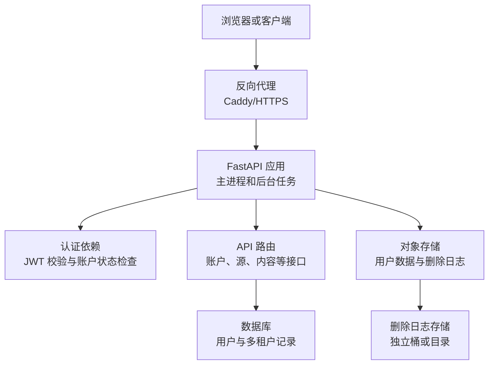
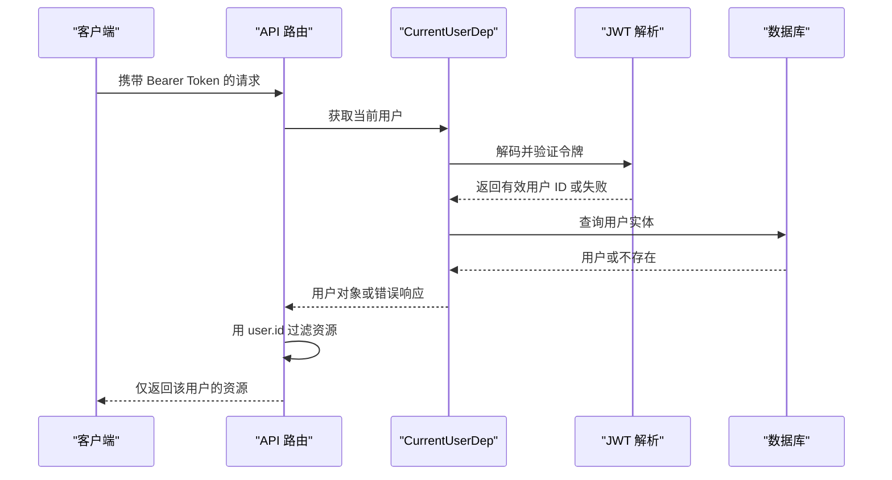
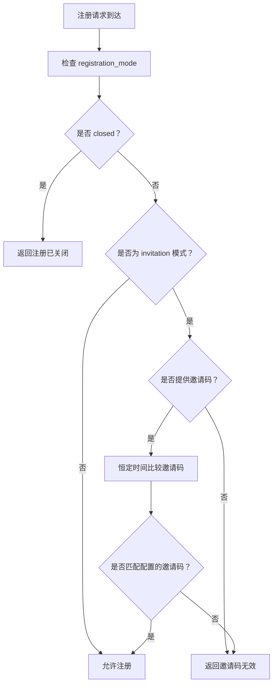
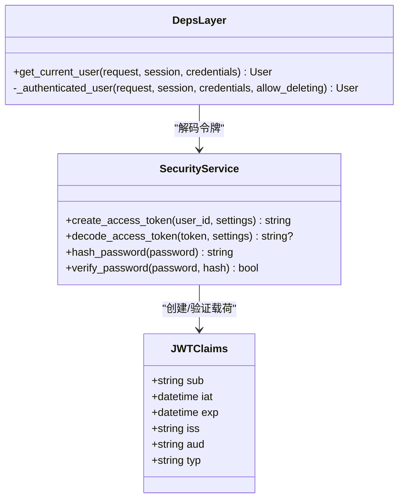
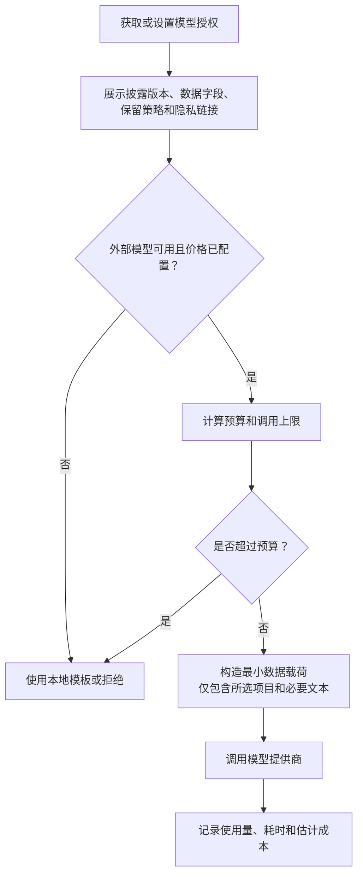
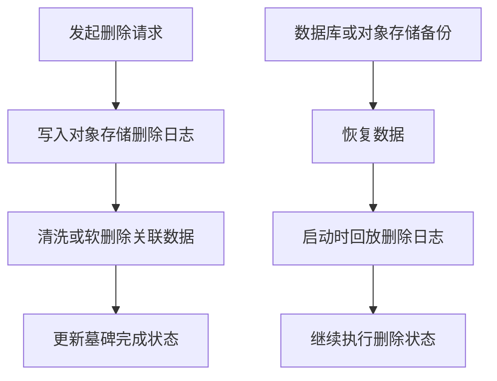

# 安全加固与访问控制

<cite>
**本文引用的文件**   
- [security.py](file://src/personal_ai_life_os/security.py)
- [config.py](file://src/personal_ai_life_os/config.py)
- [models.py](file://src/personal_ai_life_os/models.py)
- [deps.py](file://src/personal_ai_life_os/api/deps.py)
- [auth.py](file://src/personal_ai_life_os/api/routes/auth.py)
- [account.py](file://src/personal_ai_life_os/api/routes/account.py)
- [sources.py](file://src/personal_ai_life_os/api/routes/sources.py)
- [deletion.py](file://src/personal_ai_life_os/services/deletion.py)
- [storage.py](file://src/personal_ai_life_os/storage.py)
- [main.py](file://src/personal_ai_life_os/main.py)
- [privacy.md](file://docs/architecture/privacy.md)
- [SECURITY.md](file://SECURITY.md)
- [docker-compose.production.yml](file://docker-compose.production.yml)
- [Caddyfile](file://deploy/Caddyfile)
</cite>

## 目录
1. [引言](#引言)
2. [项目结构与安全边界](#项目结构与安全边界)
3. [多租户数据隔离机制](#多租户数据隔离机制)
4. [注册模式与邀请码安全机制](#注册模式与邀请码安全机制)
5. [令牌生命周期与会话安全](#令牌生命周期与会话安全)
6. [跨域控制与安全响应头](#跨域控制与安全响应头)
7. [模型提供商的数据隐私保护](#模型提供商的数据隐私保护)
8. [删除审计与可恢复机制](#删除审计与可恢复机制)
9. [网络安全与部署最佳实践](#网络安全与部署最佳实践)
10. [安全审计清单与渗透测试建议](#安全审计清单与渗透测试建议)
11. [结论](#结论)

## 引言
本文面向运行和维护 Personal-AI-Life-OS 的安全工程师、运维人员和产品负责人，说明系统如何在用户层面实现多租户数据隔离，如何配置仅邀请注册的账户入口，如何处理 JWT 访问令牌与速率限制，如何管理跨域请求和安全头部，以及如何控制外部模型调用、数据最小化、删除审计和灾难恢复。

该系统的核心安全原则是：所有业务记录都绑定到单一用户标识；敏感凭据来自环境变量或密钥管理；公开部署必须启用加密、私有对象存储、邀请式注册和受限来源；外部模型调用需要明确披露和显式授权；删除操作通过持久化墓碑记录防止备份恢复后数据误复活。

## 项目结构与安全边界
Personal-AI-Life-OS 是一个 FastAPI 后端服务，配合可选的 Web 前端和桌面模式。安全相关的关键代码分布在以下位置：
- 应用入口和中间件：[main.py](file://src/personal_ai_life_os/main.py)
- 全局设置与生产校验：[config.py](file://src/personal_ai_life_os/config.py)
- 认证安全工具：[security.py](file://src/personal_ai_life_os/security.py)
- 依赖注入和用户鉴权：[deps.py](file://src/personal_ai_life_os/api/deps.py)
- 账户与登录接口：[auth.py](file://src/personal_ai_life_os/api/routes/auth.py)
- 删除审计与会话外删除：[deletion.py](file://src/personal_ai_life_os/services/deletion.py)
- 对象存储和删除墓碑存储：[storage.py](file://src/personal_ai_life_os/storage.py)
- 领域模型和多租户键：[models.py](file://src/personal_ai_life_os/models.py)
- 隐私策略与数据处理说明：[privacy.md](file://docs/architecture/privacy.md)
- 安全报告入口与日志约束：[SECURITY.md](file://SECURITY.md)
- 生产部署与反向代理配置：[docker-compose.production.yml](file://docker-compose.production.yml)、[Caddyfile](file://deploy/Caddyfile)

**图示来源**
- [main.py:95-206](file://src/personal_ai_life_os/main.py#L95-L206)
- [deps.py:1-65](file://src/personal_ai_life_os/api/deps.py#L1-L65)
- [config.py:58-132](file://src/personal_ai_life_os/config.py#L58-L132)
- [storage.py:1-200](file://src/personal_ai_life_os/storage.py#L1-L200)
- [Caddyfile:1-11](file://deploy/Caddyfile#L1-L11)

**小节来源**
- [main.py:1-315](file://src/personal_ai_life_os/main.py#L1-L315)
- [privacy.md:1-53](file://docs/architecture/privacy.md#L1-L53)
- [SECURITY.md:1-13](file://SECURITY.md#L1-L13)

## 多租户数据隔离机制
本项目没有使用组织级多租户表，而是将 `users` 表作为单租户边界，所有业务实体通过 `owner_id` 关联到用户，并在查询中强制加入用户上下文。

### 关键模型中的租户键
| 模型 | 租户键 | 主要安全意义 |
|---|---:|---|
| `User` | `id` | 用户主体标识 |
| `ModelConsent` | `owner_id` | 模型授权按用户隔离 |
| `SourceConnection` | `owner_id` | 连接不可跨用户共享 |
| `SyncRun` | `owner_id` | 同步任务归属用户 |
| `SourceItem` | `owner_id` | 来源事件归用户所有 |
| `Tag` / `Collection` | `owner_id` | 用户标签和集合隔离 |
| `SavedSearch` | `owner_id` | 保存搜索条件按用户隔离 |
| `MemoryRecord` | `owner_id` | 用户生成记忆条目隔离 |
| `Review` / `ReviewVersion` | `review.owner_id` | 审查结果版本属于用户 |
| `GraphEntity` / `GraphRelation` / `GraphEvidence` | `owner_id` | 知识图谱按用户隔离 |
| `QaThread` / `QaMessage` | `owner_id` | 问答会话本地隔离 |
| `BackgroundJob` | `owner_id` | 后台任务只处理归属用户的数据 |
| `AgentAction` / `PluginManifest` / 插件权限/审计日志 | `owner_id` | 自动化行为与插件扩展按用户隔离 |

### 应用层权限检查
所有受保护接口通过 `CurrentUserDep` 获取当前用户。依赖层完成以下流程：
1. 要求 `Authorization: Bearer` 头。
2. 解码并验证 JWT。
3. 根据用户 ID 从数据库加载用户。
4. 如果用户已提交删除申请且不是账户删除专用端点，返回 `410 Gone`。
5. 否则把完整用户对象注入路由。

典型资源路由（如源管理）不再直接信任传入的 `source_id`，而是先查找 `SourceConnection.id == source_id` 且 `SourceConnection.owner_id == user.id`；若找不到则返回“未找到”。这实现了 API 级别的越权访问防护。

**图示来源**
- [deps.py:18-65](file://src/personal_ai_life_os/api/deps.py#L18-L65)
- [security.py:24-54](file://src/personal_ai_life_os/security.py#L24-L54)
- [sources.py:26-80](file://src/personal_ai_life_os/api/routes/sources.py#L26-L80)

### 时间复杂度和索引
大多数模型在 `owner_id` 上建立索引，常见查询的时间复杂度接近 `O(log N)` 到 `O(k log N)`，其中 `k` 为匹配的记录数。需要注意的是，某些导出、归档和批量删除逻辑会扫描较大范围的数据集，因此应结合分页、范围筛选和索引合理使用。

**小节来源**
- [models.py:61-830](file://src/personal_ai_life_os/models.py#L61-L830)
- [deps.py:1-65](file://src/personal_ai_life_os/api/deps.py#L1-L65)
- [sources.py:26-120](file://src/personal_ai_life_os/api/routes/sources.py#L26-L120)

## 注册模式与邀请码安全机制
### 注册模式
`registration_mode` 支持三种值：
| 值 | 含义 | 生产环境行为 |
|---|---|---|
| `open` | 开放注册 | 被生产配置校验拒绝 |
| `invitation` | 邀请码注册 | 生产环境要求提供 `signup_invite_code` |
| `closed` | 关闭注册 | 注册接口直接拒绝 |

生产环境中禁止开放注册，并且当模式为邀请时必须提供邀请码。这是由 Pydantic 的生产配置验证器强制执行的。

### 邀请码比较
注册接口接收客户端提交的 `invite_code`。服务器侧对两个字符串进行恒定时间比较，避免侧信道攻击。若配置关闭注册或提供的邀请码无效，接口返回 `403 Forbidden`，提示账户注册已关闭或邀请码无效。

### 速率限制
应用中间件对以下路径进行简单的客户端主机维度限流：
- `/api/v1/auth/login`：固定窗口内最多 10 次。
- `/api/v1/auth/register`：默认 5 次，每小时。
- `/api/v1/sources/*/imports`：最多 30 次，60 秒。

超出限制时返回 `429 Too Many Requests`，响应头包含 `Retry-After`。注意，当前限速以内存中的队列维护，不适合分布式多实例部署；生产部署应改用 Redis 或其他共享速率存储。

**图示来源**
- [auth.py:66-120](file://src/personal_ai_life_os/api/routes/auth.py#L66-L120)
- [main.py:164-206](file://src/personal_ai_life_os/main.py#L164-L206)
- [config.py:31-54](file://src/personal_ai_life_os/config.py#L31-L54)

**小节来源**
- [config.py:25-132](file://src/personal_ai_life_os/config.py#L25-L132)
- [auth.py:1-150](file://src/personal_ai_life_os/api/routes/auth.py#L1-L150)
- [main.py:150-206](file://src/personal_ai_life_os/main.py#L150-L206)

## 令牌生命周期与会话安全
### 令牌结构
访问令牌使用 HMAC-SHA256（HS256）签名，载荷包含：
- `sub`：用户 ID。
- `iat`：签发时间。
- `exp`：过期时间。
- `iss`：发行人，固定为应用标识。
- `aud`：受众，固定为 `personal-ai-life-os-api`。
- `typ`：类型，固定为 `access`。

### 生命周期管理
默认令牌有效期为 12 小时。该项目没有实现独立的刷新令牌或令牌刷新接口；前端通常需要在过期前重新登录或刷新页面获取新令牌。对于长时间运行的客户端，建议将短期令牌用于 API 请求，并引导用户周期性重新认证。

### 解密与验证
解码时要求同时存在 `sub`、`exp`、`iat`、`iss`、`aud`，并使用配置中的 `access_token_secret` 验签。非 HS256、受众不匹配、发行人不匹配、令牌类型不为 `access` 或解析失败都会导致令牌无效。

### 会话安全措施与建议
- 当前实现不跟踪在线会话列表，也不撤销历史令牌。若要实现登出即失效，可在数据库中添加黑名单字段或缩短 TTL。
- 生产环境强制要求 `ACCESS_TOKEN_SECRET` 不为开发默认值，且长度至少 32 字符。
- 建议使用平台密钥管理服务托管密钥；避免将密钥写入源码。
- 建议在反向代理层面禁用不必要的调试文档，生产环境中 OpenAPI、ReDoc 默认被隐藏。

**图示来源**
- [security.py:1-54](file://src/personal_ai_life_os/security.py#L1-L54)
- [deps.py:13-65](file://src/personal_ai_life_os/api/deps.py#L13-L65)

**小节来源**
- [security.py:1-54](file://src/personal_ai_life_os/security.py#L1-L54)
- [deps.py:1-65](file://src/personal_ai_life_os/api/deps.py#L1-L65)
- [config.py:20-34](file://src/personal_ai_life_os/config.py#L20-L34)

## 跨域控制与安全响应头
### CORS 配置
FastAPI 的 CORS 中间件使用 `cors_origin_list`，由逗号分隔的环境变量组成。生产环境禁止包含 `localhost` 或 `127.0.0.1`，并期望只包含实际部署的 HTTPS 来源。生产 Compose 示例将来源设置为 `https://${LIFEOS_DOMAIN}`。

在生产模式下，Web 客户端不允许携带凭据访问后端；但内部组件之间的通信可以通过其他机制保障。开发者不应为了便利而放宽 CORS，因为任意网站可能尝试调用受认证的 API。

### 安全响应头
应用对所有响应默认设置：
| 响应头 | 作用 |
|---|---|
| `X-Content-Type-Options: nosniff` | 阻止 MIME 嗅探 |
| `X-Frame-Options: DENY` | 禁止页面被嵌入帧 |
| `Referrer-Policy: no-referrer` | 不发送来源信息 |
| `Content-Security-Policy: default-src 'none'; frame-ancestors 'none'` | 默认不允许加载任何内容，且禁止被嵌套 |

反向代理 Caddy 还添加：
| 响应头 | 作用 |
|---|---|
| `Strict-Transport-Security` | 强制 TLS、子域名包含和一年有效期 |
| `Permissions-Policy` | 禁用相机、麦克风、地理位置 |
| `X-Frame-Options` | 再次禁止框架嵌套 |
| `X-Content-Type-Options` | 再次防止 MIME 嗅探 |
| `Referrer-Policy` | 再次限制来源信息泄漏 |

### 注意事项
- CSP 最严格模式适合纯 JSON API，但如果前端通过同一域名直接加载页面或静态资源，需要根据前端实际资源路径调整 `default-src`，例如允许 `self` 和特定脚本来源。
- 不要为公共 API 盲目开启 `allow_credentials=true`，除非确实需要 Cookie 会话。
- 若部署在反向代理之后，请确保客户端真实 IP 可用于限流统计（生产配置已启用 `--proxy-headers --forwarded-allow-ips=*`）。

**小节来源**
- [config.py:45-47](file://src/personal_ai_life_os/config.py#L45-L47)
- [config.py:95-117](file://src/personal_ai_life_os/config.py#L95-L117)
- [main.py:206-219](file://src/personal_ai_life_os/main.py#L206-L219)
- [Caddyfile:1-11](file://deploy/Caddyfile#L1-L11)
- [docker-compose.production.yml:1-101](file://docker-compose.production.yml#L1-L101)

## 模型提供商的数据隐私保护
### 披露配置项
系统在模型使用决策之前暴露模型提供者信息和隐私披露：
| 配置项 | 含义 |
|---|---|
| `MODEL_PROVIDER` | 是否启用外部模型，示例中使用 `openai` |
| `MODEL_DISCLOSURE_VERSION` | 披露版本 |
| `MODEL_PRIVACY_URL` | 模型提供商隐私条款链接 |
| `MODEL_DISCLOSURE_DATA` | 发送给模型的描述性数据字段 |
| `MODEL_DISCLOSURE_RETENTION` | 保留策略说明文本 |
| `MODEL_INPUT_COST_PER_MILLION_USD` | 输入单价 |
| `MODEL_OUTPUT_COST_PER_MILLION_USD` | 输出单价 |
| `MODEL_MAX_COST_PER_CALL_USD` | 单次最大预算 |

### 数据最小化
根据隐私文档和模型使用路径，系统对外部模型的发送遵循以下原则：
- 仅在用户明确同意时使用外部模型。
- 定期审查仅发送所选来源项的元数据和文本，不包含聊天消息正文，除非用户明确要求图片描述。
- 图片会进行去 EXIF 与 GPS 处理后编码再上传。
- 本地问答和洞察生成可以在无需外部模型的情况下执行。
- 外部模型结果的审核草稿在未确认前不会稳定入库，并随相关源删除而被清理。

### 成本与预算
生产配置要求外部模型调用必须配置输入、输出价格和单次调用上限。系统在使用预算前进行保守估算，超过预算时可回退到本地模板，并将用量和估算成本聚合记录，但不包含用户个人标识。

**图示来源**
- [auth.py:170-210](file://src/personal_ai_life_os/api/routes/auth.py#L170-L210)
- [privacy.md:19-37](file://docs/architecture/privacy.md#L19-L37)
- [privacy.md:38-53](file://docs/architecture/privacy.md#L38-L53)
- [config.py:62-73](file://src/personal_ai_life_os/config.py#L62-L73)

**小节来源**
- [config.py:58-91](file://src/personal_ai_life_os/config.py#L58-L91)
- [privacy.md:1-53](file://docs/architecture/privacy.md#L1-L53)
- [SECURITY.md:3-13](file://SECURITY.md#L3-L13)

## 删除审计与可恢复机制
### 删除层级
系统支持三类删除粒度：
1. **账户删除**：通过事务型删除请求记录账户删除墓碑，随后取消用户所有后台作业，并最终擦除账户相关数据。
2. **来源删除**：标记来源不可恢复，取消与其相关的任务，清除引用该来源的审阅、记录和图证据。
3. **物品删除**：用于快速笔记、日历事件合并和导入事件缺失时的软删除；部分情况下涉及对象存储中已上传文件的实际删除。

### 删除日志不可变性与版本
删除操作首先将删除状态写入对象存储的“删除日志”，而不是立即破坏数据。日志采用 JSON 格式，包含所有者 ID、目标 ID、时间戳等信息。对象存储在 S3 模式下对数据对象和删除日志均启用 AES256 服务端加密，并分开使用对象存储桶；生产配置还强制删除日志桶与实际数据桶不同，防止同一容灾拷贝同时被覆盖或删除。

应用启动时执行删除日志回放，这样即使数据库备份被还原，也不会使“已删除”数据自动复活。

### 恢复能力
- 恢复依赖于保存好的对象存储快照和独立的删除日志。
- 数据库恢复后，系统重新读取删除墓碑并补回已删除状态。
- 如果同时发生对象存储桶损坏和删除日志丢失，现有仓库不能保证自动恢复所有已删除数据，因此需要整体备份演练。

**图示来源**
- [deletion.py:25-120](file://src/personal_ai_life_os/services/deletion.py#L25-L120)
- [storage.py:75-200](file://src/personal_ai_life_os/storage.py#L75-L200)
- [main.py:137-147](file://src/personal_ai_life_os/main.py#L137-L147)

### 风险点
- 某些来源级删除可能影响批量导入的照片组；隐私文档明确指出，删除某一照片可能删除同批次其他照片。
- 快速笔记采用软删除，删除后仍保留用户可导出的痕迹，但被引用的审阅记录会被标记无效。
- 当前实现的删除审计主要是应用级持久化日志，并非传统意义上不可篡改的合规审计日志；若需审计取证，应将删除事件转发至企业 SIEM 或独立日志系统。

**小节来源**
- [deletion.py:1-200](file://src/personal_ai_life_os/services/deletion.py#L1-L200)
- [storage.py:120-264](file://src/personal_ai_life_os/storage.py#L120-L264)
- [privacy.md:44-53](file://docs/architecture/privacy.md#L44-L53)

## 网络安全与部署最佳实践
### 防火墙与网络暴露
- API 监听地址默认绑定 `0.0.0.0`，但其端口应由反向代理暴露，数据库端口不应暴露给公网。
- 容器编排中数据库、对象存储和 API 之间通过网络服务发现互通，外部仅暴露 HTTP/HTTPS。
- 桌面模式要求每次启动提供一次性桌面密钥，并通过额外请求头校验，防止外部进程直接调用本地 API。

### TLS 与证书
- 生产 Compose 使用 Caddy 暴露 80 和 443 端口，并为上游 Web 和 API 提供反向代理。
- 应使用受信任的 DNS A 记录和证书颁发机构，不建议在公共部署中使用自签名证书。
- 生产环境应启用 HTTP Strict Transport Security，并要求浏览器仅通过 HTTPS 访问。

### 弱密码与凭证防护
- 密码使用 Argon2 风格推荐哈希方案存储。
- 登录和注册失败返回统一且不过度泄露信息的错误。
- 所有密钥、API Key、令牌和配置文件通过环境变量传入；安全策略明确禁止把密钥放入源码。
- 生产环境强制唯一且足够的令牌密钥长度。
- 如需满足更严格的安全基线，可在接入层添加密码复杂度策略、失败锁定和登录异常告警。

### 监控和日志
- 当前响应头未统一设置 `Cache-Control`，对敏感 JSON API 建议在前端或反向代理层缓存静态资源而不缓存 API。
- 日志应避免记录原始聊天正文、图片字节、令牌值和代理记忆内容。
- 指标模块应有独立的强身份认证和最小权限范围。

**小节来源**
- [docker-compose.production.yml:1-101](file://docker-compose.production.yml#L1-L101)
- [Caddyfile:1-11](file://deploy/Caddyfile#L1-L11)
- [main.py:95-147](file://src/personal_ai_life_os/main.py#L95-L147)
- [SECURITY.md:3-13](file://SECURITY.md#L3-L13)
- [config.py:20-34](file://src/personal_ai_life_os/config.py#L20-L34)

## 安全审计清单与渗透测试建议

### 部署前安全审计清单
- 确认 `REGISTRATION_MODE=invitation`，并设置唯一的 `SIGNUP_INVITE_CODE`。
- 设置足够强度的 `ACCESS_TOKEN_SECRET`，且不等于开发默认值。
- 配置生产级 `METRICS_TOKEN`。
- 将 `CORS_ORIGINS` 设置为唯一的 HTTPS 站点地址，不含 `localhost` 或 `127.0.0.1`。
- 配置私有 S3 兼容对象存储和独立的删除日志桶。
- 启用 `AUTO_CREATE_SCHEMA=false`，并通过迁移脚本执行数据库架构变更。
- 配置外部模型披露版本、隐私 URL、保留说明和正确定价参数。
- 验证 TLS、HSTS、CSP、X-Frame-Options、X-Content-Type-Options、Referrer-Policy。
- 确认数据库和对象存储启用加密、私网访问和受控备份。
- 确认导入大小限制、速率限制和错误响应不含敏感详情。

### 渗透测试建议
| 测试类别 | 测试重点 |
|---|---|
| 身份认证 | 注册是否被禁用；邀请码验证是否使用恒定时间比较；JWT 签名、过期、受众和类型是否正确；错误响应不泄露内部细节。 |
| 跨域访问 | 随机站点是否无法调用 API；是否意外允许全部来源或敏感凭据。 |
| 越权访问 | 修改 URL 或表单中的资源 ID 是否能访问其他用户数据。 |
| 删除一致性 | 账户/来源/物品删除后数据库、对象存储和墓碑是否一致；恢复备份后是否仍能维持删除状态。 |
| 外部模型 | 无授权或超预算时是否退回本地实现；最小数据包是否合理；隐私披露是否可见。 |
| 上传安全 | 大文件、恶意文件名、空字节路径是否被拒绝；导入接口是否被限流；未启用导入时是否返回暂停错误。 |
| 日志与指标 | 日志和指标是否包含明文密码、令牌、请求体或敏感业务数据。 |
| 依赖漏洞 | 应用镜像、Python 依赖和 Node 依赖是否存在已知高危漏洞。 |

### 缓解措施和增强建议
- 引入集中式审计日志系统，记录登录、授权、删除、插件调用和模型使用事件。
- 增加令牌黑名单和主动退出能力。
- 使用分布式速率限制、IP 白名单、WAF 和入侵检测。
- 对敏感 API 启用额外双向认证或设备指纹（在桌面模式下已有类似意图）。
- 对模型输出结果增加二次审核流程，限制自动化操作的幂等性和回滚能力。
- 定期对删除恢复链路做端到端演练，包括数据库和对象存储联合恢复。
- 制定公开的保留策略、隐私联系人和数据销毁流程，并确保运营团队有标准处置预案。

**小节来源**
- [SECURITY.md:1-13](file://SECURITY.md#L1-L13)
- [config.py:74-132](file://src/personal_ai_life_os/config.py#L74-L132)
- [main.py:150-315](file://src/personal_ai_life_os/main.py#L150-L315)
- [privacy.md:1-53](file://docs/architecture/privacy.md#L1-L53)

## 结论
Personal-AI-Life-OS 的核心安全模型建立在“单一 `owner_id` + 应用层权限检查 + 令牌鉴权 + 对象存储删除日志”之上。生产环境通过严格的配置校验、TLS 反向代理、私有对象存储和邀请式注册进一步收敛攻击面。对外部模型的使用遵循披露优先、数据最小化和预算控制原则。

要获得更强的安全保障，应补充分布式速率限制、集中审计日志、令牌主动撤销、设备信任链、WAF 与漏洞扫描，并通过备份恢复演练验证删除不可逆性与灾难恢复能力。这些改进应与当前系统的租户隔离、令牌生命周期和删除审计机制对齐，避免引入新的横向越权路径。