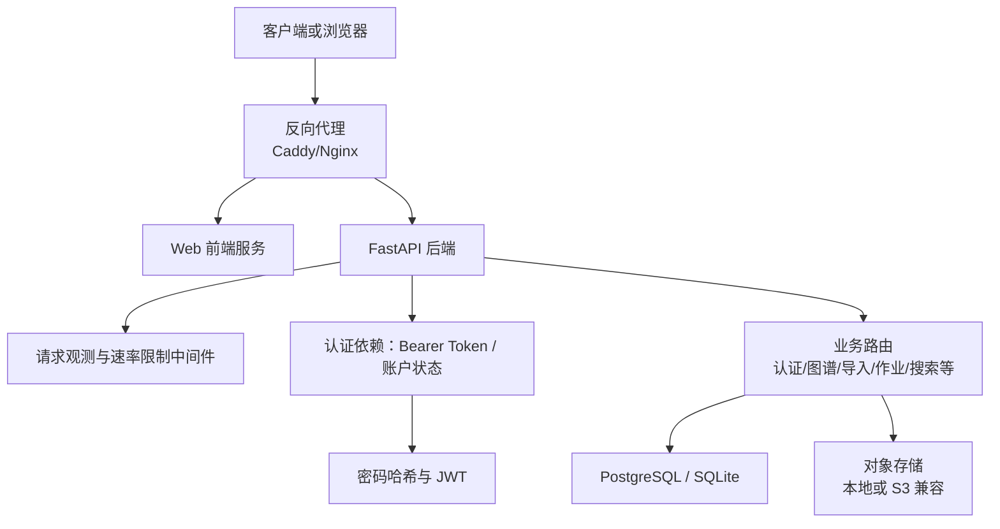
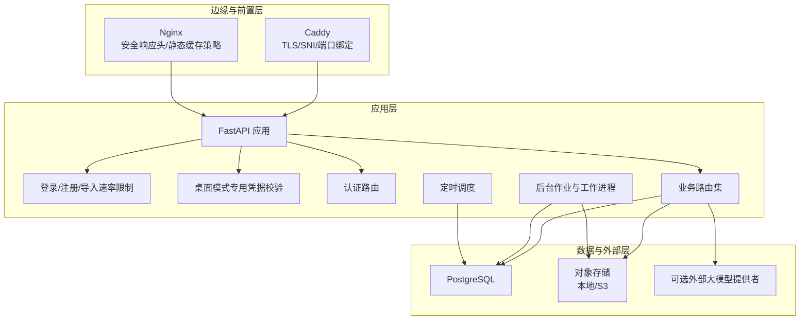
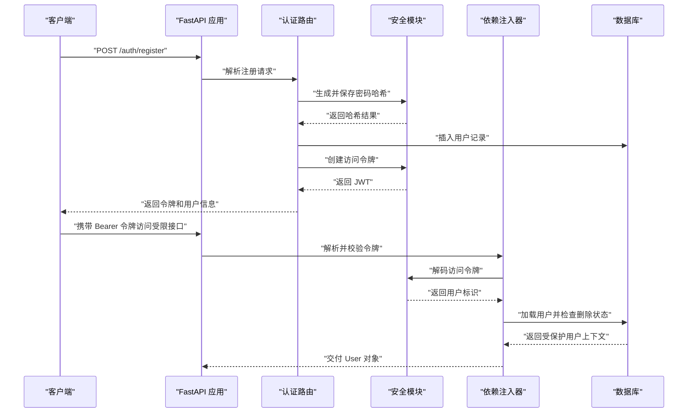
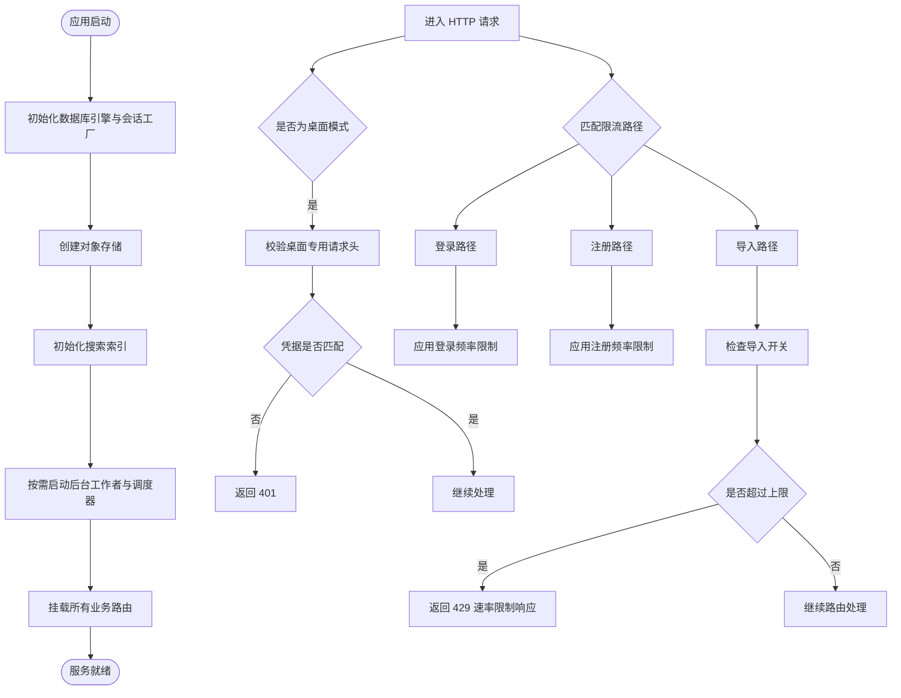
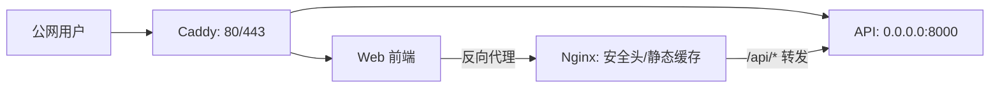
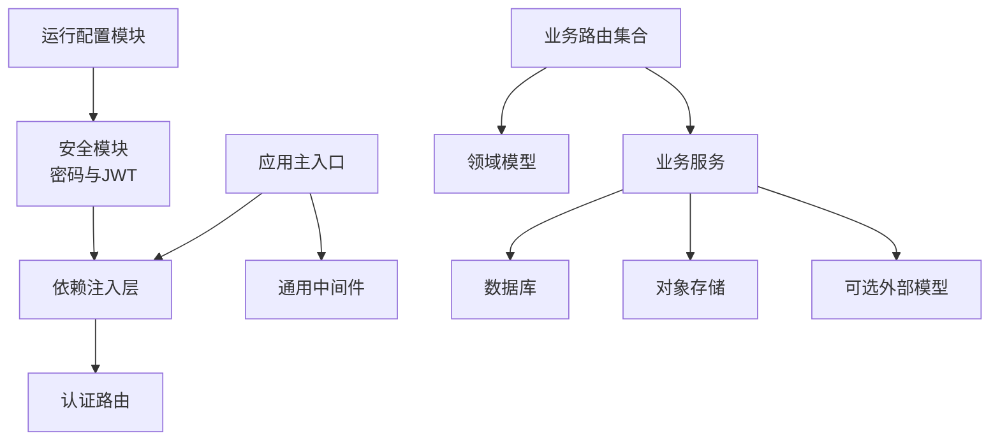
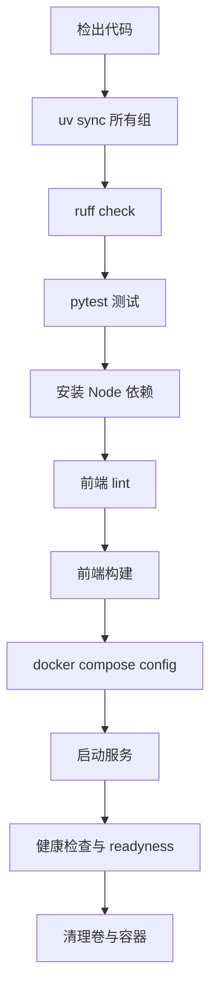

# 安全审计清单与渗透测试

<cite>
**本文引用的文件**   
- [SECURITY.md](file://SECURITY.md)
- [src/personal_ai_life_os/security.py](file://src/personal_ai_life_os/security.py)
- [src/personal_ai_life_os/main.py](file://src/personal_ai_life_os/main.py)
- [src/personal_ai_life_os/api/deps.py](file://src/personal_ai_life_os/api/deps.py)
- [src/personal_ai_life_os/config.py](file://src/personal_ai_life_os/config.py)
- [docker-compose.production.yml](file://docker-compose.production.yml)
- [web/nginx.conf](file://web/nginx.conf)
- [docs/architecture/privacy.md](file://docs/architecture/privacy.md)
- [src/personal_ai_life_os/api/routes/auth.py](file://src/personal_ai_life_os/api/routes/auth.py)
- [src/personal_ai_life_os/api/schemas.py](file://src/personal_ai_life_os/api/schemas.py)
- [pyproject.toml](file://pyproject.toml)
- [.github/workflows/ci.yml](file://.github/workflows/ci.yml)
</cite>

## 目录
1. [简介](#简介)
2. [项目结构](#项目结构)
3. [核心安全组件](#核心安全组件)
4. [架构总览](#架构总览)
5. [详细组件安全分析](#详细组件安全分析)
6. [依赖关系分析](#依赖关系分析)
7. [性能与安全特性](#性能与安全特性)
8. [安全基线与量化评估指标](#安全基线与量化评估指标)
9. [渗透测试方法](#渗透测试方法)
10. [常见漏洞检测与修复](#常见漏洞检测与修复)
11. [自动化安全审计与持续集成](#自动化安全审计与持续集成)
12. [安全事件响应计划](#安全事件响应计划)
13. [第三方扫描与报告自动生成](#第三方扫描与报告自动生成)
14. [结论](#结论)

## 简介
本文件系统性地为 Personal-AI-Life-OS 构建安全审计清单与渗透测试指南。内容覆盖认证、数据隔离、网络安全、API 访问控制、密钥管理、日志与隐私、可恢复删除机制、部署安全、外部模型调用、插件权限、备份与恢复、CI/CD 安全以及威胁建模和渗透测试流程。文档不仅说明系统当前已实现的安全能力，还给出在真实生产环境中应补充或强化的安全措施，以便团队按 OWASP 实践开展审计与验证。

## 项目结构
该项目采用 FastAPI 后端服务，结合 Pydantic 配置、SQLAlchemy 会话、可选 S3 对象存储、Nginx/Caddy 反向代理与 PWA 前端；此外提供桌面端模式、后台工作进程、调度任务和基于幂等令牌的外部模型审批流程。关键入口包括应用启动、API 中间件、统一依赖注入器和各功能路由。

**图示来源**
- [src/personal_ai_life_os/main.py:88-200](file://src/personal_ai_life_os/main.py#L88-L200)
- [src/personal_ai_life_os/api/deps.py:11-65](file://src/personal_ai_life_os/api/deps.py#L11-L65)
- [src/personal_ai_life_os/security.py:1-54](file://src/personal_ai_life_os/security.py#L1-L54)
- [docker-compose.production.yml:1-101](file://docker-compose.production.yml#L1-L101)
- [web/nginx.conf:1-37](file://web/nginx.conf#L1-L37)

**章节来源**
- [src/personal_ai_life_os/main.py:1-200](file://src/personal_ai_life_os/main.py#L1-L200)
- [docker-compose.production.yml:1-101](file://docker-compose.production.yml#L1-L101)
- [web/nginx.conf:1-37](file://web/nginx.conf#L1-L37)

## 核心安全组件
本节聚焦四个核心安全支撑点：认证与令牌、访问依赖、运行配置、网关与日志约束。

| 类别 | 当前实现 | 风险关注点 | 建议强化措施 |
|---|---|---|---|
| 密码安全 | 使用 Argon2 推荐的密码哈希器进行密码哈希与验证 | 旧哈希或非法哈希可能触发异常；需确保只允许预期算法族 | 明确白名单支持的哈希参数；对未知算法拒绝并记录不可重放告警 |
| 令牌验证 | 使用 HS256 签名的 JWT，包含子标识、签发者、受众、过期时间与类型校验 | 缺少刷新令牌机制；未启用动态黑名单；HS256 依赖服务端密钥强度 | 引入刷新令牌轮换；提供撤销端点；强制最小密钥长度并启用密钥轮转策略 |
| 请求授权 | 通过 Bearer Token 依赖解析用户并检查账户删除挂起状态 | 缺少细粒度资源级鉴权与租户检查逻辑；仅返回通用 401 | 在每个路由中显式校验资源拥有者与租户作用域 |
| 输入校验 | 注册与登录请求使用 Pydantic 模型，邮箱规范化与长度限制 | 未定义统一错误格式，可能存在内部信息泄漏 | 统一 HTTPError 模型，屏蔽堆栈，记录不可重放审计事件 |
| 速率限制 | 登录、注册、导入路径有基于内存的限速 | 水平扩展时共享内存失效；缺少回退至 Redis/数据库的方案 | 将频率计数迁移到分布式计数器，并限制失败响应体大小 |
| 桌面模式 | 通过头部与每次启动随机 secret 做简单身份假设 | 非标准加密协议；依赖可信加载环境 | 若暴露给外部网络，应改用 TLS + 强认证头或短生命周期凭证 |

**章节来源**
- [src/personal_ai_life_os/security.py:1-54](file://src/personal_ai_life_os/security.py#L1-L54)
- [src/personal_ai_life_os/api/deps.py:11-65](file://src/personal_ai_life_os/api/deps.py#L11-L65)
- [src/personal_ai_life_os/api/routes/auth.py:1-200](file://src/personal_ai_life_os/api/routes/auth.py#L1-L200)
- [src/personal_ai_life_os/api/schemas.py:1-200](file://src/personal_ai_life_os/api/schemas.py#L1-L200)

## 架构总览
系统整体由三层构成：边缘网络层、应用层和数据与服务层。边缘层负责 TLS、安全头、反代；应用层提供版本化 REST API、作业调度与搜索索引初始化；数据与服务层涵盖 Postgres、对象存储、本地桌面同步和本地持久化。

**图示来源**
- [docker-compose.production.yml:1-101](file://docker-compose.production.yml#L1-L101)
- [src/personal_ai_life_os/main.py:88-200](file://src/personal_ai_life_os/main.py#L88-L200)
- [src/personal_ai_life_os/api/routes/auth.py:1-200](file://src/personal_ai_life_os/api/routes/auth.py#L1-L200)

## 详细组件安全分析

### 认证与令牌生命周期
认证流程从注册、登录开始，使用强密码哈希与 Bearer JWT；之后由统一的依赖注入器校验令牌并加载用户上下文，同时考虑账户删除等待期。

**图示来源**
- [src/personal_ai_life_os/api/routes/auth.py:1-200](file://src/personal_ai_life_os/api/routes/auth.py#L1-L200)
- [src/personal_ai_life_os/security.py:15-54](file://src/personal_ai_life_os/security.py#L15-L54)
- [src/personal_ai_life_os/api/deps.py:11-65](file://src/personal_ai_life_os/api/deps.py#L11-L65)

#### 关键发现与建议
- **现有优势**：注册/登录使用强参数化的密码哈希；JWT 包含发行方、受众、过期时间和必须字段；令牌解码失败返回空值而非堆栈。
- **需要补充**：
  - 增加刷新令牌机制并实现令牌撤销能力。
  - 对注销和退出场景支持被动令牌失效列表，以应对令牌泄露。
  - 对所有受保护端点统一加入租户/资源级作用域校验，避免仅依赖“登录成功”。

**章节来源**
- [src/personal_ai_life_os/security.py:1-54](file://src/personal_ai_life_os/security.py#L1-L54)
- [src/personal_ai_life_os/api/deps.py:11-65](file://src/personal_ai_life_os/api/deps.py#L11-L65)
- [src/personal_ai_life_os/api/routes/auth.py:1-200](file://src/personal_ai_life_os/api/routes/auth.py#L1-L200)

### 应用入口与通用中间件
应用启动阶段初始化数据库引擎、对象存储、搜索结果索引、后台工作和调度线程，并对 desktop 模式和 worker 模式做出不同配置。HTTP 中间件执行请求观测、IP 限流、导入开关检查和桌面模式凭据校验。

**图示来源**
- [src/personal_ai_life_os/main.py:25-200](file://src/personal_ai_life_os/main.py#L25-L200)

#### 安全要点
- 桌面模式在未配置 per-launch secret 时拒绝启动；请求通过恒定时间比较防止时序侧信道泄露密码片段。
- 登录、注册、导入被单独限速；导入可通过配置临时关闭。
- 公开文档端点在 desktop 与 production 环境下默认禁用，降低攻击面。

**章节来源**
- [src/personal_ai_life_os/main.py:25-200](file://src/personal_ai_life_os/main.py#L25-L200)

### 配置与安全基线检查
配置模块提供运行时设置和严格的生产环境校验，涵盖令牌密钥长度、自动建表开关、注册模式、CORS、对象存储与外部模型披露等信息。

| 配置项 | 用途 | 生产环境要求 | 审计建议 |
|---|---|---|---|
| `ACCESS_TOKEN_SECRET` | JWT 签名密钥 | 唯一且至少 32 个字符 | 纳入密钥管理系统；定期轮换 |
| `AUTO_CREATE_SCHEMA` | 是否自动建表 | 生产环境必须关闭 | 使用 Alembic 迁移并保留变更历史 |
| `REGISTRATION_MODE` | 开放/邀请/关闭注册 | 生产环境禁止开放注册 | 使用邀请码并通过常量比较防时序 |
| `CORS_ORIGINS` | 允许跨域源 | 仅允许已部署 HTTPS 源 | 严禁在生产包含 localhost |
| `METRICS_TOKEN` | 指标访问令牌 | 必须存在且长度足够 | 使用独立令牌并限制来源 IP |
| `OBJECT_STORE_BACKEND` | 对象存储后端 | 生产环境应使用私有 S3 兼容存储 | 检查桶策略、IAM 与服务器端加密 |
| `S3_DELETION_JOURNAL_BUCKET` | 删除恢复账本桶 | 必须与主对象桶不同 | 独立生命周期与备份策略 |
| `MODEL_PROVIDER` | 外部模型配置 | 可选；需完整披露成本与隐私 | 审核提供商隐私政策与数据流向 |

**章节来源**
- [src/personal_ai_life_os/config.py:1-132](file://src/personal_ai_life_os/config.py#L1-L132)
- [docker-compose.production.yml:1-101](file://docker-compose.production.yml#L1-L101)

### 网络边界与网关安全
生产编排中 Caddy 作为前置代理处理 TCP/UDP 443 与 80 端口，API 暴露于内网，前端 Nginx 添加基础安全响应头并仅代理 `/api/`。

**图示来源**
- [docker-compose.production.yml:1-101](file://docker-compose.production.yml#L1-L101)
- [web/nginx.conf:1-37](file://web/nginx.conf#L1-L37)

网关层面已设置内容类型嗅探防护、点击劫持防护、引用策略和严格的 CSP 基础策略。需注意 CSP 中的 `style-src 'unsafe-inline'` 会增加 XSS 风险，应在去除内联样式后移除 unsafe-inline。

**章节来源**
- [web/nginx.conf:1-37](file://web/nginx.conf#L1-L37)

### 数据隔离、隐私与可恢复删除
隐私设计强调用户授权、数据范围限定、所有者作用域、本地优先处理和可恢复删除。系统通过对象前缀与数据库记录维护数据隔离，并在删除时写入墓碑记录以阻止普通访问与清理衍生数据。

| 控制点 | 当前实现 | 审计问题 |
|---|---|---|
| 所有者作用域 | 认证后加载 User 对象，审计说明称数据查询按所有者限制 | 需在每个业务路由中加入显式资源级所有权检查 |
| 输入可信性 | 明确导入内容为不受信输入，禁止解释为可执行指令 | 对导入文件做格式、大小、数量和沙箱解析检查 |
| 删除流程 | 先写墓碑，再擦除对象存储相关数据，支持启动回放 | 需测试多副本与跨节点恢复时的顺序一致性 |
| 日志隐私 | 不记录原始聊天文本、图片、访问令牌或代理记忆 | 仍需审计第三方库日志与监控输出 |
| 外部模型 | 可配置 OpenAI，需同意、披露、预算与隐私网址 | 禁止无配置时默认启用；禁止把敏感上下文发送给外部服务 |
| 插件 | 声明权限、拒绝未声明权限、审计调用 | 限制插件网络访问、进程外执行和写权限 |

**章节来源**
- [docs/architecture/privacy.md:1-53](file://docs/architecture/privacy.md#L1-L53)
- [src/personal_ai_life_os/api/deps.py:33-65](file://src/personal_ai_life_os/api/deps.py#L33-L65)

### API 安全与错误处理
所有受保护路由应通过统一依赖获取当前用户，缺失凭据或未验证令牌时返回 401。对于账户删除等待期，系统在访问时返回 410，表示访问已被暂时禁用。

需要注意：
- 登录失败响应缺少标准 `WWW-Authenticate` header，但依赖层的 401 错误设置了该响应头。
- 速率限制失败返回 429 并提供 `Retry-After`，便于客户端退避。
- 导入暂停返回 503，适合运营开关但需配合超时和重试规范。

**章节来源**
- [src/personal_ai_life_os/api/deps.py:11-65](file://src/personal_ai_life_os/api/deps.py#L11-L65)
- [src/personal_ai_life_os/main.py:118-170](file://src/personal_ai_life_os/main.py#L118-L170)

## 依赖关系分析

**图示来源**
- [src/personal_ai_life_os/main.py:1-200](file://src/personal_ai_life_os/main.py#L1-L200)
- [src/personal_ai_life_os/security.py:1-54](file://src/personal_ai_life_os/security.py#L1-L54)
- [src/personal_ai_life_os/api/deps.py:11-65](file://src/personal_ai_life_os/api/deps.py#L11-L65)

耦合性分析：
- 安全模块与配置紧耦合，所有签名和解码行为都读取 `access_token_secret` 与 TTL。
- API 依赖层封装了用户解析和删除等待检查，提高路由层一致性。
- 业务路由不应直接读取凭据，应复用 CurrentUserDep。
- 配置模块集中承担大量生产安全校验，但新增安全选项时需要同步更新部署模板与 CI。

潜在风险：
- 若路由绕过依赖注入层自行验证凭据，会破坏一致的策略决策。
- 生产配置校验全部在 Python 层完成，若部署脚本绕过启动验证则会产生高危逃逸。

**章节来源**
- [src/personal_ai_life_os/config.py:88-132](file://src/personal_ai_life_os/config.py#L88-L132)
- [src/personal_ai_life_os/api/deps.py:11-65](file://src/personal_ai_life_os/api/deps.py#L11-L65)

## 性能与安全特性
- 认证哈希：Argon2 具有计算成本，有助于抗暴力破解，但对高并发注册路径需配合速率限制和异步任务。
- 令牌校验：对称签名验算成本较低，适合高频鉴权路径；应避免在响应中包含过长 payload。
- 速率限制：内存队列简单易用，但在横向扩展和多进程部署中不具备全局一致性。
- 后台作业：worker 模式下 photo OCR、外部 review 和描述生成走数据库队列与租约，减少同步阻塞。
- 日志度量：记录操作类型、状态、延迟与 token 数量，但不记录明文对话、图片或 access token，有利于降低敏感信息扩散面。

[本节为通用性能与安全讨论]

## 安全基线与量化评估指标
以下为推荐审计评分模型，用于衡量系统安全成熟度。每项 0～2 分，满分取决于具体评估范围；建议对高风险项赋予更高权重。

| 维度 | 基线指标 | 当前证据 | 目标值 | 评分参考 |
|---|---|---|---|---|
| 机密性 | 所有敏感密钥不得提交到源码 | SECURITY.md 规定密钥放在环境变量或受管秘密 | 实现密钥注入审计 | 0=未发现策略；1=文档规定；2=自动化检测阻断 |
| 令牌强度 | 访问令牌密钥长度至少 32 字符 | 配置校验强制最小长度 | 生产唯一密钥且支持轮换 | 按实现得分 |
| 自注册限制 | 生产禁止开放注册 | 配置校验拒绝 open | 仅邀请或关闭注册 | 按实现得分 |
| 网络边界 | 仅对外暴露 80/443 | 编排暴露 80/443，API 监听 0.0.0.0 | API 内网访问+TLS 终止在前置代理 | 根据实际暴露情况评分 |
| CORS | 生产只允许已部署 HTTPS 源 | 配置校验拒绝包含 localhost 的来源 | 单域名白名单 | 按实现得分 |
| 日志隐私 | 不记录明文消息与令牌 | 隐私文档和指标描述支持此目标 | 审计第三方库日志 | 按实际输出扫描得分 |
| 导入安全 | 文件大小、来源选择、重复检测、解析限制 | schemas 与隐私文档体现有限制 | 加 MIME 白名单、沙箱解析 | 按实现得分 |
| 可恢复删除 | 墓碑+对象擦除+启动回放 | 隐私文档说明删除与恢复原则 | 测试跨节点恢复 | 按演练结果得分 |
| 外部模型 | 需配置隐私地址、披露内容与成本预算 | config 校验要求披露与预算 | 审计实际调用的上下文 | 按策略与输出得分 |
| 漏洞响应 | 有私有渠道的报告流程 | SECURITY.md 指向私有报告地址 | 建立 SLA、披露矩阵和补丁流程 | 按流程完备性得分 |

[本节为基线说明与评分框架]

## 渗透测试方法

### 测试前提与环境准备
- 搭建本地测试环境：建议使用仓库提供的 Docker Compose 编排，并在本地覆盖必要环境变量，使应用快速健康就绪。
- 分离环境：开发、测试、预生产与生产配置必须隔离；测试环境不得使用生产密钥或真实用户数据。
- 基线健康检查：确认健康检查与 readiness 探针可用，便于自动化测试判断服务状态。

### 主要测试域
| 域 | 方法与用例 | OWASP 对应 | 验收标准 |
|---|---|---|---|
| 身份认证 | 测试登录、注册、令牌验证、过期、撤销；尝试无效令牌、篡改 JWT；测试登录暴力破解 | A01:2021 Broken Access Control / A07:2021 Identification and Authentication Failures | 错误响应无用户枚举；登录速率限制生效 |
| 跨站请求伪造 | 验证敏感 POST 接口是否要求 CSRF 保护；BFF 模式应使用 SameSite Cookie 或双令牌策略 | A02:2021 Cryptographic Failures / A01:2021 | 跨源提交一律失败 |
| 跨站脚本 | 检查所有用户可控输入是否输出编码；检查 CSP 是否过于宽松 | A03:2021 Injection / A07:2021 | 无反射型或持久型 XSS |
| 不安全反序列化 | 测试导入 JSON、YAML、Markdown、ICS、DOCX、PDF 的解析路径 | A08:2021 Software and Data Integrity Failures | 不接受危险类型 |
| 安全配置缺陷 | 检查 CORS、CSP、HSTS、证书链、默认页面、OpenAPI | A05:2021 Security Misconfiguration | 生产不允许开放文档和 localhost CORS |
| 身份认证失效 | 针对弱口令、未锁定账号、令牌长期有效 | A01:2021 / A07:2021 | 强制复杂密码和会话控制 |
| 授权失败 | 越权访问其他用户资源；组织/租户切换测试 | A01:2021 | 所有资源访问均校验所有者 |
| 安全风险可见性 | 检查敏感字段是否出现在日志、指标、错误响应或报告中 | A01:2021 / A09:2021 Logging Failures | 红队测试无法找到明文凭证 |
| 第三方组件风险 | 扫描语言、JS、容器镜像 | A06:2021 Vulnerable and Outdated Components | 阻断严重及以上漏洞发布 |
| 数据完整性与可用性 | 删除重放、导入限额、外部模型配额、对象锁 | A05:2021 / A09:2021 | 配额与回滚生效 |

### OWASP Top 10 映射建议
- **A01:2021 访问控制失效**：重点验证资源 ID 替换、组织切换、删除状态下的访问拦截。
- **A02:2021 加密失败**：审查传输 TLS、静态加密、凭据存储和 HMAC 用法。
- **A03:2021 注入**：重点审查 SQL、命令执行、模板注入和不安全反序列化。
- **A04:2021 不安全设计**：关注外部模型上下文选择、插件权限和删除重放语义。
- **A05:2021 安全配置缺陷**：CORS、CSP、Caddy/Nginx、OpenAPI、调试端点。
- **A06:2021 脆弱组件**：PyPI、Node.js、Docker image、依赖树。
- **A07:2021 身份与认证失败**：登录防爆破、令牌有效期和吊销。
- **A08:2021 软件与数据完整性失效**：导入文件、插件包、构建产物签名。
- **A09:2021 安全日志与监控失效**：过滤敏感信息、告警阈值、可观测性。
- **A10:2021 服务端请求伪造**：导入导出过程中调用外部 URL 的场景。

[本节为方法论说明，不含具体代码片段]

## 常见漏洞检测与修复

### SQL 注入
- 当前通过 SQLAlchemy 与 ORM 访问数据库，通常能避免直接拼接原生 SQL。
- 审计要点：检查是否存在原生 query 或字符串拼接；检查导入数据是否直接参与查询条件；检查搜索表达式是否经安全清洗后再作为 FTS/模糊匹配参数。
- 修复建议：所有参数化查询；对输入边界值强制执行最大长度和类型校验。

**章节来源**
- [src/personal_ai_life_os/api/schemas.py:1-200](file://src/personal_ai_life_os/api/schemas.py#L1-L200)

### 跨站脚本 XSS
- Nginx CSP 允许 `style-src 'unsafe-inline'`，这会允许内联样式注入的风险。
- 修复建议：移除内联样式或使用 nonce/CSP hash；收紧 `connect-src` 到只允许的 API 域名；避免对用户输入做 HTML 直接渲染。

**章节来源**
- [web/nginx.conf:1-37](file://web/nginx.conf#L1-L37)

### CSRF
- FastAPI API 目前以 Bearer token 为主；若前后端使用 cookie，应启用 SameSite=Strict/Lax 并附加 CSRF 双重提交或双重 cookie 方案。
- 对外部可嵌入页面或 iframe 场景，还需考虑 Clickjacking 和帧权限。

**章节来源**
- [src/personal_ai_life_os/api/deps.py:11-65](file://src/personal_ai_life_os/api/deps.py#L11-L65)

### 路径遍历与未授权文件访问
- 导入与桌面模式涉及文件和目录访问，必须确保路径规范化到允许的数据目录，并拒绝 `..`、符号链接、绝对路径和外部 bucket key 混淆。
- 审计要点：检查上传文件名、本地路径、对象键、ZIP 解压路径、压缩包层级。

[本节为通用修复指导]

### 外部模型与供应链风险
- 当启用外部模型时，必须确认隐私 URL、披露内容、成本预算和 provider 配置来自受管配置。
- 审计要点：确认不发送用户全量对话原文；确认重试和取消机制；确认模型输出被视为不受信内容。

**章节来源**
- [docs/architecture/privacy.md:1-53](file://docs/architecture/privacy.md#L1-L53)
- [src/personal_ai_life_os/config.py:30-86](file://src/personal_ai_life_os/config.py#L30-L86)

## 自动化安全审计与持续集成
当前 CI 负责拉取代码、安装依赖、执行 Python lint、Python 测试、前端 lint 和前端构建，并运行 Docker Compose smoke 测试与健康检查。

**图示来源**
- [.github/workflows/ci.yml:1-57](file://.github/workflows/ci.yml#L1-L57)

建议扩展的安全门禁：
- 依赖漏洞扫描：`pip-audit` 或等效工具。
- 代码安全扫描：`semgrep` 或 `codescan`，覆盖硬编码密钥、不安全日志、路径拼接和弱密码哈希。
- 容器镜像扫描：Trivy 或等价工具。
- 依赖 SBOM 生成：Syft 或 CycloneDX。
- OpenAPI 契约测试：确保认证和鉴权 schema 演进不被绕过。
- 秘密泄露扫描：Gitleaks 或 Equivalent。
- SAST/DAST：在 staging 环境运行自动化 DAST 扫描，但需谨慎对待速率限制和真实数据。

**章节来源**
- [.github/workflows/ci.yml:1-57](file://.github/workflows/ci.yml#L1-L57)
- [pyproject.toml:1-58](file://pyproject.toml#L1-L58)

## 安全事件响应计划

### 分类与优先级
| 等级 | 描述 | 示例 | 响应时限 |
|---|---|---|---|
| P1 严重 | 可直接导致大规模数据泄露或远程代码执行 | 未认证数据库暴露、任意文件读写、未校验反序列化 | 24 小时内缓解 |
| P2 高危 | 影响部分用户数据或认证 | 越权访问、弱令牌、导入绕过 | 72 小时内修复 |
| P3 中等 | 安全配置弱化但不直接被利用 | CSP 宽松、CORS 过度 | 两周内修复 |
| P4 低危 | 信息不足或体验类安全问题 | 非必要调试页显示、日志冗余 | 下一常规发布周期 |

### 响应流程
1. **发现与分级**：由安全联系人依据影响面、可利用性和数据敏感性确定等级。
2. **抑制**：关闭危险功能、冻结问题版本、限制来源 IP、重启受影响服务或下线入口。
3. **根因分析**：复现漏洞，定位代码路径、配置差异和依赖版本。
4. **修复与回归测试**：提供最小补丁与安全回归用例，必要时重构鉴权链路。
5. **验证与回滚**：在 staging 验证并安排生产灰度；准备好回滚预案。
6. **披露与沟通**：根据危害决定是否公开披露，并向受影响用户提供建议。
7. **复盘与改进**：更新安全基线、依赖策略、CI 门禁和操作手册。

### 披露渠道与保密原则
- 不在公开 issue 中披露可利用细节。
- 报告应包含复现步骤、受影响版本、可能的影响范围和证据附件。
- 在正式安全联系人或专用安全邮箱可用后，公开披露邮件应与技术细节分层处理。

**章节来源**
- [SECURITY.md:1-13](file://SECURITY.md#L1-L13)

## 第三方扫描与报告自动生成

### 建议集成工具与目的
| 工具类别 | 推荐工具 | 集成阶段 | 输出 | 阻断策略 |
|---|---|---|---|---|
| 代码风格 | Ruff | CI | 结构化 lint 报告 | 失败即阻止合并 |
| 依赖漏洞 | pip-audit / npm audit | CI | CVE 列表 | 按 CVSS 阈值阻断 |
| 容器镜像 | Trivy | 构建后 | 镜像漏洞报告 | 高危及以上阻断 |
| 代码安全 | Semgrep | PR/CI | 规则命中位置 | 高风险规则自动标记 |
| 秘密扫描 | Gitleaks | Push/PR | 密钥泄漏清单 | 含密钥分支拒绝推送 |
| 外部依赖 | Dependabot / Renovate | 持续 | 升级 PR | 按策略自动创建 |
| 报告汇总 | SonarQube / CodeClimate | 每次构建 | 质量与安全面板 | 新漏洞门禁 |

### 报告生成机制
- 构建产物包含二进制/Python wheel、JS bundle、镜像层。
- 每个工件附带一个 SBOM 和依赖快照，以便追溯漏洞来源。
- CI 输出 YAML/JSON 形式的检测结果，方便后续自动生成 GitHub/GitLab 注释。
- 生产部署前应归档安全报告，并作为发布 checklist 的一部分。

[本节为通用实践建议]

## 结论
Personal-AI-Life-OS 在设计上体现了较为明确的安全取向：使用强哈希、JWT 鉴权、可恢复删除、所有者作用域、隐私披露、对象存储隔离和有限的外部模型调用。然而，要实现真正可审计的生产安全体系，仍需要在依赖注入与资源级鉴权、会话与令牌轮换、CSRF 防御、CSP 收紧、全局安全扫描、第三方依赖治理以及安全事件响应方面继续完善。以上安全基线、渗透测试方法和自动化流程可作为团队长期演进的安全护栏。