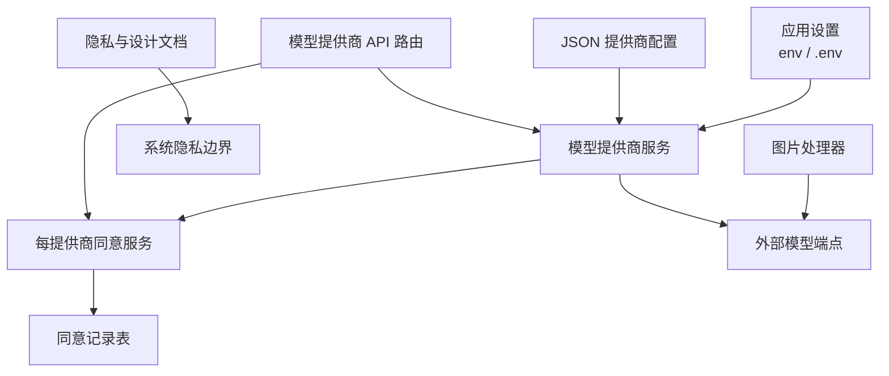
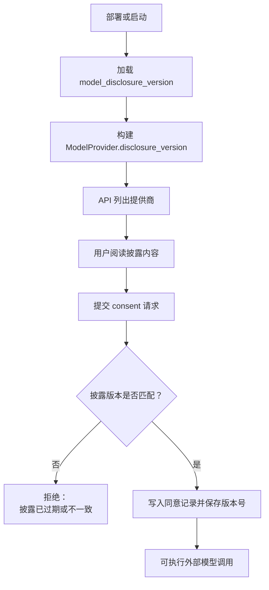
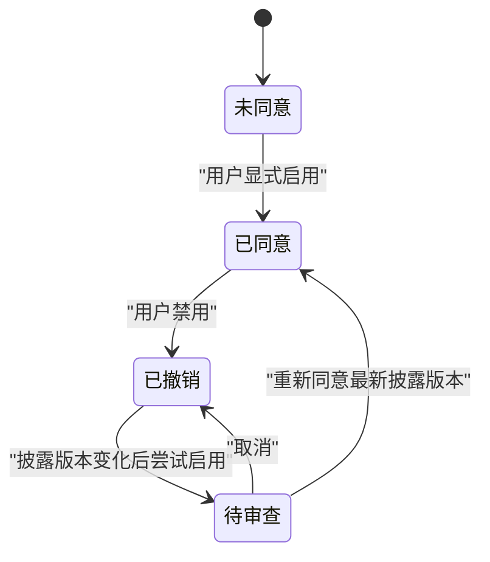
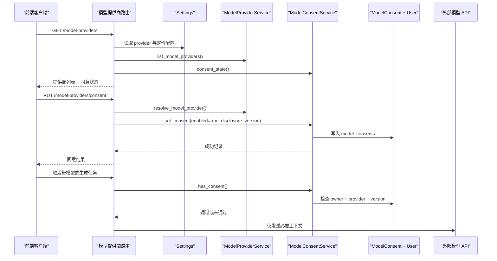
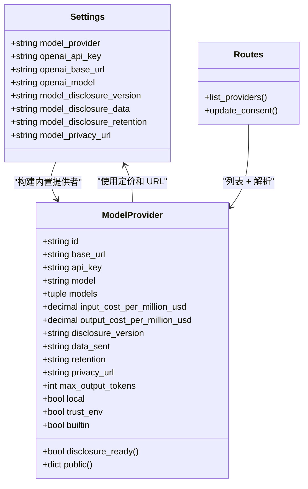
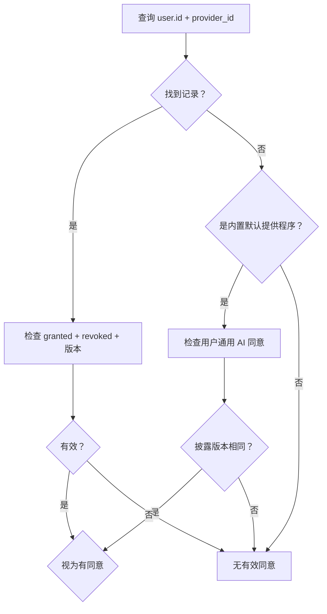
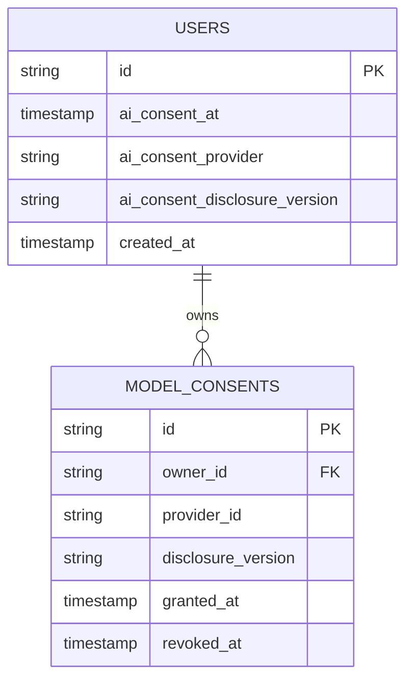
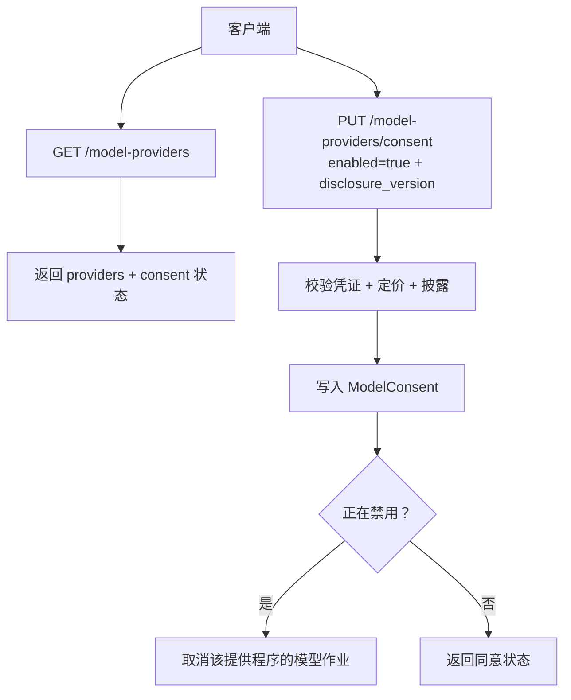
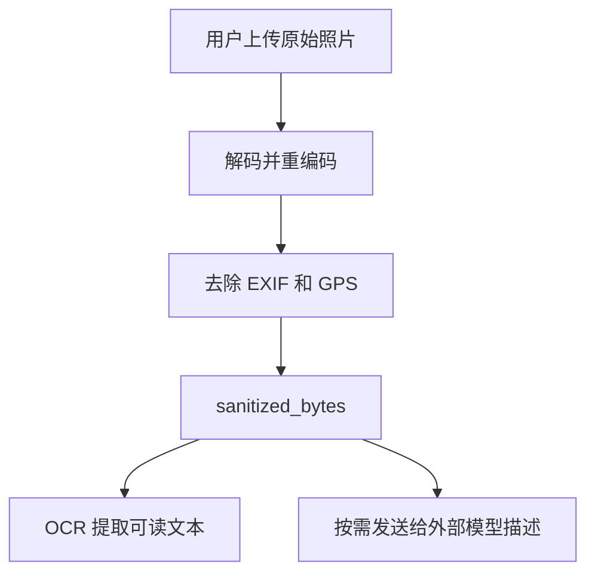
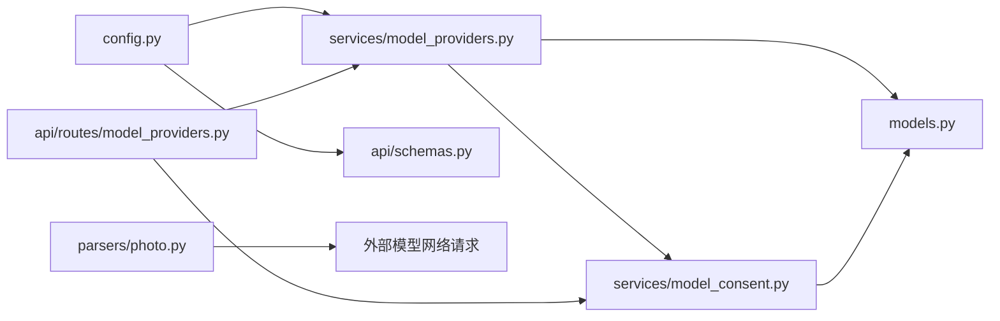

# 模型提供商数据隐私

<cite>
**本文引用的文件 **
- [config.py](file://src/personal_ai_life_os/config.py)
- [privacy.md](file://docs/architecture/privacy.md)
- [model_providers.py](file://src/personal_ai_life_os/services/model_providers.py)
- [model_consent.py](file://src/personal_ai_life_os/services/model_consent.py)
- [models.py](file://src/personal_ai_life_os/models.py)
- [migrations/a1b7c9d3e504_add_provider_consent_and_review_versions.py](file://migrations/versions/a1b7c9d3e504_add_provider_consent_and_review_versions.py)
- [routes/model_providers.py](file://src/personal_ai_life_os/api/routes/model_providers.py)
- [schemas.py](file://src/personal_ai_life_os/api/schemas.py)
- [photo.py](file://src/personal_ai_life_os/parsers/photo.py)
- [items.py](file://src/personal_ai_life_os/api/routes/items.py)
- [security.py](file://src/personal_ai_life_os/security.py)
</cite>

## 目录

1. [引言](#引言)
2. [项目结构中的隐私相关组件](#项目结构中的隐私相关组件)
3. [核心隐私机制](#核心隐私机制)
4. [架构总览](#架构总览)
5. [详细组件分析](#详细组件分析)
6. [依赖关系分析](#依赖关系分析)
7. [性能与成本约束对隐私的影响](#性能与成本约束对隐私的影响)
8. [合规检查清单](#合规检查清单)
9. [故障排查指南](#故障排查指南)
10. [第三方模型服务风险评估](#第三方模型服务风险评估)
11. [结论](#结论)

## 引言

本文件聚焦 Personal-AI-Life-OS 中与外部模型提供商相关的数据隐私机制。系统允许通过环境变量配置内置的 OpenAI 兼容服务，或通过 JSON 配置声明多个独立的外部模型提供商；同时支持基于本地回环地址的本机模型端点。用户需要在每个提供商上显式同意处理其数据，并且同意记录绑定到具体的“披露版本”，用于跟踪版本变更。

该文档重点说明以下内容：

- `MODEL_DISCLOSURE_VERSION`（在代码中映射为 `model_disclosure_version`）的版本管理机制与同意不可撤销性的实现方式。
- `MODEL_PRIVACY_URL`（对应 `model_privacy_url`）的配置要求和公开透明性保障。
- 数据最小化原则的实现，包括发送给外部模型的服务只包含必要上下文。
- 数据保留策略的声明方式、用户的知情权如何体现，以及 `model_disclosure_data` 和 `model_disclosure_retention` 的作用。
- 每提供商独立的 `consent` 管理与 `per-provider` 权限控制。
- 敏感图片的脱敏处理和传输安全边界。
- 当前审计日志和用量记录能力。
- 合规检查清单与第三方供应商评估方法。

## 项目结构中的隐私相关组件

从仓库结构看，隐私相关逻辑分布在以下位置：

- 全局配置与安全校验位于应用设置层。
- 模型提供商注册、验证、公开信息和可用性等由提供程序服务层管理。
- 用户与提供程序的同意记录存储于数据库实体层。
- API 路由暴露提供程序列表和同意更新接口。
- 文档说明模型调用时发送的具体字段、脱敏图片和整体隐私边界。
- 迁移文件创建了每提供程序的同意表结构。

**图表来源**
- [config.py:49-70](file://src/personal_ai_life_os/config.py#L49-L70)
- [model_providers.py:24-120](file://src/personal_ai_life_os/services/model_providers.py#L24-L120)
- [model_consent.py:1-110](file://src/personal_ai_life_os/services/model_consent.py#L1-L110)
- [routes/model_providers.py:1-79](file://src/personal_ai_life_os/api/routes/model_providers.py#L1-L79)
- [privacy.md:1-53](file://docs/architecture/privacy.md#L1-L53)
- [photo.py:30-121](file://src/personal_ai_life_os/parsers/photo.py#L30-L121)

**章节来源**
- [privacy.md:1-53](file://docs/architecture/privacy.md#L1-L53)

## 核心隐私机制

### 版本管理机制：MODEL_DISCLOSURE_VERSION

代码中对应的配置键是 `model_disclosure_version`。它不是直接作为数据库列名存在，而是作为 `ModelProvider.disclosure_version` 属性参与提供者生命周期：

1. 内置 OpenAI 提供程序使用配置中的 `model_disclosure_version`。
2. 自定义 JSON 提供程序可以使用自己的 `disclosure_version`，默认回退值不同，以标识外部配置。
3. 同意请求必须携带当前版本的 `disclosure_version`；如果与提供程序定义不一致，则拒绝启用同意。
4. 同意记录中持久化了所同意的版本；有效性检查要求记录版本等于提供程序当前版本。

**图表来源**
- [config.py:57-70](file://src/personal_ai_life_os/config.py#L57-L70)
- [model_providers.py:33-70](file://src/personal_ai_life_os/services/model_providers.py#L33-L70)
- [model_consent.py:43-93](file://src/personal_ai_life_os/services/model_consent.py#L43-L93)
- [routes/model_providers.py:23-44](file://src/personal_ai_life_os/api/routes/model_providers.py#L23-L44)

#### 关键含义

| 概念 | 当前实现 |
|---|---|
| 披露版本号 | 提供者对象上的 `disclosure_version` |
| 存储位置 | `model_consents.disclosure_version` 和用户兼容字段 |
| 兼容性校验 | 同意有效性需要 `record.disclosure_version == provider.disclosure_version` |
| 版本不匹配结果 | 创建或更新同意时抛出“披露已过时”错误 |
| 向后兼容 | 内置提供程序仍支持旧用户级别的通用同意字段，但仍需披露版本匹配 |

### 用户同意的不可撤销性

系统中的“撤销”语义实际上是**重新授予**的过程：

- 已授予的同意可以设置 `revoked_at`，表示明确撤回权限。
- 撤销后会取消该所有者针对该提供程序的排队和运行中的工作项。
- 若要恢复使用，用户必须再次显式同意，并且仍需使用最新披露版本。
- 因此，“不可撤销”并非指技术上无法重置状态，而是指：**一旦选择关闭或不再同意，就不能仅凭历史同意继续自动使用；每次重新开启都需要显式新确认。**

**图表来源**
- [model_consent.py:43-110](file://src/personal_ai_life_os/services/model_consent.py#L43-L110)
- [routes/model_providers.py:47-79](file://src/personal_ai_life_os/api/routes/model_providers.py#L47-L79)

### MODEL_PRIVACY_URL 的要求与透明性保障

`model_privacy_url` 是一个可选字符串；但当外部模型被实际启用时，它具有强制性约束：

- 内置提供程序和自定义 JSON 提供程序都暴露 `privacy_url`。
- `provider.disclosure_ready` 要求：数据说明非空、保留文本至少 20 字符，且要么是内置或本地提供者，要么配置了隐私链接。
- 在生产环境中，如果启用 OpenAI 外部模型，必须配置 `model_privacy_url`，且 `model_disclosure_retention` 长度至少为 20。
- API 返回的公开信息包含 `privacy_url`，使前端能够在同意前显示外部服务商隐私政策。

**章节来源**
- [config.py:61-61](file://src/personal_ai_life_os/config.py#L61-L61)
- [config.py:116-120](file://src/personal_ai_life_os/config.py#L116-L120)
- [model_providers.py:42-54](file://src/personal_ai_life_os/services/model_providers.py#L42-L54)
- [model_providers.py:100-133](file://src/personal_ai_life_os/services/model_providers.py#L100-L133)

## 架构总览

**图表来源**
- [routes/model_providers.py:1-79](file://src/personal_ai_life_os/api/routes/model_providers.py#L1-L79)
- [model_providers.py:33-70](file://src/personal_ai_life_os/services/model_providers.py#L33-L70)
- [model_consent.py:16-110](file://src/personal_ai_life_os/services/model_consent.py#L16-L110)
- [models.py:74-104](file://src/personal_ai_life_os/models.py#L74-L104)

## 详细组件分析

### 配置文件与安全校验：config.py

设置类集中管理模型相关的隐私和安全字段：

| 配置项 | 类型与默认行为 | 隐私意义 |
|---|---|---|
| `model_provider` | 限定值，含 `none` 和 `openai` | 控制是否启用内置外部模型路径 |
| `openai_base_url` | 默认指向 OpenAI 在线端点 | 决定请求目标地址 |
| `model_disclosure_version` | 字符串，默认包含版本标识符 | 用于版本化披露 |
| `model_disclosure_data` | 字符串，描述发送给模型的实际数据 | 向用户提供最小数据范围说明 |
| `model_disclosure_retention` | 字符串，生产环境至少 20 字符 | 说明保留策略并要求运维者查阅提供商条款 |
| `model_privacy_url` | 可为空，但生产环境外部模型必填 | 提供第三方隐私政策链接 |
| `model_input_cost_per_million_usd` | 十进制金额 | 估算调用成本 |
| `model_output_cost_per_million_usd` | 十进制金额 | 估算调用成本 |
| `model_max_cost_per_call_usd` | 十进制金额 | 单调用预算上限 |
| `model_monthly_budget_usd` | 十进制金额 | 月度模型预算提示 |
| `model_max_output_tokens` | 整数 | 限制输出长度，降低传输量 |
| `model_trust_env` | 布尔值 | 控制是否信任环境变量中的敏感设置 |

生产环境额外强制校验：

- 启用 OpenAI 时必须填写密钥。
- 启用外部模型时必须配置隐私链接和明确的保留声明。
- 必须配置正数的输入、输出单价和单调用预算。

**章节来源**
- [config.py:15-70](file://src/personal_ai_life_os/config.py#L15-L70)
- [config.py:86-123](file://src/personal_ai_life_os/config.py#L86-L123)

### 模型提供商服务：model_providers.py

该模块负责将部署配置转化为可用的 `ModelProvider` 数据结构，并对外暴露统一能力。

**图表来源**
- [config.py:49-70](file://src/personal_ai_life_os/config.py#L49-L70)
- [model_providers.py:24-184](file://src/personal_ai_life_os/services/model_providers.py#L24-L184)

关键行为：

- `DEFAULT_PROVIDER_ID` 预留给内置 OpenAI 配置，JSON 提供商不允许使用这个 ID。
- `_local_endpoint()` 阻止将非回环地址标记为本地；本地提供者仅允许 `localhost`、`127.0.0.1` 或 `::1`。
- 非本地提供者必须有 API key；内置本地提供者可使用空 key，因为本地回环不在默认认证范围内。
- 公共响应省略 API key，只暴露可用性、版本、价格、披露和隐私链接。

**章节来源**
- [model_providers.py:16-21](file://src/personal_ai_life_os/services/model_providers.py#L16-L21)
- [model_providers.py:24-70](file://src/personal_ai_life_os/services/model_providers.py#L24-L70)
- [model_providers.py:72-99](file://src/personal_ai_life_os/services/model_providers.py#L72-L99)
- [model_providers.py:101-184](file://src/personal_ai_life_os/services/model_providers.py#L101-L184)

### 每提供程序同意：model_consent.py

同意服务围绕三个核心能力组织：

| 函数 | 职责 |
|---|---|
| `consent_record` | 查找指定用户 + 提供程序的同意记录 |
| `has_consent` | 判断用户是否对某提供程序具有有效同意 |
| `consent_state` | 生成 API 可见的同意状态对象 |
| `set_consent` | 创建、恢复或撤销同意 |

#### 有效性规则

当查询现有记录时，同意有效需满足：

1. 存在 `granted_at`。
2. `revoked_at` 为空。
3. 记录中的 `disclosure_version` 等于提供程序当前 `disclosure_version`。

对于内置默认提供程序，还允许从旧版用户同意字段兼容推断基础意愿，但新版本披露生效时仍需版本匹配。

**图表来源**
- [model_consent.py:16-41](file://src/personal_ai_life_os/services/model_consent.py#L16-L41)

#### 更改同意的流程

- 启用时需要满足：提供商凭证已配置、定价已配置、披露已准备、传入版本正确。
- 记录不存在时创建记录，设置授予或撤销时间戳。
- 记录存在时更新披露版本和时间戳。
- 如果是内置默认提供程序，还会同步更新用户级兼容字段。
- 禁用同意时会取消所有与该提供程序相关的模型作业。

**章节来源**
- [model_consent.py:1-110](file://src/personal_ai_life_os/services/model_consent.py#L1-L110)
- [routes/model_providers.py:47-79](file://src/personal_ai_life_os/api/routes/model_providers.py#L47-L79)

### 数据库模型：User 与 ModelConsent

`User` 表保留了历史兼容字段：

| 字段 | 用途 |
|---|---|
| `ai_consent_at` | 早期内置提供程序同意的授予时间 |
| `ai_consent_provider` | 早期声明使用的提供程序 |
| `ai_consent_disclosure_version` | 早期披露版本快照 |

`ModelConsent` 表是当前主模型：

| 字段 | 隐私含义 |
|---|---|
| `owner_id` | 多租户归属 |
| `provider_id` | 独立授权给每个提供商 |
| `disclosure_version` | 固定到具体披露版本 |
| `granted_at` | 何时获得权限 |
| `revoked_at` | 何时撤销权限 |

数据库唯一约束确保同一用户在同一个提供程序上只有一个有效同意记录集合，便于状态查询和审计。

**图表来源**
- [models.py:74-104](file://src/personal_ai_life_os/models.py#L74-L104)
- [migrations/a1b7c9d3e504_add_provider_consent_and_review_versions.py:16-41](file://migrations/versions/a1b7c9d3e504_add_provider_consent_and_review_versions.py#L16-L41)

**章节来源**
- [models.py:65-104](file://src/personal_ai_life_os/models.py#L65-L104)
- [migrations/a1b7c9d3e504_add_provider_consent_and_review_versions.py:1-65](file://migrations/versions/a1b7c9d3e504_add_provider_consent_and_review_versions.py#L1-L65)

### API 路由：提供商列表与同意更新

`/model-providers` 路由提供两个主要能力：

| 接口 | 行为 |
|---|---|
| `GET /model-providers` | 列出所有提供者，包含公开信息和本用户的同意状态 |
| `PUT /model-providers/consent` | 根据提供程序 ID 切换启用或撤销，并传递披露版本 |

这两个接口的异常均转换为结构化 HTTP 响应，包含错误码和消息，例如：

- `model_provider_unavailable`
- `model_disclosure_incomplete`
- `disclosure_outdated`

**图表来源**
- [routes/model_providers.py:13-44](file://src/personal_ai_life_os/api/routes/model_providers.py#L13-L44)
- [routes/model_providers.py:47-79](file://src/personal_ai_life_os/api/routes/model_providers.py#L47-L79)

**章节来源**
- [routes/model_providers.py:1-79](file://src/personal_ai_life_os/api/routes/model_providers.py#L1-L79)

### 数据最小化原则

系统通过多种方式限制发送给外部模型的信息：

1. 配置层声明实际发送内容：
   - `model_disclosure_data` 明确说明仅发送“选定的时间线项日期、标题、源项 ID、请求审阅的文本”，并在拍照描述场景中仅发送“经脱敏的图片”。

2. 文档层的正式约束：
   - 外部审阅只发送选定时间线项的日期、标题、源项 ID 及审阅正文。
   - 只有用户明确要求拍照描述时才发送脱敏图像。
   - 图问题回答在本机进行，不发送外部模型。
   - 搜索候选索引保持本地，不向外部搜索服务发送原始文本。

3. 图片最小化处理：
   - 图片会解码、校正方向并重新编码。
   - 存储副本会移除 EXIF 和 GPS 元数据。
   - OCR 和后续处理使用已经脱敏的图片字节。

4. 输出约束：
   - `model_max_output_tokens` 限制输出长度，从而限制最终响应的大小。

5. 预算约束间接减少滥用：
   - 输入/输出单价与单调用预算防止无限长响应和无限制调用。

**章节来源**
- [config.py:58-70](file://src/personal_ai_life_os/config.py#L58-L70)
- [privacy.md:34-53](file://docs/architecture/privacy.md#L34-L53)
- [photo.py:30-121](file://src/personal_ai_life_os/parsers/photo.py#L30-L121)
- [settings model 字段]:[model_providers.py:33-70](file://src/personal_ai_life_os/services/model_providers.py#L33-L70)

### 数据保留策略与用户知情权

系统没有硬编码一个单一的“删除即永久销毁”的全球保留期限。相反，保留策略主要通过以下方式体现：

- `model_disclosure_retention` 必须由运营者配置，并向用户披露。
- 生产环境强制要求该字段存在且长度不小于 20。
- 设计文档指出备份可能恢复已删除行，因此部署操作者必须测试备份保留窗口和删除复现路径；仓库示例建议 35 天运营策略，但这只是示例而非代码提供的保证。
- 账户归档包含模型用量元数据等，但不包含原始聊天内容、图像内容或访问令牌。
- 日志和指标不得包含原始聊天文本、图片字节、访问令牌或代理内存内容。

这意味着：**数据保留策略主要由部署环境和运营商决策驱动，而 `model_disclosure_retention` 主要用于向用户和审计人员声明该策略的来源。**

**章节来源**
- [config.py:58-70](file://src/personal_ai_life_os/config.py#L58-L70)
- [config.py:116-123](file://src/personal_ai_life_os/config.py#L116-L123)
- [privacy.md:39-53](file://docs/architecture/privacy.md#L39-L53)
- [SECURITY.md:1-13](file://SECURITY.md#L1-L13)

### 敏感数据脱敏与传输加密

#### 图片脱敏

图片处理器将原始图片处理后生成：

- `sanitized_bytes`：去除了 EXIF 和 GPS 元数据的图片字节。
- 标记字段表明该副本已完成脱敏处理。

OCR 服务读取这些已脱敏字节，而不是扫描任意文件或原始对象。

**图表来源**
- [photo.py:30-121](file://src/personal_ai_life_os/parsers/photo.py#L30-L121)

#### 传输加密

代码没有实现端到端加密，也没有在服务内部对所有请求做应用层加密；设计文档明确说明：

> “系统不声称端到端加密，因为服务器侧解析和可选的模型处理需要明文。”

因此，传输安全依赖部署基础设施：

- 部署应使用 TLS。
- API 和数据库端口应保持私密。
- 日志不应捕获请求体或鉴权头。
- 模型 API key 保存在环境变量或受管密文存储器中，不放入源代码。
- 内置 OpenAI 基地址默认使用 HTTPS；自定义 JSON 提供者可通过 `base_url` 配置目标。
- JWT 访问令牌使用 HS256 签名。

**章节来源**
- [privacy.md:45-53](file://docs/architecture/privacy.md#L45-L53)
- [config.py:54-70](file://src/personal_ai_life_os/config.py#L54-L70)
- [security.py:1-43](file://src/personal_ai_life_os/security.py#L1-L43)
- [SECURITY.md:1-13](file://SECURITY.md#L1-L13)

## 依赖关系分析

**图表来源**
- [config.py:1-132](file://src/personal_ai_life_os/config.py#L1-L132)
- [model_providers.py:1-223](file://src/personal_ai_life_os/services/model_providers.py#L1-L223)
- [model_consent.py:1-110](file://src/personal_ai_life_os/services/model_consent.py#L1-L110)
- [models.py:65-104](file://src/personal_ai_life_os/models.py#L65-L104)
- [routes/model_providers.py:1-79](file://src/personal_ai_life_os/api/routes/model_providers.py#L1-L79)
- [photo.py:30-121](file://src/personal_ai_life_os/parsers/photo.py#L30-L121)

### 耦合与内聚

- 提供程序服务高度内聚地封装配置转数据结构、URL 构造、本地检测、价格和可用性判断。
- 同意服务依赖数据模型和服务接口，但与配置解耦，使单元测试更聚焦权限语义。
- API 路由仅负责请求适配，实际隐私策略下沉至服务和设置。

### 潜在风险

- 配置键名和业务语义存在映射差异：文档常称 `MODEL_DISCLOSURE_VERSION`，代码中使用 `model_disclosure_version`。
- 本地端点允许不配置 API key，但前提是严格回环地址；若 DNS 或反向代理误配，可能造成机密凭据绕过。
- 同意记录只保存最近一次授予或撤销，不提供完整审计流水；要恢复历史状态，必须结合部署日志或外部监控。

**章节来源**
- [model_providers.py:24-223](file://src/personal_ai_life_os/services/model_providers.py#L24-L223)
- [model_consent.py:16-110](file://src/personal_ai_life_os/services/model_consent.py#L16-L110)

## 性能与成本约束对隐私的影响

虽然这不是纯性能主题，但成本约束直接影响外部调用的规模：

- 输入/输出每百万令牌价格必须为正数。
- 单调用最大成本必须为正数。
- 模型调用计费函数按 token 数量估算美元成本。
- 输出 tokens 上限可限制响应大小。
- 批量或计划任务应尊重单调用预算；超过预算时应回退到本地模板或拒绝发送。

这种设计降低了无意产生大量模型费用与大数据外发风险的概率，但不能替代最小化数据和正确披露。

**章节来源**
- [config.py:62-70](file://src/personal_ai_life_os/config.py#L62-L70)
- [model_providers.py:206-223](file://src/personal_ai_life_os/services/model_providers.py#L206-L223)
- [model_usage.py:1-20](file://src/personal_ai_life_os/services/model_usage.py#L1-L20)

## 合规检查清单

以下为基于当前代码和设计文档整理的模型提供商隐私合规检查项。每一项都应可追溯至配置、代码、数据库或文档。

### 部署与配置

- [ ] 外部模型未启用时，`model_provider` 为 `none` 或未配置外部端点。
- [ ] 外部模型启用时，已提供 `openai_api_key` 或自定义提供商配置。
- [ ] `model_disclosure_version` 已设置为稳定版本字符串。
- [ ] `model_disclosure_data` 准确反映实际发送给模型的数据。
- [ ] `model_disclosure_retention` 至少 20 字符，并且真实代表运营商的数据保留策略。
- [ ] `model_privacy_url` 指向当前有效的第三方隐私页。
- [ ] 输入、输出单价均为正数。
- [ ] 单调用最高成本和月度预算均已配置。
- [ ] 自定义 JSON 提供程序中 `disclosure_version`、`data_sent`、`retention`、`privacy_url` 非空且自洽。

### 提供商与端点

- [ ] 本地提供者仅指向 `localhost`、`127.0.0.1` 或 `::1`。
- [ ] 非本地外部提供者配置了 API key。
- [ ] `/model-providers` 公开响应不包含 API key。
- [ ] 默认提供程序 ID 未被自定义 JSON 提供商覆盖。
- [ ] 提供商默认模型出现在其 `models` 列表中。

### 同意与用户权利

- [ ] 新用户首次使用前必须显式选择模型提供商。
- [ ] 用户能查看每个提供商的 `data_sent`、`retention`、`privacy_url`、`disclosure_version`。
- [ ] 版本变更时，无法继续使用过期的同意。
- [ ] 用户可撤销某一提供程序的权限。
- [ ] 撤销后不会继续调度新的模型作业。
- [ ] 恢复使用时必须重新同意当前披露版本。
- [ ] 内置默认提供程序的旧字段与新表保持一致。

### 数据处理与最小化

- [ ] 审阅调用只发送日期、标题、源项 ID 和审阅正文。
- [ ] 仅用户明确要求拍照描述时才发送图片。
- [ ] 发送到模型的图片不包含 EXIF/GPS。
- [ ] 图问答和搜索候选生成不使用外部模型。
- [ ] 日志、指标和归档中不出现原始聊天内容、图片字节、令牌或代理内存。

### 传输与存储

- [ ] 公网访问全部经过 TLS。
- [ ] 数据库卷和对象存储启用服务端加密。
- [ ] API key、JWT secret、metrics token 不进入源代码。
- [ ] S3 删除日志桶与对象桶分离。
- [ ] 备份保留策略已文档化并可验证。

### 审计与应急

- [ ] 能定位用户在哪个版本同意了哪个提供商。
- [ ] 能查看哪些提供商在当前部署中可用且披露就绪。
- [ ] 模型作业取消路径可验证。
- [ ] 第三方隐私策略链接可访问。
- [ ] 漏洞报告流程已在安全策略中说明。

**章节来源**
- [config.py:53-123](file://src/personal_ai_life_os/config.py#L53-L123)
- [model_providers.py:33-70](file://src/personal_ai_life_os/services/model_providers.py#L33-L70)
- [model_providers.py:101-184](file://src/personal_ai_life_os/services/model_providers.py#L101-L184)
- [model_consent.py:43-110](file://src/personal_ai_life_os/services/model_consent.py#L43-L110)
- [privacy.md:34-53](file://docs/architecture/privacy.md#L34-L53)
- [SECURITY.md:1-13](file://SECURITY.md#L1-L13)

## 故障排查指南

| 现象 | 可能原因 | 检查位置 | 处理方式 |
|---|---|---|---|
| 无法启用某个提供商 | 缺少 API key、未配置定价或披露不完整 | `set_consent` 报错 | 补充 `api_key`、价格、`data_sent`、`retention`、`privacy_url` |
| 提示披露已过时 | 客户端提交的 `disclosure_version` 不匹配 | `disclosure_outdated` | 先获取最新披露版本，再重新同意 |
| 本地提供者被拒绝 | `base_url` 不是回环地址 | `_local_endpoint()` | 将端点改为 localhost、127.0.0.1 或去掉 `local` 声明并配置密钥 |
| JSON 提供商不被接受 | `default` 被用作 provider ID | `list_model_providers()` | 更换唯一 ID |
| 生产环境外部模型不可用 | 未配置隐私链接或保留声明不足 | `validate_production_configuration()` | 填写 `model_privacy_url`，扩展 `model_disclosure_retention` |
| 用户认为同意后仍有旧版本争议 | 记录了旧 `disclosure_version` | `ModelConsent.disclosure_version` | 重新同意当前版本，并保留用户沟通记录 |
| 撤销后任务仍在执行 | 取消逻辑仅作用于已注册的模型作业 | `cancel_model_jobs_for_owner` | 检查工作队列是否能识别该提供程序 ID |
| 图片上传成功但模型无图像 | 脱敏图片不可用 | `/items` 中的拍照描述路由 | 检查对象存储和图片处理状态 |

常见错误码来源：

- `model_provider_unavailable`：请求的提供程序未配置或凭证缺失。
- `model_cost_unconfigured`：定价缺失。
- `model_disclosure_incomplete`：披露信息不完整。
- `disclosure_outdated`：披露版本不匹配。
- `model_provider_unconfigured`：JSON 提供商格式非法。

**章节来源**
- [model_providers.py:16-21](file://src/personal_ai_life_os/services/model_providers.py#L16-L21)
- [model_providers.py:72-184](file://src/personal_ai_life_os/services/model_providers.py#L72-L184)
- [model_consent.py:55-93](file://src/personal_ai_life_os/services/model_consent.py#L55-L93)
- [routes/model_providers.py:13-79](file://src/personal_ai_life_os/api/routes/model_providers.py#L13-L79)
- [items.py:257-335](file://src/personal_ai_life_os/api/routes/items.py#L257-L335)

## 第三方模型服务风险评估

### 评估维度

| 维度 | 应该验证的内容 |
|---|---|
| 法律与合规 | 是否存在面向消费者的隐私条款；数据处理是否符合业务所在法域 |
| 数据范围 | 是否会存储会话、提示词、图片或结果用于训练；是否需要 DPA |
| 保留周期 | 数据保留时间、缓存周期、审计日志周期 |
| 地理位置 | 数据存储和处理地区是否符合跨境数据要求 |
| 密钥与身份 | 是否支持短期令牌、作用域密钥、IP 白名单或专用接入点 |
| 最低限度 | 是否能拒绝不必要的数据收集 |
| 退出机制 | 删除请求、账号注销、数据导出和数据删除的证明能力 |
| 安全实践 | TLS、KMS、入侵检测、泄漏响应、渗透测试频率 |
| 供应商锁定 | 是否支持 OpenAI 兼容协议或可替换端点 |
| 成本透明度 | 按输入/输出 token 计费和账单导出 |

### 供应商选择标准

推荐采用以下排序：

1. 先确认最小数据范围：仅提供审阅所需字段或脱敏图像。
2. 确认披露版本真实对应其隐私政策页面。
3. 确认部署方有权选择供应商而不影响用户现有同意——例如使用抽象 `provider_id`。
4. 优先支持本地回环或私有 VPC 端点的供应商，以降低互联网暴露面。
5. 若必须使用公网第三方，应要求合同层面的数据处理协议、删除义务和通知义务。
6. 验证公开 API 返回不包含密钥。
7. 验证生产成本配置能拒绝超出预算的调用。
8. 定期进行供应链安全检查和供应商条款审计。

### 当前系统的可替代性

当前系统通过 JSON 配置声明多个提供商，并把 OpenAI 视为内置默认实现。这使未来添加其他 OpenAI 兼容后端相对容易，但需注意：

- `model_disclosure_version`、`data_sent`、`retention`、`privacy_url` 必须由部署方逐项核对，不能假设换供应商就自动合规。
- 同意记录绑定的是 `provider_id`，不是具体模型名称，有利于迁移。
- 然而，业务语义（例如“审阅”和“图片描述”）通常仍与 OpenAI chat completions 的使用场景绑定，替换提供商时需同时修订隐私文档和配置说明。

**章节来源**
- [model_providers.py:101-184](file://src/personal_ai_life_os/services/model_providers.py#L101-L184)
- [privacy.md:34-53](file://docs/architecture/privacy.md#L34-L53)
- [config.py:53-70](file://src/personal_ai_life_os/config.py#L53-L70)

## 结论

Personal-AI-Life-OS 的模型提供商隐私机制围绕四个支柱构建：

1. **版本化的披露声明**：通过 `model_disclosure_version`、`model_disclosure_data` 和 `model_disclosure_retention` 让每一次外部模型使用都可追溯到具体披露内容。
2. **每提供程序的同意控制**：用户使用 `owner_id + provider_id + disclosure_version` 三元组控制权限，撤销后必须重新确认，无法依靠历史同意自动复用。
3. **数据最小化与脱敏**：外部模型调用尽量只发送必要上下文，图片传输前先去除 EXIF/GPS，且不默认发送端到端加密。
4. **部署方责任强化**：生产环境强制要求隐私链接、保留声明、定价和预算；真正的数据保护水平仍取决于 TLS、密钥管理、对象存储加密、备份策略和供应商治理。

在实际部署中，最关键的步骤不是仅仅设置配置变量，而是确保：

- `model_disclosure_data` 和 `model_disclosure_retention` 反映真实数据流；
- `model_privacy_url` 对应真实的第三方条款；
- `MODEL_DISCLOSURE_VERSION` 变更时有明确的版本发布和用户再授权流程；
- 日志、归档和指标不泄露用户数据；
- 第三方供应商经过法律、安全和供应链审查；
- 删除、备份恢复、撤销模型作业等边缘路径已经演练。