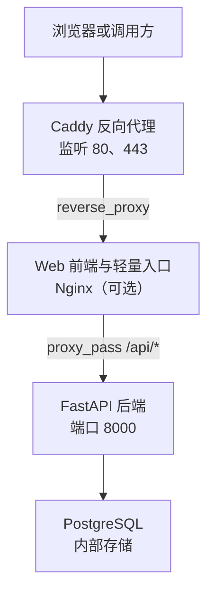
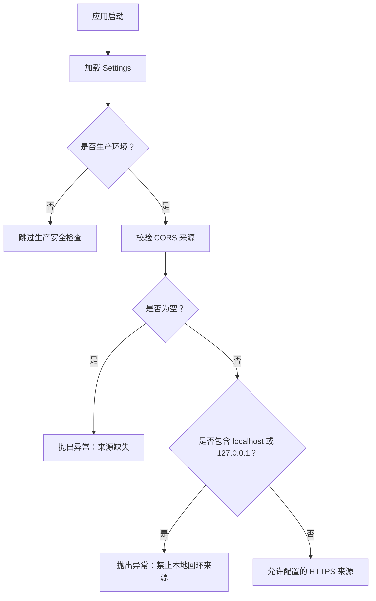
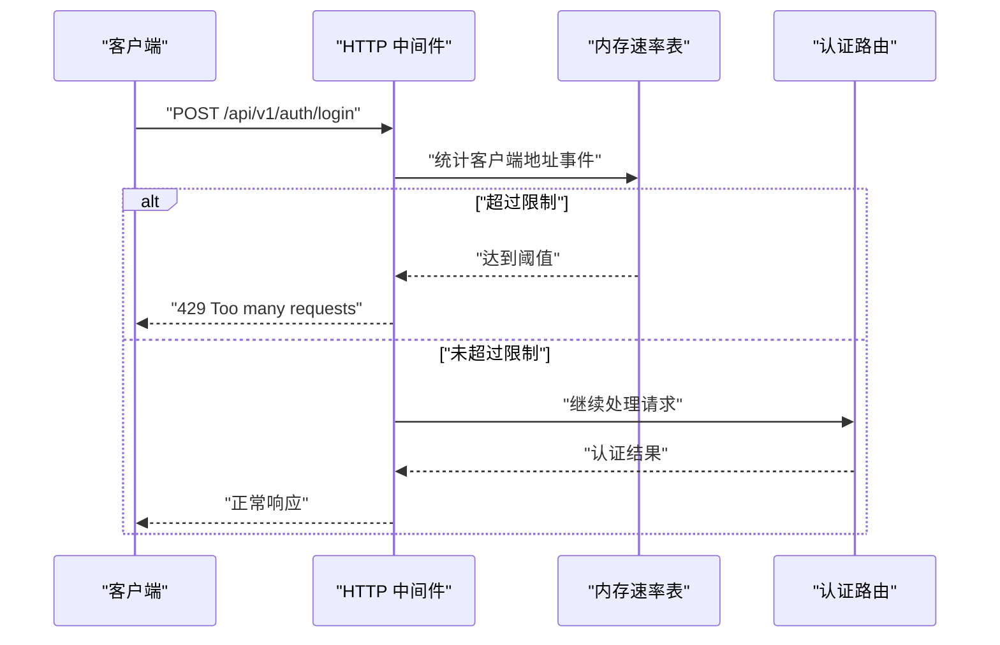
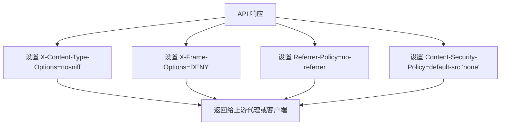
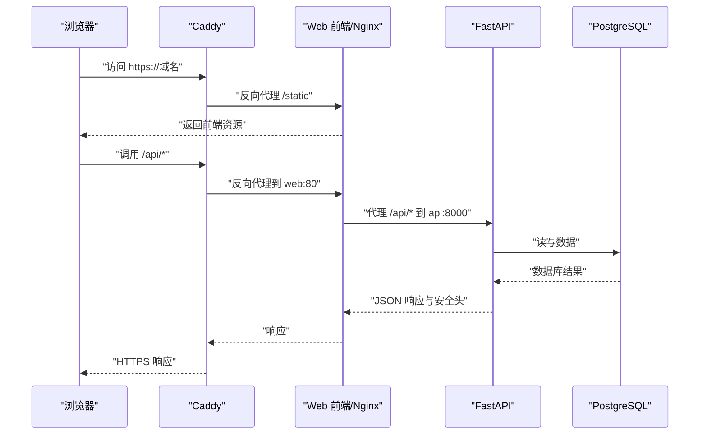

# 网络安全配置

<cite>
**本文引用的文件**   
- [安全模块 security.py](file://src/personal_ai_life_os/security.py)
- [配置模块 config.py](file://src/personal_ai_life_os/config.py)
- [应用程序入口 main.py](file://src/personal_ai_life_os/main.py)
- [生产环境编排 docker-compose.production.yml](file://docker-compose.production.yml)
- [开发环境编排 docker-compose.yml](file://docker-compose.yml)
- [Web Nginx 配置 web/nginx.conf](file://web/nginx.conf)
- [反向代理 Caddy 配置 deploy/Caddyfile](file://deploy/Caddyfile)
- [应用容器镜像 Dockerfile](file://Dockerfile)
- [安全策略 SECURITY.md](file://SECURITY.md)
</cite>

## 目录
1. [简介](#简介)
2. [项目结构与网络边界](#项目结构与网络边界)
3. [跨域源与 CORS 严格性](#跨域源与-cors-严格性)
4. [认证、令牌与请求限流](#认证令牌与请求限流)
5. [API 安全响应头](#api-安全响应头)
6. [TLS、HTTPS 与证书管理](#tlshttps-与证书管理)
7. [防火墙规则与服务隔离](#防火墙规则与服务隔离)
8. [部署环境与反向代理架构](#部署环境与反向代理架构)
9. [负载均衡与 DDoS 防护](#负载均衡与-ddos-防护)
10. [网络安全监控与入侵检测](#网络安全监控与入侵检测)
11. [渗透测试与漏洞扫描方法](#渗透测试与漏洞扫描方法)
12. [排障指南](#排障指南)
13. [结论](#结论)

## 简介
本篇文档聚焦 Personal-AI-Life-OS 的网络安全配置，包括跨域策略、CORS 生产校验、API 安全头、TLS/HTTPS 反向代理、数据库与应用服务隔离、监控告警和渗透测试建议。项目使用 FastAPI 暴露后端 API，默认通过 Caddy 或 Nginx 提供前端静态页面，并将 Web 流量反向代理到应用端口。生产模式对敏感配置进行显式检查，防止把开发默认值带入线上。

## 项目结构与网络边界
该项目在本地开发和生产环境中呈现不同网络边界：

- 开发环境将 Web 开发服务器绑定 `127.0.0.1:5173`，API 服务通过 `127.0.0.1:8000` 暴露给宿主机，数据库端口通常只在 `127.0.0.1` 访问；这是典型的单宿主机调试边界。
- 生产编排通过 Caddy 监听 `80/tcp`、`443/tcp`、`443/udp`，将公网流量转发给内部 `web` 容器，再由 Web 层反向代理到 `api:8000`。外部容器不应直接监听公共接口。
- Dockerfile 暴露容器的 `8000` 端口，表示应用期望由前置反代或容器网络访问；在生产编排中它确实只被 `web` 访问，并不直接映射到宿主机网络。

**图示来源**
- [生产环境编排 docker-compose.production.yml:1-101](file://docker-compose.production.yml#L1-L101)
- [反向代理 Caddy 配置 deploy/Caddyfile:1-11](file://deploy/Caddyfile#L1-L11)
- [Web Nginx 配置 web/nginx.conf:1-37](file://web/nginx.conf#L1-L37)
- [开发环境编排 docker-compose.yml:1-78](file://docker-compose.yml#L1-L78)
- [应用容器镜像 Dockerfile:1-25](file://Dockerfile#L1-L25)

**章节来源**
- [开发环境编排 docker-compose.yml:1-78](file://docker-compose.yml#L1-L78)
- [生产环境编排 docker-compose.production.yml:1-101](file://docker-compose.production.yml#L1-L101)
- [Web Nginx 配置 web/nginx.conf:1-37](file://web/nginx.conf#L1-L37)
- [应用容器镜像 Dockerfile:1-25](file://Dockerfile#L1-L25)

## 跨域源与 CORS 严格性
### 默认行为
- 应用通过 FastAPI 的 `CORSMiddleware` 启用跨域控制。
- 允许的来源来自配置对象中的 `cors_origins`，该字段默认值是开发阶段的前端地址，包含 `localhost` 和 `127.0.0.1`。
- 允许的请求方法包括 `GET`、`POST`、`PUT`、`PATCH`、`DELETE`。
- 允许的头部包括 `Authorization`、`Content-Type`，桌面模式下额外允许一个桌面标识头。
- 非桌面模式下允许携带凭据。

### 生产环境强制约束
配置模块在生产环境下执行校验规则：
- 不允许未设置有效 `CORS_ORIGINS`。
- 任何来源只要字符串中包含 `localhost` 或 `127.0.0.1`，都会导致启动失败。
- 生产编排已将 `CORS_ORIGINS` 设置为仅包含基于变量的 HTTPS 域名来源。

这意味着生产部署必须满足：
1. 来源必须是真实域名，例如 `https://your-domain.example.com`。
2. 不能使用 `http://localhost:*` 或 `http://127.0.0.1:*`。
3. 不需要也不需要添加泛域名通配符；应逐站点精确列出所需来源。
4. 如果业务需要多个域名，每个可信域名都应在环境变量中明确配置。

**图示来源**
- [配置模块 config.py:1-132](file://src/personal_ai_life_os/config.py#L1-L132)
- [应用程序入口 main.py:201-240](file://src/personal_ai_life_os/main.py#L201-L240)

**章节来源**
- [配置模块 config.py:1-132](file://src/personal_ai_life_os/config.py#L1-L132)
- [应用程序入口 main.py:201-240](file://src/personal_ai_life_os/main.py#L201-L240)
- [生产环境编排 docker-compose.production.yml:1-101](file://docker-compose.production.yml#L1-L101)

## 认证、令牌与请求限流
### 密码哈希
密码通过统一哈希器处理；验证时捕获底层未知哈希或验证失败异常，并返回安全失败结果，避免泄露系统内部差异。

### 访问令牌
- 访问令牌使用 HS256 算法签名。
- 载荷包含用户标识、签发时间、过期时间、签发者、受众和类型等声明。
- 解码时要求必需声明存在，并限制仅允许 HS256 算法，同时校验签发者、受众和令牌类型，降低伪造令牌风险。
- 密钥长度至少为 32 字符，且在非生产环境使用临时占位密钥时必须修改。

### 登录与注册限流
- 登录请求按客户端地址统计，每分钟最多 10 次。
- 注册请求次数由配置项决定，默认 5 次，每小时窗口。
- 数据导入接口也有限流逻辑，但导入功能可被配置关闭。
- 限流触发后返回 429，并要求调用方等待一定时间。
- 其他请求仍进入下游处理器，并在成功或失败后记录延迟采样。

**图示来源**
- [应用程序入口 main.py:41-200](file://src/personal_ai_life_os/main.py#L41-L200)
- [安全模块 security.py:1-54](file://src/personal_ai_life_os/security.py#L1-L54)

**章节来源**
- [安全模块 security.py:1-54](file://src/personal_ai_life_os/security.py#L1-L54)
- [应用程序入口 main.py:41-200](file://src/personal_ai_life_os/main.py#L41-L200)
- [配置模块 config.py:1-132](file://src/personal_ai_life_os/config.py#L1-L132)

## API 安全响应头
FastAPI 中间件会在几乎所有响应上设置基础安全头：

| 响应头 | 当前行为 | 安全含义 |
|---|---|---|
| `X-Content-Type-Options` | 固定为 `nosniff` | 防止浏览器 MIME 类型嗅探 |
| `X-Frame-Options` | 固定为 `DENY` | 防止点击劫持 |
| `Referrer-Policy` | 固定为 `no-referrer` | 减少 URL 中的敏感路径外泄 |
| `Content-Security-Policy` | 设置 `default-src 'none'`，且禁止祖先框架 | 最小化脚本与资源加载源，降低注入风险 |

这些头以“默认设置”形式写入响应，意味着上游代理或中间件可以在更靠近浏览器的位置提供更强策略，而应用保持保守基础策略。

**图示来源**
- [应用程序入口 main.py:201-240](file://src/personal_ai_life_os/main.py#L201-L240)

需要注意的是，应用内的 CSP 非常严格，主要是保护 API 响应而不是前端应用运行时。前端页面应由反向代理或前端构建产物提供更适合业务的上游策略；示例生产编排中的 Nginx 模板已包含较丰富的 CSP、X-Frame-Options、CSP 等响应头。

**章节来源**
- [应用程序入口 main.py:201-240](file://src/personal_ai_life_os/main.py#L201-L240)
- [Web Nginx 配置 web/nginx.conf:1-37](file://web/nginx.conf#L1-L37)

## TLS、HTTPS 与证书管理
生产编排通过 Caddy 作为终止点接收 HTTPS 流量，并对响应头设置了以下安全增强：

- 强制 HSTS，启用 `includeSubDomains`，使浏览器缓存 HTTPS 升级信息。
- 开启 gzip 和 zstd 压缩。
- 设置内容类型嗅探防护、禁止帧嵌入、防referrer 泄漏以及权限策略。
- 通过 `reverse_proxy` 将流量转给内部 Web 容器。

应用自身不单独实现 TLS 终止，而是依赖前置代理；这种模式符合反向代理集中管理证书的推荐做法。

| 关注点 | 当前实现 | 建议 |
|---|---|---|
| 协议版本 | 使用 Caddy；默认选择现代 TLS 版本并自动加密证书 | 如迁移到其他反向代理，应启用 TLS 1.2 和 1.3，禁用旧协议 |
| 证书管理 | Caddy 自动申请和续期证书 | 使用受信任证书颁发机构，配置域名解析和端口可达性 |
| 强制 HTTPS | HSTS 已启用 | 结合 CDN 或云负载均衡器实现全局 HTTPS |
| 前向安全密钥 | 由代理层负责协商 | 定期轮换密钥和管理凭证 |
| 内网通信 | `web` → `api` 之间走容器网络 | 若跨节点暴露，建议使用服务网格、mTLS 或隧道 |

**章节来源**
- [反向代理 Caddy 配置 deploy/Caddyfile:1-11](file://deploy/Caddyfile#L1-L11)
- [生产环境编排 docker-compose.production.yml:1-101](file://docker-compose.production.yml#L1-L101)

## 防火墙规则与服务隔离
推荐在网络层实现如下边界：

### 端口暴露控制
| 组件 | 推荐暴露方式 | 说明 |
|---|---|---|
| 浏览器入口 | 开放 80/tcp 和 443/tcp | 由反向代理提供服务 |
| UDP 入口 | 按需开放 443/udp | 用于 HTTP/3 等特性 |
| 应用端口 8000 | **不直接对外** | 仅供反向代理或同一私有网络访问 |
| 数据库端口 5432 | **不直接对外** | 仅限 API 所在网络访问 |
| 开发端口 | 仅 `127.0.0.1` | 避免从局域网或公网访问 |

### 服务间网络隔离
- 使用私有网络分隔前端、应用和数据库。
- 数据库容器不要将 5432 暴露到宿主机；开发编排已将其绑定到 `127.0.0.1`。
- API 只接受来自 `web` 或反向代理的请求。可在云安全组、宿主防火墙或平台零信任策略中限制。
- 对不可信侧输入执行鉴权、授权和限流，即使已经通过反向代理。

### 主机和网络最佳实践
- 运行容器时使用最小权限用户，例如应用镜像中创建非 root 用户并切换到普通用户运行。
- 使用只读根文件系统（除必要可写数据卷）。
- 限制 CPU、内存、磁盘和网络带宽。
- 定期更新基础镜像和第三方依赖。
- 不在容器中存储长期运行的明文密钥；改用编排系统的 Secret 或外部密钥管理系统。

**章节来源**
- [应用容器镜像 Dockerfile:1-25](file://Dockerfile#L1-L25)
- [开发环境编排 docker-compose.yml:1-78](file://docker-compose.yml#L1-L78)
- [生产环境编排 docker-compose.production.yml:1-101](file://docker-compose.production.yml#L1-L101)

## 部署环境与反向代理架构
生产编排定义了以下分层：

1. **Caddy 层**：终止 HTTPS，处理压缩和安全响应头，反向代理至 `web:80`。
2. **Web 层**：提供静态 Web 文件，并通过 `/api/` 路径反向代理到 `api:8000`。
3. **API 层**：FastAPI 进程，运行 Alembic 迁移、后台任务、搜索索引维护和数据删除日志回放。
4. **数据库层**：PostgreSQL，仅被 API 容器访问。

**图示来源**
- [生产环境编排 docker-compose.production.yml:1-101](file://docker-compose.production.yml#L1-L101)
- [反向代理 Caddy 配置 deploy/Caddyfile:1-11](file://deploy/Caddyfile#L1-L11)
- [Web Nginx 配置 web/nginx.conf:1-37](file://web/nginx.conf#L1-L37)

**章节来源**
- [生产环境编排 docker-compose.production.yml:1-101](file://docker-compose.production.yml#L1-L101)
- [反向代理 Caddy 配置 deploy/Caddyfile:1-11](file://deploy/Caddyfile#L1-L11)

## 负载均衡与 DDoS 防护
当前源码和项目编排没有内置多层负载均衡和 DDoS 防护逻辑，建议在部署层面引入这些能力：

- **反向代理层防护**
  - 使用云负载均衡器或反向代理实现连接上限、请求速率限制、IP 黑名单、请求体大小限制。
  - 关闭不必要的 HTTP 版本或启用 HTTP/2 和 HTTP/3 并发限制。
- **网关层防护**
  - 如果使用 API 网关或 WAF，可为关键路径配置 IP 信誉库、地理封锁、恶意 User-Agent 过滤、机器人识别。
- **基础设施层防护**
  - 启用云厂商 DDoS 防护服务或边缘网络清洗。
  - 通过 CDN 缓存静态资源并加速合法访问，放大攻击成本。
- **应用层防护补充**
  - 保持现有登录、注册和导入接口的限流。
  - 对异常高延迟或大量 5xx 错误接入告警，必要时自动限流或熔断。
  - 限制导出、备份和批量操作的数据量。

**章节来源**
- [应用程序入口 main.py:41-200](file://src/personal_ai_life_os/main.py#L41-L200)

## 网络安全监控与入侵检测
当前应用记录了部分请求耗时、状态码及未处理异常日志，但未提供完整审计追踪或入侵检测配置。推荐在现有基础上扩展：

### 建议监控指标
| 类别 | 指标 | 用途 |
|---|---|---|
| 访问流量 | 每秒请求数、状态码分布、IP 分布 | 发现异常访问洪泛 |
| 认证行为 | 登录失败率、注册尝试频率、令牌解码失败数 | 检测暴力破解、越权尝试 |
| 数据安全 | 导入失败率、大请求占比、对象存储删除重试数 | 发现滥用或攻击 |
| 系统健康 | 后端延迟、5xx 比例、内存/CPU、数据库连接数 | 快速定位故障面 |

### 建议告警与响应
- 当单一 IP 在短时窗口内高频访问登录、注册或导入接口时，触发软封禁。
- 当 5xx 比例明显上升时，优先区分是输入负载异常还是应用崩溃。
- 当跨域拒绝、CSP 拦截或 HSTS 相关错误增多时，检查前端域名和代理配置。
- 对数据库连接数激增、磁盘接近满载、对象存储删除回滚频繁等场景设置硬性阈值告警。

### 日志与隐私
- 安全策略强调日志不得包含原始聊天文本、图片内容、访问令牌或代理记忆内容。
- 如果需要访问日志，应脱敏后再落盘，并限制保留周期。
- 对调试工具如 OpenAPI 文档，生产环境默认关闭，避免意外暴露 API 交互详情。

**章节来源**
- [应用程序入口 main.py:41-200](file://src/personal_ai_life_os/main.py#L41-L200)
- [安全策略 SECURITY.md:1-13](file://SECURITY.md#L1-L13)

## 渗透测试与漏洞扫描方法
以下为针对本项目的实际网络与安全核查步骤：

### 端口与服务发现
- 确认仅 `80/tcp`、`443/tcp`、可选 `443/udp` 面向公网。
- 确认 `8000` 和 `5432` 未直接暴露在公网。
- 在开发环境验证 `127.0.0.1:5173` 和 `127.0.0.1:8000` 仅本地可达。

### TLS 与头部审查
- 使用在线或本地 TLS 分析工具检查协议版本、 cipher suite、HSTS、证书链完整性。
- 检查响应中是否缺少 `Strict-Transport-Security`、`X-Content-Type-Options`、`X-Frame-Options`、`Referrer-Policy` 或 CSP。
- 对敏感接口验证是否意外允许 `localhost`、`127.0.0.1`、`*` 或任意子域作为跨域来源。

### API 安全测试
- 校验登录、注册、导入接口是否生效并返回限流响应。
- 伪造、篡改、更换令牌，验证解码逻辑仅接受预期算法、签发者和受众。
- 检查表单和数据导入的体积限制、内容类型限制和非法输入处理。
- 对健康检查和内部路由确认无需暴露给公网。

### 自动化扫描建议
- 使用依赖漏洞扫描工具检查 Python 包和容器基础镜像。
- 使用 SAST 工具扫描代码中的硬编码密钥、不安全 JWT 配置和错误消息泄露。
- 使用 DAST 工具对公网入口做无认证和有认证的弱口令、参数探测、超时和异常路径扫描。
- 对容器镜像执行权限和用户模型检查，确保非 root 运行。

**章节来源**
- [安全模块 security.py:1-54](file://src/personal_ai_life_os/security.py#L1-L54)
- [应用程序入口 main.py:41-200](file://src/personal_ai_life_os/main.py#L41-L200)
- [生产环境编排 docker-compose.production.yml:1-101](file://docker-compose.production.yml#L1-L101)
- [开发环境编排 docker-compose.yml:1-78](file://docker-compose.yml#L1-L78)

## 排障指南
| 现象 | 可能原因 | 处理建议 |
|---|---|---|
| 启动时报错，提示生产环境不允许使用本地 CORS 来源 | 配置中存在 `localhost` 或 `127.0.0.1` | 改为正式 HTTPS 域名，并确保 `CORS_ORIGINS` 只包含可信来源 |
| 启动时报错，提示访问令牌密钥无效 | 使用了开发占位密钥或长度不足 | 设置足够长且唯一的 `ACCESS_TOKEN_SECRET` |
| 启动时报错，提示未启用 worker 模式 | 生产模式需要持久化作业队列 | 设置 `PROCESSING_MODE=worker` |
| 启动时报错，提示未开启对象存储或桶名缺失 | 生产要求使用兼容 S3 对象存储 | 配置 `OBJECT_STORE_BACKEND=s3` 及相关桶名 |
| 浏览器控制台出现 CSP 或 frame 阻止 | 前端资源策略过于宽松或 API 返回值不符合策略 | 调整前端代理层的 CSP，并保持 API 端使用保守默认值 |
| 移动端或跨域请求被拒绝 | 前端域名未在 `CORS_ORIGINS` 中登记 | 在环境变量中添加对应 HTTPS 域名 |
| 登录后仍无法访问 API | 令牌缺失、过期、来源错误或限流 | 检查 Authorization 头、令牌有效期、CORS 来源、限流计数 |
| 登录频繁 429 | 短时间内请求过多 | 减少重试频率，延长间隔，或临时检查是否存在自动化脚本误用 |
| 数据库连不上 | 端口暴露或凭据不正确 | 确认容器网络和数据库变量，不要直连公网端口 |
| 健康检查失败 | API 未就绪或依赖未启动 | 观察编排中健康检查命令、服务依赖顺序和启动时间 |

**章节来源**
- [配置模块 config.py:1-132](file://src/personal_ai_life_os/config.py#L1-L132)
- [应用程序入口 main.py:41-200](file://src/personal_ai_life_os/main.py#L41-L200)
- [生产环境编排 docker-compose.production.yml:1-101](file://docker-compose.production.yml#L1-L101)
- [开发环境编排 docker-compose.yml:1-78](file://docker-compose.yml#L1-L78)

## 结论
Personal-AI-Life-OS 的安全配置核心思想是：  
- 把网络边界放在反向代理和容器私有网络中，不让数据库和应用内部端口暴露给公网。  
- 用严格的 CORS 和生产环境配置校验阻止把本地开发来源上线。  
- 用 HS256 访问令牌和登录注册限流降低身份暴力破解和滥用风险。  
- 通过 Caddy 集中完成 HTTPS 与基础安全响应头。  
- 在应用之外叠加负载均衡、WAF、DDoS 防护、依赖扫描和渗透测试。  

如需进一步加强，可以引入服务间 mTLS、细粒度审计日志、动态威胁情报、API 网关策略和持续安全的 CI/CD 扫描。