# 认证与授权机制

<cite>
**本文引用的文件**
- [security.py](file://src/personal_ai_life_os/security.py)
- [auth.py](file://src/personal_ai_life_os/api/routes/auth.py)
- [deps.py](file://src/personal_ai_life_os/api/deps.py)
- [config.py](file://src/personal_ai_life_os/config.py)
- [models.py](file://src/personal_ai_life_os/models.py)
- [main.py](file://src/personal_ai_life_os/main.py)
</cite>

## 目录
1. [引言](#引言)
2. [项目结构中的认证边界](#项目结构中的认证边界)
3. [核心组件总览](#核心组件总览)
4. [令牌生命周期管理](#令牌生命周期管理)
5. [注册模式与安全实现](#注册模式与安全实现)
6. [桌面模式的特殊认证流程](#桌面模式的特殊认证流程)
7. [密码哈希与安全最佳实践](#密码哈希与安全最佳实践)
8. [CurrentUserDep 依赖注入与会话管理](#currentuserdep-依赖注入与会话管理)
9. [错误处理、安全限制与防护建议](#错误处理安全限制与防护建议)
10. [架构图与数据流图](#架构图与数据流图)
11. [配置与安全检查要点](#配置与安全检查要点)
12. [结论与建议](#结论与建议)

## 引言
本文件系统说明 Personal-AI-Life-OS 的认证与授权设计，覆盖基于 JWT 的请求认证、账户注册与登录、桌面模式的本地账户流程、邀请码签发与验证、密码哈希策略、会话相关的安全行为，以及可落地的安全防护建议。文档尽量以“模块职责 + 调用链 + 安全属性”的方式展开，便于开发者快速定位实现位置并扩展新能力。

## 项目结构中的认证边界
本项目采用 FastAPI 作为应用框架：
- 认证相关路由集中在 `/auth` 前缀下；
- 通用鉴权通过统一依赖解析 Bearer 令牌，并将当前用户注入为业务路由参数；
- 所有敏感资源路由依赖 `CurrentUserDep`，未携带有效令牌或令牌不合法时将直接拒绝访问。

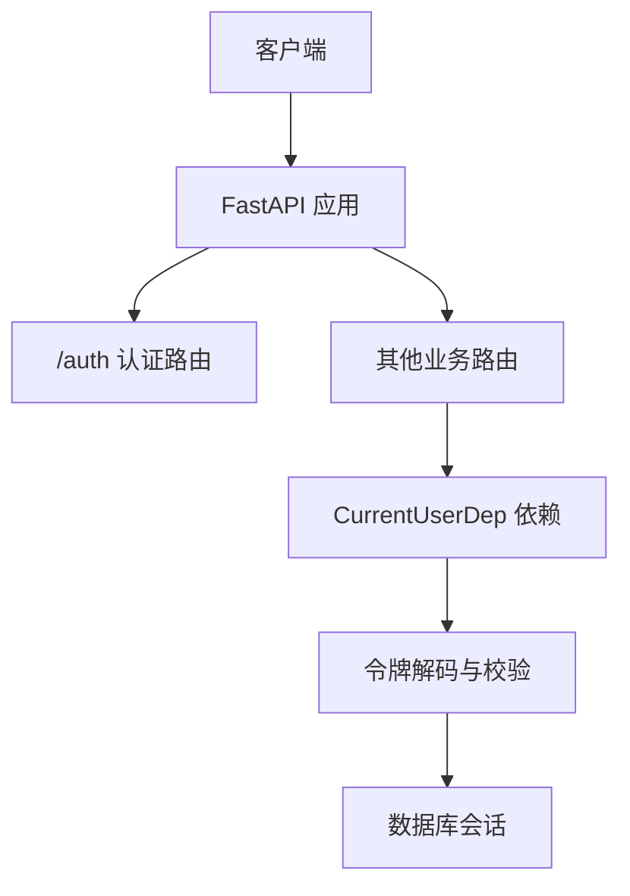

**图表来源**
- [main.py:1-30](file://src/personal_ai_life_os/main.py#L1-L30)
- [auth.py:20-45](file://src/personal_ai_life_os/api/routes/auth.py#L20-L45)
- [deps.py:12-65](file://src/personal_ai_life_os/api/deps.py#L12-L65)

**章节来源**
- [main.py:1-30](file://src/personal_ai_life_os/main.py#L1-L30)

## 核心组件总览
| 组件 | 职责 | 关键实现位置 |
|---|---|---|
| JWT 密钥与令牌的生成、编码、解码 | 负责访问令牌的创建和强校验，包括主题、发行者、受众、类型和时间戳要求 | [security.py:17-53](file://src/personal_ai_life_os/security.py#L17-L53) |
| 认证路由 | 注册、登录、桌面本地档案等身份建立流程 | [auth.py:21-105](file://src/personal_ai_life_os/api/routes/auth.py#L21-L105) |
| 当前用户依赖注入 | 从请求头解析凭据、解码令牌、加载实体对象、处理注销中状态 | [deps.py:12-65](file://src/personal_ai_life_os/api/deps.py#L12-L65) |
| 运行时配置 | JWT 密钥、过期时间、注册模式、邀请码、生产环境安全检查 | [config.py:13-78](file://src/personal_ai_life_os/config.py#L13-L78) |
| 用户模型 | 用户标识、邮箱、密码哈希、时区、AI 模型授权元信息、删除请求时间等 | [models.py:93-120](file://src/personal_ai_life_os/models.py#L93-L120) |
| 应用入口 | 组装路由、检测桌面模式必需参数、挂载认证路由 | [main.py:1-60](file://src/personal_ai_life_os/main.py#L1-L60) |

**章节来源**
- [security.py:17-53](file://src/personal_ai_life_os/security.py#L17-L53)
- [auth.py:21-105](file://src/personal_ai_life_os/api/routes/auth.py#L21-L105)
- [deps.py:12-65](file://src/personal_ai_life_os/api/deps.py#L12-L65)
- [config.py:13-78](file://src/personal_ai_life_os/config.py#L13-L78)
- [models.py:93-120](file://src/personal_ai_life_os/models.py#L93-L120)
- [main.py:1-60](file://src/personal_ai_life_os/main.py#L1-L60)

## 令牌生命周期管理

### 访问令牌的生成
访问令牌由用户成功认证后生成。流程如下：
1. 注册或登录成功后，服务获取已持久化的用户实体；
2. 调用统一的令牌创建函数，将用户标识写入主题字段，并设置发行者、受众、令牌类型和时间戳；
3. 使用 HS256 算法和配置的访问密钥进行签名；
4. 返回给客户端包含令牌、有效期和用户信息的响应对象。

令牌的语义约束包括：
- 必须包含主题、签发时间、过期时间、发行者和受众；
- 类型必须为访问令牌；
- 使用固定发行者和固定受众字符串，避免跨服务误用；
- 使用固定对称算法白名单，拒绝非预期算法。

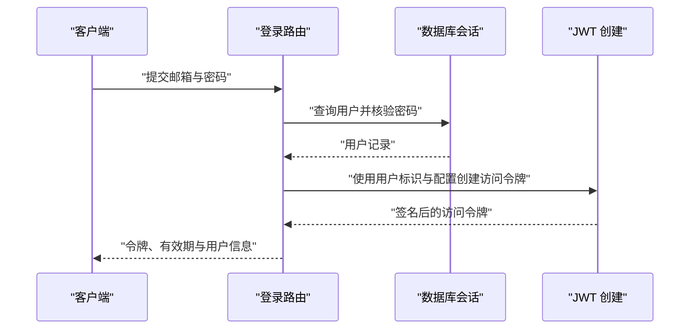

**图表来源**
- [auth.py:121-152](file://src/personal_ai_life_os/api/routes/auth.py#L121-L152)
- [security.py:24-40](file://src/personal_ai_life_os/security.py#L24-L40)

**章节来源**
- [auth.py:97-152](file://src/personal_ai_life_os/api/routes/auth.py#L97-L152)
- [security.py:24-40](file://src/personal_ai_life_os/security.py#L24-L40)
- [config.py:19-30](file://src/personal_ai_life_os/config.py#L19-L30)

### 令牌的解码与鉴权
依赖解析器会做以下检查：
1. 请求是否携带 Bearer 凭据；
2. 是否存在对应的访问密钥；
3. 令牌格式、算法、发行者、受众和类型是否正确；
4. 是否在有效期内；
5. 主题是否为可用字符串；
6. 数据库中是否存在对应用户；
7. 用户是否处于“已申请删除但清理未完成”的状态。

任一环节失败都会返回未认证或无效的访问令牌错误，且响应头中包含标准认证挑战。

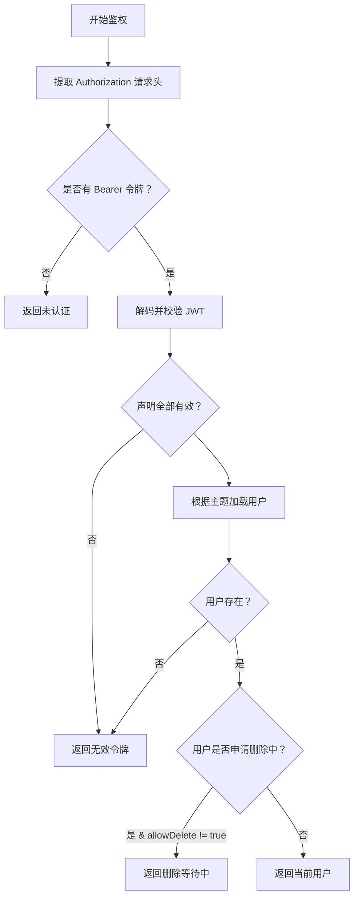

**图表来源**
- [deps.py:12-65](file://src/personal_ai_life_os/api/deps.py#L12-L65)
- [security.py:41-53](file://src/personal_ai_life_os/security.py#L41-L53)

**章节来源**
- [deps.py:12-65](file://src/personal_ai_life_os/api/deps.py#L12-L65)
- [security.py:41-53](file://src/personal_ai_life_os/security.py#L41-L53)

### 刷新策略与局限性
当前实现中没有独立的刷新令牌接口：
- 访问令牌在创建时附带过期时间；
- 每次成功登录或创建桌面本地档案后返回新的访问令牌；
- 未实现无感续期、刷新令牌轮换或黑名单吊销机制。

对于需要频繁续期的场景，建议在保留现有访问令牌校验的基础上，引入刷新令牌并单独存储，使短期访问令牌可被刷新而无需重新输入密码。这样可以在不影响现有鉴权逻辑的前提下提升用户体验。

[本节为通用策略说明，不直接分析特定源码行]

## 注册模式与安全实现

### 注册模式配置
注册模式支持三类状态：开放注册、邀请注册、关闭注册。其默认值、允许值和安全规则集中在配置层。

| 模式 | 含义 | 主要行为 |
|---|---|---|
| open | 任何人均可注册 | 不校验邀请码 |
| invitation | 需要有效邀请码才可注册 | 使用恒定时间比较比对客户端提交的邀请码与服务端配置 |
| closed | 禁止注册 | 任何注册尝试都会拒绝 |

在生产环境中：
- 不允许使用开放注册；
- 如果选择邀请注册，必须提供有效的邀请码；
- 访问密钥长度不得小于三十二位；
- CORS 不允许 localhost 地址。

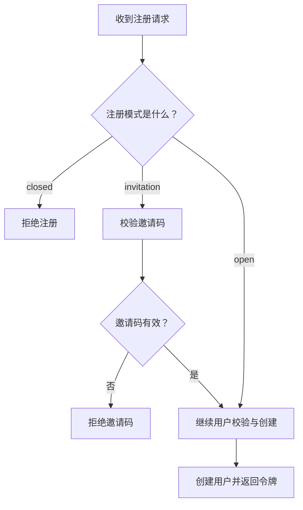

**图表来源**
- [auth.py:69-94](file://src/personal_ai_life_os/api/routes/auth.py#L69-L94)
- [config.py:21-25](file://src/personal_ai_life_os/config.py#L21-L25)

**章节来源**
- [auth.py:69-94](file://src/personal_ai_life_os/api/routes/auth.py#L69-L94)
- [config.py:21-25](file://src/personal_ai_life_os/config.py#L21-L25)

### 邀请码生成的 HMAC 安全机制
需要注意当前代码在注册流程中对服务端配置的 `signup_invite_code` 使用了常量时间比对。这可以防止时序侧信道泄露匹配差异，属于安全的比较实现。

但当前实现中没有单独的“生成邀请码接口”。这意味着实际运行中的“邀请码”来自环境变量配置，而非动态生成的服务端秘密。若要启用完整的邀请码体系，应增加：
1. 生成唯一邀请标识；
2. 使用服务器机密密钥对邀请标识及其过期时间等进行签名；
3. 将邀请标识暴露给分享渠道，不直接暴露完整签名字符串；
4. 服务端验证签名后再生成一次性或有限次数使用的注册链接。

这样可以满足 HMAC 安全原则：
- 使用独立于访问密钥的服务器机密密钥；
- 包含邀请用途、过期时间和使用者上下文；
- 仅在服务端验证，不信任客户端提供的完整邀请对象。

[本节为改进性分析，当前仓库未提供动态生成邀请码实现]

**章节来源**
- [auth.py:69-88](file://src/personal_ai_life_os/api/routes/auth.py#L69-L88)
- [config.py:21-25](file://src/personal_ai_life_os/config.py#L21-L25)

### 重复注册与时区校验
注册流程还会：
- 验证时区是否为合法的 IANA 时区；
- 检查邮箱是否已存在；
- 在异常时回滚事务，避免部分写入；
- 确保即使数据库发生冲突也能返回准确的“账号已存在”响应。

这使得注册路径具备幂等友好的错误语义，并对非法时区和重复用户进行严格保护。

**章节来源**
- [auth.py:97-118](file://src/personal_ai_life_os/api/routes/auth.py#L97-L118)
- [models.py:93-102](file://src/personal_ai_life_os/models.py#L93-L102)

## 桌面模式的特殊认证流程
桌面模式不是传统客户端–服务器登录模式，而是通过一个固定的本地档案邮箱创建专用用户：
- 固定邮箱为 `local-profile@lifeos.invalid`；
- 只在 `app_env` 为桌面模式时暴露相关接口；
- 普通登录接口在桌面模式下明确返回找不到；
- 读取本地档案只返回用户令牌，不直接泄露用户详情；
- 写入本地档案时会校验 IANA 时区；
- 如果用户不存在，则创建一个具有随机临时密码哈希的用户，随后立即签发访问令牌。

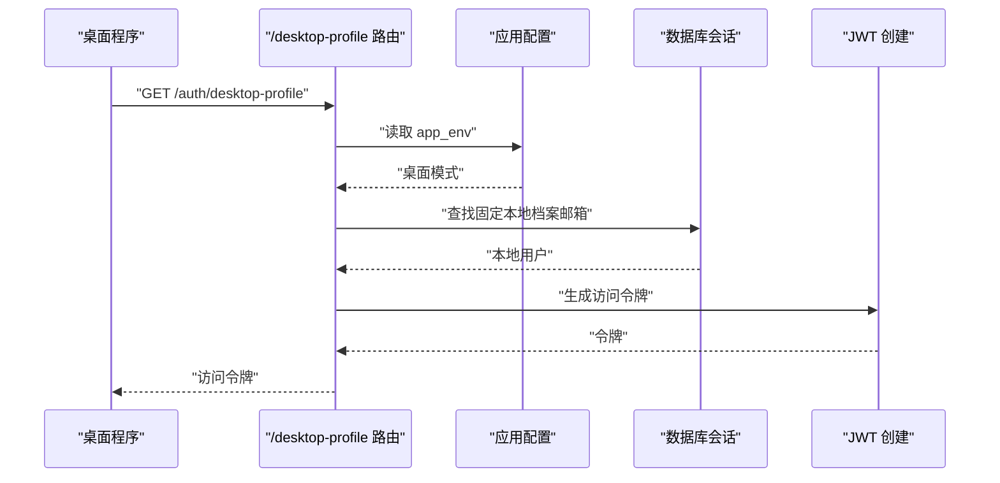

**图表来源**
- [auth.py:29-66](file://src/personal_ai_life_os/api/routes/auth.py#L29-L66)
- [security.py:24-40](file://src/personal_ai_life_os/security.py#L24-L40)

该模式的本质是：
- 把本地桌面环境的可信启动过程映射为后端的一个用户实体；
- 通过 `desktop_secret` 等应用构造参数（见入口文件）保证只有被可信进程启动的服务实例可以使用；
- 使用最小权限方式暴露接口，仅允许桌面部署环境下生效。

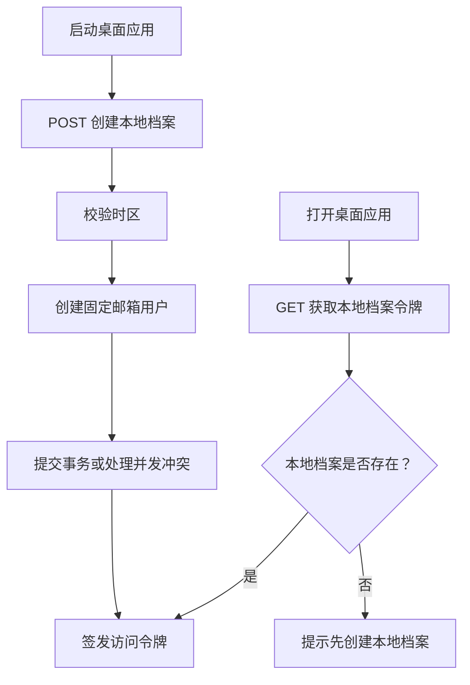

**图表来源**
- [auth.py:47-66](file://src/personal_ai_life_os/api/routes/auth.py#L47-L66)
- [auth.py:29-45](file://src/personal_ai_life_os/api/routes/auth.py#L29-L45)

**章节来源**
- [auth.py:29-66](file://src/personal_ai_life_os/api/routes/auth.py#L29-L66)
- [auth.py:128-152](file://src/personal_ai_life_os/api/routes/auth.py#L128-L152)
- [main.py:20-35](file://src/personal_ai_life_os/main.py#L20-L35)

## 密码哈希与安全最佳实践
### 使用的技术栈
- 使用 `pwdlib` 的推荐哈希器；
- `hash_password` 直接委托给上层推荐算法；
- `verify_password` 对未知哈希类型、验证异常及数值异常统一捕获，并以失败结果返回。

### 安全收益
- 自动升级：当 `PasswordHash.recommended()` 升级为更强算法时，已有哈希可在首次验证成功时按需迁移到新版本；
- 抗异常降级：哈希验证失败不会暴露内部异常，也不会抛出危险堆栈；
- 与业务解耦：密码哈希逻辑集中在安全模块中，路由层只调用抽象方法。

### 强度验证与迁移建议
当前实现没有明确的明文凭据强度检查。建议补充：
- 最小长度要求；
- 不允许常见弱密码；
- 鼓励使用短语式强密码；
- 首次登录强制重置弱密码；
- 定期扫描历史弱哈希并在下次登录时触发重写。

同时应持续跟踪 `pwdlib` 更新，确保应用始终使用推荐算法。

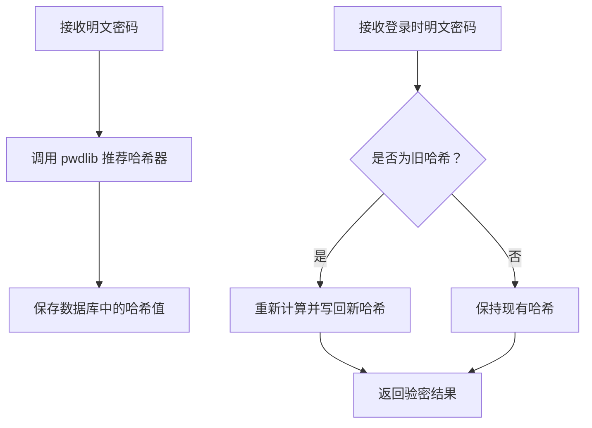

**图表来源**
- [security.py:14-22](file://src/personal_ai_life_os/security.py#L14-L22)
- [models.py:93-98](file://src/personal_ai_life_os/models.py#L93-L98)

**章节来源**
- [security.py:14-22](file://src/personal_ai_life_os/security.py#L14-L22)
- [models.py:93-98](file://src/personal_ai_life_os/models.py#L93-L98)

## CurrentUserDep 依赖注入与会话管理
### 依赖注入机制
`CurrentUserDep` 是基于 FastAPI 的 `Annotated` 与 `Depends` 构建的强类型依赖。它会：
- 从请求头解析可选 Bearer 凭据；
- 通过 `_authenticated_user` 完成统一认证判断；
- 将最终的用户实体对象注入到路由处理器参数中。

这种设计的优点是：
- 认证逻辑集中；
- 业务路由只需声明 `CurrentUserDep`；
- 新增类似 `get_user_for_account_delete` 的特殊鉴权依赖时，可复用同一套解码与加载逻辑；
- 错误响应具有一致的错误代码与响应头。

### 会话管理说明
项目中并没有 Redis 或服务端会话表；“会话”是通过访问令牌实现的无状态会话：
- 客户端在每个受保护请求中发送 Bearer 令牌；
- 服务端解码后仅查询当前用户实体；
- 用户实体的状态会影响鉴权结果，比如用户申请删除后暂时禁用访问；
- 没有登出接口意味着只要令牌未过期且不更换客户端存储，就可持续访问。

因此，令牌本身成为身份载体。客户端有责任安全地存储令牌，避免 XSS、日志泄漏或被其他页面读取。

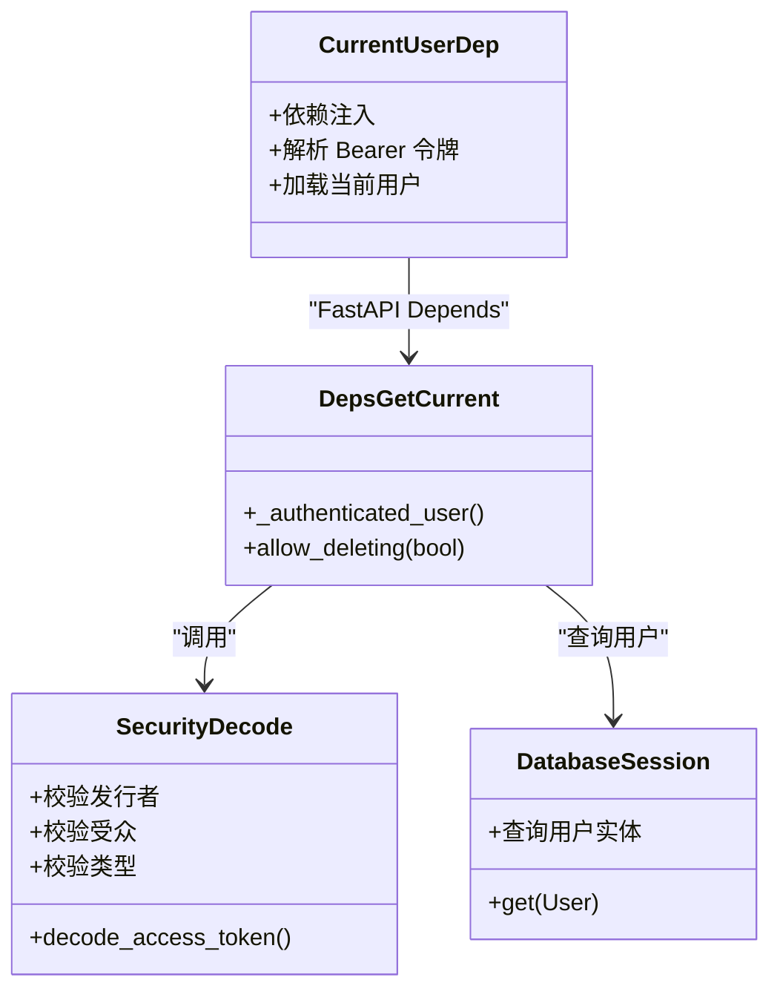

**图表来源**
- [deps.py:12-65](file://src/personal_ai_life_os/api/deps.py#L12-L65)
- [security.py:41-53](file://src/personal_ai_life_os/security.py#L41-L53)

**章节来源**
- [deps.py:12-65](file://src/personal_ai_life_os/api/deps.py#L12-L65)

## 错误处理、安全限制与防护建议

### 已实现的错误分类
| 错误场景 | HTTP 状态码 | 错误代码或描述 |
|---|---:|---|
| 缺少 Bearer 凭据 | 401 | `auth_required` |
| 访问令牌无效或过期 | 401 | `invalid_access_token` |
| 用户账号申请删除中 | 410 | `account_deletion_pending` |
| 凭证不正确 | 401 | `invalid_credentials` |
| 邀请码无效 | 403 | `invalid_invitation` |
| 注册被关闭 | 403 | `registration_closed` |
| 邮箱已存在 | 409 | `account_exists` |
| 桌面模式未启用或接口不可用 | 404 | 对应业务提示 |

这些错误大多包含结构化 `code` 和人类可读 `message`，便于前端展示和监控分类。

### 暴力攻击防护现状
当前代码：
- 没有显式的全局频率限制中间件；
- 配置中有 `registration_rate_limit` 字段，但其定义并未出现在当前注册逻辑中；
- 登录接口也没有针对 IP 或用户的计数器和延时退避。

因此不能将其视为实现了完整的暴力破解防护。

### 会话劫持防护建议
当前实现依赖客户端正确传输和保护令牌。为避免会话劫持，应：
- 仅在 HTTPS 连接上传输令牌；
- 避免在 URL、日志、错误信息中输出令牌；
- 使用安全存储（例如后端 API 持有，前端不长期缓存）；
- 在敏感操作中要求二次确认；
- 在客户端层面限制跨站脚本风险；
- 若未来引入刷新令牌，则短生命周期的访问令牌更不容易长期泄露。

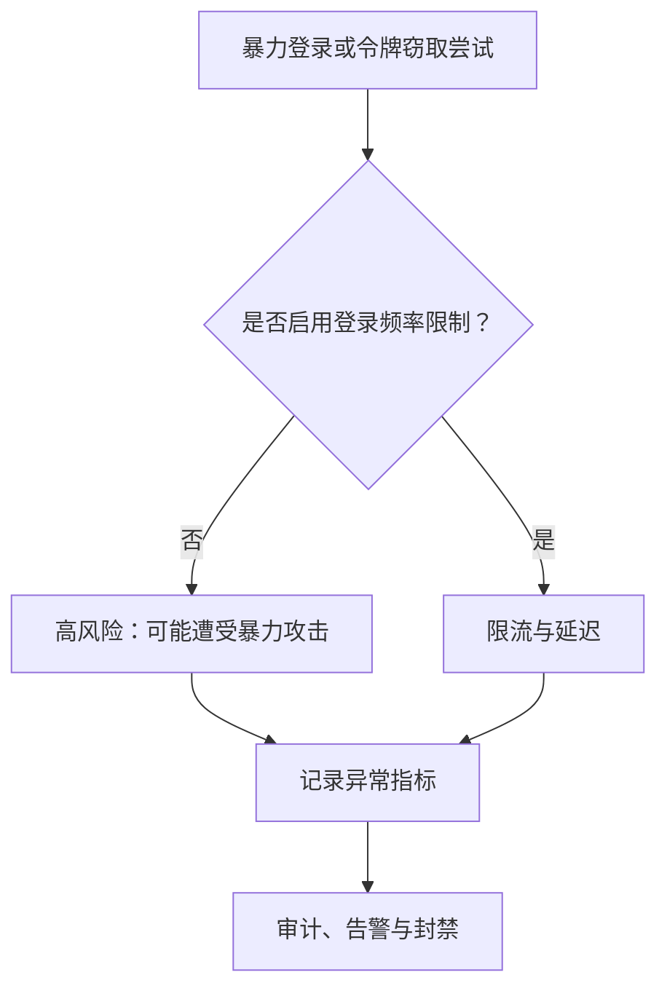

**图表来源**
- [deps.py:24-40](file://src/personal_ai_life_os/api/deps.py#L24-L40)
- [config.py:21-25](file://src/personal_ai_life_os/config.py#L21-L25)

**章节来源**
- [deps.py:12-65](file://src/personal_ai_life_os/api/deps.py#L12-L65)
- [config.py:19-30](file://src/personal_ai_life_os/config.py#L19-L30)

## 架构图与数据流图

### 整体架构关系图
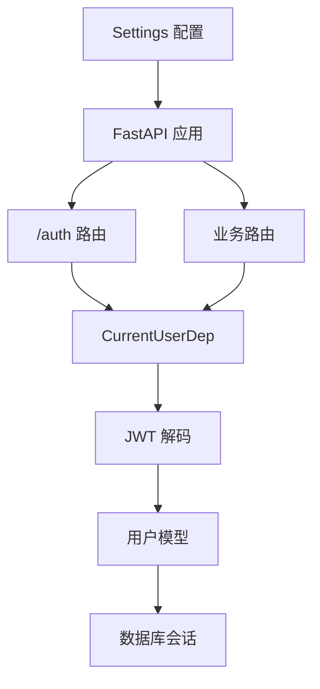

**图表来源**
- [main.py:1-30](file://src/personal_ai_life_os/main.py#L1-L30)
- [config.py:13-78](file://src/personal_ai_life_os/config.py#L13-L78)
- [deps.py:12-65](file://src/personal_ai_life_os/api/deps.py#L12-L65)
- [security.py:14-53](file://src/personal_ai_life_os/security.py#L14-L53)
- [models.py:93-120](file://src/personal_ai_life_os/models.py#L93-L120)

### 注册与登录数据流图
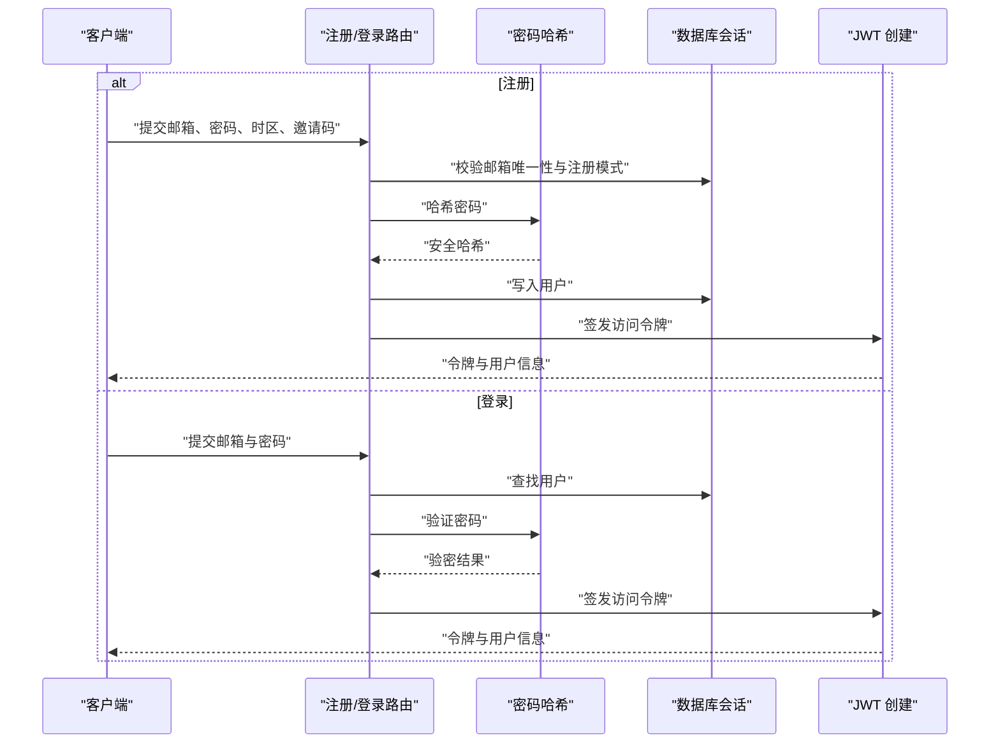

**图表来源**
- [auth.py:97-152](file://src/personal_ai_life_os/api/routes/auth.py#L97-L152)
- [security.py:14-40](file://src/personal_ai_life_os/security.py#L14-L40)

### 受保护请求鉴权流程图
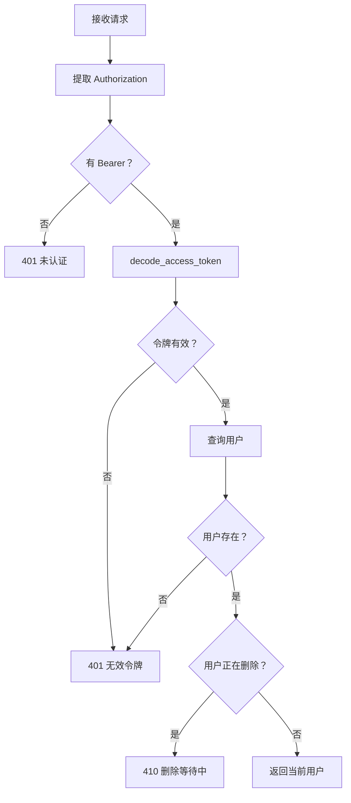

**图表来源**
- [deps.py:24-65](file://src/personal_ai_life_os/api/deps.py#L24-L65)
- [security.py:41-53](file://src/personal_ai_life_os/security.py#L41-L53)

## 配置与安全检查要点

### 关键配置项
| 配置项 | 默认值 | 作用 | 安全注意 |
|---|---|---|---|
| `access_token_secret` | 开发默认密钥 | JWT HS256 签名密钥 | 生产环境必须设为唯一且至少三十二位 |
| `access_token_ttl_hours` | 12 | 访问令牌有效期 | 不宜过长，应避免永久有效令牌 |
| `registration_mode` | open | 控制注册策略 | 生产环境不允许开放注册 |
| `signup_invite_code` | None | 邀请注册时的静态邀请码 | 仅适合演示或初始托管；不建议暴露 |
| `app_env` | development | 运行环境 | 桌面模式走不同认证分支 |
| `metrics_token` | None | 指标访问令牌 | 生产环境要求唯一且较长 |

### 生产环境强制检查
配置模型在初始化后会执行一组严格检查：
- 删除同桶风险：S3 删除日志桶与主数据桶不能相同；
- 禁止开发密钥用于生产；
- 禁止自动建库用于生产；
- 生产必须使用可恢复数据库工作进程；
- 禁止开放注册；
- 邀请注册必须提供邀请码；
- CORS 只允许部署后的 HTTPS 域名；
- 外部模型使用必须提供隐私地址、保留说明与价格参数；
- 外部模型使用需要 API Key。

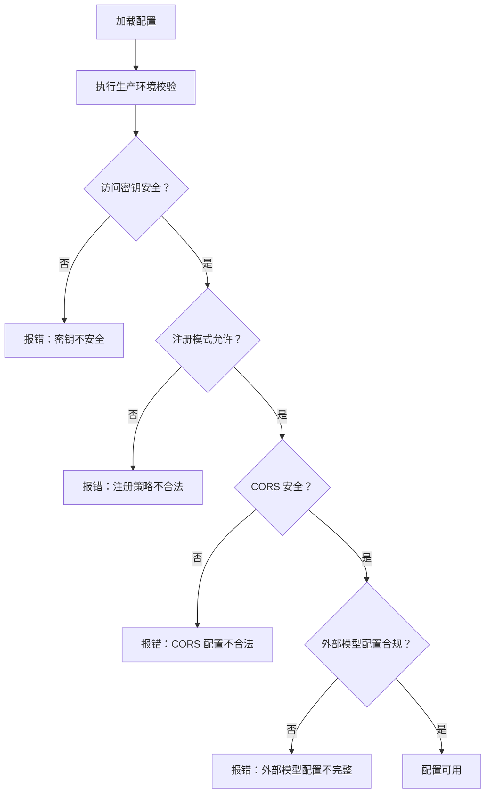

**图表来源**
- [config.py:86-132](file://src/personal_ai_life_os/config.py#L86-L132)

**章节来源**
- [config.py:19-30](file://src/personal_ai_life_os/config.py#L19-L30)
- [config.py:86-132](file://src/personal_ai_life_os/config.py#L86-L132)

## 结论与建议
Personal-AI-Life-OS 的认证与授权采用了清晰的模块化设计：JWT 令牌生成与解码集中在安全模块；注册、登录和桌面模式位于认证路由；当前用户依赖统一解析 Bearer 令牌并注入业务路由；密码哈希依赖 `pwdlib` 推荐算法，天然支持逐步升级。

目前的主要安全特征包括：
- 严格的令牌声明校验和固定发行者、受众、类型；
- 注册模式由配置驱动，邀请码比较使用常量时间算法；
- 桌面模式限定专用邮箱和环境；
- 生产配置强制执行多项安全前提。

主要的增强点包括：
- 实现真正的动态邀请码生成与 HMAC 签名；
- 添加全局登录频率限制、锁定或指数退避；
- 引入显式的令牌刷新机制与可选的撤销列表；
- 在注册流程加入明文密码强度校验；
- 完善会话生命周期管理策略；
- 对 `registration_rate_limit` 这类预留字段进行真正集成。

在不改动现有鉴权契约的前提下，优先添加外部可插拔的速率限制、刷新令牌服务和密码强度检查，可以显著提升系统的健壮性和可运维性。