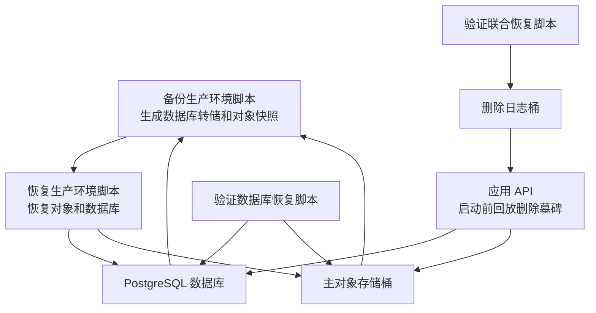
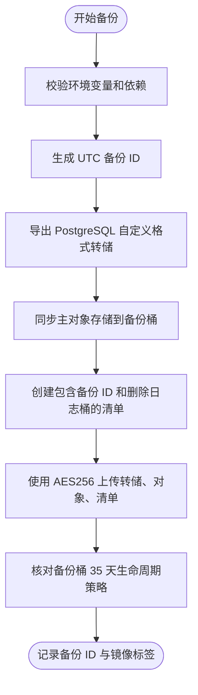
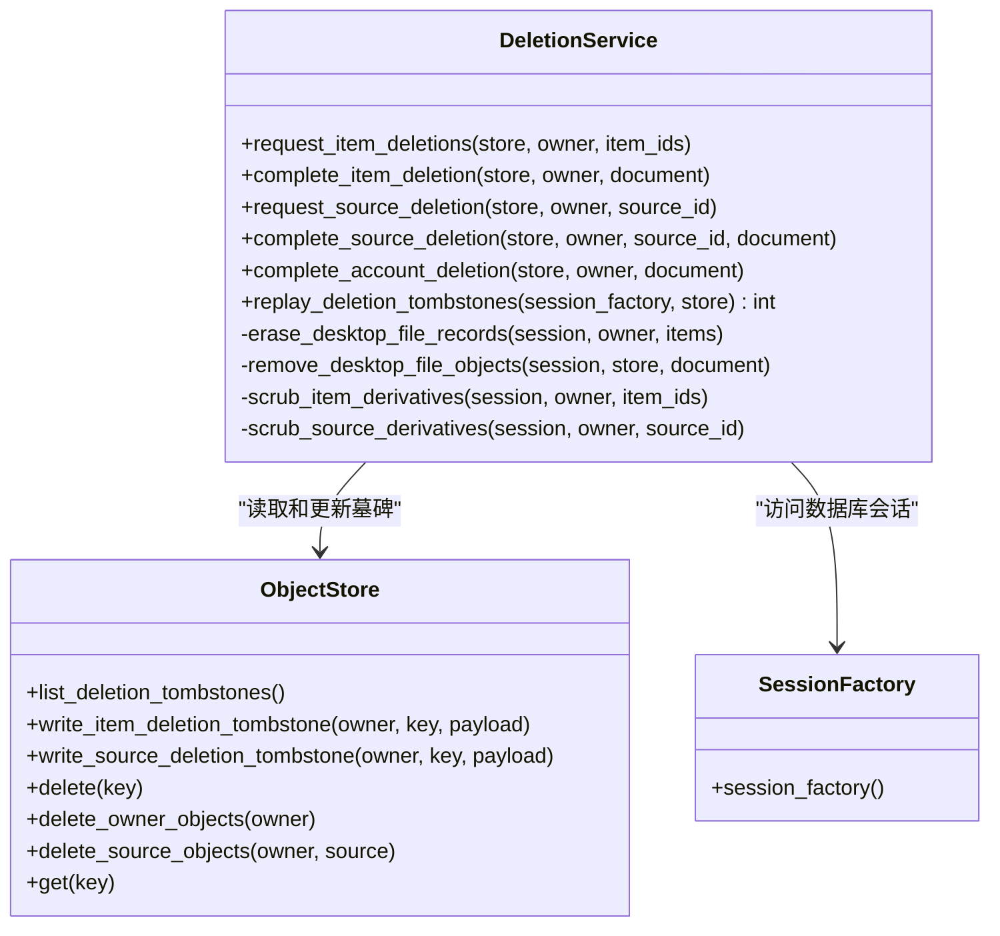
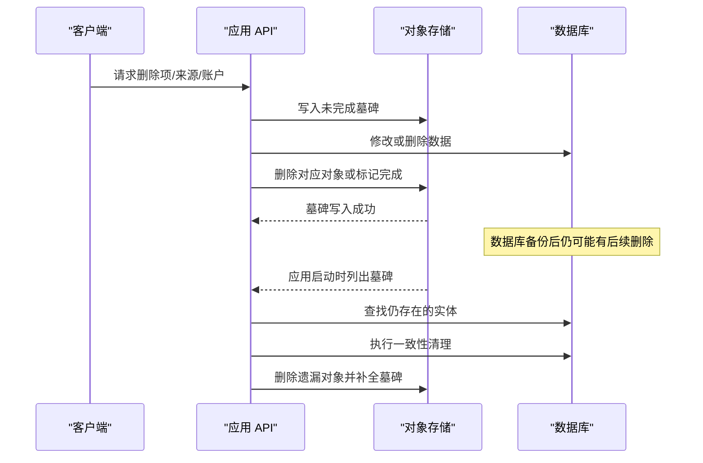
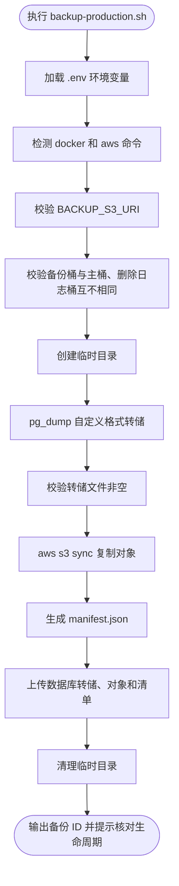
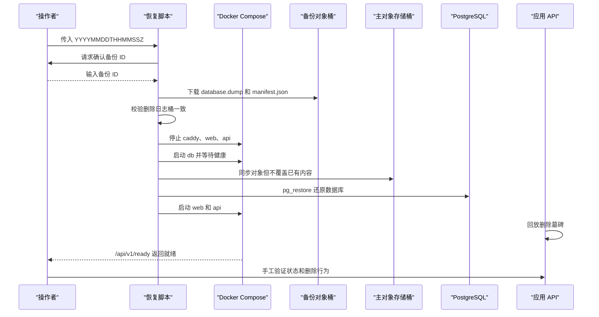
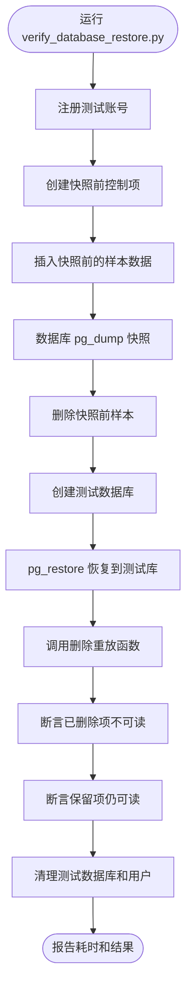
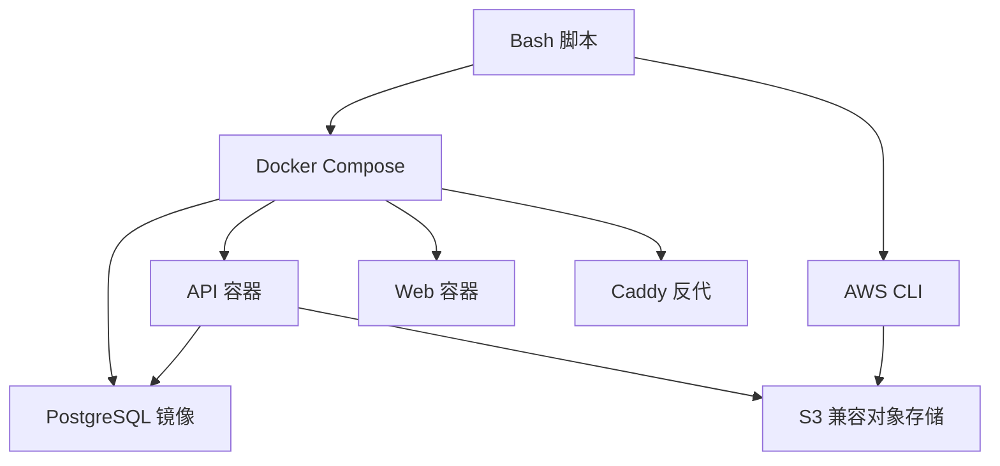

# 数据备份与灾难恢复

<cite>
**本文引用的文件**
- [文档/业务操作指南：备份与还原](file://docs/operations/backup-restore.md)
- [脚本：备份生产环境](file://scripts/backup-production.sh)
- [脚本：恢复生产环境](file://scripts/restore-production.sh)
- [测试程序：验证数据库恢复](file://scripts/verify_database_restore.py)
- [测试程序：验证联合恢复](file://scripts/verify_joint_restore.py)
- [服务实现：删除与墓碑记录](file://src/personal_ai_life_os/services/deletion.py)
- [应用配置：设置校验](file://src/personal_ai_life_os/config.py)
- [容器编排：生产部署](file://docker-compose.production.yml)
- [项目说明](file://README.md)
</cite>

## 目录
1. [简介](#简介)
2. [项目结构与边界](#项目结构与边界)
3. [备份策略设计](#备份策略设计)
4. [删除日志机制](#删除日志机制)
5. [自动化备份脚本执行流程](#自动化备份脚本执行流程)
6. [恢复流程](#恢复流程)
7. [灾难恢复场景](#灾难恢复场景)
8. [恢复验证程序](#恢复验证程序)
9. [恢复演练最佳实践](#恢复演练最佳实践)
10. [依赖与服务关系](#依赖与服务关系)
11. [故障排查](#故障排查)
12. [结论](#结论)

## 简介
Personal-AI-Life-OS 的数据备份与灾难恢复围绕三个独立要素展开：**数据库快照**、**对象存储快照**和**独立的删除日志**。项目通过 `pg_dump` 生成 PostgreSQL 自定义格式转储，通过 S3 同步复制主对象桶中的对象，同时保留一个与主业务桶隔离的删除日志桶。这样可以在数据库或对象存储损坏时，用最近备份回滚状态，并重新回放备份后发生的删除操作，使系统恢复为一致且安全的终止状态。

该项目的备份文档强调，备份应包含独立的删除日志清单；恢复时需要暂停公共服务，完成对象复制、数据库还原和应用重启；最终必须由操作者确认健康端点和关键已删除实体仍不可读。本地开发栈还提供用于数据库恢复和联合恢复的验证脚本，帮助在真实数据上线前证明 RPO/RTO 可达。

**章节来源**
- [文档/业务操作指南：备份与还原：1-33](file://docs/operations/backup-restore.md#L1-L33)

## 项目结构与边界
从备份与恢复角度，仓库中涉及的关键位置如下：

| 类别 | 文件 | 作用 |
|---|---|---|
| 操作指南 | [文档/业务操作指南：备份与还原](file://docs/operations/backup-restore.md) | 描述备份、恢复、RPO/RTO、演练和重要恢复边界 |
| 生产备份 | [脚本：备份生产环境](file://scripts/backup-production.sh) | 生成数据库 dump、对象快照、元数据清单和加密上传到独立备份桶 |
| 生产恢复 | [脚本：恢复生产环境](file://scripts/restore-production.sh) | 校验备份 ID、停止公共层、复制对象、还原数据库、重启服务 |
| 单库验证 | [测试程序：验证数据库恢复](file://scripts/verify_database_restore.py) | 在生命周期栈内创建数据、快照、增量删除、还原并校验删除重放 |
| 联合演练 | [测试程序：验证联合恢复](file://scripts/verify_joint_restore.py) | 用 Moto 模拟多 S3 桶和版本化，演练数据库与主桶同时丢失后的恢复 |
| 删除逻辑 | [服务实现：删除与墓碑记录](file://src/personal_ai_life_os/services/deletion.py) | 写入、补全和回放删除墓碑，实现跨存储的一致删除语义 |
| 运行时配置 | [应用配置：设置校验](file://src/personal_ai_life_os/config.py) | 强制生产使用 S3、要求独立删除日志桶、拒绝危险默认值 |
| 容器部署 | [容器编排：生产部署](file://docker-compose.production.yml) | 定义 Caddy、Web、API、PostgreSQL 启动顺序和健康检查 |
| 总体说明 | [项目说明](file://README.md) | 提供本地开发入口和验证命令参考 |

**图表来源**
- [脚本：备份生产环境：1-55](file://scripts/backup-production.sh#L1-L55)
- [脚本：恢复生产环境：1-63](file://scripts/restore-production.sh#L1-L63)
- [测试程序：验证数据库恢复：1-100](file://scripts/verify_database_restore.py#L1-L100)
- [测试程序：验证联合恢复：1-173](file://scripts/verify_joint_restore.py#L1-L173)
- [服务实现：删除与墓碑记录：1-352](file://src/personal_ai_life_os/services/deletion.py#L1-L352)
- [容器编排：生产部署：1-101](file://docker-compose.production.yml#L1-L101)

**章节来源**
- [文档/业务操作指南：备份与还原：1-33](file://docs/operations/backup-restore.md#L1-L33)
- [README.md:1-118](file://README.md#L1-L118)

## 备份策略设计
备份策略采用“分离三要素”的设计：

1. **数据库定时备份**
   - 使用 `docker compose exec` 调用 PostgreSQL 客户端。
   - 使用 `pg_dump --format=custom` 输出 PostgreSQL 自定义格式。
   - 不保留数据库所有者信息，适合跨用户恢复。
   - 先写入临时目录，再校验文件大小非空。

2. **对象存储快照**
   - 使用 `aws s3 sync` 复制主对象的当前内容到备份路径下的对象目录。
   - 所有传输都启用 AES256 SSE 加密，避免以明文落入中间层。
   - 只复制对象主体，不涉及数据库状态。

3. **配置文件与独立删除日志**
   - 备份元数据清单记录 `backup_id`、创建时间、数据库格式、主对象桶和删除日志桶。
   - 删除日志桶必须与主对象桶不同，也必须与备份桶不同。
   - 这保证了即使主桶和数据库同时丢失，只要删除日志桶可用，就可以回放备份后的删除行为。

4. **生命周期管理**
   - 文档指出备份桶的生产前缀带有 35 天生命周期。
   - 这是操作员运维策略，不是 API 或脚本强加的行为。
   - 不能在已发布保留窗口过去之前宣称“所有备份中的删除都已清理完成”。

**图表来源**
- [脚本：备份生产环境：1-55](file://scripts/backup-production.sh#L1-L55)
- [文档/业务操作指南：备份与还原：6-22](file://docs/operations/backup-restore.md#L6-L22)

**章节来源**
- [脚本：备份生产环境：1-55](file://scripts/backup-production.sh#L1-L55)
- [文档/业务操作指南：备份与还原：6-22](file://docs/operations/backup-restore.md#L6-L22)

## 删除日志机制
删除日志（deletion journal）是这套灾备体系中最关键的安全边界。普通删除可能因为事务失败、进程崩溃或恢复而部分完成；删除日志则把删除请求持久化为“墓碑”（tombstone），并在数据库或对象存储恢复后重新回放，确保“请求过但未完成的删除也能完成”。

### 核心组件关系
删除逻辑围绕三种墓碑类型和组织结构工作：

| 墓碑类型 | 典型用途 | 回放的副作用 |
|---|---|---|
| 项删除墓碑 | 删除单个导入项 | 标记项不可当前、清理关联证据和衍生记录 |
| 来源删除墓碑 | 删除来源及关联项 | 将来源设为删除状态，清理对象、同步记录和源连接 |
| 账户删除墓碑 | 删除账户及其全部资源 | 取消相关任务、清空所有权域中的可引用数据 |

**图表来源**
- [服务实现：删除与墓碑记录：1-200](file://src/personal_ai_life_os/services/deletion.py#L1-L200)
- [服务实现：删除与墓碑记录：201-352](file://src/personal_ai_life_os/services/deletion.py#L201-L352)

### 工作原理
1. **请求阶段**：删除操作开始前，服务将删除请求写为未完成的墓碑。
2. **完成阶段**：删除完成后，服务将墓碑补上完成时间戳。
3. **回放阶段**：应用启动或恢复流程中，会扫描删除日志中的墓碑，对数据库中尚未被删除的实体执行相同的清理逻辑。
4. **幂等性**：如果删除已完成，回放不会重复销毁对象，而是继续推进墓碑完成状态。
5. **失败保护**： malformed（格式错误）的墓碑会在启动阶段引发异常，防止盲目恢复未知删除意图。

**图表来源**
- [服务实现：删除与墓碑记录：1-352](file://src/personal_ai_life_os/services/deletion.py#L1-L352)
- [文档/业务操作指南：备份与还原：13-21](file://docs/operations/backup-restore.md#L13-L21)

### 故障域隔离
配置层在生产模式下强制要求：

- 删除日志桶不能与主对象桶相同。
- 生产必须使用 S3 作为对象存储后端。
- 必须配置 `S3_DELETION_JOURNAL_BUCKET`。
- 不能使用容易泄露的开发密钥。
- 禁止自动建表、公开注册、弱指标令牌或允许本地回环 CORS。

这些限制使得删除日志成为独立故障域：即便对象存储丢失，只要删除日志桶可用，恢复过程仍能知道“哪些删除发生在备份之后”。

**章节来源**
- [服务实现：删除与墓碑记录：1-352](file://src/personal_ai_life_os/services/deletion.py#L1-L352)
- [应用配置：设置校验：1-132](file://src/personal_ai_life_os/config.py#L1-L132)
- [文档/业务操作指南：备份与还原：21-33](file://docs/operations/backup-restore.md#L21-L33)

## 自动化备份脚本执行流程
`backup-production.sh` 是面向生产环境管理员的脚本，主要流程如下：

| 步骤 | 行为 | 安全或运维要点 |
|---|---|---|
| 加载配置 | 从 `.env` 加载环境变量 | 若缺少必要变量会立即失败 |
| 校验依赖 | 要求 Docker 和 AWS CLI 可用 | 缺失时停止运行 |
| 校验备份 URI | 要求 `BACKUP_S3_URI` 是合法的 S3 地址 | 防止误写到相对路径或错误主机 |
| 隔离主桶 | 不允许备份桶等于主对象桶 | 降低误覆盖风险 |
| 隔离删除日志桶 | 删除日志桶不能等于主对象桶或备份桶 | 满足独立故障域 |
| 生成备份 ID | 使用 UTC `YYYYMMDDTHHMMSSZ` 时间戳 | 便于按时间排序和选择恢复点 |
| 数据库转储 | 使用 PostgreSQL 自定义格式导出 | 输出到临时目录并校验大小 |
| 对象同步 | 同步主桶对象到备份路径 | 带 AES256 加密 |
| 清单创建 | 写入 JSON 清单，记录备份 ID、主对象桶和删除日志桶 | 用于恢复时校验一致性 |
| 生命周期提醒 | 打印需要核对 35 天生命周期的提示 | 提醒运维确认保留策略 |

**图表来源**
- [脚本：备份生产环境：1-55](file://scripts/backup-production.sh#L1-L55)

**章节来源**
- [脚本：备份生产环境：1-55](file://scripts/backup-production.sh#L1-L55)
- [文档/业务操作指南：备份与还原：6-22](file://docs/operations/backup-restore.md#L6-L22)

## 恢复流程
恢复流程的目标是把系统恢复到指定备份的时间点，并确保备份之后发生的所有删除都被回放。

### 恢复前置条件
1. 拥有有效的 `YYYYMMDDTHHMMSSZ` 格式备份 ID。
2. 可以使用 Docker Compose、AWS CLI 和备份桶。
3. 能够访问与原始部署相同的删除日志桶。
4. 操作者在控制台确认要替换生产数据库和对象。

### 原子暂停公共服务的含义
恢复脚本首先停止反向代理 `caddy`、前端 `web` 和应用 `api`，然后只单独拉起数据库。这样可以：

- 阻止用户在恢复过程中看到不完整的时间线。
- 防止并行写入导致对象或数据库不一致。
- 保证对象同步和数据库还原的顺序可控。
- 让应用仅在数据库准备好后才重新加入流量。

### 恢复步骤
1. 解析并验证备份 ID。
2. 校验备份 URI 和桶隔离。
3. 要求手动输入备份 ID 进行二次确认。
4. 下载选定备份的数据库转储和清单。
5. 校验清单中的删除日志桶是否匹配当前部署配置。
6. 停止公共层服务。
7. 仅启动数据库。
8. 将备份对象复制到主对象桶，但保留已有对象和删除标记。
9. 使用 `pg_restore --clean --if-exists --no-owner` 还原数据库。
10. 重新拉起整个 Compose 栈。
11. 等待 `/api/v1/ready` 就绪。
12. 由人工验证登录、时间线、归档行为和删除记录。

**图表来源**
- [脚本：恢复生产环境：1-63](file://scripts/restore-production.sh#L1-L63)
- [容器编排：生产部署：29-69](file://docker-compose.production.yml#L29-L69)

**章节来源**
- [脚本：恢复生产环境：1-63](file://scripts/restore-production.sh#L1-L63)
- [文档/业务操作指南：备份与还原：13-21](file://docs/operations/backup-restore.md#L13-L21)

## 灾难恢复场景
该项目支持以下四类灾难恢复思路：

| 灾难类型 | 主要影响 | 恢复方案 |
|---|---|---|
| 数据库损坏 | 用户元数据、记录、来源和索引不可用 | 从备份桶下载 `database.dump`，用 `pg_restore` 重建数据库，保持原对象桶 |
| 对象存储丢失 | 导入文件、图片和外部数据不可读 | 从备份桶恢复对象；如有删除需求，需先确认删除日志桶可用 |
| 双节点故障 | 数据库和对象存储同时不可用 | 重建数据库和对象存储，同时回放删除日志 |
| 级联失效 | 多个资源依次损坏，包括删除日志可能不可用 | 暂停恢复直到删除日志可用；若不可用，应先做恢复前数据对齐，而不是盲目接受流量 |

### 数据库损坏
这是最标准的单点故障场景。恢复重点在于：
- 确认备份 ID 有效。
- 停止写入口服务。
- 只恢复数据库。
- 不强制覆盖对象，避免冲掉备份后新增的数据。
- 确认健康端点后恢复对外流量。

### 对象存储丢失
恢复重点在于：
- 使用 `s3 sync` 复制备份对象。
- 保留现有对象和删除标记。
- 若有删除请求发生在备份之后，必须存在删除日志才能回放。
- 若对象版本控制可用，可通过删除标记辅助判断历史状态。

### 双节点故障
恢复重点在于：
- 准备新数据库和新对象桶。
- 将备份对象复制到新主桶。
- 还原数据库。
- 应用启动时读取删除日志并重放后续删除。
- 确认每个已知删除的资源在新桶中不存在可读版本。

### 级联失效
当删除日志本身也出现异常时，项目明确要求：**不要在无法访问删除日志的情况下直接暴露服务**。应优先执行“恢复前对齐”，即在确认事件期间哪些删除确实成功后，再恢复生产访问。否则可能出现“对象已删但墓碑未记录”或“墓碑存在但原始对象已不存在”的状态不一致问题。

**章节来源**
- [文档/业务操作指南：备份与还原：13-33](file://docs/operations/backup-restore.md#L13-L33)
- [服务实现：删除与墓碑记录：201-352](file://src/personal_ai_life_os/services/deletion.py#L201-L352)

## 恢复验证程序
项目提供两个层次的数据一致性验证：数据库恢复验证和联合恢复验证。它们共同证明备份与删除日志能够一起把系统恢复到一致状态。

### verify_database_restore.py
该脚本在本地 `lifeos-iteration` Compose 项目中执行端到端流程：

| 阶段 | 验证内容 |
|---|---|
| 数据创建 | 注册用户，创建 Markdown 来源，导入合成文件 |
| 快照前删除 | 删除一个源项并断言其对象不可读 |
| 备份 | 对数据库执行 `pg_dump -Fc` |
| 增量删除 | 删除刚刚创建的源项，构造“备份之后的删除” |
| 恢复 | 新建测试库并执行 `pg_restore` |
| 删除重放 | 在应用内调用删除重放函数，验证被删项消失 |
| 控制项检查 | 验证保留项仍存在且对象可读 |
| 清理 | 删除测试数据库和用户资源 |

它尤其验证了“备份后发生的删除能被回放”，而不只是数据库旧快照能正确还原。

**图表来源**
- [测试程序：验证数据库恢复：1-100](file://scripts/verify_database_restore.py#L1-L100)

### verify_joint_restore.py
该脚本模拟更复杂的灾难：

1. 使用本地 S3 模拟器 Moto。
2. 创建主桶、恢复桶、日志桶。
3. 创建多个用户和导入对象。
4. 在快照前删除某个对象，再重新写入。
5. 尝试对暂停来源执行导入，确认状态变更。
6. 模拟删除日志不可用：删除操作返回 503。
7. 关闭删除日志后执行更多删除，确保最终一致。
8. 删除主对象桶和数据库。
9. 将对象复制进恢复桶。
10. 还原数据库并使用新的对象桶启动恢复后的应用。
11. 验证删除项不可读、保留项可读，以及版本对象被清理。

这个脚本证明：**对象存储和数据库可以同时丢失，只要删除日志完整，恢复后的对象和关系仍可保持一致。**

**章节来源**
- [测试程序：验证数据库恢复：1-100](file://scripts/verify_database_restore.py#L1-L100)
- [测试程序：验证联合恢复：1-173](file://scripts/verify_joint_restore.py#L1-L173)

## 恢复演练最佳实践
### 定期恢复测试
建议至少执行以下两类测试：

| 测试类型 | 频率建议 | 目标 |
|---|---|---|
| 数据库恢复演练 | 高频，例如每周或每次变更前 | 验证 `pg_restore`、迁移和服务启动 |
| 联合恢复演练 | 中频，例如每月或季度 | 验证对象存储、删除日志和数据库协同恢复 |
| 真实环境预演 | 低频，如每半年或每次重大架构变更 | 验证实际 RTO/RPO、凭据权限和外部 S3 |

### RTO 与 RPO 目标
- **RPO**：可接受的最大数据丢失窗口，应与备份间隔和删除日志生命周期对齐。示例中备份前缀生命周期约为 35 天，但 RPO 应根据业务重要性设定更小目标。
- **RTO**：从决定恢复开始，到对外提供稳定可用的最大时间。脚本中服务拉起依赖健康检查，通常还需加上人工验证时间。
- 建议在每次演练后记录恢复耗时、发现的不一致项、备份大小和数据差异范围。

### 应急响应操作流程
推荐的操作清单包括：

1. 确定受影响范围：数据库、对象存储、删除日志或全部。
2. 固定当前备份 ID 和部署镜像标签。
3. 暂停公共流量和写入入口。
4. 检查删除日志桶是否可访问。
5. 根据恢复脚本恢复对象和数据库。
6. 不要立即开放全量流量。
7. 验证健康端点、登录流程、时间线、搜索、导入、归档和删除行为。
8. 检查删除重放日志和迁移日志。
9. 记录 RTO、RPO 和恢复中发现的问题。
10. 将复盘和改进措施写入变更或事故记录。

**章节来源**
- [文档/业务操作指南：备份与还原：6-33](file://docs/operations/backup-restore.md#L6-L33)
- [README.md:1-118](file://README.md#L1-L118)

## 依赖与服务关系
生产恢复过程依赖多个外部命令和服务：

**图表来源**
- [脚本：备份生产环境：1-55](file://scripts/backup-production.sh#L1-L55)
- [脚本：恢复生产环境：1-63](file://scripts/restore-production.sh#L1-L63)
- [容器编排：生产部署：1-101](file://docker-compose.production.yml#L1-L101)

**章节来源**
- [容器编排：生产部署：1-101](file://docker-compose.production.yml#L1-L101)
- [脚本：备份生产环境：1-55](file://scripts/backup-production.sh#L1-L55)
- [脚本：恢复生产环境：1-63](file://scripts/restore-production.sh#L1-L63)

## 故障排查
### 常见错误和处理方式
| 现象 | 可能原因 | 处理建议 |
|---|---|---|
| 脚本提示需要使用独立的备份桶 | 备份桶与主对象桶配置相同 | 使用单独私有桶存放备份，避免同桶覆盖 |
| 脚本提示删除日志桶需要分离 | 删除日志桶与主对象桶或备份桶重合 | 配置独立删除日志桶，保障删除重放能力 |
| 恢复脚本报错选择了不同删除日志桶 | 清单中的删除日志桶与当前环境不一致 | 对齐部署配置，恢复前先完成删除日志桶治理 |
| 恢复后 API 不健康 | 数据库迁移、连接或对象存储配置失败 | 检查数据库健康、API 日志和对象存储读写权限 |
| 恢复后删除数据仍然存在 | 删除日志桶不可用或未回放成功 | 确认删除日志可用，检查应用启动日志中的删除重放记录 |
| 联合演练报告对象版本未清理 | 主桶启用了对象版本控制但删除未成功 | 检查恢复流程是否正确调用删除 API 并完成墓碑 |
| 备份后 35 天内数据意外过期 | 生命周期策略过早清除备份 | 核对备份桶的生命周期策略，不要提前删除备份前缀 |

### 定位信息的优先顺序
1. 查看备份 ID 和时间戳。
2. 检查清单中记录的数据库格式、对象桶和删除日志桶。
3. 检查 Docker Compose 容器的健康状态。
4. 查看 `db` 容器的迁移和查询日志。
5. 查看 `api` 容器的启动日志，特别关注删除重放和模型提供方配置。
6. 对对象桶执行列表和版本操作，确认备份对象是否存在。
7. 对删除日志桶执行对象列表，确认墓碑是否完整。
8. 再次运行 `verify_database_restore.py` 或 `verify_joint_restore.py` 缩小复现范围。

**章节来源**
- [脚本：备份生产环境：1-55](file://scripts/backup-production.sh#L1-L55)
- [脚本：恢复生产环境：1-63](file://scripts/restore-production.sh#L1-L63)
- [文档/业务操作指南：备份与还原：13-33](file://docs/operations/backup-restore.md#L13-L33)

## 结论
Personal-AI-Life-OS 的备份与灾难恢复方案通过三个维度提高可靠性：

- 使用 `pg_dump` 自定义格式进行数据库备份。
- 使用 `aws s3 sync` 复制对象存储内容。
- 使用独立删除日志桶记录删除请求，支持恢复后重放。

这种设计避免了“只恢复数据库却忽略后续删除”和“只恢复对象却不知道哪些已被删除”的常见问题。配合 35 天的生命周期策略、AES256 传输加密、清单校验、独立故障域检查和多层恢复验证脚本，系统可以为管理员提供一个清晰的恢复锚点、明确的恢复顺序和可验证的一致性检查。

在实际生产中，最重要的仍然是：  
1) 始终保留独立的删除日志桶；  
2) 固定备份 ID 并记录部署镜像标签；  
3) 定期执行数据库和联合恢复演练；  
4) 在开放流量前验证健康端点、登录、时间线和删除状态；  
5) 在删除日志不可用时不得盲目恢复访问。