# 版本发布与灰度发布

<cite>
**本文引用的文件**   
- [README.md](file://README.md)
- [pyproject.toml](file://pyproject.toml)
- [web/package.json](file://web/package.json)
- [.github/workflows/ci.yml](file://.github/workflows/ci.yml)
- [.github/workflows/desktop.yml](file://.github/workflows/desktop.yml)
- [Dockerfile](file://Dockerfile)
- [docker-compose.production.yml](file://docker-compose.production.yml)
- [alembic.ini](file://alembic.ini)
- [migrations/env.py](file://migrations/env.py)
- [docs/operations/deployment.md](file://docs/operations/deployment.md)
- [docs/operations/backup-restore.md](file://docs/operations/backup-restore.md)
- [scripts/benchmark_mvp.py](file://scripts/benchmark_mvp.py)
- [src/personal_ai_life_os/api/routes/health.py](file://src/personal_ai_life_os/api/routes/health.py)
</cite>

## 目录

1. [引言](#引言)
2. [项目结构](#项目结构)
3. [核心发布工件与版本标识](#核心发布工件与版本标识)
4. [架构总览](#架构总览)
5. [MVP 版本发布检查清单](#mvp-版本发布检查清单)
6. [数据库迁移安全性](#数据库迁移安全性)
7. [灰度发布策略](#灰度发布策略)
8. [服务降级与熔断机制](#服务降级与熔断机制)
9. [性能基准测试与容量规划](#性能基准测试与容量规划)
10. [持续集成流水线](#持续集成流水线)
11. [发布回滚流程](#发布回滚流程)
12. [发布后验证](#发布后验证)
13. [依赖关系分析](#依赖关系分析)
14. [故障排查指南](#故障排查指南)
15. [结论](#结论)

## 引言

Personal-AI-Life-OS 是一个面向个人知识与学习记忆的开源系统，支持聊天导出、文档导入、日历快照、快速笔记、可追溯时间线、低置信度图谱抽取、周复盘、提醒、搜索和 Obsidian Markdown 导出。当前本地 API、命令行工具、Web 工作流、桌面 MVP 及生产部署模板已实现，但文档明确声明尚未部署到托管环境，也未获准处理真实个人资料或向他人分发。

从“版本发布与灰度发布”的角度看，该项目已经具备：

- 明确的语义版本号与 Python 包元数据。
- 基于 GitHub Actions 的 Python 矩阵 CI、Web 构建以及 Windows 桌面候选构建。
- 基于 Docker Compose 的生产部署模板。
- Alembic 版本化数据库迁移。
- 健康端点 `/api/v1/health` 和就绪端点 `/api/v1/ready`。
- 合成数据的端到端测试脚本、恢复演练脚本和本地性能基准。
- 备份、恢复和删除日志的运维文档。

但仓库中尚未出现蓝绿部署控制器、金丝雀流量路由、A/B 测试分流代码、指标采集网关或云端灰度编排。因此，灰度发布方案应以“现有基础 + 推荐实践”的形式说明：哪些可以由现有镜像标签、分支策略和 Compose 配置直接完成，哪些需要额外在编排层或网关层实现。

本文件的发布策略遵循以下原则：

1. **发布基线先于功能扩展**：先保证单个版本在本地、CI、Compose 和生产演练环境中稳定。
2. **数据不可逆操作优先保护**：迁移和回滚必须以备份、对象存储快照和删除日志为边界。
3. **外部 AI 必须可关闭**：模型提供商不可用时应退回到模板或本地路径，而不是直接失败。
4. **发布结果必须有可复核记录**：版本哈希、镜像标签、分支、日期、环境名称和实际结果应全部可审计。

**章节来源**
- [README.md:1-118](file://README.md#L1-L118)

## 项目结构

本次发布相关的项目结构按职责分为六类：

| 类别 | 关键路径 | 发布职责 |
|---|---|---|
| Python 应用入口与版本 | `pyproject.toml`、`src/personal_ai_life_os/` | 定义包版本、依赖组、测试路径和运行时模块 |
| Web 前端与端到端测试 | `web/package.json`、`web/src/`、`web/e2e/` | 前端构建、Playwright 端到端测试入口 |
| 持续集成 | `.github/workflows/ci.yml`、`.github/workflows/desktop.yml` | 自动拉取代码、安装依赖、运行 lint 和测试、构建容器或桌面候选 |
| 部署容器与编排 | `Dockerfile`、`docker-compose.production.yml` | 构建运行时镜像、启动 Caddy、Web、API、PostgreSQL |
| 数据库与迁移 | `alembic.ini`、`migrations/`、`migrations/env.py` | 初始化数据库引擎、运行 Alembic、忽略搜索引擎临时表 |
| 发布验证脚本 | `scripts/benchmark_mvp.py`、`docs/operations/deployment.md`、`docs/operations/backup-restore.md` | 性能 P95 测量、部署流程、备份与恢复 |

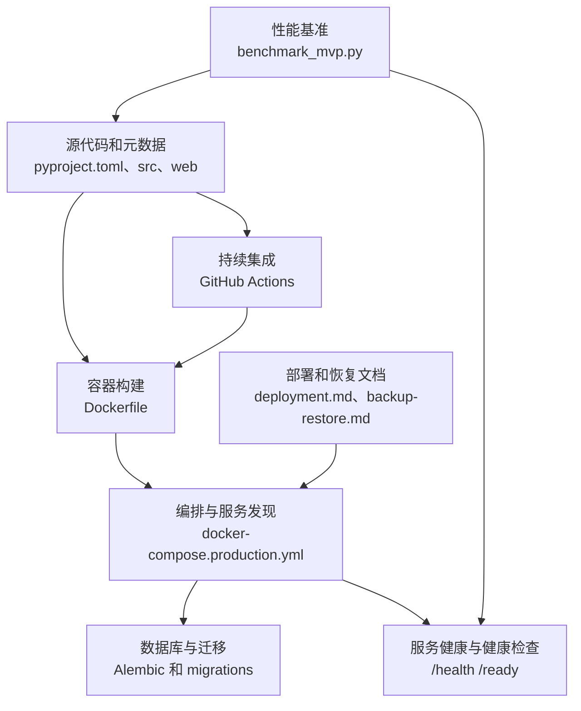

**图表来源**
- [pyproject.toml:1-58](file://pyproject.toml#L1-L58)
- [web/package.json:1-29](file://web/package.json#L1-L29)
- [.github/workflows/ci.yml:1-57](file://.github/workflows/ci.yml#L1-L57)
- [.github/workflows/desktop.yml:1-47](file://.github/workflows/desktop.yml#L1-L47)
- [Dockerfile:1-25](file://Dockerfile#L1-L25)
- [docker-compose.production.yml:1-101](file://docker-compose.production.yml#L1-L101)
- [alembic.ini:1-39](file://alembic.ini#L1-L39)
- [migrations/env.py:1-59](file://migrations/env.py#L1-L59)
- [docs/operations/deployment.md:1-153](file://docs/operations/deployment.md#L1-L153)

**章节来源**
- [README.md:74-118](file://README.md#L74-L118)
- [pyproject.toml:1-58](file://pyproject.toml#L1-L58)
- [web/package.json:1-29](file://web/package.json#L1-L29)

## 核心发布工件与版本标识

### 版本标识管理

Python 后端使用 setuptools 元数据定义版本：

- 包名：`personal-ai-life-os`
- 当前版本：`0.1.1`
- Python 最低版本要求：`>=3.11`

该版本目前存在于仓库元数据中，而不是通过环境变量或构建参数注入。这意味着发布前需要通过静态检查确认源码中的版本号、Git 提交、镜像标签三者在发布记录中一致。

| 标识维度 | 当前位置 | 建议的发布策略 |
|---|---|---|
| 应用语义版本 | `pyproject.toml` 的 `[project] version` | 作为主版本号；每次正式发布前手动校验 |
| Web 前端版本 | `web/package.json` | 当前为 `0.0.0`，正式发布前应同步更新 |
| Git 分支策略 | 未定义正式分支模型 | 建议采用 `main` + 发布标签 + 预发环境命名约定 |
| Docker 镜像标签 | 未统一规范 | 建议将 `git rev-parse --short HEAD` 与语义版本同时标记 |
| 桌面候选制品 | GitHub Actions 产物 | 以 SHA 和语义版本关联 |

### 镜像标签规范建议

由于仓库中没有统一的镜像推送动作，推荐策略如下：

| 环境 | 分支或触发条件 | 镜像标签示例 | 用途 |
|---|---|---|---|
| 开发 | 任意推送到非发布分支 | `<sha>` | 可复现构建 |
| 预发 / 候选 | `main` 或 `release/*` | `v<major>.<minor>.<patch>-candidate-<sha>` | 灰度前验证 |
| 生产灰度 | 经审批的版本发布 | `v<major>.<minor>.<patch>-gray-<env>` | 灰度环境 |
| 生产最终版 | 发布通过后最终签发 | `v<major>.<minor>.<patch>` | 生产主版本 |

### 镜像构建行为

`Dockerfile` 的行为与发布安全密切相关：

1. 使用多阶段复制逻辑：先安装 Python 依赖，再复制业务源码，确保依赖缓存可利用。
2. 通过 `uv sync --locked` 锁定依赖，避免上游变更破坏构建。
3. 创建无登录特权用户 `lifeos`，并设置 `/data` 目录权限。
4. 暴露端口 `8000`，默认启动 Uvicorn。
5. 安装了 Tesseract OCR，但语言资源由操作系统或外部依赖提供。

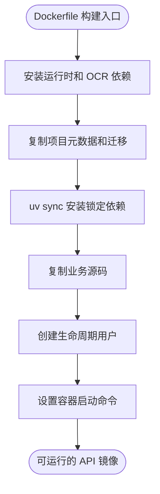

**图表来源**
- [Dockerfile:1-25](file://Dockerfile#L1-L25)

**章节来源**
- [pyproject.toml:1-58](file://pyproject.toml#L1-L58)
- [web/package.json:1-29](file://web/package.json#L1-L29)
- [Dockerfile:1-25](file://Dockerfile#L1-L25)

## 架构总览

生产 Compose 模板包含四层组件：

| 组件 | 作用 | 健康检查 |
|---|---|---|
| Caddy | HTTPS 入口、域名证书、Web 反向代理 | 依赖 Web 健康状态 |
| Web | React/Vite 构建产物 | 通过 wget 检测本地页面可用性 |
| API | FastAPI 业务服务 | 读取 `/api/v1/ready` |
| PostgreSQL | 持久化存储 | 使用 `pg_isready` |

API 启动命令在 compose 中显式执行 `alembic upgrade head`，然后再启动 Uvicorn；这体现了“先迁移、后服务”的部署顺序，但也意味着数据库必须先可用。

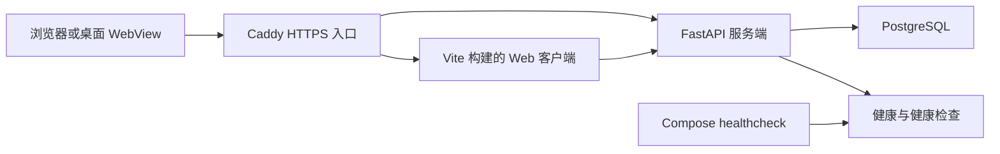

**图表来源**
- [docker-compose.production.yml:1-101](file://docker-compose.production.yml#L1-L101)
- [src/personal_ai_life_os/api/routes/health.py:1-27](file://src/personal_ai_life_os/api/routes/health.py#L1-L27)

**章节来源**
- [docker-compose.production.yml:1-101](file://docker-compose.production.yml#L1-L101)
- [docs/operations/deployment.md:70-135](file://docs/operations/deployment.md#L70-L135)

## MVP 版本发布检查清单

仓库已有的发布检查清单区分了“本机候选人”和“对他人开放的托管或 Beta 场景”。本文将其转换为可直接执行的发布门禁：

### 代码质量检查

| 检查项 | 通过标准 | 依据或命令 |
|---|---|---|
| Python lint | `ruff check .` 不报告阻断性错误 | README 推荐命令 |
| Python 单元测试 | `pytest -q` 全部通过 | pyproject pytest 配置 |
| Web lint | `npm run lint` 通过 | CI Node 步骤 |
| Web 生产构建 | `npm run build` 成功 | CI Node 步骤 |
| 容器编排正确性 | Compose 配置可通过解析 | CI Docker Compose smoke |
| 桌面安装包构建 | NSIS installer 生成并可安装 | desktop workflow |

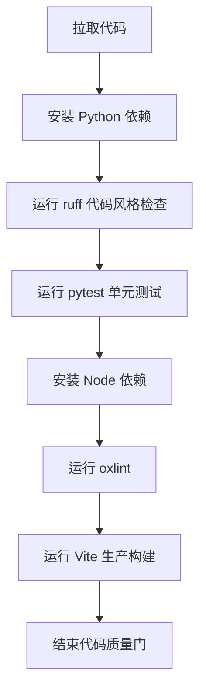

**图表来源**
- [.github/workflows/ci.yml:9-38](file://.github/workflows/ci.yml#L9-L38)
- [.github/workflows/desktop.yml:15-45](file://.github/workflows/desktop.yml#L15-L45)

### 单元测试和集成测试

现有 Python 测试由 pytest 扫描 `tests/`，并包含账号、导入、插件、计划任务、搜索结果、桌面 MVP、健康、图问答、复习、工作线程等测试文件。README 还指出作者验证过的 Owner 隔离、导入导出、来源和账户删除、复习、提醒和照片路径覆盖。

对于新功能的新增版本，必须满足：

1. 新增或变更 API 的单元测试覆盖关键路径。
2. 涉及外部依赖（数据库、对象存储、OCR、模型提供商）时，有对应 Mock 或 Compose 集成测试。
3. 桌面 MVP 相关变更由 `test_desktop_mvp.py` 或其他桌面相关测试覆盖。
4. 失败用例能够定位到具体分支、提交和测试套件。

### 端到端测试

端到端能力主要分布在：

- Web Playwright 端到端测试：`web/e2e/`
- 桌面安装包冒烟脚本：`desktop/smoke-installer.ps1`
- 数据库恢复、联合对象存储恢复、照片 OCR 验证脚本：`scripts/verify_*.py`
- MVP 性能基准：`scripts/benchmark_mvp.py`

端到端测试的通过标准应为：

| 类型 | 通过要求 |
|---|---|
| 浏览器端到端测试 | 在受支持的 Chromium 环境下通过，关键用户流程完整 |
| 桌面安装冒烟测试 | 安装包可安装、可启动、可调用 sidecar API |
| 恢复验证 | 删除后的数据不会误恢复，未删除数据保留 |
| OCR 验证 | 目标字体的中文 OCR 可用 |
| 基准测试 | 符合定义的 P95 延迟上限 |

**章节来源**
- [README.md:74-110](file://README.md#L74-L110)
- [.github/workflows/ci.yml:9-57](file://.github/workflows/ci.yml#L9-L57)
- [.github/workflows/desktop.yml:15-47](file://.github/workflows/desktop.yml#L15-L47)

## 数据库迁移安全性

### 迁移入口与执行方式

Alembic 的配置位于 `alembic.ini`，指向 `./data/lifeos.db` 的 SQLite URL。在生产 Compose 中，API 启动命令会先运行 `alembic upgrade head`，再进行请求服务。

`migrations/env.py` 负责：

1. 加载 SQLAlchemy `Base.metadata`。
2. 使用配置的 `database_url`。
3. 在离线和在线两种模式中都启用事务式迁移。
4. 忽略部分只读索引或搜索引擎表，包括 `timeline_fts`、`review_fts`、`reminder_fts` 及其 `_trgm` 后缀索引。

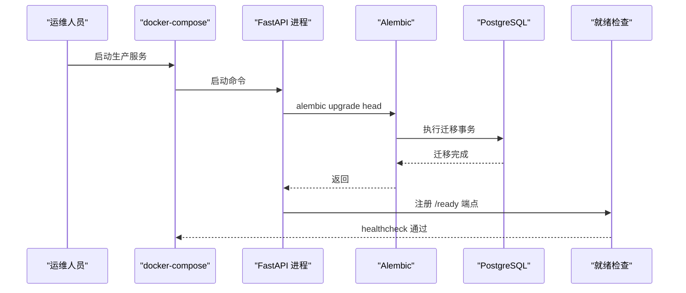

**图表来源**
- [alembic.ini:1-39](file://alembic.ini#L1-L39)
- [migrations/env.py:1-59](file://migrations/env.py#L1-L59)
- [docker-compose.production.yml:42-69](file://docker-compose.production.yml#L42-L69)

### 向前兼容性与回滚策略

根据项目文档的说明，每个迁移修订都设计了降级路径；降级操作仅删除该修订引入的表、列或索引，不会还原已删除的用户数据。这种设计体现的是“向前兼容性为主、向后降级为辅”的思路：

1. **向前兼容性优先**：新代码可以读取旧 schema，因为 migration 通常先增加字段而非立即删除。
2. **降级不等于数据恢复**：`alembic downgrade` 不能恢复已被删除的业务数据。
3. **推荐优先使用快照恢复**：发生数据问题时，应按恢复流程重新恢复数据库与对象存储。
4. **禁止跨 schema 直接回滚**：如果新应用可能写入旧 schema 不支持的数据格式，必须评估兼容性后再决定升级或回滚。

迁移安全要求包括：

| 控制点 | 要求 |
|---|---|
| 迁移前备份 | 至少保存一次数据库和对象存储一致视图 |
| 迁移后检查 | `alembic check` 无模型漂移 |
| 回滚决策 | 优先镜像回滚，而非直接迁移 down |
| 回滚前判断 | 旧镜像仍可读新 schema |
| 数据一致性 | 对象存储快照与删除日志参与恢复 |
| 演练要求 | 必须在新环境执行数据库和联合恢复演练 |

### 数据无损升级保证

“数据无损”不应只理解为“不丢行”，还应包括：

1. 新增字段允许空值或带合理默认值。
2. 删除字段前先下线代码引用。
3. 改名或重计算时新建列再切换，最后清理旧列。
4. 重建搜索索引不在单条热路径中断请求。
5. 删除数据不依赖普通行删除，还需对象存储和删除日志保持一致。
6. 恢复时不仅比较行数，还要比对 tombstone 是否影响可见性。

**章节来源**
- [alembic.ini:1-39](file://alembic.ini#L1-L39)
- [migrations/env.py:1-59](file://migrations/env.py#L1-L59)
- [docs/operations/deployment.md:120-153](file://docs/operations/deployment.md#L120-L153)
- [docs/operations/backup-restore.md:1-33](file://docs/operations/backup-restore.md#L1-L33)

## 灰度发布策略

仓库中没有自动灰度控制器。但可以利用现有 Compose、镜像标签和环境变量实现“模拟灰度”。

### 蓝绿部署

蓝绿部署的核心是保持两套相同的环境，其中一套生产、一套预热。在 Kubernetes 中可以切 Service，但在 Compose 环境中，可以通过以下方式实现简化版蓝绿：

| 组件 | 蓝色环境 | 绿色环境 |
|---|---|---|
| 数据库 | PostgreSQL 主库 | 可暂时复用或独立副本 |
| API 实例 | v1.0 | v1.1 |
| 对象存储桶 | 主桶 | 同配置主桶 |
| 流量入口 | 生产域或负载均衡器 | 暂不接收流量 |
| 数据库迁移 | 已在绿色实例启动前执行 | 不执行历史迁移 |
| 切换时机 | 健康检查、E2E 和冒烟测试均通过 | 回退时切回蓝色 |

蓝绿切换要点：

1. 预热的绿色环境必须单独部署。
2. 首次切换必须执行迁移并确认旧镜像仍可读取。
3. 切换入口域名或反向代理时先切读后切写。
4. 若发生数据写入不一致，优先回滚并做增量补偿。

### 金丝雀发布

金丝雀更适合在多副本场景下逐步放量。本项目当前生产模板展示的是“一个 Uvicorn 进程加多个 Compose 服务”，但文档也提到未来可增加更多 API 进程。金丝雀发布可采用以下过程：

1. 将灰度版本的 Pod/容器比例设置为较小百分比，例如 5%。
2. 对灰度流量采样，观察 P95 延迟、错误率和模型回调成功率。
3. 如果健康检查通过且指标正常，逐步扩大到 25%、50%、100%。
4. 任一关键指标超阈值则停止放量并回滚。

### A/B 测试

A/B 测试用于比较用户行为或功能体验差异，不适合直接对比“不稳定版本”和“稳定版本”的真实隐私数据。推荐做法：

1. 对实验用户分配不同 provider 选择、界面文案、功能开关或提示策略。
2. 通过唯一特征键记录实验分桶，但避免上传敏感个人信息。
3. 指标收集需与业务统计分离，并通过权限和最小权限策略控制。
4. 实验结果达到预期后才全量发布，而不是把 A/B 变成灰度发布。

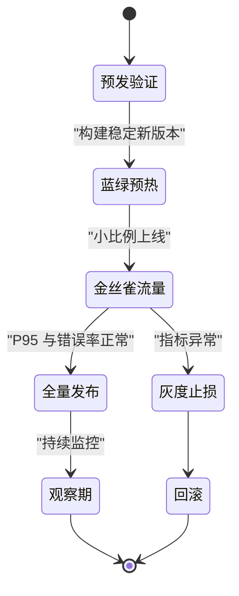

[此图为概念流程，不对应具体源码文件，无需图表来源]

**章节来源**
- [docs/operations/deployment.md:120-153](file://docs/operations/deployment.md#L120-L153)
- [docker-compose.production.yml:1-101](file://docker-compose.production.yml#L1-L101)

## 服务降级与熔断机制

项目文档明确表示：当外部人工智能不可用时，周复盘仍可继续使用模板输出。此外，外部审查和图片描述默认关闭，只有显式开启并提供 provider、价格与授权时才使用云模型。Graph 抽取同样依赖配置的 provider。

### 降级路径

服务在模型提供商不可用时应具备以下降级层级：

| 优先级 | 行为 | 适用场景 |
|---|---|---|
| 一级 | 直接使用本地配置的 OpenAI 兼容端点 | provider 可达且预算许可 |
| 二级 | 退回到固定模板输出 | provider 不可达、拒绝访问或未开启 |
| 三级 | 对用户返回“需要人工确认”或草稿结果 | 模型无法给出结构化结论 |
| 四级 | 将任务放入队列并以失败重试策略记录 | worker 异步任务失败 |
| 五级 | 对外部可观测系统上报失败原因，但不泄露敏感凭证 | 监控与排错 |

### 熔断建议

当前仓库没有内置熔断器实现，但可在 HTTP 层抽象一个 Provider Client，并在其之上添加：

1. **超时熔断**：每次调用设置合理超时，防止长时间阻塞。
2. **连续失败计数**：连续失败超过阈值后关闭下游电路。
3. **冷却窗口**：冷却结束后尝试探测下游。
4. **失败响应封装**：将底层网络错误、鉴权失败、配额不足和 5xx 聚合为统一的业务错误码。
5. **本地降级开关**：环境变量关闭外部模型时，直接返回模板。

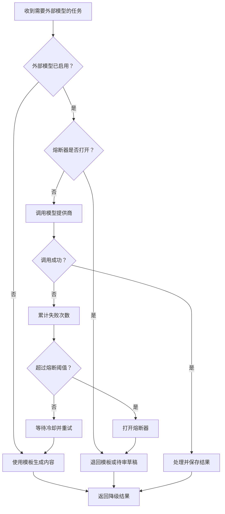

[此图是概念流程图，不映射具体源码，无需图表来源]

**章节来源**
- [README.md:30-73](file://README.md#L30-L73)
- [README.md:12-28](file://README.md#L12-L28)
- [docs/operations/deployment.md:135-153](file://docs/operations/deployment.md#L135-L153)

## 性能基准测试与容量规划

### 基准测试实现

`scripts/benchmark_mvp.py` 的目标是衡量本地 API 对合成数据的时间线和导入延迟。它的特点如下：

- 支持 SQLite 或可丢弃的 PostgreSQL。
- 通过 `LIFEOS_BENCHMARK_POSTGRES_URL` 指定 PostgreSQL。
- 自动注册一个测试账户。
- 创建一条 synthetic source，然后构造 10,000 行 timeline 数据。
- 对三种查询采样各 30 次：日期范围、来源过滤、关键词。
- 重复进行 500 条 Markdown 导入样例。
- 计算查询和导入的 P95 延迟。
- 定义了最大通过目标，但“通过”仅作为函数返回值的一部分，不代表强制门禁。

| 指标 | 基准目标 | 含义 |
|---|---:|---|
| 时间线查询 P95 延迟 | ≤ 500 ms | 三种查询样本各自不超过该值 |
| 500 条导入 P95 延迟 | ≤ 30,000 ms | 单次导入平均吞吐应可接受 |
| 样本数 | 30 | 降低随机抖动 |
| 导入数据量 | 每条约 500 行 Markdown 段落 | 模拟中等体积文本导入 |

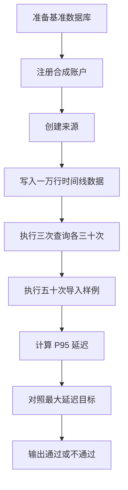

**图表来源**
- [scripts/benchmark_mvp.py:1-207](file://scripts/benchmark_mvp.py#L1-L207)

### P95 延迟要求

当前仓库的 P95 目标是在本地合成环境下评估性能，不是生产 SLA。建议为发布设定：

| 场景 | 建议目标 | 说明 |
|---|---:|---|
| 时间线分页查询 | P95 ≤ 500 ms | 面向交互，应保持流畅 |
| 500 条 Markdown 导入 | P95 ≤ 30 s | 长耗时批操作，需要进度反馈和断点续传 |
| 搜索查询 | P95 ≤ 1 s | 搜索比单纯时间线更复杂 |
| 图片 OCR 任务 | 不阻塞 UI，worker 内处理 | 应通过后台 job 和消息可见性评估 |
| 外部模型调用 | 单独计时并熔断 | 不可合并到接口 P95 否则容易掩盖下游问题 |

### 并发用户数估算

项目本质上是单人或小型协作的知识系统。文档强调它是本地 API、CLI 和 web 工作流，Windows 桌面 MVP 也已通过本地验收。因此不需要像电商或社交平台一样预估百万级并发。

估算思路应是：

1. 确定单机 PostgreSQL 和对象存储能承载的行数与对象规模。
2. 根据 500 条导入 P95 估算单实例每分钟可处理的作业量。
3. 将导入、查询、OCR、计划任务和外部模型调用视为不同资源池。
4. 横向扩展时优先解耦 worker，让导入和查询分别有足够并发容量。

### 水平扩展策略

当前生产模板只启动一个 Uvicorn 进程，但文档提到“后续可增加更多 API 进程时，PostgreSQL lease claims 协调任务”。因此扩展策略建议如下：

1. **无状态 API**：不要把会话或本地文件系统状态绑定在进程 PID。
2. **共享数据面**：PostgreSQL、对象存储、删除日志、搜索索引全部外置。
3. **有状态任务走 worker**：OCR、模型推理和定时计划由队列协调。
4. **会话或任务锁**：使用数据库 Lease Claim 或分布式锁避免重复执行。
5. **扩缩容依据**：CPU、数据库连接、PG Worker、对象存储吞吐、外部模型 QPS。

**章节来源**
- [scripts/benchmark_mvp.py:1-207](file://scripts/benchmark_mvp.py#L1-L207)
- [docs/operations/deployment.md:70-113](file://docs/operations/deployment.md#L70-L113)

## 持续集成流水线

项目有两套主要 CI：

| 流水线 | 触发条件 | 关键步骤 | 产出行文 |
|---|---|---|---|
| Linux CI | push、pull_request、workflow_dispatch | Python 矩阵、Ruff、pytest、Node 安装、Web lint、Web 构建 | 无制品上传 |
| Windows 桌面 | pull_request 中包含特定路径变化，或手动触发 | Python、Node、Rust、桌面安装器、冒烟安装、产物哈希 | 上传 Windows x64 NSIS 安装包候选 |

Linux CI 使用 Ubuntu runner，针对 Python 3.11 和 3.12 并行运行，避免单一 Python 版本差异导致的编译或依赖问题。它还构建 Web，并运行 Docker Compose smoke，验证 `/api/v1/health` 和 `/api/v1/ready`。

Windows 桌面流水线构建 Tauri 应用，生成 NSIS 安装包，运行安装冒烟测试，获取可执行文件哈希，并将产物上传到 GitHub Actions Artifacts。

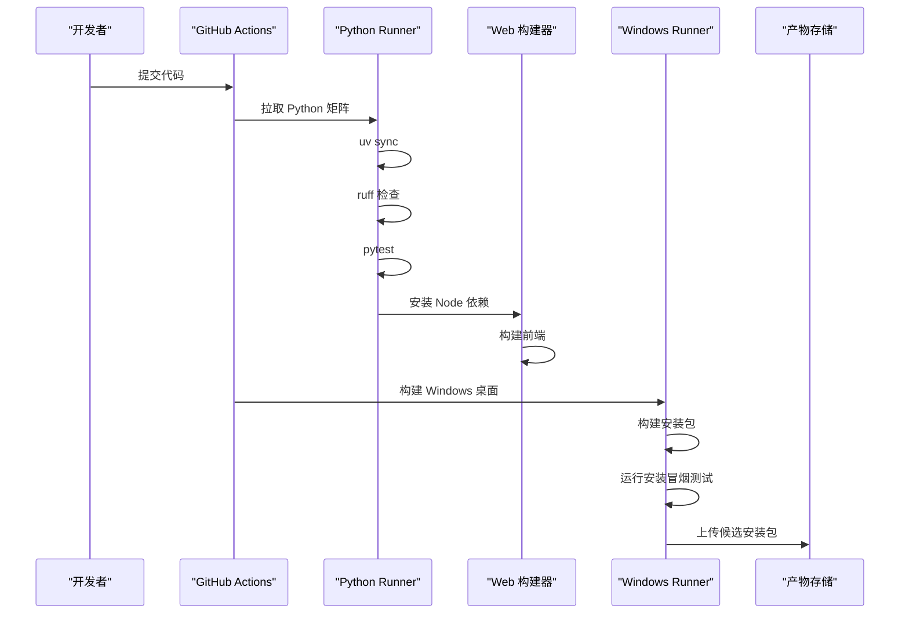

**图表来源**
- [.github/workflows/ci.yml:1-57](file://.github/workflows/ci.yml#L1-L57)
- [.github/workflows/desktop.yml:1-47](file://.github/workflows/desktop.yml#L1-L47)

### 自动化流程建议补充

当前 CI 未自动：

- 运行 Playwright 端到端测试。
- 运行性能基准。
- 运行恢复演练。
- 推送 Docker 镜像。
- 签发桌面安装包或校验签名。

建议在发布前增加“发布候选”任务：

1. 锁定 PyPI 和 npm 依赖。
2. 运行完整测试集。
3. 构建并启动 Compose 栈。
4. 运行端到端测试。
5. 运行基准和恢复演练。
6. 生成并上传构建产物。
7. 生成包含 SHA、镜像哈希、数据库迁移 head 的 Release Note。

**章节来源**
- [.github/workflows/ci.yml:1-57](file://.github/workflows/ci.yml#L1-L57)
- [.github/workflows/desktop.yml:1-47](file://.github/workflows/desktop.yml#L1-L47)
- [README.md:101-110](file://README.md#L101-L110)

## 发布回滚流程

发布回滚必须以数据保护和一致性为第一优先级。

### 回滚前置条件

1. 变更前已有数据库备份和对象存储快照。
2. 已知迁移 revision 和旧镜像版本。
3. 旧镜像仍可读取当前 schema。
4. 删除日志 bucket 仍可用。
5. 已通过“用上一个 revision 的镜像在当前 schema 上启动”验证。

### 回滚决策树

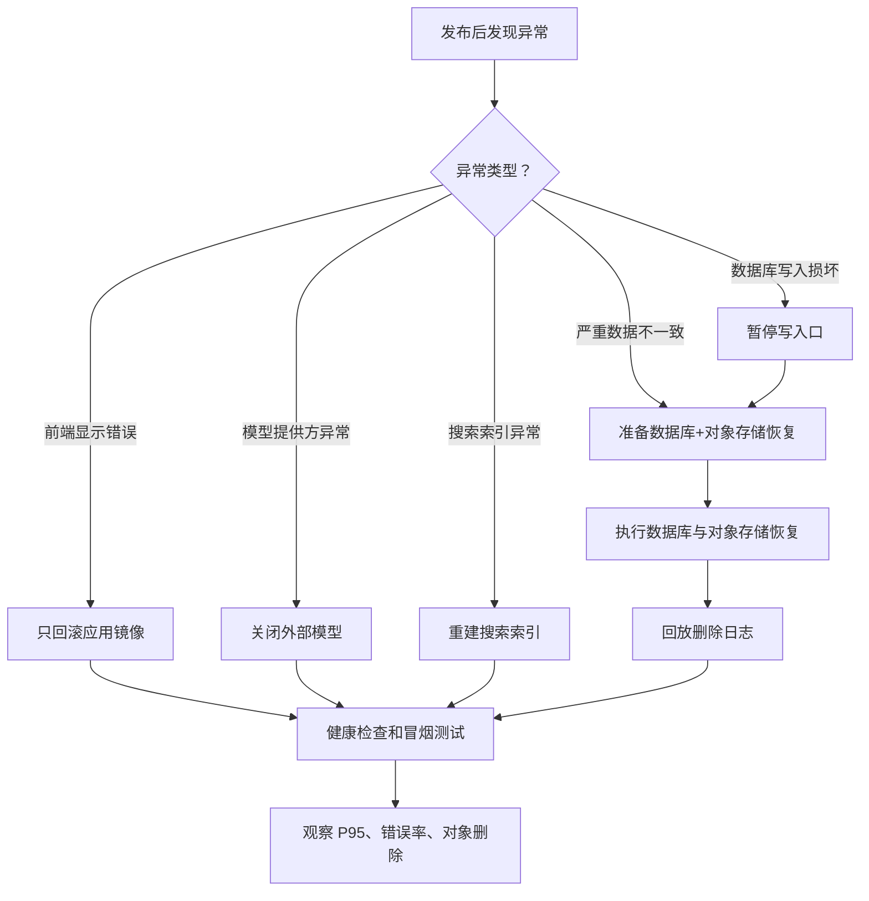

[此图是概念回滚流程，不直接映射具体源码，无需图表来源]

### 数据库回滚风险评估

| 风险 | 处理方式 |
|---|---|
| 旧应用写入了新 schema 字段 | 禁用写流量并优先修复 |
| 降级只删表或列 | 不能恢复已删除的业务数据 |
| 搜索索引损坏 | 重建 SQLite FTS 或使用 pg_trgm GIN 索引维护 |
| 对象存储删除不一致 | 依赖删除日志 replay |
| 备份早于事故时间点 | 只能恢复到备份点，损失期间数据 |
| 多租户或多环境共享库 | 隔离恢复，避免污染生产库 |

### 业务数据兼容性处理

回滚时除了检查数据库行数和对象数量，还应验证：

1. 用户是否可以登录。
2. 时间线是否可以列出。
3. 已删除的来源是否在恢复后仍不可见。
4. 对象存储中不应该存在可读取的删除版本。
5. 计划任务和 worker 是否正常。
6. 导入和导出功能不受 schema 差异影响。
7. 搜索结果的 owner 隔离仍然有效。

**章节来源**
- [docs/operations/deployment.md:142-153](file://docs/operations/deployment.md#L142-L153)
- [docs/operations/backup-restore.md:1-33](file://docs/operations/backup-restore.md#L1-L33)

## 发布后验证

发布完成后应分三层验证：服务层、业务层和用户反馈层。

### 服务层冒烟测试

| 检查项 | 期望结果 |
|---|---|
| `/api/v1/health` | 返回服务存活 |
| `/api/v1/ready` | 数据库连接正常，返回 readiness |
| TLS 域名 | HTTPS 可访问并拥有证书 |
| Metrics | 需要 token 的请求被拒绝 |
| CORS | 只允许配置的 Origin |
| 健康检查 | Compose healthcheck 持续通过 |

`/health` 仅提供轻量存活探测，而 `/ready` 真正尝试访问数据库，这是发布后首检的关键入口。

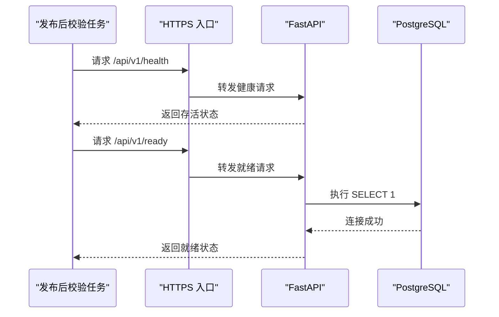

**图表来源**
- [src/personal_ai_life_os/api/routes/health.py:1-27](file://src/personal_ai_life_os/api/routes/health.py#L1-L27)
- [docker-compose.production.yml:42-81](file://docker-compose.production.yml#L42-L81)

### 业务验证

发布后应在受控环境中验证：

1. 新用户注册是否受邀请码限制。
2. 所有者隔离 API 是否正常拒绝匿名、撤销、已删除来源访问。
3. 时间线、搜索、收藏、标签、集合和检索保存是否正确。
4. 导入、Markdown 导出、Obsidian Vault 直写和下载回退是否符合预期。
5. 计划任务、提醒、周复盘模板是否可用。
6. 对象存储中对象存在性和删除一致性。
7. 外部模型功能是否按披露和预算限制工作。

### 用户反馈收集机制

对于首批用户，应采用小规模 Beta：

1. 仅邀请少量经过同意的用户。
2. 记录任务完成率、首次操作时长、失败原因。
3. 不主动采集无关个人数据。
4. 提供安全的错误反馈通道。
5. 以两周为一个观察周期，再决定是否扩大范围。

**章节来源**
- [src/personal_ai_life_os/api/routes/health.py:1-27](file://src/personal_ai_life_os/api/routes/health.py#L1-L27)
- [docs/operations/deployment.md:22-45](file://docs/operations/deployment.md#L22-L45)
- [docs/operations/release-checklist.md:1-37](file://docs/operations/release-checklist.md#L1-L37)

## 依赖关系分析

发布相关组件之间的耦合关系如下：

| 上层组件 | 依赖 | 耦合程度 |
|---|---|---|
| CI | Python、Node、Docker Compose、Rust（桌面） | 中高 |
| Docker 镜像 | Python、uv、Tesseract、alembic、SQLAlchemy | 中 |
| Compose | Caddy、Web、API、PostgreSQL | 高 |
| API | PostgreSQL、对象存储、可选模型提供商 | 高 |
| 迁移 | SQLAlchemy metadata、数据库引擎 | 中 |
| 基准测试 | TestClient、SQLAlchemy、数据库驱动 | 中 |
| 运维文档 | 脚本、Compose、对象存储 | 中 |

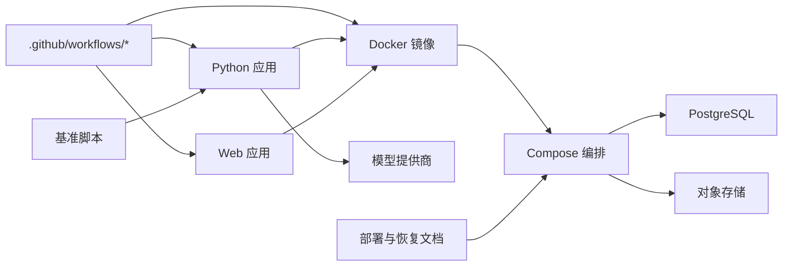

**图表来源**
- [.github/workflows/ci.yml:1-57](file://.github/workflows/ci.yml#L1-L57)
- [.github/workflows/desktop.yml:1-47](file://.github/workflows/desktop.yml#L1-L47)
- [Dockerfile:1-25](file://Dockerfile#L1-L25)
- [docker-compose.production.yml:1-101](file://docker-compose.production.yml#L1-L101)
- [scripts/benchmark_mvp.py:1-207](file://scripts/benchmark_mvp.py#L1-L207)
- [docs/operations/deployment.md:1-153](file://docs/operations/deployment.md#L1-L153)

**章节来源**
- [pyproject.toml:1-58](file://pyproject.toml#L1-L58)
- [Dockerfile:1-25](file://Dockerfile#L1-L25)
- [docker-compose.production.yml:1-101](file://docker-compose.production.yml#L1-L101)
- [.github/workflows/ci.yml:1-57](file://.github/workflows/ci.yml#L1-L57)

## 故障排查指南

### 健康检查失败

如果 `/api/v1/ready` 失败，通常是数据库不可用或初始化未完成。排查步骤：

1. 确认 PostgreSQL 已处于健康状态。
2. 确认 Alembic 已成功执行 `upgrade head`。
3. 检查 DATABASE_URL、密码编码和网络连通性。
4. 查看 Compose logs。
5. 检查是否有其他进程抢占同一数据库或对象存储。

### 迁移错误

如果出现迁移冲突或模型漂移：

1. 停止写入。
2. 确认 `alembic check` 输出。
3. 核对迁移头与模型定义。
4. 在可重现环境中回滚或修复迁移。
5. 不要在生产环境直接修改历史迁移。

### 对象存储不一致

删除对象后仍能被读取，常见原因是删除日志未 replay、对象版本未删除或被权限过宽允许匿名访问。应：

1. 确认对象桶不允许公开访问。
2. 检查删除日志是否可用。
3. 重新启动 API 以 replay 删除日志。
4. 确认源删除会移除所有版本和删除标记。

### 外部模型不可用

症状可能表现为任务失败、结果缺失或模板降级。排查要点：

1. 检查是否启用了外部模型。
2. 检查 provider 密钥、base_url、模型和预算配置。
3. 查看外部调用是否触发熔断。
4. 检查日志中是否退回模板。
5. 如为生产隐患，应先在配置层关闭外部模型。

**章节来源**
- [src/personal_ai_life_os/api/routes/health.py:1-27](file://src/personal_ai_life_os/api/routes/health.py#L1-L27)
- [docs/operations/deployment.md:120-153](file://docs/operations/deployment.md#L120-L153)
- [docs/operations/backup-restore.md:1-33](file://docs/operations/backup-restore.md#L1-L33)

## 结论

Personal-AI-Life-OS 的发布体系现阶段以“可靠本地开发 + 可复现容器镜像 + Alembic 迁移 + Compose 模板”为主干，已经具备 MPP 版本发布的基础条件，但尚未形成完整的灰度发布与生产托管自动化闭环。

建议按以下顺序建设：

1. **固化发布基线**：统一管理 Python 包版本、Web 版本、Git 标签、镜像标签和 Compose 部署记录。
2. **完善 CI 门禁**：加入端到端测试、基准测试和恢复演练作为候选发布必要条件。
3. **明确迁移纪律**：坚持向前兼容、禁用危险降级、每次发布前做迁移回归。
4. **建立灰度流程**：先用蓝绿+Compose 验证新版本，再在编排层引入金丝雀和 A/B。
5. **强化降级能力**：为模型提供商和外部依赖增加熔断、超时、本地模板和无外部依赖降级路径。
6. **完善发布验证**：以健康检查、业务冒烟、性能 P95、备份恢复和用户反馈构成五维验收。
7. **保留回滚能力**：以备份、对象存储快照、删除日志和旧镜像读取能力作为回滚底线。

这些措施的共同目标是：确保每一次发布都可解释、可复现、可观测、可回滚，并把外部模型风险和数据一致性风险控制在最小范围内。