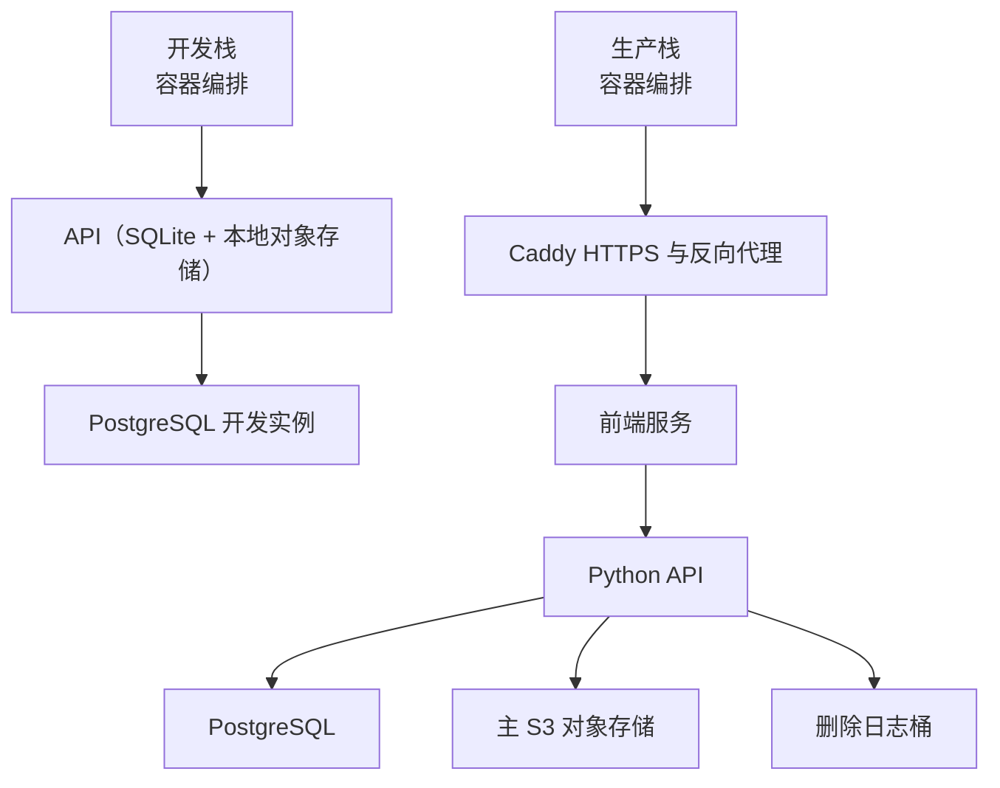
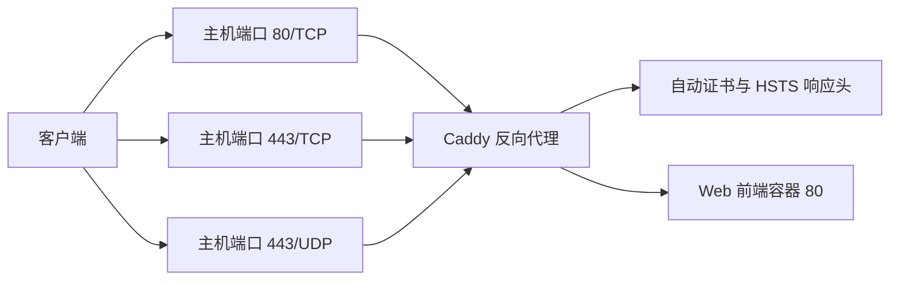
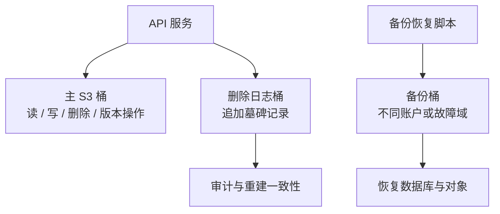
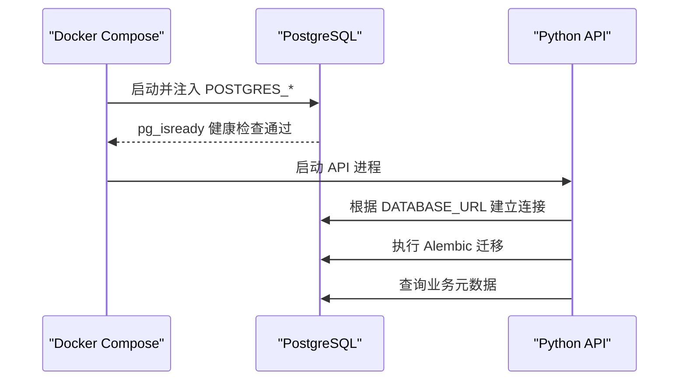
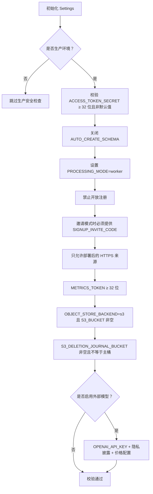

# 环境配置与前置条件

<cite>
**本文引用的文件**   
- [docker-compose.production.yml](file://docker-compose.production.yml)
- [docker-compose.yml](file://docker-compose.yml)
- [deploy/Caddyfile](file://deploy/Caddyfile)
- [src/personal_ai_life_os/config.py](file://src/personal_ai_life_os/config.py)
- [.env.example](file://.env.example)
- [.env.production.example](file://.env.production.example)
- [docs/operations/deployment.md](file://docs/operations/deployment.md)
- [scripts/backup-production.sh](file://scripts/backup-production.sh)
- [scripts/restore-production.sh](file://scripts/restore-production.sh)
</cite>

## 目录
1. [引言](#引言)
2. [项目结构中的运行环境](#项目结构中的运行环境)
3. [基础设施与系统要求](#基础设施与系统要求)
4. [DNS、域名与网络安全端口](#dns域名与网络安全端口)
5. [对象存储与删除日志桶](#对象存储与删除日志桶)
6. [PostgreSQL 数据库连接与安全](#postgresql-数据库连接与安全)
7. [环境变量与敏感信息配置](#环境变量与敏感信息配置)
8. [生产部署完整步骤](#生产部署完整步骤)
9. [差异化环境与验证命令](#差异化环境与验证命令)
10. [常见配置错误排查](#常见配置错误排查)
11. [结论](#结论)

## 引言
本文件面向需要在 Linux 主机上部署 Personal-AI-Life-OS 的运维人员与平台工程师，聚焦生产环境的系统前提、域名与证书、端口开放、S3 兼容对象存储、PostgreSQL、环境变量及备份恢复相关配置。本文不会直接粘贴敏感配置内容，所有关键字段的说明均以仓库中提供的示例文件和部署文档为依据，并以源码实现作为行为边界。

## 项目结构中的运行环境
仓库同时提供开发环境与生产环境的 Docker Compose 定义：

- **开发栈**使用 SQLite、本地对象存储和 OpenAPI 开发服务器，默认允许开放注册，适合单机或个人试用。
- **生产栈**通过 Caddy 提供 HTTPS、反向代理到 Web，Web 调用 API，API 连接 PostgreSQL，并强制要求 S3 兼容对象存储、邀请注册、后台工作模式和严格的生产配置校验。

**图示来源**
- [docker-compose.yml:1-78](file://docker-compose.yml#L1-L78)
- [docker-compose.production.yml:1-101](file://docker-compose.production.yml#L1-L101)

**章节来源**
- [docker-compose.yml:1-78](file://docker-compose.yml#L1-L78)
- [docker-compose.production.yml:1-101](file://docker-compose.production.yml#L1-L101)
- [README.md:50-50](file://README.md#L50-L50)

## 基础设施与系统要求
生产部署要求具备以下基础能力：

| 依赖项 | 生产要求 |
| --- | --- |
| 操作系统 | Linux 主机 |
| 运行时 | Docker Engine |
| 容器编排 | Docker Compose 插件 |
| DNS 解析 | 一个可公网解析到该主机的域名 |
| Web 端口 | TCP 80 与 443 可用 |
| UDP 端口 | 443/UDP（用于 HTTP/3） |
| 对象存储 | 私有 S3 兼容后端；支持读取、写入、删除对象及版本管理 |
| 备份存储 | 独立于主对象的加密 S3 桶，带生命周期策略 |
| 删除日志 | 独立的第三方 S3 桶或隔离命名空间，只给必要权限 |
| 数据库 | PostgreSQL 16 + pgvector 镜像，可通过 `pg_isready` 检测健康状态 |

这些要求来自部署指南与生产 compose 文件对 Linux 主机、Docker Engine、Docker Compose 插件、端口、对象存储和数据持久卷的定义。

**章节来源**
- [docs/operations/deployment.md:72-95](file://docs/operations/deployment.md#L72-L95)
- [docker-compose.production.yml:1-101](file://docker-compose.production.yml#L1-L101)

## DNS、域名与网络安全端口
### 域名与 DNS
生产部署需要一个明确的域名，例如 `.env.production.example` 中的占位域名。部署时应将域名解析到部署主机的公网地址，以便 Caddy 为网站自动获取 TLS 证书。

### 安全端口
生产 compose 暴露三个端口：

| 宿主机端口 | 协议 | 用途 |
| --- | --- | --- |
| 80 | TCP | Caddy 监听初始请求并处理证书申请等流程 |
| 443 | TCP | HTTPS 流量入口 |
| 443 | UDP | HTTP/3（QUIC）支持 |

如果防火墙或云安全组未开放这些端口，Caddy 无法完成 TLS 证书初始化，外网也无法访问应用。

### 反向代理与 TLS
Caddy 配置文件将传入的主机名映射为一个站点，启用 zstd/gzip 编码，并设置多个安全响应头，包括：

- `Strict-Transport-Security`：开启 HSTS。
- `X-Content-Type-Options`：禁用 MIME 类型嗅探。
- `X-Frame-Options`：拒绝嵌套到 iframe。
- `Referrer-Policy`：减少来源泄露。
- `Permissions-Policy`：限制摄像头、麦克风、地理定位等浏览器能力。

它通过反向代理把流量转发到内部 `web:80`。

**图示来源**
- [docker-compose.production.yml:1-15](file://docker-compose.production.yml#L1-L15)
- [deploy/Caddyfile:1-11](file://deploy/Caddyfile#L1-L11)

**章节来源**
- [docker-compose.production.yml:1-15](file://docker-compose.production.yml#L1-L15)
- [deploy/Caddyfile:1-11](file://deploy/Caddyfile#L1-L11)
- [docs/operations/deployment.md:72-120](file://docs/operations/deployment.md#L72-L120)

## 对象存储与删除日志桶
应用在生产环境必须使用 S3 兼容对象存储。配置项分为主存储与删除日志两类：

| 字段 | 类型 | 默认值 | 含义 |
| --- | --- | --- | --- |
| `OBJECT_STORE_BACKEND` | 字符串 | `local` | 开发环境可用 `local`，生产强制 `s3` |
| `S3_BUCKET` | 字符串 | 无 | 主对象存储桶名称 |
| `S3_REGION` | 可选字符串 | 空 | 主存储区域覆盖 |
| `S3_ENDPOINT_URL` | 可选字符串 | 空 | 主存储端点覆盖 |
| `S3_DELETION_JOURNAL_BUCKET` | 可选字符串 | 空 | 删除日志桶；生产强制填写 |
| `S3_DELETION_JOURNAL_REGION` | 可选字符串 | 空 | 删除日志桶区域覆盖 |
| `S3_DELETION_JOURNAL_ENDPOINT_URL` | 可选字符串 | 空 | 删除日志桶端点覆盖 |

### 安全要求
- 桶必须设为私有，禁止公共访问。
- 启用服务端加密，仓库部署指南提到 AES256 加密写入。
- 如果启用版本控制，需验证源对象删除会清理对应版本和删除标记。
- 删除日志桶应放在独立于主对象的故障域，便于跨失败域备份与恢复。
- 删除日志桶只授予必要的列表、读取和写入权限；删除权限应交由独立操作人员或最小化凭据。
- 备份桶必须与主对象桶不同，并通过生命周期规则保留指定时间间隔内的备份前缀。

**图示来源**
- [src/personal_ai_life_os/config.py:27-39](file://src/personal_ai_life_os/config.py#L27-L39)
- [docs/operations/deployment.md:121-152](file://docs/operations/deployment.md#L121-L152)
- [scripts/backup-production.sh:13-41](file://scripts/backup-production.sh#L13-L41)

**章节来源**
- [src/personal_ai_life_os/config.py:27-39](file://src/personal_ai_life_os/config.py#L27-L39)
- [docs/operations/deployment.md:121-152](file://docs/operations/deployment.md#L121-L152)
- [scripts/backup-production.sh:13-41](file://scripts/backup-production.sh#L13-L41)
- [scripts/restore-production.sh:18-55](file://scripts/restore-production.sh#L18-L55)

## PostgreSQL 数据库连接与安全
生产栈使用官方 PostgreSQL 镜像并附带向量扩展。

### 关键变量
| 字段 | 含义 |
| --- | --- |
| `POSTGRES_DB` | 数据库名 |
| `POSTGRES_USER` | 用户名 |
| `POSTGRES_PASSWORD` | 密码 |
| `DATABASE_URL` | Python 应用使用的 SQLAlchemy DSN |

### 连接参数
开发环境默认使用：

| 元素 | 开发值 |
| --- | --- |
| 驱动与方言 | `postgresql+psycopg` |
| 用户名 | `lifeos` |
| 密码 | 开发用随机占位符 |
| 主机 | 容器名 `db` |
| 端口 | `5432` |
| 数据库名 | `lifeos` |

生产环境下，`DATABASE_URL` 应与 `POSTGRES_DB`、`POSTGRES_USER`、`POSTGRES_PASSWORD` 保持一致。若密码包含 URL 特殊字符，需要进行百分号编码。

### 权限与运行模式
- 应用启动时会执行 Alembic 迁移。
- 生产环境禁止自动创建数据库表结构。
- 处理模式必须为后台 worker，以确保任务调度与幂等领取。
- 搜索索引依赖 PostgreSQL GIN 与 `pg_trgm`；若扩展不可用，搜索会退化到 `LIKE` 路径。

**图示来源**
- [docker-compose.production.yml:54-92](file://docker-compose.production.yml#L54-L92)
- [docker-compose.yml:21-66](file://docker-compose.yml#L21-L66)
- [src/personal_ai_life_os/config.py:12-18](file://src/personal_ai_life_os/config.py#L12-L18)

**章节来源**
- [docker-compose.production.yml:54-100](file://docker-compose.production.yml#L54-L100)
- [docker-compose.yml:21-66](file://docker-compose.yml#L21-L66)
- [docs/operations/deployment.md:105-148](file://docs/operations/deployment.md#L105-L148)
- [src/personal_ai_life_os/config.py:8-23](file://src/personal_ai_life_os/config.py#L8-L23)

## 环境变量与敏感信息配置
应用的运行时配置由 Python 层的 Settings 加载，默认从环境变量读取，并在存在 `.env` 时叠加本地覆盖层。生产环境推荐通过容器或外部密钥管理服务注入环境变量，而非提交 `.env` 文件。

### 配置加载行为
- 配置类声明 `env_file=".env"`。
- 大小写不敏感。
- 额外未定义的环境变量被忽略。
- 测试场景可通过 `_env_file=None` 避免污染。
- 桌面安装明确不应继承 web 侧的 `.env` 或云端配置。

### 敏感字段分类
| 分类 | 字段 | 生产要求 |
| --- | --- | --- |
| 数据库凭据 | `DATABASE_URL`、`POSTGRES_PASSWORD` | 强密码，URL 编码特殊字符，仅部署操作员可读 |
| 访问令牌密钥 | `ACCESS_TOKEN_SECRET` | 至少 32 位唯一随机值，不得是开发占位值 |
| 指标令牌 | `METRICS_TOKEN` | 唯一且至少 32 位，用于保护指标端点 |
| 模型密钥 | `OPENAI_API_KEY` | 仅在启用外部模型时提供 |
| 存储凭据 | `AWS_ACCESS_KEY_ID`、`AWS_SECRET_ACCESS_KEY`、`AWS_DEFAULT_REGION`、`AWS_SESSION_TOKEN` | 由 AWS SDK 自动读取，不得提交到代码库 |
| 域名 | `LIFEOS_DOMAIN` | 指向可获取证书的正式域名 |
| 对象存储 | `S3_BUCKET`、`S3_DELETION_JOURNAL_BUCKET` | 两个桶不能相同 |
| 备份 | `BACKUP_S3_URI` | 必须是独立桶，不能等于主桶或删除日志桶 |

### 生产校验逻辑
Settings 的 validator 会在 `app_env=production` 时执行额外检查：

**图示来源**
- [src/personal_ai_life_os/config.py:12-18](file://src/personal_ai_life_os/config.py#L12-L18)
- [src/personal_ai_life_os/config.py:79-132](file://src/personal_ai_life_os/config.py#L79-L132)

**章节来源**
- [src/personal_ai_life_os/config.py:12-18](file://src/personal_ai_life_os/config.py#L12-L18)
- [src/personal_ai_life_os/config.py:79-132](file://src/personal_ai_life_os/config.py#L79-L132)
- [docs/operations/deployment.md:96-120](file://docs/operations/deployment.md#L96-L120)
- [.env.production.example:43-44](file://.env.production.example#L43-L44)

## 生产部署完整步骤
以下流程基于 `.env.production.example` 与部署指南的综合要求。请勿直接复制示例文件内容到真实配置；应根据实际域名、账号和凭据填写。

### 第一步：准备基础设施
1. 准备 Linux 主机并安装 Docker Engine 与 Docker Compose 插件。
2. 在 DNS 服务商中将 `LIFEOS_DOMAIN` 解析到主机公网 IP。
3. 开放主机入站规则的 TCP 80、443 与 UDP 443。
4. 创建主 S3 桶并设为私有，启用服务端加密，必要时启用版本控制。
5. 创建独立的删除日志桶，位置需与主对象桶所在故障域分离。
6. 创建独立备份桶，配置日期前缀生命周期策略。
7. 创建 PostgreSQL 实例，确认 `PG_ISREADY`、角色、密码和网络可达。
8. 为对象存储和数据库创建最小权限凭据。

### 第二步：准备环境变量
1. 在部署主机上将 `.env.production.example` 复制为 `.env`。
2. 填写以下关键字段：
   - `LIFEOS_DOMAIN`：对外域名。
   - `POSTGRES_DB`、`POSTGRES_USER`、`POSTGRES_PASSWORD`：数据库身份。
   - `DATABASE_URL`：与上述三个 PostgreSQL 变量一致，并对密码做 URL 编码。
   - `ACCESS_TOKEN_SECRET`：至少 32 位的唯一随机密钥。
   - `REGISTRATION_MODE`：生产建议 `invitation`。
   - `SIGNUP_INVITE_CODE`：邀请码。
   - `METRICS_TOKEN`：至少 32 位的唯一随机指标令牌。
   - `S3_BUCKET`：主对象桶名称。
   - `S3_REGION` 与 `S3_ENDPOINT_URL`：按需填写 S3 兼容服务信息。
   - `S3_DELETION_JOURNAL_BUCKET`：删除日志桶名称。
   - `S3_DELETION_JOURNAL_REGION`、`S3_DELETION_JOURNAL_ENDPOINT_URL`：如需覆盖则填写。
   - `BACKUP_S3_URI`：例如 `s3://<备份桶>/<前缀>`，不得等于主桶或日志桶。
3. 仅当需要外部推理时才配置 `MODEL_PROVIDER=openai`，同时提供真实的 `OPENAI_API_KEY`、隐私 URL、披露内容和当前 token 价格，并保持 `MODEL_MAX_COST_PER_CALL_USD` 不超过审批预算。
4. 修改文件权限，使 `.env` 仅可由部署操作员读写，不要提交到版本库。

**章节来源**
- [docs/operations/deployment.md:96-120](file://docs/operations/deployment.md#L96-L120)
- [.env.production.example:1-44](file://.env.production.example#L1-L44)

### 第三步：验证配置并启动
1. 使用 Compose 插值检查命令验证环境变量是否完整、语法是否正确。
2. 构建并拉起服务，等待健康检查通过。
3. 通过 HTTPS 域名验证健康端点与就绪端点。

推荐顺序：

| 步骤 | 命令或动作 |
| --- | --- |
| 验证 compose | `docker compose -f docker-compose.production.yml config --quiet` |
| 构建并启动 | `docker compose -f docker-compose.production.yml up --build --detach --wait` |
| 验证健康 | 访问 `https://YOUR_DOMAIN/api/v1/health` |
| 验证就绪 | 访问 `https://YOUR_DOMAIN/api/v1/ready` |

若健康检查返回失败，通常意味着：
- 环境变量缺失。
- `DATABASE_URL` 无法连接到 PostgreSQL。
- `ACCESS_TOKEN_SECRET`、`METRICS_TOKEN`、`S3_BUCKET`、`S3_DELETION_JOURNAL_BUCKET` 等生产必填字段不符合约束。
- `CORS_ORIGINS` 仍包含本地回环地址。
- `AUTO_CREATE_SCHEMA` 在生产环境未被设为关闭。
- `PROCESSING_MODE` 不是 `worker`。

**章节来源**
- [docs/operations/deployment.md:105-120](file://docs/operations/deployment.md#L105-L120)
- [docker-compose.production.yml:54-75](file://docker-compose.production.yml#L54-L75)

### 第四步：最终检查清单
- Caddy 已获取证书。
- 注册模式为邀请制。
- `/api/v1/metrics` 需要正确 metrics token。
- API 和数据库端口不对公网暴露。
- 对象存储拒绝匿名访问。
- 删除日志桶处于独立故障域。
- 备份桶与主桶、日志桶不同，并具备生命周期策略。
- 已完成备份与恢复演练。

**章节来源**
- [docs/operations/deployment.md:113-152](file://docs/operations/deployment.md#L113-L152)

## 差异化环境与验证命令
### 环境差异矩阵
| 维度 | 开发 | 生产 |
| --- | --- | --- |
| 数据库 | SQLite 或开发 PostgreSQL | 生产 PostgreSQL |
| 对象存储 | `local` | `s3` |
| 注册模式 | `open` | `invitation` |
| CORS | 本地开发域名 | 仅部署后的 HTTPS 域名 |
| `ACCESS_TOKEN_SECRET` | 本地占位值 | ≥32 位唯一随机值 |
| `METRICS_TOKEN` | 本地占位值 | ≥32 位唯一随机值 |
| 工作模式 | 可 inline 或 worker | 强制 `worker` |
| 自动建表 | 可开启 | 必须关闭 |
| 外部模型 | 可选 | 可选但必须完整披露隐私与价格 |

### 常用验证命令
| 用途 | 命令 |
| --- | --- |
| 开发 compose 配置验证 | `docker compose --env-file .env.example -f docker-compose.yml config --quiet` |
| 生产 compose 配置验证 | `docker compose --env-file .env.production.example -f docker-compose.production.yml config --quiet` |
| 启动 API 后查看就绪 | `curl --fail https://YOUR_DOMAIN/api/v1/ready` |
| 查看健康 | `curl --fail https://YOUR_DOMAIN/api/v1/health` |
| 重建搜索索引 | `uv run python scripts/rebuild_search_index.py` |
| 导出生产对象和数据库 | `./scripts/backup-production.sh` |
| 恢复生产对象和数据库 | `./scripts/restore-production.sh` |

**章节来源**
- [docker-compose.yml:1-78](file://docker-compose.yml#L1-L78)
- [docker-compose.production.yml:1-101](file://docker-compose.production.yml#L1-L101)
- [docs/operations/deployment.md:97-120](file://docs/operations/deployment.md#L97-L120)
- [docs/operations/deployment.md:149-153](file://docs/operations/deployment.md#L149-L153)
- [scripts/backup-production.sh:13-41](file://scripts/backup-production.sh#L13-L41)
- [scripts/restore-production.sh:18-55](file://scripts/restore-production.sh#L18-L55)

## 常见配置错误排查
| 现象 | 可能原因 | 排查与修复 |
| --- | --- | --- |
| 启动即报错缺少环境变量 | Compose 使用了 `${VAR:?Set VAR}` 语法但未设置 | 检查 `.env` 或宿主环境中 `LIFEOS_DOMAIN`、`DATABASE_URL`、`ACCESS_TOKEN_SECRET`、`SIGNUP_INVITE_CODE`、`METRICS_TOKEN`、`S3_BUCKET`、`S3_DELETION_JOURNAL_BUCKET` |
| HTTPS 无法访问 | 80/443 未开放或 DNS 未解析 | 确认防火墙、云平台安全组和 A 记录 |
| Caddy 证书一直申请失败 | 域名解析错误或 80/443 不可达 | 先用 `dig`/`nslookup` 与 `curl http://YOUR_DOMAIN` 验证 |
| API 返回对象存储错误 | `OBJECT_STORE_BACKEND`、`S3_BUCKET`、`S3_ENDPOINT_URL`、`S3_REGION` 或 SDK 凭据不正确 | 用同凭据执行一次 `aws s3 ls` 目标桶 |
| 删除功能不影响历史版本 | S3 版本控制或权限配置不完整 | 确认具备删除版本的权限并验证删除后的版本清单 |
| 启动后立即停止 | 生产环境 `AUTO_CREATE_SCHEMA=true`、`PROCESSING_MODE!=worker`、`REGISTRATION_MODE=open`、`ACCESS_TOKEN_SECRET` 过短或缺失 | 根据 Settings validator 错误重新设置 |
| CORS 报错 | CORS 来源仍是 localhost 或回环地址 | 生产必须使用部署后的 HTTPS 域名 |
| 搜索失效或变慢 | 扩展不可用或未建索引 | 检查 PostgreSQL 扩展可用性，或使用重建搜索索引脚本 |
| 备份失败 | `BACKUP_S3_URI` 格式错误、桶相同或凭据不足 | 确保是 `s3://bucket/path`，且不等于 `S3_BUCKET` 和 `S3_DELETION_JOURNAL_BUCKET` |
| 指标端点被拒绝 | 缺少或错误的 `METRICS_TOKEN` | 设置唯一且长度足够的指标令牌，并使用正确的访问凭据 |

**章节来源**
- [docs/operations/deployment.md:96-152](file://docs/operations/deployment.md#L96-L152)
- [src/personal_ai_life_os/config.py:79-132](file://src/personal_ai_life_os/config.py#L79-L132)
- [scripts/backup-production.sh:21-25](file://scripts/backup-production.sh#L21-L25)
- [scripts/restore-production.sh:24-28](file://scripts/restore-production.sh#L24-L28)

## 结论
Production Personal-AI-Life-OS 的安全边界建立在五个维度之上：可解析域名与 HTTPS 入口、最小权限的对象存储与删除日志、强凭据的 PostgreSQL、受控的环境变量以及严格的配置校验。部署前应先在开发环境验证 Compose 与 `.env`，再逐步切换到生产模式。上线前务必完成网络连通性、TLS、对象存储、数据库、邀请注册、metrics 保护和备份恢复演练。任何敏感值都应存放在仅限部署者访问的环境中，而不是提交到代码仓库。