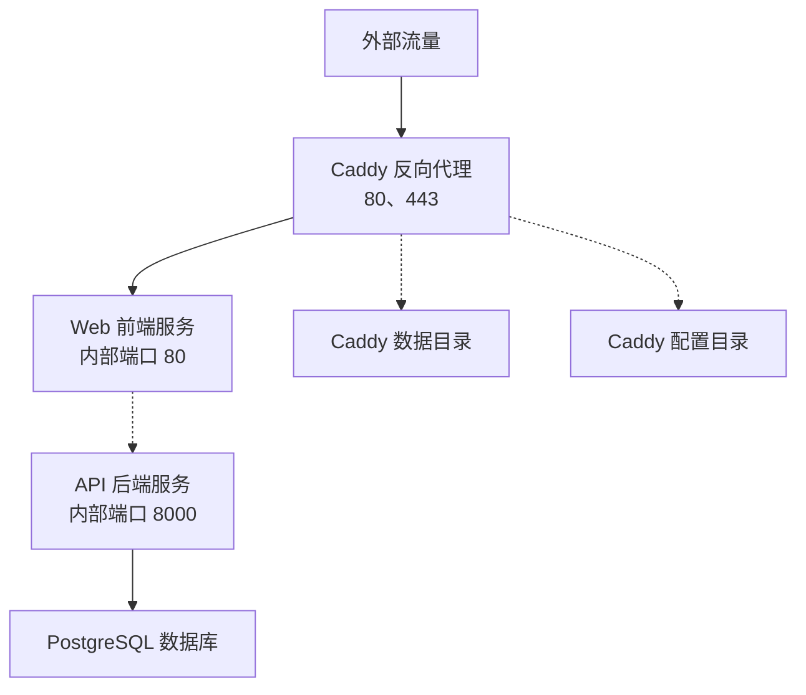
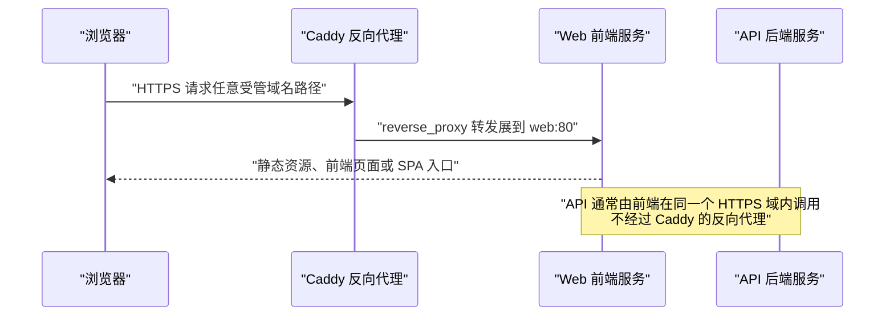
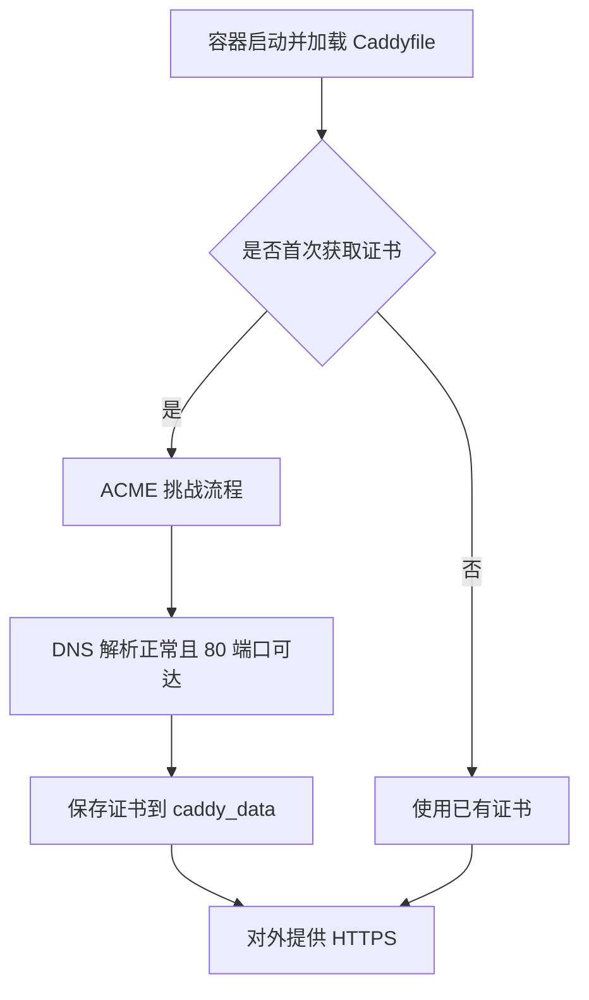
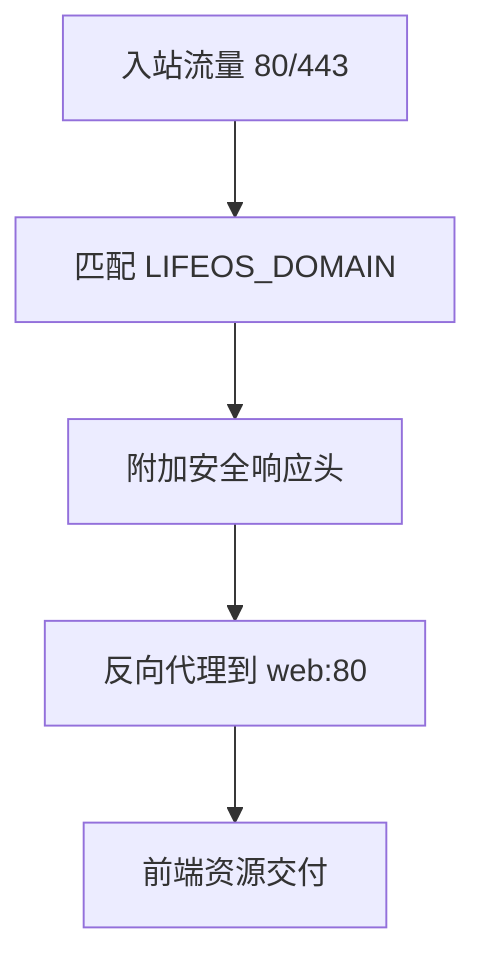
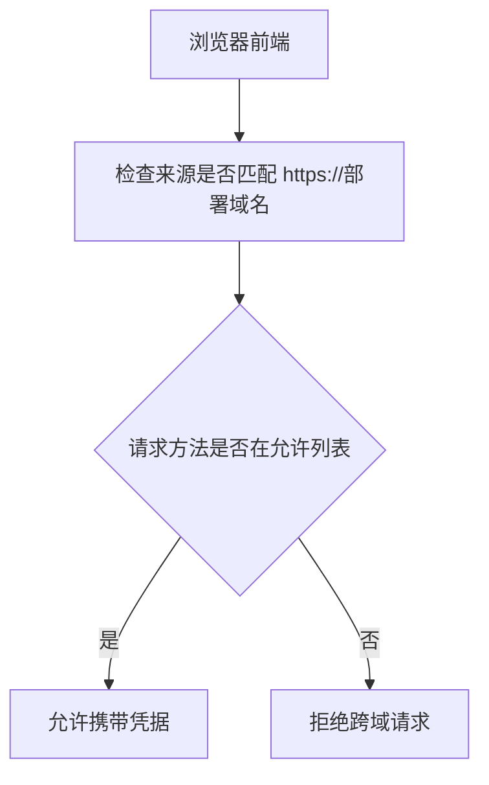
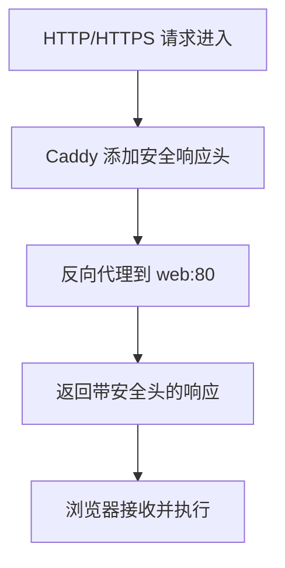
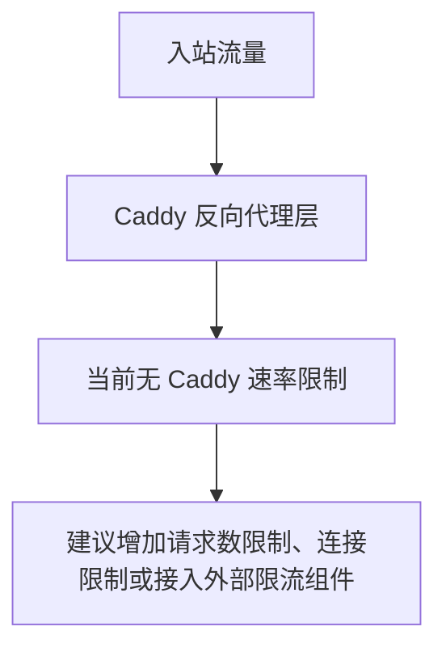
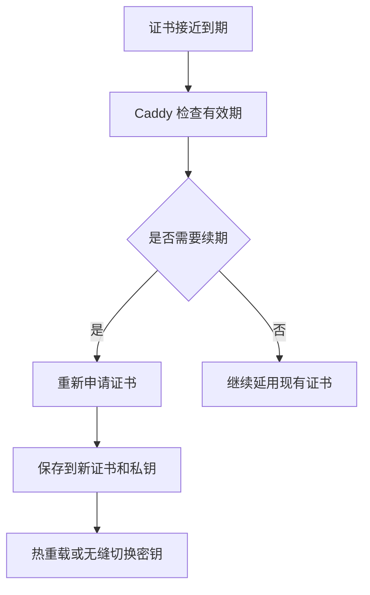

# 反向代理与安全加固

<cite>
**本文引用的文件**   
- [docker-compose.production.yml](file://docker-compose.production.yml)
- [Caddyfile](file://deploy/Caddyfile)
- [config.py](file://src/personal_ai_life_os/config.py)
- [main.py](file://src/personal_ai_life_os/main.py)
- [security.py](file://src/personal_ai_life_os/security.py)
</cite>

## 目录
1. [引言](#引言)
2. [项目部署结构概览](#项目部署结构概览)
3. [反向代理安全架构](#反向代理安全架构)
4. [TLS 与自动证书管理](#tls-与自动证书管理)
5. [HTTPS 重定向、域名绑定与端口暴露](#https-重定向域名绑定与端口暴露)
6. [跨域资源共享安全配置](#跨域资源共享安全配置)
7. [安全防护头与请求限制](#安全防护头与请求限制)
8. [速率限制与上传大小控制](#速率限制与上传大小控制)
9. [性能缓存与静态资源优化](#性能缓存与静态资源优化)
10. [防火墙规则与访问控制清单](#防火墙规则与访问控制清单)
11. [SSL/TLS 证书生命周期管理](#ssltls-证书生命周期管理)
12. [安全审计与漏洞扫描最佳实践](#安全审计与漏洞扫描最佳实践)
13. [故障排查指南](#故障排查指南)
14. [结论](#结论)

## 引言
本文面向生产环境，系统梳理本项目基于 Caddy 的反向代理层与后端应用之间的网络安全配置。重点覆盖以下方面：
- 基于 `docker-compose.production.yml` 的服务编排与网络暴露
- Caddy 的 HTTPS 出口、安全响应头和反向代理转发策略
- TLS 自动证书获取及容器卷数据的持久化职责
- CORS 跨域的安全边界约束
- 速率限制、请求体大小和性能优化配置的现状与建议
- 防火墙开放端口建议、安全审计流程和常见问题排障

需要特别注意：Caddy 在默认行为下会处理 HTTP 到 HTTPS 的重定向，但当前 Caddyfile 中并未显式声明全局 HTTPS 指令；文档将严格区分“代码与配置实际行为”和“推荐增强措施”。

## 项目部署结构概览
生产环境通过 Docker Compose 启动四个关键服务：
- `caddy`：对外入口，监听 TCP/UDP 的 80 与 443 端口，转发到前端 Web 服务。
- `web`：由 `./web` 构建的前端静态站点或开发服务器，被 Caddy 反向代理至其 80 端口。
- `api`：FastAPI 后端服务，运行于 8000 端口，提供业务 API、健康检查和指标接口。
- `db`：PostgreSQL + pgvector 数据库实例。



**图示来源**
- [docker-compose.production.yml:1-101](file://docker-compose.production.yml#L1-L101)

本图的语义是基础设施关系，不是对源码逻辑的直接映射。

**章节来源**
- [docker-compose.production.yml:1-101](file://docker-compose.production.yml#L1-L101)

## 反向代理安全架构
在部署中，外部客户端只应直接到达 `caddy` 服务。API 服务不直接对外暴露端口，因此：
- 网络攻击面主要集中在 Caddy 暴露的 80 与 443 端口。
- 所有 HTTPS 出站流量都经过 Caddy，由其在反向代理过程中添加安全响应头。
- 前端静态资源和页面请求统一经 Caddy 路由到 `web:80`。
- 后端 API 通常由前端应用通过同域 HTTPS 访问，而不再被反向代理经 Caddy 转发；这与 `docker-compose.production.yml` 中 Caddy 仅代理到 `web:80` 一致。



**图示来源**
- [docker-compose.production.yml:1-101](file://docker-compose.production.yml#L1-L101)
- [Caddyfile:1-11](file://deploy/Caddyfile#L1-L11)

**章节来源**
- [docker-compose.production.yml:1-101](file://docker-compose.production.yml#L1-L101)
- [Caddyfile:1-11](file://deploy/Caddyfile#L1-L11)

## TLS 与自动证书管理
Caddy 镜像使用 `caddy:2-alpine`，并通过环境变量 `LIFEOS_DOMAIN` 动态定义站点块主机名。该值也用于设置后端服务的 `CORS_ORIGINS`，使前端 HTTPS 域名与后端允许来源保持一致。

### 自动证书获取机制
- Caddy 在首次启动时为配置的域名发起 ACME 协议流程。
- 根据 Caddy 默认行为：
  - 如果域名已解析到宿主机公网 IP 且 80 端口可达，通常使用 HTTP-01 验证。
  - 若 DNS API 集成完整且域名托管支持相应 Provider，也可使用 DNS-01。
- 当前配置文件没有显式指定 `tls` 或 `http://`，也没有显式强制 HTTP 强制跳转指令；因此“自动启用 HTTPS”的行为依赖于 Caddy 的全局默认配置行为，而不是 Caddyfile 显式语法。
- 证书存储位于容器的 `/data` 目录，对应 volume `caddy_data`，因此重启不会丢失已申请的证书。

### 安全注意事项
- `LIFEOS_DOMAIN` 必须是一个指向可公网访问机器的 A/AAAA 记录域名。
- 如果域名不能通过 HTTP-01 验证（例如云服务商不允许入站 80），需要在宿主机的防火墙或云服务安全组中放行 80 端口。
- 证书过期时，Caddy 会自动续期，不需要外部 cron 任务接管续期步骤。



**图示来源**
- [docker-compose.production.yml:1-101](file://docker-compose.production.yml#L1-L101)
- [Caddyfile:1-11](file://deploy/Caddyfile#L1-L11)

**章节来源**
- [docker-compose.production.yml:1-101](file://docker-compose.production.yml#L1-L101)
- [Caddyfile:1-11](file://deploy/Caddyfile#L1-L11)

## HTTPS 重定向、域名绑定与端口暴露
### 端口暴露
`docker-compose.production.yml` 明确暴露三个端口：
- `80:80`：HTTP
- `443:443`：HTTPS
- `443:443/udp`：QUIC / HTTP/3 UDP

这意味着宿主机需要允许这些端口从外部可达；同时不应额外暴露其他服务端口。

### HTTPS 重定向
Caddy 在全局默认行为上可以完成 HTTP 到 HTTPS 重定向，但这并不意味着当前 Caddyfile 已经显式声明了 HTTPS 和强制跳转。当前主要行为包括：
- 使用 `${LIFEOS_DOMAIN}` 作为站点块的 Host 匹配值。
- 返回包含 HSTS、X-Content-Type-Options、X-Frame-Options、Referrer-Policy、Permissions-Policy 等响应头。
- 将所有请求 `reverse_proxy web:80`。



**图示来源**
- [docker-compose.production.yml:1-101](file://docker-compose.production.yml#L1-L101)
- [Caddyfile:1-11](file://deploy/Caddyfile#L1-L11)

**章节来源**
- [docker-compose.production.yml:1-101](file://docker-compose.production.yml#L1-L101)
- [Caddyfile:1-11](file://deploy/Caddyfile#L1-L11)

## 跨域资源共享安全配置
生产环境中，CORS 的来源由 `CORS_ORIGINS` 传入后端。其值为 `https://${LIFEOS_DOMAIN}`，即只允许一个精确的 HTTPS 域名作为前端来源。

### CORS 白名单策略
- 仅允许单一 HTTPS 源：`https://<部署域名>`
- 不支持通配符来源。
- 不包含 `http://localhost` 或 `http://127.0.0.1`，因为 `Settings.validate_production_configuration` 会在检测到 localhost 类型来源时报错。
- 该设计有效防止开发环境的常见调试配置泄漏到生产。

### 允许的 HTTP 方法与凭据
- FastAPI 中间件启用 `CORSMiddleware`。
- 允许的 HTTP 方法包括：
  - GET
  - POST
  - PUT
  - PATCH
  - DELETE
- `allow_credentials=not desktop`：在生产环境运行时，desktop 变量为假，因此生产模式下允许携带凭据。
- 这表示浏览器可在同源或受信任 HTTPS 来源前端的页面中向同一 API 发送带有 Cookie 或授权标头的请求。



**图示来源**
- [docker-compose.production.yml:1-101](file://docker-compose.production.yml#L1-L101)
- [config.py:1-132](file://src/personal_ai_life_os/config.py#L1-L132)
- [main.py:1-300](file://src/personal_ai_life_os/main.py#L1-L300)

**章节来源**
- [docker-compose.production.yml:1-101](file://docker-compose.production.yml#L1-L101)
- [config.py:1-132](file://src/personal_ai_life_os/config.py#L1-L132)
- [main.py:1-300](file://src/personal_ai_life_os/main.py#L1-L300)

## 安全防护头与请求限制
Caddy 在 Caddyfile 中为所有响应追加一组基础安全头：

| 响应头 | 值 | 安全作用 |
|---|---|---|
| Strict-Transport-Security | `max-age=31536000; includeSubDomains` | 启用 HSTS，阻止大多数降级到 HTTP 的攻击 |
| X-Content-Type-Options | `nosniff` | 禁止浏览器 MIME 嗅探 |
| X-Frame-Options | `DENY` | 禁止网站被 iframe 嵌入，降低点击劫持风险 |
| Referrer-Policy | `no-referrer` | 不泄露来源 URL 到目标站点 |
| Permissions-Policy | 禁用 camera、microphone、geolocation | 限制前端权限能力，减少敏感能力滥用空间 |

### 内容与样式安全策略缺失说明
当前 Caddyfile 未设置 `Content-Security-Policy`。这并不一定是缺陷：现代 SPA、Vite 构建产物可能依赖非确定性文件名、内联脚本、第三方服务等。若引入 CSP，需要先对前端构建和资源引用做充分审计，否则容易导致线上白屏。建议在升级前采用报告模式，并逐步收紧。

### 内容长度限制
当前 Caddyfile 未设置显式的请求体最大长度。因此：
- 大文件传输上限主要由 FastAPI、Uvicorn 以及前端请求框架决定。
- 应用侧配置中定义了文本和图片上传的最大字节数；这是合理的后端安全防线，但不能替代反向代理层的带宽防护。



**图示来源**
- [Caddyfile:1-11](file://deploy/Caddyfile#L1-L11)

**章节来源**
- [Caddyfile:1-11](file://deploy/Caddyfile#L1-L11)
- [config.py:1-132](file://src/personal_ai_life_os/config.py#L1-L132)

## 速率限制与上传大小控制
### 应用层上传限制
后端配置定义了两种上传限制：
- `max_text_upload_bytes`：文本上传上限，默认约 5 MiB。
- `max_photo_upload_bytes`：图片上传上限，默认约 20 MiB。

这两个值属于应用层输入校验能力，有助于防止超大负载进入业务逻辑。但该配置本身是 Python 对象字段，不是 Caddy 的网络请求大小限制。

### 反向代理层速率限制
当前 Caddyfile 没有使用 `rate_limit` 模块，也没有配置慢速连接保护、并发限流或每秒请求数限制。因此：
- DDoS、暴力登录、批量抓取等行为不能依赖 Caddy 进行精细限流。
- 生产环境建议结合负载均衡器、云提供商安全组、CDN 或专用 WAF 提供外围防护。
- 应用层可以考虑实现注册、导入、模型调用等接口的身份或 IP 维度限速。



**图示来源**
- [Caddyfile:1-11](file://deploy/Caddyfile#L1-L11)
- [config.py:1-132](file://src/personal_ai_life_os/config.py#L1-L132)

**章节来源**
- [Caddyfile:1-11](file://deploy/Caddyfile#L1-L11)
- [config.py:1-132](file://src/personal_ai_life_os/config.py#L1-L132)

## 性能缓存与静态资源优化
当前 Caddyfile 启用了压缩：
- `encode zstd gzip`

这意味着 Caddy 会优先使用 Zstandard 或 Gzip 压缩响应体，可减少静态资源在网络中的传输体积。

### 现状分析
- 未设置显式的缓存头或缓存目录，也未对特定路径启用长缓存策略。
- 未配置 `cache` 或 `file_server`，表明它不只是纯静态文件服务器。
- 对于 Vite 或类似构建产物的典型做法，可通过后续调整为静态资产添加长缓存头，并为 HTML 主页面保留短缓存或强制校验策略。

### 推荐优化方向
- 对 JS/CSS/字体/图标等不可变静态资源启用长期缓存头。
- 对 HTML 主页和 API 响应保持较短缓存时间。
- 开启适当的连接复用和上游健康检查，避免冷启动延迟放大用户体验问题。
- 评估 CDN 前置方案，将静态资源就近分发，进一步减轻源站带宽压力。

**章节来源**
- [Caddyfile:1-11](file://deploy/Caddyfile#L1-L11)

## 防火墙规则与访问控制清单
### 当前 Docker 暴露的端口
- TCP 80：HTTP
- TCP 443：HTTPS
- UDP 443：QUIC/HTTP/3

### 推荐对外暴露策略
| 端口 | 协议 | 用途 | 建议状态 |
|---|---|---|---|
| 80 | TCP | 可选：用于 HTTP-01 ACME 验证 | 按需开放；如果使用自有 DNS Provider 且走 DNS-01 则可不开放 |
| 443 | TCP | HTTPS 流量 | 必须开放 |
| 443 | UDP | QUIC/HTTP/3 | 可按需开放，用于更高性能的网页传输 |
| 8000 | TCP | 后端 API | 不应对外暴露 |
| 5432 | TCP | PostgreSQL | 不应对外暴露 |
| 8080/任意面板端口 | TCP | 控制面板或监控 | 如非必要不暴露，并使用更严格的认证和来源限制 |

### 主机级建议
- 使用云平台安全组限制 443 来源，至少限制到运维入口或 CDN 源站 IP。
- 若不使用 CDN，可将 SSH、Docker 管理端口限制到运维网段。
- 不要为了调试临时开放 8000、数据库或管理后台公网访问。

```mermaid
graph TB
    Internet["互联网"] --> FW["主机防火墙或云安全组"]
    FW --> Port80["TCP 80<br/>可选：ACME 验证"]
    FW --> Port443["TCP/UDP 443<br/>HTTPS/QUIC"]
    FW -.!-> Port8000["8000 API<br/>严禁外网访问"]
    FW -.!-> PortDb["PostgreSQL<br/>严禁外网访问"]
```

**图示来源**
- [docker-compose.production.yml:1-101](file://docker-compose.production.yml#L1-L101)

**章节来源**
- [docker-compose.production.yml:1-101](file://docker-compose.production.yml#L1-L101)

## SSL/TLS 证书生命周期管理
### 证书存储位置
Caddy 将配置和证书持久化到两个容器卷：
- `caddy_config`：存放运行时配置和 ACME 账户信息。
- `caddy_data`：存放证书、私钥和其他运行时数据。

在本地 Compose 环境中，volume 名称分别是 `caddy_config` 和 `caddy_data`。若迁移到新的主机，应同时迁移这两个卷，否则会重新申请证书甚至导致新域名无法复用旧 ACME 账户。

### 自动续期行为
- Caddy 会在后台检查证书有效期并自动续期。
- 续期失败通常由 DNS 不可达、域名解析异常、防火墙阻断 ACME 服务器或证书颁发机构不可用引起。
- 不建议手动替换 ACME 账户文件或删除 `caddy_config`，除非准备重置证书体系。

### 故障转移与高可用建议
- 单节点单 Caddy 实例适合中小规模部署。
- 多节点部署时应共享 ACME 账户和证书存储，或使用支持分布式 ACME 的后端。
- 结合负载均衡器时，应将多个 Caddy 实例连接到统一的存储，避免每个实例持有独立 ACME 账户造成冲突。



**图示来源**
- [docker-compose.production.yml:1-101](file://docker-compose.production.yml#L1-L101)
- [Caddyfile:1-11](file://deploy/Caddyfile#L1-L11)

**章节来源**
- [docker-compose.production.yml:1-101](file://docker-compose.production.yml#L1-L101)
- [Caddyfile:1-11](file://deploy/Caddyfile#L1-L11)

## 安全审计与漏洞扫描最佳实践
### 反向代理与服务镜像
- 定期更新 `caddy:2-alpine`、`web` 和后端基础镜像版本。
- 检查镜像是否存在已知严重漏洞。
- 最小化镜像依赖，关闭不必要的调试功能。

### 证书与安全头审计
- 确认 `LIFEOS_DOMAIN` 与 DNS 解析一致。
- 检查 HTTPS 是否生效、HSTS 是否包含正确年龄和子域指令。
- 确认生产环境没有意外开启 `Content-Security-Policy` 宽松策略。
- 确认 `Permissions-Policy` 仍符合业务最小权限原则。

### 跨域与会话安全审计
- 确保 `CORS_ORIGINS` 仅包含实际部署的 HTTPS 域名。
- 检查会话 Cookie 是否正确设置 SameSite、Secure、HttpOnly。
- 审核 JWT 签发逻辑和签名密钥轮换策略；`ACCESS_TOKEN_SECRET` 在生产环境不得使用默认值，也不得少于所需长度。

### 外部扫描建议
- 对 Caddy 暴露端口做公开端口扫描。
- 对 HTTPS 端点执行 TLS 检测、弱套件检测和证书链检测。
- 对 API 路径执行认证绕过测试、越权测试和大体输入测试。
- 对前端资产执行 XSS、注入和敏感信息泄露扫描。

**章节来源**
- [docker-compose.production.yml:1-101](file://docker-compose.production.yml#L1-L101)
- [config.py:1-132](file://src/personal_ai_life_os/config.py#L1-L132)
- [security.py:1-54](file://src/personal_ai_life_os/security.py#L1-L54)

## 故障排查指南

### 现象一：HTTPS 无法正常启用
可能原因：
- DNS 未解析到可公网访问的地址。
- 80 端口未被主机防火墙或云安全组放行。
- ACME 服务器无法从公网访问域名 80 端口。
- 域名使用了云厂商私有入口但未暴露标准 80/443。

排查步骤：
1. 确认 `LIFEOS_DOMAIN` 环境变量正确且 DNS 可解析。
2. 从宿主机之外访问 `http://<域名>:80` 看是否能连通。
3. 查看 Caddy 日志，确认是否成功完成 HTTP-01 挑战。
4. 如果使用 Cloudflare 等代理，暂时关闭其代理或将验证方式切换为 DNS-01。

### 现象二：CORS 跨域报错
可能原因：
- 前端使用的来源与后端 `CORS_ORIGINS` 不一致。
- 误将 `localhost` 或 `127.0.0.1` 保留在生产配置中。
- 前端通过 HTTP 而非 HTTPS 发起请求。

排查步骤：
1. 打开开发者工具 Network 面板，查看请求来源和响应头。
2. 检查 Docker 环境变量中 `CORS_ORIGINS=https://${LIFEOS_DOMAIN}`。
3. 确保浏览器地址栏使用的是 `https://`。
4. 检查后端启动日志，确认 Settings 未因 CORS 配置触发生产校验失败。

### 现象三：HSTS 或安全头异常
可能原因：
- Caddy 配置未生效。
- 自定义中间件或上层代理覆盖了响应头。
- 前端或 CDN 修改了响应头。

排查步骤：
1. 直接使用 Caddy 暴露的 443 端口观察响应头。
2. 检查是否有代理层再次修改 `Strict-Transport-Security` 或其他安全头。
3. 确认 Caddy 卷配置挂载的是 `deploy/Caddyfile`。

### 现象四：证书续期失败
可能原因：
- DNS 记录变更未及时生效。
- 主机出站到 Let's Encrypt 或目标 ACME CA 不通。
- 账号存储损坏或被复制到其他主机导致重复分配。

排查步骤：
1. 查看 `caddy_config` 和 `caddy_data` 卷是否完整。
2. 检查主机出站防火墙是否阻断 ACME 服务器。
3. 避免将同一 ACME 账户目录挂载给多个 Caddy 实例。

### 现象五：API 跨域请求携带 Session 失败
当前配置在生产模式下允许凭据，但仍要求：
- 前端来源必须被允许。
- Cookie 必须是 SameSite 和 Secure 友好配置。
- 前端主动配置请求携带凭证。

**章节来源**
- [docker-compose.production.yml:1-101](file://docker-compose.production.yml#L1-L101)
- [Caddyfile:1-11](file://deploy/Caddyfile#L1-L11)
- [config.py:1-132](file://src/personal_ai_life_os/config.py#L1-L132)
- [main.py:1-300](file://src/personal_ai_life_os/main.py#L1-L300)

## 结论
本项目在生产环境中以 Caddy 作为唯一对外 HTTPS 出口，配合 docker-compose 管理前端、后端和数据库。当前配置已经具备以下安全基础：
- 通过环境变量绑定唯一域名。
- 返回 HSTS、X-Content-Type-Options、X-Frame-Options、Referrer-Policy、Permissions-Policy 等核心安全头。
- 通过后端 Settings 的生产校验保证 CORS 不包含 localhost。
- 压缩静态响应以提升带宽利用率。
- 通过卷持久化 ACME 账户与证书。

仍需关注的关键改进方向包括：
- 显式确认 Caddy 是否已在默认行为下启用强制 HTTPS。
- 根据安全需求补充显式的 `Content-Security-Policy`、请求大小限制和速率限制。
- 在主机和云平台层面收敛端口暴露，尤其禁止 API 和数据库端口外网访问。
- 建立镜像更新、漏洞扫描、证书巡检和跨域变更审计流程。