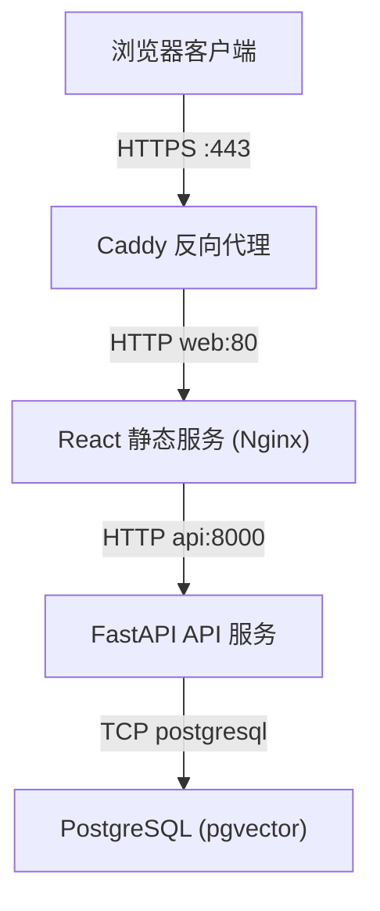
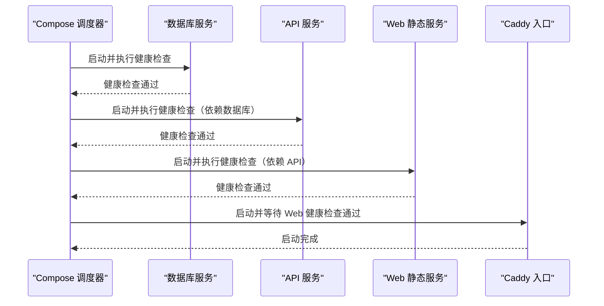
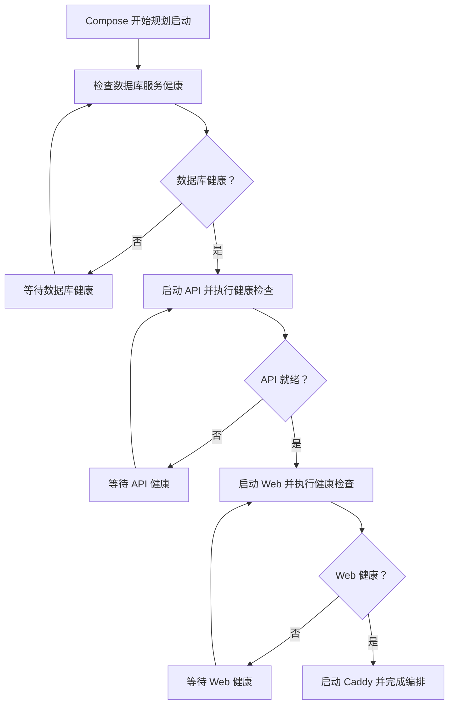

# 容器编排与服务依赖

<cite>
**本文档引用的文件**   
- [docker-compose.production.yml](file://docker-compose.production.yml)
- [Dockerfile](file://Dockerfile)
- [web/Dockerfile](file://web/Dockerfile)
- [web/nginx.conf](file://web/nginx.conf)
- [deploy/Caddyfile](file://deploy/Caddyfile)
</cite>

## 目录
1. [引言](#引言)
2. [项目结构与编排总览](#项目结构与编排总览)
3. [核心服务与启动顺序](#核心服务与启动顺序)
4. [容器镜像构建过程](#容器镜像构建过程)
5. [服务网络通信与端口策略](#服务网络通信与端口策略)
6. [运行参数与环境变量](#运行参数与环境变量)
7. [健康检查与依赖满足机制](#健康检查与依赖满足机制)
8. [重启策略、日志与故障恢复](#重启策略日志与故障恢复)
9. [性能调优与网络优化建议](#性能调优与网络优化建议)
10. [故障排查指南](#故障排查指南)
11. [结论](#结论)

## 引言
本文件为 Personal-AI-Life-OS 生产环境容器编排的详细技术文档。它基于 `docker-compose.production.yml` 解析所有服务的定义、启动顺序、镜像构建、健康检查和资源策略，同时说明 Caddy 反向代理、React Web 静态服务、FastAPI API 服务和 PostgreSQL 数据库之间的依赖关系和通信路径。文档还覆盖部署安全头、代理转发、环境变量、卷持久化以及可进一步优化的性能和运维建议。该文档面向运维人员、后端工程师和需要理解系统生产行为的技术读者。

## 项目结构与编排总览
本项目采用三层外部服务 + 两层容器应用的分层结构：
- 边缘入口：Caddy 提供 HTTPS、压缩和安全响应头，将流量转发到内部 Web 服务。
- 前端静态服务：Nginx 托管 React 构建产物，并将 `/api/` 请求转发至 API 服务。
- 业务 API：FastAPI 应用执行业务逻辑，并通过 Alembic 初始化数据库迁移。
- 数据层：PostgreSQL 配合 pgvector 扩展作为持久存储。

图示来源
- [deploy/Caddyfile:1-11](file://deploy/Caddyfile#L1-L11)
- [docker-compose.production.yml:1-101](file://docker-compose.production.yml#L1-L101)

本节来源
- [docker-compose.production.yml:1-101](file://docker-compose.production.yml#L1-L101)

## 核心服务与启动顺序
Compose 中的服务通过显式依赖与健康检查控制启动顺序。实际运行时，依赖满足后才会拉起下游服务。

### 服务定义清单
- caddy：使用官方 Alpine 镜像作为边缘反向代理；监听宿主机的 HTTP 443 和 UDP 443，并将流量转发给内部 web 服务。
- web：构建自 `web/Dockerfile`，基于 Nginx 托管 React 静态资源，并代理 `/api/` 到 api 服务。
- api：构建自根级 `Dockerfile`，运行 FastAPI 应用，并在启动时执行 Alembic 迁移。
- db：使用 `pgvector/pgvector:pg16` 镜像，挂载持久卷。

图示来源
- [docker-compose.production.yml:1-101](file://docker-compose.production.yml#L1-L101)

### 启动顺序要点
- db 先自检，达到 healthy 后再启动 api。
- api 先自检，达到 healthy 后再启动 web。
- web 先自检，达到 healthy 后再启动 caddy。
- 每个容器的 restart 策略均为 `unless-stopped`，保证异常退出后自动重启。

本节来源
- [docker-compose.production.yml:1-101](file://docker-compose.production.yml#L1-L101)

## 容器镜像构建过程

### API 镜像（根级 Dockerfile）
API 镜像基于精简 Python 环境，使用 `uv` 进行依赖管理与安装。构建步骤包括：
- 选择 `python:3.12-slim` 基础镜像。
- 安装 Tesseract OCR，便于图像文字识别场景。
- 复制 `uv` 二进制并使用 `uv sync --locked` 安装依赖；先安装无项目代码的依赖缓存阶段，再复制源码重新构建以利用 Docker 缓存分层。
- 创建非 root 用户 `lifeos`，设置工作目录权限，暴露 8000 端口。
- 默认启动命令为 Uvicorn 暴露 FastAPI 应用。

构建关键点：
- 多阶段依赖安装与源码分离，提高构建缓存命中率和安全性。
- 锁定依赖版本，确保可重复构建。
- 非 root 用户运行降低容器权限风险。
- 预装 OCR 引擎，使 API 具备处理图片文字的能力。

构建来源
- [Dockerfile:1-25](file://Dockerfile#L1-L25)

### Web 镜像（web/Dockerfile）
Web 镜像采用真正多阶段构建：
- build 阶段：基于 Node 24 镜像，安装依赖并构建 React 静态资源。
- run 阶段：使用轻量 Nginx 镜像，将构建产物复制到 Nginx 默认静态目录。

特点：
- 最终镜像仅包含静态文件和 Nginx 运行环境，显著减小体积。
- 在运行期暴露 80 端口，并提供健康检查。

构建来源
- [web/Dockerfile:1-12](file://web/Dockerfile#L1-L12)

### Caddy 镜像
- 直接使用社区镜像 `caddy:2-alpine`，不执行自定义构建。
- 运行时从宿主映射的 `deploy/Caddyfile` 读取路由、压缩、加密头部和反向代理规则。

配置来源
- [docker-compose.production.yml:1-20](file://docker-compose.production.yml#L1-L20)
- [deploy/Caddyfile:1-11](file://deploy/Caddyfile#L1-L11)

本节来源
- [Dockerfile:1-25](file://Dockerfile#L1-L25)
- [web/Dockerfile:1-12](file://web/Dockerfile#L1-L12)
- [docker-compose.production.yml:1-20](file://docker-compose.production.yml#L1-L20)
- [deploy/Caddyfile:1-11](file://deploy/Caddyfile#L1-L11)

## 服务网络通信与端口策略

### 容器内网与 DNS 发现
Compose 会为每个服务创建一个容器网络；在同一 compose 项目中，服务名称会自动解析为主机名。例如：
- Caddy 可通过 `web:80` 访问前端。
- Web 可通过 `api:8000` 访问后端。
- API 通过 PostgreSQL 协议连接数据库服务。

这意味着无需手动维护硬编码 IP，服务间通信通过内部域名实现稳定发现。

### 端口暴露映射
- Caddy 映射宿主机 80、443 及 UDP 443 到容器。对外仅开放这两个端口。
- Web、API、数据库不直接暴露给宿主机，仅在 compose 内网可达。这种设计减少了攻击面，是生产部署推荐实践。

注意：虽然 API Dockerfile 中声明了 `EXPOSE 8000`，但在生产编排中并未将其映射到宿主机，因此不应假设宿主可直接访问 API。

### Web 对 API 的请求转发
Web 镜像中的 Nginx 配置定义了静态文件根目录与安全头。对于 `/api/` 路径，会转发到内部 `api:8000`，并保持 HTTP/1.1、真实 IP、X-Forwarded-* 头部等信息。

转发来源
- [web/nginx.conf:1-37](file://web/nginx.conf#L1-L37)

### Caddy 的反向代理与安全头
Caddy 根据 `LIFEOS_DOMAIN` 动态生成站点块，启用 gzip 和 zstd 压缩，设置 HSTS、CSP 相关的安全响应头，并将请求代理给内部 `web:80`。

配置来源
- [deploy/Caddyfile:1-11](file://deploy/Caddyfile#L1-L11)
- [docker-compose.production.yml:1-20](file://docker-compose.production.yml#L1-L20)

本节来源
- [web/nginx.conf:1-37](file://web/nginx.conf#L1-L37)
- [deploy/Caddyfile:1-11](file://deploy/Caddyfile#L1-L11)
- [docker-compose.production.yml:1-101](file://docker-compose.production.yml#L1-L101)

## 运行参数与环境变量
以下环境变量在 API 和 Web 容器中起关键作用。未在 Compose 中设置的变量必须通过环境文件或运行参数提供。

### API 关键环境变量
- `APP_ENV`：设置为 production，影响应用运行模式。
- `API_HOST`、`API_PORT`：Uvicorn 监听地址与端口。
- `DATABASE_URL`：数据库连接字符串，必须由外部环境注入。
- `AUTO_CREATE_SCHEMA`：关闭自动建库模式，避免启动期隐式变更数据库结构。
- `PROCESSING_MODE`、`IMPORTS_ENABLED`：开启导入功能与工作进程模式。
- `ACCESS_TOKEN_SECRET`、`REGISTRATION_MODE`、`SIGNUP_INVITE_CODE`：认证与注册相关。
- `METRICS_TOKEN`：指标采集密钥。
- `CORS_ORIGINS`：允许的前端来源，基于 `LIFEOS_DOMAIN`。
- `OBJECT_STORE_BACKEND`、S3 系列变量：对象存储接入配置。
- LLM 系列变量：模型提供商、密钥、基准 URL、模型名称、隐私披露与成本字段。

这些变量均通过问号语法要求必填，或带默认值。缺失必填变量会导致容器无法启动。

环境变量来源
- [docker-compose.production.yml:23-79](file://docker-compose.production.yml#L23-L79)

### Web 与入口服务的环境变量
- `LIFEOS_DOMAIN`：用于 Caddy 站点域名和 CORS 上游源。
- Web 本身主要依赖构建产物和 Nginx 默认行为，未在 Compose 中注入额外环境变量。

环境变量来源
- [docker-compose.production.yml:3-21](file://docker-compose.production.yml#L3-L21)
- [docker-compose.production.yml:52-79](file://docker-compose.production.yml#L52-L79)

本节来源
- [docker-compose.production.yml:3-79](file://docker-compose.production.yml#L3-L79)

## 健康检查与依赖满足机制

### 数据库健康检查
数据库使用 PostgreSQL 的 `pg_isready` 检查当前用户和数据库是否可连接。这能确保后续 API 启动时数据库已准备好接受连接。

健康检查来源
- [docker-compose.production.yml:80-95](file://docker-compose.production.yml#L80-L95)

### API 就绪检查
API 的健康检查通过 Python 发起本地 HTTP 请求，访问 `/api/v1/ready`。该接口返回就绪状态，表明 FastAPI 应用、依赖和迁移已准备完毕。检查间隔、超时和重试次数合理分配，并带有初始启动宽限期，避免冷启动误判。

健康检查来源
- [docker-compose.production.yml:60-79](file://docker-compose.production.yml#L60-L79)

### Web 健康检查
Web 使用 `wget` 检查自身根路径是否可返回内容。由于 Nginx 会将静态根路径指向 React 构建产物，这一检查可以反映前端包是否成功构建且 Nginx 正常运行。

健康检查来源
- [docker-compose.production.yml:22-39](file://docker-compose.production.yml#L22-L39)
- [web/Dockerfile:7-12](file://web/Dockerfile#L7-L12)

### 依赖条件总结
- api 依赖 db 健康。
- web 依赖 api 健康。
- caddy 依赖 web 健康。

图示来源
- [docker-compose.production.yml:1-101](file://docker-compose.production.yml#L1-L101)

本节来源
- [docker-compose.production.yml:22-95](file://docker-compose.production.yml#L22-L95)

## 重启策略、日志与故障恢复

### 重启策略
所有服务都使用 `restart: unless-stopped`。其行为含义如下：
- 容器崩溃、异常退出或被 OOM 杀死时，Compose 会自动重启。
- 当运维人员显式停止服务后，不会再次自动拉起。
- 如果健康检查失败导致服务标记为非健康，通常不会影响重启行为，除非附加了 `restart: on-failure` 等更细粒度策略。

### 日志收集
本编排未显式设置 Compose log driver，因此使用 Docker 默认日志驱动。常见做法是通过 Docker Daemon 的日志轮转、文件大小限制和外部日志系统集成进行集中收集。建议在平台侧补充日志聚合配置。

### 故障恢复机制
- 数据库重启后，API 会在下次启动时运行 Alembic 迁移，确保数据结构与代码一致。
- Web 静态资源来自构建产物，不会因 API 或数据库临时不可用而失效；但 API 接口不可用时，页面加载可能提示后端错误。
- Caddy 仅依赖 Web 健康状态；若 Web 重建，Caddy 会在其健康后放行流量。

恢复流程建议：
- 若 API 启动失败，优先检查数据库连通性、迁移历史和环境变量。
- 若 Web 返回 404 或空白页面，优先检查构建产物是否存在，以及 Nginx 健康检查是否通过。
- 若 HTTPS 证书出现问题，首先验证 `LIFEOS_DOMAIN` 是否正确解析且可被 Caddy 获取证书。

本节来源
- [docker-compose.production.yml:1-101](file://docker-compose.production.yml#L1-L101)

## 性能调优与网络优化建议

### 镜像体积与构建效率
- API 镜像已采用依赖预安装与源码分离的方式，利于缓存重用。可在 CI 中将 `pyproject.toml`、`uv.lock`、`src` 拆分为多个构建阶段进一步减少增量构建时间。
- Web 镜像已使用双阶段构建，最终镜像仅包含 Nginx 与静态文件，是当前较优方案。
- 如需进一步优化，可将 Tesseract 语言包按需裁剪，或使用专用 OCR 运行时镜像以减少公共依赖。

构建参考
- [Dockerfile:1-25](file://Dockerfile#L1-L25)
- [web/Dockerfile:1-12](file://web/Dockerfile#L1-L12)

### 反向代理与传输优化
- Caddy 已启用 gzip 和 zstd 压缩，有助于降低带宽占用。
- Caddy 启用了 HSTS 与安全响应头，符合现代 Web 安全基线。
- Nginx 对静态资源设置了统一的缓存策略；生产环境中可根据版本号或哈希对静态资源进行长期缓存，以降低重复下载成本。

代理参考
- [deploy/Caddyfile:1-11](file://deploy/Caddyfile#L1-L11)
- [web/nginx.conf:1-37](file://web/nginx.conf#L1-L37)

### 端口与监听地址
- API 绑定 `0.0.0.0:8000`，保证在容器网络中可读。
- Web 监听 80，Caddy 监听 80/443。这样形成单一对外入口，简化防火墙与安全组策略。

### 数据库性能建议
- 针对向量检索与图表查询，应在数据库层面调整缓冲池、连接数和索引策略；这需要通过外部参数文件或数据库配置卷完成。
- 为避免连接风暴，建议在 API 侧引入连接池上限、超时和重试退避策略。

### 资源限制与调度
当前 Compose 文件未指定 CPU、内存、PID 等资源限制。建议在生产环境添加：
- `deploy.resources.limits` 或 `mem_limit` / `cpus`，防止单个容器占用宿主过多资源。
- OOM kill 阈值保护关键服务如数据库和 API。
- 数据库单独分配足够内存与磁盘 I/O 优先级，避免被 Web 或入口代理抢占。

本节来源
- [docker-compose.production.yml:1-101](file://docker-compose.production.yml#L1-L101)
- [web/nginx.conf:1-37](file://web/nginx.conf#L1-L37)
- [deploy/Caddyfile:1-11](file://deploy/Caddyfile#L1-L11)

## 故障排查指南

### 常见问题与排查路径
- 环境变量缺失
  - Caddy、API、Web 和 DB 多处使用必填环境变量。缺失时会触发启动失败。应优先检查外部 `.env` 或服务运行脚本是否正确注入。
  - 参考位置：`LIFEOS_DOMAIN`、`DATABASE_URL`、`POSTGRES_*`、`ACCESS_TOKEN_SECRET` 等。

- 健康检查反复失败
  - 数据库健康检查依赖用户名和数据库名；若不一致会导致连接失败。
  - API 健康检查访问 `/api/v1/ready`；若该路由未就绪，说明应用尚未完成迁移或存在启动错误。
  - Web 健康检查访问根路径；若静态构建未完成，nginx 将无法返回有效内容。

- 反向代理 502/503
  - 若 Caddy 报告 upstream error，通常因为 Web 未健康；查看 Web 构建和 nginx 配置。
  - 若 Web 转发 `/api/` 出现网关错误，通常因 API 未健康或未启动。

- HTTPS 与域名问题
  - Caddy 需要正确的 `LIFEOS_DOMAIN` 并能够通过 DNS 解析到宿主。
  - HSTS 和安全头可能阻止某些调试工具；可使用非 HTTPS 本地环回测试 API，但最终生产流量应经 Caddy。

- 静态资源缓存异常
  - Nginx 对静态资源和 manifest/sw 有特定缓存头；如发现旧版本资源未刷新，需确认构建输出文件名和缓存策略是否一致。

排查参考
- [docker-compose.production.yml:1-101](file://docker-compose.production.yml#L1-L101)
- [web/nginx.conf:1-37](file://web/nginx.conf#L1-L37)
- [deploy/Caddyfile:1-11](file://deploy/Caddyfile#L1-L11)
- [Dockerfile:1-25](file://Dockerfile#L1-L25)
- [web/Dockerfile:1-12](file://web/Dockerfile#L1-L12)

本节来源
- [docker-compose.production.yml:1-101](file://docker-compose.production.yml#L1-L101)
- [web/nginx.conf:1-37](file://web/nginx.conf#L1-L37)
- [deploy/Caddyfile:1-11](file://deploy/Caddyfile#L1-L11)
- [Dockerfile:1-25](file://Dockerfile#L1-L25)
- [web/Dockerfile:1-12](file://web/Dockerfile#L1-L12)

## 结论
该生产编排清晰划分为四层：边缘代理、静态前端、业务 API 和数据存储，并通过 Compose 的依赖条件与健康检查保证正确的启动序列。Caddy 负责 TLS、压缩与安全响应头；Nginx 托管 React 静态资源并转发 API 调用；FastAPI 在数据库就绪后完成迁移并开始服务；PostgreSQL 提供持久数据支持。当前设计已具备较好的安全性和可维护性；下一步建议补充显式的 CPU/内存限制、数据库参数优化、统一日志收集以及更严格的镜像最小化和扫描策略。通过这些改进，系统的可用性、可扩展性和安全性会得到进一步加强。